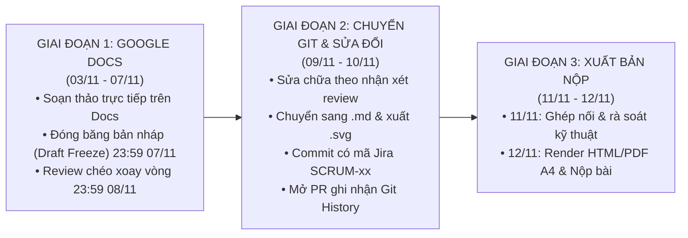
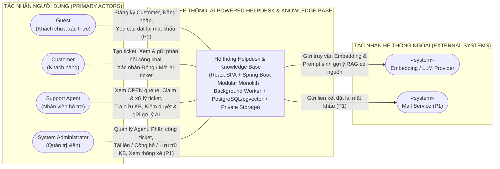
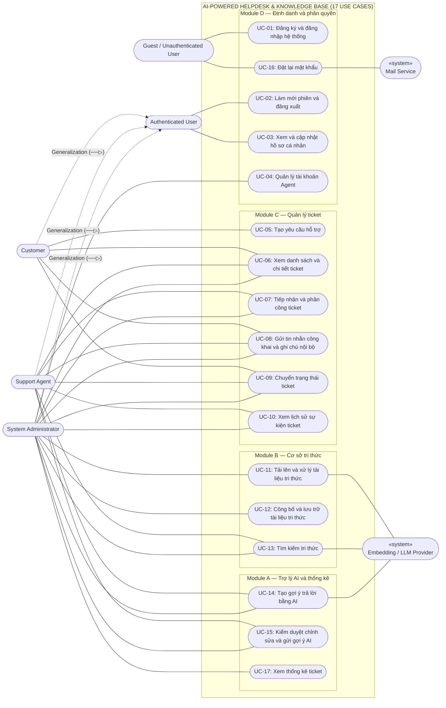
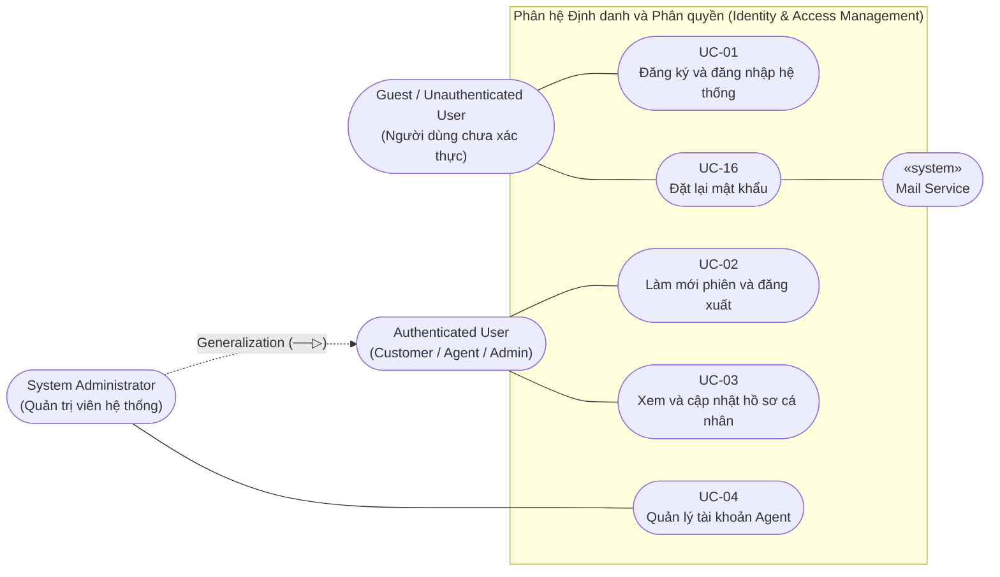
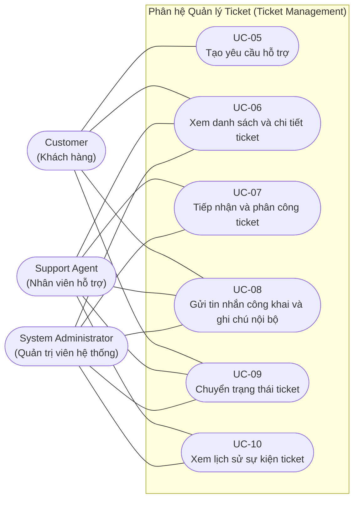
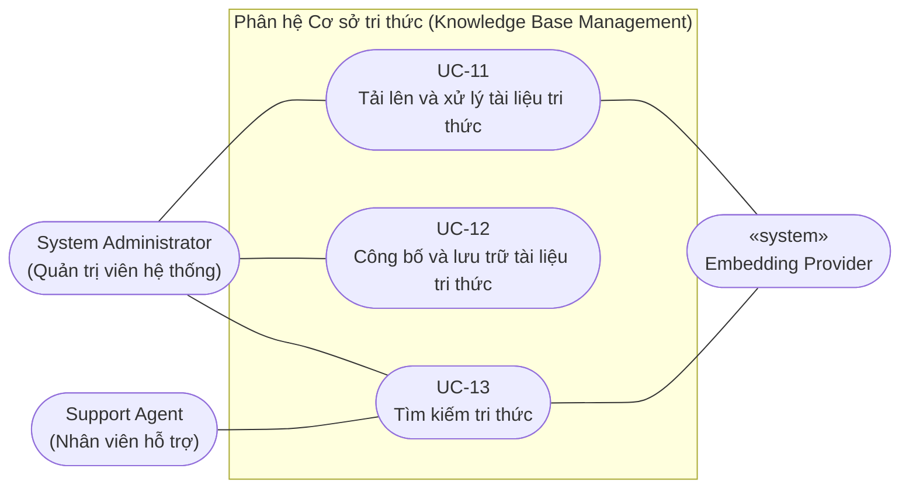
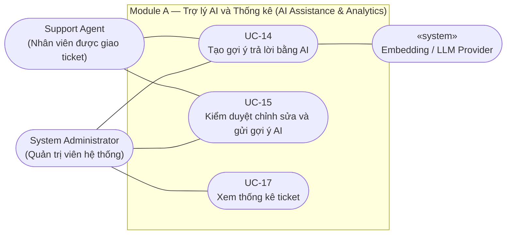
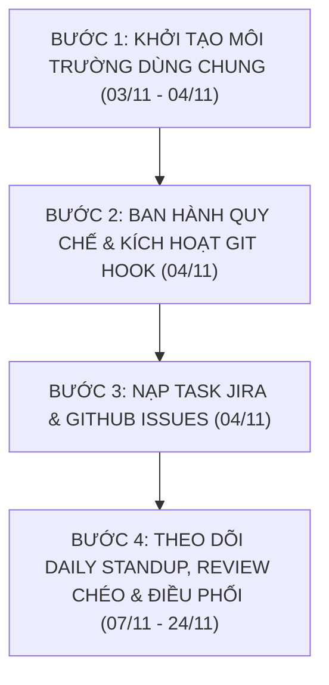

# KẾ HOẠCH HÀNH ĐỘNG TOÀN DIỆN & SỔ TAY THỰC THI GIAI ĐOẠN 2: BIÊN SOẠN TÀI LIỆU TEMPLATE 1 & PHÁT TRIỂN MÃ NGUỒN (MVP BACKEND & FIGMA UI)
> **Dự án:** Hệ thống Trợ lý Hỗ trợ Kỹ thuật & Quản lý Tri thức Thông minh (AI-Powered Helpdesk & Knowledge Base)  
> **Môn học:** Nhập môn Công nghệ Phần mềm (NMCNPM) — Khoa CNTT, Trường ĐH Khoa học Tự nhiên, ĐHQG-HCM  
> **Nhóm thực hiện:** Group 04  
> **Trưởng nhóm (Project Manager & DevOps):** Ngô Viết Thanh Bình (MSSV: `24120269`)  
> **Thời gian áp dụng:** 03/11/2026 – 24/11/2026; **chốt và nộp Template 1 lúc 23:59 ngày 12/11/2026**; **bắt đầu code ngày 11/11/2026**, **chốt MVP P0 lúc 23:59 ngày 24/11/2026**; Template 2 Thiết kế phần mềm (bắt đầu 11/11/2026, nộp trước 28/11/2026); Template 3 Kiểm thử phần mềm (diễn ra SAU MVP từ 25/11/2026 đến 12/12/2026).  
> **Tài liệu tham chiếu chuẩn:** [reports/SRS-master.md](reports/SRS-master.md) (v1.1) & [reports/MVP_CONTRACTS.md](reports/MVP_CONTRACTS.md)  
> **Tài liệu soạn thảo nhóm (Google Docs):** [NMCNPM - Clarune - 04 (Google Docs làm việc chung)](https://docs.google.com/document/d/1vSMrk5GCPtOlhbWMRMqZvDq8575tSIz2IXgcp-K0WAg/edit?tab=t.p8jvgjthj2me)  
> **Kho bài mẫu tham khảo khóa K23 (Google Drive):** [Thư mục Template tham khảo K23 (Katling, Planora,...)](https://drive.google.com/drive/folders/1Vk7wPTVLxhoxhTLnqAhIQlQxfslToMGU?usp=sharing)  
> **Bộ 6 Sơ đồ UML chuẩn (`.drawio`, `.svg`, `.png` tông Trắng - Đen):** Đã dựng sẵn tại [reports/template1/assets/diagrams/](reports/template1/assets/diagrams/) để các thành viên tham khảo, chỉnh sửa và chèn trực tiếp vào báo cáo.  
> **Bản thiết kế giao diện Figma (Redesign v2):** [SE – Figma (Node 49:58)](https://www.figma.com/design/Ofvm9udw9coBOxadTN4PXB/SE?node-id=49-58&p=f&m=dev) · [Danh mục 151 frames](docs/design/man-hinh.md) · [Mục 5 Template 1](reports/template1/05-prototype-mockup.md)  
> *LƯU Ý: Đây là tài liệu duy nhất và toàn diện nhất của nhóm, tích hợp toàn bộ Quy chế vận hành (Team Guide), Sổ tay nhận việc từng cá nhân (Playbook), Tư liệu mẫu đặc tả Template 1, Bộ 6 sơ đồ UML, Baseline kỹ thuật mã nguồn và Danh mục Backlog Tasks. Mọi thành viên chỉ cần mở duy nhất file này để tra cứu và thực thi.*

---

## MỤC LỤC TÀI LIỆU
1. [QUY CHẾ LÀM VIỆC, QUY TRÌNH PHỐI HỢP & LƯU VẾT GIT/JIRA](#1-quy-chế-làm-việc-quy-trình-phối-hợp--lưu-vết-gitjira)
   - 1.1. Chiến lược cộng tác 2 giai đoạn (Google Docs ➔ Git Markdown)
   - 1.2. Chính sách bắt buộc ghi nhật ký AI Usage
   - 1.3. Quy trình 5 bước: Nhận task, Phân nhánh Git, Commit chuẩn Jira Key, Pull Request & DoD
   - 1.4. Ma trận review chéo xoay vòng và điều kiện Approve/Merge
   - 1.5. Những quy tắc kỹ thuật và an toàn không được làm khác
2. [LỘ TRÌNH THỜI GIAN (TIMELINE) & CÁC CỘT MỐC ĐIỀU CHỈNH](#2-lộ-trình-thời-gian-timeline--các-cột-mốc-điều-chỉnh)
   - 2.1. Biểu đồ Gantt tổng thể (Template 1, MVP P0, Template 2 thiết kế, Template 3 kiểm thử)
   - 2.2. Bảng mốc kiểm soát và tiêu chí nghiệm thu bắt buộc
   - 2.3. Điều kiện giữ tiến độ và xử lý trễ hạn
   - 2.4. Định hướng sau Template 1: Thiết kế Template 2 song song code & Chuẩn bị Template 3
3. [PHÂN CÔNG CÔNG VIỆC & HƯỚNG DẪN NHẬN VIỆC TỪNG THÀNH VIÊN (PLAYBOOK)](#3-phân-công-công-việc--hướng-dẫn-nhận-việc-từng-thành-viên-playbook)
   - 3.1. Hướng dẫn chung: Cách đọc nguồn, nhận việc và cập nhật tiến độ
   - 3.2. Mỗi người bắt đầu ở đâu? (Bình, Gia Phúc, Lãm, Quý Phúc)
   - 3.3. Ma trận bàn giao để không ngồi chờ nhau (Handoff Matrix)
   - 3.4. Dẫn chiếu vị trí chính xác từ SRS-master.md cho từng thành viên
4. [CHI TIẾT TỪNG TASK CARD (TASK CARDS SPECIFICATION)](#4-chi-tiết-từng-task-card-task-cards-specification)
5. [KẾ HOẠCH CHI TIẾT LUỒNG 1: BIÊN SOẠN TÀI LIỆU TEMPLATE 1 & TƯ LIỆU MẪU](#5-kế-hoạch-chi-tiết-luồng-1-biên-soạn-tài-liệu-template-1--tư-liệu-mẫu)
   - 5.1. Danh mục 19 Use Cases chuẩn hóa theo SRS-master & Clarune Docs
   - 5.2. Cấu trúc chuẩn 9 trường của từng bảng Đặc tả Use Case
6. [BỘ SƠ ĐỒ UML TOÀN DIỆN (6 SƠ ĐỒ CHUẨN MỰC BÁM SÁT SRS-MASTER)](#6-bộ-sơ-đồ-uml-toàn-diện-6-sơ-đồ-bám-sát-srs-master)
   - Quy định vẽ và xuất file `.drawio` + `.svg`
   - Sơ đồ 0: Bối cảnh hệ thống (Context Diagram)
   - Sơ đồ 1: Tổng quan 19 Use Cases toàn hệ thống
   - Sơ đồ 2: Phân hệ Định danh và phân quyền (Ngô Viết Thanh Bình)
   - Sơ đồ 3: Phân hệ Quản lý ticket (Phan Gia Phúc)
   - Sơ đồ 4: Phân hệ Cơ sở tri thức (Nguyễn Đức Lãm)
   - Sơ đồ 5: Phân hệ Trợ lý AI và thống kê (Lê Quý Phúc)
7. [KẾ HOẠCH CHI TIẾT LUỒNG 2: PHÁT TRIỂN MÃ NGUỒN & FIGMA UI (BÁM SÁT SRS & MVP CONTRACTS)](#7-kế-hoạch-chi-tiết-luồng-2-phát-triển-mã-nguồn--figma-ui-bám-sát-srs--mvp-contracts)
   - Cấu trúc thư mục Modular Monolith
   - 7.1. Phân hệ Định danh và phân quyền (Ngô Viết Thanh Bình) — Identity & Access + DevOps Scaffolding
   - 7.2. Phân hệ Quản lý ticket (Phan Gia Phúc) — Ticket Management & Concurrency Claim Lock
   - 7.3. Phân hệ Cơ sở tri thức (Nguyễn Đức Lãm) — Knowledge Base & Ingestion Worker SKIP LOCKED
   - 7.4. Phân hệ Trợ lý AI và thống kê (Lê Quý Phúc) — AI Assistance & RAG Pipeline
   - 7.5. Kế hoạch hành động dành riêng cho Trưởng nhóm Ngô Viết Thanh Bình (DevOps Scaffolding)
8. [DANH MỤC BACKLOG TASKS CHUẨN NẠP JIRA & GITHUB ISSUES](#8-danh-mục-backlog-tasks-chuẩn-nạp-jira--github-issues)
   - 8.1. Các Epic chính
   - 8.2. Danh mục Task Giai đoạn 1: Biên soạn Tài liệu Template 1 (03/11 – 08/11)
   - 8.3. Danh mục Task Giai đoạn 2: Cài đặt Mã nguồn & Kiểm thử MVP P0 (11/11 – 24/11)
9. [NHỮNG VIỆC CẦN BẰNG CHỨNG XÁC MINH & ĐIỀU CHỈNH TEMPLATE 2–3](#9-những-việc-cần-bằng-chứng-xác-minh--điều-chỉnh-template-23)
   - 9.1. Những sản phẩm và giả định cần xác minh thực tế
   - 9.2. Kế hoạch liên kết mẫu Template 2 (Thiết kế) và Template 3 (Kiểm thử)


---

## 1. QUY CHẾ LÀM VIỆC, QUY TRÌNH PHỐI HỢP & LƯU VẾT GIT/JIRA

### 1.1. Chiến lược cộng tác 2 giai đoạn (Google Docs ➔ Git Markdown)
Để vừa tạo sự thuận tiện tối đa cho các thành viên trong việc thảo luận, góp ý (feedback) thời gian thực, vừa đảm bảo **100% lịch sử lưu vết Git chuẩn mực phục vụ chấm điểm đóng góp cá nhân từ Giảng viên**, nhóm thống nhất áp dụng quy trình làm việc 2 giai đoạn:



1. **Giai đoạn 1 (03/11 – 07/11): Soạn thảo & Đóng băng bản nháp trực tiếp trên Google Docs**
   - Link tài liệu làm việc chung: **[[SE - Nhóm 4] template1 - Google Tài liệu](https://docs.google.com/document/d/1vSMrk5GCPtOlhbWMRMqZvDq8575tSIz2IXgcp-K0WAg/edit?tab=t.0)** (đã dựng sẵn cấu trúc đề mục từ Mục 1 đến Mục 5 theo mẫu chuẩn của Khoa).
   - Từng thành viên viết nội dung phần việc của mình trực tiếp trên Google Docs (Mô tả bài toán, Stakeholders, NFR, ma trận 41 FR / 30 User Stories, 17 Use Cases).
   - **Tư nguyên thiết kế UI đã có sẵn (Baseline):** Lê Quý Phúc đã dựng sẵn bộ khung thiết kế chuẩn Redesign v2 gồm 151 màn hình / 33 nhóm chính tại [Figma SE (Redesign v2)](https://www.figma.com/design/Ofvm9udw9coBOxadTN4PXB/SE?node-id=49-58&p=f&m=dev) và trích xuất PNG tại `docs/design/anh/`. **Bộ khung này đóng vai trò là baseline chuẩn chung; các thành viên chủ động rà soát, kế thừa và có toàn quyền tinh chỉnh, bổ sung màn hình/trạng thái** trên Figma cho khớp chính xác với nghiệp vụ và kịch bản Use Case của module mình.
   - Các thành viên sử dụng tính năng **Comment** và chế độ **Suggesting** để nhận xét, chỉnh sửa câu chữ, phản biện các kịch bản Use Case của nhau một cách trực quan, nhanh chóng mà không gây áp lực về cú pháp Markdown.
   - Sơ đồ Use Case được phác thảo và thống nhất các quan hệ include/extend trước khi xuất file đồ họa `.drawio` và `.svg`.
   - **Đóng băng bản nháp (Draft Freeze):** lúc **23:59 ngày 07/11/2026** trên Google Docs.
   - **Review chéo xoay vòng:** hoàn thành trước **23:59 ngày 08/11/2026** (theo ma trận Bình → Lãm → Gia Phúc → Quý Phúc → Bình).

2. **Giai đoạn 2 (09/11 – 10/11): Task T1-DOC-MD — Chuyển đổi và nộp bản Markdown (.md), xuất sơ đồ .svg sau khi chốt Google Docs**
   - Sau khi chốt nội dung và hoàn tất review chéo trên Google Docs, từng thành viên tiếp thu nhận xét, sửa chữa và tự chuyển đổi phần của mình sang file Markdown (`.md`) đặt vào đúng thư mục `reports/template1/`:
     ```text
     reports/template1/
     ├── 01-danh-gia-thanh-vien.md            # Lê Quý Phúc
     ├── 02-mo-ta-bai-toan.md                 # Lê Quý Phúc
     ├── 03-tong-quan-yeu-cau/
     │   ├── 03.1-stakeholders.md             # Nguyễn Đức Lãm
     │   ├── 03.2.1-yeu-cau-chuc-nang.md      # Phan Gia Phúc (30 User Stories)
     │   └── 03.2.2-yeu-cau-phi-chuc-nang.md  # Nguyễn Đức Lãm (NFR)
     ├── 04-dac-ta-use-cases/
     │   ├── 04.1-so-do-tong-the.md           # Ngô Viết Thanh Bình
     │   ├── 04.2-module-D-identity.md        # Ngô Viết Thanh Bình (5 UCs)
     │   ├── 04.2-module-C-ticket.md          # Phan Gia Phúc (7 UCs)
     │   ├── 04.2-module-B-knowledge.md       # Nguyễn Đức Lãm (3 UCs)
     │   ├── 04.2-module-A-ai.md              # Lê Quý Phúc (2 UCs)
     │   └── 04.2-uc-17-analytics.md          # Lê Quý Phúc (Ticket Analytics P1)
     ├── 05-prototype-mockup.md               # Cả 4 thành viên (Lê Quý Phúc tổng hợp)
     ├── 06-ai-usage.md                       # Trích xuất từ reports/07-ai-usage.md
     ├── inputs/                              # 4 biên bản bàn giao & đối soát nộp bài
     │   ├── binh.md                          # Ngô Viết Thanh Bình
     │   ├── gia-phuc.md                      # Phan Gia Phúc
     │   ├── lam.md                           # Nguyễn Đức Lãm
     │   └── quy-phuc.md                      # Lê Quý Phúc
     └── assets/
         ├── diagrams/                        # Chứa các file sơ đồ .svg tự vẽ
         └── mockups/                         # Chứa các ảnh chụp màn hình UI Figma <= 500KB
     ```
   - Mỗi thành viên tạo nhánh riêng (`docs/t1-<module>-<tên_bạn>`), commit file `.md` và file `.svg` của mình kèm mã Jira `SCRUM-xx`, mở Pull Request lên GitHub trước **23:59 ngày 10/11/2026**.
   - Từng thành viên hoàn tất cập nhật biên bản bàn giao tại `reports/template1/inputs/<tên>.md` làm căn cứ nghiệm thu bàn giao (Task `T1-DOC-MD`).
   - Nhờ tách file hoàn toàn, **tỷ lệ xung đột merge conflict là 0%**, và commit của từng thành viên hiển thị chính xác 100% trong `git log` để Giảng viên chấm điểm cá nhân.
   - **Ngày 11/11/2026:** Rà soát kỹ thuật, ghép nối tổng thể các file Markdown. Khởi động mã nguồn MVP P0 và Template 2.
   - **Ngày 12/11/2026 (trước 23:59):** Trưởng nhóm chạy lệnh ghép nối tự động các file thành file tổng `reports/submit/01-requirements-analysis.md`, render ra bản HTML/PDF khổ A4 chuẩn Word và nộp bài chính thức.

### 1.2. Chính sách bắt buộc ghi nhật ký AI Usage
- Mọi thành viên khi dùng AI (Gemini, ChatGPT, Copilot, v0...) để soạn thảo tài liệu, viết code, sinh test case hay tra cứu lỗi đều phải mở file [reports/07-ai-usage.md](reports/07-ai-usage.md) cập nhật bảng theo mẫu:
  `| Ngày | Thành viên | Công cụ | Mục đích | Prompt chính | Kết quả AI sinh | Con người kiểm chứng & sửa đổi | Mã Task/Commit |`
- Cam kết: **AI chỉ là trợ thủ, sinh viên chịu trách nhiệm 100% về tính chính xác của tài liệu và mã nguồn**.

---

---

### 1.3. Quy trình 5 bước: Nhận task, Phân nhánh Git, Commit chuẩn Jira Key, Pull Request & DoD

- Jira là nơi theo dõi trạng thái task. GitHub Issue liên kết task; PR chứa bằng chứng. CSV/plan giữ baseline scope/deadline, không phải trạng thái live. Mỗi task có **một owner**, reviewer, nguồn, từng bước, đường dẫn đầu ra, người nhận, start/due, **gate bắt đầu khác gate chốt** và DoD; người điều phối không phải người viết thay cả nhóm.
- Dùng `ref` ổn định trong CSV. Đối chiếu ref → Jira key → GitHub issue → PR thật, không suy số GitHub từ số Jira. Mã SCRUM cũ trong file khung cần xác nhận trước khi commit; không tự tạo mã cho ref mới.
- Nhánh tài liệu `docs/t1-<module>-<ten>`; code `feat/<module>-<feature>`, test `test/<module>-<scenario>`. Đồng bộ main trước khi tạo nhánh; tránh thao tác checkout làm mất working tree đang sửa.
- Commit rõ nội dung, có mã Jira thật khi đã có ánh xạ. Hook `.githooks/commit-msg` chỉ kiểm tra có chuỗi SCRUM-số, không chứng minh key tồn tại, Conventional Commits hoặc key ở cuối. Kích hoạt local bằng `git config core.hooksPath .githooks`; không giả định hook/branch protection đã bật cho mọi người.
- PR dùng [.github/PULL_REQUEST_TEMPLATE.md](.github/PULL_REQUEST_TEMPLATE.md), link issue bằng `Closes #<số thật>` nếu muốn auto-close trên default branch. Không dùng mã SCRUM làm số GitHub Issue.
- Thay đổi file người khác được thực hiện qua PR có owner review; không cấm tuyệt đối vì sẽ chặn sửa contract chung. Mỗi người tối đa một task triển khai chính đang làm; task review/blocked được ghi riêng.

**Không import lại để “cập nhật” issue cũ:**

```bash
python3 scripts/jira/jira_bulk_create.py --csv scripts/jira/tasks_template1.csv --dry-run
```

Bulk-create bỏ qua ref đã cache, không sửa assignee/deadline/description issue hiện có. Cập nhật issue cũ riêng sau đối chiếu mapping; không xóa cache để tạo lại. Thay đổi file chưa đồng bộ Jira/GitHub và chưa gửi thông báo thành viên.

---

### 1.4. Ma trận review chéo xoay vòng và điều kiện Approve/Merge

Reviewer mặc định: **Bình → Lãm → Gia Phúc → Quý Phúc → Bình** (người đứng trước review cho người sau). Release của Lãm được Gia Phúc kiểm tra riêng; contract/schema/apply có owner phía nhận tham gia.

Reviewer ghi điều đã kiểm tra, requirement IDs, expected/actual của một happy path và một nhánh lỗi có ý nghĩa. Với Docs đối soát actor, precondition, luồng thay thế/hậu điều kiện, BR/test và mockup. Với code chạy command/fixture, xác định mode fake/live. Chưa chạy ghi NOT RUN; không đòi số comment hình thức. Request changes nếu không đạt; Approve phải có bằng chứng.

Merge bởi thành viên có quyền thực tế, khác tác giả, sau review và checks phù hợp. Không buộc Bình duyệt lại mọi PR; nếu chỉ Bình có quyền, Bình làm thao tác merge trên review đã đủ. Chưa xác minh quyền repo/branch protection thì ghi chưa xác minh, không tự tuyên bố đã cấu hình. Squash giữ link PR/task/tác giả; lịch sử main không còn từng commit gốc nên cần giữ PR/Docs làm bằng chứng.

---

### 1.5. Những quy tắc kỹ thuật và an toàn không được làm khác

Chi tiết và mẫu dữ liệu ở [MVP_CONTRACTS](reports/MVP_CONTRACTS.md):

- Actor từ principal, enabled kiểm tra server-side; role sai →403, ownership/not-found →404, auth sai →401. Kiểm tra cả history/citation/download và sau reassign, không chỉ ẩn nút UI.
- Schema theo SRS Mục 10: published boolean, job RUNNING/attempts/lease_token, chunk content; không dùng bản tên cột cũ của kế hoạch. V1–V5 merge nền phối hợp, V5 FK sau V4; model/dimension chưa chốt là blocker của V3. Không sửa migration đã áp dụng hoặc repair để che drift.
- Claim phải tăng version, event cùng transaction; bulk UPDATE không tự bảo vệ `@Version`. Invalid transition là **409**, không phải 400. TC-CON-01/02 cần PostgreSQL và transaction đồng thời thật.
- Worker một luồng, nhận job/hoàn tất bằng transaction ngắn, parser/provider ngoài transaction. Có retry bounded/backoff/lease phục hồi crash và chặn stale completion; không tăng pool để chữa transaction dài.
- Một EmbeddingProvider chung do Lãm sở hữu interface/fake, Quý Phúc adapter live. Retriever tự embed query, không làm hai lần; corpus mock/live tách biệt. Citation ID đúng chưa chứng minh câu trả lời đúng; mock không chứng minh semantic quality.
- Send dùng JSON suggestionId, workflow lock ticket rồi suggestion, same-ticket/GENERATED/current rights/PUBLIC; message và APPLIED cùng commit. Double-send/send-discard chỉ một winner. Không gọi repository chéo module hoặc LLM trong transaction gửi.
- Frontend hiện là prototype mock: cần adapter theo module, WAITING_CUSTOMER, bỏ URGENT P0, map subject/body/published và chunk sourceId. Không coi role switch/client sender là bảo mật.
- Không commit secret/PII; private upload không public URL. API logs không có token/raw prompt nhạy cảm. Lỗi quota/timeout có giới hạn retry, Ticket vẫn dùng được khi AI lỗi.

---

## 2. LỘ TRÌNH THỜI GIAN (TIMELINE) & CÁC CỘT MỐC ĐIỀU CHỈNH

Lộ trình tổng thể của dự án được phân định mạch lạc thành 4 luồng chính: Template 1 (Tài liệu Phân tích yêu cầu), Luồng Code MVP P0, Template 2 (Thiết kế phần mềm song song code) và Template 3 (Kiểm thử phần mềm diễn ra sau MVP):

```mermaid
gantt
    title Lộ trình Triển khai Dự án Tổng thể (03/11/2026 - 12/12/2026)
    dateFormat  YYYY-MM-DD
    section Template 1 (Tài liệu Phân tích Yêu cầu)
    Soạn thảo tập trung trên Google Docs                  :active, t1_doc, 2026-11-03, 2026-11-07
    Đóng băng bản nháp (Draft Freeze 23:59 07/11)        :milestone, m_freeze, 2026-11-07, 0d
    Review chéo xoay vòng (23:59 08/11)                 :crit, t1_rev, 2026-11-08, 1d
    Chuyển Markdown & nộp sơ đồ SVG (T1-DOC-MD)          :t1_md, 2026-11-09, 2026-11-10
    Ghép nối & rà soát kỹ thuật                          :t1_merge, 2026-11-11, 1d
    Final tổng hợp, render HTML/PDF & Nộp bài (23:59)    :milestone, m_t1_sub, 2026-11-12, 0d

    section Luồng Code MVP P0
    Bắt đầu Code MVP (Scaffolding, Docker, Spring Boot)  :dev_scaff, 2026-11-11, 2026-11-12
    Chốt Schema V1-V5 & OpenAPI Contract DTOs            :milestone, m_schema, 2026-11-12, 0d
    Code Module D Identity (Auth JWT, Principal)         :dev_id, 2026-11-12, 2026-11-15
    Code Module C Ticket (Concurrency Claim Lock 409)    :dev_tk, 2026-11-13, 2026-11-17
    Code Module B Knowledge (Worker Ingestion pgvector)  :dev_kb, 2026-11-14, 2026-11-19
    Code Module A AI (RAG Pipeline, Workflow Apply)      :dev_ai, 2026-11-15, 2026-11-21
    Unit & Integration Tests (4 Modules)                 :tst_all, 2026-11-21, 2026-11-23
    Code Freeze MVP P0, Clean Ops & E2E Nghiệm thu      :milestone, m_mvp_frz, 2026-11-24, 0d

    section Template 2 (Thiết kế phần mềm - Song song Code)
    Conceptual Model & Cây phân rã Kiến trúc             :t2_arch, 2026-11-11, 2026-11-14
    ERD & Data Dictionary khớp Migrations V1-V5          :t2_data, 2026-11-12, 2026-11-20
    Đặc tả UI & Luồng trạng thái theo UC/API             :t2_ui, 2026-11-13, 2026-11-22
    Review đối soát Thiết kế - Code                      :t2_rev, 2026-11-23, 2026-11-27
    Đóng gói & Nộp bài Template 2                        :milestone, m_t2_sub, 2026-11-28, 0d

    section Template 3 (Kiểm thử phần mềm - SAU MVP)
    Lập Test Plan & Catalog ≥25 ca kiểm thử              :t3_plan, 2026-11-25, 2026-11-28
    Chạy Regression, Security, Concurrency & Eval AI     :t3_run, 2026-11-26, 2026-12-02
    Báo cáo Kiểm thử cuối kỳ, Nghiệm thu & Nộp bài       :milestone, m_t3_sub, 2026-12-12, 0d
```

### Bảng tóm tắt các cột mốc bắt buộc:
| Cột mốc | Thời hạn chót | Mục tiêu & Tiêu chí nghiệm thu (Exit Criteria) |
| :---: | :---: | :--- |
| **Mốc 1** | **23:59 ngày 07/11/2026** | **Đóng băng bản nháp (Draft Freeze) Template 1:** Toàn bộ 17 Use Cases, 41 FRs, 30 User Stories, Stakeholders, NFR và liên kết Figma prototype đã được hoàn thành đầy đủ trên Google Docs. |
| **Mốc 2** | **23:59 ngày 08/11/2026** | **Hoàn tất Review chéo xoay vòng:** 100% nội dung Use Cases và sơ đồ được các cặp thành viên review, comment góp ý trực tiếp trên Google Docs. |
| **Mốc 3** | **23:59 ngày 10/11/2026** | **Task T1-DOC-MD — Hoàn tất chuyển đổi & nộp Markdown, SVG:** 4 thành viên hoàn tất sửa chữa sau review chéo, chuyển nội dung sang `.md`, xuất sơ đồ `.svg`, mở PR có mã Jira `SCRUM-xx` và cập nhật biên bản bàn giao tại `reports/template1/inputs/`. |
| **Mốc 4** | **23:59 ngày 11/11/2026** | **Khởi động Code MVP P0 & Template 2:** Bắt đầu dựng Scaffolding Spring Boot 3, Docker pgvector (`T1-DEV-01`); bắt đầu soạn Mô hình quan niệm và Kiến trúc Template 2 (`T2-MODEL-01`, `T2-ARCH-01`). Ghép nối kỹ thuật Template 1. |
| **Mốc 5** | **23:59 ngày 12/11/2026** | **Final Template 1 & Chốt Technical Baseline:** Trưởng nhóm ghép nối toàn bộ bài làm, render HTML/PDF chuẩn A4 và nộp bài Template 1. Chốt schema Flyway V1-V5 (`T1-SCHEMA-01`), OpenAPI DTOs (`T1-CONTRACT-01`) và CI pipeline (`T1-CI-01`). |
| **Mốc 6** | **23:59 ngày 21/11/2026** | **Hoàn thành cài đặt mã nguồn 4 Module:** Identity (15/11), Ticket (17/11), Knowledge (19/11), AI Assistance & Workflow (21/11). |
| **Mốc 7** | **23:59 ngày 23/11/2026** | **Hoàn thành kiểm thử Unit & Integration:** Đạt độ bao phủ kiểm thử cho cả 4 module (Identity security, Ticket concurrency 409, Knowledge SKIP LOCKED, AI RAG citation). |
| **Mốc 8** | **23:59 ngày 24/11/2026** | **Code Freeze MVP P0 & Nghiệm thu E2E:** Clean Environment Smoke test (`T1-OPS-01`), E2E integration test thông suốt từ Login $	o$ Ticket $	o$ Ingestion $	o$ AI Suggestion (`T1-INT-01`). Nghiệm thu MVP P0. |
| **Mốc 9** | **23:59 ngày 28/11/2026** | **Hoàn tất & Nộp bài Template 2 (Thiết kế phần mềm):** Chốt toàn bộ Conceptual Model, Cây phân rã Kiến trúc, Data Dictionary, ERD, UI Specs; review đối soát code hoàn tất và nộp bài trước hạn trường 29/11. |
| **Mốc 10** | **23:59 ngày 12/12/2026** | **Hoàn tất & Nộp bài Template 3 (Kiểm thử phần mềm):** Diễn ra SAU MVP (bắt đầu 25/11), hoàn thành chạy thực tế catalog $\ge 25$ ca kiểm thử, regression, concurrency test và đánh giá bộ 30 câu hỏi AI; nghiệm thu và đóng gói nộp bài.

---

---

### 2.4. Định hướng sau Template 1: Thiết kế Template 2 song song code & Chuẩn bị Template 3

Đọc [TEMPLATE2_3_ALIGNMENT](reports/planning/TEMPLATE2_3_ALIGNMENT.md). **Template 2 là thiết kế, Template 3 mới là kiểm thử**; ghi nhầm trước đây đã được sửa trong CSV/taskcards. Mẫu yêu cầu2/3 lưu nguyên nội dung trong reports/references, bài năm trước chỉ tham khảo hình thức/phạm vi thêm.

- **11–14/11:** Bắt đầu Template 2 song song với Code MVP. Lãm soạn Conceptual Model (`T2-MODEL-01`), Bình dựng Cây phân rã Kiến trúc (`T2-ARCH-01`); mỗi owner góp phần domain/port trước khi code phụ thuộc.
- **12–20/11:** Lãm hoàn thiện ERD và Data Dictionary (`T2-DATA-01`) bám sát Flyway migrations V1–V5.
- **13–22/11:** Từng owner đặc tả UI từ mockup Template 1 (`T2-UI-01`) với field/action/role/state/API/error; Quý Phúc tổng hợp.
- **23–27/11:** Gia Phúc thực hiện review đối soát độc lập giữa Thiết kế Template 2, SRS và Code (`T2-REVIEW-01`).
- **28/11 (23:59):** Đóng gói và nộp Template 2 (`QA1-T2-01`) trước hạn cổng trường 29/11.
- **Template 3 diễn ra SAU MVP (từ 25/11 đến 12/12):** Sau khi Code Freeze MVP P0 (24/11), đội ngũ tập trung toàn lực vào kiểm thử: lập test plan và catalog $\ge 25$ test cases (25–28/11), chạy regression, concurrency và AI evaluation $\ge 30$ câu (26/11–02/12), hoàn tất báo cáo kiểm thử cuối kỳ và nộp bài trước 12/12 (`T3-RELEASE-01`).

---

## 3. PHÂN CÔNG CÔNG VIỆC & HƯỚNG DẪN NHẬN VIỆC TỪNG THÀNH VIÊN (PLAYBOOK)

### 3.1. Hướng dẫn chung: Cách đọc nguồn, nhận việc và cập nhật tiến độ

1. Chọn tên mình ở Mục 3.2, mở task theo ref. Đọc nguồn đúng mục đã ghi rồi kiểm tra **BẮT ĐẦU** và **CHỐT**: dependency chốt không mặc định là điều kiện bắt đầu.
2. Xác nhận phạm vi, deadline và cập nhật trạng thái có bằng chứng trong [TEAM_READINESS](reports/planning/TEAM_READINESS.md). Chưa có input thì ghi tên người cần bàn giao, file/port cần, hạn mốc; không chờ im lặng.
3. Làm theo bước và đường dẫn đầu ra; việc code/test mới bắt đầu 09/11. Pure rules, fixture, SQL draft và UI adapter theo contract nháp có thể làm trước implementation thật của module khác.
4. Tự kiểm, gửi reviewer bằng PR với expected/actual; sửa góp ý, gửi link sản phẩm cho người nhận. Done chỉ sau gate và bằng chứng, không dựa trên ngày đã qua hoặc file khung tồn tại.
5. Nếu cách làm/naming chưa rõ, đối chiếu SRS/contract rồi báo owner giao diện; không tự thêm FR, đổi mã UC/test hoặc dùng type mock làm chuẩn API.

**Review là việc của reviewer, không phải phụ thuộc đợi tới 21/11.** Tác giả yêu cầu review ngay khi có lát cắt; reviewer xác nhận nhận việc trong cùng ngày làm việc. Nếu không thể trả kết quả trong24 giờ, báo Bình chia reviewer khác có quyền/năng lực, không để nghẽn một vòng review. Reviewer có thể ghi cần thêm thời gian khi artifact lớn; không approve cho đủ mốc.

### 3.2. Mỗi người bắt đầu ở đâu? (Bình, Gia Phúc, Lãm, Quý Phúc)

**Bản nháp Template 1 đóng băng 23:59 07/11, review chéo 23:59 08/11, sửa chữa chuyển Markdown 23:59 10/11, nộp bài 12/11. Code MVP P0 bắt đầu 11/11, chốt 24/11; Template 2 thiết kế làm song song 11–24/11, nộp 28/11. Template 3 kiểm thử diễn ra SAU MVP (25/11 – 12/12).**

#### 3.2.1. Ngô Viết Thanh Bình

| Giai đoạn | Task cần nhận | Hạn task |
|---|---|---|
| Tài liệu T1 | [T1-READY-01 — [Ready] Rubric và quyền truy cập](#t1-ready-01) | 2026-11-04 |
| Tài liệu T1 | [T1-DOC-04 — [Doc] Identity 5 UC và Use Case overview](#t1-doc-04) | 2026-11-10 |
| Tài liệu T1 | [T1-DOC-MD — [Markdown] Chuyển đổi và nộp bản Markdown (.md) sau khi chốt Google Docs](#t1-doc-md) | 2026-11-10 |
| Tài liệu T1 | [T1-SUBMIT-01 — [Submit] Nộp Template 1 và lưu biên nhận](#t1-submit-01) | 2026-11-12 |
| Code/test P0 | [T1-DEV-01 — [Foundation] Spring Boot Docker và principal/fake](#t1-dev-01) | 2026-11-12 |
| Thiết kế T2 | [T2-ARCH-01 — [Design] Cây phân rã kiến trúc và ranh giới module](#t2-arch-01) | 2026-11-14 |
| Code/test P0 | [T1-DEV-02 — [Code] Identity P0 và Axios auth](#t1-dev-02) | 2026-11-15 |
| Code/test P0 | [T1-TST-ID — [Test] Identity security và session](#t1-tst-id) | 2026-11-23 |

#### 3.2.2. Phan Gia Phúc

| Giai đoạn | Task cần nhận | Hạn task |
|---|---|---|
| Tài liệu T1 | [T1-DOC-03 — [Doc] Truy vết 41 FR và 30 User Stories chuẩn](#t1-doc-03) | 2026-11-10 |
| Tài liệu T1 | [T1-DOC-05 — [Doc] Ticket 6 UC và mockup Ticket](#t1-doc-05) | 2026-11-10 |
| Tài liệu T1 | [T1-DOC-MD — [Markdown] Chuyển đổi và nộp bản Markdown (.md) sau khi chốt Google Docs](#t1-doc-md) | 2026-11-10 |
| Code/test P0 | [T1-CONTRACT-01 — [Contract] DTO ports OpenAPI và mẫu lỗi](#t1-contract-01) | 2026-11-12 |
| Code/test P0 | [T1-DEV-03 — [Code] Ticket P0 concurrency và adapter UI](#t1-dev-03) | 2026-11-17 |
| Code/test P0 | [T1-WF-01 — [Workflow] Apply discard suggestion nguyên tử](#t1-wf-01) | 2026-11-21 |
| Code/test P0 | [T1-TST-TK — [Test] Ticket concurrency và rollback](#t1-tst-tk) | 2026-11-23 |
| Code/test P0 | [T1-TST-01 — [QA coordination] Tổng hợp kết quả bốn task test](#t1-tst-01) | 2026-11-23 |
| Code/test P0 | [T1-INT-01 — [Integration] E2E tăng dần và nghiệm thu MVP P0](#t1-int-01) | 2026-11-24 |
| Thiết kế T2 | [T2-REVIEW-01 — [Design review] Đối soát Template 2 SRS và implementation](#t2-review-01) | 2026-11-27 |
| Kiểm thử T3 | [T3-CASE-01 — [Test spec] Điều phối 5 chức năng mỗi chức năng ít nhất 5 ca kiểm thử](#t3-case-01) | 2026-11-28 |
| QA (T3) | [QA1-REG-01 — [QA] Regression bảo mật concurrency hiệu năng và sửa lỗi](#qa1-reg-01) | 2026-12-02 |

#### 3.2.3. Nguyễn Đức Lãm

| Giai đoạn | Task cần nhận | Hạn task |
|---|---|---|
| Tài liệu T1 | [T1-DOC-02 — [Doc] Stakeholders Context Diagram và NFR](#t1-doc-02) | 2026-11-10 |
| Tài liệu T1 | [T1-DOC-06 — [Doc] Knowledge 3 UC và mockup KB](#t1-doc-06) | 2026-11-10 |
| Tài liệu T1 | [T1-DOC-MD — [Markdown] Chuyển đổi và nộp bản Markdown (.md) sau khi chốt Google Docs](#t1-doc-md) | 2026-11-10 |
| Tài liệu T1 | [T1-PUB-01 — [Release] Review render và đóng gói Template 1](#t1-pub-01) | 2026-11-12 |
| Code/test P0 | [T1-SCHEMA-01 — [Schema] Phối hợp baseline V1-V5 và migration gates](#t1-schema-01) | 2026-11-12 |
| Code/test P0 | [T1-EMBED-01 — [Decision] Chốt embedding model dimension và corpus](#t1-embed-01) | 2026-11-12 |
| Thiết kế T2 | [T2-MODEL-01 — [Design] Mô hình quan niệm và quan hệ nghiệp vụ](#t2-model-01) | 2026-11-14 |
| Code/test P0 | [T1-DEV-04 — [Code] Knowledge ingestion retrieval và embedding port](#t1-dev-04) | 2026-11-19 |
| Thiết kế T2 | [T2-DATA-01 — [Design] ERD và đặc tả dữ liệu khớp migrations](#t2-data-01) | 2026-11-20 |
| Code/test P0 | [T1-TST-KB — [Test] Worker lease retrieval và file security](#t1-tst-kb) | 2026-11-23 |
| Code/test P0 | [T1-OPS-01 — [Ops] Clean environment và migration smoke](#t1-ops-01) | 2026-11-24 |
| Thiết kế T2 | [QA1-T2-01 — [Template 2] Chốt gói thiết kế và nộp trước 29/11](#qa1-t2-01) | 2026-11-28 |
| Kiểm thử T3 | [T3-RELEASE-01 — [Template 3] Hoàn thiện báo cáo test gói cuối và biên nhận](#t3-release-01) | 2026-12-12 |

#### 3.2.4. Lê Quý Phúc

| Giai đoạn | Task cần nhận | Hạn task |
|---|---|---|
| Tài liệu T1 | [T1-DOC-01 — [Doc] Bìa bảng đóng góp và mô tả bài toán](#t1-doc-01) | 2026-11-10 |
| Tài liệu T1 | [T1-DOC-07 — [Doc] AI 2 UC Analytics P1 riêng và tổng hợp mockup](#t1-doc-07) | 2026-11-10 |
| Tài liệu T1 | [T1-DOC-MD — [Markdown] Chuyển đổi và nộp bản Markdown (.md) sau khi chốt Google Docs](#t1-doc-md) | 2026-11-10 |
| Tài liệu T1 | [T1-UI-01 — [Mockup] Tổng hợp prototype và kiểm tra quyền xem](#t1-ui-01) | 2026-11-10 |
| Code/test P0 | [T1-CI-01 — [CI] Build PostgreSQL tests và frontend build](#t1-ci-01) | 2026-11-12 |
| Code/test P0 | [T1-DEV-05 — [Code] AI RAG P0 apply workflow và adapter AI UI](#t1-dev-05) | 2026-11-21 |
| Thiết kế T2 | [T2-UI-01 — [Design] Đặc tả UI và luồng trạng thái theo UC API](#t2-ui-01) | 2026-11-22 |
| Code/test P0 | [T1-TST-AI — [Test] RAG contract và send suggestion races](#t1-tst-ai) | 2026-11-23 |
| QA (T3) | [QA1-EVAL-01 — [QA] Đánh giá AI trên bộ ít nhất 30 câu có nhãn](#qa1-eval-01) | 2026-12-02 |

### 3.3. Ma trận bàn giao để không ngồi chờ nhau (Handoff Matrix)

| Người giao → người nhận | Artifact phải giao | Hạn / người nhận làm gì trong lúc chờ |
|---|---|---|
| Bình → cả nhóm | Rubric, link Docs chung, link Figma SE, phân quyền thành viên trong TEAM_READINESS | **Đã hoàn thành 03/11**; link Docs và Figma đã cấp đủ |
| Gia Phúc → Quý Phúc | Phạm vi US-28/FR-TK-12 của Analytics P1 | Trước 23:59 07/11; Quý Phúc viết AI UC-14/15 trước |
| Bốn owner | Hoàn thành bản nháp Use Cases, FR/US, sơ đồ, mockup trực tiếp trên Google Docs | **23:59 07/11 (Draft Freeze)**; đóng băng để review chéo |
| Cả 4 thành viên | Hoàn tất review chéo xoay vòng trực tiếp trên Google Docs (Bình → Lãm → Gia Phúc → Quý Phúc → Bình) | **23:59 08/11 (Review chéo)**; phản biện, comment chi tiết |
| Bốn owner → Lãm | Nộp bản Markdown (`reports/template1/*.md`), xuất sơ đồ `.svg` và cập nhật biên bản bàn giao `reports/template1/inputs/` (Task T1-DOC-MD) | **23:59 10/11**; commit kèm mã Jira SCRUM-xx; Lãm kiểm tra tiếp nhận |
| Lãm + Bình | Ghép nối kỹ thuật, kiểm tra đối soát chéo toàn bộ Markdown và liên kết ảnh | **11/11**; chuẩn bị kịch bản render |
| Lãm → Gia Phúc → Bình | Gói nộp hoàn chỉnh + render HTML/PDF chuẩn A4 + lưu biên nhận nộp | **23:59 12/11**; Bình nộp bài chính thức |
| Bình → Quý Phúc/Lãm/cả nhóm | pom/wrapper/config/scaffold Spring Boot chạy tối thiểu | **11/11 - 12/11**; khởi tạo hạ tầng mã nguồn |
| Các owner → Gia Phúc / Lãm | DTO/port/error OpenAPI và SQL V1/V2/V3/V4/V5 theo trách nhiệm | **23:59 12/11**; chốt schema V1-V5 và contract OpenAPI |
| Lãm + Quý Phúc → schema/AI | Quyết định model/dimension/corpus và EmbeddingProvider/fake | **23:59 12/11**; chốt model embedding và vector dimension |
| Bình → Gia Phúc | Auth/principal thật + seed dev an toàn | **15/11**; Module D hoàn thành |
| Gia Phúc → Quý Phúc | TicketContext public-only + message/workflow port v1 | **17/11**; Module C hoàn thành |
| Lãm → Quý Phúc | Retriever thật + corpus READY/published | **19/11**; Module B hoàn thành |
| Gia Phúc + Quý Phúc → E2E | Workflow apply/discard thật, test race/rollback | **21/11**; Module A và Workflow hoàn thành |
| Các owner → Gia Phúc | Test feature tại gate module, final regression/evidence | **23/11**; hoàn thành kiểm thử Unit & Integration 4 module |
| Lãm → Gia Phúc → Bình | Clean-environment evidence rồi kết quả nghiệm thu MVP | **23:59 24/11**; Code Freeze MVP P0 và nghiệm thu E2E |
| Chủ phần thiết kế → Lãm | Conceptual/architecture 14/11, data 20/11, UI 22/11, review 27/11 | **23:59 28/11**; đóng gói và nộp Template 2 trước hạn trường 29/11 |
| Từng test owner → Gia Phúc/Lãm | ≥5 chức năng × 5 ca kiểm thử (25–28/11), QA regression & AI evaluation (26/11–02/12) | **25/11 – 12/12**; Template 3 diễn ra SAU MVP; nộp bài trước 12/12 |

Mốc trên là yêu cầu bàn giao, **chưa phải bằng chứng đã giao**. Người nhận kiểm tra artifact/PR/phiên bản, trả lại thiếu sót ngay và ghi blocker. Nếu bỏ lỡ mốc, trước buổi làm việc tiếp theo phải báo Bình/owner phía nhận; Bình quyết định chia lại trong ngày. Không giảm test quyền/transaction hoặc tự đưa P0 thành P1.

---

### 3.4. Dẫn chiếu vị trí chính xác từ SRS-master.md cho từng thành viên

Tất cả thành viên khi thực hiện nhiệm vụ bắt buộc phải mở file [reports/SRS-master.md](reports/SRS-master.md) để đọc đúng các phần được phân công sau:

#### 3.4.1. Ngô Viết Thanh Bình (Module D: Identity & Access)
- **Yêu cầu chức năng:** `FR-ID-01` đến `FR-ID-09` (Mục 4.1, Dòng 130–155).
- **Quy tắc nghiệp vụ:** `BR-01` (Tài khoản tự đăng ký luôn là CUSTOMER), `BR-02` (Chỉ Admin tạo tài khoản Agent).
- **Use Cases cần đặc tả:** `UC-01` (Register & Login), `UC-02` (Refresh & Logout), `UC-03` (Manage Profile), `UC-04` (Admin Manage Agents), `UC-16` (Reset Password) (Mục 3.3 & Mục 6).
- **Cơ sở dữ liệu:** Bảng `users` và bảng `auth_sessions` (Mục 10.2, Dòng 540–580).
- **API Contracts:** Bảng API nhóm Identity (Mục 11.2, Dòng 735–755).
- **Test Matrix:** `TC-ID-01` đến `TC-ID-04` (Mục 14.2).

#### 3.4.2. Phan Gia Phúc (Module C: Ticket Management)
- **Yêu cầu chức năng:** `FR-TK-01` đến `FR-TK-12` (Mục 4.2, Dòng 156–178).
- **Quy tắc nghiệp vụ:** `BR-03` (Customer ownership), `BR-04` (Agent queue visibility), `BR-05` & `BR-06` (Atomic claim, không 2 agent nhận cùng ticket), `BR-07` (Quy định khi ticket CLOSED/RESOLVED), `BR-08` (Phân quyền Public message vs Internal note), `BR-09` (Quy trình chuyển trạng thái).
- **Use Cases cần đặc tả:** `UC-05` (Tạo ticket), `UC-06` (Xem danh sách/chi tiết ticket), `UC-07` (Claim & Assign ticket), `UC-08` (Gửi tin nhắn & Internal note), `UC-09` (Chuyển trạng thái ticket), `UC-10` (Xem lịch sử ticket), `UC-17` (Xem dashboard ticket) (Mục 6.1 – 6.4, Dòng 265–310).
- **Cơ sở dữ liệu:** Bảng `tickets`, `ticket_messages`, `ticket_events` (Mục 10.2, Dòng 585–630).
- **API Contracts:** Bảng API nhóm Ticket (Mục 11.3, Dòng 760–795).
- **Test Matrix:** `TC-TK-01` đến `TC-TK-08` và `TC-CON-01` (Kiểm thử đồng thời claim ticket).

#### 3.4.3. Nguyễn Đức Lãm (Module B: Knowledge Base)
- **Yêu cầu chức năng:** `FR-KB-01` đến `FR-KB-09` (Mục 4.3, Dòng 179–192).
- **Quy tắc nghiệp vụ:** `BR-11` (Chỉ tài liệu READY + PUBLISHED mới được tìm kiếm/đưa vào AI), Ingestion lifecycle (`UPLOADED` $\to$ `PROCESSING` $\to$ `READY` / `FAILED`).
- **Use Cases cần đặc tả:** `UC-11` (Upload & Process Document), `UC-12` (Publish / Archive Document), `UC-13` (Search Knowledge) (Mục 6.5 & 6.6, Dòng 311–340).
- **Cơ sở dữ liệu:** Bảng `knowledge_documents`, `knowledge_chunks` (có cột `embedding vector(1536)`) (Mục 10.2, Dòng 635–670).
- **API Contracts:** Bảng API nhóm Knowledge Base (Mục 11.4, Dòng 800–825).
- **Test Matrix:** `TC-KB-01` đến `TC-KB-05` (Mục 14.2).

#### 3.4.4. Lê Quý Phúc (Module A: AI Assistance)
- **Yêu cầu chức năng:** `FR-AI-01` đến `FR-AI-09` (Mục 4.4, Dòng 193–203).
- **Quy tắc nghiệp vụ:** `BR-10` (AI không tự ý gửi tin nhắn cho khách hay đổi trạng thái - Human-in-the-loop), `BR-12` (AI Citation contract trỏ đúng chunk), `BR-13` (Abstention: Không đủ chứng cứ thì trả về `INSUFFICIENT_EVIDENCE`), `BR-14` (Không đưa Internal note vào prompt AI).
- **Use Cases cần đặc tả:** `UC-14` (Generate AI Suggestion), `UC-15` (Review, Edit and Send AI Suggestion) (Mục 6.7 & 6.8, Dòng 341–363).
- **Cơ sở dữ liệu:** Bảng `ai_suggestions`, `ai_suggestion_sources` (Mục 10.2, Dòng 675–710).
- **API Contracts:** Bảng API nhóm AI Assistance (Mục 11.5, Dòng 830–860).
- **Test Matrix:** `TC-AI-01` đến `TC-AI-07` (Mục 14.2).

## 4. CHI TIẾT TỪNG TASK CARD (TASK CARDS SPECIFICATION)

<a id="t1-dev-01"></a>

### T1-DEV-01 — [Foundation] Spring Boot Docker và principal/fake

**Owner:** Bình. **Reviewer:** Quý Phúc. **Bắt đầu:** 11/11/2026. **Hạn task:** 2026-11-12.

**Đọc trước:** [reports/SRS-master.md](reports/SRS-master.md) — 9.2/9.3, 15.3; [reports/MVP_CONTRACTS.md](reports/MVP_CONTRACTS.md) — 1–3; [backend/README.md](backend/README.md) — package và scope; [infra/README.md](infra/README.md) — hạ tầng dự kiến.

**BẮT ĐẦU:** 11/11/2026; scaffold khởi động mã nguồn nền tảng, không chờ contract/schema hoàn tất.

1. 11/11 tạo Maven/Java 21/Spring Boot 3 skeleton đúng package, config dev và .env.example không secrets; ghi phiên bản/lệnh chạy thực tế.
2. Chạy Docker PostgreSQL/pgvector và kết nối app; trong ngày 11/11 bàn giao pom/wrapper/config chạy tối thiểu để Quý Phúc làm CI (`T1-CI-01`), Lãm thử DB; không chờ schema cả bốn module.
3. Cài error envelope, Actor/fake principal theo contract của Gia Phúc; phân biệt fake dùng test và auth thật. Phối hợp principal thật bàn giao 15/11 trong DEV-02.
4. Gửi Quý Phúc review và cập nhật backend/infra README; schema và CI là task khác, không viết thay owner.

**Đầu ra:** `backend/pom.xml, Maven wrapper, HelpdeskApplication, common config/error/principal; infra/compose.yaml và README chạy thực tế`.

**CHỐT / DoD:** Khung chạy với DB và Actor/error đúng baseline MVP_CONTRACTS; bàn giao scaffold tối thiểu trong 11/11. Không chờ toàn bộ CONTRACT/schema/CI đóng để giao scaffold; owner phối hợp fix compile trước gate 12/11.

**Ai chờ kết quả:** Quý Phúc dùng skeleton cho CI; Lãm dùng DB/schema; mọi owner dùng khung chung.

<a id="t1-doc-01"></a>

### T1-DOC-01 — [Doc] Bìa bảng đóng góp và mô tả bài toán

**Owner:** Quý Phúc. **Reviewer:** Gia Phúc. **Bắt đầu:** 03/11/2026. **Hạn task:** 2026-11-10.

**Đọc trước:** [reports/SRS-master.md](reports/SRS-master.md) — 1, A.1, C; [reports/template1/01-danh-gia-thanh-vien.md](reports/template1/01-danh-gia-thanh-vien.md) — khung đóng góp; [reports/template1/02-mo-ta-bai-toan.md](reports/template1/02-mo-ta-bai-toan.md) — khung mô tả; [Google Docs nhóm](https://docs.google.com/document/d/1vSMrk5GCPtOlhbWMRMqZvDq8575tSIz2IXgcp-K0WAg/edit?tab=t.0).

**BẮT ĐẦU:** Soạn thảo trực tiếp trên Google Docs từ SRS ngay; phần rubric/chữ ký chờ READY/đương sự.

1. Đọc phạm vi/mục tiêu và viết bối cảnh, vấn đề, mục tiêu đo được, môi trường/ràng buộc vào Mục 1 và Mục 2 trên Google Docs; không thêm AI tự phân loại hoặc SLA ngoài SRS.
2. Điền bìa/thông tin người làm; xác nhận tỷ lệ đóng góp của 4 thành viên.
3. Hoàn tất bản nháp trước 23:59 07/11 (Draft Freeze); nhận review chéo trên Docs trước 23:59 08/11.
4. Sửa chữa theo nhận xét, chuyển sang `reports/template1/01-danh-gia-thanh-vien.md` và `02-mo-ta-bai-toan.md` trước 23:59 10/11.

**Đầu ra:** `reports/template1/01-danh-gia-thanh-vien.md và 02-mo-ta-bai-toan.md`.

**CHỐT / DoD:** Gia Phúc approve; thông tin cá nhân/đóng góp có xác nhận và nguồn. Bản nháp đủ nội dung trên Google Docs trước 23:59 07/11 (Draft Freeze); review chéo trước 23:59 08/11; sửa chữa và chuyển Markdown trước 23:59 10/11.

**Ai chờ kết quả:** Cả nhóm review chéo trên Docs trước 23:59 08/11; Lãm nhận Markdown trước 23:59 10/11.

<a id="t1-doc-02"></a>

### T1-DOC-02 — [Doc] Stakeholders Context Diagram và NFR

**Owner:** Lãm. **Reviewer:** Bình. **Bắt đầu:** 03/11/2026. **Hạn task:** 2026-11-10.

**Đọc trước:** [reports/SRS-master.md](reports/SRS-master.md) — 3.1, 8; NFR IDs; [PLAN_TEMPLATE1_AND_DEVELOPMENT.md](PLAN_TEMPLATE1_AND_DEVELOPMENT.md) — 4–5; [reports/template1/03-tong-quan-yeu-cau/03.1-stakeholders.md](reports/template1/03-tong-quan-yeu-cau/03.1-stakeholders.md) — file nhận nội dung; [reports/template1/03-tong-quan-yeu-cau/03.2.2-yeu-cau-phi-chuc-nang.md](reports/template1/03-tong-quan-yeu-cau/03.2.2-yeu-cau-phi-chuc-nang.md) — file nhận nội dung; [Google Docs nhóm](https://docs.google.com/document/d/1vSMrk5GCPtOlhbWMRMqZvDq8575tSIz2IXgcp-K0WAg/edit?tab=t.0).

**BẮT ĐẦU:** Soạn từ SRS trên Google Docs ngay; chỉ bố cục/rubric chờ READY.

1. Liệt kê stakeholder nghiệp vụ tách khỏi actor; vẽ context chỉ có toàn hệ thống, người dùng và dịch vụ ngoài, không đưa DB/worker thành actor.
2. Chuyển toàn bộ NFR từ SRS 8, giữ mã/mức/điều kiện đo và bổ sung cách nghiệm thu, không biến mục tiêu chưa đo thành kết quả đã đạt. Soạn thảo trực tiếp trên Google Docs trước 23:59 07/11 (Draft Freeze).
3. Nhận review chéo từ Bình trên Docs trước 23:59 08/11; sửa chữa và chuyển sang Markdown, lưu context-diagram.drawio + SVG trước 23:59 10/11.

**Đầu ra:** `reports/template1/03-tong-quan-yeu-cau/03.1-stakeholders.md, 03.2.2-yeu-cau-phi-chuc-nang.md; assets/diagrams/context-diagram.drawio và .svg`.

**CHỐT / DoD:** Bình review; đủ NFR/cách đo, source + SVG đọc được. Bản nháp đủ nội dung trên Google Docs trước 23:59 07/11 (Draft Freeze); review chéo trước 23:59 08/11; sửa chữa và chuyển Markdown trước 23:59 10/11.

**Ai chờ kết quả:** Cả nhóm review chéo trên Docs trước 23:59 08/11; Lãm nhận Markdown trước 23:59 10/11.

<a id="t1-doc-03"></a>

### T1-DOC-03 — [Doc] Truy vết 41 FR và 30 User Stories chuẩn

**Owner:** Gia Phúc. **Reviewer:** Lãm. **Bắt đầu:** 03/11/2026. **Hạn task:** 2026-11-10.

**Đọc trước:** [reports/SRS-master.md](reports/SRS-master.md) — 4, 7, 22 và Phụ lục D; [reports/template1/03-tong-quan-yeu-cau/03.2.1-yeu-cau-chuc-nang.md](reports/template1/03-tong-quan-yeu-cau/03.2.1-yeu-cau-chuc-nang.md) — bảng tổng hợp; [Google Docs nhóm](https://docs.google.com/document/d/1vSMrk5GCPtOlhbWMRMqZvDq8575tSIz2IXgcp-K0WAg/edit?tab=t.0).

**BẮT ĐẦU:** Dựng bảng trên Google Docs ngay, không chờ UC hoàn chỉnh.

1. Gia Phúc dựng bảng 41 FR / 30 US theo đúng mã chuẩn trên Google Docs; mỗi dòng thêm UC/BR/mockup/test liên quan, priority và owner; RBAC/privacy là cross-cutting.
2. Các owner hoàn thiện phần Use Case của mình trực tiếp trên Google Docs trước 23:59 07/11 (Draft Freeze); Gia Phúc tổng hợp và liên kết chéo FR ↔ US ↔ UC ↔ Mockup.
3. Đối soát đủ mã và không đổi nghĩa, liên kết UC P1/FR không có UC riêng, hoàn thành review chéo trước 23:59 08/11; sửa chữa và chuyển sang Markdown trước 23:59 10/11.

**Đầu ra:** `reports/template1/03-tong-quan-yeu-cau/03.2.1-yeu-cau-chuc-nang.md`.

**CHỐT / DoD:** Không còn FR/US chưa được owner kiểm tra. Bản nháp đủ nội dung trên Google Docs trước 23:59 07/11 (Draft Freeze); review chéo trước 23:59 08/11; sửa chữa và chuyển Markdown trước 23:59 10/11.

**Ai chờ kết quả:** Cả nhóm review chéo trên Docs trước 23:59 08/11; Lãm nhận Markdown trước 23:59 10/11.

<a id="t1-doc-04"></a>

### T1-DOC-04 — [Doc] Identity 5 UC và Use Case overview

**Owner:** Bình. **Reviewer:** Quý Phúc. **Bắt đầu:** 03/11/2026. **Hạn task:** 2026-11-10.

**Đọc trước:** [reports/SRS-master.md](reports/SRS-master.md) — 4.1, 5, 10 users/auth_sessions, 11.2, 14.2; [PLAN_TEMPLATE1_AND_DEVELOPMENT.md](PLAN_TEMPLATE1_AND_DEVELOPMENT.md) — 4 mẫu chín trường, 5 sơ đồ tham khảo; [reports/template1/04-dac-ta-use-cases/04.2-module-D-identity.md](reports/template1/04-dac-ta-use-cases/04.2-module-D-identity.md) — file nhận đặc tả; [reports/template1/05-prototype-mockup.md](reports/template1/05-prototype-mockup.md) — ma trận màn hình; [Google Docs nhóm](https://docs.google.com/document/d/1vSMrk5GCPtOlhbWMRMqZvDq8575tSIz2IXgcp-K0WAg/edit?tab=t.0).

**BẮT ĐẦU:** Viết từ SRS trực tiếp trên Google Docs; không chờ bảng FR tổng hợp hoặc UC module khác.

1. Đọc 4.1, 5, 10 users/auth_sessions, 11.2, 14.2; lấy UC-01..04, 16, FR-ID-01..09, US-01..06, 27, actor/BR. Soạn thảo trực tiếp trên Google Docs nhóm trước 23:59 07/11 (Draft Freeze).
2. Viết từng UC đủ chín trường theo kế hoạch Mục 4, có trigger, nhánh lỗi và hậu điều kiện; Tách register/login, refresh/logout; Admin quản lý Agent; UC-16 chỉ đặc tả P1. Bình vẽ `uc-overview.drawio` + SVG đủ 17 mã.
3. Vẽ `uc-module-D.drawio` + SVG giữ mã UC và tên nghiệp vụ. **Kế thừa bộ khung thiết kế v2 làm baseline:** Bình chủ động rà soát, tinh chỉnh hoặc bổ sung các màn hình/trạng thái Identity trên Figma (Node `62:8214` đến `62:14361`, ảnh PNG tại `docs/design/anh/`) cho phù hợp với UC-01..04, 16.
4. Nhận review chéo từ Quý Phúc trên Google Docs trước 23:59 08/11; sửa chữa và chuyển nội dung vào `04.2-module-D-identity.md`, xuất file `.svg` trước 23:59 10/11. Bàn giao cho Lãm ghép bài.

**Đầu ra:** `reports/template1/04-dac-ta-use-cases/04.2-module-D-identity.md; assets/diagrams/uc-overview.drawio/.svg; assets/diagrams/uc-module-D.drawio/.svg; mapping màn hình Identity`.

**CHỐT / DoD:** Reviewer approve, đủ scope đã giao, drawio/SVG/mockup. Bản nháp đủ nội dung trên Google Docs trước 23:59 07/11 (Draft Freeze); review chéo trước 23:59 08/11; sửa chữa và chuyển Markdown trước 23:59 10/11.

**Ai chờ kết quả:** Cả nhóm review chéo trên Docs trước 23:59 08/11; Lãm nhận Markdown/SVG trước 23:59 10/11.

<a id="t1-doc-05"></a>

### T1-DOC-05 — [Doc] Ticket 6 UC và mockup Ticket

**Owner:** Gia Phúc. **Reviewer:** Lãm. **Bắt đầu:** 03/11/2026. **Hạn task:** 2026-11-10.

**Đọc trước:** [reports/SRS-master.md](reports/SRS-master.md) — 4.2, 5.1/5.2, 6 UC-05/07/08/09, 11.3, 14.2; [PLAN_TEMPLATE1_AND_DEVELOPMENT.md](PLAN_TEMPLATE1_AND_DEVELOPMENT.md) — 4 mẫu chín trường, 5 sơ đồ tham khảo; [reports/template1/04-dac-ta-use-cases/04.2-module-C-ticket.md](reports/template1/04-dac-ta-use-cases/04.2-module-C-ticket.md) — file nhận đặc tả; [reports/template1/05-prototype-mockup.md](reports/template1/05-prototype-mockup.md) — ma trận màn hình; [Google Docs nhóm](https://docs.google.com/document/d/1vSMrk5GCPtOlhbWMRMqZvDq8575tSIz2IXgcp-K0WAg/edit?tab=t.0).

**BẮT ĐẦU:** Viết từ SRS trực tiếp trên Google Docs; không chờ bảng FR tổng hợp hoặc UC module khác.

1. Đọc 4.2, 5.1/5.2, 6 UC-05/07/08/09, 11.3, 14.2; lấy UC-05..10, FR-TK-01..12, US-07..17, 28, 29, actor/BR. Soạn thảo trực tiếp trên Google Docs nhóm trước 23:59 07/11 (Draft Freeze).
2. Viết từng UC đủ chín trường theo kế hoạch Mục 4, có trigger, nhánh lỗi và hậu điều kiện; Phân biệt claim của Agent/assign của Admin, public/internal theo quyền, state và 409. UC-17 trong sơ đồ Ticket nhưng Quý Phúc viết file riêng; Gia Phúc review phạm vi US-28 và chuyển Quý Phúc trước 23:59 07/11.
3. Vẽ `uc-module-C.drawio` + SVG giữ mã UC và tên nghiệp vụ. **Kế thừa bộ khung thiết kế v2 làm baseline:** Gia Phúc chủ động rà soát, tinh chỉnh hoặc bổ sung các màn hình/trạng thái Agent và Customer trên Figma (Node `55:1992`..`62:14876` và `58:6763`..`62:15156`, ảnh PNG tại `docs/design/anh/`) cho phù hợp với UC-05..10.
4. Nhận review chéo từ Lãm trên Google Docs trước 23:59 08/11; sửa chữa và chuyển nội dung vào `04.2-module-C-ticket.md`, xuất file `.svg` trước 23:59 10/11. Bàn giao cho Lãm ghép bài.

**Đầu ra:** `reports/template1/04-dac-ta-use-cases/04.2-module-C-ticket.md; assets/diagrams/uc-module-C.drawio và .svg; mapping màn hình Ticket`.

**CHỐT / DoD:** Reviewer approve, đủ scope đã giao, drawio/SVG/mockup. Bản nháp đủ nội dung trên Google Docs trước 23:59 07/11 (Draft Freeze); review chéo trước 23:59 08/11; sửa chữa và chuyển Markdown trước 23:59 10/11.

**Ai chờ kết quả:** Cả nhóm review chéo trên Docs trước 23:59 08/11; Lãm nhận Markdown/SVG trước 23:59 10/11; Quý Phúc nhận phạm vi US-28.

<a id="t1-doc-06"></a>

### T1-DOC-06 — [Doc] Knowledge 3 UC và mockup KB

**Owner:** Lãm. **Reviewer:** Bình. **Bắt đầu:** 03/11/2026. **Hạn task:** 2026-11-10.

**Đọc trước:** [reports/SRS-master.md](reports/SRS-master.md) — 4.3, 6 UC-11/12, 10 Knowledge, 11.4, 12.1, 14.2; [PLAN_TEMPLATE1_AND_DEVELOPMENT.md](PLAN_TEMPLATE1_AND_DEVELOPMENT.md) — 4 mẫu chín trường, 5 sơ đồ tham khảo; [reports/template1/04-dac-ta-use-cases/04.2-module-B-knowledge.md](reports/template1/04-dac-ta-use-cases/04.2-module-B-knowledge.md) — file nhận đặc tả; [reports/template1/05-prototype-mockup.md](reports/template1/05-prototype-mockup.md) — ma trận màn hình; [Google Docs nhóm](https://docs.google.com/document/d/1vSMrk5GCPtOlhbWMRMqZvDq8575tSIz2IXgcp-K0WAg/edit?tab=t.0).

**BẮT ĐẦU:** Viết từ SRS trực tiếp trên Google Docs; không chờ bảng FR tổng hợp hoặc UC module khác.

1. Đọc 4.3, 6 UC-11/12, 10 Knowledge, 11.4, 12.1, 14.2; lấy UC-11..13, FR-KB-01..10, US-18..21, actor/BR. Soạn thảo trực tiếp trên Google Docs nhóm trước 23:59 07/11 (Draft Freeze).
2. Viết từng UC đủ chín trường theo kế hoạch Mục 4, có trigger, nhánh lỗi và hậu điều kiện; UC-11 READY chưa publish, UC-12 publish/archive riêng; worker là bước nội bộ. Chốt các nhánh PDF scan, file sai và retry có giới hạn.
3. Vẽ `uc-module-B.drawio` + SVG giữ mã UC và tên nghiệp vụ. **Kế thừa bộ khung thiết kế v2 làm baseline:** Lãm chủ động rà soát, tinh chỉnh hoặc bổ sung các màn hình/trạng thái Knowledge Base trên Figma (Node `62:9092`..`62:11768`, ảnh PNG tại `docs/design/anh/`) cho phù hợp với UC-11..13.
4. Nhận review chéo từ Bình trên Google Docs trước 23:59 08/11; sửa chữa và chuyển nội dung vào `04.2-module-B-knowledge.md`, xuất file `.svg` trước 23:59 10/11. Bàn giao cho Lãm ghép bài.

**Đầu ra:** `reports/template1/04-dac-ta-use-cases/04.2-module-B-knowledge.md; assets/diagrams/uc-module-B.drawio và .svg; mapping màn hình KB`.

**CHỐT / DoD:** Reviewer approve, đủ scope đã giao, drawio/SVG/mockup. Bản nháp đủ nội dung trên Google Docs trước 23:59 07/11 (Draft Freeze); review chéo trước 23:59 08/11; sửa chữa và chuyển Markdown trước 23:59 10/11.

**Ai chờ kết quả:** Cả nhóm review chéo trên Docs trước 23:59 08/11; Lãm nhận Markdown/SVG trước 23:59 10/11.

<a id="t1-doc-07"></a>

### T1-DOC-07 — [Doc] AI 2 UC Analytics P1 riêng và tổng hợp mockup

**Owner:** Quý Phúc. **Reviewer:** Gia Phúc. **Bắt đầu:** 03/11/2026. **Hạn task:** 2026-11-10.

**Đọc trước:** [reports/SRS-master.md](reports/SRS-master.md) — 4.4, 6 UC-14/15, 11.5, 12.2/12.4; FR-TK-12/US-28; [PLAN_TEMPLATE1_AND_DEVELOPMENT.md](PLAN_TEMPLATE1_AND_DEVELOPMENT.md) — 4 mẫu chín trường, 5 sơ đồ tham khảo; [reports/template1/04-dac-ta-use-cases/04.2-module-A-ai.md](reports/template1/04-dac-ta-use-cases/04.2-module-A-ai.md) — file nhận đặc tả; [reports/template1/05-prototype-mockup.md](reports/template1/05-prototype-mockup.md) — ma trận màn hình; [Google Docs nhóm](https://docs.google.com/document/d/1vSMrk5GCPtOlhbWMRMqZvDq8575tSIz2IXgcp-K0WAg/edit?tab=t.0).

**BẮT ĐẦU:** Viết từ SRS trực tiếp trên Google Docs; không chờ bảng FR tổng hợp hoặc UC module khác.

1. Đọc 4.4, 6 UC-14/15, 11.5, 12.2/12.4; FR-TK-12/US-28; lấy UC-14/15 và UC-17 P1 riêng, FR-AI-01..10 và FR-TK-12, US-22..26, 28, 30, actor/BR. Soạn thảo trực tiếp trên Google Docs nhóm trước 23:59 07/11 (Draft Freeze).
2. Viết từng UC đủ chín trường theo kế hoạch Mục 4, có trigger, nhánh lỗi và hậu điều kiện; UC-14 không tạo message, UC-15 phải duyệt text rồi send; có insufficient/timeout/citation sai. UC-17 viết file `04.2-uc-17-analytics.md`, thuộc Ticket P1, lấy phạm vi US-28 từ Gia Phúc.
3. Vẽ `uc-module-A.drawio` + SVG giữ mã UC và tên nghiệp vụ. Tinh chỉnh, bổ sung các frames AI (`A03`, `A05`, `A08`, `A-AIError`, `A-AIInsufficient`, `A-Replace`, `A-Inserted`, `A-AISent`) và hoàn thiện mockup Analytics P1 khớp với UC-14, 15 và UC-17.
4. Nhận review chéo từ Gia Phúc trên Google Docs trước 23:59 08/11; sửa chữa và chuyển nội dung vào `04.2-module-A-ai.md` và `04.2-uc-17-analytics.md`, xuất file `.svg` trước 23:59 10/11. Bàn giao cho Lãm ghép bài.

**Đầu ra:** `reports/template1/04-dac-ta-use-cases/04.2-module-A-ai.md và 04.2-uc-17-analytics.md; assets/diagrams/uc-module-A.drawio/.svg; mapping màn hình AI`.

**CHỐT / DoD:** Gia Phúc review UC-14/15 và UC-17 P1 riêng, đủ drawio/SVG/ảnh AI. Bản nháp đủ nội dung trên Google Docs trước 23:59 07/11 (Draft Freeze); review chéo trước 23:59 08/11; sửa chữa và chuyển Markdown trước 23:59 10/11. Tổng hợp màn hình của cả nhóm là task T1-UI-01 riêng.

**Ai chờ kết quả:** Cả nhóm review chéo trên Docs trước 23:59 08/11; Lãm nhận Markdown/SVG trước 23:59 10/11.

<a id="t1-doc-md"></a>

### T1-DOC-MD — [Markdown] Chuyển đổi và nộp bản Markdown (.md) sau khi chốt Google Docs

**Owner:** Lãm (điều phối 4 thành viên). **Reviewer:** Gia Phúc. **Bắt đầu:** 09/11/2026. **Hạn task:** 2026-11-10 (23:59).

**Đọc trước:** [reports/SRS-master.md](reports/SRS-master.md); [PLAN_TEMPLATE1_AND_DEVELOPMENT.md](PLAN_TEMPLATE1_AND_DEVELOPMENT.md); [[SE - Nhóm 4] template1 - Google Tài liệu](https://docs.google.com/document/d/1vSMrk5GCPtOlhbWMRMqZvDq8575tSIz2IXgcp-K0WAg/edit?tab=t.0); [reports/template1/inputs/](reports/template1/inputs/).

**BẮT ĐẦU:** Sau khi đóng băng bản nháp (23:59 07/11) và hoàn tất review chéo xoay vòng (23:59 08/11) trên Google Docs.

1. **Tiếp thu góp ý:** 4 thành viên rà soát các comment/suggesting trên Google Docs từ vòng review chéo ngày 08/11, chỉnh sửa câu chữ, chuẩn hóa định dạng các bảng Use Case chín trường và chốt bản nội dung văn bản cuối cùng trên Google Docs trước 09/11.
2. **Chuyển đổi sang Markdown (.md):** Từng thành viên chuyển đổi phần nội dung đã chốt sang file Markdown theo đúng cấu trúc thư mục `reports/template1/`:
   - **Ngô Viết Thanh Bình:** `04.1-so-do-tong-the.md`, `04.2-module-D-identity.md` (5 UCs).
   - **Phan Gia Phúc:** `03.2.1-yeu-cau-chuc-nang.md` (ma trận 41 FRs ↔ 30 USs), `04.2-module-C-ticket.md` (7 UCs).
   - **Nguyễn Đức Lãm:** `03.1-stakeholders.md`, `03.2.2-yeu-cau-phi-chuc-nang.md` (NFR), `04.2-module-B-knowledge.md` (3 UCs).
   - **Lê Quý Phúc:** `01-danh-gia-thanh-vien.md`, `02-mo-ta-bai-toan.md`, `04.2-module-A-ai.md` (2 UCs), `04.2-uc-17-analytics.md` (Ticket Analytics P1), `05-prototype-mockup.md`.
3. **Xuất sơ đồ phân hệ vector (.svg):** Từng thành viên xuất các sơ đồ Use Case phân hệ tự vẽ sang định dạng `.svg` và `.drawio` đặt tại `reports/template1/assets/diagrams/` (`uc-overview.svg`, `uc-module-D.svg`, `uc-module-C.svg`, `uc-module-B.svg`, `uc-module-A.svg`, `context-diagram.svg`).
4. **Cam kết Git & Bàn giao:** Mỗi thành viên commit file `.md` và file `.svg` lên nhánh của mình kèm mã Jira `SCRUM-xx`, mở Pull Request lên GitHub; đồng thời cập nhật biên bản bàn giao tại `reports/template1/inputs/<tên>.md` trước **23:59 ngày 10/11/2026**.
5. **Nghiệm thu tiếp nhận:** Lãm kiểm tra toàn bộ 4 module, đối soát danh mục file và sơ đồ trên repo; bàn giao toàn bộ kho tài liệu cho Bình và cả nhóm để thực hiện ghép nối kỹ thuật ngày 11/11 và render gói nộp ngày 12/11.

**Đầu ra:** Toàn bộ các file Markdown `reports/template1/*.md` và sơ đồ `.svg` trong repo; 4 biên bản xác nhận tại `reports/template1/inputs/{binh,gia-phuc,lam,quy-phuc}.md`.

**CHỐT / DoD:** 100% tài liệu Template 1 của cả 4 module đã được chuyển sang Markdown và sơ đồ SVG, commit thành công lên GitHub với mã Jira SCRUM-xx; không có liên kết ảnh bị hỏng; Gia Phúc approve; Lãm tiếp nhận trước **23:59 ngày 10/11/2026**.

**Ai chờ kết quả:** Lãm và Bình ghép nối kỹ thuật ngày 11/11; chuẩn bị render HTML/PDF nộp bài trước 23:59 ngày 12/11.

<a id="t1-dev-02"></a>

### T1-DEV-02 — [Code] Identity P0 và Axios auth

**Owner:** Bình. **Reviewer:** Quý Phúc. **Bắt đầu:** 12/11/2026. **Hạn task:** 2026-11-15.

**Đọc trước:** [reports/SRS-master.md](reports/SRS-master.md) — SRS 4.1/10/11.2; [reports/MVP_CONTRACTS.md](reports/MVP_CONTRACTS.md) —  contract 2,8; [backend/README.md](backend/README.md) — cấu trúc backend; [frontend/README.md](frontend/README.md) — scope adapter theo owner.

**BẮT ĐẦU:** Bắt đầu pure rules/DTO nháp/SQL/UI mock từ 09/11; không chờ cả Foundation hoặc module khác hoàn tất.

1. 09/11 đọc SRS 4.1/10/11.2; contract 2,8; tham gia DTO nháp/schema draft trước 23:59 09/11, viết pure rules/fixture/adapter theo contract nháp, chưa cần chờ dependency Done.
2. Register/login/refresh/logout/profile/change-password/Admin Agent và security enabled; Axios single-flight, cookie/CSRF, API DTO/adapter Auth. Không làm UC-16 P1.
3. Nhận Foundation/contract/schema đã chốt 10/11 để compile/run với PostgreSQL; sai contract phải báo owner phía nhận và sửa fake/caller/test cùng thay đổi, không nối repo chéo module.
4. Viết/chạy test module theo task TST tương ứng cùng từng PR; feature gate yêu cầu các test của phần đã giao đã pass, task test 21/11 chỉ để chốt regression/coverage, không trì hoãn test đến đó.
5. Bình bàn giao principal/auth thật và tài khoản seed dev an toàn trước 15/11 12:00 cho Gia Phúc; hoàn thiện module đến 15/11.
6. Gửi reviewer code/API samples/screenshots và command/test evidence; README có cách chạy thật. Mỗi owner tự sửa UI/API của mình, không giao lại toàn frontend cho Quý Phúc.
7. Bình cập nhật conceptualUser/Session, kiếntrúcidentity, dictionaryusers/auth_sessions vàUIspecAuth/Admin củaTemplate 2 cùng PR; test casesLogin5 ca nằmTST-ID. DraftSQL/dictionary 10/11; phần thiết kế chi tiết bàn giao choDATA 18/11/UI 19/11 theo taskT2 tươngứng. Báo blocker nếu đầu vào chưa đủ; không giảm test an toàn.

**Đầu ra:** `backend/src/main/java/vn/edu/hcmus/helpdesk/identity/; frontend/src/features/auth/, frontend/src/features/admin/, frontend/src/api/client.ts; DTO/adapter, SQL draft và README/PR có evidence`.

**CHỐT / DoD:** Để chạy thật cần DEV-01/CONTRACT/SCHEMA; review và test feature pass trước hạn 19/11.

**Ai chờ kết quả:** Gia Phúc E2E; owner module nhận theo bảng handoff; test task cùng module.

<a id="t1-dev-03"></a>

### T1-DEV-03 — [Code] Ticket P0 concurrency và adapter UI

**Owner:** Gia Phúc. **Reviewer:** Lãm; Bình quyền/transaction, Quý Phúc apply. **Bắt đầu:** 13/11/2026. **Hạn task:** 2026-11-17.

**Đọc trước:** [reports/SRS-master.md](reports/SRS-master.md) — SRS 4.2/5/10/11.3; [reports/MVP_CONTRACTS.md](reports/MVP_CONTRACTS.md) —  contract 4,7,8; [backend/README.md](backend/README.md) — cấu trúc backend; [frontend/README.md](frontend/README.md) — scope adapter theo owner.

**BẮT ĐẦU:** Bắt đầu pure rules/DTO nháp/SQL/UI mock từ 09/11; không chờ cả Foundation hoặc module khác hoàn tất.

1. 09/11 đọc SRS 4.2/5/10/11.3; contract 4,7,8; tham gia DTO nháp/schema draft trước 23:59 09/11, viết pure rules/fixture/adapter theo contract nháp, chưa cần chờ dependency Done.
2. Ticket/message/events, state/claim/version và quyền; UI Customer/Ticket/WAITING_CUSTOMER, adapter bỏ URGENT P0. Cung cấp public Ticket/message port cho workflow; implementation workflow theo task T1-WF-01 riêng.
3. Nhận Foundation/contract/schema đã chốt 10/11 để compile/run với PostgreSQL; sai contract phải báo owner phía nhận và sửa fake/caller/test cùng thay đổi, không nối repo chéo module.
4. Viết/chạy test module theo task TST tương ứng cùng từng PR; feature gate yêu cầu các test của phần đã giao đã pass, task test 21/11 chỉ để chốt regression/coverage, không trì hoãn test đến đó.
5. Gia Phúc bàn giao create/view thật 15/11, TicketContextProvider public-only và message/apply port v1 trước 17/11 (23:59) cho Quý Phúc; workflow được giao T1-WF-01 hạn 21/11; riêng task này chốt Ticket core và ports trước 17/11.
6. Gửi reviewer code/API samples/screenshots và command/test evidence; README có cách chạy thật. Mỗi owner tự sửa UI/API của mình, không giao lại toàn frontend cho Quý Phúc.
7. Gia Phúc cập nhật conceptualTicket/Message/Event, kiếntrúcticket/workflow, dictionarytickets/messages/events vàUIspecTicket;5 caCreate+5 caClaim nằmTST-TK. DraftSQL/dictionary 10/11; phần thiết kế chi tiết bàn giao choDATA 18/11/UI 19/11 theo taskT2 tươngứng. Báo blocker nếu đầu vào chưa đủ; không giảm test an toàn.

**Đầu ra:** `backend/src/main/java/vn/edu/hcmus/helpdesk/ticket/; frontend/src/features/ticket/, frontend/src/features/customer/; DTO/adapter, SQL draft và README/PR có evidence`.

**CHỐT / DoD:** Để chạy thật cần DEV-01/CONTRACT/SCHEMA; review và test feature pass trước hạn 19/11.

**Ai chờ kết quả:** Gia Phúc E2E; owner module nhận theo bảng handoff; test task cùng module.

<a id="t1-dev-04"></a>

### T1-DEV-04 — [Code] Knowledge ingestion retrieval và embedding port

**Owner:** Lãm. **Reviewer:** Bình; Quý Phúc port embedding. **Bắt đầu:** 14/11/2026. **Hạn task:** 2026-11-19.

**Đọc trước:** [reports/SRS-master.md](reports/SRS-master.md) — SRS 4.3/10/11.4/12.1; [reports/MVP_CONTRACTS.md](reports/MVP_CONTRACTS.md) —  contract 5,6,8; [backend/README.md](backend/README.md) — cấu trúc backend; [frontend/README.md](frontend/README.md) — scope adapter theo owner.

**BẮT ĐẦU:** Bắt đầu pure rules/DTO nháp/SQL/UI mock từ 09/11; không chờ cả Foundation hoặc module khác hoàn tất.

1. 09/11 đọc SRS 4.3/10/11.4/12.1; contract 5,6,8; tham gia DTO nháp/schema draft trước 23:59 09/11, viết pure rules/fixture/adapter theo contract nháp, chưa cần chờ dependency Done.
2. Upload PDF/TXT/MD, private storage, worker lease/attempts/backoff/stale guard, publish/archive/search và UI; sở hữu EmbeddingProvider interface/fake và Retriever.
3. Nhận Foundation/contract/schema đã chốt 10/11 để compile/run với PostgreSQL; sai contract phải báo owner phía nhận và sửa fake/caller/test cùng thay đổi, không nối repo chéo module.
4. Viết/chạy test module theo task TST tương ứng cùng từng PR; feature gate yêu cầu các test của phần đã giao đã pass, task test 21/11 chỉ để chốt regression/coverage, không trì hoãn test đến đó.
5. Lãm bàn giao EmbeddingProvider/fake theo contract 12/11, retriever thật với corpus đã publish trước 19/11 23:59; cùng Quý Phúc kiểm tra nối thật trước 20/11 (23:59).
6. Gửi reviewer code/API samples/screenshots và command/test evidence; README có cách chạy thật. Mỗi owner tự sửa UI/API của mình, không giao lại toàn frontend cho Quý Phúc.
7. Lãm cập nhật conceptualDocument/Chunk/Job, kiếntrúcKB, dictionaryknowledge vàUIspecKB;5 caUpload nằmTST-KB. DraftSQL/dictionary 10/11; phần thiết kế chi tiết bàn giao choDATA 18/11/UI 19/11 theo taskT2 tươngứng. Báo blocker nếu đầu vào chưa đủ; không giảm test an toàn.

**Đầu ra:** `backend/src/main/java/vn/edu/hcmus/helpdesk/knowledge/; frontend/src/features/knowledge/; DTO/adapter, SQL draft và README/PR có evidence`.

**CHỐT / DoD:** Để chạy thật cần DEV-01/CONTRACT/SCHEMA; review và test feature pass trước hạn 19/11.

**Ai chờ kết quả:** Gia Phúc E2E; owner module nhận theo bảng handoff; test task cùng module.

<a id="t1-dev-05"></a>

### T1-DEV-05 — [Code] AI RAG P0 apply workflow và adapter AI UI

**Owner:** Quý Phúc. **Reviewer:** Gia Phúc; Lãm nguồn/retrieval. **Bắt đầu:** 15/11/2026. **Hạn task:** 2026-11-21.

**Đọc trước:** [reports/SRS-master.md](reports/SRS-master.md) — SRS 4.4/10/11.5/12; [reports/MVP_CONTRACTS.md](reports/MVP_CONTRACTS.md) —  contract 6,7,8; [backend/README.md](backend/README.md) — cấu trúc backend; [frontend/README.md](frontend/README.md) — scope adapter theo owner.

**BẮT ĐẦU:** Bắt đầu pure rules/DTO nháp/SQL/UI mock từ 09/11; không chờ cả Foundation hoặc module khác hoàn tất.

1. 09/11 đọc SRS 4.4/10/11.5/12; contract 6,7,8; tham gia DTO nháp/schema draft trước 23:59 09/11, viết pure rules/fixture/adapter theo contract nháp, chưa cần chờ dependency Done.
2. Adapter embedding live dùng chung, RAG/citation/abstention/FAILED/timeout/history/discard/suggestion port, AI panel và sourceId. Không Analytics P1; không embed query lần hai.
3. Nhận Foundation/contract/schema đã chốt 10/11 để compile/run với PostgreSQL; sai contract phải báo owner phía nhận và sửa fake/caller/test cùng thay đổi, không nối repo chéo module.
4. Viết/chạy test module theo task TST tương ứng cùng từng PR; feature gate yêu cầu các test của phần đã giao đã pass, task test 21/11 chỉ để chốt regression/coverage, không trì hoãn test đến đó.
5. Quý Phúc nhận Ticket context/port 17/11 và Retriever thật 19/11; xác nhận integration thật với Lãm/Gia Phúc trước 20/11 (23:59), chạy live smoke và hoàn thiện AI 21/11; workflow do Gia Phúc làm riêng T1-WF-01.
6. Gửi reviewer code/API samples/screenshots và command/test evidence; README có cách chạy thật. Mỗi owner tự sửa UI/API của mình, không giao lại toàn frontend cho Quý Phúc.
7. Quý Phúc cập nhật conceptualSuggestion/Source, kiếntrúcAI, dictionarysuggestions/sources vàUIspecAI;5 caGenerate nằmTST-AI. DraftSQL/dictionary 10/11; phần thiết kế chi tiết bàn giao choDATA 18/11/UI 19/11 theo taskT2 tươngứng. Báo blocker nếu đầu vào chưa đủ; không giảm test an toàn.

**Đầu ra:** `backend/src/main/java/vn/edu/hcmus/helpdesk/ai/; frontend/src/features/ticket/components/AISuggestionCard.tsx và CitationModal.tsx; DTO/adapter, SQL draft và README/PR có evidence`.

**CHỐT / DoD:** Để chạy thật cần DEV-01/CONTRACT/SCHEMA và EMBED, TicketContext/Retriever thật; suggestion port bàn giao workflow trước 20/11 (23:59), UI/fault/live smoke và review xong 21/11. Workflow có gate riêng T1-WF-01, không chờ hai task Done rồi mới bàn giao port.

**Ai chờ kết quả:** Gia Phúc E2E; owner module nhận theo bảng handoff; test task cùng module.

<a id="t1-tst-01"></a>

### T1-TST-01 — [QA coordination] Tổng hợp kết quả bốn task test

**Owner:** Gia Phúc. **Reviewer:** Lãm. **Bắt đầu:** 21/11/2026. **Hạn task:** 2026-11-23.

**Đọc trước:** [reports/SRS-master.md](reports/SRS-master.md) — 14.2/14.3; [reports/05-test-plan.md](reports/05-test-plan.md) — test owners; [reports/06-test-results.md](reports/06-test-results.md) — kết quả và trạng thái.

**BẮT ĐẦU:** Bắt đầu lập matrix 09/11.

1. Gia Phúc tạo ma trận mã test → owner → PR → command/mode → kết quả; nhận cases từ bốn owner từ 09/11, không đợi task test Done.
2. Thu bằng chứng tại từng gate module và cập nhật FAIL/NOT RUN; không ghi PASS nếu chỉ thấy CI build xanh hoặc reviewer tick checklist.
3. 23:59 23/11 đối soát bốn task test và lỗi P0; bàn giao tổng hợp cho E2E/QA. Task này chỉ điều phối, không viết thay test.

**Đầu ra:** `reports/06-test-results.md và link artifact từng suite`.

**CHỐT / DoD:** Bốn task test đã có kết quả đủ scope; các lỗi chặn được sửa hoặc báo rõ chưa đạt, không đóng Done giả.

**Ai chờ kết quả:** Gia Phúc INT; Lãm chuẩn bị Template 3.

<a id="t1-int-01"></a>

### T1-INT-01 — [Integration] E2E tăng dần và nghiệm thu MVP P0

**Owner:** Gia Phúc. **Reviewer:** Bình; Lãm dự phòng. **Bắt đầu:** 22/11/2026. **Hạn task:** 2026-11-24.

**Đọc trước:** [reports/SRS-master.md](reports/SRS-master.md) — 13.2, 14.3; [reports/MVP_CONTRACTS.md](reports/MVP_CONTRACTS.md) — 9; [reports/06-test-results.md](reports/06-test-results.md) — evidence.

**BẮT ĐẦU:** Chỉ chờ lát cắt principal+ticket từ Bình/Gia Phúc ngày12; AI fake trong các lát cắt đầu.

1. 12/11 nối principal/auth thật với create/view ticket tối thiểu; không chờ tất cả DEV/TST/OPS Done mới bắt đầu. Ghi JSON/API trace và người đang chặn.
2. 15/11 chạy Ticket E2E không AI; 18/11 cùng Lãm/Quý Phúc nối corpus/retrieval thật; 19/11 chạy review/edit/send/discard thật.
3. 20–22/11 chạy đủ demo SRS13.2, quyền hiện tại, AI timeout/Ticket còn dùng, races/rollback và clean environment; tạo bug cho đúng owner, tránh giao Gia Phúc sửa thay module.
4. Tổng hợp test và OPS trước 23:59 24/11, reviewer xác nhận MVP ready hoặc liệt kê P0 chưa đạt; bàn giao bản cố định cho QA 25/11.

**Đầu ra:** `Kịch bản E2E, API traces/screenshots/test artifact và phiên bản demo trong reports/06-test-results.md`.

**CHỐT / DoD:** Toàn bộ DEV, TST-01 và OPS đã có evidence; đây là gate chốt cuối, không phải dependency để bắt đầu INT.

**Ai chờ kết quả:** Cả nhóm QA; Bình nắm P0 chưa đạt.

<a id="t1-pub-01"></a>

### T1-PUB-01 — [Release] Review render và đóng gói Template 1

**Owner:** Lãm. **Reviewer:** Gia Phúc. **Bắt đầu:** 09/11/2026. **Hạn task:** 2026-11-12.

**Đọc trước:** [reports/SRS-master.md](reports/SRS-master.md) — A.2, 19; [scripts/render_reports.py](scripts/render_reports.py) — render_file; script hiện có không tự ghép Template 1; [scripts/package_submission.py](scripts/package_submission.py) — đọc giới hạn; không chạy toàn repo để nộp Template 1; [reports/template1/06-ai-usage.md](reports/template1/06-ai-usage.md) — AI log tổng hợp.

**BẮT ĐẦU:** Chuẩn bị script render và template; ghép nối nháp kỹ thuật từ 09/11 - 11/11.

1. Lãm thử nghiệm quy trình render một UC/bảng dài/SVG mẫu bằng pipeline có sẵn, ghi rõ câu lệnh và kiểm tra hiển thị. Gia Phúc cùng thử lại để dự phòng.
2. Nhận T1-DOC-01..T1-DOC-07 đã commit Markdown và SVG trước 23:59 10/11; ngày 11/11 ghép nối theo thứ tự bìa/1/2/3/4/5/6, copy assets theo vị trí đầu ra.
3. Ngày 12/11 (trước 23:59): Xuất bản HTML/PDF khổ A4 chuẩn, rà soát từng trang, kiểm tra liên kết Figma, hình ảnh sơ đồ và độ sắc nét.
4. Giải nén gói kiểm tra độc lập, Gia Phúc ký biên bản rà soát; bàn giao gói cố định trước 23:59 12/11 cho Bình nộp bài.

**Đầu ra:** `reports/template1/release/ (gói nộp chuẩn theo mã nhóm, master HTML/PDF, assets, manifest và biên bản review)`.

**CHỐT / DoD:** Cần các sản phẩm DOC-01..07 đã hoàn tất Markdown; Gia Phúc kiểm tra gói, không còn lỗi render, hoàn thành trước 23:59 12/11.

**Ai chờ kết quả:** Bình nhận để nộp bài trước 23:59 12/11; Gia Phúc dự phòng.

<a id="t1-contract-01"></a>

### T1-CONTRACT-01 — [Contract] DTO ports OpenAPI và mẫu lỗi

**Owner:** Gia Phúc. **Reviewer:** Bình và các owner phía nhận. **Bắt đầu:** 11/11/2026. **Hạn task:** 2026-11-12.

**Đọc trước:** [reports/SRS-master.md](reports/SRS-master.md) — 9.4, 11, 16.2; [reports/MVP_CONTRACTS.md](reports/MVP_CONTRACTS.md) — 1, 2, 6–8; [frontend/src/types/index.ts](frontend/src/types/index.ts) — view model cũ, không phải chuẩn API.

**BẮT ĐẦU:** Đọc MVP_CONTRACTS được ngay 09/11; không chờ Foundation hoàn chỉnh để viết JSON/interface.

1. Gia Phúc tạo docs/contracts/openapi.yaml và mẫu JSON success/empty/error; mỗi owner viết endpoint/DTO phần mình, không để Gia Phúc đoán nghiệp vụ module khác.
2. Chốt public ports Actor/TicketContext/RetrievedChunk/EmbeddingProvider và workflow Apply/Discard; deadline 11/11 (23:59) cho DTO/enum/error nháp để cả nhóm dùng fake.
3. 10/11 đối soát naming/nullability/score/visibility và quyền, lưu fake fixtures và test contract; interface chia ownership: Bình Actor, Gia Phúc Ticket/workflow, Lãm Retriever/Embedding, Quý Phúc Suggestion/live adapter.
4. Bàn giao v1 đã review trước 23:59 12/11; thay contract sau đó phải sửa caller/fake/test cùng PR. Chốt ports không cần chờ service thật.

**Đầu ra:** `docs/contracts/openapi.yaml, docs/contracts/examples/*.json, boundary interfaces/fakes theo module và workflow`.

**CHỐT / DoD:** Cần từng owner review phần nhận; compile interfaces khi scaffold DEV-01 có, không chờ code module hoàn thành.

**Ai chờ kết quả:** Bốn owner, frontend và các test task.

<a id="t1-ci-01"></a>

### T1-CI-01 — [CI] Build PostgreSQL tests và frontend build

**Owner:** Quý Phúc. **Reviewer:** Bình. **Bắt đầu:** 11/11/2026. **Hạn task:** 2026-11-12.

**Đọc trước:** [reports/SRS-master.md](reports/SRS-master.md) — 15.2; [frontend/package.json](frontend/package.json) — script thật; [.github/workflows/docs-check.yml](.github/workflows/docs-check.yml) — CI tài liệu hiện có; [backend/README.md](backend/README.md) — command được cập nhật bởi Bình.

**BẮT ĐẦU:** Soạn workflow ngay 09/11; không chờ mọi module.

1. 09/11 Quý Phúc soạn workflow build Java21/Maven và npm ci + npm run build từ scripts thật; chưa có lint/test frontend thì ghi chưa có, không gọi lệnh giả.
2. Nhận pom/wrapper từ Bình và DB/schema từ Lãm; chạy backend unit/integration bằng PostgreSQL/pgvector thật, truyền secrets qua CI secret store khi cần, fake provider mặc định.
3. Ghi kết quả/check name trên PR và command chạy local; 12/11 CI có thể chỉ chạy test nền, mỗi owner thêm suite khi code vào. Chốt infra CI không đòi toàn bộ test feature đã pass trước khi feature được viết.

**Đầu ra:** `.github/workflows/backend-ci.yml, frontend-ci.yml hoặc workflow tương đương; log/check links`.

**CHỐT / DoD:** Cần scaffold DEV-01, schema T1-SCHEMA-01 để smoke DB; không chờ test module đầy đủ 21/11.

**Ai chờ kết quả:** Mọi PR code/test và Gia Phúc điều phối regression.

<a id="t1-schema-01"></a>

### T1-SCHEMA-01 — [Schema] Phối hợp baseline V1-V5 và migration gates

**Owner:** Lãm. **Reviewer:** Bình + Gia Phúc. **Bắt đầu:** 11/11/2026. **Hạn task:** 2026-11-12.

**Đọc trước:** [reports/SRS-master.md](reports/SRS-master.md) — 10 toàn bộ schema; [reports/MVP_CONTRACTS.md](reports/MVP_CONTRACTS.md) — 3–5, 7.

**BẮT ĐẦU:** Draft SQL được làm ngay 09/11 từ SRS; V1/V2 không cần chờ model.

1. Lãm mở PR schema phối hợp; Bình viết V1, Gia Phúc V2, Lãm V3, Quý Phúc V4; Gia Phúc + Quý Phúc viết FK V5, Lãm gom/check dependency. Các draft SQL phải bàn giao 11/11 (23:59), thuộc task code từng owner.
2. Theo tên cột/enum SRS; thêm constraints lease/job/chunk/apply và extension vector trước cột; V2 cột nullable, V5 FK sau V4.
3. Nhận quyết định EMBED trước 12:00 10/11 rồi chạy full V1–V5 trên DB sạch; migration mới về sau kiểm tra upgrade. Chưa có decision thì chỉ draft V3, không áp dụng giá trị đoán.
4. Gửi reviewer log migration/validate, chốt baseline trước 23:59 10/11; sau áp dụng chung chỉ version mới, không sửa checksum/repair để che lỗi.

**Đầu ra:** `backend/src/main/resources/db/migration/V1..V5 và kết quả migrate/validate, schema naming đối chiếu SRS`.

**CHỐT / DoD:** Chờ scaffold/DB DEV-01 và decision EMBED để áp dụng đủ; chờ SQL từng owner, không chờ service/business code.

**Ai chờ kết quả:** Tất cả owner cài repository; Quý Phúc dùng trong CI.

<a id="t1-tst-id"></a>

### T1-TST-ID — [Test] Identity security và session

**Owner:** Bình. **Reviewer:** Quý Phúc. **Bắt đầu:** 21/11/2026. **Hạn task:** 2026-11-23.

**Đọc trước:** [reports/SRS-master.md](reports/SRS-master.md) — 14.2, 8 và 12.4; [reports/MVP_CONTRACTS.md](reports/MVP_CONTRACTS.md) — 2,9; [reports/05-test-plan.md](reports/05-test-plan.md) — phân công và nguyên tắc.

**BẮT ĐẦU:** Đọc spec, viết cases/fake được ngay 09/11; test từng feature khi code vào.

1. 09/11 lập test cases/fixtures theo TC-ID-01..06, enabled access, refresh/CSRF và role escalation; giữ nguyên nghĩa mã test gốc, dùng fake để thử fault branch, không phải chờ module Done mới viết test.
2. Đặc tả5 caLogin theo TEST_CASE_CATALOG và formTemplate 3; giao Gia PhúcT3-CASE trước 14/11, actual/resultsau khi feature chạy. Không giao trùng phần viết ca vớiT3-CASE điều phối.
3. Thêm test vào từng PR feature khi có endpoint/service; concurrency dùng PostgreSQL/pgvector thật với connection/transaction riêng và barrier, không dùng H2/mock để chứng minh lock.
4. Chạy suite khi feature được bàn giao tại gate module; test fail thì owner sửa code trong DEV tương ứng, mở bug nếu liên module. TST-AI phối hợp Gia Phúc phần workflow và Lãm nhãn nguồn.
5. Tới 23:59 21/11 chốt regression trọng yếu, ghi command/commit/mode/dataset/actual/expected và PASS/FAIL/NOT RUN vào báo cáo 06-test-results; bàn giao Gia Phúc tổng hợp.

**Đầu ra:** `backend/src/test/... và fixtures, evidence trong reports/06-test-results.md hoặc artifact có link`.

**CHỐT / DoD:** Cần implementation tương ứng để chạy thật, cùng contract/schema/CI; feature tests pass tại gate module, regression đóng trước 21/11.

**Ai chờ kết quả:** Gia Phúc TST-01/INT; mỗi owner sửa lỗi phần mình.

<a id="t1-tst-tk"></a>

### T1-TST-TK — [Test] Ticket concurrency và rollback

**Owner:** Gia Phúc. **Reviewer:** Lãm. **Bắt đầu:** 21/11/2026. **Hạn task:** 2026-11-23.

**Đọc trước:** [reports/SRS-master.md](reports/SRS-master.md) — 14.2, 8 và 12.4; [reports/MVP_CONTRACTS.md](reports/MVP_CONTRACTS.md) — 4,9; [reports/05-test-plan.md](reports/05-test-plan.md) — phân công và nguyên tắc.

**BẮT ĐẦU:** Đọc spec, viết cases/fake được ngay 09/11; test từng feature khi code vào.

1. 09/11 lập test cases/fixtures theo TC-TK-01..08, TC-CON-01/02, event rollback và stale version; giữ nguyên nghĩa mã test gốc, dùng fake để thử fault branch, không phải chờ module Done mới viết test.
2. Đặc tả5 caCreateTicket+5 caClaim theo TEST_CASE_CATALOG và formTemplate 3; giao Gia PhúcT3-CASE trước 14/11, actual/resultsau khi feature chạy. Không giao trùng phần viết ca vớiT3-CASE điều phối.
3. Thêm test vào từng PR feature khi có endpoint/service; concurrency dùng PostgreSQL/pgvector thật với connection/transaction riêng và barrier, không dùng H2/mock để chứng minh lock.
4. Chạy suite khi feature được bàn giao tại gate module; test fail thì owner sửa code trong DEV tương ứng, mở bug nếu liên module. TST-AI phối hợp Gia Phúc phần workflow và Lãm nhãn nguồn.
5. Tới 23:59 21/11 chốt regression trọng yếu, ghi command/commit/mode/dataset/actual/expected và PASS/FAIL/NOT RUN vào báo cáo 06-test-results; bàn giao Gia Phúc tổng hợp.

**Đầu ra:** `backend/src/test/... và fixtures, evidence trong reports/06-test-results.md hoặc artifact có link`.

**CHỐT / DoD:** Cần implementation tương ứng để chạy thật, cùng contract/schema/CI; feature tests pass tại gate module, regression đóng trước 21/11.

**Ai chờ kết quả:** Gia Phúc TST-01/INT; mỗi owner sửa lỗi phần mình.

<a id="t1-tst-kb"></a>

### T1-TST-KB — [Test] Worker lease retrieval và file security

**Owner:** Lãm. **Reviewer:** Bình. **Bắt đầu:** 21/11/2026. **Hạn task:** 2026-11-23.

**Đọc trước:** [reports/SRS-master.md](reports/SRS-master.md) — 14.2, 8 và 12.4; [reports/MVP_CONTRACTS.md](reports/MVP_CONTRACTS.md) — 5,6,9; [reports/05-test-plan.md](reports/05-test-plan.md) — phân công và nguyên tắc.

**BẮT ĐẦU:** Đọc spec, viết cases/fake được ngay 09/11; test từng feature khi code vào.

1. 09/11 lập test cases/fixtures theo TC-KB-01..07, crash/lease cũ/hết attempts, file private, archive/duplicate; giữ nguyên nghĩa mã test gốc, dùng fake để thử fault branch, không phải chờ module Done mới viết test.
2. Đặc tả5 caUpload theo TEST_CASE_CATALOG và formTemplate 3; giao Gia PhúcT3-CASE trước 14/11, actual/resultsau khi feature chạy. Không giao trùng phần viết ca vớiT3-CASE điều phối.
3. Thêm test vào từng PR feature khi có endpoint/service; concurrency dùng PostgreSQL/pgvector thật với connection/transaction riêng và barrier, không dùng H2/mock để chứng minh lock.
4. Chạy suite khi feature được bàn giao tại gate module; test fail thì owner sửa code trong DEV tương ứng, mở bug nếu liên module. TST-AI phối hợp Gia Phúc phần workflow và Lãm nhãn nguồn.
5. Tới 23:59 21/11 chốt regression trọng yếu, ghi command/commit/mode/dataset/actual/expected và PASS/FAIL/NOT RUN vào báo cáo 06-test-results; bàn giao Gia Phúc tổng hợp.

**Đầu ra:** `backend/src/test/... và fixtures, evidence trong reports/06-test-results.md hoặc artifact có link`.

**CHỐT / DoD:** Cần implementation tương ứng để chạy thật, cùng contract/schema/CI; feature tests pass tại gate module, regression đóng trước 21/11.

**Ai chờ kết quả:** Gia Phúc TST-01/INT; mỗi owner sửa lỗi phần mình.

<a id="t1-tst-ai"></a>

### T1-TST-AI — [Test] RAG contract và send suggestion races

**Owner:** Quý Phúc. **Reviewer:** Gia Phúc; Bình quyền. **Bắt đầu:** 21/11/2026. **Hạn task:** 2026-11-23.

**Đọc trước:** [reports/SRS-master.md](reports/SRS-master.md) — 14.2, 8 và 12.4; [reports/MVP_CONTRACTS.md](reports/MVP_CONTRACTS.md) — 7,9; [reports/05-test-plan.md](reports/05-test-plan.md) — phân công và nguyên tắc.

**BẮT ĐẦU:** Đọc spec, viết cases/fake được ngay 09/11; test từng feature khi code vào.

1. 09/11 lập test cases/fixtures theo TC-AI-01..07, TC-WF-01..04, same-ticket/double-send/send-discard/rollback/reassign; giữ nguyên nghĩa mã test gốc, dùng fake để thử fault branch, không phải chờ module Done mới viết test.
2. Đặc tả5 caGenerateSuggestion theo TEST_CASE_CATALOG và formTemplate 3; giao Gia PhúcT3-CASE trước 14/11, actual/resultsau khi feature chạy. Không giao trùng phần viết ca vớiT3-CASE điều phối.
3. Thêm test vào từng PR feature khi có endpoint/service; concurrency dùng PostgreSQL/pgvector thật với connection/transaction riêng và barrier, không dùng H2/mock để chứng minh lock.
4. Chạy suite khi feature được bàn giao tại gate module; test fail thì owner sửa code trong DEV tương ứng, mở bug nếu liên module. TST-AI phối hợp Gia Phúc phần workflow và Lãm nhãn nguồn.
5. Tới 23:59 21/11 chốt regression trọng yếu, ghi command/commit/mode/dataset/actual/expected và PASS/FAIL/NOT RUN vào báo cáo 06-test-results; bàn giao Gia Phúc tổng hợp.

**Đầu ra:** `backend/src/test/... và fixtures, evidence trong reports/06-test-results.md hoặc artifact có link`.

**CHỐT / DoD:** Cần implementation tương ứng để chạy thật, cùng contract/schema/CI; feature tests pass tại gate module, regression đóng trước 21/11.

**Ai chờ kết quả:** Gia Phúc TST-01/INT; mỗi owner sửa lỗi phần mình.

<a id="t1-ops-01"></a>

### T1-OPS-01 — [Ops] Clean environment và migration smoke

**Owner:** Lãm. **Reviewer:** Gia Phúc. **Bắt đầu:** 22/11/2026. **Hạn task:** 2026-11-24.

**Đọc trước:** [reports/SRS-master.md](reports/SRS-master.md) — 15.3, NFR-DEPLOY-01; [reports/MVP_CONTRACTS.md](reports/MVP_CONTRACTS.md) — 3,5,9; [backend/README.md](backend/README.md) — lệnh chạy thực tế phải được owner cập nhật; [frontend/README.md](frontend/README.md) — scripts thật.

**BẮT ĐẦU:** 20/11 dùng phần đã tích hợp; không chờ INT đóng.

1. Lãm chọn máy/thư mục sạch, lấy phiên bản demo và .env.example; mỗi owner cung cấp lệnh/seed/config của module. Không dùng secrets thật trong artifact.
2. 20/11 có thể chạy từng phần, kiểm tra compose up/migrate seed và README; missing command thì trả ngay cho owner, không tự đoán lệnh rồi đánh pass.
3. Kiểm tra volume/private upload sau restart, migration fresh/upgrade khi có migration mới, provider timeout không làm Ticket lỗi; Gia Phúc chạy lại phần smoke.
4. Ghi OS/version/commit/commands/actual/expected, gửi INT trước 23:59 24/11 để nghiệm thu MVP P0.

**Đầu ra:** `README các module được chạy lại và log TC-OPS-01 trong reports/06-test-results.md`.

**CHỐT / DoD:** DEV-01/02/03/04/05, CI/schema và README đủ chạy; không depends INT để tránh vòng chờ.

**Ai chờ kết quả:** Gia Phúc INT trước 23:59 24/11.

<a id="t1-ready-01"></a>

### T1-READY-01 — [Ready] Rubric và quyền truy cập

**Owner:** Bình. **Reviewer:** Lãm. **Bắt đầu:** 03/11/2026. **Hạn task:** 2026-11-04.

**Đọc trước:** [reports/SRS-master.md](reports/SRS-master.md) — A.2, 19, 20, J.2; [PLAN_TEMPLATE1_AND_DEVELOPMENT.md](PLAN_TEMPLATE1_AND_DEVELOPMENT.md) — 2–4.

**BẮT ĐẦU:** Làm ngay; không chờ các task tài liệu.

1. Bình lấy template/rubric/hạn cổng thật, ghi link hoặc đường dẫn tài liệu và điểm còn chưa rõ; chưa có thì giữ UNVERIFIED, không coi bài khóa trước là rubric.
2. Thu username và xác nhận quyền truy cập Docs/Figma/repo/Jira của từng người; ghi vào TEAM_READINESS, không điền hộ khi chưa trả lời.
3. Bàn giao cấu trúc Docs/Figma, tên file gói nộp và nguyên tắc UC có mã cho cả nhóm; ghi ref → Jira key thật khi đã đối chiếu, không chạy live chỉ vì có CSV.

**Đầu ra:** `reports/planning/TEAM_READINESS.md, nguồn rubric và liên kết dùng chung được ghi rõ`.

**CHỐT / DoD:** Có nguồn/ràng buộc đã kiểm tra và giờ từng người; mục chưa xác minh ghi owner/hạn xử lý, không đóng task nếu thiếu thông tin chặn bài nộp.

**Ai chờ kết quả:** Cả nhóm để viết đúng mẫu; Lãm để đóng gói.

<a id="t1-embed-01"></a>

### T1-EMBED-01 — [Decision] Chốt embedding model dimension và corpus

**Owner:** Lãm. **Reviewer:** Quý Phúc; Bình review cấu hình. **Bắt đầu:** 11/11/2026. **Hạn task:** 2026-11-12.

**Đọc trước:** [reports/SRS-master.md](reports/SRS-master.md) — 10.1, 12.1/12.4, DEC-06; [reports/MVP_CONTRACTS.md](reports/MVP_CONTRACTS.md) — 3, 6.

**BẮT ĐẦU:** 09/11 có cấu hình provider; có thể đọc tài liệu/chốt model trước khi DB xong.

1. Lãm cùng Quý Phúc chọn model/API và dimension thực dùng; kiểm tra quyền gọi/quota/khóa bằng môi trường kín, không đưa token vào log.
2. Lấy embedding mẫu query/document, kiểm tra finite/nonzero/dimension và thử pgvector; ghi model, dimension, namespace/mode, cách tái tạo và giới hạn test.
3. Chốt quyết định trước 23:59 12/11, cập nhật DEC-06 và ghi kết quả thật. Nếu chưa gọi live được thì ghi blocker; fake kiểm tra plumbing không được coi đã xác minh chất lượng/model live.

**Đầu ra:** `docs/contracts/embedding-decision.md và cập nhật DEC-06; mẫu vector an toàn/kết quả smoke, không secrets`.

**CHỐT / DoD:** Quý Phúc xác nhận cùng model/dimension dùng cả query/document; schema chỉ áp dụng V3 sau decision đã chốt.

**Ai chờ kết quả:** Lãm schema/KB; Quý Phúc live adapter/AI.

<a id="t1-submit-01"></a>

### T1-SUBMIT-01 — [Submit] Nộp Template 1 và lưu biên nhận

**Owner:** Bình. **Reviewer:** Gia Phúc. **Bắt đầu:** 11/11/2026. **Hạn task:** 2026-11-12.

**Đọc trước:** [reports/SRS-master.md](reports/SRS-master.md) — A.2 và 19; [reports/planning/TEAM_READINESS.md](reports/planning/TEAM_READINESS.md) — hạn/tên gói/tài khoản quyền nộp.

**BẮT ĐẦU:** Có gói hoàn chỉnh từ T1-PUB-01 ngày 12/11; không phụ thuộc vào tiến độ code.

1. Bình nhận gói đã được Gia Phúc kiểm tra độc lập từ Lãm; so sánh tên file, dung lượng, manifest và quy định nộp bài.
2. Bình dùng tài khoản đại diện nhóm nộp bài lên cổng trường trong khung giờ **23:59 ngày 12/11/2026**; xác nhận cổng đã lưu nhận file thành công.
3. Chụp ảnh màn hình biên nhận nộp, ghi nhận thời điểm, tên file và link artifact vào task; Gia Phúc đối chiếu xác thực.

**Đầu ra:** `Biên nhận nộp bài chính thức và liên kết gói nộp lưu trữ tại reports/template1/release/`.

**CHỐT / DoD:** Cổng trường xác nhận nhận đúng gói trước 23:59 12/11/2026; có ảnh chụp biên nhận nộp bài.

**Ai chờ kết quả:** Cả nhóm biết trạng thái nộp bài thành công.

<a id="qa1-reg-01"></a>

### QA1-REG-01 — [QA] Regression bảo mật concurrency hiệu năng và sửa lỗi

**Owner:** Gia Phúc. **Reviewer:** Bình. **Bắt đầu:** 26/11/2026. **Hạn task:** 2026-12-02.

**Đọc trước:** [reports/SRS-master.md](reports/SRS-master.md) — 8, 14 và G.6; [reports/05-test-plan.md](reports/05-test-plan.md) — coverage; [reports/06-test-results.md](reports/06-test-results.md) — kết quả trước QA.

**BẮT ĐẦU:** 23/11 đọc kết quả MVP; nếu MVP chưa đạt thì ưu tiên P0 trước evaluation/feature.

1. Nhận bản MVP và P0 chưa đạt ngày22; chốt danh sách regression/quyền/concurrency/worker/fault và môi trường seed, không mở feature P1.
2. Từ23–27/11 từng owner chạy/sửa module mình; Gia Phúc điều phối, chạy performance smoke theo NFR điều kiện ghi rõ, không tự đổi ngưỡng để báo đạt.
3. Bàn giao ảnh/chỉ số/bug status cho Lãm trước 23:59 27/11 để chuẩn bị bằng chứng Template 3; không chặn gói thiết kế Template 2; 28–29/11 tiếp tục fix/regression, thay đổi sau bản nộp phải có revision.

**Đầu ra:** `reports/06-test-results.md, bug links và số liệu NFR có điều kiện đo`.

**CHỐT / DoD:** Có evidence regression và lỗi P0 đã xử lý hoặc được báo rõ; quyết định exit gate không suy từ lịch.

**Ai chờ kết quả:** Lãm T3-RELEASE-01; cả nhóm triển khai cuối.

<a id="qa1-eval-01"></a>

### QA1-EVAL-01 — [QA] Đánh giá AI trên bộ ít nhất 30 câu có nhãn

**Owner:** Quý Phúc. **Reviewer:** Lãm; Gia Phúc đối soát báo cáo. **Bắt đầu:** 26/11/2026. **Hạn task:** 2026-12-02.

**Đọc trước:** [reports/SRS-master.md](reports/SRS-master.md) — 12.4, NFR-AI-01..03; [reports/MVP_CONTRACTS.md](reports/MVP_CONTRACTS.md) — 6,7,9.

**BẮT ĐẦU:** Chuẩn bị nhãn trong task KB/AI trước22 được; đợt đo chính từ23 sau MVP.

1. Quý Phúc cùng Lãm chốt ít nhất 30 câu có nhãn/reference theo nhóm trong SRS12.4; Lãm cung cấp nguồn và expected, Quý Phúc chuẩn bị harness/config; review nhãn trước khi chạy.
2. Chạy corpus/model/mode live cố định, lưu kết quả/latency và chấm grounding/citation/abstention/retrieval theo rubric rõ; mock không thay live evaluation.
3. Gửi kết quả và giới hạn cho Lãm trước 12:00 28/11; nếu quota/provider chặn phải ghi NOT RUN/partial và biện pháp, không bịa metric để kịp nộp.

**Đầu ra:** `reports/testing/ai-evaluation.md, bộ dữ liệu có nhãn và kết quả đã khử dữ liệu nhạy cảm`.

**CHỐT / DoD:** Chạy được trên bản cố định hoặc báo rõ phần chưa chạy; chấm có đối soát, không biến smoke thành metric.

**Ai chờ kết quả:** Lãm chuẩn bị Template 3; Gia Phúc regression AI.

<a id="qa1-t2-01"></a>

### QA1-T2-01 — [Template 2] Chốt gói thiết kế và nộp trước 29/11

**Owner:** Lãm. **Reviewer:** Gia Phúc; Bình nộp/xác minh hạn. **Bắt đầu:** 26/11/2026. **Hạn task:** 2026-11-28.

**Đọc trước:** [reports/references/template2-design-requirements.md](reports/references/template2-design-requirements.md) — cấu trúc tài liệu thiết kế; [reports/planning/TEMPLATE2_3_ALIGNMENT.md](reports/planning/TEMPLATE2_3_ALIGNMENT.md) — 2–3; [reports/template2/README.md](reports/template2/README.md) — manifest và owner; [reports/SRS-master.md](reports/SRS-master.md) — A.2 giờ cổng cần xác minh.

**BẮT ĐẦU:** Dựng khung/manifest từ 09/11, không đợi code hoặc regression/evaluation.

1. 09/11 Lãm dựng master/mục lục và manifestTemplate 2, giao file phần cho owner. Bình đối chiếu nguồn/yêu cầu/giao diện và hạn 29/11 với giờ cổng thật; không giữ yêu cầu “báo cáo kiểm thử” của kế hoạch cũ.
2. Thu conceptual/architecture 12/11, data 18/11, UI 20/11; ghép nháp từng phần và đối soát code 22/11. 23–25/11 nhận findingsT2-REVIEW, sửa theo owner.
3. Freeze nội dung 26/11 23:59, render/kiểm gói và reviewer chạy độc lập 27/11 23:59; bảng đóng góp/chữ ký đúngxác nhận, source/ảnh/table/links portable, P1 đánhplanned.
4. Bình nộp gói thiết kế trước23:59 28/11 hoặc sớm hơn nếu giờ cổng yêu cầu; lưu biên nhận, Gia Phúc kiểm. QA/evaluationvẫn làm choTemplate 3, không làdependency đểchờ nộp Template 2.

**Đầu ra:** `reports/template2/release/ master/HTML/PDF/assets/manifest và biên nhận nộp thiết kế`.

**CHỐT / DoD:** T2-REVIEW đã xửlýfinding, freeze 26/kiểm gói 27/biên nhận28, mụcUI được bao phủ; nội dung thiết kế đúng mẫu.

**Ai chờ kết quả:** Bình nộp; cả nhóm giữ baseline thiết kế choTemplate 3/demo.

<a id="t1-wf-01"></a>

### T1-WF-01 — [Workflow] Apply discard suggestion nguyên tử

**Owner:** Gia Phúc. **Reviewer:** Quý Phúc; Bình quyền/transaction. **Bắt đầu:** 17/11/2026. **Hạn task:** 2026-11-21.

**Đọc trước:** [reports/SRS-master.md](reports/SRS-master.md) — 9.4, 11.3/11.5, UC-15, 14.2 TC-WF; [reports/MVP_CONTRACTS.md](reports/MVP_CONTRACTS.md) — 7,9.

**BẮT ĐẦU:** Thiết kế ports/cases từ 09/11; dùng fake rồi mới nối thật, không chờ AI Done 19/11 mới bắt đầu.

1. 09–10/11 Gia Phúc viết application ports Apply/Discard nháp với Quý Phúc trong task CONTRACT, soạn cases cùng TST-AI; chưa chờ Suggestion service thật.
2. Từ 15/11 hiện thực workflow application service qua Ticket/AI public ports; lock ticket rồi suggestion, recheck current rights/state/same-ticket/GENERATED/PUBLIC, message+APPLIED cùng transaction, không REQUIRES_NEW hoặc gọi provider.
3. Nhận Suggestion port implementation từ Quý Phúc và Ticket port của mình trước 23:59 18/11; nối send/discard thật; Quý Phúc cùng Gia Phúc chạy TC-WF-01..04 với PostgreSQL và rollback/races.
4. Gửi Quý Phúc/Bình review; bàn giao service, command và bằng chứng trước23:59 19/11 cho INT. Ticket core Done 15/11 không có nghĩa workflow đã Done.

**Đầu ra:** `backend/src/main/java/vn/edu/hcmus/helpdesk/workflow/; public ports Ticket/AI; evidence TC-WF trong reports/06-test-results.md`.

**CHỐT / DoD:** Ticket port + Suggestion port thật, quyền/state/one winner/rollback được kiểm thử; Quý Phúc và Bình review; không cần chờ toàn bộ AI UI mới gửi PR workflow.

**Ai chờ kết quả:** Quý Phúc AI panel/TST-AI; Gia Phúc INT; Bình security review.

<a id="t1-ui-01"></a>

### T1-UI-01 — [Mockup] Tổng hợp prototype và kiểm tra quyền xem

**Owner:** Quý Phúc. **Reviewer:** Gia Phúc; Lãm kiểm tra gói. **Bắt đầu:** 03/11/2026. **Hạn task:** 2026-11-10.

**Đọc trước:** [reports/template1/05-prototype-mockup.md](reports/template1/05-prototype-mockup.md) — ma trận màn hình; [docs/design/man-hinh.md](docs/design/man-hinh.md) — 151 frames chi tiết; [design-system/helpdesk-workspace/MASTER.md](design-system/helpdesk-workspace/MASTER.md) — tokens & components; [Google Docs nhóm](https://docs.google.com/document/d/1vSMrk5GCPtOlhbWMRMqZvDq8575tSIz2IXgcp-K0WAg/edit?tab=t.0).

**BẮT ĐẦU:** Thiết kế Redesign v2 đã hoàn thành 100% trước hạn (151 frames / 33 nhóm chính). Tập trung hoàn thiện tài liệu Mục 5 và hỗ trợ nhóm ánh xạ Use Case.

1. Đã hoàn thành bộ thiết kế Redesign v2 trên Figma SE: [Figma Node 49:58](https://www.figma.com/design/Ofvm9udw9coBOxadTN4PXB/SE?node-id=49-58&p=f&m=dev), xuất trọn bộ 151 ảnh PNG tại `docs/design/anh/`. Đảm bảo quyền chia sẻ link là "Anyone with the link can view".
2. Hỗ trợ 3 owner lấy đúng Node ID và ảnh PNG ánh xạ vào các Use Case UC-01..17 trong `docs/design/man-hinh.md`; rà soát đầy đủ loading/error/empty/disabled và các trạng thái máy ticket theo SRS.
3. Hoàn thiện nội dung Mục 5 trong `reports/template1/05-prototype-mockup.md` và đồng bộ lên Google Docs nhóm; Gia Phúc review chéo trước 23:59 08/11 và bàn giao cho Lãm chuyển Markdown trước 23:59 10/11.

**Đầu ra:** `reports/template1/05-prototype-mockup.md; link Figma SE; bộ 151 ảnh PNG tại docs/design/anh/; Google Docs Mục 5`.

**CHỐT / DoD:** Ma trận 33 nhóm màn hình / 151 frames đầy đủ, link view Figma hoạt động với tài khoản ngoài nhóm, và reviewer approve trước 23:59 10/11.

**Ai chờ kết quả:** Lãm PUB để ghép/render; Gia Phúc kiểm tra độc lập.

<a id="t2-model-01"></a>

### T2-MODEL-01 — [Design] Mô hình quan niệm và quan hệ nghiệp vụ

**Owner:** Lãm. **Reviewer:** Gia Phúc; từng owner domain. **Bắt đầu:** 11/11/2026. **Hạn task:** 2026-11-14.

**Đọc trước:** [reports/references/template2-design-requirements.md](reports/references/template2-design-requirements.md) — Mục2 Mô hình quan niệm; [reports/SRS-master.md](reports/SRS-master.md) — 2–6 và10 làm đối chiếu, không chép SQL thành conceptual; [reports/planning/TEMPLATE2_3_ALIGNMENT.md](reports/planning/TEMPLATE2_3_ALIGNMENT.md) — 2–3; [reports/template2/02-conceptual-model.md](reports/template2/02-conceptual-model.md) — khung nhận nội dung.

**BẮT ĐẦU:** Đọc SRS được ngay 09/11; không chờ schema/business code Done.

1. 09/11 Lãm thu đối tượng/quan hệ từ từng owner: Bình User/Session, Gia Phúc Ticket/Message/Event, Lãm Document/Chunk/Job, Quý Phúc Suggestion/Source. Phân biệt object nghiệp vụ với thành phần kỹ thuật và ghi lý do chọn đưa vào mô hình.
2. Bàn giao conceptual nháp và cardinality trước23:59 09/11 cho schema/contract; mô hình nghiệp vụ không phụ thuộc PostgreSQL đã chạy. Ghi glossary, role/ownership và quan hệ, không thay bằng cây package.
3. Vẽ source drawio + SVG, reviewer kiểm semantics/cardinality với UC/BR và bảng dữ liệu, chốt 12/11. Nếu schema/API đổi sau đó cập nhật artifact cùng PR; không tái phát minh entity khác SRS.

**Đầu ra:** `reports/template2/02-conceptual-model.md; assets/diagrams/conceptual-model.drawio/.svg`.

**CHỐT / DoD:** Có domain contributions của bốn owner, conceptual nháp trước SQL gate 10/11 và bản vẽ/glossary được review 12/11.

**Ai chờ kết quả:** Bình kiến trúc, Lãm schema/data, Gia Phúc review thiết kế.

<a id="t2-arch-01"></a>

### T2-ARCH-01 — [Design] Cây phân rã kiến trúc và ranh giới module

**Owner:** Bình. **Reviewer:** Quý Phúc; Gia Phúc ports. **Bắt đầu:** 11/11/2026. **Hạn task:** 2026-11-14.

**Đọc trước:** [reports/references/template2-design-requirements.md](reports/references/template2-design-requirements.md) — Mục3 cây phân rã, điểm kiến trúc, gợi ýC4; [reports/SRS-master.md](reports/SRS-master.md) — 9,16.2; [reports/MVP_CONTRACTS.md](reports/MVP_CONTRACTS.md) — 1,6,7; [reports/template2/03-architecture.md](reports/template2/03-architecture.md) — khung.

**BẮT ĐẦU:** Làm từ 09/11 cùngFoundation/contract, không chờ code đủ bốn module.

1. Bình dùng kiến trúc SRS vẽ cây phân rã Web/Backend/DB và bốn module + workflow/worker nội bộ; nháp boundary/ports 09/11 trước khi caller code phụ thuộc.
2. Giải thích modular monolith, tier/layer, dependency qua ports, oneDB transaction apply, provider/fake; thêm sơ đồ giao tiếp và vài sequence quan trọng nếu giúp hiểu. Không vẽ microservice hoặc khoe pattern không được áp dụng.
3. Chốt nguồn/SVG + diễn giải 12/11 theo contract 10/11; mỗi owner viết trách nhiệm/đầu vào/đầu ra của module mình, đồng bộ phiên bản khi code đổi. Class diagram/đặc tả mọi lớp không là yêu cầu bắt buộc suy từ bài mẫu.

**Đầu ra:** `reports/template2/03-architecture.md; decomposition/architecture.drawio/.svg và diễn giải boundary`.

**CHỐT / DoD:** Ports/kiến trúc được owner phía nhận review, diagram/thuyết minh đúng code dự kiến và điều kiện transaction.

**Ai chờ kết quả:** Bốn owner thực thi và Gia Phúc T2-REVIEW.

<a id="t2-data-01"></a>

### T2-DATA-01 — [Design] ERD và đặc tả dữ liệu khớp migrations

**Owner:** Lãm. **Reviewer:** Bình + Gia Phúc; Quý Phúc phầnAI. **Bắt đầu:** 12/11/2026. **Hạn task:** 2026-11-20.

**Đọc trước:** [reports/references/template2-design-requirements.md](reports/references/template2-design-requirements.md) — 4.1 sơ đồ dữ liệu,4.2 bảng/cột/kiểu/giá trị/khóa/diễn giải; [reports/SRS-master.md](reports/SRS-master.md) — 10; [reports/MVP_CONTRACTS.md](reports/MVP_CONTRACTS.md) — 3,5,7; [reports/template2/04-data-design.md](reports/template2/04-data-design.md) — khung.

**BẮT ĐẦU:** Nháp từSRS 09/11, không chờ allservice; V3 chỉ áp dụng sauEMBED.

1. Lãm dựng mẫu data dictionary 09/11; Bình điền users/auth_sessions, Gia Phúc tickets/messages/events/V5, Lãm Knowledge/jobs/chunks, Quý Phúc suggestions/sources. Nháp đi cùng SQL 10/11, mỗi owner tự viết phần mình.
2. Liệt kê từng cột: kiểu PostgreSQL, ý nghĩa, nullable/default, PK/FK/unique/check/index, enum/domain và quan hệ/cardinality; file storage/private metadata, vector model/dimension đã chốt, retry/lease/transaction constraints.
3. Vẽ ERD vật lý khớp V1–V5 và migration bổ sung; cùng mỗi thay đổi code cập nhật dictionary/ERD. Chốt đủ bảng/cột 18/11, đánh PLANNED/P1 nếu chưa cài đặt; không mô tả DB khác migration.

**Đầu ra:** `reports/template2/04-data-design.md; assets/diagrams/data-erd.drawio/.svg; table specs đủ cột`.

**CHỐT / DoD:** Lãm nhận đủ table specs từ bốn owner, so schema thực/migration và review xong 18/11; sau đó cập nhật theo PR.

**Ai chờ kết quả:** Gia Phúc T2-REVIEW; mọi owner biết storage contract.

<a id="t2-ui-01"></a>

### T2-UI-01 — [Design] Đặc tả UI và luồng trạng thái theo UC API

**Owner:** Quý Phúc. **Reviewer:** Gia Phúc; Lãm kiểm gói. **Bắt đầu:** 13/11/2026. **Hạn task:** 2026-11-22.

**Đọc trước:** [reports/references/template2-design-requirements.md](reports/references/template2-design-requirements.md) — mục tiêu thiết kế giao diện; mục lục chưa có đề mục riêng; [reports/SRS-master.md](reports/SRS-master.md) — 13 và11; [reports/MVP_CONTRACTS.md](reports/MVP_CONTRACTS.md) — 8 adapter/DTO/error; [reports/template1/05-prototype-mockup.md](reports/template1/05-prototype-mockup.md) — tái dùng prototype; [reports/template2/05-ui-design.md](reports/template2/05-ui-design.md) — khung.

**BẮT ĐẦU:** Có prototype1 và contract/API 10/11 để bắt đầu 11/11; không đợi UIcode xong mới viết thiết kế.

1. Quý Phúc tái dùng mockup đã chốtTemplate 1, không giao vẽ lại toàn bộ. Bình đặc tả Auth/Profile/AdminAgent, Gia Phúc Customer/Ticket, Lãm KB, Quý Phúc AI; mỗi người viết field/action/validation/role/state/API/error/output cho màn hình mình.
2. Bổ sung flowloading/error/empty/disabled, WAITING_CUSTOMER, claim409, publishREADY và send/review/citation/timeout; ghi UIviewmodel→API mapping. P1 được gắnPLANNED, không giả đãcode.
3. Mỗi owner giao UI spec/ảnh/link trước 19/11; Quý Phúc tổng hợp 20/11. Bình xác nhận vớiGV cách đặt mụcUI do mẫu nhắc trong mục tiêu nhưng thiếu đề mục; trước khi xác nhận vẫn giữ mục5 riêng để bao phủ, không xóa nội dungUI.
4. Kiểm prototype quyền xem và đối soát màn hình thực/P0gates; thay đổi20–22/11 cập nhật córevision, không để ảnh cũ nói hành vi khác API.

**Đầu ra:** `reports/template2/05-ui-design.md; UIflow/screen specs và ảnh/link prototype đã kiểm`.

**CHỐT / DoD:** Đủ specs của bốn owner và flow/error, reviewer approve 20/11; mụcUI có ghi tình trạng xác minh cấu trúc mẫu.

**Ai chờ kết quả:** Lãm ghépTemplate 2; Gia Phúc T2-REVIEW.

<a id="t2-review-01"></a>

### T2-REVIEW-01 — [Design review] Đối soát Template 2 SRS và implementation

**Owner:** Gia Phúc. **Reviewer:** Bình; Lãm xửlý findings. **Bắt đầu:** 23/11/2026. **Hạn task:** 2026-11-27.

**Đọc trước:** [reports/references/template2-design-requirements.md](reports/references/template2-design-requirements.md) — toàn bộ mục thiết kế; [reports/planning/TEMPLATE2_3_ALIGNMENT.md](reports/planning/TEMPLATE2_3_ALIGNMENT.md) — 2–3; [reports/template2/06-design-consistency.md](reports/template2/06-design-consistency.md) — checklist; [reports/SRS-master.md](reports/SRS-master.md) — FR/UC/BR và 10/11.

**BẮT ĐẦU:** 23/11 có docs nháp và MVP bảnđối soát; nếu codechưaxong ghi rõplanned/partial.

1. Gia Phúc nhận thiết kế MODEL/ARCH/DATA/UI đã được owner cập nhật đếnMVP 22/11; đối soát trace FR/UC→conceptual→component/port→table→API/UI trên bản code cố định.
2. Kiểm modelkhácERD, cardinality/role, têncột/nullable/FK/enum/vector, transaction/apply/lease, error/state và P0/P1; không tự bắt đặc tả mọi lớp theo sốtrang bài mẫu.
3. Từ23–25/11 lậpfindings và giao đúngowner sửa thiết kế/code; Lãm tổng hợp và Bình reviewscope. Chốt biênbản 25/11, không chờ metricsAI/regression 29/11 để nộp Template 2.

**Đầu ra:** `reports/template2/06-design-consistency.md; findings→owner→PR→resolution và phiên bản đối soát`.

**CHỐT / DoD:** Đủ review bốn mảng và sửa findingchặn thiết kế trướcfreeze 26/11; không yêu cầu QAmetrics hoàn tất.

**Ai chờ kết quả:** Lãm releaseQA1-T2-01, Bình nộp.

<a id="t3-case-01"></a>

### T3-CASE-01 — [Test spec] Điều phối 5 chức năng mỗi chức năng ít nhất 5 ca kiểm thử

**Owner:** Gia Phúc. **Reviewer:** Lãm; từng owner ca của mình. **Bắt đầu:** 25/11/2026. **Hạn task:** 2026-11-28.

**Đọc trước:** [reports/references/template3-testing-requirements.md](reports/references/template3-testing-requirements.md) — test plan/listcase/ít nhất 5 chức năng mỗi chức năng 5 ca; [reports/testing/TEST_CASE_CATALOG.md](reports/testing/TEST_CASE_CATALOG.md) — 25 ca dựkiến và mapping; [reports/SRS-master.md](reports/SRS-master.md) — 14.2/12.4; dataset30 câu khác25 ca; [reports/template3/README.md](reports/template3/README.md) — cấu trúc báo cáo.

**BẮT ĐẦU:** 09/11 viết theo UC/BR vàfake; không chờ implementation thật.

1. Gia Phúc chốt5 nhóm: Login(Bình), CreateTicket(Gia Phúc), Claim(Gia Phúc), Upload(Lãm), GenerateSuggestion(Quý Phúc); dùng catalog25 ca làm khởiđiểm, mỗi owner tự đặc tả context/input/expected/steps và mappingUC/FR/TCsuite.
2. Mỗiowner viết bảngca cùng PRtest trongtaskTST của mình; trước 14/11 review ≥5 ca/chức năng, có boundary/equivalence/state/decision/concurrency phùhợp. Actual/Result lúcchưa chạy làNOT RUN, không điềnPassed.
3. Khi feature đếngate 13/15/17/19, chạy và gắnactual/evidence, Gia Phúc chỉ điều phối/catalog. Case thiết kế đượcduyệt 14/11 không đồngnghĩa AI/Uploadđãchạytrước khi code xong.
4. Giữ cả suite security/rollbackSRS, không cắt chỉđể đủ25 ca; bộ30 câuRAG thuộcQA1-EVAL, không tự đếm thành5 chức năng. Bàn giaocatalog/plan choT3-RELEASE.

**Đầu ra:** `reports/testing/TEST_CASE_CATALOG.md; reports/template3/02-test-plan.md và03-test-cases.md có25 specs tốithiểu`.

**CHỐT / DoD:** Ítnhất5 chức năng×5 ca được spec/review 14/11; trườngchưa chạy ghiNOT RUN. Giờchi tiếtcases nằmTST owner, tasknày chỉ điều phối.

**Ai chờ kết quả:** BốnTST owner, Gia PhúcQA và LãmT3-RELEASE.

<a id="t3-release-01"></a>

### T3-RELEASE-01 — [Template 3] Hoàn thiện báo cáo test gói cuối và biên nhận

**Owner:** Lãm. **Reviewer:** Gia Phúc; Bình xác minh hạn/nộp. **Bắt đầu:** 30/11/2026. **Hạn task:** 2026-12-12.

**Đọc trước:** [reports/references/template3-testing-requirements.md](reports/references/template3-testing-requirements.md) — toàn bộ nội dung kiểm thử; [reports/SRS-master.md](reports/SRS-master.md) — A.2/G.7,14 và12.4; [reports/template3/README.md](reports/template3/README.md) — manifest; [reports/06-test-results.md](reports/06-test-results.md) — bằng chứng thật.

**BẮT ĐẦU:** 30/11 thu artifacts đãchuẩnbị từ 09/11; không bắt đầu toàn bộ cases vào tháng12.

1. Lãm lấy test plan/catalog/cases đãduyệt và regression/evaluation23–29/11, hợpnhất báo cáoTemplate 3 đúng mẫu; mỗi owner bổ sung actual/result và linkcommands/commit/dataset, không tạoPassed thay người.
2. Đốichiếu ít nhất 5 chức năng×5 ca và trường RelatedUC/Context/Input/Expected/Steps; chưa chạy cóNOT RUN/lý do; phânbiệt test cases ứngdụng với datasetAI. Đínhkèm defectstatus, limitations và hướngdẫn tái hiện.
3. 30/11–09/12 cậpnhật kết quả sau deploy/finalfix, review09–10/12, render/kiểm gói 11/12; Bình xác minh giờ cổngTemplate 3/AppDemo theo nguồn thật.
4. Bình nộp trước 23:59 ngày 12/12 hoặc sớm hơn theo giờ cổng đãxác nhận, lưu biên nhận; Gia Phúc dựphòng. Kịch bảndemo/triểnkhai còn theo SRS G.7, không tự coi submit làtestpass.

**Đầu ra:** `reports/template3/release/ báo cáo kiểm thử/master/assets/evidence/manifest vàbiên nhận cuối`.

**CHỐT / DoD:** Đủ cấu trúc mẫu, sốchức năng/ca, kết quảtrungthực cóevidence, reviewer và biên nhận; hạn cổngTemplate 3 chưađược mẫu này xác nhận.

**Ai chờ kết quả:** Bình nộp/demo; cả nhóm bàn giao cuối.

---

## 5. KẾ HOẠCH CHI TIẾT LUỒNG 1: BIÊN SOẠN TÀI LIỆU TEMPLATE 1 & TƯ LIỆU MẪU

Tài liệu được thiết kế theo đúng quy chuẩn mẫu giáo trình môn học HCMUS (Khoa CNTT - ĐHQG-HCM) và cấu trúc chuẩn của hai bài mẫu đạt điểm xuất sắc `Group03 (Katling)` và `Group06 (Planora)`.

### 5.1. Danh mục 19 Use Cases chuẩn hóa theo SRS-master & Clarune Docs
Thay vì tự ý chia nhỏ vụn vặt làm mất tính nguyên tử của Use Case hoặc tự vẽ thêm module không có thực, toàn bộ hệ thống bám sát **chính xác 17 Use Cases** được định nghĩa chính thức tại **Mục 3.3 của [reports/SRS-master.md](reports/SRS-master.md)** (gồm 15 Use Cases cốt lõi P0 và 2 Use Cases mở rộng P1), tương ứng trực tiếp với 30 User Stories trong Phụ lục D và 30 Functional Requirements trong Mục 4:

| Module | Mã Use Case | Tên Use Case | Tác nhân chính (Actors) | Mức độ | Người phụ trách | Dẫn chiếu SRS |
| :---: | :---: | :--- | :--- | :---: | :---: | :---: |
| **Phân hệ Định danh & Phân quyền** | **UC-01** | Đăng ký & Đăng nhập | Guest, User | P0 | Ngô Viết Thanh Bình | FR-ID-01..03, US-01..02 |
| | **UC-02** | Làm mới phiên & Đăng xuất | Authenticated User | P0 | Ngô Viết Thanh Bình | FR-ID-04..05, US-03 |
| | **UC-03** | Quản lý hồ sơ cá nhân & Đổi mật khẩu | Authenticated User | P0 | Ngô Viết Thanh Bình | FR-ID-06, US-04 |
| | **UC-04** | Quản lý nhân viên hỗ trợ | Admin | P0 | Ngô Viết Thanh Bình | FR-ID-08, US-05 |
| | **UC-16** | Đặt lại mật khẩu qua email | Guest, User | P1 | Ngô Viết Thanh Bình | FR-ID-09, US-27 |
| **Phân hệ Quản lý ticket** | **UC-05** | Tạo ticket mới | Customer | P0 | Phan Gia Phúc | FR-TK-01, US-07 |
| | **UC-06** | Xem danh sách & Chi tiết ticket | Customer, Agent, Admin | P0 | Phan Gia Phúc | FR-TK-02..03, 10; US-08, 17 |
| | **UC-07** | Nhận & Phân công ticket | Agent, Admin | P0 | Phan Gia Phúc | FR-TK-04..05, US-11..12 |
| | **UC-08** | Gửi trao đổi công khai & Ghi chú nội bộ | Customer, Agent, Admin | P0 | Phan Gia Phúc | FR-TK-06..07; US-09, 13..14 |
| | **UC-09** | Chuyển trạng thái ticket | Customer, Agent, Admin | P0 | Phan Gia Phúc | FR-TK-08, US-10, 15 |
| | **UC-10** | Xem lịch sử sự kiện ticket | Agent, Admin | P0 | Phan Gia Phúc | FR-TK-09, US-16 |
| | **UC-18** | Xem lịch sử gợi ý AI | Agent, Admin | P0 | Lê Quý Phúc | FR-AI-08, US-23 |
| | **UC-19** | Đánh giá gợi ý AI hữu ích (P1) | Agent | P1 | Lê Quý Phúc | FR-AI-07, US-30 |
| | **UC-17** | Xem thống kê ticket | Admin | P1 | Phan Gia Phúc | FR-TK-12, US-28 |
| **Phân hệ Cơ sở tri thức** | **UC-11** | Tải lên & Xử lý tài liệu | Admin, System Worker | P0 | Nguyễn Đức Lãm | FR-KB-01..05, 09; US-18..19 |
| | **UC-12** | Công bố & Lưu trữ tài liệu | Admin | P0 | Nguyễn Đức Lãm | FR-KB-06, 08; US-20 |
| | **UC-13** | Tìm kiếm tri thức theo ngữ nghĩa | Agent, Admin | P0 | Nguyễn Đức Lãm | FR-KB-07, US-21 |
| **Phân hệ Trợ lý AI & Thống kê** | **UC-14** | Tạo gợi ý câu trả lời AI | Agent, Admin | P0 | Lê Quý Phúc | FR-AI-01..06, 09; US-22..23, 26 |
| | **UC-15** | Rà soát, chỉnh sửa & Gửi phản hồi AI | Agent, Admin | P0 | Lê Quý Phúc | FR-AI-07..08, US-24..25 |

> **Phân định phạm vi rõ ràng giữa Mục 3.2.1 và Mục 4.2 của Template 1:**
> - **Mục 3.2.1 (Đặc tả yêu cầu chức năng):** Phan Gia Phúc phụ trách tổng hợp bảng **30 User Stories (`US-01` đến `US-30`)** từ Phụ lục D trong `SRS-master.md`.
> - **Mục 4.2 (Đặc tả Use Case):** Cả 4 thành viên soạn thảo chi tiết **17 bảng đặc tả Use Case chuẩn** theo mẫu 8 trường thông tin bên dưới, phân công đúng theo module phụ trách.

### 5.2. Cấu trúc chuẩn của từng bảng Đặc tả Use Case (Bắt buộc dùng form này)
Tất cả 17 Use Case trên phải được viết dưới dạng bảng Markdown chuẩn 8 trường thông tin (đồng bộ hoàn toàn với cấu trúc đặc tả tại Mục 6 của `SRS-master.md`):

| Thuộc tính | Nội dung chi tiết |
| :--- | :--- |
| **Mã Use Case** | `UC-XX` (Từ `UC-01` đến `UC-17`) |
| **Tên Use Case** | Tên hành động tiếng Việt ngắn gọn, rõ ràng (Ví dụ: *Nhận và phân công ticket*) |
| **Tóm tắt** | Mô tả tóm lược 2-3 câu về mục tiêu của ca sử dụng |
| **Tác nhân** | Tác nhân chính thực hiện (Ví dụ: *Nhân viên hỗ trợ, Quản trị viên*) |
| **Điều kiện tiên quyết** | Các điều kiện bắt buộc trước khi kích hoạt (Ví dụ: *Nhân viên đã đăng nhập, ticket đang ở trạng thái OPEN*) |
| **Kết quả** | Trạng thái hệ thống và dữ liệu sau khi thực hiện thành công |
| **Kịch bản chính** | Các bước tuần tự đánh số: 1, 2, 3, 4, 5... từ khi tác nhân tương tác đến khi nhận phản hồi |
| **Kịch bản phụ** | Các trường hợp lỗi hoặc luồng rẽ nhánh: 2.1, 3.1, 4.1... (Ví dụ: *4.1 Ticket đã bị nhân viên khác nhận trước -> trả về lỗi 409 Conflict*) |
| **Ràng buộc & Quy tắc nghiệp vụ** | Quy tắc nghiệp vụ liên quan (`BR-xx`), yêu cầu hiệu năng, tính nguyên tử transaction, bảo mật... |

---

---

## 6. BỘ SƠ ĐỒ UML TOÀN DIỆN & QUY CHUẨN ĐỒNG NHẤT TOÀN NHÓM (6 SƠ ĐỒ CHUẨN SRS & GOOGLE DOCS)

Cấu trúc chuẩn của hệ thống gồm **đúng 4 module chức năng (17 Use Cases từ `UC-01` đến `UC-17`)** bám sát 100% `SRS-master.md` và tài liệu làm việc chung Google Docs (`NMCNPM - Clarune - 04`). Hệ thống gồm **6 sơ đồ chuẩn**:

```
[BỘ 6 SƠ ĐỒ ĐẶC TẢ YÊU CẦU MÔN NMCNPM — NHÓM 04]
├── Sơ đồ 0: Sơ đồ bối cảnh hệ thống (Hình 3.1 - Mục 3.1.1 — Phụ trách: Nguyễn Đức Lãm)
├── Sơ đồ 1: Sơ đồ Use Case tổng thể 17 Use Cases (Hình 4.1 - Mục 4.1.1 — Phụ trách: Ngô Viết Thanh Bình)
├── Sơ đồ 2: Sơ đồ Use Case Module D - Định danh và phân quyền (Hình 4.2 - Mục 4.1.2 — Phụ trách: Ngô Viết Thanh Bình)
├── Sơ đồ 3: Sơ đồ Use Case Module C - Quản lý ticket (Hình 4.3 - Mục 4.1.3 — Phụ trách: Phan Gia Phúc)
├── Sơ đồ 4: Sơ đồ Use Case Module B - Cơ sở tri thức (Hình 4.4 - Mục 4.1.4 — Phụ trách: Nguyễn Đức Lãm)
└── Sơ đồ 5: Sơ đồ Use Case Module A - Trợ lý AI và thống kê (Hình 4.5 - Mục 4.1.5 — Phụ trách: Lê Quý Phúc)
```

> [!IMPORTANT]
> **QUY CHUẨN BẮT BUỘC KHI VẼ SƠ ĐỒ USE CASE (UML 2.5 — TÔNG TRẮNG ĐEN HỌC THUẬT):**
> Để 5 sơ đồ Use Case khi ghép vào Google Docs và Markdown đồng nhất tuyệt đối như do một người vẽ, toàn bộ thành viên tuân thủ **4 quy tắc bất di bất dịch** sau:
>
> 1. **Quy tắc 1 — Ánh xạ 1:1 với 17 mã Use Case (`UC-01` đến `UC-17`) trong Mục 4.2:**
>    - Mỗi hình Elip trên sơ đồ **BẮT BUỘC** tương ứng 1:1 với 1 bảng đặc tả trong Mục 4.2.
>    - Nhãn trong mỗi hình Elip gồm 2 dòng: Dòng 1 in đậm mã **`UC-xx`**, dòng 2 ghi đúng **Tên Use Case** trong Mục 4.2.
>    - **TUYỆT ĐỐI KHÔNG** vẽ các bước kiểm tra kỹ thuật nội bộ (như *"Kiểm tra chính sách mật khẩu"*, *"Ghi nhận sự kiện tự động"*, *"Kiểm tra khóa tránh nhận trùng"*, *"Trích xuất văn bản"*, *"Chia nhỏ đoạn văn bản"*, *"Kiểm chứng trích dẫn"*) thành hình Elip rời rồi nối `«include»` / `«extend»`. Đó là lỗi phân rã chức năng (*Functional Decomposition*) và làm lệch số lượng Use Case so với SRS.
>    - **Không dùng viền nét đứt cho hình Elip** (kể cả các chức năng P1 như `UC-16`, `UC-17`). Mọi Use Case chuẩn UML đều vẽ bằng **Elip viền nét liền**.
>
> 2. **Quy tắc 2 — Tông màu Trắng - Đen (Monochrome UML) dễ quan sát, chuẩn báo cáo học thuật:**
>    - Nền tất cả các hình (System Boundary, Elip Use Case, Actor): **Trắng (`#FFFFFF`)**.
>    - Đường viền và dây nối: **Đen (`#000000`)**, độ dày nét `1.5 pt`, không đổ bóng (No Shadow), không tô màu sặc sỡ.
>    - Font chữ: `Arial` hoặc `Segoe UI`, cỡ chữ `12–13 pt`, màu đen.
>
> 3. **Quy tắc 3 — Vị trí Tác nhân (Actor) và Ranh giới hệ thống (System Boundary):**
>    - **System Boundary:** Khung chữ nhật đứng bao quanh các hình Elip của phân hệ, tiêu đề đặt ở chính giữa phía trên bên trong khung.
>    - **Tác nhân chính (Primary Actors):** Vẽ bằng ký hiệu **Stickman (Hình người que)** đặt ở **bên trái** ngoài khung hệ thống.
>    - **Tác nhân phụ / Hệ thống ngoài (Secondary Actors):** Đặt ở **bên phải** ngoài khung hệ thống, có stereotype `«system»` (VD: `«system» Mail Service`, `«system» Embedding / LLM Provider`).
>    - **Lưu ý quan trọng theo Mục 3.1.1:** `System Worker`, `Database (PostgreSQL + pgvector)` và `Private Storage` là **thành phần nội bộ của hệ thống**, **TUYỆT ĐỐI KHÔNG** vẽ thành Actor bên ngoài ranh giới hệ thống!
>
> 4. **Quy tắc 4 — Chuẩn ký hiệu Đường nối UML 2.5 trên Draw.io:**
>    - **Association (Actor ─── Use Case):** Đường thẳng **nét liền, KHÔNG có đầu mũi tên**.
>    - **Generalization / Kế thừa (Actor con ──▷ Actor cha):** Đường thẳng **nét liền, đầu mũi tên tam giác rỗng** trỏ về Actor cha (KHÔNG dùng nét đứt và KHÔNG ghi chữ *"Kế thừa"* đè lên dây).
>    - **Chỉ dùng `«include»` / `«extend»` khi cả 2 đầu mũi tên đều là các Use Case có mã `UC-xx` thật trong SRS** (ví dụ ở Module A: `UC-15` có thể độc lập hoặc nối với `UC-14`; ở Module D, C, B các Use Case đều là các mục tiêu độc lập nên nối trực tiếp với Actor, không ép buộc dùng `«include»` giả tạo).
>
> 📁 **TÀI LIỆU & BỘ FILE MẪU THAM KHẢO BẮT BUỘC CHO CÁC THÀNH VIÊN:**
> 1. **Kho bài mẫu xuất sắc khóa K23 (Google Drive):** [Mở thư mục Template tham khảo K23](https://drive.google.com/drive/folders/1Vk7wPTVLxhoxhTLnqAhIQlQxfslToMGU?usp=sharing) *(Dùng để tham khảo bố cục trình bày báo cáo, cách đặt tên hình và phong cách sơ đồ trắng-đen học thuật; lưu ý không lặp lại lỗi lạm dụng `«include»` cho các bước nhập liệu nhỏ).*
> 2. **Bộ 6 Sơ đồ chuẩn (`.drawio`, `.svg`, `.png`) đã được Trưởng nhóm dựng sẵn tại:** [`reports/template1/assets/diagrams/`](reports/template1/assets/diagrams/)
>    - **Cách sử dụng cho các thành viên (Phan Gia Phúc, Nguyễn Đức Lãm, Lê Quý Phúc):**
>      * Có thể dùng ngay các file `.png` / `.svg` tương ứng trong `reports/template1/assets/diagrams/` để chèn vào Google Docs ([NMCNPM - Clarune - 04](https://docs.google.com/document/d/1vSMrk5GCPtOlhbWMRMqZvDq8575tSIz2IXgcp-K0WAg/edit?tab=t.p8jvgjthj2me)) và file Markdown.
>      * Nếu cần tinh chỉnh thêm chi tiết, mở trực tiếp file `.drawio` của phân hệ mình trên **app.diagrams.net (Draw.io)** để sửa trên đúng khung chuẩn, giữ nguyên tông Trắng - Đen (`#FFFFFF` / `#000000`), font chữ và kích thước hình Elip để cả 6 sơ đồ trong báo cáo đồng nhất 100%.

---

### SƠ ĐỒ 0: Sơ đồ bối cảnh hệ thống (Context Diagram — Hình 3.1, Mục 3.1.1)
- **Phụ trách:** Nguyễn Đức Lãm
- **File chuẩn:** `reports/template1/assets/diagrams/context_diagram_system.drawio` | `.svg` | `.png`
- **Nguyên tắc theo Mục 3.1.1:** `Worker`, `PostgreSQL + pgvector` và `Private Storage` nằm **bên trong** ranh giới hệ thống, không phải Actor ngoài.



---

### SƠ ĐỒ 1: Sơ đồ Use Case tổng thể 19 Use Cases (Hình 4.1, Mục 4.1.1)
- **Phụ trách:** Ngô Viết Thanh Bình
- **File chuẩn:** `reports/template1/assets/diagrams/uc_overall_17_usecases.drawio` | `.svg` | `.png`
- **Nguyên tắc theo Mục 4.1.1:** Hiển thị đầy đủ **19 Use Cases (`UC-01` đến `UC-19`)** chia theo 4 phân hệ bên trong ranh giới hệ thống. `Customer`, `Support Agent`, `System Administrator` kế thừa khả năng thao tác phiên (`UC-02`) và hồ sơ (`UC-03`) của `Authenticated User`.



---

### SƠ ĐỒ 2: Phân hệ Định danh và phân quyền (Hình 4.2, Mục 4.1.2)
- **Phụ trách:** Ngô Viết Thanh Bình
- **File chuẩn:** `reports/template1/assets/diagrams/uc_module_d_identity.drawio` | `.svg` | `.png`
- **Ánh xạ 1:1 với Mục 4.2.1 – 4.2.5:** Gồm đúng 5 Use Cases (`UC-01`, `UC-16`, `UC-02`, `UC-03`, `UC-04`). Không vẽ các bước kiểm tra mật khẩu hay thu hồi phiên thành Use Case phụ.



---

### SƠ ĐỒ 3: Phân hệ Quản lý ticket (Hình 4.3, Mục 4.1.3)
- **Phụ trách:** Phan Gia Phúc
- **File chuẩn tham khảo:** `reports/template1/assets/diagrams/uc_module_c_ticketing.drawio` | `.svg` | `.png`
- **Ánh xạ 1:1 với Mục 4.2.6 – 4.2.11:** Gồm đúng **6 Use Cases (`UC-05`, `UC-06`, `UC-07`, `UC-08`, `UC-09`, `UC-10`)**.
  - Lưu ý: `UC-07` đã gộp cả Luồng A (Agent Claim) và Luồng B (Admin Assign/Reassign); `UC-08` đã gộp cả Luồng A (Public Message) và Luồng B (Internal Note); `UC-17 (Xem thống kê ticket)` thuộc Module A (Mục 4.1.5), không vẽ lặp ở Module C.
  - Không vẽ các bước kỹ thuật nội bộ (`RecordEvent`, `ConcurrencyCheck`) thành hình Elip rời.



---

### SƠ ĐỒ 4: Phân hệ Cơ sở tri thức (Hình 4.4, Mục 4.1.4)
- **Phụ trách:** Nguyễn Đức Lãm
- **File chuẩn tham khảo:** `reports/template1/assets/diagrams/uc_module_b_kb.drawio` | `.svg` | `.png`
- **Ánh xạ 1:1 với Mục 4.2.12 – 4.2.14:** Gồm đúng **3 Use Cases (`UC-11`, `UC-12`, `UC-13`)**.
  - Lưu ý quan trọng: Theo Mục 2.3 và 3.1.1, chỉ **Admin** có quyền Upload (`UC-11`) và Publish/Archive (`UC-12`); cả **Support Agent** và **Admin** đều có quyền Tìm kiếm tri thức (`UC-13`).
  - `Worker` là thành phần nội bộ thực thi bên trong `UC-11`, **không vẽ `System Worker` làm Actor ngoài** và không tách các bước `Extract`, `Chunk`, `Embed` thành Use Case rời. Tác nhân phụ bên phải là `«system» Embedding Provider`.



---

### SƠ ĐỒ 5: Phân hệ Trợ lý AI và thống kê (Hình 4.5, Mục 4.1.5)
- **Phụ trách:** Lê Quý Phúc
- **File chuẩn tham khảo:** `reports/template1/assets/diagrams/uc_module_a_ai_analytics.drawio` | `.svg` | `.png`
- **Ánh xạ 1:1 với Mục 4.2.15 – 4.2.17:** Gồm đúng **3 Use Cases (`UC-14`, `UC-15`, `UC-17`)**.
  - Lưu ý: Không vẽ các bước xử lý nội bộ của pipeline RAG (`RetrieveContext`, `VerifyCitation`, `Abstain`) thành các hình Elip rời. Tác nhân phụ bên phải là `«system» Embedding / LLM Provider` kết nối với `UC-14`.



---

---

## 7. KẾ HOẠCH CHI TIẾT LUỒNG 2: PHÁT TRIỂN MÃ NGUỒN & FIGMA UI (BÁM SÁT SRS & MVP CONTRACTS)

Mỗi thành viên được phân công cụ thể từng file cần tạo/chỉnh sửa, các class, DTO, phương thức, quy tắc nghiệp vụ (BR) cần bảo đảm:

```
backend/src/main/java/vn/edu/hcmus/helpdesk/
├── HelpdeskApplication.java
├── common/             # Lead (Thanh Bình): ApiResponse, GlobalExceptionHandler, SecurityConfig
├── identity/           # Lead (Thanh Bình): Module D - Auth, User, JWT, Session
├── ticket/             # Phan Gia Phúc: Module C - Ticket, Message, StateMachine, Claim
├── knowledge/          # Nguyễn Đức Lãm: Module B - Document, Ingestion, pgvector Search
└── ai/                 # Lê Quý Phúc: Module A - OpenAIClient, RAG Pipeline, Citation
```

---

### 7.1. Ngô Viết Thanh Bình — Phân hệ Định danh và phân quyền + DevOps Scaffolding
- **Thư mục làm việc:** `backend/src/main/java/vn/edu/hcmus/helpdesk/identity/` và `common/`.
- **Nhánh Git:** `feat/identity-auth-jwt`.
- **Nhiệm vụ chi tiết từng bước:**
  1. **Bước 1 (Hạ tầng DB & Docker):**
     - Chỉnh sửa/kiểm tra file `infra/compose.yaml` chạy image `pgvector/pgvector:pg16`, mount volume `pgdata`.
     - Tạo file Flyway migration `backend/src/main/resources/db/migration/V1__init_schema.sql` với bảng `users` (`id`, `email`, `password_hash`, `full_name`, `role`, `enabled`, `created_at`, `updated_at`) và `auth_sessions` (`id`, `user_id`, `refresh_token_hash`, `expires_at`, `revoked_at`, `created_at`, `last_used_at`).
  2. **Bước 2 (Security & JWT Infrastructure):**
     - Tạo `JwtTokenProvider.java`: Hàm tạo `accessToken` (thời hạn 15 phút, chứa claims: `userId`, `role`, `email`) và kiểm tra chữ ký.
     - Tạo `JwtAuthenticationFilter.java`: Bắt header `Authorization: Bearer <token>`, trích xuất Authentication gán vào `SecurityContextHolder`.
     - Tạo `SecurityConfig.java`: Cấu hình stateless session, BCryptPasswordEncoder, phân quyền matcher:
       - `/api/v1/auth/**`: `permitAll()`
       - `/api/v1/admin/**`: `hasRole('ADMIN')`
       - Tất cả endpoint khác: `authenticated()`.
  3. **Bước 3 (Thực thể & DTOs):**
     - Entities: `User.java`, `AuthSession.java`. Enum `UserRole` (`CUSTOMER`, `AGENT`, `ADMIN`).
     - DTOs: `RegisterRequest`, `LoginRequest`, `TokenResponse` (`accessToken`, `refreshToken`), `UserProfileResponse`, `CreateAgentRequest`, `ChangePasswordRequest`.
  4. **Bước 4 (Service & Controller):**
     - `AuthService.java`:
       - `register(RegisterRequest)`: Kiểm tra trùng email (bỏ qua case). Bắt buộc gán role `CUSTOMER` (Tuân thủ `BR-01`).
       - `login(LoginRequest)`: So khớp BCrypt, sinh access token và refresh token ngẫu nhiên, lưu SHA-256 hash của refresh token vào `auth_sessions`.
       - `refreshToken(String refreshToken)`: Xoay vòng token (rotate), vô hiệu hóa session cũ, cấp cặp token mới.
       - `logout(String refreshToken)`: Cập nhật `revoked_at = NOW()`.
     - `AdminAgentService.java`:
       - `createAgent(CreateAgentRequest)`: Chỉ Admin có quyền gọi (`BR-02`), tạo user với role `AGENT`.
       - `toggleAgent(UUID agentId, boolean enabled)`: Vô hiệu hóa hoặc kích hoạt lại tài khoản Agent.
     - Controllers: `AuthController.java`, `UserController.java`, `AdminAgentController.java`.
  5. **Bước 5 (Frontend Integration):**
     - Cấu hình file `frontend/src/api/client.ts` Axios instance với Interceptor tự động gán Bearer token và bắt mã 401 để tự gọi refresh token.
     - Nối form UI Đăng nhập, Đăng ký và trang Profile cá nhân.

---

### 7.2. Phan Gia Phúc — Phân hệ Quản lý ticket
- **Thư mục làm việc:** `backend/src/main/java/vn/edu/hcmus/helpdesk/ticket/`.
- **Nhánh Git:** `feat/ticket-management-lifecycle`.
- **Nhiệm vụ chi tiết từng bước:**
  1. **Bước 1 (Thực thể & CSDL):**
     - Đảm bảo bảng `tickets` và `ticket_messages` trong Flyway `V1__init_schema.sql` có đủ các cột:
       - `tickets`: `id`, `ticket_number`, `customer_id`, `assigned_agent_id`, `title`, `description`, `status`, `priority`, `created_at`, `updated_at`, `version` (cho optimistic locking).
       - `ticket_messages`: `id`, `ticket_id`, `sender_id`, `sender_role`, `message_body`, `is_internal_note`, `created_at`.
     - Tạo Entity: `Ticket.java`, `TicketMessage.java`.
     - Tạo Enum: `TicketStatus` (`OPEN`, `ASSIGNED`, `IN_PROGRESS`, `RESOLVED`, `CLOSED`), `TicketPriority` (`LOW`, `NORMAL`, `HIGH`).
  2. **Bước 2 (Cài đặt Máy trạng thái TicketStateMachine):**
     - Viết class `TicketStateMachine.java` định nghĩa ma trận chuyển đổi hợp lệ:
       - `OPEN` $\to$ `IN_PROGRESS` (khi Agent claim hoặc Admin assign)
       - `IN_PROGRESS` $\to$ `RESOLVED` (bởi Agent được giao hoặc Admin)
       - `RESOLVED` $\to$ `CLOSED` (bởi Customer xác nhận xong hoặc Admin)
       - `RESOLVED` $\to$ `IN_PROGRESS` (Reopen bởi Customer khi chưa hài lòng)
       - Nếu cố tình chuyển trạng thái không hợp lệ $\to$ ném ngoại lệ `InvalidTransitionException` với mã lỗi `INVALID_TICKET_TRANSITION` (HTTP 400). Tuân thủ `BR-09`.
  3. **Bước 3 (Xử lý tranh chấp nhận Ticket - Concurrency Claim - UC-07):**
     - Viết method `claimTicket(UUID ticketId, UUID agentId)` trong `TicketService.java`.
     - Sử dụng câu truy vấn cập nhật nguyên tử có điều kiện (Conditional Update) trong `TicketRepository.java`:
       ```java
       @Modifying
       @Query("UPDATE Ticket t SET t.status = 'IN_PROGRESS', t.assignedAgentId = :agentId, t.updatedAt = CURRENT_TIMESTAMP WHERE t.id = :ticketId AND t.status = 'OPEN' AND t.assignedAgentId IS NULL")
       int executeClaim(@Param("ticketId") UUID ticketId, @Param("agentId") UUID agentId);
       ```
     - Nếu kết quả trả về `rowsUpdated == 0`, ném ngoại lệ `ConflictException("TICKET_ALREADY_CLAIMED")` trả về mã HTTP `409 Conflict`. Đảm bảo không bao giờ có 2 Agent cùng nhận 1 ticket (`BR-06`).
  4. **Bước 4 (Cài đặt Message & Phân quyền bảo mật - BR-08):**
     - `POST /api/v1/tickets/{id}/messages`: Nhận tin nhắn. Nếu `isInternalNote = true`, bắt buộc kiểm tra người gửi phải là Agent được giao hoặc Admin.
     - `GET /api/v1/tickets/{id}/messages`: Nếu người xem có role `CUSTOMER`, lọc bỏ 100% các tin nhắn có `is_internal_note = true`.
     - Không cho phép gửi tin nhắn khi ticket ở trạng thái `CLOSED` (`BR-07`).
  5. **Bước 5 (Cung cấp ngữ cảnh cho Module AI):**
     - Cài đặt lớp `TicketContextProviderImpl` hiện thực interface `TicketContextProvider` của Thanh Bình để Quý Phúc có thể lấy dữ liệu câu hỏi ticket thật.
  6. **Bước 6 (Frontend Integration):**
     - Kết nối API vào giao diện Khách hàng tạo ticket, xem danh sách ticket và Agent Workspace (bảng ticket queue, nút Claim, khung chat phân tách màu vàng cho Internal note).

---

### 7.3. Nguyễn Đức Lãm — Phân hệ Cơ sở tri thức & Ingestion
- **Thư mục làm việc:** `backend/src/main/java/vn/edu/hcmus/helpdesk/knowledge/`.
- **Nhánh Git:** `feat/knowledge-base-ingestion`.
- **Nhiệm vụ chi tiết từng bước:**
  1. **Bước 1 (Thực thể & Bảng vector):**
     - Bảng `knowledge_documents`: `id`, `title`, `file_name`, `file_path`, `file_size`, `mime_type`, `status` (`UPLOADED`, `PROCESSING`, `READY`, `FAILED`), `publish_status` (`DRAFT`, `PUBLISHED`, `ARCHIVED`), `created_at`, `updated_at`.
     - Bảng `knowledge_chunks`: `id`, `document_id`, `chunk_index`, `page_number`, `content_text`, `embedding vector(1536)`, `created_at`.
     - Entity: `KnowledgeDocument.java`, `KnowledgeChunk.java`.
  2. **Bước 2 (API Upload & Ingestion Worker):**
     - `POST /api/v1/knowledge/documents`: Nhận `MultipartFile` (PDF văn bản, TXT, MD $\le$ 10 MiB). Lưu file vào ổ cứng (`storage/documents/`). Tạo bản ghi trạng thái `UPLOADED`. Trả về mã HTTP `202 Accepted` kèm ID tài liệu.
     - `DocumentIngestionWorker.java` (chạy bất đồng bộ `@Async`):
       - Chuyển trạng thái sang `PROCESSING`.
       - Dùng thư viện `Apache PDFBox` trích xuất nội dung text từng trang.
       - Cắt nhỏ văn bản thành các chunks: độ dài 500–1000 ký tự, overlap 100 ký tự để giữ mạch ý. Lưu số trang `page_number` vào từng chunk.
       - Gọi service Embedding (nếu Mock mode thì sinh vector giả định, nếu Real mode thì gọi OpenAI) để lấy mảng float vector 1536 chiều.
       - Lưu danh sách chunks vào bảng `knowledge_chunks`.
       - Cập nhật tài liệu sang trạng thái `READY`. Nếu gặp lỗi, chuyển sang `FAILED` kèm thông báo lỗi.
  3. **Bước 3 (Quản lý Xuất bản - Publish Lifecycle - UC-12):**
     - `POST /api/v1/knowledge/documents/{id}/publish`: Chuyển tài liệu `READY` thành `PUBLISHED` (Chỉ Admin có quyền).
     - `POST /api/v1/knowledge/documents/{id}/archive`: Chuyển sang `ARCHIVED` (để AI không được dùng nữa theo `BR-11`).
  4. **Bước 4 (Hiện thực Tìm kiếm Vector - KnowledgeRetriever - UC-13):**
     - Cài đặt lớp `KnowledgeRetrieverImpl` hiện thực interface `KnowledgeRetriever`.
     - Viết truy vấn Cosine Similarity trên `pgvector`:
       ```sql
       SELECT c.id, c.content_text, c.page_number, d.title as document_title, 
              (1 - (c.embedding <=> :queryVector)) as similarity
       FROM knowledge_chunks c
       JOIN knowledge_documents d ON c.document_id = d.id
       WHERE d.publish_status = 'PUBLISHED' AND d.status = 'READY'
       ORDER BY c.embedding <=> :queryVector
       LIMIT :k;
       ```
  5. **Bước 5 (Frontend Integration):**
     - Nối API vào giao diện Admin Knowledge Base: hiển thị danh sách tài liệu, thanh trạng thái xử lý, nút xuất bản/lưu trữ và ô tìm kiếm ngữ nghĩa.

---

### 7.4. Lê Quý Phúc — Phân hệ Trợ lý AI và thống kê & RAG Pipeline
- **Thư mục làm việc:** `backend/src/main/java/vn/edu/hcmus/helpdesk/ai/`.
- **Nhánh Git:** `feat/ai-rag-service`.
- **Nhiệm vụ chi tiết từng bước:**
  1. **Bước 1 (Thực thể & Bảng lưu trữ gợi ý):**
     - Bảng `ai_suggestions`: `id`, `ticket_id`, `agent_id`, `status` (`GENERATED`, `INSUFFICIENT_EVIDENCE`, `APPLIED`, `DISCARDED`), `suggested_text`, `created_at`.
     - Bảng `ai_suggestion_sources`: `id`, `suggestion_id`, `chunk_id`, `document_title`, `page_number`, `excerpt_text`. (Lưu snapshot nguồn trích dẫn để tài liệu sau này có sửa đổi thì lịch sử vẫn giữ nguyên, tuân thủ `BR-12`).
     - Entity: `AiSuggestion.java`.
  2. **Bước 2 (OpenAI Client & Chế độ Giả lập Mock Mode):**
     - Tạo `OpenAiClient.java` đọc biến môi trường `AI_MOCK_MODE` từ file cấu hình:
       - Khi `AI_MOCK_MODE=true`: Trả về dữ liệu mock có sẵn với câu trả lời chuẩn hỗ trợ khách hàng kèm 2 nguồn trích dẫn mẫu (Tiết kiệm 100% tiền API cho nhóm trong giai đoạn dev).
       - Khi `AI_MOCK_MODE=false`: Gọi trực tiếp OpenAI API `https://api.openai.com/v1/chat/completions` (model `gpt-4o-mini`) và `https://api.openai.com/v1/embeddings` (model `text-embedding-3-small`).
  3. **Bước 3 (Cài đặt RAG Pipeline & Quy tắc An toàn AI):**
     - Viết `RagPipelineService.java`:
       - Nhận `ticketId`. Gọi `TicketContextProvider` để lấy tiêu đề và mô tả ticket của khách hàng.
       - Gọi `KnowledgeRetriever.search(query, k=3)` để lấy top 3 đoạn tri thức liên quan nhất.
       - **Quy tắc Từ chối (Abstention - BR-13):** Nếu điểm tương đồng vector cao nhất nhỏ hơn ngưỡng an toàn (ví dụ: `similarity < 0.65`) hoặc không tìm thấy tài liệu phù hợp $\to$ Không cho phép LLM bịa đặt chính sách! Trả về trạng thái `INSUFFICIENT_EVIDENCE`, `suggestedText = null`, gợi ý nhân viên tự tra cứu thêm.
       - Nếu đủ dữ kiện: Tạo System Prompt ép buộc mô hình chỉ trả lời dựa trên ngữ cảnh kèm đánh số trích dẫn `[1]`, `[2]`.
       - Lưu bản ghi vào bảng `ai_suggestions` và `ai_suggestion_sources`.
  4. **Bước 4 (API Endpoints & Human-in-the-loop - BR-10):**
     - `POST /api/v1/tickets/{id}/ai-suggestions`: Sinh gợi ý câu trả lời.
     - `GET /api/v1/tickets/{id}/ai-suggestions`: Lấy danh sách lịch sử gợi ý của ticket.
     - `POST /api/v1/tickets/{id}/ai-suggestions/{id}/apply`: Trả nội dung gợi ý về cho giao diện của Agent để Agent trực tiếp duyệt và sửa đổi thủ công trước khi gửi (Tuyệt đối không để AI tự động gửi tin nhắn cho khách hàng).
  5. **Bước 5 (Frontend Integration & Figma UI):**
     - Tinh chỉnh AI Suggestion Widget bên cạnh khung chat Agent trong `frontend/src/features/ticket/`.
     - Xây dựng Modal xem chi tiết trích dẫn đối soát (Citation Modal).
     - Chụp ảnh các màn hình Figma/UI đưa vào Mục 5 của tài liệu Template 1.

---

---

### 7.5. Kế hoạch hành động dành riêng cho Trưởng nhóm Ngô Viết Thanh Bình (DevOps Scaffolding)

Là Project Manager kiêm DevOps Lead, Trưởng nhóm thực hiện theo lộ trình 4 bước cụ thể sau:



### Bước 1: Khởi tạo môi trường & Hạ tầng dùng chung (Hạn chót: 04/11/2026)
1. Kiểm tra cấu hình Docker Compose `infra/compose.yaml` (pgvector:pg16, port 5432).
2. Tạo khung dự án Maven Spring Boot 3.3 Java 21 tại thư mục `backend/` với đầy đủ file `pom.xml`, `application.yml`.
3. Viết script Flyway `backend/src/main/resources/db/migration/V1__init_schema.sql` khởi tạo 9 bảng dữ liệu (chuẩn SRS Mục 10.2).
4. Viết sẵn 2 interface ranh giới:
   - `TicketContextProvider.java`:
     ```java
     public interface TicketContextProvider {
         TicketContextDto getContextForAi(UUID ticketId);
     }
     ```
   - `KnowledgeRetriever.java`:
     ```java
     public interface KnowledgeRetriever {
         List<ChunkSearchResultDto> searchSimilarChunks(String query, int topK);
     }
     ```
   và 2 class Mock Stubs (`MockTicketContextProvider`, `MockKnowledgeRetriever`) để Quý Phúc và Đức Lãm có thể code ngay mà không phụ thuộc lẫn nhau.
5. Viết class `DataInitializer.java` tự động nạp 3 tài khoản mẫu mã hóa BCrypt (`admin@helpdesk.edu.vn`, `agent@helpdesk.edu.vn`, `customer@company.com`).

### Bước 2: Ban hành quy định kỹ thuật & Kích hoạt Git Hook
1. Gửi thông báo yêu cầu 3 thành viên chạy lệnh cấu hình Git Hook:
   ```bash
   git config core.hooksPath .githooks
   ```
2. Nhắc nhở định dạng commit bắt buộc phải có mã Jira Sprint mới:
   - Ví dụ: `feat(identity): cai dat jwt token provider SCRUM-18`
   - Ví dụ: `docs(template1): viet dac ta use case UC-05 tao ticket SCRUM-22`
3. Thiết lập chính sách bảo vệ nhánh `main` trên GitHub: Mọi pull request phải có ít nhất 1 review approve mới được merge.

### Bước 3: Nạp Backlog Tasks lên Jira và GitHub Issues
1. Cập nhật file dữ liệu `scripts/jira/tasks_template1_dev.csv` (danh mục ở Mục 8 bên dưới).
2. Chạy script tạo hàng loạt task lên Jira:
   ```bash
   python3 scripts/jira/jira_bulk_create.py
   ```
3. Tạo Milestone trên GitHub Repository: `Template 1 & Core Implementation (Due: 13/11/2026)`.

### Bước 4: Điều phối Review chéo, Tích hợp & Đóng gói sản phẩm
1. Áp dụng ma trận review chéo nghiêm ngặt:
   - Bình review cho Đức Lãm.
   - Đức Lãm review cho Phan Gia Phúc.
   - Phan Gia Phúc review cho Lê Quý Phúc.
   - Lê Quý Phúc review cho Bình.
2. Kiểm tra tiến độ mỗi tối qua kênh chat nội bộ. Đảm bảo đến **23:59 ngày 12/11** tài liệu Template 1 hoàn thành, đóng gói và nộp; từ **11/11 đến 24/11** hoàn thành code & test MVP P0 và tích hợp E2E.

---

---

## 8. DANH MỤC BACKLOG TASKS CHUẨN NẠP JIRA & GITHUB ISSUES

Dưới đây là danh mục tasks chuẩn mực theo mốc điều phối mới (Template 1 nộp **12/11/2026**; Code MVP P0 triển khai **11/11 – 24/11/2026**; Template 2 triển khai **11/11 – 28/11/2026**; Template 3 diễn ra SAU MVP từ **25/11 – 12/12/2026**; đồng bộ 100% với `scripts/jira/tasks_template1.csv`):

### 8.1. Các Epic Chính
| Ref | Loại Task | Tóm tắt (Summary) | Mô tả phạm vi | Owner | Hạn chót |
| :---: | :---: | :--- | :--- | :---: | :---: |
| **T1** | Epic | [Template 1 & MVP P0] Tài liệu 03-12/11; code 11-24/11 | Điều phối tài liệu Template 1 (03–12/11) và MVP code/test P0 (11–24/11) theo ranh giới kỹ thuật MVP_CONTRACTS. | Ngô Viết Thanh Bình | 2026-11-24 |
| **QA1** | Epic | [QA] Regression và evaluation sau MVP làm bằng chứng Template 3 | Chạy regression kiểm thử bảo mật, concurrency, hiệu năng và đánh giá bộ 30 câu hỏi AI sau khi hoàn thành MVP. | Phan Gia Phúc | 2026-12-02 |
| **T2** | Epic | [Template 2] Thiết kế song song code 11-24 và nộp trước 29/11 | Thiết kế phần mềm (Conceptual Model, Architecture Breakdown, Data Dictionary, UI Specs) song song code 11–24/11; review 23–27/11, nộp trước 29/11. | Nguyễn Đức Lãm | 2026-11-28 |
| **T3** | Epic | [Template 3] Test plan tối thiểu 25 ca và báo cáo kiểm thử cuối kỳ | Diễn ra SAU MVP (25/11 – 12/12): Chuẩn bị danh mục $\ge 25$ test cases (25–28/11), ghi nhận kết quả chạy thật và hoàn tất báo cáo kiểm thử cuối kỳ. | Phan Gia Phúc | 2026-12-12 |

### 8.2. Danh mục Task Chi tiết Luồng 1: Biên soạn Tài liệu Template 1 (03/11 – 12/11)
| Ref | Tóm tắt (Summary) | Mô tả công việc & Đầu ra | Owner | Reviewer | Hạn chót |
| :---: | :--- | :--- | :---: | :---: | :---: |
| **T1-READY-01** | [Ready] Rubric và quyền truy cập | Xác minh rubric Template 1, link Google Docs, link Figma, phân quyền repo | Ngô Viết Thanh Bình | Cả nhóm | 2026-11-04 |
| **T1-DOC-01** | [Doc] Bìa bảng đóng góp và mô tả bài toán | Viết Trang bìa, Bảng đóng góp, Mục 2 Mô tả bài toán (01 & 02) | Lê Quý Phúc | Phan Gia Phúc | 2026-11-10 |
| **T1-DOC-02** | [Doc] Stakeholders Context Diagram và NFR | Bảng Stakeholders, Context Diagram (.drawio + .svg), Bảng NFRs (03.1 & 03.2.2) | Nguyễn Đức Lãm | Ngô Viết Thanh Bình | 2026-11-10 |
| **T1-DOC-03** | [Doc] Truy vết 41 FR và 30 User Stories chuẩn | Tổng hợp bảng ma trận 41 FRs ánh xạ sang 30 User Stories (03.2.1) | Phan Gia Phúc | Nguyễn Đức Lãm | 2026-11-10 |
| **T1-DOC-04** | [Doc] Identity 5 UC và Use Case overview | Sơ đồ Overview, Sơ đồ Module D (.drawio + .svg), đặc tả UC-01..04, 16 (04.1 & 04.2) | Ngô Viết Thanh Bình | Lê Quý Phúc | 2026-11-10 |
| **T1-DOC-05** | [Doc] Ticket 6 UC và mockup Ticket | Sơ đồ Module C (.drawio + .svg), đặc tả 6 Use Case: UC-05..10 | Phan Gia Phúc | Nguyễn Đức Lãm | 2026-11-10 |
| **T1-DOC-06** | [Doc] Knowledge 3 UC và mockup KB | Sơ đồ Module B (.drawio + .svg), đặc tả 3 Use Case: UC-11..13 | Nguyễn Đức Lãm | Ngô Viết Thanh Bình | 2026-11-10 |
| **T1-DOC-07** | [Doc] AI 2 UC Analytics P1 riêng và tổng hợp mockup | Sơ đồ Module A (.drawio + .svg), đặc tả UC-14, 15 và UC-17 (P1 Analytics) | Lê Quý Phúc | Phan Gia Phúc | 2026-11-10 |
| **T1-DOC-MD** | [Markdown] Chuyển đổi và nộp bản Markdown (.md) sau khi chốt Google Docs | 4 thành viên nộp bản .md, sơ đồ .svg của module mình vào repo và cập nhật biên bản bàn giao | Nguyễn Đức Lãm | Phan Gia Phúc | **2026-11-10** (23:59) |
| **T1-UI-01** | [Mockup] Tổng hợp prototype và kiểm tra quyền xem | Tổng hợp liên kết Figma và ảnh chụp màn hình vào Mục 5 Template 1 | Lê Quý Phúc | Cả nhóm | 2026-11-10 |
| **T1-PUB-01** | [Release] Review render và đóng gói Template 1 | Ghép nối Markdown, kiểm tra link ảnh, render HTML/PDF, tạo gói nộp bài | Nguyễn Đức Lãm | Phan Gia Phúc | **2026-11-12** (23:59) |
| **T1-SUBMIT-01** | [Submit] Nộp Template 1 và lưu biên nhận | Kiểm tra gói giải nén độc lập, nộp lên cổng trường và lưu biên nhận nộp bài | Ngô Viết Thanh Bình | Phan Gia Phúc | **2026-11-12** (23:59) |

### 8.3. Danh mục Task Chi tiết Luồng 2: Cài đặt Mã nguồn & Kiểm thử MVP P0 (11/11 – 24/11)
| Ref | Tóm tắt (Summary) | Mô tả công việc & Đầu ra | Owner | Reviewer | Hạn chót |
| :---: | :--- | :--- | :---: | :---: | :---: |
| **T1-DEV-01** | [Foundation] Spring Boot Docker và principal/fake | Khung dự án Spring Boot 3 Java 21, Docker pgvector, Error Envelope, Actor Principal | Ngô Viết Thanh Bình | Lê Quý Phúc | 2026-11-12 |
| **T1-SCHEMA-01** | [Schema] Phối hợp baseline V1-V5 và migration gates | Phối hợp Flyway V1 (Identity), V2 (Ticket), V3 (KB), V4/V5 (AI/FK) | Nguyễn Đức Lãm | Bình + Phúc | 2026-11-12 |
| **T1-CONTRACT-01** | [Contract] DTO ports OpenAPI và mẫu lỗi | Chốt OpenAPI spec, DTO ports giữa các module và mã lỗi chuẩn HTTP | Phan Gia Phúc | Bình + Lãm | 2026-11-12 |
| **T1-CI-01** | [CI] Build PostgreSQL tests và frontend build | Cấu hình GitHub Actions CI chạy Maven build, Docker PostgreSQL test và Frontend | Lê Quý Phúc | Ngô Viết Thanh Bình | 2026-11-12 |
| **T1-EMBED-01** | [Decision] Chốt embedding model dimension và corpus | Chốt model embedding, số chiều vector (DEC-06) và interface EmbeddingProvider | Nguyễn Đức Lãm | Lê Quý Phúc | 2026-11-12 |
| **T1-DEV-02** | [Code] Identity P0 và Axios auth | API JWT Token, Login, Register, Refresh token xoay vòng, Axios 401 Interceptor | Ngô Viết Thanh Bình | Quý Phúc | 2026-11-15 |
| **T1-DEV-03** | [Code] Ticket P0 concurrency và adapter UI | State machine 5 bước, Claim lock HTTP 409 (UC-07), Public/Internal chat, UI Ticket | Phan Gia Phúc | Nguyễn Đức Lãm | 2026-11-17 |
| **T1-DEV-04** | [Code] Knowledge ingestion retrieval và embedding port | Ingestion Worker nền quét job SKIP LOCKED retry $\le 3$, chunking 500-800 token, pgvector search | Nguyễn Đức Lãm | Ngô Viết Thanh Bình | 2026-11-19 |
| **T1-DEV-05** | [Code] AI RAG P0 apply workflow và adapter AI UI | RAG pipeline, Citation verification (BR-12), Abstention (BR-13), AI widget UI | Lê Quý Phúc | Phan Gia Phúc | 2026-11-21 |
| **T1-WF-01** | [Workflow] Apply discard suggestion nguyên tử | Transaction áp dụng gợi ý tạo tin nhắn PUBLIC kèm sourceId, đổi trạng thái APPLIED | Phan Gia Phúc | Lê Quý Phúc | 2026-11-21 |
| **T1-TST-ID** | [Test] Identity security và session | Unit & Integration test bảo mật Identity, JWT expiry, RBAC (TC-ID-01..06) | Ngô Viết Thanh Bình | Lê Quý Phúc | 2026-11-23 |
| **T1-TST-TK** | [Test] Ticket concurrency và rollback | Test tranh chấp claim ticket đồng thời (TC-CON-01/02), state machine (TC-TK-01..08) | Phan Gia Phúc | Nguyễn Đức Lãm | 2026-11-23 |
| **T1-TST-KB** | [Test] Worker lease retrieval và file security | Test worker lease token, retry bounded, pgvector cosine search (TC-KB-01..07) | Nguyễn Đức Lãm | Ngô Viết Thanh Bình | 2026-11-23 |
| **T1-TST-AI** | [Test] RAG contract và send suggestion races | Test trích dẫn citation, nhánh từ chối thiếu nguồn, double-send suggestion (TC-AI-01..07) | Lê Quý Phúc | Phan Gia Phúc | 2026-11-23 |
| **T1-TST-01** | [QA coordination] Tổng hợp kết quả bốn task test | Điều phối tổng hợp kết quả chạy test tự động của cả 4 module | Phan Gia Phúc | Cả nhóm | 2026-11-23 |
| **T1-OPS-01** | [Ops] Clean environment và migration smoke | Kiểm thử chạy ứng dụng từ môi trường sạch (Clean Environment Smoke Test) | Nguyễn Đức Lãm | Phan Gia Phúc | 2026-11-24 |
| **T1-INT-01** | [Integration] E2E tăng dần và nghiệm thu MVP P0 | Tích hợp End-to-end (Auth $	o$ Ticket $	o$ KB Ingestion $	o$ AI Suggestion), nghiệm thu MVP | Phan Gia Phúc | Ngô Viết Thanh Bình | **2026-11-24** (23:59) |

### 8.4. Danh mục Task Luồng 3: Thiết kế Phần mềm Template 2 (11/11 – 28/11)
| Ref | Tóm tắt (Summary) | Mô tả công việc & Đầu ra | Owner | Reviewer | Hạn chót |
| :---: | :--- | :--- | :---: | :---: | :---: |
| **T2-MODEL-01** | [Design] Mô hình quan niệm và quan hệ nghiệp vụ | Soạn thảo Conceptual Model, các thực thể nghiệp vụ và quan hệ cardinality | Nguyễn Đức Lãm | Phan Gia Phúc | 2026-11-14 |
| **T2-ARCH-01** | [Design] Cây phân rã kiến trúc và ranh giới module | Phân rã kiến trúc hệ thống C4 Model, ranh giới package và API gateway | Ngô Viết Thanh Bình | Lê Quý Phúc | 2026-11-14 |
| **T2-DATA-01** | [Design] ERD và đặc tả dữ liệu khớp migrations | Thiết kế ERD chi tiết, Data Dictionary khớp 100% với Flyway migrations V1-V5 | Nguyễn Đức Lãm | Bình + Phúc | 2026-11-20 |
| **T2-UI-01** | [Design] Đặc tả UI và luồng trạng thái theo UC API | Đặc tả UI chi tiết (field, action, role, state, API, error envelope) theo mockup | Lê Quý Phúc | Phan Gia Phúc | 2026-11-22 |
| **T2-REVIEW-01** | [Design review] Đối soát Template 2 SRS và implementation | Rà soát đối chiếu chéo giữa Thiết kế Template 2, SRS và mã nguồn thực tế | Phan Gia Phúc | Ngô Viết Thanh Bình | 2026-11-27 |
| **QA1-T2-01** | [Template 2] Chốt gói thiết kế và nộp trước 29/11 | Hoàn thiện bản đóng gói cuối cùng Template 2, render PDF/A4 và nộp bài trước hạn | Nguyễn Đức Lãm | Gia Phúc + Bình | **2026-11-28** (23:59) |

### 8.5. Danh mục Task Luồng 4: Kiểm thử Phần mềm Template 3 & QA (SAU MVP: 25/11 – 12/12)
| Ref | Tóm tắt (Summary) | Mô tả công việc & Đầu ra | Owner | Reviewer | Hạn chót |
| :---: | :--- | :--- | :---: | :---: | :---: |
| **T3-CASE-01** | [Test spec] Điều phối 5 chức năng mỗi chức năng ít nhất 5 ca kiểm thử | Lập Test Plan và catalog $\ge 25$ ca kiểm thử chuẩn (context, input, expected, steps) | Phan Gia Phúc | Nguyễn Đức Lãm | 2026-11-28 |
| **QA1-REG-01** | [QA] Regression bảo mật concurrency hiệu năng và sửa lỗi | Chạy regression test thực tế sau MVP: RBAC, Concurrency Claim 409, Ingestion SKIP LOCKED | Phan Gia Phúc | Ngô Viết Thanh Bình | 2026-12-02 |
| **QA1-EVAL-01** | [QA] Đánh giá AI trên bộ ít nhất 30 câu có nhãn | Chạy đánh giá bộ 30 câu hỏi AI trên hệ thống thực tế (Grounding, Citation, Abstention) | Lê Quý Phúc | Nguyễn Đức Lãm | 2026-12-02 |
| **T3-RELEASE-01** | [Template 3] Hoàn thiện báo cáo test gói cuối và biên nhận | Tổng hợp actual results từ chạy thật, hoàn thiện báo cáo kiểm thử và nộp bài | Nguyễn Đức Lãm | Gia Phúc + Bình | **2026-12-12** (23:59) |

---

*Tài liệu này được lưu trữ chính thức tại `PLAN_TEMPLATE1_AND_DEVELOPMENT.md` trong thư mục gốc của repository dự án.*

---

## 9. NHỮNG VIỆC CẦN BẰNG CHỨNG XÁC MINH & ĐIỀU CHỈNH TEMPLATE 2–3

### 9.1. Những sản phẩm và giả định cần xác minh thực tế

- Đã có mẫu yêu cầu Template 2/3 trong reports/references; rubric chấm điểm chi tiết, cấu trúc mụcUI và giờ cổng cần Bình xác minh. Link Docs/Figma, quyền truy cập vẫn không tự điền PASS.
- Model/dimension/live credential/quota: task EMBED; không tự đóng DEC-06 từ ví dụ vector1536.
- Các UC chi tiết, ảnh SVG/drawio và mockup: hiện có file khung, không coi khung là bài đã hoàn thành. Bốn owner cung cấp artifact qua DOC tương ứng.
- OpenAPI/scaffold/schema/CI/app tests: là sản phẩm code 11–24/11, chưa được tạo/kiểm thử chỉ vì có contract và task.
- Gói/biên nhận nộp Template 1, kết quả E2E/QA: chỉ ghi hoàn tất khi có bằng chứng thật. Bản rà soát không truy cập board/cổng hay thông báo thành viên.
- Reset password, Analytics, attachments, OCR, AI feedback: P1 chưa nhận triển khai; không nằm trên đường găng MVP P0. Nếu rubric đổi phải ghi change request, phạm vi và owner mới.

Quy trình render hiện có không tự ghép Template 1; package_submission mặc định quét repo không phải manifest Template 1. Task PUB chịu trách nhiệm thử sớm và ghi quy trình đóng gói cụ thể; không chạy --force để che file quá số lượng/size. Trong gói nộp, ảnh/nguồn UML phải đúng nội dung, mã UC chỉ hỗ trợ truy vết, không thay tên mục tiêu nghiệp vụ.

### 9.2. Kế hoạch liên kết mẫu Template 2 (Thiết kế) và Template 3 (Kiểm thử)

Đọc [TEMPLATE2_3_ALIGNMENT](reports/planning/TEMPLATE2_3_ALIGNMENT.md). Template 2 là thiết kế, không phải báo cáo test. Ref QA1-T2-01 giữ để update issue cũ nhưng chuyển parent T2/nội dung thiết kế; không tạo issue trùng. Template 3 yêu cầu ≥5 chức năng × 5 case; catalog/spec từ 25/11, actual sau chạy, QA 26/11–02/12. Giữ code P0 từ 11–24/11; Template 2 thiết kế làm song song 11–28/11 và Template 3 diễn ra SAU MVP (25/11 – 12/12).


---

*Tài liệu này là bản đặc tả kế hoạch và hướng dẫn thực thi chính thức của Group 04, được lưu trữ tại `PLAN_TEMPLATE1_AND_DEVELOPMENT.md` trong thư mục gốc của repository dự án.*
