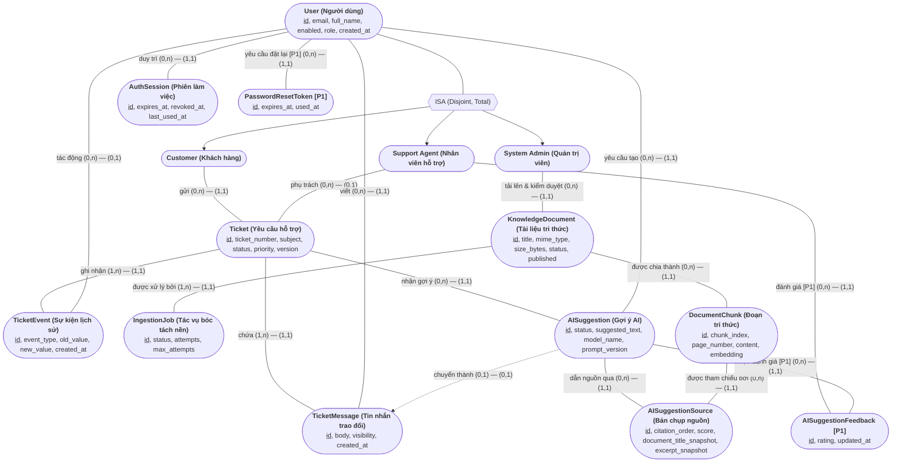
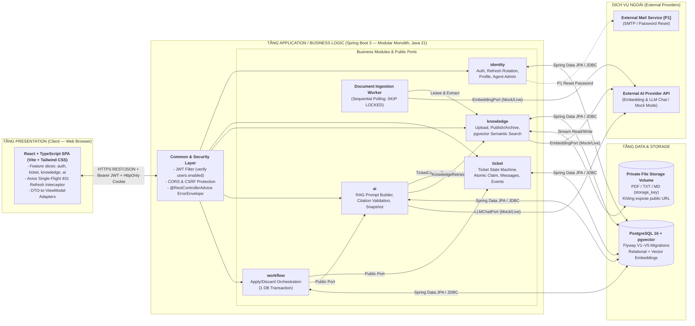
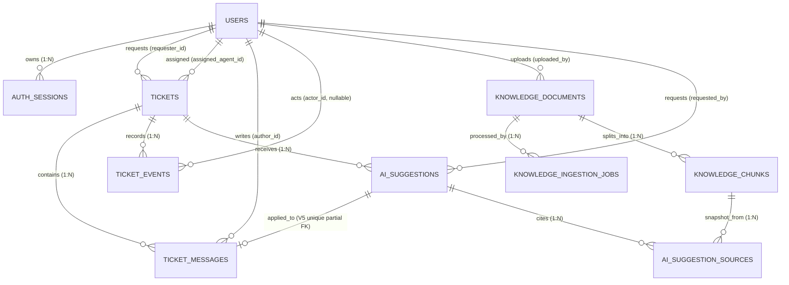
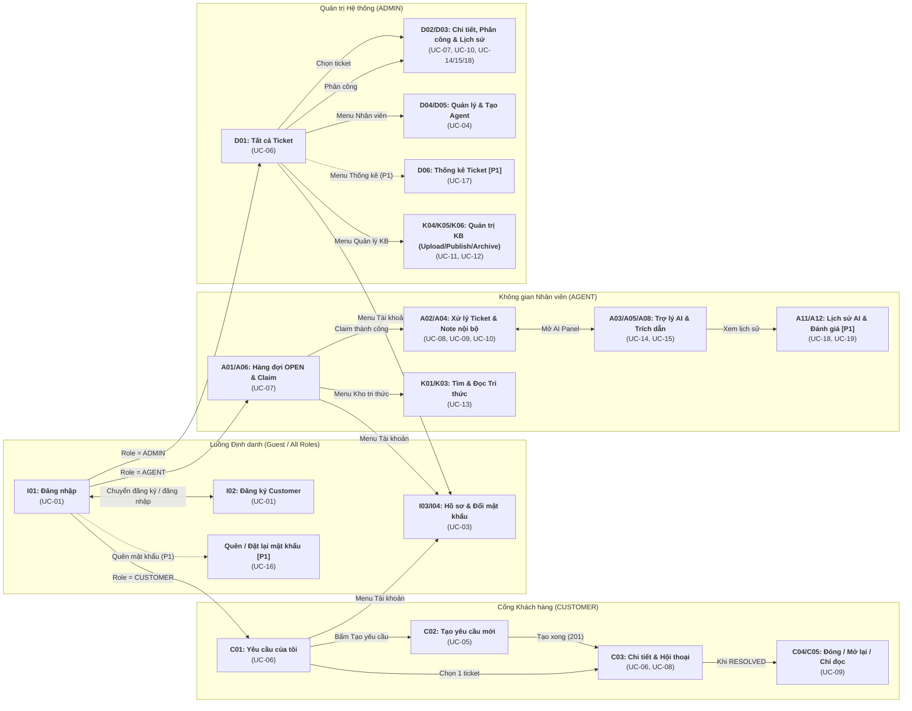

# NMCNPM - Clarune - 04

# TÀI LIỆU THIẾT KẾ PHẦN MỀM (SOFTWARE DESIGN DOCUMENT — TEMPLATE 2)

> **Lưu ý sử dụng bản nháp (Draft Master):**
> - Tài liệu này được biên soạn theo đúng cấu trúc chuẩn của mẫu **Template 2** (đối chiếu các bài mẫu K23: *Planora*, *Katling*, *SmartSpend* và biểu mẫu `Template2-ThietKe.docx`), khớp **100%** với `Template 0`, `Template 1` ([`report.md`](../../reports/template1/report/report.md)), [`SRS-master.md`](../../reports/SRS-master.md), [`MVP_CONTRACTS.md`](../../reports/MVP_CONTRACTS.md) và thiết kế UI/UX **Figma ver3 (`node-id=111-3978`)**.
> - **Phạm vi Domain Knowledge MVP:** Lĩnh vực **Đồ điện tử** (FAQ & Chính sách bảo hành, đổi trả, lắp đặt, hướng dẫn xử lý sự cố thiết bị điện tử).
> - **Cách đưa vào Google Doc chung ([`[SE - Nhóm 4] Template2-ThietKe-Clarune-04`](https://docs.google.com/document/d/1xI8hj6xi6dqKEPklbn9H8nXUGhvN8OpxdDhpVNPSLc8/edit?tab=t.0)):** Copy từng mục vào Google Doc, thay thế các khối `[CẦN BỔ SUNG: ...]` bằng thông tin/ảnh/sơ đồ thực tế, và **xóa toàn bộ các khối `> [GÓP Ý / ĐỀ XUẤT CẢI THIỆN]` trước khi xuất bản PDF nộp bài**.

---

## Thông tin chung dự án

| Thuộc tính | Giá trị |
|---|---|
| **Môn học** | Nhập môn Công nghệ Phần mềm |
| **Tên đề tài (Tiếng Anh)** | **Clarune — AI-Powered Helpdesk & Knowledge Base** |
| **Tên đề tài (Tiếng Việt)** | Hệ thống quản lý yêu cầu hỗ trợ và tra cứu cơ sở tri thức tích hợp AI |
| **Mã nhóm** | Nhóm **04** |
| **Miền tri thức dữ liệu (Domain)** | Hỗ trợ khách hàng lĩnh vực **Đồ điện tử** (Electronics FAQ & Policy) |
| **Google Doc làm việc chung** | [[SE - Nhóm 4] Template2-ThietKe-Clarune-04](https://docs.google.com/document/d/1xI8hj6xi6dqKEPklbn9H8nXUGhvN8OpxdDhpVNPSLc8/edit?tab=t.0) |
| **Thiết kế UI/UX chính thức** | [Figma SE — Bản ver3 (`node-id=111-3978`)](https://www.figma.com/design/Ofvm9udw9coBOxadTN4PXB/SE?node-id=111-3978&p=f&m=dev) |
| **Phiên bản tài liệu** | Draft v1.0 (Ngày 20/11/2026) — Sẵn sàng hoàn thiện tới 23/11 và Review chéo ngày 24/11 |

---

# MỤC LỤC

1. [Bảng đánh giá thành viên & Phân công Template 2](#1-bảng-đánh-giá-thành-viên)
2. [Mô hình quan niệm](#2-mô-hình-quan-niệm)
   - 2.1 Tổng quan Mô hình quan niệm (EER)
   - 2.2 Sơ đồ Mô hình quan niệm
   - 2.3 Đặc tả thực thể ngữ nghĩa và mối quan hệ
3. [Thiết kế kiến trúc](#3-thiết-kế-kiến-trúc)
   - 3.1 Sơ đồ kiến trúc
     - 3.1.1 Sơ đồ cây phân rã hệ thống
     - 3.1.2 Sơ đồ tổng quan kiến trúc hệ thống
     - 3.1.3 Tổng quan kiến trúc (3-Tier kết hợp Modular Monolith)
     - 3.1.4 Tầng Client (Presentation Layer)
     - 3.1.5 Tầng Server (Business Logic Layer)
     - 3.1.6 Tầng Cơ sở dữ liệu & Lưu trữ (Data Layer)
     - 3.1.7 Công nghệ sử dụng & Các điểm đặc biệt trong kiến trúc
   - 3.2 Sơ đồ lớp (Class Diagram)
   - 3.3 Đặc tả lớp (Class Specifications)
4. [Thiết kế dữ liệu](#4-thiết-kế-dữ-liệu)
   - 4.1 Sơ đồ dữ liệu (Physical ERD)
   - 4.2 Đặc tả dữ liệu (Data Dictionary — Flyway V1–V5 & P1 Planned)
5. [Thiết kế giao diện người dùng (Figma ver3)](#5-thiết-kế-giao-diện-người-dùng)
   - 5.1 Sơ đồ màn hình (Screen Flow Diagram & Danh mục tổng hợp)
   - 5.2 Đặc tả màn hình chi tiết
6. [Ghi chú sử dụng AI](#6-ghi-chú-sử-dụng-ai)

---

# 1. Bảng đánh giá thành viên

> `[Phụ trách tổng hợp: Nguyễn Đức Lãm (24120083) & Ngô Viết Thanh Bình (24120269) — SCRUM-58, SCRUM-55]`

## 1.1 Bảng đánh giá đóng góp thành viên

| STT | MSSV | Họ và tên | Vai trò & Nhiệm vụ chính trong Template 2 | % đóng góp (tối đa 100%) | Chữ ký |
| :---: | :---: | :--- | :--- | :---: | :---: |
| 1 | `24120269` | **Ngô Viết Thanh Bình** | Trưởng nhóm; Mục 3.1 (Cây phân rã & Sơ đồ kiến trúc 3-Tier/Modular Monolith); phối hợp rà soát Class, Data và UI phân hệ `identity`; đồng tổng hợp bản hoàn chỉnh (`SCRUM-59`, `SCRUM-55`). | `[CẦN BỔ SUNG: Chốt % ngày 25/11]` | `[CẦN BỔ SUNG: Chữ ký]` |
| 2 | `24120503` | **Phan Gia Phúc** | Điều phối Mục 3.2–3.3 (Class Diagram & Đặc tả lớp 4 phân hệ + `workflow`); chủ trì Review chéo & Đối soát nhất quán toàn bộ Template 2 trên Google Doc (`SCRUM-66`, `SCRUM-62`). | `[CẦN BỔ SUNG: Chốt % ngày 25/11]` | `[CẦN BỔ SUNG: Chữ ký]` |
| 3 | `24120083` | **Nguyễn Đức Lãm** | Mục 1–2 (Bảng thành viên & Mô hình quan niệm EER); điều phối Mục 4 (ERD vật lý & Đặc tả dữ liệu V1–V5); rà soát phân hệ `knowledge`; chủ trì đóng gói bản release (`SCRUM-58`, `SCRUM-60`, `SCRUM-55`). | `[CẦN BỔ SUNG: Chốt % ngày 25/11]` | `[CẦN BỔ SUNG: Chữ ký]` |
| 4 | `24120121` | **Lê Quý Phúc** | Điều phối Mục 5 (Screen Flow & Đặc tả giao diện theo Figma ver3 `node-id=111-3978`); rà soát Class, Data và UI phân hệ `ai` (`SCRUM-61`). | `[CẦN BỔ SUNG: Chốt % ngày 25/11]` | `[CẦN BỔ SUNG: Chữ ký]` |

## 1.2 Ma trận phân công hoàn thiện & đối soát Template 2

| Mục trong Template 2 | Mã Jira | Người chịu trách nhiệm chính | Người phối hợp bổ sung / rà soát | Hạn hoàn thành |
| :--- | :---: | :--- | :--- | :---: |
| Mục 1 & Mục 2 (Thành viên & EER) | `SCRUM-58` | Nguyễn Đức Lãm (`24120083`) | Ngô Viết Thanh Bình | 23/11/2026 |
| Mục 3.1 (Cây phân rã & Kiến trúc hệ thống) | `SCRUM-59` | Ngô Viết Thanh Bình (`24120269`) | Lê Quý Phúc, Nguyễn Đức Lãm | 23/11/2026 |
| Mục 3.2 & 3.3 (Class Diagram & Đặc tả lớp) | `SCRUM-66` | Phan Gia Phúc (`24120503`) | Bình (`identity`), Lãm (`knowledge`), Quý Phúc (`ai`) | 23/11/2026 |
| Mục 4 (ERD vật lý & Đặc tả dữ liệu V1–V5) | `SCRUM-60` | Nguyễn Đức Lãm (`24120083`) | Bình (`V1`), Gia Phúc (`V2/V5`), Quý Phúc (`V4`) | 23/11/2026 |
| Mục 5 (Screen Flow & Đặc tả UI Figma ver3) | `SCRUM-61` | Lê Quý Phúc (`24120121`) | Bình (`I*`), Gia Phúc (`C*/A*/D*`), Lãm (`K*`) | 23/11/2026 |
| Review chéo & Đối soát nhất quán 4 mục | `SCRUM-62` | Phan Gia Phúc (`24120503`) | Cả nhóm (xoay vòng Bình $\to$ Lãm $\to$ Gia Phúc $\to$ Quý Phúc) | 24/11/2026 |
| Mục 6 (AI Usage) & Tổng hợp gói nộp | `SCRUM-55` | Nguyễn Đức Lãm & Ngô Viết Thanh Bình | Cả 4 thành viên (`ai-usage/template2/<ten>.md`) | 25/11/2026 |

---

# 2. Mô hình quan niệm

> `[Phụ trách chính: Nguyễn Đức Lãm (24120083) — SCRUM-58 | Phối hợp rà soát ngữ nghĩa: Ngô Viết Thanh Bình]`

## 2.1 Tổng quan Mô hình quan niệm (EER)

Mô hình quan niệm (**Conceptual Data Model / Enhanced Entity-Relationship — EER**) mô tả bức tranh dữ liệu nghiệp vụ của hệ thống **Clarune** ở mức khái niệm, độc lập với hệ quản trị cơ sở dữ liệu PostgreSQL và chưa đưa các cột kỹ thuật cài đặt (như khóa ngoại thuần túy, chỉ mục vector hay bảng trung gian vật lý).

Mô hình áp dụng **tổng quát hóa / chuyên biệt hóa (Generalization / Specialization)** cho thực thể trung tâm **Người dùng (`User`)**:
- **Thực thể cha (`User`)**: Chứa các thuộc tính định danh dùng chung gồm `email`, `fullName`, `passwordHash`, `enabled`, `createdAt`.
- **Ba thực thể con chuyên biệt (Disjoint, Total theo miền 3 vai trò MVP)**:
  1. **Khách hàng (`Customer`)**: Tác nhân tạo và theo dõi yêu cầu hỗ trợ (`Ticket`), gửi tin nhắn công khai, yêu cầu mở lại hoặc đóng yêu cầu.
  2. **Nhân viên hỗ trợ (`Support Agent`)**: Tác nhân xem hàng đợi mở, nhận xử lý (`Claim`) ticket, soạn ghi chú nội bộ, tra cứu tri thức và kiểm duyệt/đánh giá gợi ý AI.
  3. **Quản trị viên (`System Administrator`)**: Tác nhân quản lý tài khoản nhân viên, tải lên/công bố/lưu trữ tài liệu tri thức, phân công/chuyển giao ticket và xem thống kê vận hành (P1).

## 2.2 Sơ đồ Mô hình quan niệm

> `[CẦN BỔ SUNG: Nguyễn Đức Lãm vẽ sơ đồ EER chuẩn ký hiệu Chen hoặc Crow's Foot EER (dùng MySQL Workbench / Power Designer / draw.io, chú trọng mũi tên kế thừa ISA cho User -> Customer/Agent/Admin và tránh gắn FK vật lý như ticket_id trong hình EER), xuất ảnh PNG vào docs/template2/assets/diagrams/conceptual-model.png và chèn thay cho sơ đồ tham chiếu dưới đây.]`

**Hình 2.1 — Sơ đồ Mô hình quan niệm (EER) mức khái niệm hệ thống Clarune** *(Lưu ý: Sơ đồ trên minh họa thực thể ngữ nghĩa và liên kết nghiệp vụ; khi vẽ lại bản đồ họa chính thức bằng Crow's Foot/Chen, trình bày rõ ký hiệu kế thừa ISA và loại bỏ các khóa ngoại cài đặt).*

## 2.3 Đặc tả các thực thể ngữ nghĩa và mối quan hệ

### 2.3.1 Danh sách thực thể ngữ nghĩa

| STT | Tên thực thể | Loại thực thể | Thuộc tính nghiệp vụ cốt lõi | Định nghĩa ngữ nghĩa theo bài toán |
| :---: | :--- | :--- | :--- | :--- |
| 1 | **User** | Thực thể cha (Supertype) | `id`, `email`, `fullName`, `passwordHash`, `role`, `enabled`, `createdAt`, `updatedAt` | Tài khoản định danh duy nhất theo email không phân biệt hoa thường, kiểm soát trạng thái kích hoạt (`enabled`). |
| 2 | **Customer** | Thực thể con (Subtype của User) | Kế thừa toàn bộ thuộc tính từ `User` (`role = CUSTOMER`) | Khách hàng sở hữu các `Ticket` của chính mình và chỉ được xem phần trao đổi công khai. |
| 3 | **Support Agent** | Thực thể con (Subtype của User) | Kế thừa toàn bộ thuộc tính từ `User` (`role = AGENT`) | Nhân viên hỗ trợ xem hàng đợi mở, nhận xử lý (`claim`) ticket, tra cứu tri thức và kiểm duyệt/đánh giá gợi ý AI. |
| 4 | **System Administrator** | Thực thể con (Subtype của User) | Kế thừa toàn bộ thuộc tính từ `User` (`role = ADMIN`) | Quản trị viên điều hành tài khoản Agent, vòng đời tài liệu tri thức, phân công/chuyển giao ticket và thống kê (P1). |
| 5 | **AuthSession** | Thực thể yếu / phụ thuộc `User` | `id`, `refreshTokenHash`, `expiresAt`, `revokedAt`, `createdAt`, `lastUsedAt` | Phiên đăng nhập duy trì theo cơ chế xoay vòng mã gia hạn (`Refresh Token Rotation`). |
| 6 | **PasswordResetToken** *(P1)* | Thực thể mở rộng (`PLANNED`) | `id`, `tokenHash`, `expiresAt`, `usedAt`, `createdAt` | Mã đặt lại mật khẩu dùng một lần có thời hạn phục vụ `UC-16` (P1). |
| 7 | **Ticket** | Thực thể trung tâm | `id`, `ticketNumber`, `subject`, `status`, `priority`, `version`, `createdAt`, `updatedAt`, `resolvedAt`, `closedAt` | Yêu cầu hỗ trợ có mã hiển thị duy nhất, tuân theo máy trạng thái 5 bước và khóa lạc quan `version`. |
| 8 | **TicketMessage** | Thực thể phụ thuộc `Ticket` | `id`, `body`, `visibility` (`PUBLIC`/`INTERNAL`), `createdAt` | Tin nhắn trao đổi công khai (bao gồm nội dung mô tả đầu tiên) hoặc ghi chú nội bộ ẩn với khách hàng. |
| 9 | **TicketEvent** | Thực thể nhật ký phụ thuộc `Ticket` | `id`, `eventType`, `oldValue`, `newValue`, `createdAt` | Sự kiện lịch sử bất biến (append-only) ghi vết tạo, nhận, phân công và chuyển trạng thái. |
| 10 | **KnowledgeDocument** | Thực thể độc lập | `id`, `title`, `originalFilename`, `storageKey`, `mimeType`, `sizeBytes`, `contentHash`, `status`, `published`, `failureCode`, `publishedAt`, `archivedAt` | Tài liệu nghiệp vụ/FAQ/Policy do Admin tải lên; tách biệt giữa trạng thái xử lý (`READY`) và công bố (`published`). |
| 11 | **IngestionJob** | Thực thể phụ thuộc `KnowledgeDocument` | `id`, `status`, `attempts`, `maxAttempts`, `nextRunAt`, `lockedUntil`, `leaseToken`, `lastErrorCode` | Tác vụ xử lý nền (trích xuất chữ, chia đoạn, tạo vector) có cơ chế lease và thử lại giới hạn tối đa 3 lần. |
| 12 | **DocumentChunk** | Thực thể phụ thuộc `KnowledgeDocument` | `id`, `chunkIndex`, `pageNumber`, `content`, `embedding`, `createdAt` | Đoạn văn bản được cắt kèm số thứ tự, số trang (nếu là PDF) và vector nhúng ngữ nghĩa. |
| 13 | **AISuggestion** | Thực thể phụ thuộc `Ticket` | `id`, `status`, `suggestedText`, `modelName`, `promptVersion`, `latencyMs`, `errorCode`, `createdAt`, `appliedAt` | Kết quả một lần yêu cầu AI sinh bản nháp (kể cả trạng thái thiếu căn cứ hoặc lỗi) kèm dấu vết mô hình. |
| 14 | **AISuggestionSource** | Thực thể liên kết + bản chụp | `id`, `citationOrder`, `score`, `documentTitleSnapshot`, `excerptSnapshot`, `pageNumberSnapshot` | Bản chụp (snapshot) đoạn trích nguồn tại thời điểm sinh gợi ý, đảm bảo lịch sử bất biến khi tài liệu gốc bị lưu trữ. |
| 15 | **AISuggestionFeedback** *(P1)* | Thực thể liên kết Agent–AISuggestion (`PLANNED`) | `id`, `rating` (`HELPFUL`/`NOT_HELPFUL`), `createdAt`, `updatedAt` | Đánh giá mức hữu ích hiện hành của nhân viên phụ trách đối với một gợi ý hợp lệ (`UC-19`, P1). |

### 2.3.2 Bảng mối quan hệ ngữ nghĩa và lực lượng (Cardinalities)

| Quan hệ (Verb) | Thực thể tham gia | Lực lượng (Min, Max) | Ý nghĩa nghiệp vụ & Ràng buộc (`BR`) |
| :--- | :--- | :--- | :--- |
| **duy trì** | `User` — `AuthSession` | `(0,n)` — `(1,1)` | Một người dùng có thể có nhiều phiên trên các thiết bị; mỗi phiên thuộc đúng 1 người dùng. |
| **gửi (requests)** | `Customer` — `Ticket` | `(0,n)` — `(1,1)` | Một khách hàng có thể tạo nhiều ticket; mỗi ticket bắt buộc do đúng 1 khách hàng tạo (`BR-03`). |
| **phụ trách (assigned)** | `Support Agent` — `Ticket` | `(0,n)` — `(0,1)` | Một nhân viên hỗ trợ xử lý nhiều ticket; mỗi ticket ở trạng thái `OPEN` chưa có nhân viên (`0`), sau khi nhận/gán chỉ có tối đa 1 nhân viên phụ trách (`BR-05`, `BR-06`). |
| **chứa (contains)** | `Ticket` — `TicketMessage` | `(1,n)` — `(1,1)` | Mỗi ticket ngay khi tạo đã có tối thiểu 1 tin nhắn công khai đầu tiên chứa mô tả (`FR-TK-01`). |
| **viết (writes)** | `User` — `TicketMessage` | `(0,n)` — `(1,1)` | Mỗi tin nhắn/ghi chú bắt buộc do đúng 1 người dùng xác thực viết (`BR-14`); Customer không được viết `INTERNAL` (`BR-08`). |
| **ghi nhận (records)** | `Ticket` — `TicketEvent` | `(1,n)` — `(1,1)` | Ngay khi tạo ticket đã có tối thiểu sự kiện `TICKET_CREATED`; tác nhân thay đổi có thể `null` nếu là sự kiện hệ thống (`BR-15`). |
| **tải lên (uploads)** | `System Admin` — `KnowledgeDocument` | `(0,n)` — `(1,1)` | Chỉ Admin được tải lên tài liệu; mỗi tài liệu gắn 1 người tải lên (`BR-02`, `UC-11`). |
| **được xử lý bởi** | `KnowledgeDocument` — `IngestionJob` | `(1,n)` — `(1,1)` | Mỗi tài liệu sau tải lên tạo tối thiểu 1 tác vụ xử lý nền; tại một thời điểm chỉ có tối đa 1 job đang hoạt động (`PENDING`/`RUNNING`). |
| **chia thành (contains)** | `KnowledgeDocument` — `DocumentChunk` | `(0,n)` — `(1,1)` | Tài liệu chưa xong hoặc lỗi có 0 đoạn; tài liệu `READY` có 1..n đoạn duy nhất theo `(document, chunkIndex)`. |
| **nhận gợi ý (has)** | `Ticket` — `AISuggestion` | `(0,n)` — `(1,1)` | Một ticket có thể yêu cầu AI gợi ý nhiều lần (hoặc 0 lần); mỗi gợi ý gắn cố định với 1 ticket. |
| **yêu cầu tạo (requests)** | `User (Agent/Admin)` — `AISuggestion` | `(0,n)` — `(1,1)` | Lưu vết nhân viên hoặc Admin đã bấm tạo gợi ý (`requestedBy`). |
| **chuyển thành (applied as)** | `AISuggestion` — `TicketMessage` | `(0,1)` — `(0,1)` | Một gợi ý tối đa chỉ được áp dụng thành **1** tin nhắn công khai duy nhất (`BR-12`, chống double-apply); tin nhắn soạn tay không gắn gợi ý (`0`). |
| **dẫn nguồn (references)** | `AISuggestion` — `AISuggestionSource` | `(0,n)` — `(1,1)` | Gợi ý `INSUFFICIENT_EVIDENCE`/`FAILED` có 0 nguồn; gợi ý `GENERATED`/`APPLIED` tham chiếu từ 1 nguồn trở lên. |
| **được chụp từ (cited from)** | `DocumentChunk` — `AISuggestionSource` | `(0,n)` — `(1,1)` | Lưu bản chụp trích dẫn từ đúng 1 chunk gốc; không xóa cứng chunk đã được trích dẫn (`BR-12`). |

> **[GÓP Ý / ĐỀ XUẤT CẢI THIỆN]**
> - **Nội dung đề xuất:** Đối với phạm vi **Domain Knowledge: Đồ điện tử (FAQ + Policy)**, cần giữ nguyên cấu trúc 13 thực thể P0 + 2 thực thể P1 như trên (không thêm bảng `Product`, `Order` hay `Warranty` ngoài thiết kế để tránh phình phạm vi MVP và phá vỡ schema `V1–V5`), nhưng trong phần diễn giải thuộc tính của `Ticket.subject` và `KnowledgeDocument.title`, nên nêu rõ ví dụ đặc trưng ngành điện tử (ví dụ: mã model thiết bị, loại chính sách bảo hành/đổi trả, nhóm FAQ lỗi thường gặp) để minh họa tính thực tế của Mô hình quan niệm. Đồng thời khi vẽ ảnh EER bằng MySQL Workbench/draw.io, cần **loại bỏ hoàn toàn tên cột khóa ngoại (`requester_id`, `document_id`, `chunk_id`)** ra khỏi hình vẽ để đúng chuẩn EER quan niệm, phân biệt rạch ròi với Sơ đồ dữ liệu vật lý ở Mục 4.
> - **Lý do:** Quy định đánh giá Template 2 thường trừ điểm nếu nhầm lẫn Mô hình quan niệm (Mục 2) với Mô hình dữ liệu vật lý (Mục 4). Việc giữ đúng thực thể của `SRS-master` đảm bảo tính truy vết 100% giữa `EER ↔ Class Diagram ↔ ERD`.

---

# 3. Thiết kế kiến trúc

## 3.1 Sơ đồ kiến trúc

> `[Phụ trách chính: Ngô Viết Thanh Bình (24120269) — SCRUM-59]`

### 3.1.1 Sơ đồ cây phân rã hệ thống (System Decomposition Tree)

Sơ đồ cây phân rã trình bày cấu trúc phân rã chức năng theo chiều dọc của toàn bộ hệ thống **Clarune** thành **4 phân hệ nghiệp vụ** ánh xạ trực tiếp tới 19 Use Cases (`UC-01`..`UC-19`), kết nối xuyên suốt tới máy chủ ứng dụng (Application Server), lớp điều phối giao dịch (`workflow`) và hệ quản trị cơ sở dữ liệu PostgreSQL + `pgvector`.

> `[CẦN BỔ SUNG: Ngô Viết Thanh Bình vẽ bản đồ họa sắc nét trên draw.io theo bố cục cây phân rã dọc như các bài mẫu K23 (Planora/Katling), xuất vào docs/template2/assets/diagrams/system-decomposition-tree.png và chèn vào Google Doc.]`

```mermaid
flowchart TB
    ROOT["<b>HỆ THỐNG HELPDESK &amp; CƠ SỞ TRI THỨC TÍCH HỢP AI (CLARUNE)</b>"]

    ROOT --> M1["<b>1. Phân hệ Định danh &amp; Phân quyền</b><br/>(identity module)"]
    ROOT --> M2["<b>2. Phân hệ Quản lý Ticket</b><br/>(ticket module)"]
    ROOT --> M3["<b>3. Phân hệ Cơ sở tri thức</b><br/>(knowledge module)"]
    ROOT --> M4["<b>4. Phân hệ Trợ lý AI &amp; Điều phối</b><br/>(ai &amp; workflow modules)"]

    M1 --> M1_1["UC-01: Đăng ký &amp; Đăng nhập"]
    M1 --> M1_2["UC-02: Làm mới phiên &amp; Đăng xuất"]
    M1 --> M1_3["UC-03: Xem &amp; Cập nhật hồ sơ"]
    M1 --> M1_4["UC-04: Quản lý tài khoản Agent"]
    M1 --> M1_5["UC-16 [P1]: Đặt lại mật khẩu"]

    M2 --> M2_1["UC-05: Tạo yêu cầu hỗ trợ"]
    M2 --> M2_2["UC-06: Danh sách &amp; Chi tiết ticket"]
    M2 --> M2_3["UC-07: Nhận xử lý &amp; Phân công"]
    M2 --> M2_4["UC-08: Tin nhắn công khai &amp; Ghi chú nội bộ"]
    M2 --> M2_5["UC-09: Chuyển trạng thái ticket"]
    M2 --> M2_6["UC-10: Lịch sử sự kiện (Audit Trail)"]
    M2 --> M2_7["UC-17 [P1]: Thống kê ticket"]

    M3 --> M3_1["UC-11: Upload &amp; Xử lý nền (Worker)"]
    M3 --> M3_2["UC-12: Công bố &amp; Lưu trữ tài liệu"]
    M3 --> M3_3["UC-13: Tìm kiếm tri thức ngữ nghĩa"]

    M4 --> M4_1["UC-14: Sinh gợi ý RAG kèm trích dẫn"]
    M4 --> M4_2["UC-15: Kiểm duyệt, Áp dụng/Bỏ gợi ý (Workflow)"]
    M4 --> M4_3["UC-18: Xem lịch sử gợi ý &amp; Snapshot"]
    M4 --> M4_4["UC-19 [P1]: Đánh giá hữu ích"]

    M1 & M2 & M3 & M4 --> APP["<b>Spring Boot 3 Modular Monolith Server</b><br/>(REST API /api/v1 + Spring Security + Async Worker)"]
    APP --> DB["<b>PostgreSQL 16 + Extension pgvector + Private File Storage</b>"]
```

**Hình 3.1 — Sơ đồ cây phân rã chức năng hệ thống Clarune theo chiều dọc**

---

### 3.1.2 Sơ đồ tổng quan kiến trúc hệ thống (Overall System Architecture)

Hệ thống được thiết kế theo mô hình **Client–Server 3 tầng (3-Tier)** ở cấp triển khai kết hợp **Kiến trúc Khối đơn thể Mô-đun hóa (Modular Monolith — C4 Container/Component)** ở tầng máy chủ nhằm tối ưu sự tách biệt nghiệp vụ nhưng không phát sinh chi phí vận hành phân tán (Microservices/Message Broker) trong phạm vi MVP.

> `[CẦN BỔ SUNG: Ngô Viết Thanh Bình xuất sơ đồ C4 Container/Component sắc nét từ draw.io vào docs/template2/assets/diagrams/system-architecture.png và chèn thay cho sơ đồ Mermaid minh họa dưới đây.]`

**Hình 3.2 — Sơ đồ tổng quan kiến trúc 3 tầng kết hợp Modular Monolith của hệ thống Clarune**

---

### 3.1.3 Tổng quan kiến trúc

Kiến trúc Clarune giải quyết đồng thời hai yêu cầu đối lập của một đồ án học kỳ có tích hợp AI: **đơn giản trong đóng gói/triển khai** (một tệp deployable duy nhất chạy qua Docker Compose) và **nghiêm ngặt trong phân tách ranh giới nghiệp vụ** (tránh mã nguồn rối chéo giữa quản lý Ticket và AI).

Các **quy tắc ranh giới mô-đun (Module Boundary Rules)** bắt buộc (theo [`SRS-master.md`](../../reports/SRS-master.md) Mục 9.4 và [`MVP_CONTRACTS.md`](../../reports/MVP_CONTRACTS.md)):
1. **Cô lập Entity và Repository:** Các module (`identity`, `ticket`, `knowledge`, `ai`, `workflow`) tổ chức theo *business feature* (thay vì gom toàn repo vào `controller/`, `service/`, `repository/`). **Cấm** module này import trực tiếp JPA Entity hoặc Spring Data Repository của module khác.
2. **Giao tiếp qua Public Ports & Immutable DTO:**
   - `identity` cung cấp danh tính và vai trò hiện tại thông qua `ActorPrincipal` (`userId`, `role`); các module khác không được đọc trực tiếp bảng `auth_sessions`.
   - `ai` lấy ngữ cảnh hội thoại công khai từ `ticket` thông qua cổng `TicketContextProvider.getForSuggestion(ticketId, actor)` (trả về `TicketContext` đã lọc bỏ hoàn toàn ghi chú `INTERNAL` và email/PII thừa).
   - `ai` truy xuất tri thức từ `knowledge` thông qua cổng `KnowledgeRetriever.search(queryText, actor, limit, minSimilarity)` (chỉ `knowledge` giữ độc quyền gọi `EmbeddingProvider` cho câu truy vấn, tránh `ai` gọi embed lặp lần hai).
   - `workflow` điều phối hành động **Apply/Discard AI Suggestion** thông qua các Public Ports của `ticket` và `ai` trong **một database transaction duy nhất**, tuyệt đối không tạo phụ thuộc vòng `ticket ↔ ai` và không dùng `REQUIRES_NEW`.

---

### 3.1.4 Tầng Client (Presentation Layer)

- **Công nghệ:** **React + TypeScript** đóng gói với **Vite**, tạo giao diện responsive hỗ trợ cả desktop (1440×900), tablet (1024×768) và mobile (tối thiểu 360px/390×844) kèm chế độ Light/Dark theo **Figma ver3**.
- **Cấu trúc theo tính năng (`frontend/src/features/`):** `auth/`, `ticket/`, `knowledge/`, `ai/` (tách panel AI và màn hình lịch sử gợi ý/đánh giá khỏi logic lõi ticket).
- **Quản lý phiên an toàn trên trình duyệt:**
  - **Access Token** được giữ **chỉ trong bộ nhớ ứng dụng (in-memory)**; **Refresh Token** được máy chủ cấp qua **HttpOnly Cookie** (`SameSite=Lax`, bật `Secure` trên HTTPS) và bảo vệ bằng **CSRF token** cho `/auth/refresh` và `/auth/logout`. Không lưu refresh token trong `localStorage`.
  - **Axios Single-Flight 401 Interceptor:** Khi nhiều request song song gặp `HTTP 401`, interceptor sử dụng **một** lời gọi `/auth/refresh` dùng chung, retry tối đa 1 lần cho các request gốc và không refresh đệ quy trên chính endpoint `/auth/login` hay `/auth/refresh`.
- **Tách biệt DTO và ViewModel:** Toàn bộ dữ liệu API trả về dạng `{ data }` hoặc `{ data, page }` với timestamp UTC ISO-8601 được lớp Adapter của Frontend ánh xạ sang ViewModel hiển thị giờ địa phương, tuyệt đối không dùng dữ liệu mock UI làm hợp đồng API.

---

### 3.1.5 Tầng Server (Business Logic Layer)

- **Công nghệ:** **Java 21**, **Spring Boot 3**, **Spring Security**, **Spring Data JPA / Hibernate**.
- **Luồng xử lý chuẩn trong mỗi module (`api/` $\to$ `application/` $\to$ `domain/` $\to$ `infrastructure/`):**
  - `api/` (REST Controllers): Tiếp nhận HTTP request `/api/v1/*`, validate đầu vào bằng Bean Validation, chuyển đổi sang DTO phản hồi chuẩn.
  - `application/` (Use-case Services): Nắm giữ ranh giới `@Transactional` (chỉ áp dụng với nghiệp vụ ghi/đọc DB; **tuyệt đối không** bọc `@Transactional` quanh lời gọi API LLM/Embedding ngoài mạng để tránh cạn kiệt Hikari connection pool).
  - `domain/` (Domain Entities, State Machine, Policies): Đóng gói luật nghiệp vụ bất biến (`BR-01`..`BR-16`), máy trạng thái Ticket/Document và quy tắc sở hữu.
  - `infrastructure/`: Thực thi Repository JPA/JDBC, lưu trữ file riêng tư, parser PDF/TXT/MD và các adapter gọi AI bên ngoài.
- **Kiểm tra bảo mật nhiều lớp:** Mọi yêu cầu xác thực đi qua `JwtAuthenticationFilter` không chỉ xác minh chữ ký JWT mà còn truy vấn/kiểm tra `users.enabled` ở phía máy chủ (`BR-16`). Nếu tài khoản Agent vừa bị Admin vô hiệu hóa, ngay cả Access Token còn hạn cũng lập tức bị từ chối (`HTTP 403`).
- **Xử lý nền bất đồng bộ (Document Ingestion Worker):** Chạy nội bộ trong monolith theo mô hình worker tuần tự để trích xuất văn bản, chia đoạn và tạo vector cho tài liệu tải lên mà không chặn luồng HTTP `POST /knowledge/documents`.

---

### 3.1.6 Tầng Cơ sở dữ liệu & Lưu trữ (Data Layer)

- **Cơ sở dữ liệu quan hệ & Vector:** **PostgreSQL 16** tích hợp extension **`pgvector`**, quản lý vòng đời schema qua **Flyway** theo 5 bản migration nền chuẩn (`V1` $\to$ `V5`). Kết hợp trong một hệ quản trị giúp câu truy vấn RAG thực hiện lọc quyền và trạng thái (`status = 'READY' AND published = true`) ngay tại câu SQL trước khi tính `LIMIT top-k` khoảng cách cosine.
- **Kho lưu trữ tệp riêng tư (Private File Storage):** Toàn bộ tệp PDF/TXT/MD do Admin tải lên được lưu trong Docker volume nằm ngoài thư mục public web root, ánh xạ qua khóa nội bộ `storage_key` sinh ngẫu nhiên phía server (chống Path Traversal). Quyền tải tệp được kiểm soát chặt qua API Backend; Agent không được tải tài liệu đã `ARCHIVED`.

---

### 3.1.7 Công nghệ sử dụng & Các điểm đặc biệt trong kiến trúc

#### A. Bảng tổng hợp Công nghệ sử dụng

| Lớp (Layer) | Công nghệ / Thư viện | Mục đích & Lý do lựa chọn | Phiên bản dự kiến |
| :--- | :--- | :--- | :--- |
| **Frontend** | React + TypeScript + Vite | Xây dựng SPA có kiểm soát kiểu tĩnh mạnh, tốc độ build nhanh | `[CẦN BỔ SUNG: Khóa version trong package.json ngày 21/11]` |
| **UI Styling & HTTP** | Tailwind CSS + Axios | Responsive theo Figma ver3; interceptor single-flight refresh 401 | `[CẦN BỔ SUNG: Khóa version trong package.json]` |
| **Backend Core** | Java 21 (LTS) + Spring Boot 3 | Hệ sinh thái vững chắc cho REST API, transaction và bảo mật | `[CẦN BỔ SUNG: Khóa version trong pom.xml ngày 21/11]` |
| **Security** | Spring Security + JJWT / Nimbus + BCrypt (`PasswordEncoder`) | Xác thực Access JWT 15 phút, Refresh Token hash SHA-256 trong DB | `[CẦN BỔ SUNG: Khóa version thư viện JWT trong pom.xml]` |
| **Persistence & Migration** | Spring Data JPA / Hibernate + PostgreSQL 16 + `pgvector` + Flyway | Hỗ trợ vừa giao dịch ACID cho Ticket, vừa truy vấn vector cho RAG | PostgreSQL 16 + `pgvector` |
| **Document Parsing** | Apache PDFBox + Bộ đọc TXT/MD UTF-8 thuần | Trích xuất text từ PDF có lớp văn bản (không OCR ảnh quét trong P0) | `[CẦN BỔ SUNG: Version PDFBox trong pom.xml]` |
| **AI & RAG Integration** | Spring AI / HTTP Client tương thích API Embedding & LLM | Trừu tượng hóa qua cổng Port để hoán đổi giữa `Live` và `Mock` | `[CẦN BỔ SUNG: Chốt model & vector dimension D tại DEC-06]` |
| **Testing & DevOps** | JUnit 5, Mockito, MockMvc, Testcontainers, Docker Compose, GitHub Actions | Chạy test tranh chấp đồng thời trên PostgreSQL thật và tái lập môi trường sạch | Java 21 / Maven / Docker |

#### B. Các điểm đặc biệt và Mẫu thiết kế (Design Patterns) áp dụng

1. **State Machine Pattern (Quản lý vòng đời Ticket & Document):**
   - Toàn bộ chuyển đổi trạng thái Ticket (`OPEN` $\to$ `IN_PROGRESS` $\to$ `WAITING_CUSTOMER` $\to$ `RESOLVED` $\to$ `CLOSED`) và Document (`UPLOADED` $\to$ `PROCESSING` $\to$ `READY`/`FAILED` $\to$ `ARCHIVED`) được đóng gói trong các phương thức chuyển trạng thái có kiểm soát luật theo vai trò. Mọi chuyển đổi ngoài bảng luật lập tức trả về `HTTP 409 INVALID_TICKET_TRANSITION`.
2. **Optimistic Locking (`@Version`) kết hợp Conditional Atomic Update (Chống tranh chấp nhận việc):**
   - Giải quyết bài toán hai nhân viên cùng bấm **Nhận xử lý (Claim)** một ticket `OPEN` (`UC-07`, `BR-06`). Hệ thống thực hiện câu lệnh cập nhật nguyên tử có điều kiện `WHERE id = :id AND status = 'OPEN' AND assigned_agent_id IS NULL` đồng thời tăng `version = version + 1`. Đảm bảo **chỉ có đúng 1 Agent chiến thắng**, request còn lại nhận `HTTP 409 TICKET_ALREADY_CLAIMED` mà không làm lộ Agent nào đã nhận.
3. **Lease-Based Sequential Polling Worker (`FOR UPDATE SKIP LOCKED` + `lease_token`):**
   - `KnowledgeIngestionWorker` nhận job nền trong transaction ngắn bằng `FOR UPDATE SKIP LOCKED`, tăng `attempts` ngay lúc nhận (tối đa 3), sinh `lease_token` UUID mới kèm thời hạn `locked_until`, rồi **đóng DB transaction trước khi parse PDF và gọi API Embedding**. Kết quả chỉ được phép ghi nhận nếu tại bước commit, `lease_token` và thời hạn lease vẫn còn hiệu lực. Cơ chế này tránh kẹt worker nếu tiến trình crash giữa chừng và ngăn worker cũ ghi đè kết quả mới.
4. **Adapter / Strategy Pattern cho dịch vụ AI (`EmbeddingProviderPort`, `LLMChatProviderPort`):**
   - Tách rời logic RAG khỏi nhà cung cấp AI cụ thể thông qua biến cấu hình `AI_MODE=mock|live`. Ở chế độ `mock`, hệ thống trả vector chuẩn hóa hữu hạn (không zero vector) và phản hồi mẫu theo contract để chạy kiểm thử tự động CI/E2E không phụ thuộc chi phí hay mạng bên ngoài (`NFR-REL-01`).
5. **Cross-Module Orchestration & Human-in-the-Loop Atomic Transaction (`workflow` module):**
   - Khi Agent gửi tin nhắn áp dụng gợi ý AI (`POST /tickets/{id}/messages` kèm `suggestionId`), dịch vụ `ApplySuggestionWorkflowService` điều phối qua các Public Ports của `ticket` và `ai` trong **cùng 1 transaction**: khóa theo thứ tự thống nhất **`Ticket` trước $\to$ `AISuggestion` sau** (chống deadlock), kiểm tra lại quyền sở hữu hiện tại (trường hợp vừa bị Admin reassign), lưu tin nhắn `PUBLIC` đúng nội dung Agent đã duyệt/sửa và chuyển trạng thái suggestion sang `APPLIED` kèm khóa unique partial index chống apply hai lần.
6. **Prompt Injection Defense & Fail-Closed Citation Validation:**
   - Tách biệt System Prompt (tin cậy) khỏi văn bản Ticket/Tài liệu (dữ liệu không đáng tin cậy — *untrusted input*), không cung cấp bất kỳ tool/function gọi ghi DB nào cho LLM. Nếu câu trả lời AI trả về `sourceId` không nằm trong danh sách các chunk đã truy xuất hoặc có điểm tương đồng dưới ngưỡng, hệ thống từ chối trả bản nháp và chuyển trạng thái `INSUFFICIENT_EVIDENCE` hoặc `FAILED` (*fail closed*).

> **[GÓP Ý / ĐỀ XUẤT CẢI THIỆN]**
> - **Nội dung đề xuất:** Khi áp dụng kiến trúc này cho dữ liệu **Đồ điện tử (FAQ + Policy)**, ở phần Cấu hình Ingestion Worker (Mục 3.1.7), nhóm nên nhấn mạnh chiến lược **Heading/Section-aware Chunking** (tách đoạn theo đề mục chính sách bảo hành / mã dòng sản phẩm, khoảng 500–800 tokens, overlap 80–120 tokens) để mỗi `DocumentChunk` không bị cắt ngang bảng điều kiện bảo hành hoặc quy định đổi trả 7/15/30 ngày. Ngoài ra, cần hoàn thiện quyết định `DEC-06` (chốt tên model Embedding và số chiều `D` cố định trước khi chạy migration `V3`).
> - **Lý do:** Tài liệu chính sách đồ điện tử thường có bảng đối chiếu thời hạn bảo hành theo từng nhóm linh kiện/thiết bị; nếu cắt đoạn máy móc theo số ký tự mà mất tiêu đề mục, bước truy xuất vector có thể ghép nhầm điều khoản bảo hành của sản phẩm này sang sản phẩm khác.

---

## 3.2 Sơ đồ lớp (Class Diagram)

> `[Phụ trách điều phối: Phan Gia Phúc (24120503) — SCRUM-66 | Phối hợp từng phân hệ: Bình (identity), Lãm (knowledge), Quý Phúc (ai)]`

Kiến trúc lớp được tổ chức thành 5 gói chính theo đúng cấu trúc mã nguồn đề xuất (`vn.edu.hcmus.helpdesk.*`): `identity`, `ticket`, `knowledge`, `ai` và `workflow`. Mỗi phân hệ tuân theo phân lớp chuẩn **Controller $\to$ Application Service / Public Port $\to$ Domain Entity & Enum $\to$ Repository / External Adapter**.

> `[CẦN BỔ SUNG: Phan Gia Phúc vẽ sơ đồ Class Diagram tổng thể và 4 sơ đồ Class chi tiết theo phân hệ bằng PlantUML / StarUML / draw.io với đầy đủ ký hiệu visibility (+, -, #), kiểu dữ liệu và quan hệ liên kết/kế thừa/thực thi (composition, aggregation, association, dependency), lưu ảnh PNG vào docs/template2/assets/diagrams/class-*.png để chèn vào Google Doc.]`

```mermaid
classDiagram
    direction TB

    %% ===== MODULE 1: IDENTITY =====
    namespace identity {
        class User {
            -UUID id
            -String email
            -String passwordHash
            -String fullName
            -UserRole role
            -boolean enabled
            -Instant createdAt
            -Instant updatedAt
            +disable() void
            +enable() void
            +updateProfile(fullName) void
            +changePassword(newHash) void
        }
        class AuthSession {
            -UUID id
            -UUID userId
            -String refreshTokenHash
            -Instant expiresAt
            -Instant revokedAt
            -Instant createdAt
            -Instant lastUsedAt
            +isActive(now) boolean
            +revoke(now) void
        }
        class PasswordResetToken_P1 {
            -UUID id
            -UUID userId
            -String tokenHash
            -Instant expiresAt
            -Instant usedAt
            +isUsable(now) boolean
            +markUsed(now) void
        }
        class AuthApplicationService {
            +registerCustomer(cmd) UserSummaryDto
            +login(cmd) TokenPairResult
            +refreshSession(rawToken) TokenPairResult
            +logout(rawToken) void
        }
        class UserApplicationService {
            +getCurrentProfile(actor) UserProfileDto
            +updateProfile(actor, cmd) UserProfileDto
            +changePassword(actor, cmd) void
            +createAgent(actor, cmd) AgentSummaryDto
            +setAgentEnabled(actor, agentId, enabled) AgentSummaryDto
        }
        class UserPrincipalPort {
            <<interface>>
            +verifyEnabledActor(userId) ActorPrincipal
        }
    }

    %% ===== MODULE 2: TICKET =====
    namespace ticket {
        class Ticket {
            -UUID id
            -String ticketNumber
            -UUID requesterId
            -UUID assignedAgentId
            -String subject
            -TicketStatus status
            -TicketPriority priority
            -long version
            -Instant createdAt
            -Instant updatedAt
            -Instant resolvedAt
            -Instant closedAt
            +assignAgent(agentId) void
            +transition(action, actorRole) void
            +updatePriority(priority) void
        }
        class TicketMessage {
            -UUID id
            -UUID ticketId
            -UUID authorId
            -String body
            -MessageVisibility visibility
            -UUID sourceSuggestionId
            -Instant createdAt
            +isVisibleTo(role) boolean
        }
        class TicketEvent {
            -UUID id
            -UUID ticketId
            -UUID actorId
            -TicketEventType eventType
            -String oldValueJson
            -String newValueJson
            -Instant createdAt
        }
        class TicketApplicationService {
            +createTicket(actor, cmd) TicketDetailDto
            +listTickets(actor, filter, pageable) Page~TicketSummaryDto~
            +getTicketDetail(actor, ticketId) TicketDetailDto
            +claimTicket(actor, ticketId, expectedVersion) TicketDetailDto
            +assignTicket(actor, ticketId, agentId) TicketDetailDto
            +addMessage(actor, ticketId, cmd) TicketMessageDto
            +transitionTicket(actor, ticketId, action) TicketDetailDto
            +listEvents(actor, ticketId) List~TicketEventDto~
        }
        class TicketContextProvider {
            <<interface>>
            +getForSuggestion(ticketId, actor) TicketContext
            +lockAndValidateForReply(ticketId, actor) LockedTicketView
            +appendSuggestionReply(ticketId, actor, body, suggestionId) TicketMessageDto
        }
    }

    %% ===== MODULE 3: KNOWLEDGE =====
    namespace knowledge {
        class KnowledgeDocument {
            -UUID id
            -String title
            -String originalFilename
            -String storageKey
            -String mimeType
            -long sizeBytes
            -String contentHash
            -DocumentStatus status
            -boolean published
            -UUID uploadedBy
            -String failureCode
            +markProcessing() void
            +markReady() void
            +publish() void
            +archive() void
            +markFailed(code) void
        }
        class KnowledgeIngestionJob {
            -UUID id
            -UUID documentId
            -IngestionJobStatus status
            -int attempts
            -int maxAttempts
            -Instant nextRunAt
            -Instant lockedUntil
            -UUID leaseToken
            -String lastErrorCode
            +acquireLease(token, leaseDuration) void
            +markCompleted() void
            +scheduleRetryOrFail(errorCode, now) void
        }
        class KnowledgeChunk {
            -UUID id
            -UUID documentId
            -int chunkIndex
            -Integer pageNumber
            -String content
            -float[] embedding
            -Instant createdAt
        }
        class KnowledgeApplicationService {
            +uploadDocument(actor, multipartFile, title) DocumentDto
            +listDocuments(actor, filter, pageable) Page~DocumentDto~
            +getDocument(actor, docId) DocumentDto
            +publishDocument(actor, docId) DocumentDto
            +archiveDocument(actor, docId) DocumentDto
            +retryIngestion(actor, docId) DocumentDto
            +searchPublished(actor, query, limit) List~RetrievedChunk~
        }
        class KnowledgeIngestionWorker {
            +pollAndProcessNextJob() void
            -extractAndChunk(document, bytes) List~RawChunk~
        }
        class KnowledgeRetriever {
            <<interface>>
            +search(queryText, actor, limit, minSimilarity) List~RetrievedChunk~
            +areChunksStillPublishable(chunkIds) boolean
        }
        class EmbeddingProviderPort {
            <<interface>>
            +embed(text) EmbeddingResult
        }
    }

    %% ===== MODULE 4: AI & WORKFLOW =====
    namespace ai {
        class AISuggestion {
            -UUID id
            -UUID ticketId
            -UUID requestedBy
            -AISuggestionStatus status
            -String suggestedText
            -String modelName
            -String promptVersion
            -Integer latencyMs
            -String errorCode
            -Instant createdAt
            -Instant appliedAt
            +markApplied(now) void
            +markDiscarded() void
        }
        class AISuggestionSource {
            -UUID id
            -UUID suggestionId
            -UUID chunkId
            -int citationOrder
            -Double score
            -String documentTitleSnapshot
            -String excerptSnapshot
            -Integer pageNumberSnapshot
        }
        class AISuggestionFeedback_P1 {
            -UUID id
            -UUID suggestionId
            -UUID agentId
            -FeedbackRating rating
            -Instant createdAt
            -Instant updatedAt
        }
        class AISuggestionApplicationService {
            +generateSuggestion(actor, ticketId) AISuggestionDto
            +listSuggestionHistory(actor, ticketId) List~AISuggestionDto~
            +discardSuggestion(actor, suggestionId) AISuggestionDto
        }
        class AISuggestionCommandPort {
            <<interface>>
            +lockAndValidateForApply(suggestionId, ticketId) AISuggestion
            +markApplied(suggestionId, now) void
            +discard(suggestionId, actor) AISuggestionDto
        }
        class LLMChatProviderPort {
            <<interface>>
            +generateDraft(promptContext) LLMGenerationOutput
        }
    }

    namespace workflow {
        class ApplySuggestionWorkflowService {
            +sendReplyApplyingSuggestion(actor, ticketId, suggestionId, body) TicketMessageDto
            +discardSuggestionSafely(actor, ticketId, suggestionId) AISuggestionDto
        }
    }

    %% Quan he giua cac lop va module ports
    User "1" *-- "0..*" AuthSession
    User "1" *-- "0..*" PasswordResetToken_P1
    Ticket "1" *-- "1..*" TicketMessage
    Ticket "1" *-- "1..*" TicketEvent
    KnowledgeDocument "1" *-- "1..*" KnowledgeIngestionJob
    KnowledgeDocument "1" *-- "0..*" KnowledgeChunk
    AISuggestion "1" *-- "0..*" AISuggestionSource
    AISuggestion "1" *-- "0..*" AISuggestionFeedback_P1

    TicketApplicationService ..|> TicketContextProvider
    KnowledgeApplicationService ..|> KnowledgeRetriever
    AISuggestionApplicationService ..|> AISuggestionCommandPort

    AISuggestionApplicationService --> TicketContextProvider : uses
    AISuggestionApplicationService --> KnowledgeRetriever : uses
    AISuggestionApplicationService --> LLMChatProviderPort : uses
    KnowledgeApplicationService --> EmbeddingProviderPort : uses
    KnowledgeIngestionWorker --> EmbeddingProviderPort : uses
    ApplySuggestionWorkflowService --> TicketContextProvider : locks Ticket first
    ApplySuggestionWorkflowService --> AISuggestionCommandPort : locks Suggestion second
```

**Hình 3.3 — Sơ đồ lớp tổng thể theo kiến trúc Modular Monolith và ranh giới Public Ports**

---

## 3.3 Đặc tả lớp (Class Specifications)

> `[Phụ trách điều phối: Phan Gia Phúc (24120503) — SCRUM-66 | Từng chủ sở hữu phân hệ đối soát chi tiết tham số hàm và constraint phân hệ mình]`

### 3.3.1 Phân hệ 1: Định danh và Phân quyền (`identity`) — `[Phụ trách chính: Ngô Viết Thanh Bình]`

#### Lớp `User` (Domain Entity — ánh xạ bảng `users`)
- **Mô tả:** Đại diện tài khoản người dùng của hệ thống Clarune, đóng gói quy tắc đổi mật khẩu, cập nhật hồ sơ và vô hiệu hóa/kích hoạt tài khoản.

*Thuộc tính (Properties):*

| STT | Thuộc tính | Modifier | Kiểu dữ liệu & Ràng buộc | Mô tả |
| :---: | :--- | :---: | :--- | :--- |
| 1 | `id` | `private` | `UUID` (PK, Not Null) | Định danh duy nhất của người dùng |
| 2 | `email` | `private` | `String` (`varchar(255)`, Unique Normalized, Not Null) | Email đăng nhập được chuẩn hóa chữ thường (`lowercase`) |
| 3 | `passwordHash` | `private` | `String` (`varchar(255)`, Not Null) | Chuỗi băm mật khẩu một chiều (BCrypt), không lưu thô |
| 4 | `fullName` | `private` | `String` (`varchar(120)`, Not Null) | Họ và tên hiển thị |
| 5 | `role` | `private` | `UserRole` (`CUSTOMER`, `AGENT`, `ADMIN`, Not Null) | Vai trò phân quyền theo RBAC (`BR-01`, `BR-02`) |
| 6 | `enabled` | `private` | `boolean` (Default `true`, Not Null) | Trạng thái hoạt động; `false` chặn toàn bộ request (`BR-16`) |
| 7 | `createdAt` | `private` | `Instant` (`timestamptz`, Not Null) | Thời điểm tạo tài khoản (UTC) |
| 8 | `updatedAt` | `private` | `Instant` (`timestamptz`, Not Null) | Thời điểm cập nhật gần nhất (UTC) |

*Phương thức (Operations):*

| STT | Phương thức | Modifier | Tham số & Kiểu trả về | Mô tả |
| :---: | :--- | :---: | :--- | :--- |
| 1 | `createCustomer` | `public static` | `(String email, String passwordHash, String fullName) : User` | Factory method tạo tài khoản mới luôn gắn mặc định `role = CUSTOMER` |
| 2 | `createAgent` | `public static` | `(String email, String passwordHash, String fullName) : User` | Factory method tạo tài khoản nhân viên (`role = AGENT`) |
| 3 | `updateFullName` | `public` | `(String fullName, Instant now) : void` | Cập nhật họ tên hợp lệ (không cho phép sửa email hoặc role) |
| 4 | `changePasswordHash` | `public` | `(String newPasswordHash, Instant now) : void` | Ghi nhận mã băm mật khẩu mới sau khi kiểm tra mật khẩu cũ |
| 5 | `setEnabled` | `public` | `(boolean enabled, Instant now) : void` | Kích hoạt hoặc vô hiệu hóa tài khoản |

---

#### Lớp `AuthSession` (Domain Entity — ánh xạ bảng `auth_sessions`)
- **Mô tả:** Quản lý phiên duy trì đăng nhập sử dụng Refresh Token có cơ chế xoay vòng nguyên tử và thu hồi khi đăng xuất.

*Thuộc tính (Properties):*

| STT | Thuộc tính | Modifier | Kiểu dữ liệu & Ràng buộc | Mô tả |
| :---: | :--- | :---: | :--- | :--- |
| 1 | `id` | `private` | `UUID` (PK, Not Null) | Mã phiên đăng nhập |
| 2 | `userId` | `private` | `UUID` (FK `users.id`, Not Null) | Tham chiếu tài khoản sở hữu phiên |
| 3 | `refreshTokenHash` | `private` | `String` (`varchar(128)`, Unique, Not Null) | Mã băm SHA-256 của Refresh Token ngẫu nhiên |
| 4 | `expiresAt` | `private` | `Instant` (`timestamptz`, Not Null) | Thời điểm hết hạn phiên (mặc định +7 ngày) |
| 5 | `revokedAt` | `private` | `Instant` (`timestamptz`, Nullable) | Thời điểm phiên bị thu hồi (logout/rotation/disable) |
| 6 | `createdAt` | `private` | `Instant` (`timestamptz`, Not Null) | Thời điểm khởi tạo phiên |
| 7 | `lastUsedAt` | `private` | `Instant` (`timestamptz`, Nullable) | Thời điểm làm mới token gần nhất (audit) |

*Phương thức (Operations):*

| STT | Phương thức | Modifier | Tham số & Kiểu trả về | Mô tả |
| :---: | :--- | :---: | :--- | :--- |
| 1 | `isUsable` | `public` | `(Instant now) : boolean` | Kiểm tra `revokedAt == null && expiresAt.isAfter(now)` |
| 2 | `revoke` | `public` | `(Instant now) : void` | Đánh dấu phiên đã thu hồi, ngăn chặn sử dụng lại token cũ |

---

#### Lớp `PasswordResetToken` *(P1 — PLANNED — chưa thuộc Flyway V1–V5)*
- **Mô tả:** Quản lý token khôi phục mật khẩu dùng một lần có thời hạn phục vụ `UC-16` (giai đoạn mở rộng P1).

*Thuộc tính & Phương thức chính:* `id (UUID)`, `userId (UUID)`, `tokenHash (String)`, `expiresAt (Instant)`, `usedAt (Instant nullable)`, `createdAt (Instant)`; phương thức `isValid(Instant now) : boolean` và `markUsed(Instant now) : void`.

---

#### Các lớp Controller & Application Service của phân hệ `identity`

| Lớp | Vai trò / Layer | Phương thức chính (`public`) | Quyền & Giao dịch (`@Transactional`) |
| :--- | :--- | :--- | :--- |
| `AuthController` | API Layer (`/api/v1/auth`) | `register(RegisterRequest)`, `login(LoginRequest)`, `refresh(HttpServletRequest, HttpServletResponse)`, `logout(HttpServletRequest, HttpServletResponse)` | Public cho register/login/refresh; kiểm tra CSRF + HttpOnly Cookie cho refresh/logout |
| `UserController` | API Layer (`/api/v1/users`) | `getMyProfile(ActorPrincipal)`, `updateMyProfile(ActorPrincipal, UpdateProfileRequest)`, `changeMyPassword(ActorPrincipal, ChangePasswordRequest)` | Authenticated (Customer, Agent, Admin); chỉ thao tác trên chính `actor.userId()` |
| `AdminAgentController` | API Layer (`/api/v1/admin/agents`) | `createAgent(ActorPrincipal, CreateAgentRequest)`, `toggleAgentEnabled(ActorPrincipal, UUID id, SetEnabledRequest)` *(cùng endpoint list Agent)* | Chỉ `ADMIN` (`@PreAuthorize` + kiểm tra service) |
| `AuthApplicationService` | Application Layer | `register(...)`, `login(...)`, `rotateRefreshSession(...)`, `logout(...)` | `@Transactional` đảm bảo rotation nguyên tử: revoke cũ + insert phiên mới cùng transaction |
| `UserApplicationService` | Application Layer | `getProfile(...)`, `updateProfile(...)`, `changePassword(...)`, `createAgent(...)`, `setEnabled(...)` | Khi `setEnabled(false)`, thu hồi đồng thời các `AuthSession` đang mở |
| `UserPrincipalPort` | Public Port | `loadActiveActor(UUID userId) : ActorPrincipal` | Được `JwtAuthenticationFilter` gọi để xác nhận `enabled = true` ở mọi request (`BR-16`) |

---

### 3.3.2 Phân hệ 2: Quản lý Ticket (`ticket`) — `[Phụ trách chính: Phan Gia Phúc]`

#### Lớp `Ticket` (Domain Entity — ánh xạ bảng `tickets`)
- **Mô tả:** Thực thể gốc quản lý vòng đời yêu cầu hỗ trợ, đóng gói máy trạng thái 5 bước và khóa lạc quan `version`.

*Thuộc tính (Properties):*

| STT | Thuộc tính | Modifier | Kiểu dữ liệu & Ràng buộc | Mô tả |
| :---: | :--- | :---: | :--- | :--- |
| 1 | `id` | `private` | `UUID` (PK, Not Null) | Định danh duy nhất của ticket |
| 2 | `ticketNumber` | `private` | `String` (`varchar(32)`, Unique, Not Null) | Mã hiển thị thân thiện cho người dùng (VD: `HD-1054`) |
| 3 | `requesterId` | `private` | `UUID` (FK `users.id`, Not Null) | ID Khách hàng tạo ticket |
| 4 | `assignedAgentId` | `private` | `UUID` (FK `users.id`, Nullable khi `OPEN`) | ID Nhân viên hỗ trợ phụ trách hiện tại |
| 5 | `subject` | `private` | `String` (`varchar(150)`, Not Null, 5–150 ký tự) | Tiêu đề tóm tắt yêu cầu hỗ trợ |
| 6 | `status` | `private` | `TicketStatus` (`OPEN`, `IN_PROGRESS`, `WAITING_CUSTOMER`, `RESOLVED`, `CLOSED`) | Trạng thái xử lý hiện tại theo máy trạng thái |
| 7 | `priority` | `private` | `TicketPriority` (`LOW`, `NORMAL`, `HIGH`, Default `NORMAL`) | Mức ưu tiên xử lý (không có `URGENT`) |
| 8 | `version` | `private` | `long` (`@Version`, Not Null) | Số phiên bản phục vụ Optimistic Locking (`BR-06`) |
| 9 | `createdAt` | `private` | `Instant` (`timestamptz`, Not Null) | Thời điểm tạo ticket (UTC) |
| 10 | `updatedAt` | `private` | `Instant` (`timestamptz`, Not Null) | Thời điểm cập nhật gần nhất (UTC) |
| 11 | `resolvedAt` | `private` | `Instant` (`timestamptz`, Nullable) | Thời điểm chuyển sang `RESOLVED` |
| 12 | `closedAt` | `private` | `Instant` (`timestamptz`, Nullable) | Thời điểm chuyển sang `CLOSED` |

*Phương thức (Operations):*

| STT | Phương thức | Modifier | Tham số & Kiểu trả về | Mô tả |
| :---: | :--- | :---: | :--- | :--- |
| 1 | `createNew` | `public static` | `(String ticketNumber, UUID requesterId, String subject, Instant now) : Ticket` | Tạo ticket ở trạng thái `OPEN`, `priority = NORMAL`, `assignedAgentId = null` |
| 2 | `applyTransition` | `public` | `(TicketAction action, UserRole actorRole, Instant now) : TicketStatus` | Kiểm tra luật máy trạng thái theo bảng transition; ném lỗi conflict 409 nếu không hợp lệ |
| 3 | `assignToAgent` | `public` | `(UUID newAgentId, Instant now) : void` | Gán lần đầu (`OPEN -> IN_PROGRESS`) hoặc chuyển người phụ trách (`IN_PROGRESS`/`WAITING_CUSTOMER`) |
| 4 | `reopenOnCustomerReply` | `public` | `(Instant now) : boolean` | Tự động chuyển `WAITING_CUSTOMER -> IN_PROGRESS` khi Customer gửi tin nhắn |
| 5 | `canAcceptMessage` | `public` | `(UserRole role, MessageVisibility visibility) : boolean` | Xác nhận `CLOSED` và `RESOLVED` không được gửi thêm message (`BR-07`), Customer chỉ gửi `PUBLIC` |

---

#### Lớp `TicketMessage` (Domain Entity — ánh xạ bảng `ticket_messages`)
- **Mô tả:** Lưu tin nhắn trao đổi công khai (gồm cả nội dung mô tả đầu tiên) và ghi chú nội bộ giữa nhân viên/quản trị viên.

*Thuộc tính (Properties):*

| STT | Thuộc tính | Modifier | Kiểu dữ liệu & Ràng buộc | Mô tả |
| :---: | :--- | :---: | :--- | :--- |
| 1 | `id` | `private` | `UUID` (PK, Not Null) | Định danh tin nhắn |
| 2 | `ticketId` | `private` | `UUID` (FK `tickets.id`, Not Null) | Ticket chứa tin nhắn |
| 3 | `authorId` | `private` | `UUID` (FK `users.id`, Not Null) | Người gửi lấy từ `ActorPrincipal` (`BR-14`) |
| 4 | `body` | `private` | `String` (`text`, Not Null, 1–5000 ký tự) | Nội dung tin nhắn/ghi chú |
| 5 | `visibility` | `private` | `MessageVisibility` (`PUBLIC`, `INTERNAL`, Not Null) | `INTERNAL` bị lọc ẩn hoàn toàn khỏi Customer (`BR-08`) |
| 6 | `sourceSuggestionId` | `private` | `UUID` (Nullable FK `ai_suggestions.id`, Unique Partial Index) | Liên kết gợi ý AI nếu Agent gửi qua quy trình kiểm duyệt (`UC-15`) |
| 7 | `createdAt` | `private` | `Instant` (`timestamptz`, Not Null) | Thời điểm gửi tin nhắn |

*Phương thức (Operations):*

| STT | Phương thức | Modifier | Tham số & Kiểu trả về | Mô tả |
| :---: | :--- | :---: | :--- | :--- |
| 1 | `createPublic` | `public static` | `(UUID ticketId, UUID authorId, String body, UUID suggestionId, Instant now) : TicketMessage` | Khởi tạo tin nhắn công khai (cho phép gắn `suggestionId` tùy chọn) |
| 2 | `createInternalNote` | `public static` | `(UUID ticketId, UUID authorId, String body, Instant now) : TicketMessage` | Khởi tạo ghi chú nội bộ (`sourceSuggestionId` luôn `null`) |

---

#### Lớp `TicketEvent` (Domain Entity — ánh xạ bảng `ticket_events`)
- **Mô tả:** Bản ghi nhật ký bất biến (*append-only*) ghi nhận đồng transaction mọi sự kiện thay đổi trạng thái/phân công ticket.

*Thuộc tính:* `id (UUID)`, `ticketId (UUID)`, `actorId (UUID nullable cho system event)`, `eventType (TicketEventType: TICKET_CREATED, CLAIMED, ASSIGNED, REASSIGNED, STATUS_CHANGED, PRIORITY_CHANGED)`, `oldValue (String JSONB)`, `newValue (String JSONB)`, `createdAt (Instant)`.
*Phương thức:* `record(UUID ticketId, UUID actorId, TicketEventType type, String oldJson, String newJson, Instant now) : TicketEvent`.

---

#### Các lớp Controller, Service & Port của phân hệ `ticket`

| Lớp | Vai trò / Layer | Phương thức chính (`public`) | Cơ chế bảo vệ & Concurrency |
| :--- | :--- | :--- | :--- |
| `TicketController` | API Layer (`/api/v1/tickets`) | `createTicket`, `listTickets`, `getTicket`, `claimTicket`, `assignTicket`, `postMessage`, `listMessages`, `transitionTicket`, `listEvents`, `updatePriority` | Với `POST /messages` thông thường (`suggestionId == null`), controller ủy quyền cho `TicketApplicationService`. Với `POST /messages` có kèm `suggestionId`, controller ở tầng API Presentation đóng vai trò điều phối chuyển giao xử lý giao dịch nguyên tử xuống `ApplySuggestionWorkflowService` (gói `workflow`). Bản thân phân hệ `ticket` không phụ thuộc hay import gói `workflow`, bảo đảm chiều phụ thuộc một chiều (DAG). Trong một transaction: khóa ticket trước -> khóa suggestion sau -> ghi TicketMessage -> cập nhật suggestion APPLIED. |
| `TicketApplicationService` | Application Layer | Thực thi `UC-05..UC-10` với `@Transactional` kiểm tra ownership, visibility filter (`PUBLIC` cho Customer) và ghi `TicketEvent` đồng giao dịch | `claimTicket` dùng conditional SQL UPDATE (`status='OPEN' AND assigned_agent_id IS NULL`) tăng `version`, trả `HTTP 409` nếu 0 dòng ảnh hưởng |
| `TicketContextProvider` | Public Port | `getForSuggestion(UUID ticketId, ActorPrincipal actor) : TicketContext` `lockAndApplyAiReply(...) : TicketMessageDto` | Chỉ trích xuất `ticketId`, `ticketVersion`, `subject`, `publicMessages[]`; lọc sạch ghi chú `INTERNAL` và email trước khi trả cho module `ai` |

---

### 3.3.3 Phân hệ 3: Cơ sở tri thức (`knowledge`) — `[Phụ trách chính: Nguyễn Đức Lãm | Phối hợp adapter Embedding: Lê Quý Phúc]`

#### Lớp `KnowledgeDocument` (Domain Entity — ánh xạ bảng `knowledge_documents`)
- **Mô tả:** Quản lý siêu dữ liệu tài liệu tri thức tải lên, vị trí lưu trữ riêng tư và hai trục trạng thái tách biệt (`status` xử lý vs `published` công bố).

*Thuộc tính (Properties):*

| STT | Thuộc tính | Modifier | Kiểu dữ liệu & Ràng buộc | Mô tả |
| :---: | :--- | :---: | :--- | :--- |
| 1 | `id` | `private` | `UUID` (PK, Not Null) | Định danh tài liệu |
| 2 | `title` | `private` | `String` (`varchar(200)`, Not Null) | Tiêu đề hiển thị (VD: *Chính sách bảo hành Tivi/Tủ lạnh*) |
| 3 | `originalFilename` | `private` | `String` (`varchar(255)`, Not Null) | Tên file gốc đã sanitize ký tự điều khiển/đường dẫn |
| 4 | `storageKey` | `private` | `String` (`varchar(500)`, Unique, Not Null) | Đường dẫn lưu trữ nội bộ do server sinh |
| 5 | `mimeType` | `private` | `String` (`varchar(100)`, Not Null) | MIME đã kiểm chứng từ nội dung (`application/pdf`, `text/plain`, `text/markdown`) |
| 6 | `sizeBytes` | `private` | `long` (`> 0` và `<= 10 MiB`) | Dung lượng tệp tính bằng byte |
| 7 | `contentHash` | `private` | `String` (`varchar(64)`, Not Null) | Mã SHA-256 nội dung hỗ trợ phát hiện trùng lặp |
| 8 | `status` | `private` | `DocumentStatus` (`UPLOADED`, `PROCESSING`, `READY`, `FAILED`, `ARCHIVED`) | Trạng thái bóc tách / lưu trữ |
| 9 | `published` | `private` | `boolean` (Default `false`, Not Null) | Chỉ `true` sau khi Admin chủ động Publish trên tài liệu `READY` |
| 10 | `uploadedBy` | `private` | `UUID` (FK `users.id`, Not Null) | Admin tải tài liệu lên |
| 11 | `publishedAt`, `archivedAt` | `private` | `Instant` (`timestamptz`, Nullable) | Mốc thời gian công bố và lưu trữ |
| 12 | `failureCode` | `private` | `String` (`varchar(100)`, Nullable) | Mã lỗi an toàn khi xử lý thất bại (VD: `UNSUPPORTED_SCANNED_PDF`) |

*Phương thức (Operations):*

| STT | Phương thức | Modifier | Tham số & Kiểu trả về | Mô tả |
| :---: | :--- | :---: | :--- | :--- |
| 1 | `markProcessing` | `public` | `() : void` | Chuyển `UPLOADED`/`FAILED` sang `PROCESSING` khi worker nhận job |
| 2 | `markReady` | `public` | `(Instant now) : void` | Đánh dấu xử lý xong (`status = READY`, giữ nguyên `published = false`) |
| 3 | `publish` | `public` | `(Instant now) : void` | Chỉ hợp lệ khi `status == READY && !archived`; đặt `published = true` |
| 4 | `archive` | `public` | `(Instant now) : void` | Đặt `status = ARCHIVED` và `published = false` để loại khỏi search/RAG mới |
| 5 | `isQueryableByAgent` | `public` | `() : boolean` | Trả về `status == READY && published` |

---

#### Lớp `KnowledgeIngestionJob` (Domain Entity — ánh xạ bảng `knowledge_ingestion_jobs`)
- **Mô tả:** Điều phối vòng đời tác vụ xử lý nền bóc tách văn bản và sinh vector nhúng theo cơ chế lease token chống đè.

*Thuộc tính:* `id (UUID)`, `documentId (UUID)`, `status (PENDING/RUNNING/COMPLETED/FAILED)`, `attempts (int)`, `maxAttempts (int = 3)`, `nextRunAt (Instant)`, `lockedUntil (Instant)`, `leaseToken (UUID nullable)`, `lastErrorCode (String)`, `createdAt`, `updatedAt`.
*Phương thức:* `claimWithLease(UUID newToken, Instant now, Duration leaseTtl) : void`, `markCompleted(Instant now) : void`, `handleFailure(String errorCode, boolean permanent, Instant now) : void` (còn lượt $\to$ `PENDING` kèm `nextRunAt` backoff; hết lượt/lỗi vĩnh viễn như `UNSUPPORTED_SCANNED_PDF` $\to$ `FAILED`).

---

#### Lớp `KnowledgeChunk` (Domain Entity — ánh xạ bảng `knowledge_chunks`)
- **Mô tả:** Đoạn văn bản nhỏ tách từ tài liệu phục vụ tìm kiếm ngữ nghĩa bằng `pgvector`.

*Thuộc tính:* `id (UUID)`, `documentId (UUID)`, `chunkIndex (int >= 0, unique theo documentId)`, `pageNumber (Integer nullable với TXT/MD)`, `content (String text)`, `embedding (float[] ánh xạ kiểu vector(D))`, `createdAt (Instant)`.

---

#### Các lớp Controller, Worker & Ports của phân hệ `knowledge`

| Lớp | Vai trò / Layer | Phương thức chính (`public`) | Ràng buộc nổi bật |
| :--- | :--- | :--- | :--- |
| `KnowledgeController` | API Layer (`/api/v1/knowledge`) | `uploadDocument`, `listDocuments`, `getDocument`, `publish`, `archive`, `retry`, `search` | Upload trả `HTTP 202 Accepted`; Agent chỉ xem `READY + published + chưa archive` |
| `KnowledgeApplicationService` | Application Layer | Điều phối upload (lưu file + metadata + `PENDING` job), publish, archive, manual retry (chỉ khi còn attempts $< 3$, hết trả `409 INGESTION_ATTEMPTS_EXHAUSTED`) | Không gọi mô hình AI trong request HTTP upload |
| `KnowledgeIngestionWorker` | Infrastructure Worker | `@Scheduled` polling tuần tự: transaction ngắn `FOR UPDATE SKIP LOCKED` $\to$ parse + embed ngoài transaction $\to$ transaction ngắn kiểm chứng `leaseToken` ghi `KnowledgeChunk` | Không commit nếu lease hết hạn hoặc bị worker mới thu hồi |
| `KnowledgeRetriever` | Public Port | `search(String queryText, ActorPrincipal actor, int limit, double minSimilarity) : List<RetrievedChunk>` | Lọc SQL `status='READY' AND published=true` trước `LIMIT top-k` |
| `DocumentParserPort` | Infrastructure Port | `parse(InputStream stream, String mimeType) : List<ParsedPage>` | Thực thi bằng `PdfBoxDocumentParser` (báo lỗi rõ PDF scan rỗng text) và `PlainTextMarkdownParser` |
| `FileStoragePort` | Infrastructure Port | `store(String key, InputStream data)`, `read(String key)`, `deleteQuietly(String key)` | Lưu trong Docker volume riêng tư, không lộ đường dẫn public |

---

### 3.3.4 Phân hệ 4: Trợ lý AI & Điều phối Workflow (`ai` & `workflow`) — `[Phụ trách: Lê Quý Phúc (ai) & Phan Gia Phúc (workflow)]`

#### Lớp `AISuggestion` (Domain Entity — ánh xạ bảng `ai_suggestions`)
- **Mô tả:** Ghi nhận toàn bộ thông tin mỗi lần yêu cầu sinh gợi ý AI của một ticket, bao gồm cả nhánh thiếu bằng chứng hoặc lỗi provider.

*Thuộc tính (Properties):*

| STT | Thuộc tính | Modifier | Kiểu dữ liệu & Ràng buộc | Mô tả |
| :---: | :--- | :---: | :--- | :--- |
| 1 | `id` | `private` | `UUID` (PK, Not Null) | Định danh gợi ý AI |
| 2 | `ticketId` | `private` | `UUID` (FK `tickets.id`, Not Null) | Ticket nhận gợi ý |
| 3 | `requestedBy` | `private` | `UUID` (FK `users.id`, Not Null) | Agent/Admin bấm yêu cầu tạo (audit, không dùng để cấp quyền sau reassign) |
| 4 | `status` | `private` | `AISuggestionStatus` (`GENERATED`, `INSUFFICIENT_EVIDENCE`, `FAILED`, `APPLIED`, `DISCARDED`) | Trạng thái vòng đời gợi ý |
| 5 | `suggestedText` | `private` | `String` (`text`, Nullable khi `INSUFFICIENT_EVIDENCE`/`FAILED`) | Nội dung bản nháp AI sinh ra để Agent kiểm duyệt |
| 6 | `modelName` | `private` | `String` (`varchar(120)`, Nullable khi mock/failure) | Tên model đã phục vụ sinh bản nháp |
| 7 | `promptVersion` | `private` | `String` (`varchar(50)`, Not Null) | Phiên bản mẫu prompt kiểm soát định dạng |
| 8 | `latencyMs` | `private` | `Integer` (Nullable) | Độ trễ phản hồi tính bằng mili giây |
| 9 | `errorCode` | `private` | `String` (`varchar(100)`, Nullable) | Mã lỗi an toàn khi provider lỗi/timeout/citation sai |
| 10 | `createdAt`, `appliedAt` | `private` | `Instant` (`timestamptz`) | Thời điểm tạo và thời điểm Agent xác nhận gửi |

*Phương thức (Operations):*

| STT | Phương thức | Modifier | Tham số & Kiểu trả về | Mô tả |
| :---: | :--- | :---: | :--- | :--- |
| 1 | `generated` | `public static` | `(UUID ticketId, UUID requestedBy, String text, String model, String promptVer, int latencyMs) : AISuggestion` | Tạo bản ghi `GENERATED` sau khi pass kiểm tra trích dẫn |
| 2 | `insufficientEvidence` | `public static` | `(UUID ticketId, UUID requestedBy, String promptVer, int latencyMs) : AISuggestion` | Tạo bản ghi từ chối trả lời không căn cứ (`suggestedText = null`) |
| 3 | `markApplied` | `public` | `(Instant now) : void` | Chỉ hợp lệ từ `GENERATED`; chuyển `APPLIED` và gán `appliedAt` |
| 4 | `markDiscarded` | `public` | `() : void` | Chỉ hợp lệ từ `GENERATED`; chuyển `DISCARDED` |

---

#### Lớp `AISuggestionSource` (Domain Entity — ánh xạ bảng `ai_suggestion_sources`)
- **Mô tả:** Lưu bản chụp cố định (snapshot) của các đoạn tài liệu được AI trích dẫn tại thời điểm tạo gợi ý (`BR-12`).

*Thuộc tính:* `id (UUID)`, `suggestionId (UUID FK)`, `chunkId (UUID FK)`, `citationOrder (int >= 1)`, `score (Double nullable)`, `documentTitleSnapshot (String varchar(200))`, `excerptSnapshot (String text)`, `pageNumberSnapshot (Integer nullable)`.

---

#### Lớp `AISuggestionFeedback` *(P1 — PLANNED — chưa thuộc Flyway V1–V5)*
- **Mô tả:** Lưu lựa chọn đánh giá hiện hành (`HELPFUL` / `NOT_HELPFUL`) của từng Agent đang phụ trách đối với gợi ý `GENERATED`/`APPLIED` (`UC-19`, P1).

*Thuộc tính:* `id (UUID)`, `suggestionId (UUID FK)`, `agentId (UUID FK)`, `rating (FeedbackRating)`, `createdAt`, `updatedAt`; ràng buộc duy nhất `(suggestion_id, agent_id)`.

---

#### Các lớp Controller, Service & Workflow Orchestration của `ai` & `workflow`

| Lớp | Gói (Module) | Phương thức chính (`public`) | Trách nhiệm & Ràng buộc an toàn |
| :--- | :--- | :--- | :--- |
| `AISuggestionController` | `ai.api` | `generate(UUID ticketId)`, `getHistory(UUID ticketId)`, `discard(UUID suggestionId)` | Kiểm tra quyền ticket hiện hành trên mọi request; không có endpoint auto-send |
| `AnalyticsController` *(P1)* | `ticket.api` | `getTicketSummary(ActorPrincipal)` *(PLANNED — `UC-17`)* | Chỉ dành cho `ADMIN`; tổng hợp theo trạng thái & Agent |
| `AISuggestionApplicationService` | `ai.application` | `generateSuggestion(actor, ticketId)`, `listHistory(actor, ticketId)` | Đọc `TicketContext` ở transaction ngắn $\to$ gọi `KnowledgeRetriever` + `LLMChatProviderPort` **ngoài transaction** $\to$ kiểm tra `ticketVersion` (khác trả `409 TICKET_VERSION_CONFLICT`) và kiểm tra nguồn chưa bị archive + toàn bộ `citedSourceIds` thuộc tập retrieve rồi mới lưu DB |
| `LLMChatProviderPort` | `ai.infrastructure` | `generateDraft(RagPromptInput) : RagDraftOutput` | Thực thi qua `LiveLLMProviderAdapter` và `MockLLMProviderAdapter` |
| `ApplySuggestionWorkflowService` | `workflow` | `sendPublicReplyFromSuggestion(actor, ticketId, suggestionId, editedBody) : TicketMessageDto` `discardSuggestion(actor, suggestionId) : AISuggestionDto` | **1 DB Transaction duy nhất:** khóa `Ticket` trước $\to$ khóa `AISuggestion` sau $\to$ xác minh quyền hiện hành, `visibility == PUBLIC`, `suggestion.ticketId == ticketId`, `suggestion.status == GENERATED` $\to$ lưu message theo `editedBody` của Agent và chuyển `APPLIED` nguyên tử |

> **[GÓP Ý / ĐỀ XUẤT CẢI THIỆN]**
> - **Nội dung đề xuất:** Khi Phan Gia Phúc vẽ sơ đồ lớp (Mục 3.2) bằng PlantUML/draw.io, nên tách thành **1 sơ đồ tổng quan liên module** (chỉ vẽ Interfaces/Ports và Application Services giữa 5 gói `identity`, `ticket`, `knowledge`, `ai`, `workflow`) cộng **4 sơ đồ lớp chi tiết cho từng phân hệ** (chứa đầy đủ thuộc tính, kiểu dữ liệu, phương thức và Enum). Điều này giúp hình vẽ trong Google Doc giữ được cỡ chữ dễ đọc trên trang A4, đồng thời chứng minh trực quan tuân thủ nguyên tắc *Modular Monolith không import repository chéo module*.
> - **Lý do:** Gộp cả hơn 25 lớp và gần 100 phương thức vào chung một ảnh sơ đồ duy nhất sẽ làm chữ quá nhỏ, khó đọc khi chuyển sang PDF nộp bài như kinh nghiệm một số nhóm K23.

---

# 4. Thiết kế dữ liệu

> `[Phụ trách điều phối: Nguyễn Đức Lãm (24120083) — SCRUM-60 | Phối hợp đối soát theo migration: Bình (V1), Gia Phúc (V2/V5), Lãm (V3), Quý Phúc (V4)]`

## 4.1 Sơ đồ dữ liệu (Physical ERD)

Cơ sở dữ liệu sử dụng **PostgreSQL 16** kết hợp extension **`pgvector`**. Lược đồ vật lý tuân thủ các quy ước chuẩn (`SRS-master.md` Mục 10.1 & `MVP_CONTRACTS.md` Mục 3):
- Khóa chính chuẩn **`UUID`**, thời gian chuẩn **`TIMESTAMPTZ` (UTC)**.
- Email so sánh không phân biệt chữ hoa/thường thông qua chuẩn hóa lowercase và unique index.
- Ánh xạ Enum Java bằng **`VARCHAR` (STRING)** kèm **`CHECK` constraint** tại SQL (không dùng ordinal integer).
- Quản lý phiên bản schema qua **Flyway** theo thứ tự tuyến tính **`V1` $\to$ `V5`**. Để tránh tham chiếu vòng giữa `ticket_messages` (`V2`) và `ai_suggestions` (`V4`), cột nullable `ticket_messages.source_suggestion_id` được khai báo ở `V2` nhưng **khóa ngoại và unique partial index chỉ được bổ sung tại `V5`**.

> `[CẦN BỔ SUNG: Nguyễn Đức Lãm vẽ Physical ERD hoàn chỉnh với đầy đủ tên cột, kiểu PostgreSQL, PK/FK/Unique Constraints bằng DBeaver/draw.io từ database chạy Flyway V1–V5, xuất PNG vào docs/template2/assets/diagrams/physical-erd.png và chèn vào Google Doc.]`

**Hình 4.1 — Sơ đồ dữ liệu vật lý (Physical ERD) cho Flyway baseline V1–V5**

### Bảng thứ tự Migration Flyway (V1–V5 & Phần mở rộng P1)

| Phiên bản Migration | Phạm vi bảng / đối tượng | Phụ thuộc & Nguyên tắc kỹ thuật |
| :---: | :--- | :--- |
| **`V1`** (`V1__init_identity.sql`) | `users`, `auth_sessions` | Khởi tạo extension `pgcrypto` (nếu cần gen UUID), bảng định danh và quản lý phiên; seed tài khoản Admin ban đầu qua script/config an toàn (`BR-02`). |
| **`V2`** (`V2__init_ticketing.sql`) | `tickets`, `ticket_messages`, `ticket_events` | Tạo cột nullable `source_suggestion_id uuid` trong `ticket_messages` nhưng **chưa gắn FK** tới `ai_suggestions`. |
| **`V3`** (`V3__init_knowledge.sql`) | Extension `vector` (`pgvector`), `knowledge_documents`, `knowledge_ingestion_jobs`, `knowledge_chunks` | Kích hoạt `CREATE EXTENSION IF NOT EXISTS vector;` trước cột `embedding vector(D)`. `[CẦN BỔ SUNG: Lãm & Quý Phúc chốt số chiều D (DEC-06) trước khi áp dụng V3]`. |
| **`V4`** (`V4__init_ai.sql`) | `ai_suggestions`, `ai_suggestion_sources` | Tham chiếu `tickets(id)` (`V2`) và `knowledge_chunks(id)` (`V3`). |
| **`V5`** (`V5__add_ticket_message_suggestion_fk.sql`) | `ticket_messages` (`ALTER TABLE`) | Bổ sung `FK (source_suggestion_id) REFERENCES ai_suggestions(id)` và `UNIQUE INDEX WHERE source_suggestion_id IS NOT NULL` chống apply 2 lần. |
| **`V6+`** *(P1 — `PLANNED`)* | `password_reset_tokens` (`UC-16`), `ai_suggestion_feedback` (`UC-19`) | Chưa thuộc phạm vi P0; chỉ thêm file migration mới nếu nhóm mở rộng làm P1 (tuyệt đối không sửa đè `V1`–`V5`). |

---

## 4.2 Đặc tả dữ liệu (Data Dictionary)

### Danh mục tổng hợp các bảng

| STT | Tên bảng SQL | Flyway | Phân hệ | Mức | Mục đích lưu trữ |
| :---: | :--- | :---: | :--- | :---: | :--- |
| 1 | `users` | `V1` | `identity` | P0 | Tài khoản người dùng (Customer, Agent, Admin) |
| 2 | `auth_sessions` | `V1` | `identity` | P0 | Phiên Refresh Token dạng băm hỗ trợ xoay vòng & thu hồi |
| 3 | `tickets` | `V2` | `ticket` | P0 | Thông tin lõi yêu cầu hỗ trợ, trạng thái và optimistic version |
| 4 | `ticket_messages` | `V2`, `V5` | `ticket` | P0 | Hội thoại công khai (kèm mô tả đầu) và ghi chú nội bộ |
| 5 | `ticket_events` | `V2` | `ticket` | P0 | Nhật ký sự kiện xử lý bất biến (append-only) |
| 6 | `knowledge_documents` | `V3` | `knowledge` | P0 | Siêu dữ liệu tài liệu tri thức (FAQ, Chính sách Đồ điện tử) |
| 7 | `knowledge_ingestion_jobs` | `V3` | `knowledge` | P0 | Hàng đợi & lease job bóc tách, chunking, nhúng vector |
| 8 | `knowledge_chunks` | `V3` | `knowledge` | P0 | Các đoạn tri thức và vector nhúng `pgvector` |
| 9 | `ai_suggestions` | `V4` | `ai` | P0 | Lịch sử các lần AI gợi ý, mô hình, độ trễ và trạng thái |
| 10 | `ai_suggestion_sources` | `V4` | `ai` | P0 | Bản chụp trích dẫn nguồn tại thời điểm sinh gợi ý |
| 11 | `password_reset_tokens` | `V6+` *(Dự kiến)* | `identity` | **P1 (`PLANNED`)** | Token đặt lại mật khẩu dùng một lần có thời hạn (`UC-16`) |
| 12 | `ai_suggestion_feedback` | `V6+` *(Dự kiến)* | `ai` | **P1 (`PLANNED`)** | Đánh giá Hữu ích / Không hữu ích của Agent (`UC-19`) |

---

### Bảng 4.1: `users` (`V1` — `identity`)

| STT | Thuộc tính | Kiểu dữ liệu | Khóa / Ràng buộc | Ý nghĩa / Mô tả |
| :---: | :--- | :--- | :--- | :--- |
| 1 | `id` | `uuid` | `PK`, `NOT NULL` | Khóa chính định danh người dùng |
| 2 | `email` | `varchar(255)` | `UNIQUE (normalized)`, `NOT NULL` | Địa chỉ email đăng nhập (chuẩn hóa chữ thường, không phân biệt hoa/thường) |
| 3 | `password_hash` | `varchar(255)` | `NOT NULL` | Mật khẩu đã băm một chiều (BCrypt), tuyệt đối không lưu thô |
| 4 | `full_name` | `varchar(120)` | `NOT NULL` | Họ và tên hiển thị của người dùng |
| 5 | `role` | `varchar(20)` | `NOT NULL`, `CHECK (role IN ('CUSTOMER', 'AGENT', 'ADMIN'))` | Vai trò phân quyền hệ thống |
| 6 | `enabled` | `boolean` | `NOT NULL`, `DEFAULT true` | Cờ kích hoạt tài khoản (`false` sẽ chặn login, refresh và access JWT còn hạn) |
| 7 | `created_at` | `timestamptz` | `NOT NULL` | Thời điểm tạo tài khoản (UTC) |
| 8 | `updated_at` | `timestamptz` | `NOT NULL` | Thời điểm cập nhật thông tin gần nhất (UTC) |

- **Chỉ mục (Indexes):** `PK(id)`, `UNIQUE INDEX idx_users_email_lower ON users (LOWER(email))`.

---

### Bảng 4.2: `auth_sessions` (`V1` — `identity`)

| STT | Thuộc tính | Kiểu dữ liệu | Khóa / Ràng buộc | Ý nghĩa / Mô tả |
| :---: | :--- | :--- | :--- | :--- |
| 1 | `id` | `uuid` | `PK`, `NOT NULL` | Khóa chính phiên đăng nhập |
| 2 | `user_id` | `uuid` | `FK -> users(id)`, `NOT NULL` | Người dùng sở hữu phiên |
| 3 | `refresh_token_hash` | `varchar(128)` | `UNIQUE`, `NOT NULL` | Mã băm SHA-256 của Refresh Token ngẫu nhiên có entropy cao |
| 4 | `expires_at` | `timestamptz` | `NOT NULL` | Mốc thời gian hết hạn phiên (UTC) |
| 5 | `revoked_at` | `timestamptz` | `NULL` | Thời điểm thu hồi do logout, token rotation hoặc disable tài khoản |
| 6 | `created_at` | `timestamptz` | `NOT NULL` | Thời điểm cấp phiên ban đầu (audit) |
| 7 | `last_used_at` | `timestamptz` | `NULL` | Thời điểm sử dụng gần nhất (audit) |

- **Chỉ mục (Indexes):** `PK(id)`, `UNIQUE(refresh_token_hash)`, `INDEX (user_id, revoked_at)`.

---

### Bảng 4.3: `tickets` (`V2` — `ticket`)

| STT | Thuộc tính | Kiểu dữ liệu | Khóa / Ràng buộc | Ý nghĩa / Mô tả |
| :---: | :--- | :--- | :--- | :--- |
| 1 | `id` | `uuid` | `PK`, `NOT NULL` | Khóa chính định danh ticket |
| 2 | `ticket_number` | `varchar(32)` | `UNIQUE`, `NOT NULL` | Mã hiển thị duy nhất (VD: `HD-1054`) |
| 3 | `requester_id` | `uuid` | `FK -> users(id)`, `NOT NULL` | Khách hàng gửi yêu cầu hỗ trợ |
| 4 | `assigned_agent_id` | `uuid` | `FK -> users(id)`, `NULL` (khi `OPEN`) | Nhân viên hỗ trợ phụ trách hiện tại (`NULL` khi đang mở hàng đợi) |
| 5 | `subject` | `varchar(150)` | `NOT NULL`, `CHECK (char_length(subject) >= 5)` | Tiêu đề yêu cầu (mô tả chi tiết ban đầu nằm ở public message đầu tiên) |
| 6 | `status` | `varchar(30)` | `NOT NULL`, `CHECK (status IN ('OPEN', 'IN_PROGRESS', 'WAITING_CUSTOMER', 'RESOLVED', 'CLOSED'))` | Trạng thái vòng đời ticket |
| 7 | `priority` | `varchar(10)` | `NOT NULL`, `DEFAULT 'NORMAL'`, `CHECK (priority IN ('LOW', 'NORMAL', 'HIGH'))` | Mức độ ưu tiên (giá trị `URGENT` không tồn tại trong MVP) |
| 8 | `version` | `bigint` | `NOT NULL`, `DEFAULT 0` | Số phiên bản phục vụ Optimistic Locking chống double-claim/lost update |
| 9 | `created_at` | `timestamptz` | `NOT NULL` | Thời điểm khởi tạo ticket (UTC) |
| 10 | `updated_at` | `timestamptz` | `NOT NULL` | Thời điểm cập nhật gần nhất (UTC) |
| 11 | `resolved_at` | `timestamptz` | `NULL` | Thời điểm chuyển trạng thái `RESOLVED` |
| 12 | `closed_at` | `timestamptz` | `NULL` | Thời điểm chuyển trạng thái `CLOSED` |

- **Chỉ mục (Indexes):** `(requester_id, created_at DESC)`, `(assigned_agent_id, status, updated_at DESC)`, `(status, created_at DESC)`, `UNIQUE(ticket_number)`.

---

### Bảng 4.4: `ticket_messages` (`V2` & ràng buộc FK ở `V5` — `ticket`)

| STT | Thuộc tính | Kiểu dữ liệu | Khóa / Ràng buộc | Ý nghĩa / Mô tả |
| :---: | :--- | :--- | :--- | :--- |
| 1 | `id` | `uuid` | `PK`, `NOT NULL` | Khóa chính tin nhắn |
| 2 | `ticket_id` | `uuid` | `FK -> tickets(id)`, `NOT NULL` | Ticket chứa nội dung trao đổi |
| 3 | `author_id` | `uuid` | `FK -> users(id)`, `NOT NULL` | Tác giả tin nhắn (xác định từ `ActorPrincipal`) |
| 4 | `body` | `text` | `NOT NULL` | Nội dung tin nhắn (1–5000 ký tự) |
| 5 | `visibility` | `varchar(10)` | `NOT NULL`, `CHECK (visibility IN ('PUBLIC', 'INTERNAL'))` | Phạm vi hiển thị; Customer chỉ được query `visibility = 'PUBLIC'` |
| 6 | `source_suggestion_id` | `uuid` | `NULL`, `FK -> ai_suggestions(id)` (thêm ở `V5`) | Tham chiếu gợi ý AI nếu tin nhắn gửi qua luồng duyệt AI (`UC-15`) |
| 7 | `created_at` | `timestamptz` | `NOT NULL` | Thời điểm gửi tin nhắn (UTC) |

- **Chỉ mục (Indexes):** `INDEX (ticket_id, created_at, id)`, `UNIQUE INDEX idx_msg_source_suggestion_unique ON ticket_messages (source_suggestion_id) WHERE source_suggestion_id IS NOT NULL` (hàng rào DB ngăn chặn gửi lặp từ cùng 1 gợi ý AI).

---

### Bảng 4.5: `ticket_events` (`V2` — `ticket`)

| STT | Thuộc tính | Kiểu dữ liệu | Khóa / Ràng buộc | Ý nghĩa / Mô tả |
| :---: | :--- | :--- | :--- | :--- |
| 1 | `id` | `uuid` | `PK`, `NOT NULL` | Khóa chính sự kiện lịch sử |
| 2 | `ticket_id` | `uuid` | `FK -> tickets(id)`, `NOT NULL` | Ticket phát sinh sự kiện |
| 3 | `actor_id` | `uuid` | `FK -> users(id)`, `NULL` (cho sự kiện hệ thống) | Người thực hiện thao tác |
| 4 | `event_type` | `varchar(40)` | `NOT NULL` | Loại sự kiện (`TICKET_CREATED`, `CLAIMED`, `ASSIGNED`, `REASSIGNED`, `STATUS_CHANGED`, ...) |
| 5 | `old_value` | `jsonb` | `NULL` | Giá trị cấu trúc trước thay đổi (không lưu secrets) |
| 6 | `new_value` | `jsonb` | `NULL` | Giá trị cấu trúc sau thay đổi (không lưu secrets) |
| 7 | `created_at` | `timestamptz` | `NOT NULL` | Thời điểm ghi nhận sự kiện đồng transaction |

- **Chỉ mục (Indexes):** `INDEX (ticket_id, created_at ASC)`.

---

### Bảng 4.6: `knowledge_documents` (`V3` — `knowledge`)

| STT | Thuộc tính | Kiểu dữ liệu | Khóa / Ràng buộc | Ý nghĩa / Mô tả |
| :---: | :--- | :--- | :--- | :--- |
| 1 | `id` | `uuid` | `PK`, `NOT NULL` | Khóa chính tài liệu tri thức |
| 2 | `title` | `varchar(200)` | `NOT NULL` | Tiêu đề tài liệu hiển thị trên KB & citation |
| 3 | `original_filename` | `varchar(255)` | `NOT NULL` | Tên tệp gốc đã được làm sạch ký tự điều khiển |
| 4 | `storage_key` | `varchar(500)` | `UNIQUE`, `NOT NULL` | Khóa đường dẫn nội bộ do máy chủ sinh trong Private Storage |
| 5 | `mime_type` | `varchar(100)` | `NOT NULL` | Định dạng MIME thực tế (`application/pdf`, `text/plain`, `text/markdown`) |
| 6 | `size_bytes` | `bigint` | `NOT NULL`, `CHECK (size_bytes > 0 AND size_bytes <= 10485760)` | Dung lượng tệp tính bằng byte ($\le 10$ MiB) |
| 7 | `content_hash` | `varchar(64)` | `NOT NULL` | Mã SHA-256 nội dung hỗ trợ phát hiện file trùng lặp |
| 8 | `status` | `varchar(20)` | `NOT NULL`, `CHECK (status IN ('UPLOADED', 'PROCESSING', 'READY', 'FAILED', 'ARCHIVED'))` | Trạng thái bóc tách / lưu trữ tài liệu |
| 9 | `published` | `boolean` | `NOT NULL`, `DEFAULT false` | Chỉ `true` khi Admin công bố sau khi `READY`; `ARCHIVED` phải giữ `published = false` |
| 10 | `uploaded_by` | `uuid` | `FK -> users(id)`, `NOT NULL` | Admin tải lên tài liệu |
| 11 | `published_at` | `timestamptz` | `NULL` | Mốc thời gian công bố |
| 12 | `archived_at` | `timestamptz` | `NULL` | Mốc thời gian đưa vào lưu trữ |
| 13 | `failure_code` | `varchar(100)` | `NULL` | Mã lỗi an toàn khi bóc tách thất bại (không lộ stack trace) |
| 14 | `created_at` | `timestamptz` | `NOT NULL` | Thời điểm tạo bản ghi (UTC) |
| 15 | `updated_at` | `timestamptz` | `NOT NULL` | Thời điểm cập nhật trạng thái gần nhất (UTC) |

---

### Bảng 4.7: `knowledge_ingestion_jobs` (`V3` — `knowledge`)

| STT | Thuộc tính | Kiểu dữ liệu | Khóa / Ràng buộc | Ý nghĩa / Mô tả |
| :---: | :--- | :--- | :--- | :--- |
| 1 | `id` | `uuid` | `PK`, `NOT NULL` | Khóa chính tác vụ xử lý nền |
| 2 | `document_id` | `uuid` | `FK -> knowledge_documents(id)`, `NOT NULL` | Tài liệu cần bóc tách và tạo vector |
| 3 | `status` | `varchar(20)` | `NOT NULL`, `CHECK (status IN ('PENDING', 'RUNNING', 'COMPLETED', 'FAILED'))` | Trạng thái tác vụ xử lý của worker |
| 4 | `attempts` | `int` | `NOT NULL`, `DEFAULT 0` | Số lần đã nhận chạy (tăng ngay khi worker nhận job) |
| 5 | `max_attempts` | `int` | `NOT NULL`, `DEFAULT 3` | Giới hạn số lần thử tối đa (mặc định 3) |
| 6 | `next_run_at` | `timestamptz` | `NOT NULL` | Thời điểm dự kiến chạy lại theo backoff |
| 7 | `locked_until` | `timestamptz` | `NULL` | Thời điểm hết hạn lease hiện tại |
| 8 | `lease_token` | `uuid` | `NULL` | Token ngẫu nhiên sinh mỗi lần nhận job để chặn worker cũ hết hạn ghi đè |
| 9 | `last_error_code` | `varchar(100)` | `NULL` | Mã lỗi của lần thử gần nhất |
| 10 | `created_at`, `updated_at` | `timestamptz` | `NOT NULL` | Mốc thời gian tạo và cập nhật job |

- **Chỉ mục (Indexes):** `UNIQUE INDEX idx_ingestion_one_active_job ON knowledge_ingestion_jobs (document_id) WHERE status IN ('PENDING', 'RUNNING')` (đảm bảo tối đa 1 job hoạt động cho mỗi tài liệu).

---

### Bảng 4.8: `knowledge_chunks` (`V3` — `knowledge`)

| STT | Thuộc tính | Kiểu dữ liệu | Khóa / Ràng buộc | Ý nghĩa / Mô tả |
| :---: | :--- | :--- | :--- | :--- |
| 1 | `id` | `uuid` | `PK`, `NOT NULL` | Khóa chính đoạn tri thức |
| 2 | `document_id` | `uuid` | `FK -> knowledge_documents(id)`, `NOT NULL` | Tài liệu nguồn sở hữu đoạn trích |
| 3 | `chunk_index` | `int` | `NOT NULL`, `CHECK (chunk_index >= 0)` | Thứ tự tuần tự của đoạn trong tài liệu |
| 4 | `page_number` | `int` | `NULL` (với TXT/MD) | Số trang trong PDF phục vụ hiển thị vị trí nguồn trích dẫn |
| 5 | `content` | `text` | `NOT NULL` | Nội dung văn bản thuần của đoạn tri thức |
| 6 | `embedding` | `vector(D)` | `NOT NULL` `[CẦN BỔ SUNG: Giá trị D cố định từ DEC-06]` | Vector biểu diễn ngữ nghĩa `pgvector` dùng cho Cosine Search |
| 7 | `created_at` | `timestamptz` | `NOT NULL` | Thời điểm lập chỉ mục (UTC) |

- **Chỉ mục (Indexes):** `UNIQUE (document_id, chunk_index)`. Lưu ý về Vector Index (HNSW/IVFFlat): `SRS-master.md` Mục 10.2 quy định sử dụng exact nearest-neighbor cho corpus nhỏ của MVP và chỉ tạo HNSW/IVFFlat sau khi benchmark trên dữ liệu thực tế.

---

### Bảng 4.9: `ai_suggestions` (`V4` — `ai`)

| STT | Thuộc tính | Kiểu dữ liệu | Khóa / Ràng buộc | Ý nghĩa / Mô tả |
| :---: | :--- | :--- | :--- | :--- |
| 1 | `id` | `uuid` | `PK`, `NOT NULL` | Khóa chính bản ghi gợi ý AI |
| 2 | `ticket_id` | `uuid` | `FK -> tickets(id)`, `NOT NULL` | Ticket cần hỗ trợ sinh phản hồi |
| 3 | `requested_by` | `uuid` | `FK -> users(id)`, `NOT NULL` | Nhân viên hoặc Admin yêu cầu sinh gợi ý |
| 4 | `status` | `varchar(30)` | `NOT NULL`, `CHECK (status IN ('GENERATED', 'INSUFFICIENT_EVIDENCE', 'FAILED', 'APPLIED', 'DISCARDED'))` | Trạng thái kiểm duyệt/kết quả của gợi ý |
| 5 | `suggested_text` | `text` | `NULL` (khi `INSUFFICIENT_EVIDENCE`/`FAILED`) | Bản nháp nội dung câu trả lời AI đề xuất |
| 6 | `model_name` | `varchar(120)` | `NULL` (khi mock/failure) | Tên mô hình LLM đã tạo gợi ý |
| 7 | `prompt_version` | `varchar(50)` | `NOT NULL` | Mã phiên bản system prompt |
| 8 | `latency_ms` | `int` | `NULL` | Tổng thời gian thực thi (mili giây) |
| 9 | `error_code` | `varchar(100)` | `NULL` | Mã lỗi an toàn khi provider lỗi/timeout hoặc từ chối citation |
| 10 | `created_at` | `timestamptz` | `NOT NULL` | Thời điểm tạo gợi ý (UTC) |
| 11 | `applied_at` | `timestamptz` | `NULL` | Thời điểm Agent duyệt gửi phản hồi công khai |

- **Chỉ mục (Indexes):** `INDEX (ticket_id, created_at DESC)`.

---

### Bảng 4.10: `ai_suggestion_sources` (`V4` — `ai`)

| STT | Thuộc tính | Kiểu dữ liệu | Khóa / Ràng buộc | Ý nghĩa / Mô tả |
| :---: | :--- | :--- | :--- | :--- |
| 1 | `id` | `uuid` | `PK`, `NOT NULL` | Khóa chính nguồn trích dẫn của gợi ý |
| 2 | `suggestion_id` | `uuid` | `FK -> ai_suggestions(id)`, `NOT NULL` | Gợi ý AI sử dụng trích dẫn này |
| 3 | `chunk_id` | `uuid` | `FK -> knowledge_chunks(id)`, `NOT NULL` | Đoạn tri thức gốc (không hard delete khi đã có citation tham chiếu) |
| 4 | `citation_order` | `int` | `NOT NULL`, `CHECK (citation_order >= 1)` | Thứ tự xuất hiện nguồn (`[1]`, `[2]`, ...) |
| 5 | `score` | `double precision` | `NULL` | Độ tương đồng cosine tại thời điểm truy xuất |
| 6 | `document_title_snapshot` | `varchar(200)` | `NOT NULL` | Bản chụp tiêu đề tài liệu tại lúc sinh gợi ý |
| 7 | `excerpt_snapshot` | `text` | `NOT NULL` | Bản chụp đoạn trích văn bản (giới hạn độ dài), giữ nguyên dù tài liệu bị archive |
| 8 | `page_number_snapshot` | `int` | `NULL` | Bản chụp số trang tài liệu tại lúc sinh gợi ý |

---

### Bảng 4.11 & 4.12: Các bảng mở rộng giai đoạn P1 (`PLANNED` — ngoài Flyway V1–V5)

> **Lưu ý:** Hai bảng dưới đây phục vụ `UC-16` và `UC-19` thuộc **mức ưu tiên P1 (`PLANNED`)** theo [`MVP_CONTRACTS.md`](../../reports/MVP_CONTRACTS.md) Mục 3.4 và chưa nằm trong migration nền V1–V5 của MVP P0. `[CẦN BỔ SUNG: Nếu nhóm triển khai P1 sau ngày 05/12, Lãm xác nhận schema chính xác trong file migration V6+.]`

1. **`password_reset_tokens` (P1 — `UC-16`):** `id (uuid PK)`, `user_id (uuid FK -> users)`, `token_hash (varchar(128) UNIQUE NOT NULL)`, `expires_at (timestamptz NOT NULL)`, `used_at (timestamptz NULL)`, `created_at (timestamptz NOT NULL)`.
2. **`ai_suggestion_feedback` (P1 — `UC-19`):** `id (uuid PK)`, `suggestion_id (uuid FK -> ai_suggestions)`, `agent_id (uuid FK -> users)`, `rating (varchar(20) CHECK IN ('HELPFUL', 'NOT_HELPFUL'))`, `created_at (timestamptz NOT NULL)`, `updated_at (timestamptz NOT NULL)`, kèm `UNIQUE (suggestion_id, agent_id)` đảm bảo mỗi cặp Agent–Gợi ý chỉ có đúng một đánh giá hiện hành (`FR-AI-10`).

> **[GÓP Ý / ĐỀ XUẤT CẢI THIỆN]**
> - **Nội dung đề xuất:**
>   1. **Chốt gấp `DEC-06` cho cột `knowledge_chunks.embedding vector(D)`:** Trước ngày **22/11/2026** (deadline `SCRUM-44`), Nguyễn Đức Lãm và Lê Quý Phúc phải thống nhất mô hình Embedding (ví dụ `text-embedding-004` chiều `768`, hoặc `text-embedding-3-small` chiều `1536`) để thay ký hiệu `D` bằng hằng số SQL cố định trong `V3__init_knowledge.sql`. Tuyệt đối không thay đổi số chiều vector trên corpus đang chạy mà không re-index lại toàn bộ `knowledge_chunks`.
>   2. **Tối ưu truy xuất cho dữ liệu Đồ điện tử (Mã model sản phẩm):** Dữ liệu FAQ/Policy ngành đồ điện tử thường chứa nhiều mã model thiết bị (VD: `OLED55C4`, `WW90T634DLN`, mã lỗi `E04`, `CH05`). Vì tìm kiếm vector thuần túy đôi khi bắt sai mã ký tự chính xác (exact SKU/error code), ở lần nâng cấp sau P0 (P1) nên bổ sung cột `tsvector` (PostgreSQL Full-Text Search / Hybrid Search) kết hợp cùng `embedding` trên bảng `knowledge_chunks` mà không làm thay đổi hợp đồng DTO bên ngoài.
> - **Lý do:** Tìm kiếm lai (Hybrid Search: BM25/tsvector + pgvector cosine) khắc phục điểm yếu phổ biến của Embedding khi khách hàng hỏi đúng tên model điện máy hoặc mã lỗi phần cứng.

---

# 5. Thiết kế giao diện người dùng

> `[Phụ trách điều phối: Lê Quý Phúc (24120121) — SCRUM-61 | Phối hợp đặc tả theo phân hệ: Bình (I*), Gia Phúc (C*/A01-A10/D01-D03), Lãm (K*), Quý Phúc (A03/A11-A12/D06)]`

- **Thiết kế UI/UX chính thức hiện hành:** **Figma ver3** do Lê Quý Phúc chỉnh sửa tại [Figma SE — Bản ver3 (`node-id=111-3978`)](https://www.figma.com/design/Ofvm9udw9coBOxadTN4PXB/SE?node-id=111-3978&p=f&m=dev).
- **Quy ước tham chiếu:** Bố cục responsive hỗ trợ Desktop (`1440×900`), Tablet (`1024×768`), Mobile (`390×844` / từ `360px`) cùng hai chế độ Light/Dark Mode. Các mã màn hình kế thừa từ đặc tả `docs/design/man-hinh.md` và `reports/template1/report/report.md` Mục 5; đối với các frame đã điều chỉnh trong **Figma ver3 (`node-id=111-3978`)**, Lê Quý Phúc đối soát lại Node ID và chèn ảnh chụp mới từ `docs/template2/assets/ui-ver3/`.

---

## 5.1 Sơ đồ màn hình (Screen Flow Diagram & Danh mục tổng hợp)

### 5.1.1 Sơ đồ luồng chuyển màn hình theo vai trò

> `[CẦN BỔ SUNG: Lê Quý Phúc vẽ sơ đồ Screen Flow chuẩn (hoặc xuất trực tiếp ảnh prototype flow từ Figma ver3 node-id=111-3978) vào docs/template2/assets/diagrams/screen-flow.png và chèn vào Google Doc.]`

**Hình 5.1 — Sơ đồ luồng màn hình (Screen Flow) theo 3 vai trò hệ thống Clarune**

### 5.1.2 Danh mục tổng hợp các màn hình chính (Đối chiếu Figma ver3)

| Nhóm | Mã màn hình | Tên màn hình | Tác nhân | Use Case liên quan | Ghi chú Figma ver3 (`node-id=111-3978`) |
| :---: | :---: | :--- | :--- | :--- | :--- |
| **Identity** | `I01`, `I05` | Đăng nhập hệ thống (Desktop / Mobile) | Guest | `UC-01` (Luồng B) | `[CẦN BỔ SUNG: Node ID trong ver3]` |
| **Identity** | `I02` | Đăng ký tài khoản Khách hàng | Guest | `UC-01` (Luồng A) | `[CẦN BỔ SUNG: Node ID trong ver3]` |
| **Identity** | `I-Reset` *(P1)* | Quên mật khẩu / Đặt lại mật khẩu (**`PLANNED`**) | Guest | `UC-16` (**P1**) | `[CẦN BỔ SUNG: Xác nhận có frame trong ver3 hay chưa]` |
| **Identity** | `I03`, `I04` | Hồ sơ cá nhân & Đổi mật khẩu | Customer, Agent, Admin | `UC-03` | `[CẦN BỔ SUNG: Node ID trong ver3]` |
| **Customer** | `C01`, `C06` | Danh sách yêu cầu của tôi (Desktop / Mobile) | Customer | `UC-06` | `[CẦN BỔ SUNG: Node ID trong ver3]` |
| **Customer** | `C02` | Tạo yêu cầu hỗ trợ mới | Customer | `UC-05` | `[CẦN BỔ SUNG: Node ID trong ver3]` |
| **Customer** | `C03`, `C04`, `C05`, `C07` | Chi tiết yêu cầu, Phản hồi, Đóng/Mở lại, Chỉ đọc | Customer | `UC-06`, `UC-08`, `UC-09` | `[CẦN BỔ SUNG: Node ID trong ver3]` |
| **Agent** | `A01`, `A06` | Hàng đợi Ticket OPEN & Xung đột Claim | Agent | `UC-06`, `UC-07` | `[CẦN BỔ SUNG: Node ID trong ver3]` |
| **Agent** | `A02`, `A04`, `A07`, `A10` | Xử lý Ticket, Ghi chú nội bộ, Chờ khách / Đã giải quyết | Agent | `UC-08`, `UC-09`, `UC-10` | `[CẦN BỔ SUNG: Node ID trong ver3]` |
| **AI Copilot** | `A03`, `A05`, `A08`, `A09` | Tạo gợi ý AI, Đọc nguồn trích dẫn, Lỗi/Thiếu căn cứ | Agent, Admin | `UC-14` | `[CẦN BỔ SUNG: Node ID trong ver3]` |
| **AI Copilot** | `A-Inserted`, `A-Replace`, `A-DiscardConfirm` | Chèn bản nháp, Kiểm duyệt/Gửi, Bỏ gợi ý | Agent, Admin | `UC-15` | `[CẦN BỔ SUNG: Node ID trong ver3]` |
| **AI Copilot** | `A11`, `A12` | Lịch sử gợi ý AI, Snapshot nguồn & Đánh giá (`UC-19` P1) | Agent, Admin | `UC-18`, `UC-19` (**P1**) | `[CẦN BỔ SUNG: Node ID trong ver3]` |
| **Knowledge** | `K01`, `K02`, `K03` | Tìm kiếm & Đọc tài liệu tri thức đã công bố | Agent, Admin | `UC-13` | `[CẦN BỔ SUNG: Node ID trong ver3]` |
| **Knowledge** | `K04`, `K05`, `K06` | Quản trị danh sách KB, Upload & Công bố/Lưu trữ | Admin | `UC-11`, `UC-12` | `[CẦN BỔ SUNG: Node ID trong ver3]` |
| **Admin** | `D01`, `D02`, `D03` | Tất cả Ticket, Chi tiết & Lịch sử, Phân công/Chuyển giao | Admin | `UC-06`, `UC-07`, `UC-10` | `[CẦN BỔ SUNG: Node ID trong ver3]` |
| **Admin** | `D04`, `D05` | Quản lý tài khoản Agent, Tạo mới & Vô hiệu hóa | Admin | `UC-04` | `[CẦN BỔ SUNG: Node ID trong ver3]` |
| **Admin** | `D06` *(P1)* | Bảng điều khiển Thống kê Ticket (**`PLANNED`**) | Admin | `UC-17` (**P1**) | `[CẦN BỔ SUNG: Node ID trong ver3]` |

---

## 5.2 Đặc tả màn hình chi tiết

### 5.2.1 Nhóm màn hình Định danh & Hồ sơ (`Identity`) — `[Phụ trách: Ngô Viết Thanh Bình]`

#### 5.2.1.1 Màn hình Đăng nhập (`I01` / `I05`)

- **A. Thông tin màn hình:**
  - **Mã / Tên màn hình:** `I01` (Desktop) / `I05` (Mobile) — Đăng nhập hệ thống.
  - **Tác nhân (Actor):** Guest (Khách hàng, Nhân viên, Quản trị viên chưa đăng nhập).
  - **Use Case liên quan:** `UC-01` (Luồng B).
  - **Mục đích:** Xác thực bằng email và mật khẩu để cấp Access Token (lưu trong memory) cùng Refresh Token (HttpOnly Cookie) và điều hướng vào không gian làm việc đúng vai trò.
  - **Liên kết Figma ver3:** `[CẦN BỔ SUNG: Node ID màn I01 trên Figma ver3 node-id=111-3978]`
- **B. Hình ảnh giao diện:**
  - `[CẦN BỔ SUNG: Chèn ảnh chụp màn hình I01 từ Figma ver3 lưu tại docs/template2/assets/ui-ver3/I01-login.png]`
- **C. Mô tả giao diện (Presentation Format):**
  - Bố cục thẻ đăng nhập đặt giữa trang (hỗ trợ Light/Dark mode), gồm logo Clarune, ô nhập `Email`, ô nhập `Mật khẩu` (có nút ẩn/hiện), nút `Đăng nhập`, liên kết `Đăng ký tài khoản` (dành cho Customer) và liên kết `Quên mật khẩu` *(ghi nhãn P1)*.
  - Hiển thị trạng thái lỗi chung (`Email hoặc mật khẩu không chính xác` / `Tài khoản đã bị vô hiệu hóa`) mà không tiết lộ email có tồn tại hay không (`FR-ID-02`), trạng thái nút `Đang xử lý...` khi gửi yêu cầu.
- **D. Xử lý sự kiện (Event Handling):**

| STT | Tên đối tượng | Sự kiện / Hành động (Trigger) | Hành vi hệ thống & API gọi |
| :---: | :--- | :--- | :--- |
| 1 | Ô nhập `Email`, `Mật khẩu` | Người dùng nhập và rời tiêu điểm / bấm `Đăng nhập` | Kiểm tra hợp lệ phía client (không rỗng, đúng định dạng email). |
| 2 | Nút `Đăng nhập` | Click / Submit form | Gửi `POST /api/v1/auth/login` với `{ email, password }`. Nếu `200 OK`: lưu `accessToken` vào bộ nhớ JS (memory), nhận Refresh Cookie HttpOnly từ server, giải mã vai trò và điều hướng (`CUSTOMER` $\to$ `C01`, `AGENT` $\to$ `A01`, `ADMIN` $\to$ `D01`). Nếu `401`/`403`: hiển thị thông báo lỗi tương ứng. |
| 3 | Liên kết `Đăng ký` | Click | Điều hướng sang màn hình `I02` (Đăng ký Customer). |
| 4 | Liên kết `Quên mật khẩu` *(P1)* | Click | Điều hướng sang luồng `UC-16` (P1 — hiển thị thông báo nếu tính năng đang ở giai đoạn mở rộng). |

---

#### 5.2.1.2 Màn hình Đăng ký tài khoản Khách hàng (`I02`)

- **A. Thông tin màn hình:**
  - **Mã / Tên màn hình:** `I02` — Đăng ký Customer.
  - **Tác nhân:** Guest.
  - **Use Case liên quan:** `UC-01` (Luồng A).
  - **Mục đích:** Tạo mới tài khoản người dùng với vai trò cố định `CUSTOMER` ở máy chủ (`BR-01`).
- **B. Hình ảnh giao diện:**
  - `[CẦN BỔ SUNG: Chèn ảnh chụp màn hình I02 từ Figma ver3 lưu tại docs/template2/assets/ui-ver3/I02-register.png]`
- **C. Mô tả giao diện:** Gồm các trường `Họ và tên`, `Email`, `Mật khẩu`, `Xác nhận mật khẩu`, nút `Đăng ký` và liên kết quay lại `Đăng nhập`. Tuyệt đối không có ô chọn vai trò (`role`) trên giao diện.
- **D. Xử lý sự kiện:**

| STT | Tên đối tượng | Sự kiện / Hành động (Trigger) | Hành vi hệ thống & API gọi |
| :---: | :--- | :--- | :--- |
| 1 | Biểu mẫu Đăng ký | Submit | Kiểm tra mật khẩu và xác nhận khớp nhau, độ dài hợp lệ; gọi `POST /api/v1/auth/register` với `{ fullName, email, password }`. Server bỏ qua/từ chối mọi trường `role` gửi kèm, băm BCrypt và gán `CUSTOMER`. Thành công (`201 Created`): báo thành công và chuyển về `I01`. Lỗi `409`/trùng email hoặc `400`: hiển thị lỗi tại trường nhập. |
| 2 | Liên kết `Đã có tài khoản? Đăng nhập` | Click | Quay lại màn hình `I01`. |

---

#### 5.2.1.3 Màn hình Quên mật khẩu & Đặt lại mật khẩu *(P1 — `PLANNED`)*

- **A. Thông tin màn hình:**
  - **Tên màn hình:** Quên mật khẩu / Đặt lại mật khẩu (**P1 — `PLANNED`**).
  - **Tác nhân:** Guest + Dịch vụ Mail ngoài (`UC-16`).
- **B. Hình ảnh giao diện:** `[CẦN BỔ SUNG: Xác nhận với Quý Phúc nếu bổ sung frame P1 trong Figma ver3]`
- **C. Mô tả giao diện:** Bước 1 nhập `Email` nhận liên kết; Bước 2 mở liên kết chứa token một lần, nhập `Mật khẩu mới` và `Xác nhận mật khẩu mới`.
- **D. Xử lý sự kiện:** Submit Email $\to$ trả thông báo chung không tiết lộ email có tồn tại hay không (`FR-ID-09`); Submit đặt lại mật khẩu kèm token một lần $\to$ kiểm tra hạn dùng và chưa sử dụng trong `password_reset_tokens`, cập nhật hash mật khẩu mới và đánh dấu `used_at`. `[CẦN BỔ SUNG: Chốt endpoint P1 nếu triển khai sau MVP]`

---

#### 5.2.1.4 Màn hình Hồ sơ cá nhân & Đổi mật khẩu (`I03` / `I04`)

- **A. Thông tin màn hình:**
  - **Mã / Tên màn hình:** `I03` (Customer), `I04` (Agent/Admin) — Quản lý hồ sơ cá nhân.
  - **Tác nhân:** Customer, Support Agent, System Administrator.
  - **Use Case liên quan:** `UC-03`, `UC-02` (Đăng xuất).
- **B. Hình ảnh giao diện:** `[CẦN BỔ SUNG: Chèn ảnh I03/I04 từ Figma ver3 lưu tại docs/template2/assets/ui-ver3/I03-profile.png]`
- **C. Mô tả giao diện:** Hai khối rõ ràng: (1) Thông tin cá nhân (`Họ và tên` được sửa; `Email` và `Vai trò` ở trạng thái chỉ đọc); (2) Khối `Đổi mật khẩu` (`Mật khẩu hiện tại`, `Mật khẩu mới`, `Xác nhận mật khẩu mới`), nút `Lưu thay đổi`, `Đổi mật khẩu` và nút `Đăng xuất`.
- **D. Xử lý sự kiện:**

| STT | Tên đối tượng | Sự kiện / Hành động (Trigger) | Hành vi hệ thống & API gọi |
| :---: | :--- | :--- | :--- |
| 1 | Khởi tạo màn hình | Mount component | Gọi `GET /api/v1/users/me` hiển thị thông tin người dùng hiện hành. |
| 2 | Nút `Lưu hồ sơ` | Click | Gọi `PATCH /api/v1/users/me` với `{ fullName }`; hiển thị thông báo cập nhật thành công/lỗi validation (`400`). |
| 3 | Nút `Đổi mật khẩu` | Click | Gọi `PUT /api/v1/users/me/password` với `{ currentPassword, newPassword }`. Server kiểm tra mật khẩu hiện tại, lưu hash mới, xóa trắng các ô mật khẩu trên UI. |
| 4 | Nút `Đăng xuất` | Click | Gọi `POST /api/v1/auth/logout` kèm CSRF + Refresh Cookie để thu hồi phiên trên server, xóa `accessToken` trong memory (kể cả khi mất mạng) và điều hướng về `I01`. |

---

### 5.2.2 Nhóm màn hình Cổng Khách hàng (`Customer Portal`) — `[Phụ trách: Phan Gia Phúc]`

#### 5.2.2.1 Màn hình Danh sách yêu cầu của tôi (`C01` / `C06`)

- **A. Thông tin màn hình:**
  - **Mã / Tên màn hình:** `C01` (Desktop) / `C06` (Mobile) — Yêu cầu của tôi.
  - **Tác nhân:** Customer.
  - **Use Case liên quan:** `UC-06`.
- **B. Hình ảnh giao diện:** `[CẦN BỔ SUNG: Chèn ảnh C01 từ Figma ver3 lưu tại docs/template2/assets/ui-ver3/C01-customer-tickets.png]`
- **C. Mô tả giao diện:** Thanh tìm kiếm theo từ khóa, bộ lọc theo trạng thái (`OPEN`, `IN_PROGRESS`, `WAITING_CUSTOMER`, `RESOLVED`, `CLOSED`), nút `+ Tạo yêu cầu mới`, bảng/danh sách ticket hiển thị `ticketNumber`, `subject`, `status`, thời gian cập nhật và thanh phân trang. Có đầy đủ 4 trạng thái UI: Đang tải (Skeleton), Rỗng (`C-Empty`), Lọc không có kết quả (`C-FilteredEmpty`) và Lỗi kèm nút Thử lại (`C-ListError`).
- **D. Xử lý sự kiện:**

| STT | Tên đối tượng | Sự kiện / Hành động (Trigger) | Hành vi hệ thống & API gọi |
| :---: | :--- | :--- | :--- |
| 1 | Thanh tìm kiếm / Bộ lọc trạng thái / Phân trang | Thay đổi từ khóa, chọn trạng thái hoặc bấm chuyển trang | Gọi `GET /api/v1/tickets?q=...&status=...&page=0&size=20&sort=updatedAt,desc`. Server lọc theo `requesterId = actor.userId`. |
| 2 | Nút `+ Tạo yêu cầu mới` | Click | Điều hướng sang màn hình `C02`. |
| 3 | Dòng ticket trong danh sách | Click | Điều hướng sang màn hình chi tiết `C03` với `ticketId`. |

---

#### 5.2.2.2 Màn hình Tạo yêu cầu hỗ trợ mới (`C02`)

- **A. Thông tin màn hình:**
  - **Mã / Tên màn hình:** `C02` — Tạo yêu cầu hỗ trợ.
  - **Tác nhân:** Customer.
  - **Use Case liên quan:** `UC-05`.
- **B. Hình ảnh giao diện:** `[CẦN BỔ SUNG: Chèn ảnh C02 từ Figma ver3 lưu tại docs/template2/assets/ui-ver3/C02-create-ticket.png]`
- **C. Mô tả giao diện:** Form gồm trường `Tiêu đề` (5–150 ký tự, có gợi ý nhập mã model thiết bị / vấn đề), trường `Nội dung mô tả` (10–5000 ký tự), nút `Gửi yêu cầu` (disable khi đang submit để chống double-click) và nút `Hủy`. *(Ghi chú: Tệp đính kèm là P1, chưa có trong form MVP P0).*
- **D. Xử lý sự kiện:**

| STT | Tên đối tượng | Sự kiện / Hành động (Trigger) | Hành vi hệ thống & API gọi |
| :---: | :--- | :--- | :--- |
| 1 | Nút `Gửi yêu cầu` | Click / Submit | Validate `subject` (5–150) và `description` (10–5000); khóa nút gửi; gọi `POST /api/v1/tickets` với `{ subject, description }`. Server tạo nguyên tử ticket (`OPEN`, `priority=NORMAL`) + public message đầu tiên + `TICKET_CREATED` event, trả `201 Created` và chuyển thẳng sang `C03`. Lỗi `400`: hiển thị chỉ dẫn trường sai. |

---

#### 5.2.2.3 Màn hình Chi tiết yêu cầu, Hội thoại công khai & Đóng/Mở lại (`C03`, `C04`, `C05`)

- **A. Thông tin màn hình:**
  - **Mã / Tên màn hình:** `C03` (Đang xử lý), `C04` (Đã giải quyết — Chờ xác nhận), `C05` (Đã đóng — Chỉ đọc).
  - **Tác nhân:** Customer sở hữu ticket.
  - **Use Case liên quan:** `UC-06`, `UC-08` (Luồng A), `UC-09`.
- **B. Hình ảnh giao diện:** `[CẦN BỔ SUNG: Chèn ảnh C03/C04 từ Figma ver3 lưu tại docs/template2/assets/ui-ver3/C03-customer-detail.png]`
- **C. Mô tả giao diện:** Hiển thị tiêu đề, mã ticket, badge trạng thái (`OPEN`, `IN_PROGRESS`, `WAITING_CUSTOMER`, `RESOLVED`, `CLOSED`), luồng hội thoại chỉ gồm tin nhắn `PUBLIC` (tuyệt đối không có `INTERNAL` note hay event lịch sử nội bộ). Khi `OPEN`/`IN_PROGRESS`/`WAITING_CUSTOMER`: hiện khung soạn phản hồi. Khi `RESOLVED` (`C04`): khóa ô soạn phản hồi và hiện banner hai nút `Xác nhận đóng yêu cầu` và `Yêu cầu xử lý tiếp (Mở lại)` kèm hộp thoại xác nhận `C-Close`. Khi `CLOSED` (`C05`): toàn bộ khung nhập bị khóa ở chế độ chỉ đọc.
- **D. Xử lý sự kiện:**

| STT | Tên đối tượng | Sự kiện / Hành động (Trigger) | Hành vi hệ thống & API gọi |
| :---: | :--- | :--- | :--- |
| 1 | Tải trang chi tiết | Mount với `ticketId` | Gọi song song `GET /api/v1/tickets/{id}` và `GET /api/v1/tickets/{id}/messages`. Nếu không thuộc sở hữu/không tồn tại $\to$ `404`. |
| 2 | Nút `Gửi phản hồi` | Click (khi `OPEN` / `IN_PROGRESS` / `WAITING_CUSTOMER`) | Gọi `POST /api/v1/tickets/{id}/messages` với `{ body, visibility: "PUBLIC" }`. Nếu đang `WAITING_CUSTOMER`, server tự động chuyển trạng thái sang `IN_PROGRESS` trong cùng transaction và cập nhật UI. |
| 3 | Nút `Xác nhận đóng` $\to$ `Đồng ý` | Click xác nhận khi `RESOLVED` | Gọi `POST /api/v1/tickets/{id}/transitions` với `{ action: "CLOSE" }` (kèm version nếu cấu hình). Thành công $\to$ chuyển sang `CLOSED` (`C05`). |
| 4 | Nút `Mở lại yêu cầu` | Click khi `RESOLVED` | Gọi `POST /api/v1/tickets/{id}/transitions` với `{ action: "REOPEN" }`. Thành công $\to$ chuyển về `IN_PROGRESS` (`C03`). |

---

### 5.2.3 Nhóm màn hình Không gian làm việc Nhân viên hỗ trợ (`Agent Workspace`) — `[Phụ trách: Phan Gia Phúc]`

#### 5.2.3.1 Màn hình Hàng đợi Ticket & Nhận xử lý (`A01`, `A06`)

- **A. Thông tin màn hình:**
  - **Mã / Tên màn hình:** `A01` (Hàng đợi & Nhận xử lý), `A06` (Thông báo xung đột nhận xử lý).
  - **Tác nhân:** Support Agent.
  - **Use Case liên quan:** `UC-06`, `UC-07` (Luồng A).
- **B. Hình ảnh giao diện:** `[CẦN BỔ SUNG: Chèn ảnh A01 và A06 từ Figma ver3 lưu tại docs/template2/assets/ui-ver3/A01-agent-queue.png]`
- **C. Mô tả giao diện:** Thanh chuyển tab giữa `Hàng đợi chưa nhận (OPEN Queue)` và `Yêu cầu tôi phụ trách (Assigned to me)`, bộ lọc tìm kiếm, bảng danh sách ticket và khung xem trước nội dung ticket `OPEN` kèm nút **`Nhận xử lý (Claim)`**. Với ticket chưa nhận, toàn bộ vùng soạn tin nhắn, ghi chú nội bộ và nút Trợ lý AI bị **khóa/ẩn** (`BR-04`). Nếu xảy ra tranh chấp đồng thời với Agent khác, hiển thị hộp thoại xung đột `A06` (*"Yêu cầu đã có nhân viên khác tiếp nhận"*) cùng nút `Về hàng đợi`.
- **D. Xử lý sự kiện:**

| STT | Tên đối tượng | Sự kiện / Hành động (Trigger) | Hành vi hệ thống & API gọi |
| :---: | :--- | :--- | :--- |
| 1 | Tab `Hàng đợi mở` / `Của tôi` | Click | Gọi `GET /api/v1/tickets?status=OPEN` hoặc `GET /api/v1/tickets?assignedTo=me`. |
| 2 | Nút `Nhận xử lý` | Click trên ticket `OPEN` | Gọi `POST /api/v1/tickets/{id}/claim` (kèm expected `version`). Nếu `200 OK`: ticket chuyển `IN_PROGRESS`, gán `assignedAgentId` cho Agent hiện tại và mở màn hình `A02`. Nếu `409 TICKET_ALREADY_CLAIMED` / `TICKET_VERSION_CONFLICT`: hiển thị trạng thái xung đột `A06` mà không tiết lộ tên Agent đã thắng, bấm `Về hàng đợi` để reload danh sách. |

---

#### 5.2.3.2 Màn hình Xử lý chi tiết Ticket, Phản hồi & Ghi chú nội bộ (`A02`, `A04`, `A07`)

- **A. Thông tin màn hình:**
  - **Mã / Tên màn hình:** `A02` (Xử lý ticket — AI đóng), `A04` (Tab Ghi chú nội bộ), `A07` (Chờ khách phản hồi), `A-Resolved` (Đã giải quyết).
  - **Tác nhân:** Support Agent đang được phân công (hoặc Admin tại `D02`).
  - **Use Case liên quan:** `UC-08`, `UC-09`, `UC-10`.
- **B. Hình ảnh giao diện:** `[CẦN BỔ SUNG: Chèn ảnh A02/A04 từ Figma ver3 lưu tại docs/template2/assets/ui-ver3/A02-agent-workspace.png]`
- **C. Mô tả giao diện:** Bố cục 2–3 cột desktop:
  - Cột giữa: Chuỗi trao đổi phân biệt trực quan bằng màu sắc/nhãn giữa **Tin nhắn công khai (`PUBLIC`)** và **Ghi chú nội bộ (`INTERNAL`)**, thanh tab lịch sử sự kiện (`Audit Events`), vùng soạn thảo bên dưới có 2 tab tách biệt rõ **`Trả lời khách hàng (Public)`** vs **`Ghi chú nội bộ (Internal Note)`** để tránh gửi nhầm nội dung nội bộ ra ngoài (`SRS` Mục 13.3).
  - Thanh hành động đầu/cuối trang: nút `Yêu cầu thêm thông tin` (`WAITING_CUSTOMER`), nút `Đánh dấu đã giải quyết` (`RESOLVED`), nút `Mở Trợ lý AI`.
- **D. Xử lý sự kiện:**

| STT | Tên đối tượng | Sự kiện / Hành động (Trigger) | Hành vi hệ thống & API gọi |
| :---: | :--- | :--- | :--- |
| 1 | Tab `Ghi chú nội bộ` $\to$ Nút `Lưu ghi chú` | Click | Gọi `POST /api/v1/tickets/{id}/messages` với `{ body, visibility: "INTERNAL" }` (tuyệt đối không kèm `suggestionId`). Lưu thành công: chèn thẻ ghi chú nền vàng/xám nội bộ vào luồng xem. |
| 2 | Tab `Trả lời khách hàng` $\to$ Nút `Gửi trả lời` | Click (soạn thủ công) | Gọi `POST /api/v1/tickets/{id}/messages` với `{ body, visibility: "PUBLIC" }`. |
| 3 | Nút `Yêu cầu thêm thông tin` | Click (khi `IN_PROGRESS`) | Gọi `POST /api/v1/tickets/{id}/transitions` với `{ action: "REQUEST_INFO" }` $\to$ cập nhật `WAITING_CUSTOMER` (`A07`). |
| 4 | Nút `Đánh dấu đã giải quyết` | Click (khi `IN_PROGRESS`) | Gọi `POST /api/v1/tickets/{id}/transitions` với `{ action: "RESOLVE" }` $\to$ cập nhật `RESOLVED`, khóa ô nhập tin nhắn mới (`A-Resolved`). |
| 5 | Tab `Lịch sử sự kiện` | Click | Gọi `GET /api/v1/tickets/{id}/events` hiển thị timeline thay đổi (`TICKET_CREATED`, `CLAIMED`, `STATUS_CHANGED`, ...). |

---

### 5.2.4 Nhóm màn hình Trợ lý AI Copilot (`AI Copilot Panel`) — `[Phụ trách: Lê Quý Phúc]`

#### 5.2.4.1 Panel Yêu cầu gợi ý AI & Xem nguồn trích dẫn (`A03`, `A05`, `A08`, `A-AIInsufficient`, `A-AIError`)

- **A. Thông tin màn hình:**
  - **Mã / Tên màn hình:** `A-AIIdle` (Chưa tạo), `A05` (Đang tạo), `A03` (Gợi ý AI có nguồn), `A08` (Đọc nguồn trích dẫn), `A-AIInsufficient` (Thiếu căn cứ), `A-AIError` (Lỗi provider/Timeout).
  - **Tác nhân:** Support Agent được giao ticket hoặc Admin.
  - **Use Case liên quan:** `UC-14`.
- **B. Hình ảnh giao diện:** `[CẦN BỔ SUNG: Chèn ảnh A03 và A08 từ Figma ver3 lưu tại docs/template2/assets/ui-ver3/A03-ai-panel.png]`
- **C. Mô tả giao diện:** Ngăn bên phải của Ticket Workspace (trên Tablet `A09` là overlay, Mobile `A-MobileAI` là drawer/tab). Luôn hiển thị nhãn cảnh báo cố định **"AI-generated suggestion — review before sending"** (`SRS` Mục 13.3). Hiển thị nút `Tạo gợi ý trả lời`, khung nội dung bản nháp `suggestedText`, danh sách chip nguồn trích dẫn `[1] Tên tài liệu (Trang X)` có thể click để mở panel xem bản chụp đoạn trích (`A08`), và nút `Chèn vào khung trả lời`, `Bỏ gợi ý`, `Lịch sử gợi ý`.
- **D. Xử lý sự kiện:**

| STT | Tên đối tượng | Sự kiện / Hành động (Trigger) | Hành vi hệ thống & API gọi |
| :---: | :--- | :--- | :--- |
| 1 | Nút `Tạo gợi ý AI` | Click | Hiển thị trạng thái `A05` (Loading/Disabled tránh bấm trùng); gọi `POST /api/v1/tickets/{id}/ai-suggestions`. Xử lý kết quả trả về:  • `GENERATED`: hiển thị `suggestedText` + danh sách `citations[]` (`A03`). • `INSUFFICIENT_EVIDENCE`: hiển thị thông báo *"Kho tri thức hiện tại chưa đủ căn cứ để đề xuất câu trả lời"* (`A-AIInsufficient`), không sinh văn bản giả. • `409 TICKET_VERSION_CONFLICT`: nhắc reload hội thoại mới nhất. • `429` / `502` / `504` (AI Timeout): hiển thị lỗi rõ ràng (`A-AIError`), Agent vẫn soạn/gửi ticket bình thường (`NFR-REL-01`). |
| 2 | Chip nguồn `[1]`, `[2]` | Click | Mở modal/drawer `A08` hiển thị `documentTitleSnapshot`, `pageNumberSnapshot`, `excerptSnapshot` (bản chụp cố định, không gọi lại LLM). |

---

#### 5.2.4.2 Luồng Kiểm duyệt, Chèn bản nháp, Gửi phản hồi hoặc Bỏ gợi ý (`A-Inserted`, `A-Replace`, `A-AISent`, `A-DiscardConfirm`, `A-Discarded`)

- **A. Thông tin màn hình:** Các trạng thái tương tác trên khung soạn thảo và AI Panel thuộc `UC-15`.
- **B. Hình ảnh giao diện:** `[CẦN BỔ SUNG: Chèn ảnh A-Inserted và A-DiscardConfirm từ Figma ver3 lưu tại docs/template2/assets/ui-ver3/A-inserted-discard.png]`
- **C. Mô tả giao diện:** Nếu Agent đang mở tab `Ghi chú nội bộ`, nút chèn nhắc chuyển sang tab `Trả lời công khai`. Nếu ô soạn đã có chữ, bật hộp thoại xác nhận thay thế `A-Replace`. Khi đang liên kết với một `suggestionId` ở trạng thái `GENERATED`, hiển thị thanh chỉ báo *"Đang kiểm duyệt bản nháp từ gợi ý AI"* kèm nút `Gửi trả lời`. Khi Agent chọn `Bỏ gợi ý`, bật hộp thoại xác nhận `A-DiscardConfirm`; sau khi bỏ, nếu trong ô soạn vẫn còn nội dung, yêu cầu bấm `Tiếp tục soạn thủ công` (`A-ManualAfterDiscard`) để xóa liên kết `suggestionId` trước khi gửi thủ công.
- **D. Xử lý sự kiện:**

| STT | Tên đối tượng | Sự kiện / Hành động (Trigger) | Hành vi hệ thống & API gọi |
| :---: | :--- | :--- | :--- |
| 1 | Nút `Chèn vào khung trả lời` | Click | Kiểm tra tab đang là `PUBLIC` (nếu là `INTERNAL`, yêu cầu chuyển tab); nếu textarea không rỗng, hỏi xác nhận `A-Replace`; chèn `suggestedText` vào textarea và gắn trạng thái nháp với `suggestionId` hiện hành (chưa gọi API gửi hay đổi trạng thái sang `APPLIED`). |
| 2 | Nút `Gửi trả lời` (đang gắn `suggestionId`) | Click | Khóa nút gửi chống double-submit; gọi `POST /api/v1/tickets/{id}/messages` với `{ body: editedText, visibility: "PUBLIC", suggestionId }`. `ApplySuggestionWorkflowService` thực hiện giao dịch nguyên tử tạo message + đổi gợi ý sang `APPLIED` (`A-AISent`). Nếu `409 SUGGESTION_NOT_APPLICABLE` / `404`: giữ nguyên text đang soạn và thông báo lỗi. |
| 3 | Nút `Bỏ gợi ý` $\to$ `Xác nhận bỏ` | Click | Gọi `POST /api/v1/ai-suggestions/{suggestionId}/discard`. Gợi ý chuyển `DISCARDED` (`A-Discarded`), giữ nguyên nội dung textarea (gỡ `suggestionId` khi bấm `Tiếp tục soạn thủ công`), tuyệt đối không gửi message cho khách. |

---

#### 5.2.4.3 Màn hình Lịch sử gợi ý AI, Snapshot nguồn & Đánh giá hữu ích (`A11`, `A12`, `UC-19 P1`)

- **A. Thông tin màn hình:**
  - **Mã / Tên màn hình:** `A11` (Danh sách lịch sử gợi ý), `A12` (Chi tiết gợi ý & Đánh giá P1), `A-HistorySource1` (Xem snapshot nguồn).
  - **Tác nhân:** Agent đang được giao ticket (hoặc Admin đối với xem lịch sử; Admin không có nút đánh giá `UC-19`).
  - **Use Case liên quan:** `UC-18` (P0), `UC-19` (**P1**).
- **B. Hình ảnh giao diện:** `[CẦN BỔ SUNG: Chèn ảnh A11/A12 từ Figma ver3 lưu tại docs/template2/assets/ui-ver3/A11-ai-history.png]`
- **C. Mô tả giao diện:** Danh sách theo thứ tự thời gian ngược các lần tạo gợi ý của ticket, hiển thị badge trạng thái (`GENERATED`, `APPLIED`, `DISCARDED`, `INSUFFICIENT_EVIDENCE`, `FAILED`), `requestedBy`, thời điểm tạo và độ trễ. Chọn 1 mục để xem chi tiết nội dung và bản chụp nguồn (`excerptSnapshot`), kể cả khi tài liệu gốc đã `ARCHIVED`. Đánh giá `Hữu ích` / `Không hữu ích` (`UC-19 P1`) chỉ xuất hiện với Agent phụ trách trên gợi ý `GENERATED`/`APPLIED`. Có đầy đủ trạng thái Loading, Empty, Error và Mất quyền (`A-HistoryLost`).
- **D. Xử lý sự kiện:**

| STT | Tên đối tượng | Sự kiện / Hành động (Trigger) | Hành vi hệ thống & API gọi |
| :---: | :--- | :--- | :--- |
| 1 | Nút `Lịch sử gợi ý` | Click / Mở tab | Gọi `GET /api/v1/tickets/{id}/ai-suggestions`. Server kiểm tra quyền ticket hiện hành (trả `404`/`403` nếu ticket vừa bị chuyển sang Agent khác). |
| 2 | Chip nguồn trong lịch sử | Click | Mở `A-HistorySource1` đọc `documentTitleSnapshot`, `excerptSnapshot`, `pageNumberSnapshot` lưu sẵn; không tự cấp quyền tải file gốc nếu tài liệu đã `ARCHIVED`. |
| 3 | Nút `Hữu ích` / `Không hữu ích` *(P1)* | Click (chỉ Agent hiện phụ trách, trên `GENERATED`/`APPLIED`) | Gọi API đánh giá gợi ý P1 (`[CẦN BỔ SUNG: Chốt endpoint POST/PUT /api/v1/ai-suggestions/{id}/feedback nếu triển khai P1]`). Lưu hoặc đổi đánh giá của chính Agent, không làm thay đổi trạng thái ticket/gợi ý. |

---

### 5.2.5 Nhóm màn hình Cơ sở tri thức (`Knowledge Base`) — `[Phụ trách: Nguyễn Đức Lãm]`

#### 5.2.5.1 Màn hình Tìm kiếm & Đọc tài liệu tri thức (`K01`, `K02`, `K03`)

- **A. Thông tin màn hình:** `K01` (Tìm kiếm tri thức), `K02` (Không có kết quả), `K03` (Đọc chi tiết đoạn/tài liệu đã công bố).
- **Tác nhân:** Support Agent, System Administrator (`UC-13`).
- **B. Hình ảnh giao diện:** `[CẦN BỔ SUNG: Chèn ảnh K01/K03 từ Figma ver3 lưu tại docs/template2/assets/ui-ver3/K01-kb-search.png]`
- **C. Mô tả giao diện:** Thanh tìm kiếm ngữ nghĩa câu hỏi/từ khóa (VD: *chính sách đổi trả tivi trong 7 ngày*), danh sách kết quả hiển thị tên tài liệu, đoạn nội dung liên quan, số trang (nếu là PDF) và điểm phù hợp. Agent chỉ nhìn thấy tài liệu `READY + published = true` và chưa `ARCHIVED`.
- **D. Xử lý sự kiện:**

| STT | Tên đối tượng | Sự kiện / Hành động (Trigger) | Hành vi hệ thống & API gọi |
| :---: | :--- | :--- | :--- |
| 1 | Thanh tìm kiếm + nút `Tìm kiếm` | Submit / Enter | Gọi `GET /api/v1/knowledge/search?q=...&limit=10`. Server nhúng câu truy vấn qua `EmbeddingProvider` và lọc SQL `status='READY' AND published=true` trước khi sắp xếp độ tương đồng cosine. Không có kết quả $\to$ hiển thị `K02`. |
| 2 | Thẻ kết quả tài liệu | Click | Gọi `GET /api/v1/knowledge/documents/{id}` kiểm tra lại quyền và trạng thái tài liệu trước khi hiển thị chi tiết (`K03`). Nếu tài liệu vừa bị Admin archive $\to$ báo không còn khả dụng. |

---

#### 5.2.5.2 Màn hình Quản lý danh sách, Tải lên & Công bố/Lưu trữ tài liệu (`K04`, `K05`, `K06`)

- **A. Thông tin màn hình:** `K04` (Danh sách quản trị tài liệu), `K05` (Tải lên tài liệu), `K06` / `K-ReadyDetail` / `K-Archive` (Chi tiết, Công bố, Lưu trữ, Thử lại).
- **Tác nhân:** System Administrator (`UC-11`, `UC-12`).
- **B. Hình ảnh giao diện:** `[CẦN BỔ SUNG: Chèn ảnh K04/K05/K-ReadyDetail từ Figma ver3 lưu tại docs/template2/assets/ui-ver3/K04-kb-admin.png]`
- **C. Mô tả giao diện:** Bảng quản trị hiển thị tiêu đề, tên tệp, kích thước, ngày tải lên, 2 cột/badge tách biệt: **Trạng thái xử lý** (`UPLOADED`, `PROCESSING`, `READY`, `FAILED`, `ARCHIVED`) và **Trạng thái công bố** (`Chưa công bố` vs `Đã công bố`), kèm nút hành động theo trạng thái (`Công bố` chỉ bật khi `READY && !published`; `Thử lại` khi `FAILED` và còn lượt; `Lưu trữ` kèm modal xác nhận `K-Archive`). Modal `K05` hỗ trợ chọn tệp `.pdf`/`.txt`/`.md` tối đa **10 MiB**, hiển thị các lỗi cụ thể (`K-TooLarge`, `K-ScanFailed` khi PDF chỉ có ảnh quét).
- **D. Xử lý sự kiện:**

| STT | Tên đối tượng | Sự kiện / Hành động (Trigger) | Hành vi hệ thống & API gọi |
| :---: | :--- | :--- | :--- |
| 1 | Tải danh mục KB | Mount / Đổi bộ lọc hoặc trang | Gọi `GET /api/v1/knowledge/documents?page=0&size=20`. |
| 2 | Modal `K05` $\to$ Nút `Tải lên` | Submit form (Title + File) | Kiểm tra extension + kích thước $\le 10$ MiB phía client; gửi `POST /api/v1/knowledge/documents` (`multipart/form-data`). Server trả `202 Accepted` ngay sau khi lưu file private & tạo job `PENDING`; worker xử lý nền bất đồng bộ. |
| 3 | Nút `Công bố tài liệu` | Click trên tài liệu `READY` | Gọi `POST /api/v1/knowledge/documents/{id}/publish`. Đặt `published = true`, `publishedAt = now`. |
| 4 | Nút `Lưu trữ` $\to$ `Xác nhận` | Click xác nhận (`K-Archive`) | Gọi `POST /api/v1/knowledge/documents/{id}/archive`. Đặt `status = ARCHIVED`, `published = false`; tài liệu lập tức biến mất khỏi search và RAG mới nhưng giữ nguyên bản chụp snapshot cũ (`BR-11`, `BR-12`). |
| 5 | Nút `Thử lại xử lý` | Click trên tài liệu `FAILED` | Gọi `POST /api/v1/knowledge/documents/{id}/retry`. Nếu còn lượt (`attempts < 3`), đưa job về `PENDING`; nếu đã hết 3 lượt, trả `409 INGESTION_ATTEMPTS_EXHAUSTED`. |

---

### 5.2.6 Nhóm màn hình Quản trị hệ thống & Thống kê (`Admin Workspace`) — `[Phụ trách: Gia Phúc, Bình, Quý Phúc]`

#### 5.2.6.1 Màn hình Tất cả Ticket, Chi tiết & Phân công Nhân viên (`D01`, `D02`, `D03`)

- **A. Thông tin màn hình:** `D01` (Tất cả yêu cầu), `D02` (Chi tiết, lịch sử và xử lý dưới quyền Admin), `D03` / `D-Reassign` (Modal phân công / chuyển nhân viên phụ trách).
- **Tác nhân:** System Administrator (`UC-06`, `UC-07` Luồng B, `UC-10`).
- **B. Hình ảnh giao diện:** `[CẦN BỔ SUNG: Chèn ảnh D01/D03 từ Figma ver3 lưu tại docs/template2/assets/ui-ver3/D01-admin-tickets.png]`
- **C. Mô tả giao diện:** Danh sách toàn bộ ticket trong tổ chức kèm bộ lọc đa điều kiện (trạng thái, nhân viên phụ trách, ngày tạo, tìm kiếm). Ở trang `D02`, Admin có đầy đủ góc nhìn hội thoại công khai, ghi chú nội bộ, lịch sử sự kiện, trợ lý AI và nút `Phân công` / `Chuyển người phụ trách` (`D03`), chỉ liệt kê các Agent có `enabled = true`.
- **D. Xử lý sự kiện:**

| STT | Tên đối tượng | Sự kiện / Hành động (Trigger) | Hành vi hệ thống & API gọi |
| :---: | :--- | :--- | :--- |
| 1 | Bộ lọc danh sách `D01` | Lọc / Phân trang | Gọi `GET /api/v1/tickets?...` với quyền `ADMIN` xem toàn bộ. |
| 2 | Modal `D03` $\to$ Nút `Xác nhận phân công` | Chọn Agent đang hoạt động và xác nhận | Gọi `PATCH /api/v1/tickets/{id}/assignment` với `{ assignedAgentId }`. Server kiểm tra Agent tồn tại và `enabled == true`; nếu từ `OPEN` $\to$ chuyển `IN_PROGRESS`; nếu `IN_PROGRESS`/`WAITING_CUSTOMER` $\to$ giữ nguyên trạng thái và thu hồi ngay quyền của Agent cũ ở request kế tiếp (`BR-04`); ghi sự kiện `ASSIGNED`/`REASSIGNED` đồng giao dịch. |

---

#### 5.2.6.2 Màn hình Quản lý nhân viên hỗ trợ (`D04`, `D05`, `D-Disable`)

- **A. Thông tin màn hình:** `D04` (Danh sách nhân viên hỗ trợ), `D05` (Tạo nhân viên mới), `D-Disable` (Xác nhận vô hiệu hóa).
- **Tác nhân:** System Administrator (`UC-04`).
- **B. Hình ảnh giao diện:** `[CẦN BỔ SUNG: Chèn ảnh D04/D05 từ Figma ver3 lưu tại docs/template2/assets/ui-ver3/D04-admin-agents.png]`
- **C. Mô tả giao diện:** Bảng danh sách nhân viên (`Họ tên`, `Email`, `Trạng thái Hoạt động/Vô hiệu hóa`, ngày tạo), bộ lọc trạng thái (`D-StaffActive`/`D-StaffInactive`), nút `+ Tạo nhân viên` (`D05`) và công tắc/nút `Vô hiệu hóa` / `Kích hoạt lại` kèm hộp thoại xác nhận `D-Disable`.
- **D. Xử lý sự kiện:**

| STT | Tên đối tượng | Sự kiện / Hành động (Trigger) | Hành vi hệ thống & API gọi |
| :---: | :--- | :--- | :--- |
| 1 | Khởi tạo `D04` / Lọc | Mount / Filter | `[CẦN BỔ SUNG: Gia Phúc & Bình bổ sung chính thức GET /api/v1/admin/agents vào OpenAPI SCRUM-42 để phục vụ màn hình D04 trong SRS 11.2]`. |
| 2 | Form `D05` $\to$ Nút `Tạo nhân viên` | Submit (`fullName`, `email`, `password`) | Gọi `POST /api/v1/admin/agents`. Nếu email trùng $\to$ hiển thị `D-CreateError` (`409`). |
| 3 | Nút `Vô hiệu hóa` / `Kích hoạt lại` | Xác nhận ở `D-Disable` | Gọi `PATCH /api/v1/admin/agents/{id}/enabled` với `{ enabled: false/true }`. Khi `enabled=false`, vô hiệu hóa đồng thời các `AuthSession` của Agent đó; mọi request kế tiếp dù dùng Access Token còn hạn đều bị từ chối `403` (`BR-16`). |

---

#### 5.2.6.3 Màn hình Bảng điều khiển Thống kê Ticket (`D06` — **`P1 PLANNED`**)

- **A. Thông tin màn hình:** `D06` — Thống kê ticket (**Mức ưu tiên P1 — `PLANNED`**).
- **Tác nhân:** System Administrator (`UC-17`).
- **B. Hình ảnh giao diện:** `[CẦN BỔ SUNG: Chèn ảnh D06 từ Figma ver3 lưu tại docs/template2/assets/ui-ver3/D06-analytics.png]`
- **C. Mô tả giao diện:** Hiển thị tổng số lượng ticket toàn hệ thống, bảng/biểu đồ phân bố theo 5 trạng thái (`OPEN`, `IN_PROGRESS`, `WAITING_CUSTOMER`, `RESOLVED`, `CLOSED`), phân bố theo nhân viên phụ trách (gồm nhóm `Chưa phân công` và giữ lại nhân viên đã vô hiệu hóa nếu vẫn đang gắn ticket) kèm dấu thời gian cập nhật dữ liệu và nút `Tải lại`. Phân biệt rõ trạng thái đang tải, chưa có dữ liệu (số 0) và lỗi tải (không dùng số 0 thay thế lỗi).
- **D. Xử lý sự kiện:** Bấm mở menu Thống kê hoặc nút `Tải lại` $\to$ gọi endpoint thống kê P1 (`[CẦN BỔ SUNG: Chốt endpoint P1 GET /api/v1/admin/analytics/tickets nếu nhóm triển khai P1]`), kiểm tra vai trò `ADMIN` server-side trước khi trả số liệu.

> **[GÓP Ý / ĐỀ XUẤT CẢI THIỆN]**
> - **Nội dung đề xuất:**
>   1. **Đồng bộ nội dung mẫu trong Figma ver3 sang miền Đồ điện tử:** Các ảnh mẫu ở Template 1 (Redesign v2) trước đây đang minh họa kịch bản tổng quát như *"Quy trình mở khóa tài khoản"*, *"Chính sách thanh toán"*, *"Bảo vệ tài khoản khi đăng nhập"*. Trong quá trình rà soát và xuất ảnh màn hình từ **Figma ver3 (`node-id=111-3978`)** cho Template 2 (và chuẩn bị code Frontend MVP), Lê Quý Phúc nên cập nhật text dữ liệu mẫu trên các màn chính sang ngữ cảnh **Đồ điện tử (FAQ & Chính sách)** — ví dụ: ticket *"Tivi OLED 55 inch bị sọc màn hình, còn bảo hành có được đổi mới không?"* và tài liệu KB *"Chính sách bảo hành & đổi trả thiết bị điện tử 2026.pdf"*.
>   2. **Bổ sung ngay 2 endpoint còn thiếu trong bảng API ở SRS 11.2 / 11.4 vào OpenAPI (`SCRUM-42`):** Trong `SRS-master.md` Mục 11.2 đã liệt kê `POST /admin/agents` và `PATCH /admin/agents/{id}/enabled` nhưng chưa liệt kê tường minh `GET /admin/agents` (dùng cho bảng nhân viên màn `D04`) và `GET /knowledge/documents/{id}/download` (được nhắc tới trong quy tắc `MVP_CONTRACTS` Mục 2 về việc cấm Agent tải file đã archive). Gia Phúc và Bình cần thống nhất thêm 2 đường dẫn này khi chốt OpenAPI ngày **22/11**.
>   3. **Loại bỏ mức ưu tiên `URGENT` khỏi UI:** Đảm bảo trong Figma ver3 và code React sắp tới chỉ hiển thị `LOW`, `NORMAL` *(mặc định)*, `HIGH` khớp với ràng buộc SQL của `tickets.priority` và bảng chuyển đổi ở [`MVP_CONTRACTS.md`](../../reports/MVP_CONTRACTS.md) Mục 8.
> - **Lý do:** Đảm bảo sự đồng nhất tuyệt đối 3 chiều giữa **Tài liệu Thiết kế (Template 2) $\leftrightarrow$ Thiết kế UI Figma ver3 $\leftrightarrow$ Dữ liệu crawl thực tế & Mã nguồn MVP** trước khi code song song.

---

# 6. Ghi chú sử dụng AI

> `[Phụ trách: Cả 4 thành viên cập nhật log cá nhân vào ai-usage/template2/<ten>.md trước 25/11 — Nguyễn Đức Lãm & Ngô Viết Thanh Bình tổng hợp vào bản nộp]`

## 6.1 Nguyên tắc ghi nhận và kiểm chứng AI trong giai đoạn Template 2

1. Toàn bộ công cụ AI (ChatGPT, Claude, Gemini, Antigravity, v.v.) chỉ đóng vai trò hỗ trợ tạo cấu trúc nháp, gợi ý sơ đồ Mermaid và rà soát tính nhất quán chéo.
2. Mọi nội dung kỹ thuật (tên bảng, cột SQL, kiểu dữ liệu, Use Case, Business Rules, màn hình Figma ver3) đều phải được thành viên phụ trách **đối chiếu thủ công 100%** với tài liệu gốc của nhóm (`Template 1`, `SRS-master.md`, `MVP_CONTRACTS.md`) và sửa chữa trước khi đưa vào Google Doc chung hoặc commit lên GitHub.
3. Tuyệt đối không đưa secrets, token, khóa API cá nhân hay thông tin nhạy cảm vào prompt.

## 6.2 Bảng tổng hợp các phiên sử dụng AI (Giai đoạn Template 2)

| Mã phiên | Ngày | Thành viên phụ trách | Công cụ / Model AI | Hạng mục áp dụng trong Template 2 | Trạng thái kiểm chứng |
| :---: | :---: | :--- | :--- | :--- | :--- |
| `T2-01` | 20/11/2026 | Ngô Viết Thanh Bình (`24120269`) | `[CẦN BỔ SUNG: Tên tool/model đã dùng]` | Tạo bản nháp cấu trúc `TEMPLATE2_DRAFT_MASTER.md` đối chiếu từ `Template 1`, `SRS-master.md`, `MVP_CONTRACTS.md` và các bài mẫu K23 | Đang kiểm chứng bởi cả nhóm qua quy trình review chéo 24/11 |
| `T2-02` | `[Ngày]` | Nguyễn Đức Lãm (`24120083`) | `[Tool / Model]` | `[CẦN BỔ SUNG: Phiên sử dụng AI hỗ trợ vẽ/rà soát Mục 2 EER & Mục 4 ERD/Data Dictionary]` | `[Kết quả kiểm chứng]` |
| `T2-03` | `[Ngày]` | Phan Gia Phúc (`24120503`) | `[Tool / Model]` | `[CẦN BỔ SUNG: Phiên sử dụng AI hỗ trợ Mục 3.2-3.3 Class Diagram & Review đối soát]` | `[Kết quả kiểm chứng]` |
| `T2-04` | `[Ngày]` | Lê Quý Phúc (`24120121`) | `[Tool / Model]` | `[CẦN BỔ SUNG: Phiên sử dụng AI hỗ trợ Mục 5 Screen Flow & Đặc tả UI Figma ver3]` | `[Kết quả kiểm chứng]` |

## 6.3 Mẫu log chi tiết phiên sử dụng AI (7 trường bắt buộc)

Mỗi thành viên ghi nhận chi tiết từng phiên vào file `ai-usage/template2/<ten>.md` theo đúng 7 trường chuẩn để tổng hợp vào phụ lục cuối của `Template2-ThietKe.pdf`:

- **1. Tool / Model:** Tên công cụ và phiên bản mô hình AI đã sử dụng.
- **2. Mục đích:** Mô tả nhiệm vụ cụ thể trong Template 2 (VD: rà soát cardinatlity EER, viết bảng Event Handling màn `K04`).
- **3. Prompt / Input tóm tắt:** Tóm tắt yêu cầu và tài liệu đầu vào đã cung cấp cho AI (không chứa secrets).
- **4. Output áp dụng:** Các bảng, đoạn diễn giải hoặc mã Mermaid giữ lại đưa vào báo cáo.
- **5. Cách kiểm chứng:** Cách tự kiểm tra đối chiếu với `SRS-master.md`, `MVP_CONTRACTS.md`, Figma ver3 hoặc thực nghiệm SQL.
- **6. Phần đã sửa / loại bỏ:** Liệt kê cụ thể các lỗi AI tự suy diễn bị phát hiện và chỉnh sửa/cắt bỏ.
- **7. Người chịu trách nhiệm:** Họ tên — MSSV.

---
*Hết bản mẫu Draft Master Template 2 — Cập nhật lần cuối: 20/11/2026.*
