> Bản master đồng bộ theo [Report.pdf](release/report/Report.pdf) ngày 26/11/2026. Nội dung trích từ [report.md](release/report/report.md); ảnh dùng chung với bản final.

NMCNPM \- Clarune \- 04

MỤC LỤC

[**1\. Đánh giá đóng góp các thành viên**](#1.-đánh-giá-đóng-góp-các-thành-viên)

[1.1 Bảng đánh giá đóng góp thành viên](#1.1-bảng-đánh-giá-đóng-góp-thành-viên)

[**2\. Mô hình quan niệm**](#2.-mô-hình-quan-niệm)

[2.1 Tổng quan Mô hình quan niệm (EER)](#2.1-tổng-quan-mô-hình-quan-niệm-\(eer\))

[2.2 Sơ đồ Mô hình quan niệm](#2.2-sơ-đồ-mô-hình-quan-niệm)

[2.3 Đặc tả các thực thể ngữ nghĩa và mối quan hệ](#2.3-đặc-tả-các-thực-thể-ngữ-nghĩa-và-mối-quan-hệ)

[2.3.1 Danh sách thực thể ngữ nghĩa](#2.3.1-danh-sách-thực-thể-ngữ-nghĩa)

[2.3.2 Bảng mối quan hệ ngữ nghĩa và lực lượng (Cardinalities)](#2.3.2-bảng-mối-quan-hệ-ngữ-nghĩa-và-lực-lượng-\(cardinalities\))

[**3\. Thiết kế kiến trúc**](#3.-thiết-kế-kiến-trúc)

[3.1 Sơ đồ kiến trúc](#3.1-sơ-đồ-kiến-trúc)

[3.1.1 Sơ đồ cây phân rã hệ thống (System Decomposition Tree)](#3.1.1-sơ-đồ-cây-phân-rã-hệ-thống-\(system-decomposition-tree\))

[3.1.2 Sơ đồ tổng quan kiến trúc hệ thống (Overall System Architecture)](#3.1.2-sơ-đồ-tổng-quan-kiến-trúc-hệ-thống-\(overall-system-architecture\))

[3.1.3 Tổng quan kiến trúc](#3.1.3-tổng-quan-kiến-trúc)

[3.1.4 Tầng Client (Presentation Layer)](#3.1.4-tầng-client-\(presentation-layer\))

[3.1.5 Tầng Server (Business Logic Layer)](#3.1.5-tầng-server-\(business-logic-layer\))

[3.1.6 Tầng Cơ sở dữ liệu & Lưu trữ (Data Layer)](#3.1.6-tầng-cơ-sở-dữ-liệu-&-lưu-trữ-\(data-layer\))

[3.1.7 Công nghệ sử dụng & Các điểm đặc biệt trong kiến trúc](#3.1.7-công-nghệ-sử-dụng-&-các-điểm-đặc-biệt-trong-kiến-trúc)

[3.2 Sơ đồ lớp (Class Diagram)](#3.2-sơ-đồ-lớp-\(class-diagram\))

[3.3 Đặc tả lớp (Class Specifications)](#3.3-đặc-tả-lớp-\(class-specifications\))

[3.3.1 Module 1: Định danh và Phân quyền (Identity)](#3.3.1-module-1:-định-danh-và-phân-quyền-\(identity\))

[3.3.2 Module 2: Quản lý Ticket (Ticket)](#3.3.2-module-2:-quản-lý-ticket-\(ticket\))

[3.3.3 Module 3: Cơ sở tri thức (Knowledge)](#3.3.3-module-3:-cơ-sở-tri-thức-\(knowledge\))

[3.3.4 Module 4: Trợ lý AI & Điều phối Workflow (AI & Workflow)](#3.3.4-module-4:-trợ-lý-ai-&-điều-phối-workflow-\(ai-&-workflow\))

[**4\. Thiết kế dữ liệu**](#4.-thiết-kế-dữ-liệu)

[4.1 Sơ đồ dữ liệu (Physical ERD)](#4.1-sơ-đồ-dữ-liệu-\(physical-erd\))

[Bảng thứ tự Migration Flyway (V1–V5 & Phần mở rộng P1)](#bảng-thứ-tự-migration-flyway-\(v1–v5-&-phần-mở-rộng-p1\))

[4.2 Đặc tả dữ liệu (Data Dictionary)](#4.2-đặc-tả-dữ-liệu-\(data-dictionary\))

[Danh mục tổng hợp các bảng](#danh-mục-tổng-hợp-các-bảng)

[Bảng 4.1: users (Module Identity)](#bảng-4.1:-users-\(module-identity\))

[Bảng 4.2: auth\_sessions (Module Identity)](#bảng-4.2:-auth_sessions-\(module-identity\))

[Bảng 4.3: tickets (Module Ticket)](#bảng-4.3:-tickets-\(module-ticket\))

[Bảng 4.4: ticket\_messages (Module Ticket)](#bảng-4.4:-ticket_messages-\(module-ticket\))

[Bảng 4.5: ticket\_events (Module Ticket)](#bảng-4.5:-ticket_events-\(module-ticket\))

[Bảng 4.6: knowledge\_documents (Module Knowledge)](#bảng-4.6:-knowledge_documents-\(module-knowledge\))

[Bảng 4.7: knowledge\_ingestion\_jobs (Module Knowledge)](#bảng-4.7:-knowledge_ingestion_jobs-\(module-knowledge\))

[Bảng 4.8: knowledge\_chunks (Module Knowledge)](#bảng-4.8:-knowledge_chunks-\(module-knowledge\))

[Bảng 4.9: ai\_suggestions (Module AI)](#bảng-4.9:-ai_suggestions-\(module-ai\))

[Bảng 4.10: ai\_suggestion\_sources (Module AI)](#bảng-4.10:-ai_suggestion_sources-\(module-ai\))

[Các bảng mở rộng giai đoạn P1](#các-bảng-mở-rộng-giai-đoạn-p1)

[Bảng 4.11: password\_reset\_tokens (Mở rộng P1 — Module Identity)](#bảng-4.11:-password_reset_tokens-\(mở-rộng-p1-—-module-identity\))

[Bảng 4.12: ai\_suggestion\_feedback (Mở rộng P1 — Module AI)](#bảng-4.12:-ai_suggestion_feedback-\(mở-rộng-p1-—-module-ai\))

[**5\. Thiết kế giao diện người dùng**](#5.-thiết-kế-giao-diện-người-dùng)

[5.1 Sơ đồ màn hình (Screen Flow Diagram & Danh mục tổng hợp)](#5.1-sơ-đồ-màn-hình-\(screen-flow-diagram-&-danh-mục-tổng-hợp\))

[5.1.1 Sơ đồ luồng chuyển màn hình theo vai trò](#5.1.1-sơ-đồ-luồng-chuyển-màn-hình-theo-vai-trò)

[5.1.2 Danh mục màn hình hệ thống](#5.1.2-danh-mục-màn-hình-hệ-thống)

[5.2 Đặc tả màn hình chi tiết](#5.2-đặc-tả-màn-hình-chi-tiết)

[5.2.1 Nhóm màn hình Định danh & Hồ sơ (Identity)](#5.2.1-nhóm-màn-hình-định-danh-&-hồ-sơ-\(identity\))

[5.2.2 Nhóm màn hình Cổng Khách hàng (Customer Portal)](#5.2.2-nhóm-màn-hình-cổng-khách-hàng-\(customer-portal\))

[5.2.3 Nhóm màn hình Không gian làm việc Nhân viên hỗ trợ (Agent Workspace)](#5.2.3-nhóm-màn-hình-không-gian-làm-việc-nhân-viên-hỗ-trợ-\(agent-workspace\))

[5.2.4 Nhóm màn hình Trợ lý AI Copilot (AI Copilot Panel)](#5.2.4-nhóm-màn-hình-trợ-lý-ai-copilot-\(ai-copilot-panel\))

[5.2.5 Nhóm màn hình Cơ sở tri thức (Knowledge Base)](#5.2.5-nhóm-màn-hình-cơ-sở-tri-thức-\(knowledge-base\))

[5.2.6 Nhóm màn hình Quản trị hệ thống & Thống kê (Admin Workspace)](#5.2.6-nhóm-màn-hình-quản-trị-hệ-thống-&-thống-kê-\(admin-workspace\))

# 1**. Đánh giá đóng góp các thành viên**

## **1.1 Bảng đánh giá đóng góp thành viên**

| STT | MSSV | Họ và tên | Vai trò & Nội dung phụ trách | Đóng góp (%) | Chữ ký |
| :---: | :---- | :---- | :---- | :---- | :---- |
| 1 | 24120269 | Ngô Viết Thanh Bình | Trưởng nhóm; Mục 3.1 (Cây phân rã & Sơ đồ kiến trúc 3-Tier/Modular Monolith); phối hợp rà soát Class, Data và UI Module Identity; đồng tổng hợp tài liệu thiết kế hoàn chỉnh. | 100% |  |
| 2 | 24120503 | Phan Gia Phúc | Điều phối Mục 3.2–3.3 (Class Diagram & Đặc tả lớp 4 Module \+ Workflow); chủ trì rà soát chéo và đối soát tính nhất quán toàn bộ tài liệu thiết kế. | 100% |  |
| 3 | 24120083 | Nguyễn Đức Lãm | Mục 1–2 (Bảng thành viên & Mô hình quan niệm EER); điều phối Mục 4 (ERD vật lý & Đặc tả dữ liệu V1–V5); rà soát Module Knowledge; chủ trì đóng gói tài liệu phát hành. | 100% |  |
| 4 | 24120121 | Lê Quý Phúc | Điều phối Mục 5 (Luồng màn hình & Đặc tả giao diện người dùng); rà soát Class, Data và UI Module AI. | 100% |  |

# **2\. Mô hình quan niệm**

## **2.1 Tổng quan Mô hình quan niệm (EER)**

Mô hình quan niệm (Conceptual Data Model / Enhanced Entity-Relationship — EER) mô tả bức tranh dữ liệu nghiệp vụ của hệ thống Clarune phục vụ bài toán Chăm sóc khách hàng, Hỗ trợ kỹ thuật và Tra cứu chính sách bảo hành, đổi trả thiết bị điện tử tiêu dùng (Consumer Electronics) ở mức khái niệm, độc lập với hệ quản trị cơ sở dữ liệu PostgreSQL và chưa đưa các cột kỹ thuật cài đặt (như khóa ngoại thuần túy, chỉ mục vector hay bảng trung gian vật lý).

Mô hình áp dụng tổng quát hóa / chuyên biệt hóa (Generalization / Specialization) cho thực thể trung tâm Người dùng (User):

* Thực thể cha (User): Chứa các thuộc tính định danh dùng chung gồm email, fullName, passwordHash, enabled, createdAt.  
* Ba thực thể con chuyên biệt (Disjoint, Total theo miền 3 vai trò MVP):

1\. Khách hàng (Customer): Tác nhân tạo và theo dõi yêu cầu hỗ trợ (Ticket), gửi tin nhắn công khai, yêu cầu mở lại hoặc đóng yêu cầu.

2\. Nhân viên hỗ trợ (Support Agent): Tác nhân xem hàng đợi mở, nhận xử lý (Claim) ticket, soạn ghi chú nội bộ, tra cứu tri thức và kiểm duyệt/đánh giá gợi ý AI.

3\. Quản trị viên (System Administrator): Tác nhân quản lý tài khoản nhân viên, tải lên/công bố/lưu trữ tài liệu tri thức, phân công/chuyển giao ticket và xem thống kê vận hành (P1).

## **2.2 Sơ đồ Mô hình quan niệm**

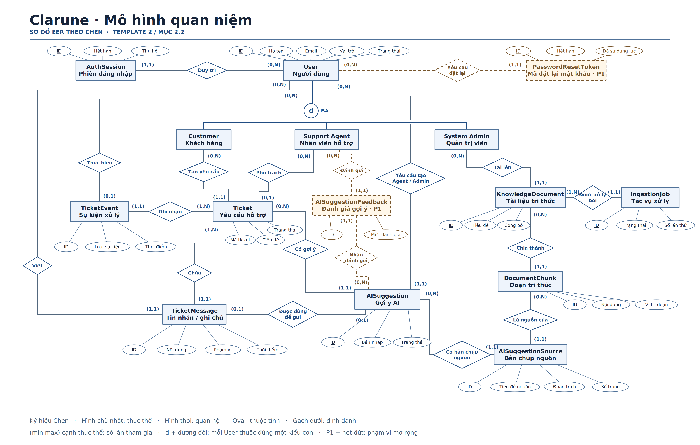

Hình 2.1 — Mô hình quan niệm (EER) của hệ thống Clarune theo ký pháp Chen. 

Vòng tròn d và đường nối đôi thể hiện mỗi User thuộc đúng một trong ba kiểu con Customer, Support Agent và System Administrator. Cặp (min, max) ở mỗi đầu quan hệ biểu thị số lần tham gia tối thiểu và tối đa của một thể hiện thuộc thực thể tại đầu đó. Nhãn P1 và nét đứt đánh dấu các thực thể và quan hệ thuộc phạm vi mở rộng.

## **2.3 Đặc tả các thực thể ngữ nghĩa và mối quan hệ**

### ***2.3.1 Danh sách thực thể ngữ nghĩa***

| STT | Tên thực thể | Loại thực thể | Thuộc tính nghiệp vụ cốt lõi | Định nghĩa ngữ nghĩa theo bài toán |
| :---: | :---- | :---- | :---- | :---- |
| 1 | User | Thực thể cha (Supertype) | id, email, fullName, role, enabled, createdAt, updatedAt | Tài khoản định danh duy nhất theo email không phân biệt hoa thường, kiểm soát trạng thái kích hoạt (enabled). |
| 2 | Customer | Thực thể con (Subtype của User) | Kế thừa toàn bộ thuộc tính từ User (role \= CUSTOMER) | Khách hàng sở hữu các Ticket của chính mình và chỉ được xem phần trao đổi công khai. |
| 3 | Support Agent | Thực thể con (Subtype của User) | Kế thừa toàn bộ thuộc tính từ User (role \= AGENT) | Nhân viên hỗ trợ xem hàng đợi mở, nhận xử lý (claim) ticket, tra cứu tri thức và kiểm duyệt/đánh giá gợi ý AI. |
| 4 | System Administrator | Thực thể con (Subtype của User) | Kế thừa toàn bộ thuộc tính từ User (role \= ADMIN) | Quản trị viên điều hành tài khoản Agent, vòng đời tài liệu tri thức, phân công/chuyển giao ticket và thống kê (P1). |
| 5 | AuthSession | Thực thể yếu / phụ thuộc User | id, expiresAt, revokedAt, createdAt, lastUsedAt | Phiên đăng nhập duy trì theo cơ chế xoay vòng mã gia hạn (Refresh Token Rotation). |
| 6 | PasswordResetToken *(P1)* | Thực thể mở rộng (PLANNED) | id, expiresAt, usedAt, createdAt | Mã đặt lại mật khẩu dùng một lần có thời hạn phục vụ UC-16 (P1). |
| 7 | Ticket | Thực thể trung tâm | id, ticketNumber, subject, status, priority, createdAt, updatedAt, resolvedAt, closedAt | Yêu cầu hỗ trợ do khách hàng tạo, có mã hiển thị duy nhất và được xử lý theo máy trạng thái gồm năm trạng thái. Thuộc tính subject tóm tắt vấn đề và có thể chứa mã model thiết bị. Ví dụ minh họa là “TV model TV-55A mất tiếng khi kết nối HDMI”. |
| 8 | TicketMessage | Thực thể phụ thuộc Ticket | id, body, visibility (PUBLIC/INTERNAL), createdAt | Tin nhắn trao đổi công khai (bao gồm nội dung mô tả đầu tiên) hoặc ghi chú nội bộ ẩn với khách hàng. |
| 9 | TicketEvent | Thực thể nhật ký phụ thuộc Ticket | id, eventType, oldValue, newValue, createdAt | Sự kiện lịch sử bất biến (append-only) ghi vết tạo, nhận, phân công và chuyển trạng thái. |
| 10 | KnowledgeDocument | Thực thể độc lập | id, title, originalFilename, mimeType, sizeBytes, status, published, failureCode, publishedAt, archivedAt | Tài liệu tri thức do Admin tải lên, chẳng hạn FAQ, hướng dẫn kỹ thuật hoặc chính sách bảo hành, đổi trả trong lĩnh vực đồ điện tử. Thuộc tính title là tiêu đề hiển thị của tài liệu. Ví dụ minh họa gồm “FAQ xử lý mất tiếng qua HDMI trên TV” và “Chính sách bảo hành và đổi trả TV”. Trạng thái xử lý READY và tình trạng công bố published được theo dõi riêng.  |
| 11 | KnowledgeIngestionJob | Thực thể phụ thuộc KnowledgeDocument | id, status, attempts, maxAttempts, nextRunAt, lockedUntil, leaseToken, lastErrorCode | Tác vụ xử lý nền (trích xuất chữ, chia đoạn, tạo vector) có cơ chế lease và thử lại giới hạn tối đa 3 lần. |
| 12 | KnowledgeChunk | Thực thể phụ thuộc KnowledgeDocument | id, chunkIndex, pageNumber, content, createdAt | Đoạn văn bản được cắt kèm số thứ tự, số trang (nếu là PDF) và vector nhúng ngữ nghĩa. |
| 13 | AISuggestion | Thực thể phụ thuộc Ticket | id, status, suggestedText, modelName, promptVersion, latencyMs, errorCode, createdAt, appliedAt | Kết quả một lần yêu cầu AI sinh bản nháp (kể cả trạng thái thiếu căn cứ hoặc lỗi) kèm dấu vết mô hình. |
| 14 | AISuggestionSource | Thực thể liên kết \+ bản chụp | id, citationOrder, score, documentTitleSnapshot, excerptSnapshot, pageNumberSnapshot | Bản chụp (snapshot) đoạn trích nguồn tại thời điểm sinh gợi ý, đảm bảo lịch sử bất biến khi tài liệu gốc bị lưu trữ. |
| 15 | AISuggestionFeedback *(P1)* | Thực thể đánh giá chất lượng gợi ý AI (Mở rộng P1 — UC-19) | id, rating (HELPFUL/NOT\_HELPFUL), createdAt, updatedAt | Đánh giá mức hữu ích hiện hành của nhân viên phụ trách đối với một gợi ý hợp lệ (UC-19, P1). |

### ***2.3.2 Bảng mối quan hệ ngữ nghĩa và lực lượng (Cardinalities)***

| Quan hệ (Verb) | Thực thể tham gia | Lực lượng (Min, Max) | Ý nghĩa nghiệp vụ & Ràng buộc toàn vẹn |
| :---- | :---- | :---- | :---- |
| duy trì | User — AuthSession | (0,n) — (1,1) | Một người dùng có thể có nhiều phiên trên các thiết bị; mỗi phiên thuộc đúng 1 người dùng. |
| gửi (requests) | Customer — Ticket | (0,n) — (1,1) | Một khách hàng có thể tạo nhiều ticket; mỗi ticket bắt buộc do đúng 1 khách hàng tạo. |
| phụ trách (assigned) | Support Agent — Ticket | (0,n) — (0,1) | Một nhân viên hỗ trợ xử lý nhiều ticket; mỗi ticket ở trạng thái OPEN chưa có nhân viên (0), sau khi nhận/gán chỉ có tối đa 1 nhân viên phụ trách. |
| chứa (contains) | Ticket — TicketMessage | (1,n) — (1,1) | Mỗi ticket ngay khi tạo đã có tối thiểu 1 tin nhắn công khai đầu tiên chứa mô tả ban đầu của khách hàng. |
| viết (writes) | User — TicketMessage | (0,n) — (1,1) | Mỗi tin nhắn/ghi chú bắt buộc do đúng 1 người dùng xác thực viết; Customer không được viết INTERNAL. |
| ghi nhận (records) | Ticket — TicketEvent | (1,n) — (1,1) | Ngay khi tạo ticket đã có tối thiểu sự kiện TICKET\_CREATED; tác nhân thay đổi có thể null nếu là sự kiện hệ thống. |
| tải lên (uploads) | System Administrator — KnowledgeDocument | (0,n) — (1,1) | Chỉ Admin được tải lên tài liệu; mỗi tài liệu gắn 1 người tải lên (UC-11). |
| được xử lý bởi | KnowledgeDocument — KnowledgeKnowledgeIngestionJob | (1,n) — (1,1) | Mỗi tài liệu sau tải lên tạo tối thiểu 1 tác vụ xử lý nền; tại một thời điểm chỉ có tối đa 1 job đang hoạt động (PENDING/RUNNING). |
| chia thành (contains) | KnowledgeDocument — KnowledgeChunk | (0,n) — (1,1) | Tài liệu chưa xong hoặc lỗi có 0 đoạn; tài liệu READY có 1..n đoạn duy nhất theo (document, chunkIndex). |
| nhận gợi ý (has) | Ticket — AISuggestion | (0,n) — (1,1) | Một ticket có thể yêu cầu AI gợi ý nhiều lần (hoặc 0 lần); mỗi gợi ý gắn cố định với 1 ticket. |
| yêu cầu tạo (requests) | User (Agent/Admin) — AISuggestion | (0,n) — (1,1) | Lưu vết nhân viên hoặc Admin đã bấm tạo gợi ý (requestedBy). |
| chuyển thành (applied as) | AISuggestion — TicketMessage | (0,1) — (0,1) | Một gợi ý tối đa chỉ được áp dụng thành 1 tin nhắn công khai duy nhất (chống áp dụng trùng lặp); tin nhắn soạn tay không gắn gợi ý (0). |
| dẫn nguồn (references) | AISuggestion — AISuggestionSource | (0,n) — (1,1) | Gợi ý INSUFFICIENT\_EVIDENCE/FAILED có 0 nguồn; gợi ý GENERATED/APPLIED tham chiếu từ 1 nguồn trở lên. |
| được chụp từ (cited from) | KnowledgeChunk — AISuggestionSource | (0,n) — (1,1) | Lưu bản chụp trích dẫn từ đúng 1 chunk gốc; không xóa cứng chunk đã được trích dẫn. |
| thực hiện (triggers) | User — TicketEvent | (0,n) — (0,1) | Một người dùng có thể thực hiện nhiều sự kiện xử lý. Mỗi sự kiện gắn với tối đa một người dùng. Sự kiện do hệ thống ghi nhận có thể không gắn với người dùng. |
| yêu cầu đặt lại (requests reset \- P1) | User — PasswordResetToken | (0,n) — (1,1) | Một người dùng có thể yêu cầu đặt lại mật khẩu nhiều lần; mỗi mã xác nhận khôi phục mật khẩu chỉ thuộc về đúng một người dùng. |
| đánh giá (evaluates \- P1) | Support Agent — AISuggestionFeedback | (0,n) — (1,1) | Một nhân viên hỗ trợ có thể đánh giá nhiều gợi ý. Mỗi bản đánh giá thuộc đúng một nhân viên. Chỉ nhân viên đang phụ trách Ticket mới được đánh giá gợi ý của Ticket đó (UC-19).  |
| Nhận đánh giá (P1) | AISuggestion — AISuggestionFeedback | (0,n) — (1,1) | Một gợi ý có thể chưa có đánh giá hoặc có nhiều đánh giá từ các nhân viên khác nhau. Mỗi bản đánh giá thuộc đúng một gợi ý. Chỉ gợi ý ở trạng thái GENERATED hoặc APPLIED được đánh giá. Mỗi cặp nhân viên–gợi ý có tối đa một đánh giá hiện hành (UC-19). |

# **3\. Thiết kế kiến trúc**

## **3.1 Sơ đồ kiến trúc**

### ***3.1.1 Sơ đồ cây phân rã hệ thống (System Decomposition Tree)***

Sơ đồ cây phân rã trình bày cấu trúc phân rã chức năng theo chiều dọc của toàn bộ hệ thống Clarune thành 4 Module nghiệp vụ ánh xạ trực tiếp tới 19 Use Cases (UC-01..UC-19), kết nối xuyên suốt tới máy chủ ứng dụng (Application Server), lớp điều phối giao dịch (Workflow) và hệ quản trị cơ sở dữ liệu PostgreSQL \+ pgvector.

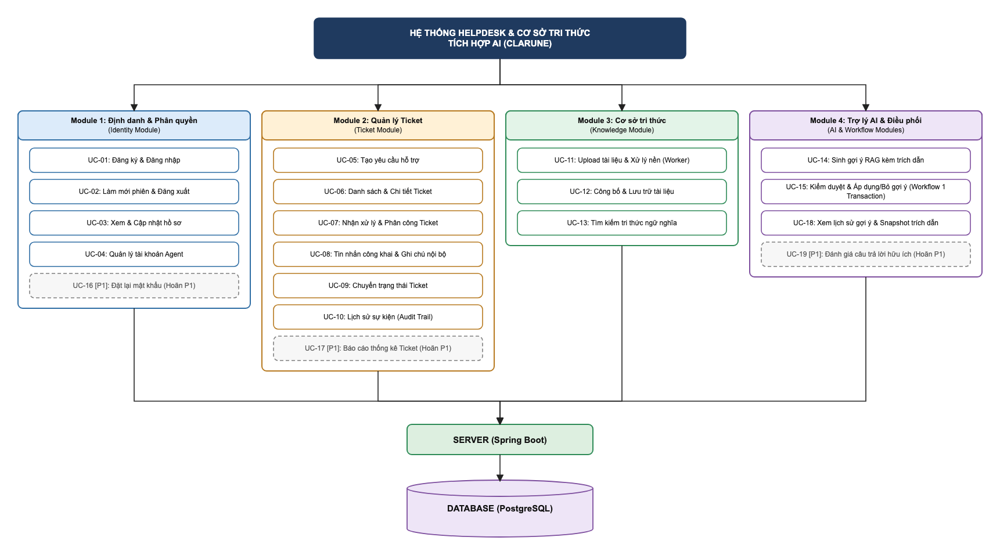

Hình 3.1 — Sơ đồ cây phân rã chức năng hệ thống Clarune theo chiều dọc

### ***3.1.2 Sơ đồ tổng quan kiến trúc hệ thống (Overall System Architecture)***

Hệ thống được thiết kế theo mô hình Client–Server 3 tầng (3-Tier) ở cấp triển khai kết hợp Kiến trúc Khối đơn thể Mô-đun hóa (Modular Monolith — C4 Container/Component) ở tầng máy chủ nhằm tối ưu sự tách biệt nghiệp vụ nhưng không phát sinh chi phí vận hành phân tán (Microservices/Message Broker) trong phạm vi MVP.

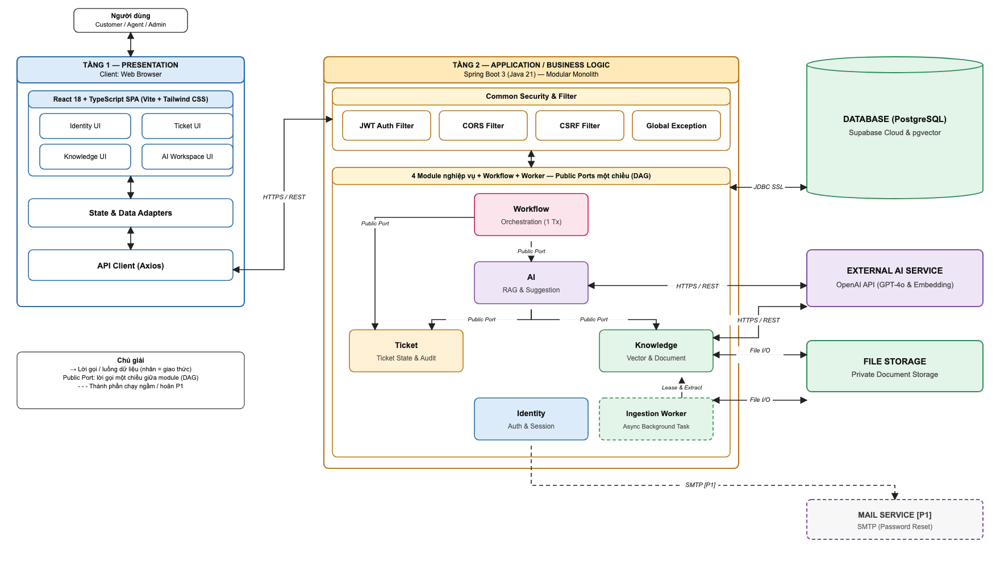

Hình 3.2 — Sơ đồ tổng quan kiến trúc 3 tầng kết hợp Modular Monolith của hệ thống Clarune

### ***3.1.3 Tổng quan kiến trúc***

Hệ thống Clarune được thiết kế dựa trên mô hình Client \- Server kết hợp với Kiến trúc 3 tầng (3-Tier Architecture) ở cấp độ triển khai và Kiến trúc Khối đơn thể Mô-đun hóa (Modular Monolith) ở phía máy chủ. Cách tiếp cận này giúp hệ thống vừa đơn giản trong việc đóng gói, vận hành, vừa đảm bảo tính phân tách độc lập giữa các miền nghiệp vụ:

* Cô lập thực thể và kho dữ liệu theo từng Module: Toàn bộ mã nguồn máy chủ được chia thành 4 Module nghiệp vụ độc lập (Identity, Ticket, Knowledge, AI) cùng 1 gói điều phối Workflow chung. Mỗi Module quản lý riêng các thực thể dữ liệu (Entity) và lớp truy xuất (Repository) của mình, không truy cập trực tiếp vào bảng hay kho dữ liệu nội bộ của Module khác.  
* Giao tiếp liên Module qua Cổng giao tiếp công khai (Public Ports) và DTO bất biến: Các Module trao đổi dữ liệu với nhau thông qua các giao diện dịch vụ được định nghĩa rõ ràng. Cụ thể: Module Identity cung cấp thông tin định danh và vai trò người dùng hiện tại; Module Ticket cung cấp ngữ cảnh hội thoại công khai (đã loại bỏ các ghi chú nội bộ) cho Module AI; Module Knowledge đảm nhận độc quyền việc nhúng câu truy vấn và tìm kiếm đoạn tri thức tương đồng; Module Workflow đứng ở tầng trên để điều phối thao tác áp dụng hoặc hủy bỏ gợi ý AI giữa Ticket và AI trong một giao dịch thống nhất, tránh phụ thuộc vòng hai chiều.

### ***3.1.4 Tầng Client (Presentation Layer)***

Tầng Client chịu trách nhiệm hiển thị giao diện trực quan và tiếp nhận thao tác từ ba nhóm người dùng (Khách hàng, Nhân viên hỗ trợ, Quản trị viên). Được xây dựng bằng thư viện React kết hợp TypeScript và công cụ Vite, tầng này áp dụng các nguyên tắc thiết kế hiện đại:

* Kiến trúc tổ chức theo tính năng (Feature-Sliced Design): Giao diện được phân chia thành các phân khu độc lập tương ứng với các miền nghiệp vụ (Identity, Ticket, Knowledge, AI), hỗ trợ hiển thị tương thích trên cả máy tính để bàn, máy tính bảng và thiết bị di động kèm hai chế độ giao diện Sáng/Tối.  
* Quản lý phiên đăng nhập và làm mới Token tự động: Access Token có thời hạn ngắn chỉ được lưu trữ trong bộ nhớ tạm của ứng dụng (in-memory), trong khi Refresh Token được bảo vệ an toàn qua HttpOnly Cookie. Bộ đón chặn (Axios Interceptor) tự động gộp các yêu cầu làm mới phiên khi hết hạn token để đảm bảo trải nghiệm liền mạch cho người dùng.  
* Tách biệt dữ liệu giao tiếp và mô hình hiển thị (DTO & ViewModel Adapter): Dữ liệu JSON chuẩn hóa từ máy chủ được chuyển đổi qua lớp Adapter tại phía Client để định dạng thời gian theo múi giờ địa phương và hiển thị đúng trạng thái giao diện.

### ***3.1.5 Tầng Server (Business Logic Layer)***

Tầng Server là trung tâm xử lý nghiệp vụ của toàn hệ thống, được phát triển trên nền tảng Java 21 và Spring Boot 3\. Bên trong mỗi Module nghiệp vụ, luồng xử lý tuân thủ chặt chẽ kiến trúc phân lớp gồm 4 thành phần:

* Lớp Giao tiếp API (Controller Layer): Tiếp nhận các yêu cầu HTTP RESTful (/api/v1/\*) từ phía Client, kiểm tra tính hợp lệ của dữ liệu đầu vào và chuẩn hóa kết quả trả về hoặc thông báo lỗi theo cấu trúc thống nhất.  
* Lớp Dịch vụ Ứng dụng (Application Service Layer): Điều phối luồng thực thi của từng ca sử dụng và quản lý ranh giới giao dịch cơ sở dữ liệu (Transaction). Để tối ưu hiệu năng và tài nguyên kết nối, giao dịch chỉ được mở khi đọc hoặc ghi cơ sở dữ liệu và luôn tách riêng khỏi các lời gọi mạng tới dịch vụ AI bên ngoài.  
* Lớp Mô hình Nghiệp vụ (Domain Layer): Đóng gói các quy tắc nghiệp vụ cốt lõi, kiểm soát quyền sở hữu trên từng phiếu hỗ trợ và quản lý máy trạng thái của Ticket cũng như tài liệu tri thức.  
* Lớp Hạ tầng Kỹ thuật (Infrastructure Layer): Thực thi việc truy xuất dữ liệu qua Spring Data JPA, quản lý lưu trữ tệp tin nội bộ, trích xuất văn bản từ tài liệu (PDF, TXT, Markdown) và kết nối với dịch vụ AI bên ngoài. Ngoài ra, bộ lọc bảo mật (JWT Authentication Filter) kiểm tra trạng thái kích hoạt của tài khoản trên mọi yêu cầu để thu hồi quyền truy cập ngay lập tức khi tài khoản bị vô hiệu hóa.

### ***3.1.6 Tầng Cơ sở dữ liệu & Lưu trữ (Data Layer)***

Tầng Cơ sở dữ liệu và Lưu trữ đảm bảo tính toàn vẹn, bền vững và bảo mật cho cả dữ liệu cấu trúc, dữ liệu vector ngữ nghĩa và tệp tài liệu gốc:

* Cơ sở dữ liệu quan hệ kết hợp Vector (PostgreSQL 16 & pgvector): Hệ thống triển khai cơ sở dữ liệu chính trên nền tảng Supabase Cloud (khu vực Singapore) tích hợp sẵn tiện ích mở rộng pgvector, đồng thời duy trì cấu hình Docker Compose làm môi trường dự phòng khi phát triển cục bộ. Việc hợp nhất dữ liệu nghiệp vụ và vector nhúng trong cùng một hệ quản trị cho phép hệ thống vừa đảm bảo tính toàn vẹn giao dịch (ACID), vừa lọc điều kiện quyền truy cập và trạng thái công bố của tài liệu ngay trong câu truy vấn tìm kiếm tương đồng ngữ nghĩa.  
* Kho lưu trữ tệp tin riêng tư (Private File Storage): Các tệp tài liệu gốc do Quản trị viên tải lên được lưu trữ trong phân vùng riêng biệt nằm ngoài thư mục truy cập công khai và định danh bằng khóa lưu trữ ngẫu nhiên do máy chủ cấp phát. Mọi yêu cầu đọc hoặc tải tệp đều phải đi qua tầng kiểm tra phân quyền của máy chủ.

### ***3.1.7 Công nghệ sử dụng & Các điểm đặc biệt trong kiến trúc***

#### ***A. Bảng tổng hợp Công nghệ sử dụng***

| Lớp (Layer) | Công nghệ / Thư viện | Mục đích & Lý do lựa chọn | Phiên bản / Tiêu chuẩn áp dụng |
| :---- | :---- | :---- | :---- |
| Frontend | React \+ TypeScript \+ Vite | Xây dựng SPA có kiểm soát kiểu tĩnh mạnh, tốc độ build nhanh | React 18.3.1, TypeScript 5.6.2, Vite 6.0.1 |
| UI Styling & HTTP | Tailwind CSS \+ Axios | Giao diện đáp ứng (Responsive) theo thiết kế Figma; interceptor single-flight refresh 401 | Tailwind CSS 3.4.15, Fetch API / Axios Client có Refresh Interceptor |
| Backend Core | Java 21 (LTS) \+ Spring Boot 3 | Hệ sinh thái vững chắc cho REST API, transaction và bảo mật | Java 21 (LTS), Spring Boot 3.3.5 |
| Security | Spring Security \+ JJWT / Nimbus \+ BCrypt (PasswordEncoder) | Xác thực Access JWT 15 phút, Refresh Token hash SHA-256 trong DB | Spring Security 6.3.4, JJWT / Token Auth, BCrypt |
| Persistence & Migration | Spring Data JPA / Hibernate \+ PostgreSQL 16 \+ pgvector \+ Flyway | Hỗ trợ vừa giao dịch ACID cho Ticket, vừa truy vấn vector cho RAG | PostgreSQL 16 \+ pgvector |
| Document Parsing | Apache PDFBox \+ Bộ đọc TXT/MD UTF-8 thuần | Trích xuất text từ PDF có lớp văn bản (không OCR ảnh quét trong P0) | Apache PDFBox (PDF text) & UTF-8 Text/Markdown Parser |
| AI & RAG Integration | Spring AI / HTTP Client tương thích API Embedding & LLM | Trừu tượng hóa qua cổng Port để hoán đổi giữa Live và Mock | Mô hình ngôn ngữ lớn (LLM: GPT-4o-mini) & Mô hình nhúng Vector (gemini-embedding-2, 768 chiều) |
| Testing & DevOps | JUnit 5, Mockito, MockMvc, Testcontainers, Docker Compose, GitHub Actions | Chạy test tranh chấp đồng thời trên PostgreSQL thật và tái lập môi trường sạch | Java 21 / Maven / Docker |

#### ***B. Các điểm đặc biệt và Mẫu thiết kế (Design Patterns) áp dụng***

1\. Mẫu Máy trạng thái (State Machine Pattern — Quản lý vòng đời Ticket và Tài liệu):

Toàn bộ quy trình chuyển đổi trạng thái của phiếu hỗ trợ (từ OPEN, IN\_PROGRESS, WAITING\_CUSTOMER đến RESOLVED, CLOSED) và tài liệu tri thức (từ UPLOADED, PROCESSING đến READY, FAILED, ARCHIVED) được đóng gói trực tiếp trong các thực thể nghiệp vụ. Mọi thao tác chuyển trạng thái không hợp lệ hoặc không đúng thẩm quyền vai trò sẽ bị hệ thống từ chối ngay tại tầng nghiệp vụ.

2\. Cơ chế Khóa lạc quan kết hợp Cập nhật nguyên tử (Optimistic Locking & Atomic Claim):

Giải quyết triệt để tình huống hai nhân viên hỗ trợ cùng bấm nhận xử lý một phiếu đang mở tại cùng một thời điểm. Hệ thống sử dụng trường phiên bản (version) kết hợp câu lệnh cập nhật nguyên tử có điều kiện để đảm bảo chỉ có duy nhất một nhân viên nhận phiếu thành công; yêu cầu đến sau sẽ nhận được thông báo xung đột (HTTP 409\) để làm mới lại danh sách.

3\. Tiến trình Xử lý nền theo cơ chế Giữ khóa có thời hạn (Lease-Based Background Worker):

Khi Quản trị viên tải lên tài liệu tri thức, hệ thống ghi nhận tệp và trả về phản hồi ngay lập tức, sau đó tiến trình nền sẽ tự động nhận tác vụ trong một giao dịch ngắn kèm mã khóa phiên (lease token) có thời hạn. Quá trình trích xuất văn bản PDF và gọi API sinh vector nhúng được thực hiện bên ngoài giao dịch cơ sở dữ liệu; kết quả chỉ được lưu lại nếu mã khóa phiên vẫn còn hiệu lực, giúp hệ thống tự phục hồi an toàn nếu tiến trình gặp sự cố giữa chừng.

4\. Mẫu Chiến lược & Bộ chuyển đổi cho dịch vụ AI (Strategy & Adapter Pattern):

Trừu tượng hóa việc tích hợp mô hình ngôn ngữ lớn (LLM) và mô hình nhúng (Embedding) thông qua các cổng giao tiếp chuẩn. Kiến trúc này cho phép hệ thống linh hoạt chuyển đổi giữa nhà cung cấp dịch vụ AI thực tế (OpenAI API) và bộ mô phỏng phục vụ kiểm thử tự động mà không làm thay đổi mã nguồn xử lý nghiệp vụ cốt lõi.

5\. Điều phối Giao dịch Liên Module có con người kiểm duyệt (Human-in-the-Loop Workflow):

Hệ thống không bao giờ tự động gửi trực tiếp câu trả lời của AI cho khách hàng. Khi nhân viên hỗ trợ kiểm duyệt, chỉnh sửa và xác nhận áp dụng gợi ý, dịch vụ điều phối tại Module Workflow sẽ thực hiện khóa bản ghi theo thứ tự nhất quán từ Ticket đến gợi ý AI trong cùng một giao dịch cơ sở dữ liệu, đảm bảo việc tạo tin nhắn phản hồi công khai và cập nhật trạng thái gợi ý diễn ra đồng bộ, chống áp dụng trùng lặp.

6\. Phòng chống tấn công Prompt Injection & Kiểm chứng Trích dẫn Nghiêm ngặt:

Tách biệt hoàn toàn chỉ dẫn hệ thống (System Prompt) với nội dung văn bản do người dùng nhập vào, đồng thời không cấp cho mô hình AI bất kỳ quyền thực thi công cụ hay truy cập cơ sở dữ liệu trực tiếp nào. Mọi gợi ý do AI sinh ra đều phải đi kèm mã nguồn trích dẫn hợp lệ nằm trong tập đoạn tri thức vừa truy xuất; nếu không đủ căn cứ từ tài liệu đã công bố, hệ thống chủ động trả về trạng thái thiếu bằng chứng thay vì suy đoán.

## **3.2 Sơ đồ lớp (Class Diagram)**

Hệ thống tổ chức các lớp thành 4 module nghiệp vụ (Identity, Ticket, Knowledge, AI) và 1 gói điều phối chung (Workflow). Mũi tên thể hiện lớp sử dụng dịch vụ. Đường nối có bội số thể hiện liên kết dữ liệu. Các liên kết giữa thực thể thuộc hai module dùng ID. Dấu \+ chỉ thành viên public, dấu − chỉ thành viên private.

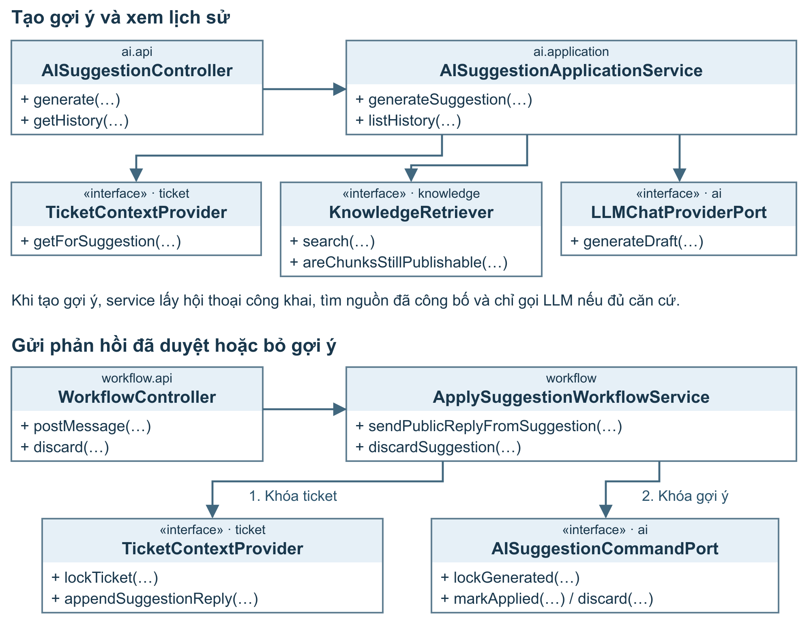

Hình 3.3a — Các cổng giao tiếp và thứ tự khóa khi áp dụng gợi ý

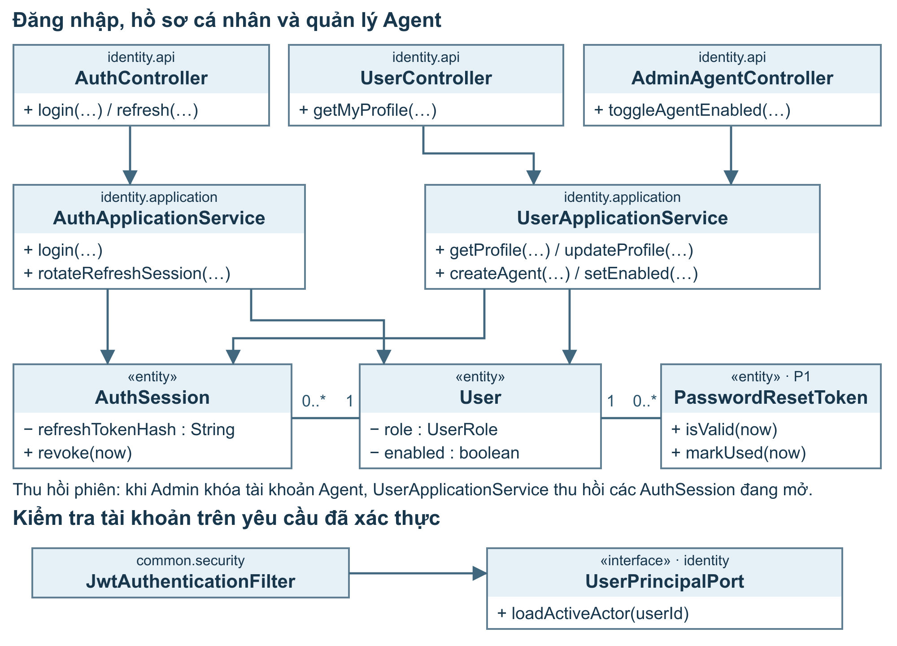

Hình 3.3b — Định danh, tài khoản và phiên đăng nhập

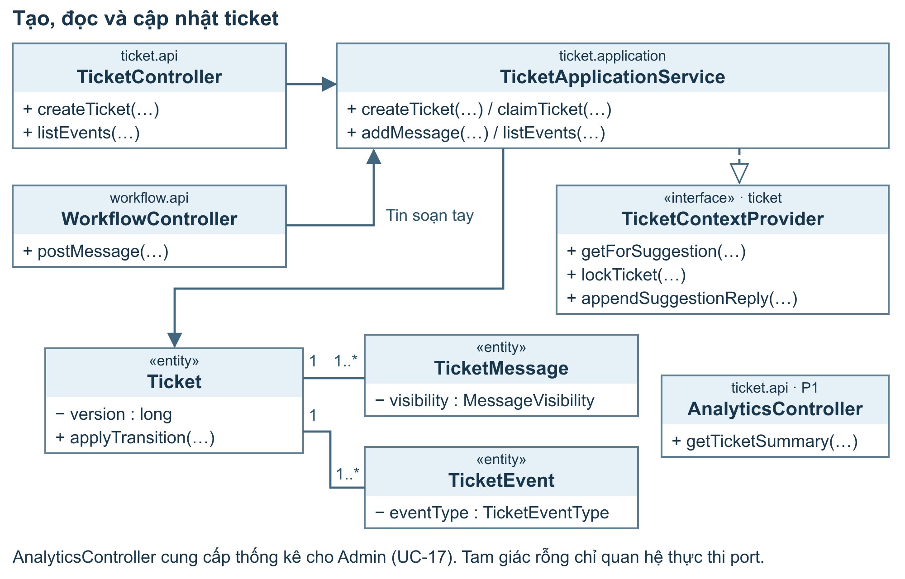

Hình 3.3c — Dịch vụ Ticket, cổng ngữ cảnh và lịch sử xử lý

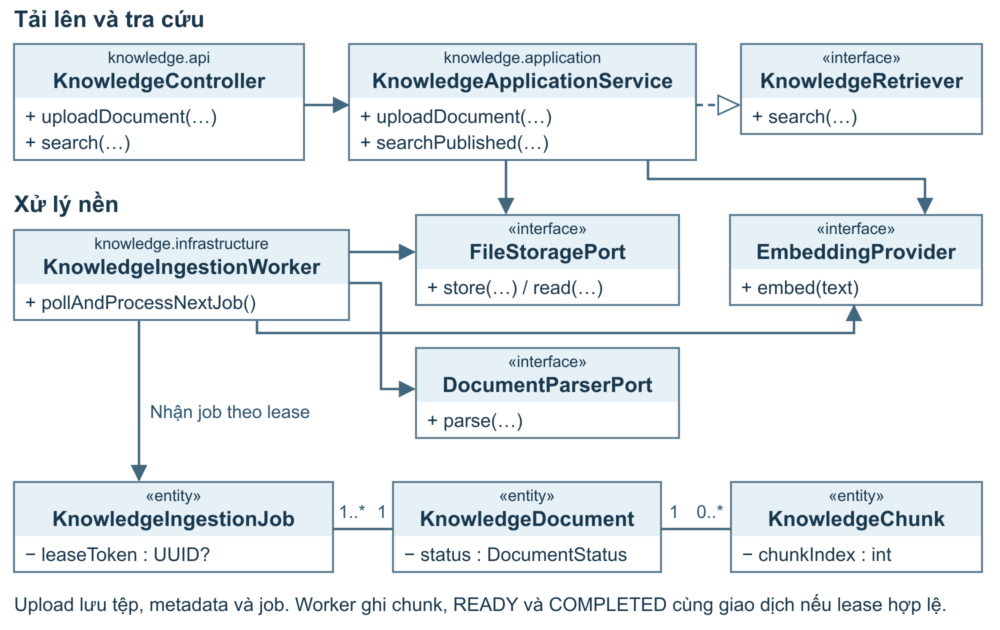

Hình 3.3d — Các lớp xử lý tài liệu và sinh vector

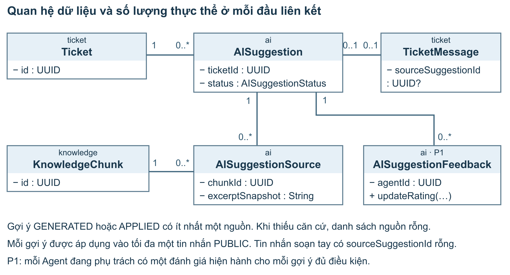

Hình 3.3e — Gợi ý AI, tin nhắn đã duyệt và nguồn trích dẫn

## **3.3 Đặc tả lớp (Class Specifications)**

### ***3.3.1 Module 1: Định danh và Phân quyền (Identity)***

#### ***Lớp User (Thực thể nghiệp vụ — Bảng users)***

Mô tả: Đại diện tài khoản người dùng của hệ thống Clarune, đóng gói quy tắc đổi mật khẩu, cập nhật hồ sơ và vô hiệu hóa/kích hoạt tài khoản.

Thuộc tính (Properties):

| STT | Thuộc tính | Modifier | Kiểu dữ liệu & Ràng buộc | Mô tả |
| :---: | :---- | :---- | :---- | :---- |
| 1 | id | private | UUID (PK, Not Null) | Định danh duy nhất của người dùng |
| 2 | email | private | String (varchar(255), Unique Normalized, Not Null) | Email đăng nhập được chuẩn hóa chữ thường (lowercase) |
| 3 | passwordHash | private | String (varchar(255), Not Null) | Chuỗi băm mật khẩu một chiều (BCrypt), không lưu thô |
| 4 | fullName | private | String (varchar(120), Not Null) | Họ và tên hiển thị |
| 5 | role | private | UserRole (CUSTOMER, AGENT, ADMIN, Not Null) | Vai trò phân quyền theo RBAC |
| 6 | enabled | private | boolean (Default true, Not Null) | Trạng thái kích hoạt tài khoản; khi bị khóa sẽ từ chối mọi yêu cầu truy cập |
| 7 | createdAt | private | Instant (timestamptz, Not Null) | Thời điểm tạo tài khoản (UTC) |
| 8 | updatedAt | private | Instant (timestamptz, Not Null) | Thời điểm cập nhật gần nhất (UTC) |

Phương thức (Operations):

| STT | Phương thức | Modifier | Tham số & Kiểu trả về | Mô tả |
| :---: | :---- | :---- | :---- | :---- |
| 1 | createCustomer | public static | (String email, String passwordHash, String fullName) : User | Factory method tạo tài khoản mới luôn gắn mặc định role \= CUSTOMER |
| 2 | createAgent | public static | (String email, String passwordHash, String fullName) : User | Factory method tạo tài khoản nhân viên (role \= AGENT) |
| 3 | updateProfile | public | (String fullName, Instant now) : void | Cập nhật họ tên hợp lệ (không cho phép sửa email hoặc role) |
| 4 | changePasswordHash | public | (String newPasswordHash, Instant now) : void | Ghi nhận mã băm mật khẩu mới sau khi kiểm tra mật khẩu cũ |
| 5 | setEnabled | public | (boolean enabled, Instant now) : void | Kích hoạt hoặc vô hiệu hóa tài khoản |

#### ***Lớp AuthSession (Thực thể nghiệp vụ — Bảng auth\_sessions)***

Mô tả: Quản lý phiên duy trì đăng nhập sử dụng Refresh Token có cơ chế xoay vòng nguyên tử và thu hồi khi đăng xuất.

Thuộc tính (Properties):

| STT | Thuộc tính | Modifier | Kiểu dữ liệu & Ràng buộc | Mô tả |
| :---: | :---- | :---- | :---- | :---- |
| 1 | id | private | UUID (PK, Not Null) | Mã phiên đăng nhập |
| 2 | userId | private | UUID (FK users.id, Not Null) | Tham chiếu tài khoản sở hữu phiên |
| 3 | refreshTokenHash | private | String (varchar(128), Unique, Not Null) | Mã băm SHA-256 của Refresh Token ngẫu nhiên |
| 4 | expiresAt | private | Instant (timestamptz, Not Null) | Thời điểm hết hạn phiên (mặc định \+7 ngày) |
| 5 | revokedAt | private | Instant (timestamptz, Nullable) | Thời điểm phiên bị thu hồi (logout/rotation/disable) |
| 6 | createdAt | private | Instant (timestamptz, Not Null) | Thời điểm khởi tạo phiên |
| 7 | lastUsedAt | private | Instant (timestamptz, Nullable) | Thời điểm làm mới token gần nhất (audit) |

Phương thức (Operations):

| STT | Phương thức | Modifier | Tham số & Kiểu trả về | Mô tả |
| :---: | :---- | :---- | :---- | :---- |
| 1 | isActive | public | (Instant now) : boolean | Kiểm tra phiên đăng nhập còn hiệu lực (chưa bị thu hồi và chưa hết hạn) |
| 2 | revoke | public | (Instant now) : void | Đánh dấu phiên đã thu hồi, ngăn chặn sử dụng lại token cũ |

#### ***Lớp PasswordResetToken (Thực thể mở rộng P1 — Bảng password\_reset\_tokens)***

Mô tả: Quản lý mã xác nhận khôi phục mật khẩu dùng một lần có giới hạn thời gian phục vụ chức năng quên mật khẩu (UC-16, giai đoạn mở rộng P1).

Thuộc tính (Properties):

| STT | Thuộc tính | Modifier | Kiểu dữ liệu & Ràng buộc | Mô tả |
| :---: | :---- | :---- | :---- | :---- |
| 1 | id | private | UUID (PK, Not Null) | Mã định danh bản ghi khôi phục mật khẩu |
| 2 | userId | private | UUID (FK users.id, Not Null) | Tài khoản người dùng yêu cầu đặt lại mật khẩu |
| 3 | tokenHash | private | String (varchar(128), Unique, Not Null) | Mã băm SHA-256 của chuỗi token khôi phục |
| 4 | expiresAt | private | Instant (timestamptz, Not Null) | Thời điểm hết hạn hiệu lực của token |
| 5 | usedAt | private | Instant (timestamptz, Nullable) | Thời điểm token đã được sử dụng để đặt lại mật khẩu |
| 6 | createdAt | private | Instant (timestamptz, Not Null) | Thời điểm khởi tạo yêu cầu (UTC) |

Phương thức (Operations):

| STT | Phương thức | Modifier | Tham số & Kiểu trả về | Mô tả |
| :---: | :---- | :---- | :---- | :---- |
| 1 | isValid | public | (Instant now) : boolean | Kiểm tra token chưa được sử dụng và vẫn còn trong thời hạn hiệu lực |
| 2 | markUsed | public | (Instant now) : void | Đánh dấu token đã được sử dụng để ngăn chặn việc tái sử dụng |

#### *C**ác lớp Controller & Application Service của Module Identity***

| Lớp | Vai trò / Layer | Phương thức chính (public) | Phân quyền & Quản lý giao dịch |
| :---- | :---- | :---- | :---- |
| AuthController | API Layer (/api/v1/auth) | register(RegisterRequest), login(LoginRequest), refresh(HttpServletRequest, HttpServletResponse), logout(HttpServletRequest, HttpServletResponse) | Public cho register/login/refresh; kiểm tra CSRF \+ HttpOnly Cookie cho refresh/logout |
| UserController | API Layer (/api/v1/users) | getMyProfile(ActorPrincipal), updateMyProfile(ActorPrincipal, UpdateProfileRequest), changeMyPassword(ActorPrincipal, ChangePasswordRequest) | Yêu cầu xác thực; người dùng chỉ được thao tác trên hồ sơ của chính mình |
| AdminAgentController | API Layer (/api/v1/admin/agents) | listAgents(ActorPrincipal, AgentStatusFilter, Pageable), createAgent(ActorPrincipal, CreateAgentRequest), toggleAgentEnabled(ActorPrincipal, UUID id, SetEnabledRequest) | Chỉ dành cho Quản trị viên (ADMIN) |
| AuthApplicationService | Application Layer | register(...), login(...), rotateRefreshSession(...), logout(...) | Thực thi trong một giao dịch nguyên tử: thu hồi phiên cũ và lưu phiên mới đồng thời |
| UserApplicationService | Application Layer | getProfile(...), updateProfile(...), changePassword(...), listAgents(...), createAgent(...), setEnabled(...) | Khi setEnabled(false), thu hồi đồng thời các AuthSession đang mở |
| UserPrincipalPort | Public Port | loadActiveActor(UUID userId) : ActorPrincipal | Được JwtAuthenticationFilter gọi để xác nhận enabled \= true ở mọi request |

### ***3.3.2 Module 2: Quản lý Ticket (Ticket)***

#### ***Lớp Ticket (Thực thể nghiệp vụ — Bảng tickets)***

Mô tả: Thực thể gốc quản lý vòng đời yêu cầu hỗ trợ, đóng gói máy trạng thái 5 bước và khóa lạc quan version.

Thuộc tính (Properties):

| STT | Thuộc tính | Modifier | Kiểu dữ liệu & Ràng buộc | Mô tả |
| :---: | :---- | :---- | :---- | :---- |
| 1 | id | private | UUID (PK, Not Null) | Định danh duy nhất của Ticket |
| 2 | ticketNumber | private | String (varchar(32), Unique, Not Null) | Mã hiển thị thân thiện cho người dùng (VD: HD-1054) |
| 3 | requesterId | private | UUID (FK users.id, Not Null) | ID Khách hàng tạo ticket |
| 4 | assignedAgentId | private | UUID (FK users.id, Nullable khi OPEN) | ID Nhân viên hỗ trợ phụ trách hiện tại |
| 5 | subject | private | String (varchar(150), Not Null, 5–150 ký tự) | Tiêu đề tóm tắt sự cố hoặc yêu cầu hỗ trợ thiết bị điện tử (VD: "TV model TV-55A mất tiếng khi kết nối HDMI") |
| 6 | status | private | TicketStatus (OPEN, IN\_PROGRESS, WAITING\_CUSTOMER, RESOLVED, CLOSED) | Trạng thái xử lý hiện tại theo máy trạng thái |
| 7 | priority | private | TicketPriority (LOW, NORMAL, HIGH, Default NORMAL) | Mức ưu tiên xử lý (không có URGENT; P0 khởi tạo mặc định NORMAL, thao tác đổi mức ưu tiên thuộc Backlog/P1) |
| 8 | version | private | long (@Version, Not Null) | Số phiên bản phục vụ Optimistic Locking |
| 9 | createdAt | private | Instant (timestamptz, Not Null) | Thời điểm tạo ticket (UTC) |
| 10 | updatedAt | private | Instant (timestamptz, Not Null) | Thời điểm cập nhật gần nhất (UTC) |
| 11 | resolvedAt | private | Instant (timestamptz, Nullable) | Thời điểm chuyển sang RESOLVED |
| 12 | closedAt | private | Instant (timestamptz, Nullable) | Thời điểm chuyển sang CLOSED |

Phương thức (Operations):

| STT | Phương thức | Modifier | Tham số & Kiểu trả về | Mô tả |
| :---: | :---- | :---- | :---- | :---- |
| 1 | createNew | public static | (String ticketNumber, UUID requesterId, String subject, Instant now) : Ticket | Tạo ticket ở trạng thái OPEN, priority \= NORMAL, assignedAgentId \= null |
| 2 | applyTransition | public | (TicketAction action, UserRole actorRole, Instant now) : TicketStatus | Kiểm tra luật máy trạng thái theo bảng transition; ném lỗi conflict 409 nếu không hợp lệ |
| 3 | assignToAgent | public | (UUID newAgentId, Instant now) : void | Gán lần đầu (OPEN \-\> IN\_PROGRESS) hoặc chuyển người phụ trách (IN\_PROGRESS/WAITING\_CUSTOMER) |
| 4 | resumeOnCustomerReply | public | (Instant now) : boolean | Tự động tiếp tục xử lý (WAITING\_CUSTOMER \-\> IN\_PROGRESS) khi Khách hàng gửi tin nhắn phản hồi |
| 5 | canAcceptMessage | public | (UserRole role, MessageVisibility visibility) : boolean | Xác nhận CLOSED và RESOLVED không được gửi thêm message, Customer chỉ gửi PUBLIC |

#### ***Lớp TicketMessage (Thực thể nghiệp vụ — Bảng ticket\_messages)***

Mô tả: Lưu tin nhắn trao đổi công khai (gồm cả nội dung mô tả đầu tiên) và ghi chú nội bộ giữa nhân viên/quản trị viên.

Thuộc tính (Properties):

| STT | Thuộc tính | Modifier | Kiểu dữ liệu & Ràng buộc | Mô tả |
| :---: | :---- | :---- | :---- | :---- |
| 1 | id | private | UUID (PK, Not Null) | Định danh tin nhắn |
| 2 | ticketId | private | UUID (FK tickets.id, Not Null) | Ticket chứa tin nhắn |
| 3 | authorId | private | UUID (FK users.id, Not Null) | Người gửi lấy từ ActorPrincipal |
| 4 | body | private | String (text, Not Null, 1–5000 ký tự) | Nội dung tin nhắn/ghi chú |
| 5 | visibility | private | MessageVisibility (PUBLIC, INTERNAL, Not Null) | INTERNAL bị lọc ẩn hoàn toàn khỏi Customer |
| 6 | sourceSuggestionId | private | UUID (Nullable FK ai\_suggestions.id, Unique Partial Index) | Liên kết gợi ý AI nếu Agent gửi qua quy trình kiểm duyệt (UC-15) |
| 7 | createdAt | private | Instant (timestamptz, Not Null) | Thời điểm gửi tin nhắn |

Phương thức (Operations):

| STT | Phương thức | Modifier | Tham số & Kiểu trả về | Mô tả |
| :---: | :---- | :---- | :---- | :---- |
| 1 | createPublic | public static | (UUID ticketId, UUID authorId, String body, UUID suggestionId, Instant now) : TicketMessage | Khởi tạo tin nhắn công khai (cho phép gắn suggestionId tùy chọn) |
| 2 | createInternalNote | public static | (UUID ticketId, UUID authorId, String body, Instant now) : TicketMessage | Khởi tạo ghi chú nội bộ (sourceSuggestionId luôn null) |

#### ***Lớp TicketEvent (Thực thể nghiệp vụ — Bảng ticket\_events)***

Mô tả: Lưu trữ bản ghi nhật ký bất biến (chỉ thêm mới) nhằm theo dõi toàn bộ lịch sử khởi tạo, nhận việc, phân công và chuyển đổi trạng thái trên mỗi Ticket.

Thuộc tính (Properties):

| STT | Thuộc tính | Modifier | Kiểu dữ liệu & Ràng buộc | Mô tả |
| :---: | :---- | :---- | :---- | :---- |
| 1 | id | private | UUID (PK, Not Null) | Mã định danh duy nhất của sự kiện |
| 2 | ticketId | private | UUID (FK tickets.id, Not Null) | Phiếu hỗ trợ phát sinh sự kiện |
| 3 | actorId | private | UUID (FK users.id, Nullable) | Người dùng thực hiện thao tác (để trống nếu là sự kiện tự động của hệ thống) |
| 4 | eventType | private | TicketEventType (TICKET\_CREATED, CLAIMED, ASSIGNED, REASSIGNED, STATUS\_CHANGED, PRIORITY\_CHANGED) | Phân loại sự kiện nghiệp vụ phát sinh (riêng PRIORITY\_CHANGED gắn với chức năng đổi mức ưu tiên thuộc Backlog/P1; trong phạm vi P0 ticket khởi tạo mặc định NORMAL) |
| 5 | oldValue | private | String (jsonb, Nullable) | Giá trị trạng thái hoặc thông tin trước khi thay đổi (dạng JSON) |
| 6 | newValue | private | String (jsonb, Nullable) | Giá trị trạng thái hoặc thông tin mới sau khi thay đổi (dạng JSON) |
| 7 | createdAt | private | Instant (timestamptz, Not Null) | Thời điểm ghi nhận sự kiện (UTC) |

Phương thức (Operations):

| STT | Phương thức | Modifier | Tham số & Kiểu trả về | Mô tả |
| :---: | :---- | :---- | :---- | :---- |
| 1 | record | public static | (UUID ticketId, UUID actorId, TicketEventType type, String oldJson, String newJson, Instant now) : TicketEvent | Khởi tạo bản ghi nhật ký sự kiện bất biến cho Ticket |

#### *C**ác lớp Controller, Service & Port của Module Ticket***

| Lớp | Vai trò / Layer | Phương thức chính (public) | Cơ chế bảo vệ & Concurrency |
| :---- | :---- | :---- | :---- |
| TicketController | API Layer (/api/v1/tickets) | createTicket, listTickets, getTicket, claimTicket, assignTicket, listMessages, transitionTicket, listEvents; updatePriority (Backlog/P1 — ngoài P0, MVP mặc định NORMAL) | Tiếp nhận các thao tác thuần nội bộ Module Ticket (tạo phiếu, danh sách/chi tiết, claim, phân công, đọc danh sách tin nhắn, chuyển trạng thái, đọc lịch sử sự kiện) và ủy quyền xuống TicketApplicationService như Hình 3.3c. Riêng route POST /api/v1/tickets/{id}/messages (postMessage) được đặt tại WorkflowController (workflow.api): nếu là tin soạn tay (suggestionId \== null) thì gọi TicketApplicationService.addMessage (Hình 3.3c), nếu có suggestionId thì gọi ApplySuggestionWorkflowService (Hình 3.3a), giữ chiều phụ thuộc một chiều (DAG). Thao tác updatePriority (PATCH /api/v1/tickets/{id}/priority) thuộc Backlog/P1 (P0 mặc định NORMAL). |
| TicketApplicationService | Application Layer | Điều phối xử lý các ca sử dụng UC-05..UC-10 trong giao dịch cơ sở dữ liệu, kiểm tra quyền sở hữu, lọc phạm vi hiển thị (chỉ trả tin nhắn công khai cho Khách hàng) và ghi nhận lịch sử sự kiện | Phương thức nhận xử lý phiếu thực hiện cập nhật nguyên tử có điều kiện kết hợp tăng số phiên bản; trả về mã lỗi xung đột (HTTP 409\) nếu phiếu đã được nhân viên khác nhận trước |
| TicketContextProvider | Public Port | getForSuggestion(UUID ticketId, ActorPrincipal actor) : TicketContextlockTicket(UUID ticketId, ActorPrincipal actor) : void, appendSuggestionReply(UUID ticketId, ActorPrincipal actor, UUID suggestionId, String editedBody, Instant now) : TicketMessageDto | getForSuggestion trích xuất ngữ cảnh hội thoại công khai (loại bỏ hoàn toàn ghi chú nội bộ) cho Module AI. Tách riêng lockTicket (Bước 1: khóa bản ghi Ticket và kiểm tra quyền phụ trách hiện hành) và appendSuggestionReply (Bước 3: lưu TicketMessage công khai gắn sourceSuggestionId sau khi đã khóa Suggestion ở Bước 2\) để khớp Hình 3.3a/3.3c và bảo đảm thứ tự khóa Ticket → Suggestion → lưu tin. |

### ***3.3.3 Module 3: Cơ sở tri thức (Knowledge)***

#### ***Lớp KnowledgeDocument (Thực thể nghiệp vụ — Bảng knowledge\_documents)***

Mô tả: Quản lý siêu dữ liệu tài liệu tri thức tải lên, vị trí lưu trữ riêng tư và hai trục trạng thái tách biệt (status xử lý vs published công bố).

Thuộc tính (Properties):

| STT | Thuộc tính | Modifier | Kiểu dữ liệu & Ràng buộc | Mô tả |
| :---: | :---- | :---- | :---- | :---- |
| 1 | id | private | UUID (PK, Not Null) | Định danh tài liệu |
| 2 | title | private | String (varchar(200), Not Null) | Tiêu đề hiển thị (VD: *Chính sách bảo hành Tivi/Tủ lạnh*) |
| 3 | originalFilename | private | String (varchar(255), Not Null) | Tên file gốc đã sanitize ký tự điều khiển/đường dẫn |
| 4 | storageKey | private | String (varchar(500), Unique, Not Null) | Đường dẫn lưu trữ nội bộ do server sinh |
| 5 | mimeType | private | String (varchar(100), Not Null) | MIME đã kiểm chứng từ nội dung (application/pdf, text/plain, text/markdown) |
| 6 | sizeBytes | private | long (\> 0 và \<= 10 MiB) | Dung lượng tệp tính bằng byte |
| 7 | contentHash | private | String (varchar(64), Not Null) | Mã SHA-256 nội dung hỗ trợ phát hiện trùng lặp |
| 8 | status | private | DocumentStatus (UPLOADED, PROCESSING, READY, FAILED, ARCHIVED) | Trạng thái bóc tách / lưu trữ |
| 9 | published | private | boolean (Default false, Not Null) | Chỉ true sau khi Admin chủ động Publish trên tài liệu READY |
| 10 | uploadedBy | private | UUID (FK users.id, Not Null) | Admin tải tài liệu lên |
| 11 | publishedAt | private | Instant (timestamptz, Nullable) | Thời điểm công bố tài liệu (UTC) |
| 12 | archivedAt | private | Instant (timestamptz, Nullable) | Thời điểm đưa tài liệu vào lưu trữ (UTC) |
| 13 | failureCode | private | String (varchar(100), Nullable) | Mã lỗi an toàn khi xử lý thất bại (VD: UNSUPPORTED\_SCANNED\_PDF) |

Phương thức (Operations):

| STT | Phương thức | Modifier | Tham số & Kiểu trả về | Mô tả |
| :---: | :---- | :---- | :---- | :---- |
| 1 | markProcessing | public | () : void | Chuyển trạng thái tài liệu sang đang xử lý khi tiến trình nền tiếp nhận tác vụ |
| 2 | markReady | public | (Instant now) : void | Đánh dấu tài liệu đã trích xuất hoàn tất (chờ Quản trị viên công bố) |
| 3 | publish | public | (Instant now) : void | Công bố tài liệu đã xử lý hoàn tất để nhân viên hỗ trợ có thể tra cứu |
| 4 | archive | public | (Instant now) : void | Chuyển tài liệu sang trạng thái lưu trữ và ngừng hiển thị trong các lượt tìm kiếm mới |
| 5 | isQueryableByAgent | public | () : boolean | Kiểm tra tài liệu đã sẵn sàng và đang được công bố cho nhân viên hỗ trợ hay chưa |

#### ***Lớp KnowledgeIngestionJob (Thực thể nghiệp vụ — Bảng knowledge\_ingestion\_jobs)***

Mô tả: Điều phối vòng đời tác vụ xử lý nền để bóc tách văn bản, phân đoạn và sinh vector nhúng cho tài liệu tri thức tải lên.

Thuộc tính (Properties):

| STT | Thuộc tính | Modifier | Kiểu dữ liệu & Ràng buộc | Mô tả |
| :---: | :---- | :---- | :---- | :---- |
| 1 | id | private | UUID (PK, Not Null) | Mã định danh tác vụ xử lý tài liệu |
| 2 | documentId | private | UUID (FK knowledge\_documents.id, Not Null) | Tài liệu tri thức cần xử lý |
| 3 | status | private | KnowledgeIngestionJobStatus (PENDING, RUNNING, COMPLETED, FAILED) | Trạng thái thực thi hiện tại của tác vụ |
| 4 | attempts | private | int (Default 0, Not Null) | Số lần đã thực hiện xử lý |
| 5 | maxAttempts | private | int (Default 3, Not Null) | Số lần thử tối đa cho phép trước khi dừng hẳn |
| 6 | nextRunAt | private | Instant (timestamptz, Not Null) | Thời điểm đủ điều kiện chạy lượt tiếp theo |
| 7 | lockedUntil | private | Instant (timestamptz, Nullable) | Thời điểm hết hạn quyền giữ khóa xử lý của tiến trình |
| 8 | leaseToken | private | UUID (Nullable) | Mã định danh phiên giữ khóa chống ghi đè kết quả giữa các tiến trình |
| 9 | lastErrorCode | private | String (varchar(100), Nullable) | Mã lỗi của lần thực thi thất bại gần nhất |
| 10 | createdAt | private | Instant (timestamptz, Not Null) | Thời điểm khởi tạo tác vụ (UTC) |
| 11 | updatedAt | private | Instant (timestamptz, Not Null) | Thời điểm cập nhật trạng thái gần nhất (UTC) |

Phương thức (Operations):

| STT | Phương thức | Modifier | Tham số & Kiểu trả về | Mô tả |
| :---: | :---- | :---- | :---- | :---- |
| 1 | claimWithLease | public | (UUID newToken, Instant now, Duration leaseTtl) : void | Nhận tác vụ xử lý, cấp mã khóa phiên mới và tăng số lần thử |
| 2 | markCompleted | public | (Instant now) : void | Đánh dấu tác vụ trích xuất và tạo vector đã hoàn tất thành công |
| 3 | handleFailure | public | (String errorCode, boolean permanent, Instant now) : void | Ghi nhận lỗi; đặt lịch thử lại nếu còn lượt hoặc chuyển sang thất bại nếu lỗi vĩnh viễn |

#### *L**ớp KnowledgeChunk (Thực thể nghiệp vụ — Bảng knowledge\_chunks)***

Mô tả: Lưu trữ từng phân đoạn văn bản đã tách từ tài liệu tri thức kèm vector biểu diễn ngữ nghĩa phục vụ truy xuất RAG.

Thuộc tính (Properties):

| STT | Thuộc tính | Modifier | Kiểu dữ liệu & Ràng buộc | Mô tả |
| :---: | :---- | :---- | :---- | :---- |
| 1 | id | private | UUID (PK, Not Null) | Mã định danh đoạn tri thức |
| 2 | documentId | private | UUID (FK knowledge\_documents.id, Not Null) | Tài liệu gốc chứa đoạn văn bản này |
| 3 | chunkIndex | private | int (Not Null, \>= 0\) | Thứ tự của đoạn văn bản trong tài liệu gốc |
| 4 | pageNumber | private | Integer (Nullable) | Số trang tương ứng trên tài liệu PDF (để trống với tệp TXT/MD) |
| 5 | content | private | String (text, Not Null) | Nội dung văn bản thuần của đoạn tri thức |
| 6 | embedding | private | float\[\] (vector(768), Not Null) | Vector nhúng biểu diễn ngữ nghĩa phục vụ tìm kiếm độ tương đồng |
| 7 | createdAt | private | Instant (timestamptz, Not Null) | Thời điểm khởi tạo đoạn tri thức (UTC) |

#### *C**ác lớp Controller, Worker & Ports của Module Knowledge***

| Lớp | Vai trò / Layer | Phương thức chính (public) | Ràng buộc nổi bật |
| :---- | :---- | :---- | :---- |
| KnowledgeController | API Layer (/api/v1/knowledge) | uploadDocument, listDocuments, getDocument, publish, archive, retry, search | Tiếp nhận tệp tải lên theo cơ chế bất đồng bộ (HTTP 202); nhân viên hỗ trợ chỉ tra cứu được các tài liệu đã xử lý hoàn tất và được công bố |
| KnowledgeApplicationService | Application Layer | uploadDocument(...), searchPublished(...), publish(...), archive(...), retry(...) — Điều phối tải lên tài liệu (lưu tệp riêng tư, metadata và tạo job PENDING), tra cứu đoạn tri thức đã công bố (thực thi cổng KnowledgeRetriever), công bố, lưu trữ và thử lại (tối đa 3 lần) | Không gọi mô hình AI trong request HTTP upload |
| KnowledgeIngestionWorker | Infrastructure Worker | Định kỳ quét nhận tác vụ xử lý trong giao dịch ngắn kèm khóa phiên, thực hiện tách văn bản và sinh vector bên ngoài giao dịch, sau đó kiểm chứng lại mã khóa phiên trước khi lưu các đoạn tri thức | Không commit nếu lease hết hạn hoặc bị worker mới thu hồi |
| KnowledgeRetriever | Public Port | search(String queryText, ActorPrincipal actor, int limit, double minSimilarity) : List\<RetrievedChunk\>, areChunksStillPublishable(Collection\<UUID\> chunkIds) : boolean | search lọc quyền truy cập cùng điều kiện READY và published \= true trước LIMIT để top-k chỉ tính trên các đoạn người dùng được phép xem. areChunksStillPublishable (Hình 3.3a) kiểm tra lại toàn bộ chunk trích dẫn vẫn thuộc tài liệu READY và published \= true ngay trước khi lưu gợi ý và snapshot nguồn. |
| EmbeddingProvider | Public Port dùng chung | embed(String text) : EmbeddingResult (model, dimension, vector) | Đảm nhận việc sinh vector nhúng cho tài liệu và câu truy vấn; tập trung tại Module Knowledge để tránh gọi trùng lặp |
| DocumentParserPort | Infrastructure Port | parse(InputStream stream, String mimeType) : List\<ParsedPage\> | Thực thi bằng PdfBoxDocumentParser (báo lỗi rõ PDF scan rỗng text) và PlainTextMarkdownParser |
| FileStoragePort | Infrastructure Port | store(String key, InputStream data), read(String key), deleteQuietly(String key) | Lưu trong Docker volume riêng tư, không lộ đường dẫn public |

### ***3.3.4 Module 4: Trợ lý AI & Điều phối Workflow (AI & Workflow)***

#### ***Lớp AISuggestion (Thực thể nghiệp vụ — Bảng ai\_suggestions)***

Mô tả: Ghi nhận toàn bộ thông tin mỗi lần yêu cầu sinh gợi ý AI của một ticket, bao gồm cả nhánh thiếu bằng chứng hoặc lỗi provider.

Thuộc tính (Properties):

| STT | Thuộc tính | Modifier | Kiểu dữ liệu & Ràng buộc | Mô tả |
| :---: | :---- | :---- | :---- | :---- |
| 1 | id | private | UUID (PK, Not Null) | Định danh gợi ý AI |
| 2 | ticketId | private | UUID (FK tickets.id, Not Null) | Ticket nhận gợi ý |
| 3 | requestedBy | private | UUID (FK users.id, Not Null) | Agent/Admin bấm yêu cầu tạo (audit, không dùng để cấp quyền sau reassign) |
| 4 | status | private | AISuggestionStatus (GENERATED, INSUFFICIENT\_EVIDENCE, FAILED, APPLIED, DISCARDED) | Trạng thái vòng đời gợi ý |
| 5 | suggestedText | private | String (text, Nullable khi INSUFFICIENT\_EVIDENCE/FAILED) | Nội dung bản nháp AI sinh ra để Agent kiểm duyệt |
| 6 | modelName | private | String (varchar(120), Nullable khi nhánh thiếu căn cứ INSUFFICIENT\_EVIDENCE dừng trước khi gọi LLM, khi lỗi hoặc chạy chế độ mô phỏng) | Tên model đã phục vụ sinh bản nháp |
| 7 | promptVersion | private | String (varchar(50), Not Null) | Phiên bản mẫu prompt kiểm soát định dạng |
| 8 | latencyMs | private | Integer (Nullable) | Độ trễ phản hồi tính bằng mili giây |
| 9 | errorCode | private | String (varchar(100), Nullable) | Mã lỗi an toàn khi provider lỗi/timeout/citation sai |
| 10 | createdAt | private | Instant (timestamptz, Not Null) | Thời điểm tạo bản ghi gợi ý (UTC) |
| 11 | appliedAt | private | Instant (timestamptz, Nullable) | Thời điểm nhân viên duyệt gửi phản hồi công khai (UTC) |

Phương thức (Operations):

| STT | Phương thức | Modifier | Tham số & Kiểu trả về | Mô tả |
| :---: | :---- | :---- | :---- | :---- |
| 1 | generated | public static | (UUID ticketId, UUID requestedBy, String text, String model, String promptVer, int latencyMs) : AISuggestion | Khởi tạo bản ghi gợi ý hợp lệ sau khi đối chiếu đầy đủ các nguồn trích dẫn |
| 2 | insufficientEvidence | public static | (UUID ticketId, UUID requestedBy, String promptVer, int latencyMs) : AISuggestion | Ghi nhận trạng thái thiếu căn cứ từ tài liệu tri thức (không sinh văn bản trả lời) |
| 3 | markApplied | public | (Instant now) : void | Đánh dấu gợi ý đã được nhân viên duyệt gửi và ghi nhận thời điểm áp dụng |
| 4 | markDiscarded | public | () : void | Đánh dấu gợi ý đã bị nhân viên hỗ trợ hủy bỏ |

#### ***Lớp AISuggestionSource (Thực thể nghiệp vụ — Bảng ai\_suggestion\_sources)***

Mô tả: Lưu trữ bản chụp cố định (snapshot) của các đoạn tài liệu tri thức được AI trích dẫn tại thời điểm tạo gợi ý, đảm bảo tính toàn vẹn lịch sử ngay cả khi tài liệu gốc về sau bị lưu trữ.

Thuộc tính (Properties):

| STT | Thuộc tính | Modifier | Kiểu dữ liệu & Ràng buộc | Mô tả |
| :---: | :---- | :---- | :---- | :---- |
| 1 | id | private | UUID (PK, Not Null) | Mã định danh nguồn trích dẫn của gợi ý |
| 2 | suggestionId | private | UUID (FK ai\_suggestions.id, Not Null) | Tham chiếu bản ghi gợi ý AI sử dụng trích dẫn này |
| 3 | chunkId | private | UUID (FK knowledge\_chunks.id, Not Null) | Tham chiếu đoạn tri thức gốc được trích dẫn |
| 4 | citationOrder | private | int (Not Null, \>= 1\) | Thứ tự xuất hiện của trích dẫn trong bản nháp (\[1\], \[2\], ...) |
| 5 | score | private | Double (Nullable) | Điểm tương đồng ngữ nghĩa tại thời điểm truy xuất |
| 6 | documentTitleSnapshot | private | String (varchar(200), Not Null) | Bản chụp tiêu đề tài liệu tại thời điểm sinh gợi ý |
| 7 | excerptSnapshot | private | String (text, Not Null) | Bản chụp nội dung đoạn trích văn bản làm căn cứ |
| 8 | pageNumberSnapshot | private | Integer (Nullable) | Bản chụp số trang của tài liệu gốc (nếu là tệp PDF) |

#### *L**ớp AISuggestionFeedback (Thực thể mở rộng P1 — Bảng ai\_suggestion\_feedback)***

Mô tả: Lưu trữ đánh giá mức độ hữu ích của nhân viên phụ trách đối với một bản gợi ý AI hợp lệ (phục vụ UC-19).

Thuộc tính (Properties):

| STT | Thuộc tính | Modifier | Kiểu dữ liệu & Ràng buộc | Mô tả |
| :---: | :---- | :---- | :---- | :---- |
| 1 | id | private | UUID (PK, Not Null) | Mã định danh bản ghi đánh giá |
| 2 | suggestionId | private | UUID (FK ai\_suggestions.id, Not Null) | Gợi ý AI được đánh giá |
| 3 | agentId | private | UUID (FK users.id, Not Null) | Nhân viên hỗ trợ thực hiện đánh giá |
| 4 | rating | private | FeedbackRating (HELPFUL, NOT\_HELPFUL) | Mức đánh giá chất lượng gợi ý |
| 5 | createdAt | private | Instant (timestamptz, Not Null) | Thời điểm tạo đánh giá (UTC) |
| 6 | updatedAt | private | Instant (timestamptz, Not Null) | Thời điểm cập nhật đánh giá gần nhất (UTC) |

Phương thức (Operations):

| STT | Phương thức | Modifier | Tham số & Kiểu trả về | Mô tả |
| :---: | :---- | :---- | :---- | :---- |
| 1 | updateRating | public | (FeedbackRating newRating, Instant now) : void | Cập nhật lựa chọn đánh giá hiện hành của nhân viên hỗ trợ |

#### *C**ác lớp Controller, Service & Workflow Orchestration của Module AI & Workflow***

| Lớp | Gói (Module) | Phương thức chính (public) | Trách nhiệm & Ràng buộc an toàn |
| :---- | :---- | :---- | :---- |
| AISuggestionController | AI (ai.api) | generate(UUID ticketId), getHistory(UUID ticketId) | Tiếp nhận POST /api/v1/tickets/{id}/ai-suggestions (generate) và GET /api/v1/tickets/{id}/ai-suggestions (getHistory); kiểm tra quyền ticket hiện hành trên mọi request; không có endpoint auto-send. Hai thao tác điều phối liên module là gửi phản hồi áp dụng gợi ý (postMessage) và hủy gợi ý (discard) do WorkflowController (workflow.api) tiếp nhận như Hình 3.3a. |
| AnalyticsController (P1) | Ticket (ticket.api) | getTicketSummary(ActorPrincipal) (PLANNED — UC-17) | Chỉ dành cho ADMIN; tổng hợp theo trạng thái & Agent |
| AISuggestionApplicationService | AI (ai.application) | generateSuggestion(actor, ticketId), listHistory(actor, ticketId) | Đọc ngữ cảnh hội thoại công khai qua TicketContextProvider.getForSuggestion trong giao dịch ngắn, truy xuất đoạn tri thức qua KnowledgeRetriever.search (nếu thiếu căn cứ thì dừng và trả về INSUFFICIENT\_EVIDENCE trước khi gọi mô hình ngôn ngữ). Khi lưu gợi ý và bản chụp nguồn, kiểm tra lại quyền trên Ticket, phiên bản Ticket và gọi KnowledgeRetriever.areChunksStillPublishable để đảm bảo tài liệu nguồn vẫn đang READY và published \= true. |
| AISuggestionCommandPort | Public Port của AI | lockGenerated(UUID suggestionId, UUID ticketId) : AISuggestionDto, markApplied(UUID suggestionId, Instant now) : void, discard(UUID suggestionId, ActorPrincipal actor) : AISuggestionDto | Truyền dữ liệu qua DTO bất biến và tham gia vào giao dịch điều phối của Workflow theo đúng thứ tự khóa trong Hình 3.3a: (1) TicketContextProvider.lockTicket khóa Ticket → (2) AISuggestionCommandPort.lockGenerated khóa gợi ý đang ở trạng thái GENERATED → (3) TicketContextProvider.appendSuggestionReply lưu tin nhắn phản hồi → (4) markApplied chuyển gợi ý sang APPLIED (hoặc gọi discard chuyển sang DISCARDED). |
| LLMChatProviderPort | AI (ai.infrastructure) | generateDraft(RagPromptInput) : RagDraftOutput | Thực thi qua LiveLLMProviderAdapter và MockLLMProviderAdapter |
| WorkflowController | Workflow (workflow.api) | postMessage(UUID ticketId, CreateTicketMessageRequest), discard(UUID suggestionId) | Lớp API điều phối (Hình 3.3a & 3.3c): tiếp nhận POST /api/v1/tickets/{id}/messages (postMessage — nếu tin soạn tay không có suggestionId thì gọi TicketApplicationService.addMessage như Hình 3.3c; nếu có suggestionId thì gọi ApplySuggestionWorkflowService.sendPublicReplyFromSuggestion như Hình 3.3a) và POST /api/v1/ai-suggestions/{id}/discard (gọi ApplySuggestionWorkflowService.discardSuggestion). |
| ApplySuggestionWorkflowService | Workflow | sendPublicReplyFromSuggestion(actor, ticketId, suggestionId, editedBody) : TicketMessageDto, discardSuggestion(actor, suggestionId) : AISuggestionDto | Thực hiện trong một giao dịch duy nhất theo thứ tự khóa cố định trên Hình 3.3a: (1) gọi TicketContextProvider.lockTicket khóa Ticket trước và xác minh quyền phụ trách hiện hành → (2) gọi AISuggestionCommandPort.lockGenerated khóa gợi ý AI ở trạng thái GENERATED → (3) với thao tác áp dụng, gọi TicketContextProvider.appendSuggestionReply lưu tin nhắn phản hồi công khai rồi gọi markApplied chuyển gợi ý sang APPLIED; với thao tác hủy bỏ, gọi discard chuyển gợi ý sang DISCARDED. |

# **4\. Thiết kế dữ liệu**

## **4.1 Sơ đồ dữ liệu (Physical ERD)**

Cơ sở dữ liệu sử dụng PostgreSQL 16 kết hợp extension pgvector. Lược đồ cơ sở dữ liệu vật lý tuân thủ các quy ước thiết kế nhất quán:

* Khóa chính chuẩn UUID, thời gian chuẩn TIMESTAMPTZ (UTC).  
* Email so sánh không phân biệt chữ hoa/thường thông qua chuẩn hóa lowercase và unique index.  
* Ánh xạ Enum Java bằng VARCHAR (STRING) kèm CHECK constraint tại SQL (không dùng ordinal integer).  
* Quản lý phiên bản schema qua Flyway theo thứ tự tuyến tính V1 → V5. Để tránh tham chiếu vòng giữa ticket\_messages (V2) và ai\_suggestions (V4), cột nullable ticket\_messages.source\_suggestion\_id được khai báo ở V2 nhưng khóa ngoại và unique partial index chỉ được bổ sung tại V5.

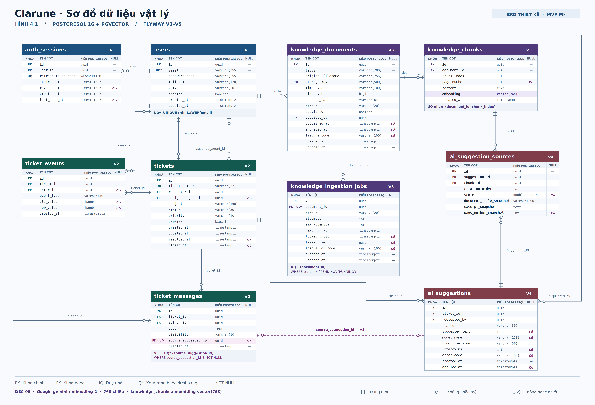

Hình 4.1 — Sơ đồ cơ sở dữ liệu vật lý của hệ thống Clarune.

Sơ đồ mô tả 10 bảng thuộc phạm vi P0 trên PostgreSQL 16 và pgvector. Các đường nối biểu diễn khóa ngoại và lực lượng theo ràng buộc dữ liệu. Ví dụ, ứng dụng tạo ticket cùng tin nhắn công khai đầu tiên và sự kiện tạo trong một giao dịch, dù khóa ngoại riêng lẻ cho phép ticket chưa có bản ghi con. Các giá trị mặc định, ràng buộc CHECK và chỉ mục được trình bày tại Mục 4.2. Sơ đồ và đặc tả bảng đã được thiết kế đồng bộ với bộ script Flyway V1–V5 của hệ thống cơ sở dữ liệu.

### ***Bảng thứ tự Migration Flyway (V1–V5 & Phần mở rộng P1)***

| Phiên bản Migration | Phạm vi bảng / đối tượng | Phụ thuộc & Nguyên tắc kỹ thuật |
| :---- | :---- | :---- |
| V1 (V1\_\_init\_identity.sql) | users, auth\_sessions | Ứng dụng sinh UUID cho khóa chính trước khi ghi dữ liệu. Tài khoản Admin ban đầu được khởi tạo riêng qua cấu hình môi trường bảo mật của máy chủ |
| V2 (V2\_\_init\_ticketing.sql) | tickets, ticket\_messages, ticket\_events | Tạo cột ticket\_messages.source\_suggestion\_id kiểu uuid, cho phép NULL. V5 bổ sung khóa ngoại và chỉ mục duy nhất có điều kiện sau khi V4 tạo bảng ai\_suggestions. \| |
| V3 (V3\_\_init\_knowledge.sql) | Extension vector (pgvector), knowledge\_documents, knowledge\_ingestion\_jobs, knowledge\_chunks | Extension vector phải khả dụng trước khi tạo bảng knowledge\_chunks. Cột knowledge\_chunks.embedding được khai báo cố định là vector(768) NOT NULL (tạo từ mô hình nhúng 768 chiều của gemini-embedding-2). |
| V4 (V4\_\_init\_ai.sql) | ai\_suggestions, ai\_suggestion\_sources | Tham chiếu tickets(id) (V2) và knowledge\_chunks(id) (V3). |
| V5 (V5\_\_add\_ticket\_message\_suggestion\_fk.sql) | ticket\_messages (ALTER TABLE) | Bổ sung FK (source\_suggestion\_id) REFERENCES ai\_suggestions(id) và UNIQUE INDEX WHERE source\_suggestion\_id IS NOT NULL chống apply 2 lần. |
| V6+ *(P1 — PLANNED)* | password\_reset\_tokens (UC-16), ai\_suggestion\_feedback (UC-19) | Chưa thuộc phạm vi P0; chỉ thêm file migration mới nếu nhóm mở rộng làm P1 (tuyệt đối không sửa đè V1–V5). |

## **4.2 Đặc tả dữ liệu (Data Dictionary)**

### ***Danh mục tổng hợp các bảng***

| STT | Tên bảng SQL | Flyway | Module | Mức | Mục đích lưu trữ |
| :---: | :---- | :---- | :---- | :---- | :---- |
| 1 | users | V1 | Identity | P0 | Tài khoản người dùng (Customer, Agent, Admin) |
| 2 | auth\_sessions | V1 | Identity | P0 | Phiên Refresh Token dạng băm hỗ trợ xoay vòng & thu hồi |
| 3 | tickets | V2 | Ticket | P0 | Thông tin lõi yêu cầu hỗ trợ, trạng thái và optimistic version |
| 4 | ticket\_messages | V2, V5 | Ticket | P0 | Hội thoại công khai (kèm mô tả đầu) và ghi chú nội bộ |
| 5 | ticket\_events | V2 | Ticket | P0 | Nhật ký sự kiện xử lý bất biến (append-only) |
| 6 | knowledge\_documents | V3 | Knowledge | P0 | Siêu dữ liệu tài liệu tri thức (FAQ, Chính sách Đồ điện tử) |
| 7 | knowledge\_ingestion\_jobs | V3 | Knowledge | P0 | Hàng đợi & lease job bóc tách, chunking, nhúng vector |
| 8 | knowledge\_chunks | V3 | Knowledge | P0 | Các đoạn tri thức và vector nhúng pgvector |
| 9 | ai\_suggestions | V4 | AI | P0 | Lịch sử các lần AI gợi ý, mô hình, độ trễ và trạng thái |
| 10 | ai\_suggestion\_sources | V4 | AI | P0 | Bản chụp trích dẫn nguồn tại thời điểm sinh gợi ý |
| 11 | password\_reset\_tokens | V6+ (Dự kiến) | Identity | P1 (PLANNED) | Token đặt lại mật khẩu dùng một lần có thời hạn (UC-16) |
| 12 | ai\_suggestion\_feedback | V6+ (Dự kiến) | AI | P1 (PLANNED) | Đánh giá Hữu ích / Không hữu ích của Agent (UC-19) |

### ***Bảng 4.1: users (Module Identity)***

| STT | Thuộc tính | Kiểu dữ liệu | Khóa / Ràng buộc | Ý nghĩa / Mô tả |
| :---: | :---- | :---- | :---- | :---- |
| 1 | id | uuid | PK, NOT NULL | Khóa chính định danh người dùng |
| 2 | email | varchar(255) | UNIQUE (normalized), NOT NULL | Địa chỉ email đăng nhập (chuẩn hóa chữ thường, không phân biệt hoa/thường) |
| 3 | password\_hash | varchar(255) | NOT NULL | Mật khẩu đã băm một chiều (BCrypt), tuyệt đối không lưu thô |
| 4 | full\_name | varchar(120) | NOT NULL | Họ và tên hiển thị của người dùng |
| 5 | role | varchar(20) | NOT NULL, CHECK (role IN ('CUSTOMER', 'AGENT', 'ADMIN')) | Vai trò phân quyền hệ thống |
| 6 | enabled | boolean | NOT NULL, DEFAULT true | Cờ kích hoạt tài khoản (false sẽ chặn login, refresh và access JWT còn hạn) |
| 7 | created\_at | timestamptz | NOT NULL | Thời điểm tạo tài khoản (UTC) |
| 8 | updated\_at | timestamptz | NOT NULL | Thời điểm cập nhật thông tin gần nhất (UTC) |

Chỉ mục (Indexes): PK(id), UNIQUE INDEX idx\_users\_email\_lower ON users (LOWER(email)).

### ***Bảng 4.2: auth\_sessions (Module Identity)***

| STT | Thuộc tính | Kiểu dữ liệu | Khóa / Ràng buộc | Ý nghĩa / Mô tả |
| :---: | :---- | :---- | :---- | :---- |
| 1 | id | uuid | PK, NOT NULL | Khóa chính phiên đăng nhập |
| 2 | user\_id | uuid | FK \-\> users(id), NOT NULL | Người dùng sở hữu phiên |
| 3 | refresh\_token\_hash | varchar(128) | UNIQUE, NOT NULL | Mã băm SHA-256 của Refresh Token ngẫu nhiên có entropy cao |
| 4 | expires\_at | timestamptz | NOT NULL | Mốc thời gian hết hạn phiên (UTC) |
| 5 | revoked\_at | timestamptz | NULL | Thời điểm thu hồi do logout, token rotation hoặc disable tài khoản |
| 6 | created\_at | timestamptz | NOT NULL | Thời điểm cấp phiên ban đầu (audit) |
| 7 | last\_used\_at | timestamptz | NULL | Thời điểm sử dụng gần nhất (audit) |

Chỉ mục (Indexes): PK(id), UNIQUE(refresh\_token\_hash), INDEX (user\_id, revoked\_at).

### ***Bảng 4.3: tickets (Module Ticket)***

| STT | Thuộc tính | Kiểu dữ liệu | Khóa / Ràng buộc | Ý nghĩa / Mô tả |
| :---: | :---- | :---- | :---- | :---- |
| 1 | id | uuid | PK, NOT NULL | Khóa chính định danh ticket |
| 2 | ticket\_number | varchar(32) | UNIQUE, NOT NULL | Mã hiển thị duy nhất (VD: HD-1054) |
| 3 | requester\_id | uuid | FK \-\> users(id), NOT NULL | Khách hàng gửi yêu cầu hỗ trợ |
| 4 | assigned\_agent\_id | uuid | FK \-\> users(id), NULL (khi OPEN) | Nhân viên hỗ trợ phụ trách hiện tại (NULL khi đang mở hàng đợi) |
| 5 | subject | varchar(150) | NOT NULL, CHECK (char\_length(subject) \>= 5\) | Tiêu đề tóm tắt sự cố thiết bị điện tử (VD: "TV 4K 55 inch không lên nguồn"; mô tả chi tiết ban đầu nằm ở tin nhắn công khai đầu tiên) |
| 6 | status | varchar(30) | NOT NULL, CHECK (status IN ('OPEN', 'IN\_PROGRESS', 'WAITING\_CUSTOMER', 'RESOLVED', 'CLOSED')) | Trạng thái vòng đời ticket |
| 7 | priority | varchar(10) | NOT NULL, DEFAULT 'NORMAL', CHECK (priority IN ('LOW', 'NORMAL', 'HIGH')) | Mức độ ưu tiên (giá trị URGENT không tồn tại trong MVP; P0 mặc định NORMAL, thao tác đổi mức ưu tiên thuộc Backlog/P1) |
| 8 | version | bigint | NOT NULL, DEFAULT 0 | Số phiên bản phục vụ Optimistic Locking chống double-claim/lost update |
| 9 | created\_at | timestamptz | NOT NULL | Thời điểm khởi tạo ticket (UTC) |
| 10 | updated\_at | timestamptz | NOT NULL | Thời điểm cập nhật gần nhất (UTC) |
| 11 | resolved\_at | timestamptz | NULL | Thời điểm chuyển trạng thái RESOLVED |
| 12 | closed\_at | timestamptz | NULL | Thời điểm chuyển trạng thái CLOSED |

Chỉ mục (Indexes): (requester\_id, created\_at DESC), (assigned\_agent\_id, status, updated\_at DESC), (status, created\_at DESC), UNIQUE(ticket\_number).

### ***Bảng 4.4: ticket\_messages (Module Ticket)***

| STT | Thuộc tính | Kiểu dữ liệu | Khóa / Ràng buộc | Ý nghĩa / Mô tả |
| :---: | :---- | :---- | :---- | :---- |
| 1 | id | uuid | PK, NOT NULL | Khóa chính tin nhắn |
| 2 | ticket\_id | uuid | FK \-\> tickets(id), NOT NULL | Ticket chứa nội dung trao đổi |
| 3 | author\_id | uuid | FK \-\> users(id), NOT NULL | Tác giả tin nhắn (xác định từ ActorPrincipal) |
| 4 | body | text | NOT NULL | Nội dung tin nhắn (1–5000 ký tự) |
| 5 | visibility | varchar(10) | NOT NULL, CHECK (visibility IN ('PUBLIC', 'INTERNAL')) | Phạm vi hiển thị; Customer chỉ được query visibility \= 'PUBLIC' |
| 6 | source\_suggestion\_id | uuid | NULL, FK \-\> ai\_suggestions(id) (thêm ở V5) | Tham chiếu gợi ý AI nếu tin nhắn gửi qua luồng duyệt AI (UC-15) |
| 7 | created\_at | timestamptz | NOT NULL | Thời điểm gửi tin nhắn (UTC) |

Chỉ mục (Indexes): INDEX (ticket\_id, created\_at, id), UNIQUE INDEX idx\_msg\_source\_suggestion\_unique ON ticket\_messages (source\_suggestion\_id) WHERE source\_suggestion\_id IS NOT NULL (hàng rào DB ngăn chặn gửi lặp từ cùng 1 gợi ý AI).

### ***Bảng 4.5: ticket\_events (Module Ticket)***

| STT | Thuộc tính | Kiểu dữ liệu | Khóa / Ràng buộc | Ý nghĩa / Mô tả |
| :---: | :---- | :---- | :---- | :---- |
| 1 | id | uuid | PK, NOT NULL | Khóa chính sự kiện lịch sử |
| 2 | ticket\_id | uuid | FK \-\> tickets(id), NOT NULL | Ticket phát sinh sự kiện |
| 3 | actor\_id | uuid | FK \-\> users(id), NULL (cho sự kiện hệ thống) | Người thực hiện thao tác |
| 4 | event\_type | varchar(40) | NOT NULL | Loại sự kiện lịch sử (TICKET\_CREATED, CLAIMED, ASSIGNED, REASSIGNED, STATUS\_CHANGED; riêng PRIORITY\_CHANGED thuộc Backlog/P1 vì P0 mặc định NORMAL) |
| 5 | old\_value | jsonb | NULL | Giá trị cấu trúc trước thay đổi (không lưu secrets) |
| 6 | new\_value | jsonb | NULL | Giá trị cấu trúc sau thay đổi (không lưu secrets) |
| 7 | created\_at | timestamptz | NOT NULL | Thời điểm ghi nhận sự kiện đồng transaction |

Chỉ mục (Indexes): INDEX (ticket\_id, created\_at ASC).

### ***Bảng 4.6: knowledge\_documents (Module Knowledge)***

| STT | Thuộc tính | Kiểu dữ liệu | Khóa / Ràng buộc | Ý nghĩa / Mô tả |
| :---: | :---- | :---- | :---- | :---- |
| 1 | id | uuid | PK, NOT NULL | Khóa chính tài liệu tri thức |
| 2 | title | varchar(200) | NOT NULL | Tiêu đề tài liệu hiển thị trên KB & citation |
| 3 | original\_filename | varchar(255) | NOT NULL | Tên tệp gốc đã được làm sạch ký tự điều khiển |
| 4 | storage\_key | varchar(500) | UNIQUE, NOT NULL | Khóa đường dẫn nội bộ do máy chủ sinh trong Private Storage |
| 5 | mime\_type | varchar(100) | NOT NULL | Định dạng MIME thực tế (application/pdf, text/plain, text/markdown) |
| 6 | size\_bytes | bigint | NOT NULL, CHECK (size\_bytes \> 0 AND size\_bytes \<= 10485760\) | Dung lượng tệp tính bằng byte (≤ 10 MiB) |
| 7 | content\_hash | varchar(64) | NOT NULL | Mã SHA-256 nội dung hỗ trợ phát hiện file trùng lặp |
| 8 | status | varchar(20) | NOT NULL, CHECK (status IN ('UPLOADED', 'PROCESSING', 'READY', 'FAILED', 'ARCHIVED')) | Trạng thái bóc tách / lưu trữ tài liệu |
| 9 | published | boolean | NOT NULL, DEFAULT false | Chỉ true khi Admin công bố sau khi READY; ràng buộc CHECK: status \!= \\x27ARCHIVED\\x27 OR published \= false |
| 10 | uploaded\_by | uuid | FK \-\> users(id), NOT NULL | Admin tải lên tài liệu |
| 11 | published\_at | timestamptz | NULL | Mốc thời gian công bố |
| 12 | archived\_at | timestamptz | NULL | Mốc thời gian đưa vào lưu trữ |
| 13 | failure\_code | varchar(100) | NULL | Mã lỗi an toàn khi bóc tách thất bại (không lộ stack trace) |
| 14 | created\_at | timestamptz | NOT NULL | Thời điểm tạo bản ghi (UTC) |
| 15 | updated\_at | timestamptz | NOT NULL | Thời điểm cập nhật trạng thái gần nhất (UTC) |

### ***Bảng 4.7: knowledge\_ingestion\_jobs (Module Knowledge)***

| STT | Thuộc tính | Kiểu dữ liệu | Khóa / Ràng buộc | Ý nghĩa / Mô tả |
| :---: | :---- | :---- | :---- | :---- |
| 1 | id | uuid | PK, NOT NULL | Khóa chính tác vụ xử lý nền |
| 2 | document\_id | uuid | FK \-\> knowledge\_documents(id), NOT NULL | Tài liệu cần bóc tách và tạo vector |
| 3 | status | varchar(20) | NOT NULL, CHECK (status IN ('PENDING', 'RUNNING', 'COMPLETED', 'FAILED')) | Trạng thái tác vụ xử lý của worker |
| 4 | attempts | int | NOT NULL, DEFAULT 0 | Số lần đã nhận chạy (tăng ngay khi worker nhận job) |
| 5 | max\_attempts | int | NOT NULL, DEFAULT 3 | Giới hạn số lần thử tối đa (mặc định 3\) |
| 6 | next\_run\_at | timestamptz | NOT NULL | Thời điểm dự kiến chạy lại theo backoff |
| 7 | locked\_until | timestamptz | NULL | Thời điểm hết hạn lease hiện tại |
| 8 | lease\_token | uuid | NULL | Token ngẫu nhiên sinh mỗi lần nhận job để chặn worker cũ hết hạn ghi đè |
| 9 | last\_error\_code | varchar(100) | NULL | Mã lỗi của lần thử gần nhất |
| 10 | created\_at | timestamptz | NOT NULL | Thời điểm khởi tạo tác vụ xử lý nền (UTC) |
| 11 | updated\_at | timestamptz | NOT NULL | Thời điểm cập nhật trạng thái tác vụ gần nhất (UTC) |

Chỉ mục (Indexes): UNIQUE INDEX idx\_ingestion\_one\_active\_job ON knowledge\_ingestion\_jobs (document\_id) WHERE status IN ('PENDING', 'RUNNING') (đảm bảo tối đa 1 job hoạt động cho mỗi tài liệu).

### ***Bảng 4.8: knowledge\_chunks (Module Knowledge)***

| STT | Thuộc tính | Kiểu dữ liệu | Khóa / Ràng buộc | Ý nghĩa / Mô tả |
| :---: | :---- | :---- | :---- | :---- |
| 1 | id | uuid | PK, NOT NULL | Khóa chính đoạn tri thức |
| 2 | document\_id | uuid | FK \-\> knowledge\_documents(id), NOT NULL | Tài liệu nguồn sở hữu đoạn trích |
| 3 | chunk\_index | int | NOT NULL, CHECK (chunk\_index \>= 0\) | Thứ tự tuần tự của đoạn trong tài liệu |
| 4 | page\_number | int | NULL (với TXT/MD) | Số trang trong PDF phục vụ hiển thị vị trí nguồn trích dẫn |
| 5 | content | text | NOT NULL | Nội dung văn bản thuần của đoạn tri thức |
| 6 | embedding | vector(768) | NOT NULL | Vector biểu diễn ngữ nghĩa pgvector dùng cho Cosine Search |
| 7 | created\_at | timestamptz | NOT NULL | Thời điểm lập chỉ mục (UTC) |

Chỉ mục (Indexes): UNIQUE (document\_id, chunk\_index). Lưu ý về chỉ mục Vector (HNSW/IVFFlat): Hệ thống sử dụng phương pháp tìm kiếm láng giềng gần nhất chính xác (exact nearest-neighbor) phù hợp với quy mô tập dữ liệu hiện tại và chỉ khởi tạo chỉ mục HNSW/IVFFlat sau khi đo kiểm hiệu năng thực tế.

Mỗi kho vector sử dụng cùng một mô hình embedding, số chiều và chế độ chạy. Chế độ giả lập (Mock) và thực tế (Live) được phân tách qua cấu hình môi trường của ứng dụng (biến AI\_MODE), đảm bảo tính nhất quán của không gian vector trong bảng knowledge\_chunks mà không cần lưu phân tách cột vật lý. Khi đổi mô hình hoặc số chiều, cần tạo kho vector riêng hoặc tạo lại embedding cho toàn bộ đoạn tri thức liên quan trước khi dùng kho đó để tìm kiếm.

Với bộ FAQ và chính sách đồ điện tử của MVP, hệ thống dùng tìm kiếm chính xác theo khoảng cách cosine trên các tài liệu đủ điều kiện truy xuất. Nếu đánh giá thực tế cho thấy hệ thống thường bỏ sót mã model hoặc mã lỗi, nhóm có thể khảo sát tìm kiếm lai kết hợp đối sánh từ khóa và vector. Hướng này nằm ngoài baseline V1–V5 và chưa đưa cột tsvector vào thiết kế dữ liệu P0.

### ***Bảng 4.9: ai\_suggestions (Module AI)***

| STT | Thuộc tính | Kiểu dữ liệu | Khóa / Ràng buộc | Ý nghĩa / Mô tả |
| :---: | :---- | :---- | :---- | :---- |
| 1 | id | uuid | PK, NOT NULL | Khóa chính bản ghi gợi ý AI |
| 2 | ticket\_id | uuid | FK \-\> tickets(id), NOT NULL | Ticket cần hỗ trợ sinh phản hồi |
| 3 | requested\_by | uuid | FK \-\> users(id), NOT NULL | Nhân viên hoặc Admin yêu cầu sinh gợi ý |
| 4 | status | varchar(30) | NOT NULL, CHECK (status IN ('GENERATED', 'INSUFFICIENT\_EVIDENCE', 'FAILED', 'APPLIED', 'DISCARDED')) | Trạng thái kiểm duyệt/kết quả của gợi ý |
| 5 | suggested\_text | text | NULL (khi INSUFFICIENT\_EVIDENCE/FAILED) | Bản nháp nội dung câu trả lời AI đề xuất |
| 6 | model\_name | varchar(120) | NULL (khi nhánh thiếu căn cứ INSUFFICIENT\_EVIDENCE dừng trước khi gọi LLM, khi lỗi hoặc chạy chế độ mô phỏng) | Tên mô hình LLM đã tạo gợi ý |
| 7 | prompt\_version | varchar(50) | NOT NULL | Mã phiên bản system prompt |
| 8 | latency\_ms | int | NULL | Tổng thời gian thực thi (mili giây) |
| 9 | error\_code | varchar(100) | NULL | Mã lỗi an toàn khi provider lỗi/timeout hoặc từ chối citation |
| 10 | created\_at | timestamptz | NOT NULL | Thời điểm tạo gợi ý (UTC) |
| 11 | applied\_at | timestamptz | NULL | Thời điểm Agent duyệt gửi phản hồi công khai |

Chỉ mục (Indexes): INDEX (ticket\_id, created\_at DESC).

### ***Bảng 4.10: ai\_suggestion\_sources (Module AI)***

| STT | Thuộc tính | Kiểu dữ liệu | Khóa / Ràng buộc | Ý nghĩa / Mô tả |
| :---: | :---- | :---- | :---- | :---- |
| 1 | id | uuid | PK, NOT NULL | Khóa chính nguồn trích dẫn của gợi ý |
| 2 | suggestion\_id | uuid | FK \-\> ai\_suggestions(id), NOT NULL | Gợi ý AI sử dụng trích dẫn này |
| 3 | chunk\_id | uuid | FK \-\> knowledge\_chunks(id), NOT NULL | Đoạn tri thức gốc (không hard delete khi đã có citation tham chiếu) |
| 4 | citation\_order | int | NOT NULL, CHECK (citation\_order \>= 1\) | Thứ tự xuất hiện nguồn (\[1\], \[2\], ...) |
| 5 | score | double precision | NULL | Độ tương đồng cosine tại thời điểm truy xuất |
| 6 | document\_title\_snapshot | varchar(200) | NOT NULL | Bản chụp tiêu đề tài liệu tại lúc sinh gợi ý |
| 7 | excerpt\_snapshot | text | NOT NULL | Bản chụp đoạn trích văn bản (giới hạn độ dài), giữ nguyên dù tài liệu bị archive |
| 8 | page\_number\_snapshot | int | NULL | Bản chụp số trang tài liệu tại lúc sinh gợi ý |

### ***Các bảng mở rộng giai đoạn P1***

Hai bảng dưới đây phục vụ chức năng khôi phục mật khẩu qua email (UC-16) và đánh giá mức độ hữu ích của gợi ý AI (UC-19) thuộc giai đoạn mở rộng P1 của hệ thống.

### ***Bảng 4.11: password\_reset\_tokens (Mở rộng P1 — Module Identity)***

| STT | Thuộc tính | Kiểu dữ liệu | Khóa / Ràng buộc | Ý nghĩa / Mô tả |
| :---: | :---- | :---- | :---- | :---- |
| 1 | id | uuid | PK, NOT NULL | Khóa chính định danh mã khôi phục mật khẩu |
| 2 | user\_id | uuid | FK \-\> users(id), NOT NULL | Tài khoản người dùng yêu cầu đặt lại mật khẩu |
| 3 | token\_hash | varchar(128) | UNIQUE, NOT NULL | Mã băm một chiều (SHA-256) của mã xác nhận khôi phục |
| 4 | expires\_at | timestamptz | NOT NULL | Thời điểm hết hạn của mã khôi phục (UTC) |
| 5 | used\_at | timestamptz | NULL | Thời điểm mã đã được sử dụng thành công (chống dùng lại) |
| 6 | created\_at | timestamptz | NOT NULL | Thời điểm phát hành mã khôi phục (UTC) |

### *B**ảng 4.12: ai\_suggestion\_feedback (Mở rộng P1 — Module AI)***

| STT | Thuộc tính | Kiểu dữ liệu | Khóa / Ràng buộc | Ý nghĩa / Mô tả |
| :---: | :---- | :---- | :---- | :---- |
| 1 | id | uuid | PK, NOT NULL | Khóa chính bản ghi đánh giá chất lượng gợi ý AI |
| 2 | suggestion\_id | uuid | FK \-\> ai\_suggestions(id), NOT NULL | Bản ghi gợi ý AI được nhân viên hỗ trợ đánh giá |
| 3 | agent\_id | uuid | FK \-\> users(id), NOT NULL | Nhân viên hỗ trợ thực hiện đánh giá (UNIQUE cùng suggestion\_id) |
| 4 | rating | varchar(20) | NOT NULL, CHECK (rating IN ('HELPFUL', 'NOT\_HELPFUL')) | Mức đánh giá chất lượng gợi ý (Hữu ích hoặc Không hữu ích) |
| 5 | created\_at | timestamptz | NOT NULL | Thời điểm gửi đánh giá lần đầu (UTC) |
| 6 | updated\_at | timestamptz | NOT NULL | Thời điểm cập nhật lựa chọn đánh giá gần nhất (UTC) |

# 5**. Thiết kế giao diện người dùng**

* Thiết kế giao diện người dùng (UI/UX): Toàn bộ hệ thống giao diện Clarune được thiết kế đồng bộ trên Figma, tối ưu hóa trải nghiệm cho cả ba nhóm tác nhân trong lĩnh vực hỗ trợ kỹ thuật và bảo hành thiết bị điện tử tiêu dùng.  
* Quy ước trình bày & Khả năng đáp ứng (Responsive): Giao diện hỗ trợ đa thiết bị gồm Desktop (1440×900), Tablet (1024×768) và Mobile (390×844 / tối thiểu 360px) cùng hai chế độ hiển thị Sáng/Tối (Light/Dark Mode). Các mã định danh màn hình (I01..I05, C01..C07, A01..A13, K01..K06, D01..D03) được ánh xạ nhất quán với danh mục các ca sử dụng của hệ thống (UC-01..UC-19).  
* Link Figma của nhóm: [SE – Figma](https://www.figma.com/design/Ofvm9udw9coBOxadTN4PXB/SE?node-id=111-3978&p=f&m=dev).

## **5.1 Sơ đồ màn hình (Screen Flow Diagram & Danh mục tổng hợp)**

### ***5.1.1 Sơ đồ luồng chuyển màn hình theo vai trò***

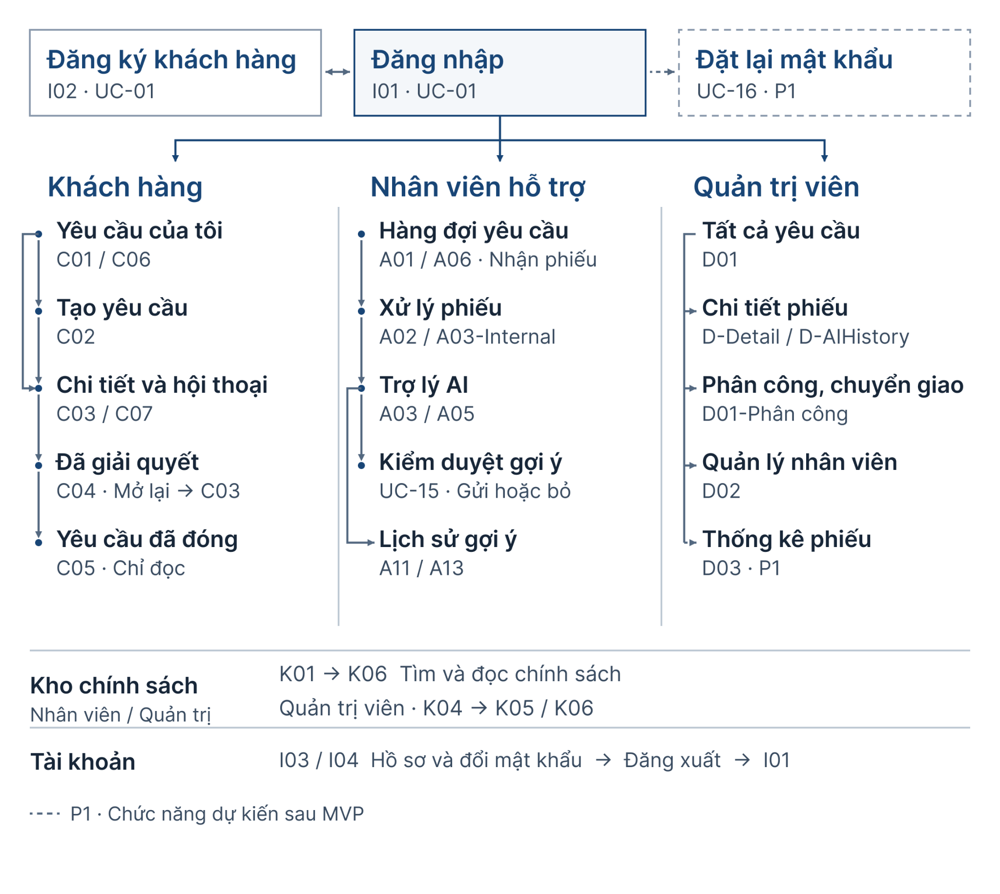

Hình 5.1. Luồng màn hình Clarune theo vai trò. Đăng nhập thành công đưa Khách hàng đến Yêu cầu của tôi, Nhân viên đến hàng đợi và Quản trị viên đến Tất cả yêu cầu. Chức năng P1 có nhãn PLANNED (P1).

* Khách hàng: Từ C01/C06, mở phiếu đã có hoặc tạo phiếu C02. Gửi phiếu mới thành công mở C03. Khi phiếu đã giải quyết, C04 cho phép mở lại hoặc xác nhận đóng. C05 chỉ đọc.  
* Nhân viên: Từ hàng đợi, nhận phiếu A01 để mở A02. Nếu người khác đã nhận, A06 thông báo xung đột và tải lại danh sách. Từ nơi xử lý phiếu, mở Copilot, xem nguồn, kiểm duyệt bản nháp hoặc mở lịch sử gợi ý. Vào K01 từ menu Kho chính sách.  
* Quản trị viên: D01 dẫn đến chi tiết D-Detail hoặc hộp thoại D01-Phân công. Từ chi tiết mở D-AIHistory. Menu quản trị dẫn đến D02 (Nhân viên), K04 (Quản lý tài liệu) và D03 (Thống kê, PLANNED (P1)). Quản trị viên cũng có quyền tìm tài liệu ở K01.  
* Tài khoản: I02 quay về I01 sau đăng ký. Sau đăng nhập, menu tài khoản mở I03 cho Khách hàng hoặc I04 cho Nhân viên/Quản trị viên. Đăng xuất quay lại I01. Đặt lại mật khẩu thuộc UC-16, PLANNED (P1).

### ***5.1.2 Danh mục màn hình hệ thống***

Bảng dưới đây tổng hợp danh mục các màn hình chính của hệ thống Clarune theo từng nhóm chức năng, tác nhân sử dụng, ca sử dụng liên quan và thông tin Frame tương ứng trên bản thiết kế giao diện Figma:

| Nhóm | Mã màn hình | Tên màn hình | Tác nhân | Use Case liên quan | Ghi chú Frame thiết kế |
| :---- | :---- | :---- | :---- | :---- | :---- |
| Định danh | I01, I02, I03, I04, I05 | Đăng nhập; Đăng ký; Hồ sơ Khách hàng; Hồ sơ Nhân viên/Quản trị viên | Guest; Khách hàng, Nhân viên, Quản trị viên (hồ sơ) | UC-01, UC-02, UC-03 | I01: 113:4387; I02: 114:4766; I03: 113:3580; I04: 113:3461 |
| Định danh P1 | — | Đặt lại mật khẩu | Guest | UC-16 | PLANNED (P1). Chưa có màn hình trong phạm vi hiện tại. |
| Khách hàng | C01, C02, C03, C04, C05, C06, C07 | Danh sách; Tạo yêu cầu; Chi tiết; Đã giải quyết; Đã đóng; Danh sách mobile; Chi tiết mobile | Khách hàng | UC-05, UC-06, UC-08, UC-09 | C01: 111:2664; C02: 132:6237; C03: 111:2763; C04: 132:6339; C05: 132:6441; C06: 111:3570; C07: 111:3571 |
| Nhân viên | A01, A06, A02, A03-Internal, A07, A10, A-Resolved | Phiếu mới; Xung đột nhận; Phiếu đang xử lý; Ghi chú; Chờ khách; Hội thoại mobile | Nhân viên hỗ trợ | UC-06 đến UC-10 | A01: 132:5524; A06: 118:3245; A02: 132:5676; A03-Internal (Ghi chú nội bộ): 115:2017; A07: 118:3523; A10: 118:5192 |
| Copilot | A03, A05, A-AIError, A09, A12 | Có gợi ý; Đang tạo; Lỗi; Tablet; Mobile | Nhân viên phụ trách; Quản trị viên | UC-14 | A03: 111:1700; A05: 118:2229; A-AIError: 118:2508; A09: 118:5368; A12: 119:16873 |
| Kiểm duyệt gợi ý | A-DiscardConfirm, A-DiscardError, A-ManualAfterDiscard, A-SendError | Xác nhận bỏ; Lỗi bỏ; Soạn thủ công; Lỗi gửi | Nhân viên phụ trách; Quản trị viên | UC-15 | A-DiscardConfirm: 118:8823; A-DiscardError: 118:9088; A-ManualAfterDiscard: 118:14515; A-SendError: 118:2785 |
| Lịch sử AI | A11, A13, A-HistorySourceError, A-HistoryLost, D-AIHistory | Lịch sử desktop; Lịch sử mobile; Lỗi bản chụp; Mất quyền; Lịch sử Admin | Nhân viên phụ trách; Quản trị viên | UC-18 (P0), UC-19 (P1) | A11: 118:6210; A13: 119:17179; A-HistorySourceError: 118:14804; A-HistoryLost: 118:15089; D-AIHistory: 118:10738. Đánh giá hữu ích là PLANNED (P1). |
| Kho chính sách | K01, K02, K03, K06 | Tìm kiếm; Không có kết quả; Đọc chi tiết | Nhân viên; Quản trị viên | UC-13 | K01: 111:3691; K06: 113:819. Cùng frame K06 minh họa màn quản trị chi tiết. |
| Quản lý tài liệu | K04, K05, K06, K-ReadyDetail, K06-Lưu trữ | Danh sách; Tải lên; Chi tiết; Lưu trữ | Quản trị viên | UC-11, UC-12 | K04: 111:4066; K05: 113:693; K06: 113:819; K06-Lưu trữ: 113:2323 |
| Quản trị yêu cầu | D01, D01-Phân công, D-Detail | Tất cả yêu cầu; Phân công; Chi tiết | Quản trị viên | UC-06, UC-07, UC-10 | D01: 112:1709; D01-Phân công: 133:7972; D-Detail: 118:13090 |
| Quản trị nhân viên | D02, D02-Thêm, D02-Vô hiệu hóa | Nhân viên; Thêm nhân viên; Vô hiệu hóa | Quản trị viên | UC-04 | D02: 112:2142; D02-Thêm: 112:2985; D02-Vô hiệu hóa: 112:2883 |
| Thống kê | D03 | Thống kê | Quản trị viên | UC-17 | D03: 112:2268. PLANNED (P1) |

## **5.2 Đặc tả màn hình chi tiết**

### ***5.2.1 Nhóm màn hình Định danh & Hồ sơ (Identity)***

#### ***5.2.1.1 Màn hình Đăng nhập (I01 / I05)***

A. Thông tin màn hình:

* Mã / Tên màn hình: I01 (Desktop) / I05 (Mobile) — Đăng nhập hệ thống.  
* Tác nhân (Actor): Guest (Khách hàng, Nhân viên, Quản trị viên chưa đăng nhập).  
* Use Case liên quan: UC-01 (Luồng B).  
* Mục đích: Xác thực bằng email và mật khẩu để cấp Access Token (lưu trong memory) cùng Refresh Token (HttpOnly Cookie) và điều hướng vào không gian làm việc đúng vai trò.  
* Liên kết bản thiết kế Figma: Frame I01.

B. Hình ảnh giao diện:

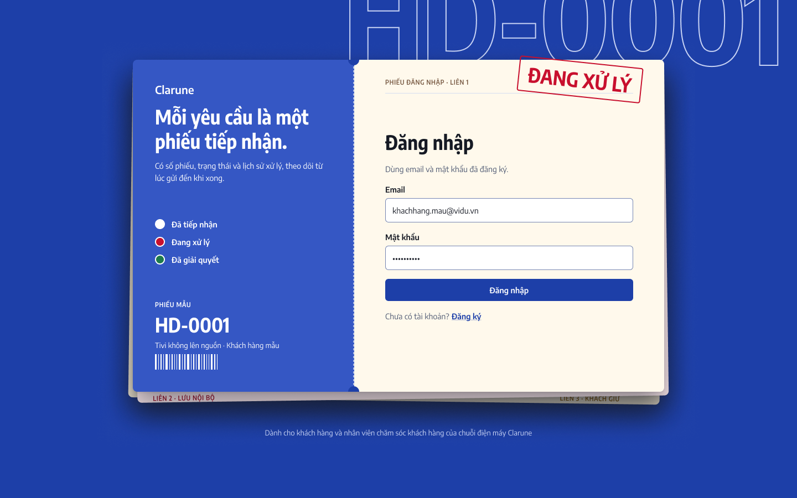

Hình 5.2.1a. I01 · Đăng nhập hệ thống.

C. Mô tả giao diện (Presentation Format):

* Bố cục thẻ đăng nhập đặt giữa trang (hỗ trợ Light/Dark mode), gồm logo Clarune, ô nhập Email, ô nhập Mật khẩu (có nút ẩn/hiện), nút Đăng nhập, liên kết Đăng ký tài khoản (dành cho Customer) và liên kết Quên mật khẩu *(ghi nhãn P1)*.  
* Hiển thị trạng thái lỗi chung (Email hoặc mật khẩu không chính xác / Tài khoản đã bị vô hiệu hóa) mà không tiết lộ email có tồn tại trên hệ thống hay không, trạng thái nút Đang xử lý... khi gửi yêu cầu.

D. Xử lý sự kiện (Event Handling):

| STT | Tên đối tượng | Sự kiện / Hành động (Trigger) | Hành vi hệ thống & API gọi |
| :---: | :---- | :---- | :---- |
| 1 | Ô nhập Email, Mật khẩu | Người dùng nhập và rời tiêu điểm / bấm Đăng nhập | Kiểm tra hợp lệ phía client (không rỗng, đúng định dạng email). |
| 2 | Nút Đăng nhập | Click / Submit form | Gửi POST /api/v1/auth/login với { email, password }. Nếu 200 OK: lưu accessToken vào bộ nhớ JS (memory), nhận Refresh Cookie HttpOnly từ server, giải mã vai trò và điều hướng (CUSTOMER → C01, AGENT → A01, ADMIN → D01). Nếu 401/403: hiển thị thông báo lỗi tương ứng. |
| 3 | Liên kết Đăng ký | Click | Điều hướng sang màn hình I02 (Đăng ký Customer). |
| 4 | Liên kết Quên mật khẩu *(P1)* | Click | Điều hướng sang luồng UC-16 (P1 — hiển thị thông báo nếu tính năng đang ở giai đoạn mở rộng). |

#### ***5.2.1.2 Màn hình Đăng ký tài khoản Khách hàng (I02)***

A. Thông tin màn hình:

* Mã / Tên màn hình: I02 — Đăng ký Customer.  
* Tác nhân: Guest.  
* Use Case liên quan: UC-01 (Luồng A).  
* Mục đích: Tạo mới tài khoản người dùng với vai trò cố định CUSTOMER ở máy chủ.

B. Hình ảnh giao diện:

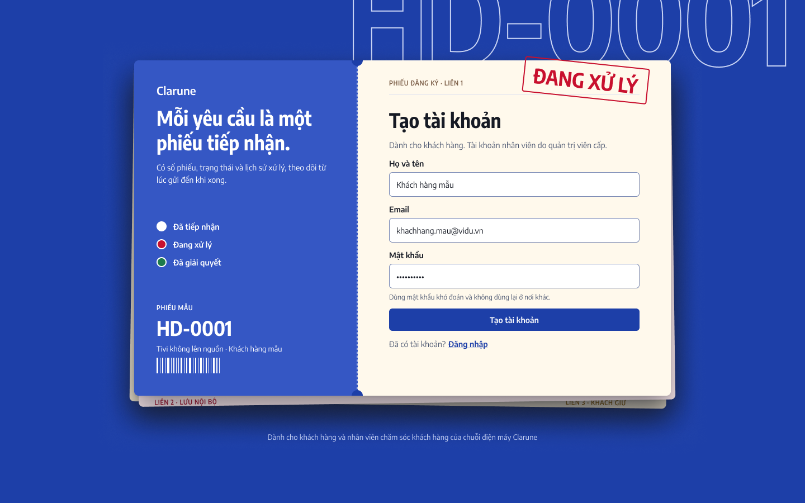

Hình 5.2.1b. I02 · Đăng ký tài khoản Khách hàng.

C. Mô tả giao diện: Gồm các trường Họ và tên, Email, Mật khẩu, Xác nhận mật khẩu, nút Đăng ký và liên kết quay lại Đăng nhập. Tuyệt đối không có ô chọn vai trò (role) trên giao diện.

D. Xử lý sự kiện:

| STT | Tên đối tượng | Sự kiện / Hành động (Trigger) | Hành vi hệ thống & API gọi |
| :---: | :---- | :---- | :---- |
| 1 | Biểu mẫu Đăng ký | Submit | Kiểm tra mật khẩu và xác nhận mật khẩu khớp nhau, độ dài hợp lệ ngay trên UI trước khi gửi; gọi POST /api/v1/auth/register với { fullName, email, password, confirmPassword }. Backend kiểm tra lại password khớp confirmPassword theo UC-01 (Bước A.3), bỏ qua/từ chối mọi trường role gửi kèm, băm BCrypt và gán cố định CUSTOMER. Thành công (201 Created): báo thành công và chuyển về I01. Lỗi 409/trùng email hoặc 400: hiển thị lỗi tại trường nhập. |
| 2 | Liên kết Đã có tài khoản? Đăng nhập | Click | Quay lại màn hình I01. |

#### ***5.2.1.3 Màn hình Quên mật khẩu & Đặt lại mật khẩu (P1 — PLANNED)***

A. Thông tin màn hình:

* Tên màn hình: Quên mật khẩu / Đặt lại mật khẩu (P1 — PLANNED).  
* Tác nhân: Guest \+ Dịch vụ Mail ngoài (UC-16).

B. Hình ảnh giao diện:

\*(Tính năng thuộc phạm vi mở rộng P1 — PLANNED UC-16, giao diện màn hình sẽ được bổ sung đồng bộ trong các bản phát hành tiếp theo).\*

C. Mô tả giao diện: Bước 1 nhập Email nhận liên kết; Bước 2 mở liên kết chứa token một lần, nhập Mật khẩu mới và Xác nhận mật khẩu mới.

D. Xử lý sự kiện: Submit Email → trả thông báo chung không tiết lộ email có tồn tại hay không; Submit đặt lại mật khẩu kèm token một lần → kiểm tra hạn dùng và chưa sử dụng trong password\_reset\_tokens, cập nhật hash mật khẩu mới và đánh dấu used\_at.

#### ***5.2.1.4 Màn hình Hồ sơ cá nhân & Đổi mật khẩu (I03 / I04)***

A. Thông tin màn hình:

* Mã / Tên màn hình: I03 (Customer), I04 (Agent/Admin) — Quản lý hồ sơ cá nhân.  
* Tác nhân: Customer, Support Agent, System Administrator.  
* Use Case liên quan: UC-03, UC-02 (Đăng xuất).

B. Hình ảnh giao diện:

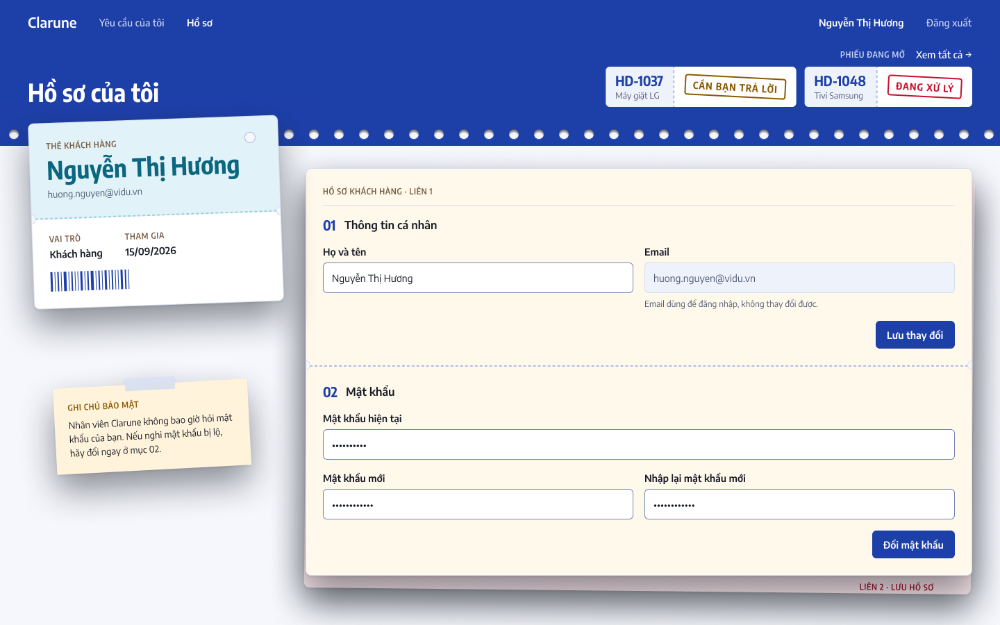

Hình 5.2.1c. I03 · Hồ sơ cá nhân Khách hàng.

C. Mô tả giao diện: Hai khối rõ ràng: (1) Thông tin cá nhân (Họ và tên được sửa; Email và Vai trò ở trạng thái chỉ đọc); (2) Khối Đổi mật khẩu (Mật khẩu hiện tại, Mật khẩu mới, Xác nhận mật khẩu mới), nút Lưu thay đổi, Đổi mật khẩu và nút Đăng xuất.

D. Xử lý sự kiện:

| STT | Tên đối tượng | Sự kiện / Hành động (Trigger) | Hành vi hệ thống & API gọi |
| :---: | :---- | :---- | :---- |
| 1 | Khởi tạo màn hình | Mount component | Gọi GET /api/v1/users/me hiển thị thông tin người dùng hiện hành. |
| 2 | Nút Lưu hồ sơ | Click | Gọi PATCH /api/v1/users/me với { fullName }; hiển thị thông báo cập nhật thành công/lỗi validation (400). |
| 3 | Nút Đổi mật khẩu | Click | Kiểm tra mật khẩu mới và xác nhận mật khẩu mới khớp nhau trên UI, sau đó gọi PUT /api/v1/users/me/password với { currentPassword, newPassword, confirmPassword }. Backend đối chiếu mật khẩu hiện tại, kiểm tra lại newPassword khớp confirmPassword theo UC-03 (Bước B.2 & B.2b), lưu hash mới và xóa trắng các ô mật khẩu trên UI. |
| 4 | Nút Đăng xuất | Click | Gọi POST /api/v1/auth/logout kèm CSRF \+ Refresh Cookie để thu hồi phiên trên server, xóa accessToken lưu trong bộ nhớ trình duyệt (memory) và điều hướng về màn hình đăng nhập I01 (Access Token ngắn hạn tối đa 15 phút tự hết hiệu lực). |

### ***5.2.2 Nhóm màn hình Cổng Khách hàng (Customer Portal)***

#### ***5.2.2.1 Màn hình Danh sách yêu cầu của tôi (C01 / C06)***

A. Thông tin màn hình:

* Mã / Tên màn hình: C01 (Desktop) / C06 (Mobile) — Yêu cầu của tôi.  
* Tác nhân: Customer.  
* Use Case liên quan: UC-06.

B. Hình ảnh giao diện:

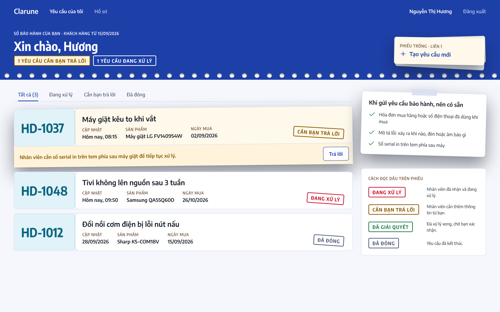

Hình 5.2.2a. C01 · Danh sách yêu cầu của tôi.

C. Mô tả giao diện: Thanh tìm kiếm theo từ khóa, bộ lọc theo trạng thái (OPEN, IN\_PROGRESS, WAITING\_CUSTOMER, RESOLVED, CLOSED), nút \+ Tạo yêu cầu mới, bảng danh sách phiếu hỗ trợ hiển thị Mã yêu cầu, Tiêu đề, Trạng thái xử lý, Thời gian cập nhật và thanh điều hướng phân trang. Giao diện hỗ trợ đầy đủ 4 trạng thái hiển thị: đang tải dữ liệu, danh sách trống, không tìm thấy kết quả lọc và thông báo lỗi kèm nút thử lại.

D. Xử lý sự kiện:

| STT | Tên đối tượng | Sự kiện / Hành động (Trigger) | Hành vi hệ thống & API gọi |
| :---: | :---- | :---- | :---- |
| 1 | Thanh tìm kiếm / Bộ lọc trạng thái / Phân trang | Thay đổi từ khóa, chọn trạng thái hoặc bấm chuyển trang | 1\. Gửi yêu cầu API GET /api/v1/tickets kèm từ khóa tìm kiếm, bộ lọc trạng thái và tham số phân trang. 2\. Hệ thống lọc danh sách các phiếu thuộc quyền sở hữu của khách hàng đang đăng nhập và cập nhật bảng hiển thị. |
| 2 | Nút \+ Tạo yêu cầu mới | Click | Điều hướng sang màn hình C02. |
| 3 | Dòng ticket trong danh sách | Click | Điều hướng sang màn hình chi tiết C03 với ticketId. |

#### ***5.2.2.2 Màn hình Tạo yêu cầu hỗ trợ mới (C02)***

A. Thông tin màn hình:

* Mã / Tên màn hình: C02 — Tạo yêu cầu hỗ trợ.  
* Tác nhân: Customer.  
* Use Case liên quan: UC-05.

B. Hình ảnh giao diện:

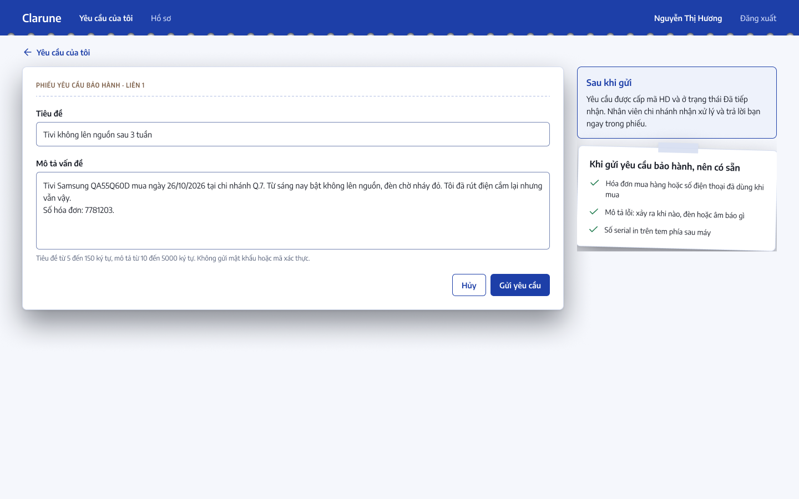

Hình 5.2.2b. C02 · Tạo yêu cầu hỗ trợ mới.

C. Mô tả giao diện: Form gồm trường Tiêu đề (5–150 ký tự, có gợi ý nhập mã model thiết bị điện tử và triệu chứng sự cố, VD: TV model TV-55A mất tiếng qua cổng HDMI), trường Nội dung mô tả (10–5000 ký tự), nút Gửi yêu cầu (disable khi đang submit để chống double-click) và nút Hủy. (Ghi chú: Tệp đính kèm là P1, chưa có trong form MVP P0).

D. Xử lý sự kiện:

| STT | Tên đối tượng | Sự kiện / Hành động (Trigger) | Hành vi hệ thống & API gọi |
| :---: | :---- | :---- | :---- |
| 1 | Nút Gửi yêu cầu | Click / Submit | Validate subject (5–150) và description (10–5000); khóa nút gửi; gọi POST /api/v1/tickets với { subject, description }. Server tạo nguyên tử ticket (OPEN, priority=NORMAL) \+ public message đầu tiên \+ TICKET\_CREATED event, trả 201 Created và chuyển thẳng sang C03. Lỗi 400: hiển thị chỉ dẫn trường sai. |

#### ***5.2.2.3 Màn hình Chi tiết yêu cầu, Hội thoại công khai & Đóng/Mở lại (C03, C04, C05, C07)***

A. Thông tin màn hình:

* Mã / Tên màn hình: C03 (Đang xử lý), C04 (Đã giải quyết — Chờ xác nhận), C05 (Đã đóng — Chỉ đọc), C07 (Mobile — Chi tiết yêu cầu).  
* Tác nhân: Customer sở hữu ticket.  
* Use Case liên quan: UC-06, UC-08 (Luồng A), UC-09.

B. Hình ảnh giao diện:

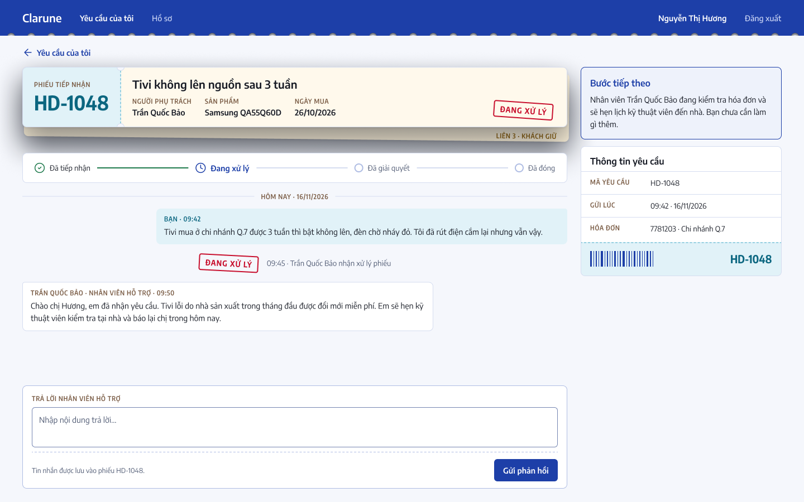

Hình 5.2.2c. C03 · Chi tiết yêu cầu đang xử lý.

C. Mô tả giao diện: Hiển thị tiêu đề, mã ticket, badge trạng thái (OPEN, IN\_PROGRESS, WAITING\_CUSTOMER, RESOLVED, CLOSED), luồng hội thoại chỉ gồm tin nhắn PUBLIC (tuyệt đối không có INTERNAL note hay event lịch sử nội bộ). Khi OPEN/IN\_PROGRESS/WAITING\_CUSTOMER: hiện khung soạn phản hồi. Khi RESOLVED (C04): khóa ô soạn phản hồi và hiện banner hai nút Xác nhận đóng yêu cầu và Yêu cầu xử lý tiếp (Mở lại) kèm hộp thoại xác nhận C-Close. Khi CLOSED (C05): toàn bộ khung nhập bị khóa ở chế độ chỉ đọc.

D. Xử lý sự kiện:

| STT | Tên đối tượng | Sự kiện / Hành động (Trigger) | Hành vi hệ thống & API gọi |
| :---: | :---- | :---- | :---- |
| 1 | Tải trang chi tiết | Mount với ticketId | Gọi song song GET /api/v1/tickets/{id} và GET /api/v1/tickets/{id}/messages. Nếu không thuộc sở hữu/không tồn tại → 404\. |
| 2 | Nút Gửi phản hồi | Click (khi OPEN / IN\_PROGRESS / WAITING\_CUSTOMER) | Gọi POST /api/v1/tickets/{id}/messages với { body, visibility: "PUBLIC" }. Nếu đang WAITING\_CUSTOMER, server tự động chuyển trạng thái sang IN\_PROGRESS trong cùng transaction và cập nhật UI. |
| 3 | Nút Xác nhận đóng → Đồng ý | Click xác nhận khi RESOLVED | Gọi POST /api/v1/tickets/{id}/transitions với { action: "CLOSE", version } (truyền version của phiếu tại thời điểm mở xem). Thành công → chuyển sang CLOSED (C05) và tăng version. Nếu 409 TICKET\_VERSION\_CONFLICT (phiếu đã thay đổi từ lúc mở xem) → thông báo xung đột và tải lại dữ liệu mới nhất. |
| 4 | Nút Mở lại yêu cầu | Click khi RESOLVED | Gọi POST /api/v1/tickets/{id}/transitions với { action: "REOPEN", version } (truyền version của phiếu tại thời điểm mở xem). Thành công → chuyển về IN\_PROGRESS (C03) và tăng version. Nếu 409 TICKET\_VERSION\_CONFLICT → thông báo xung đột và tải lại dữ liệu mới nhất. |

### ***5.2.3 Nhóm màn hình Không gian làm việc Nhân viên hỗ trợ (Agent Workspace)***

#### ***5.2.3.1 Màn hình Hàng đợi Ticket & Nhận xử lý (A01, A06)***

A. Thông tin màn hình:

* Mã / Tên màn hình: A01 (Hàng đợi & Nhận xử lý), A06 (Thông báo xung đột nhận xử lý).  
* Tác nhân: Support Agent.  
* Use Case liên quan: UC-06, UC-07 (Luồng A).

B. Hình ảnh giao diện:

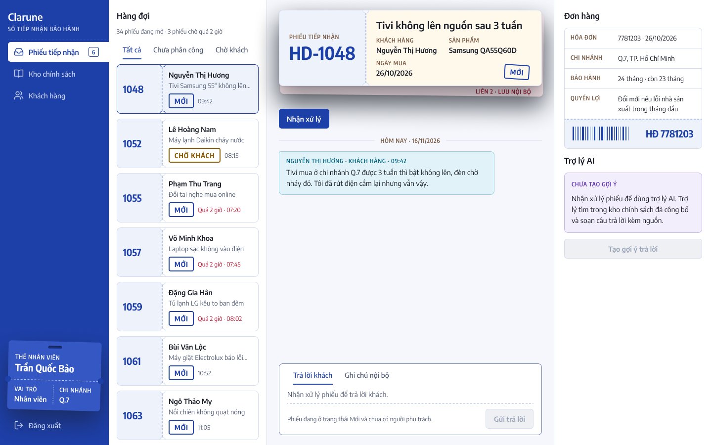

Hình 5.2.3a. A01 · Hàng đợi phiếu mới nhận xử lý.

C. Mô tả giao diện: Thanh chuyển tab giữa Hàng đợi chưa nhận (OPEN Queue) và Yêu cầu tôi phụ trách (Assigned to me), bộ lọc tìm kiếm, bảng danh sách ticket và khung xem trước nội dung ticket OPEN kèm nút Nhận xử lý (Claim). Với ticket chưa nhận, toàn bộ vùng soạn tin nhắn, ghi chú nội bộ và nút Trợ lý AI bị khóa/ẩn. Nếu xảy ra tranh chấp đồng thời với Agent khác, hiển thị hộp thoại xung đột A06 ("Yêu cầu đã có nhân viên khác tiếp nhận") cùng nút Về hàng đợi.

D. Xử lý sự kiện:

| STT | Tên đối tượng | Sự kiện / Hành động (Trigger) | Hành vi hệ thống & API gọi |
| :---: | :---- | :---- | :---- |
| 1 | Tab Hàng đợi mở / Của tôi | Click | Gọi GET /api/v1/tickets?status=OPEN hoặc GET /api/v1/tickets?assignedTo=me. |
| 2 | Nút Nhận xử lý | Click trên ticket OPEN | Gọi POST /api/v1/tickets/{id}/claim với { version } (phiên bản ticket tại thời điểm mở xem). Nếu 200 OK: ticket chuyển IN\_PROGRESS, gán assignedAgentId cho Agent hiện tại và mở màn hình A02. Nếu 409 TICKET\_ALREADY\_CLAIMED / TICKET\_VERSION\_CONFLICT: hiển thị trạng thái xung đột A06 mà không tiết lộ tên Agent đã thắng, bấm Về hàng đợi để reload danh sách. |

#### ***5.2.3.2 Màn hình Xử lý chi tiết Ticket, Phản hồi & Ghi chú nội bộ (A02, A04, A07, A10)***

A. Thông tin màn hình:

* Mã / Tên màn hình: A02 (Xử lý ticket — AI đóng), A04 (Tab Ghi chú nội bộ), A07 (Chờ khách phản hồi), A10 (Mobile — Hội thoại), A-Resolved (Đã giải quyết).  
* Tác nhân: Support Agent đang được phân công (hoặc Admin tại D-Detail).  
* Use Case liên quan: UC-08, UC-09, UC-10.

B. Hình ảnh giao diện:

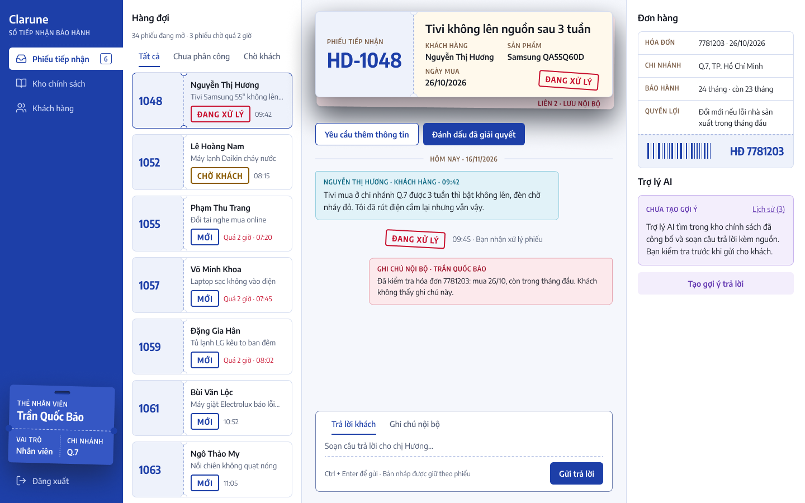

Hình 5.2.3b. A02 · Xử lý chi tiết yêu cầu với Copilot đóng.

C. Mô tả giao diện: Bố cục 2–3 cột desktop:

* Cột giữa: Chuỗi trao đổi phân biệt trực quan bằng màu sắc/nhãn giữa Tin nhắn công khai (PUBLIC) và Ghi chú nội bộ (INTERNAL), thanh tab lịch sử sự kiện (Audit Events), vùng soạn thảo bên dưới có 2 tab tách biệt rõ Trả lời khách hàng (Public) vs Ghi chú nội bộ (Internal Note) để tránh gửi nhầm ghi chú nội bộ ra ngoài cho khách hàng.  
* Thanh hành động đầu/cuối trang: nút Yêu cầu thêm thông tin (WAITING\_CUSTOMER), nút Đánh dấu đã giải quyết (RESOLVED), nút Mở Trợ lý AI.

D. Xử lý sự kiện:

| STT | Tên đối tượng | Sự kiện / Hành động (Trigger) | Hành vi hệ thống & API gọi |
| :---: | :---- | :---- | :---- |
| 1 | Tab Ghi chú nội bộ → Nút Lưu ghi chú | Click | Gọi POST /api/v1/tickets/{id}/messages với { body, visibility: "INTERNAL" } (tuyệt đối không kèm suggestionId). Lưu thành công: chèn thẻ ghi chú nền vàng/xám nội bộ vào luồng xem. |
| 2 | Tab Trả lời khách hàng → Nút Gửi trả lời | Click (soạn thủ công) | Gọi POST /api/v1/tickets/{id}/messages với { body, visibility: "PUBLIC" }. |
| 3 | Nút Yêu cầu thêm thông tin | Click (khi IN\_PROGRESS) | Gọi POST /api/v1/tickets/{id}/transitions với { action: "REQUEST\_INFO", version } → cập nhật WAITING\_CUSTOMER (A07) và tăng version; nếu 409 TICKET\_VERSION\_CONFLICT (phiếu vừa bị cập nhật bởi thao tác khác) thì thông báo xung đột và yêu cầu tải lại. |
| 4 | Nút Đánh dấu đã giải quyết | Click (khi IN\_PROGRESS) | Gọi POST /api/v1/tickets/{id}/transitions với { action: "RESOLVE", version } → cập nhật RESOLVED, tăng version và khóa ô nhập tin nhắn mới (A-Resolved); nếu 409 TICKET\_VERSION\_CONFLICT thì thông báo xung đột và yêu cầu tải lại. |
| 5 | Tab Lịch sử sự kiện | Click | Gọi GET /api/v1/tickets/{id}/events hiển thị timeline thay đổi (TICKET\_CREATED, CLAIMED, STATUS\_CHANGED, ...). |

### ***5.2.4 Nhóm màn hình Trợ lý AI Copilot (AI Copilot Panel)*** 

#### ***5.2.4.1 Tạo gợi ý và kiểm tra nguồn***

A. Thông tin màn hình: Mã màn hình: A03 (Có gợi ý), A05 (Đang tạo), A-AIError (Lỗi dịch vụ AI), A09 (Tablet), A12 (Mobile) · Tác nhân: Nhân viên hỗ trợ đang phụ trách phiếu hoặc Quản trị viên · Use Case: UC-14 (P0).

B. Hình ảnh giao diện:

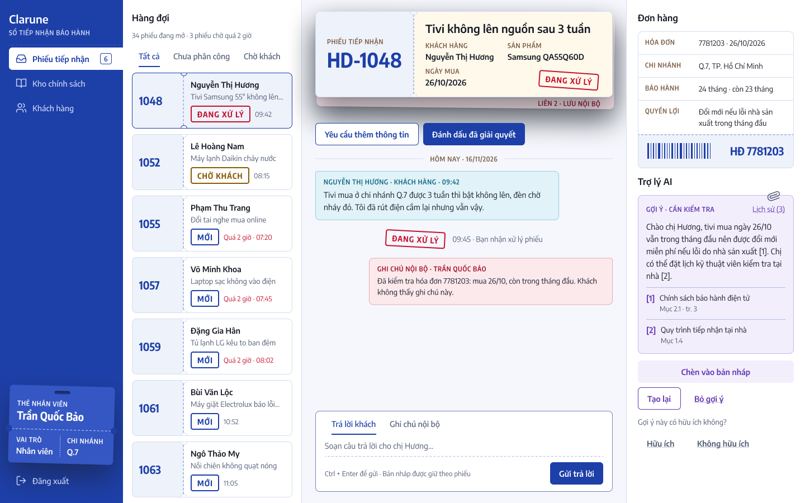

Hình 5.2.4a. A03 · Gợi ý câu trả lời Copilot & trích dẫn nguồn. 

C. Mô tả giao diện: Phiếu HD-1048 minh họa TV không lên nguồn sau ba tuần sử dụng. Ngăn Copilot nằm bên phải A03, nổi trên tablet A09 và mở dạng bảng trượt ở mobile A12. Lời nhắc kiểm tra gợi ý trước khi gửi luôn đi cùng bản nháp AI. Các chip trích dẫn hiển thị tên tài liệu và số trang khi có. [Giao diện hỗ trợ đầy đủ các trạng thái tương tác gồm: chưa tạo gợi ý (A02), đang xử lý sinh gợi ý (A05), thông báo lỗi dịch vụ AI (A-AIError) và bố cục bảng trượt trên thiết bị di động (A12).](https://www.figma.com/design/Ofvm9udw9coBOxadTN4PXB/SE?node-id=132-5676)

D. Xử lý sự kiện:

| STT | Tên đối tượng | Sự kiện / Hành động (Trigger) | Hành vi hệ thống & API gọi |
| :---: | :---- | :---- | :---- |
| 1 | Tạo gợi ý trả lời | Bấm ở phiếu được phép xử lý và chưa đóng | Hiển thị A05, khóa nút khi đang chờ. Gọi POST /api/v1/tickets/{id}/ai-suggestions. Máy chủ dùng hội thoại công khai, kiểm tra quyền, phiên bản phiếu và nguồn trước khi lưu. |
| 2 | Kết quả tạo | Nhận GENERATED | Hiện data.suggestedText và data.citations\[\]; dùng sourceId của đoạn nguồn. Gợi ý được lưu cùng bản chụp căn cứ. |
| 3 | Thiếu căn cứ | Nhận INSUFFICIENT\_EVIDENCE | Báo “Kho chính sách chưa đủ căn cứ để đề xuất câu trả lời”. Dữ liệu trả về có suggestedText: null, citations: \[\]. Khung soạn thủ công tiếp tục tuân theo trạng thái phiếu. |
| 4 | Nguồn trích dẫn | Bấm một nguồn | Mở đoạn trích đã lưu, ánh xạ documentTitle, pageNumber và excerpt từ DTO. Số trang có thể trống. |
| 5 | Lỗi hoặc mất quyền | Nhận 409, 429, 502, 504, 401, 403 hoặc 404 | 409 do phiên bản phiếu yêu cầu tải lại rồi tạo lại. Lỗi AI hiển thị A-AIError, giữ khung soạn. Lỗi quyền hoặc phiên hết hạn chặn thao tác và xóa dữ liệu Copilot khỏi màn hình. |

Lưu ý thiết kế: Trạng thái từ chối trả lời khi thiếu căn cứ (INSUFFICIENT\_EVIDENCE) và hộp thoại xem chi tiết đoạn trích nguồn tài liệu được hiển thị trực tiếp ngay bên trong khung Copilot Panel ở cột bên phải màn hình xử lý phiếu mà không làm gián đoạn nội dung nhân viên đang soạn thảo.

#### ***5.2.4.2 Kiểm duyệt, chèn, gửi và bỏ gợi ý***

A. Thông tin màn hình: Mã màn hình: A-DiscardConfirm (Xác nhận bỏ gợi ý), A-ManualAfterDiscard (Soạn thủ công sau khi bỏ) · Tác nhân: Nhân viên hỗ trợ đang phụ trách phiếu hoặc Quản trị viên · Use Case: UC-15 (P0).

B. Hình ảnh giao diện:

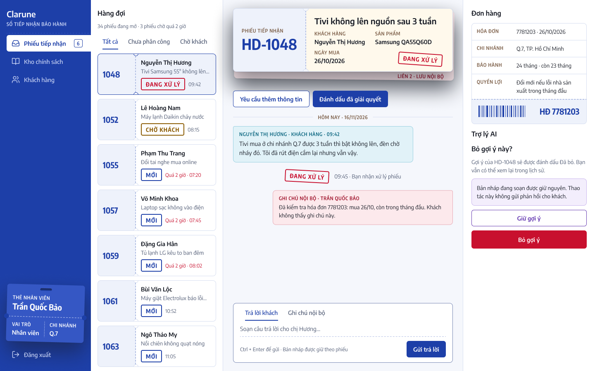

Hình 5.2.4b. A-DiscardConfirm · Xác nhận bỏ qua gợi ý câu trả lời AI. 

C. Mô tả giao diện: Sau khi bỏ, [màn soạn thủ công](https://www.figma.com/design/Ofvm9udw9coBOxadTN4PXB/SE?node-id=118-14515) minh họa nút xác nhận tiếp tục với nội dung bản nháp đang có.

D. Xử lý sự kiện:

| STT | Tên đối tượng | Sự kiện / Hành động (Trigger) | Hành vi hệ thống & API gọi |
| :---: | :---- | :---- | :---- |
| 1 | Chèn vào phản hồi | Bấm với gợi ý GENERATED | Yêu cầu chuyển sang tab Trả lời công khai nếu đang ghi chú. Nếu đã có nội dung, hỏi xác nhận thay thế, hủy thì giữ nguyên. Khi chèn, lưu suggestionId vào bản nháp cục bộ. |
| 2 | Gửi trả lời | Người xử lý xác nhận nội dung đã rà soát | Khóa nút khi đang gửi. Gọi POST /api/v1/tickets/{id}/messages với body, visibility: PUBLIC, suggestionId. Máy chủ lưu một tin công khai và đánh dấu APPLIED trong cùng giao dịch. |
| 3 | Gửi lỗi hoặc mất phản hồi | Nhận lỗi hoặc hết thời gian chờ | Giữ bản nháp. Với 409 hoặc hết thời gian chờ, tải lại phiếu/lịch sử để kiểm tra kết quả trước khi thử lại. Với lỗi quyền, ngừng hiển thị nội dung ngoài quyền hiện tại. |
| 4 | Bỏ gợi ý | Mở hộp thoại và xác nhận | Gọi POST /api/v1/ai-suggestions/{id}/discard. Chuyển GENERATED sang DISCARDED; không có tin nhắn gửi cho khách. Lỗi bỏ giữ gợi ý và bản nháp. |
| 5 | Tiếp tục soạn thủ công | Bấm sau khi đã bỏ gợi ý được chèn | Gỡ liên kết suggestionId khỏi bản nháp, giữ nguyên nội dung. Chỉ gửi khi người xử lý xác nhận phản hồi công khai. |

Lưu ý thiết kế: Khi nhân viên bấm Chèn vào phản hồi mà khung soạn thảo đang có sẵn nội dung, hệ thống hiển thị hộp thoại xác nhận thay thế bản nháp để tránh mất dữ liệu ngoài ý muốn; sau khi gửi thành công, tin nhắn phản hồi công khai xuất hiện ngay trên luồng hội thoại và thẻ gợi ý chuyển sang trạng thái Đã áp dụng (APPLIED).

#### ***5.2.4.3 Lịch sử gợi ý, bản chụp nguồn và đánh giá hữu ích***

A. Thông tin màn hình: Mã màn hình: A11 (Lịch sử gợi ý Desktop), A13 (Mobile), D-AIHistory (Góc nhìn Quản trị viên) · Tác nhân: Nhân viên hỗ trợ đang phụ trách phiếu hoặc Quản trị viên · Use Case: UC-18 (P0), UC-19 (P1 — PLANNED).

B. Hình ảnh giao diện:

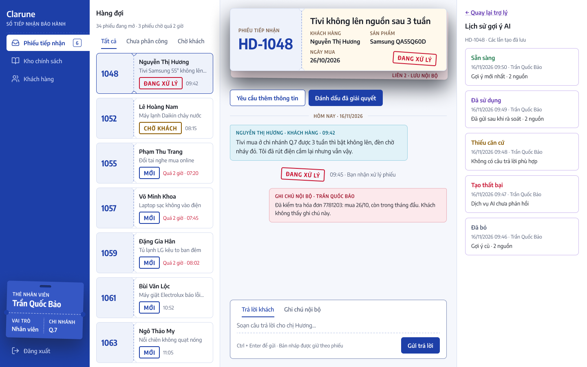

Hình 5.2.4c. A11 · Lịch sử gợi ý và đánh giá phản hồi Copilot. 

C. Mô tả giao diện: Lịch sử hiển thị các lần tạo gần nhất trước, người yêu cầu, thời điểm và trạng thái GENERATED, APPLIED, DISCARDED, INSUFFICIENT\_EVIDENCE hoặc FAILED. A13 là bản mobile; [D-AIHistory](https://www.figma.com/design/Ofvm9udw9coBOxadTN4PXB/SE?node-id=118-10738) là góc nhìn Quản trị viên. Có biến thể đang tải, rỗng, lỗi và mất quyền.

D. Xử lý sự kiện:

| STT | Tên đối tượng | Sự kiện / Hành động (Trigger) | Hành vi hệ thống & API gọi |
| :---: | :---- | :---- | :---- |
| 1 | Lịch sử gợi ý | Mở từ Copilot hoặc D-Detail | Gọi GET /api/v1/tickets/{id}/ai-suggestions. Hiển thị trạng thái đang tải, rỗng hoặc lỗi tương ứng. Với 403/404 sau chuyển giao, ẩn lịch sử và báo quyền đã thay đổi. |
| 2 | Mục lịch sử hoặc nguồn | Chọn gợi ý hay trích dẫn | Hiện kết quả và bản chụp đã lưu nếu còn quyền, kể cả khi tài liệu gốc đã lưu trữ. Lỗi tải bản chụp có thông báo riêng. Việc thấy bản chụp không cấp thêm quyền tải tệp gốc. |
| 3 | Tiếp tục kiểm duyệt | Chọn gợi ý còn GENERATED | Quay về khung kiểm duyệt theo UC-15; kiểm tra lại quyền và điều kiện gửi. |
| 4 | Hữu ích / Không hữu ích | Nhân viên phụ trách đánh giá gợi ý GENERATED hoặc APPLIED | PLANNED (P1). Chỉ lưu/đổi đánh giá của chính Nhân viên. Hợp đồng phương thức và đường dẫn API P1 thuộc phạm vi triển khai UC-19. |

### ***5.2.5 Nhóm màn hình Cơ sở tri thức (Knowledge Base)***

#### ***5.2.5.1 Màn hình Tìm kiếm & Đọc tài liệu tri thức (K01, K02, K03)***

A. Thông tin màn hình: K01 (Tìm kiếm tri thức), K02 (Không có kết quả), K03 (Đọc chi tiết đoạn/tài liệu đã công bố).

* Tác nhân: Support Agent, System Administrator (UC-13).

B. Hình ảnh giao diện:

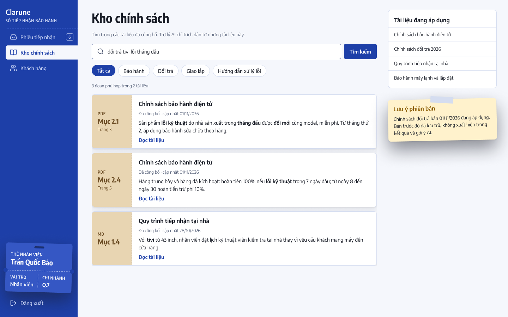

Hình 5.2.5a. K01 · Tìm kiếm cơ sở tri thức.

C. Mô tả giao diện: Thanh tìm kiếm ngữ nghĩa câu hỏi/từ khóa (VD: chính sách đổi trả tivi trong 7 ngày), danh sách kết quả hiển thị tên tài liệu, đoạn nội dung liên quan, số trang (nếu là PDF) và điểm phù hợp. Agent chỉ nhìn thấy tài liệu READY \+ published \= true và chưa ARCHIVED.

D. Xử lý sự kiện:

| STT | Tên đối tượng | Sự kiện / Hành động (Trigger) | Hành vi hệ thống & API gọi |
| :---: | :---- | :---- | :---- |
| 1 | Thanh tìm kiếm \+ nút Tìm kiếm | Submit / Enter | Gọi GET /api/v1/knowledge/search?q=...\&limit=10. Server nhúng câu truy vấn qua EmbeddingProvider và lọc SQL status='READY' AND published=true trước khi sắp xếp độ tương đồng cosine. Không có kết quả → hiển thị K02. |
| 2 | Thẻ kết quả tài liệu | Click | Gọi GET /api/v1/knowledge/documents/{id} kiểm tra lại quyền và trạng thái tài liệu trước khi hiển thị chi tiết (K03). Nếu tài liệu vừa bị Admin archive → báo không còn khả dụng. |

#### ***5.2.5.2 Màn hình Quản lý danh sách, Tải lên & Công bố/Lưu trữ tài liệu (K04, K05, K06)***

A. Thông tin màn hình: K04 (Danh sách quản trị tài liệu), K05 (Tải lên tài liệu), K06 / K-ReadyDetail / K-Archive (Chi tiết, Công bố, Lưu trữ, Thử lại).

* Tác nhân: System Administrator (UC-11, UC-12).

B. Hình ảnh giao diện:

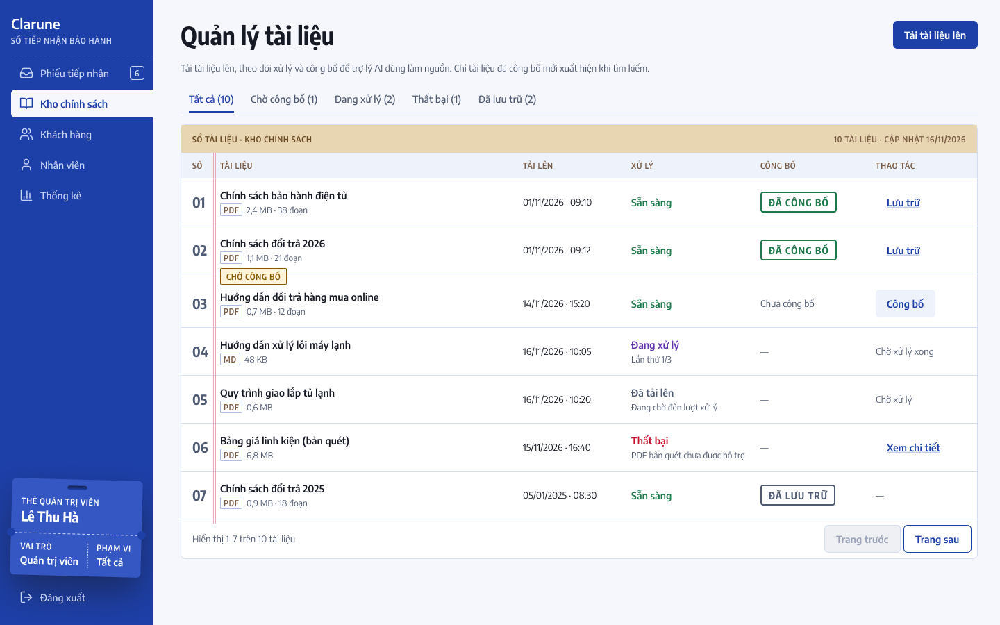

Hình 5.2.5b. K04 · Quản lý danh sách tài liệu tri thức.

C. Mô tả giao diện: Bảng quản trị hiển thị tiêu đề, tên tệp, kích thước, ngày tải lên, 2 cột/badge tách biệt: cột Xử lý phản ánh tiến trình bóc tách kỹ thuật (Đã tải lên — UPLOADED, Đang xử lý — PROCESSING, Sẵn sàng — READY, Thất bại — FAILED) và cột Công bố hiển thị tình trạng phát hành (Chưa công bố khi status \= READY, published \= false; ĐÃ CÔNG BỐ khi status \= READY, published \= true; và ĐÃ LƯU TRỮ khi dưới CSDL tài liệu chuyển sang status \= ARCHIVED, published \= false, trong khi cột Xử lý vẫn giữ nhãn Sẵn sàng để thể hiện tài liệu đã bóc tách hoàn tất), kèm nút hành động theo trạng thái (Công bố chỉ bật khi tài liệu đạt trạng thái READY và chưa công bố; Thử lại khi FAILED và còn lượt; Lưu trữ kèm modal xác nhận K-Archive). Modal K05 hỗ trợ chọn tệp .pdf/.txt/.md tối đa 10 MiB, hiển thị các lỗi cụ thể (K-TooLarge, K-ScanFailed khi PDF chỉ có ảnh quét).

D. Xử lý sự kiện:

| STT | Tên đối tượng | Sự kiện / Hành động (Trigger) | Hành vi hệ thống & API gọi |
| :---: | :---- | :---- | :---- |
| 1 | Tải danh mục KB | Mount / Đổi bộ lọc hoặc trang | Gọi GET /api/v1/knowledge/documents?page=0\&size=20. |
| 2 | Modal K05 → Nút Tải lên | Submit form (Title \+ File) | Kiểm tra extension \+ kích thước ≤ 10 MiB phía client; gửi POST /api/v1/knowledge/documents (multipart/form-data). Server trả 202 Accepted ngay sau khi lưu file private & tạo job PENDING; worker xử lý nền bất đồng bộ. |
| 3 | Nút Công bố tài liệu | Click trên tài liệu READY | Gọi POST /api/v1/knowledge/documents/{id}/publish. Cập nhật trạng thái tài liệu sang Đã công bố và ghi nhận thời điểm công bố. |
| 4 | Nút Lưu trữ → Xác nhận | Click xác nhận (K-Archive) | Gọi POST /api/v1/knowledge/documents/{id}/archive. Dưới CSDL cập nhật status \= ARCHIVED và published \= false; trên bảng K04 giữ nhãn Sẵn sàng ở cột Xử lý và chuyển cột Công bố sang badge ĐÃ LƯU TRỮ. Tài liệu ngừng xuất hiện trong các lượt tìm kiếm và RAG mới nhưng vẫn giữ nguyên các bản chụp trích dẫn trong lịch sử gợi ý cũ. |
| 5 | Nút Thử lại xử lý | Click trên tài liệu FAILED | Gọi POST /api/v1/knowledge/documents/{id}/retry. Nếu còn lượt (attempts \< 3), đưa job về PENDING; nếu đã hết 3 lượt, trả 409 INGESTION\_ATTEMPTS\_EXHAUSTED. |

### ***5.2.6 Nhóm màn hình Quản trị hệ thống & Thống kê (Admin Workspace)***

#### ***5.2.6.1 Tất cả yêu cầu, chi tiết và phân công***

A. Thông tin màn hình: Mã màn hình: D01 (Danh sách tất cả yêu cầu), D01-Phân công (Hộp thoại phân công nhân viên), D-Detail (Chi tiết yêu cầu & Lịch sử sự kiện) · Tác nhân: Quản trị viên · Use Case: UC-06, UC-07, UC-10, UC-18.

B. Hình ảnh giao diện:

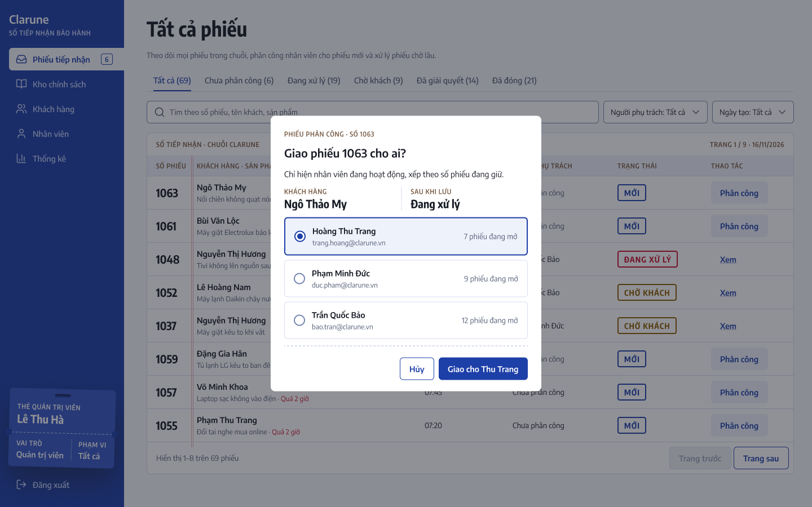

Hình 5.2.6a. D01 · Quản trị viên phân công nhân viên hỗ trợ.

C. Mô tả giao diện: Màn hình Quản trị yêu cầu (D01) hiển thị bảng danh sách toàn bộ phiếu hỗ trợ trên hệ thống kèm thanh tìm kiếm, bộ lọc theo 5 trạng thái và theo nhân viên phụ trách. Khi chọn một phiếu để mở chi tiết (D-Detail) hoặc bấm nút Phân công (D01-Phân công), hệ thống hiển thị hộp thoại chọn nhân viên hỗ trợ đang hoạt động (ACTIVE) kèm số lượng phiếu đang mở của từng nhân viên để Quản trị viên điều phối tải công việc hợp lý.

D. Xử lý sự kiện:

| STT | Tên đối tượng | Sự kiện / Hành động (Trigger) | Hành vi hệ thống & API gọi |
| :---: | :---- | :---- | :---- |
| 1 | Danh sách, bộ lọc và phân trang | Mở hoặc đổi bộ lọc | Gọi GET /api/v1/tickets với tham số lọc/phân trang theo hợp đồng Ticket và quyền Admin. |
| 2 | Dòng phiếu / Lịch sử | Chọn phiếu hoặc mở lịch sử | Đọc GET /api/v1/tickets/{id}, GET /api/v1/tickets/{id}/messages và GET /api/v1/tickets/{id}/events theo dữ liệu màn hình cần. Nút Lịch sử gợi ý mở D-AIHistory. |
| 3 | Phân công / Chuyển người phụ trách | Chọn Nhân viên đang hoạt động và xác nhận | Gọi PATCH /api/v1/tickets/{id}/assignment với { assignedAgentId, version }. Phân công phiếu OPEN chuyển sang IN\_PROGRESS; chuyển giao giữ trạng thái IN\_PROGRESS hoặc WAITING\_CUSTOMER và tăng version; quyền Nhân viên cũ được kiểm tra lại ở request kế tiếp. Nếu version gửi lên đã cũ (409 TICKET\_VERSION\_CONFLICT) thì thông báo xung đột và tải lại dữ liệu mới nhất. |

#### *5**.2.6.2 Quản lý nhân viên hỗ trợ***

A. Thông tin màn hình: Mã màn hình: D02 (Danh sách nhân viên hỗ trợ), D02-Thêm (Tạo tài khoản nhân viên), D02-Vô hiệu hóa (Khóa tài khoản) · Tác nhân: Quản trị viên · Use Case: UC-04 (P0).

B. Hình ảnh giao diện:

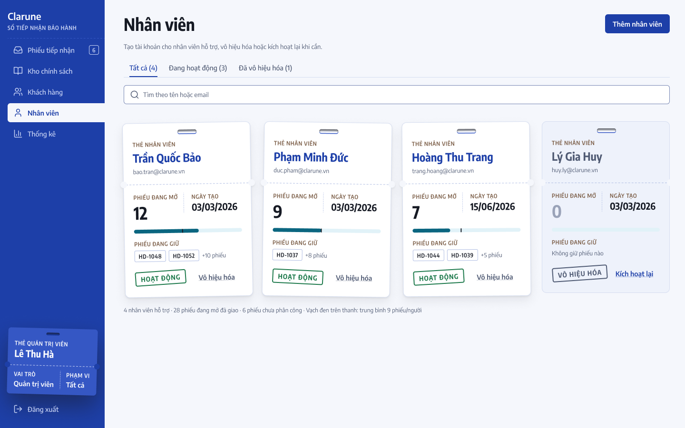

Hình 5.2.6b. D02 · Quản lý kích hoạt tài khoản nhân viên hỗ trợ. 

C. Mô tả giao diện: Màn hình thể hiện thẻ Nhân viên, trạng thái tài khoản và số phiếu đang mở. [Quản trị viên có thể mở biểu mẫu tạo tài khoản nhân viên mới (D02-Thêm) hoặc mở hộp thoại xác nhận vô hiệu hóa\\](https://www.figma.com/design/Ofvm9udw9coBOxadTN4PXB/SE?node-id=112-2985)

D. Xử lý sự kiện:

| STT | Tên đối tượng | Sự kiện / Hành động (Trigger) | Hành vi hệ thống & API gọi |
| :---: | :---- | :---- | :---- |
| 1 | Danh sách và bộ lọc | Mở trang hoặc lọc trạng thái | Tải danh sách theo quyền Admin qua API GET /api/v1/admin/agents?page=0\&size=20\&status=ACTIVE\|INACTIVE\|ALL (kiểm tra phân quyền Quản trị viên do Module Identity cung cấp). |
| 2 | Tạo nhân viên | Điền tên, email, mật khẩu và gửi | Gọi POST /api/v1/admin/agents. Nếu email trùng, hiển thị biến thể D02-Thêm-Lỗi 112:3117. |
| 3 | Vô hiệu hóa / Kích hoạt lại | Xác nhận thay đổi | Gọi PATCH /api/v1/admin/agents/{id}/enabled với enabled. Khi vô hiệu hóa, máy chủ thu hồi các phiên của tài khoản và chặn request tiếp theo ngay lập tức. |

#### *5**.2.6.3 Thống kê phiếu***

A. Thông tin màn hình: Mã màn hình: D03 (Bảng điều khiển thống kê phiếu hỗ trợ) · Tác nhân: Quản trị viên · Use Case: UC-17 (P1 — PLANNED).

B. Hình ảnh giao diện:

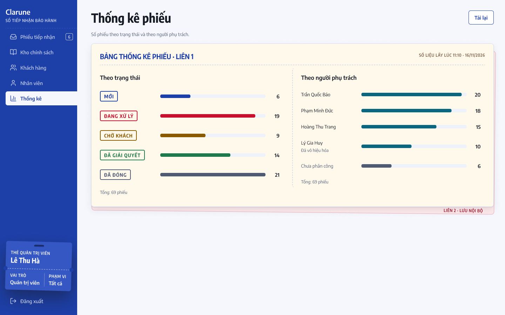

Hình 5.2.6c. D03 · Thống kê tổng quan và số liệu Ticket. 

C. Mô tả giao diện: Hiển thị phân bố theo năm trạng thái phiếu và theo người phụ trách, gồm nhóm chưa phân công. Giữ Nhân viên đã vô hiệu hóa trong thống kê nếu vẫn đang gắn phiếu. Phân biệt đang tải, dữ liệu rỗng và lỗi tải.

D. Xử lý sự kiện:

| STT | Tên đối tượng | Sự kiện / Hành động (Trigger) | Hành vi hệ thống & API gọi |
| :---: | :---- | :---- | :---- |
| 1 | Menu Thống kê / Tải lại | Mở báo cáo hoặc yêu cầu cập nhật | Gọi GET /api/v1/admin/analytics/tickets/summary (thuộc phạm vi mở rộng P1 — UC-17, kiểm tra phân quyền Quản trị viên trên máy chủ) để truy xuất số liệu thống kê tổng hợp phiếu theo 5 trạng thái và theo từng nhân viên hỗ trợ. |
