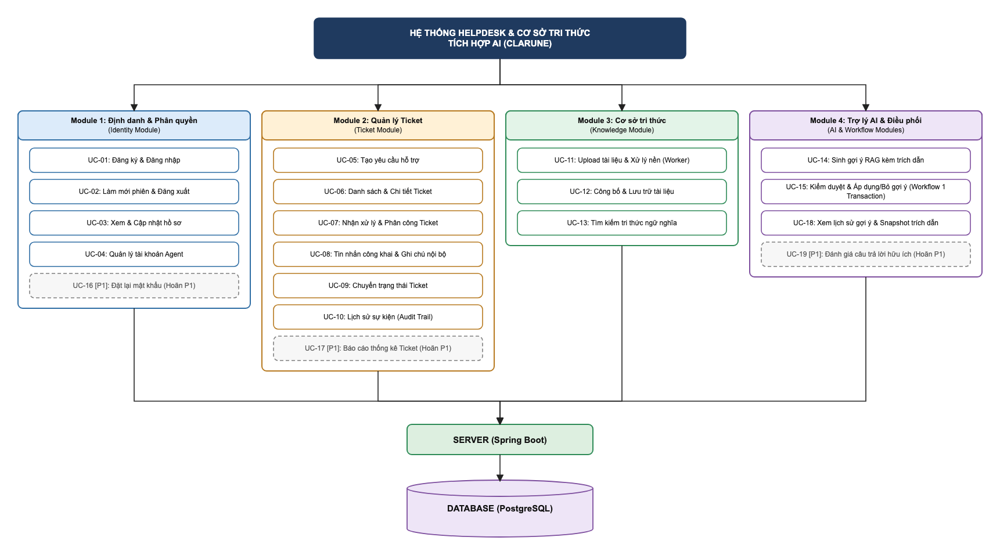
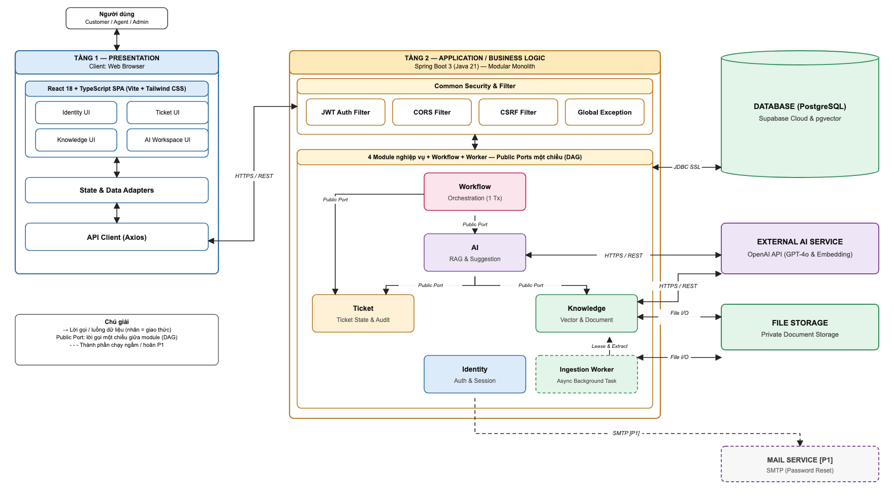

# Thiết kế Kiến trúc Hệ thống — Mục 3.1 (Ngô Viết Thanh Bình - `24120269`)

> **Học phần:** Nhập môn Công nghệ Phần mềm — **Nhóm 04 (Clarune)**  
> **Thành viên phụ trách:** Ngô Viết Thanh Bình (`24120269` — Trưởng nhóm)  
> **Mã công việc Jira:** `SCRUM-59` (`T2-ARCH-01`), `SCRUM-62` (`T2-REVIEW-01`), `SCRUM-55` (`QA1-T2-01`)  
> **Nguồn đối chiếu:** Trích xuất nguyên bản 100% từ Google Doc chính thức đã chốt của nhóm (`[SE - Nhóm 4] Template2-ThietKe-Clarune-04`)  
> **Tệp nguồn sơ đồ đính kèm:** [`diagrams/system-decomposition-tree.drawio`](diagrams/system-decomposition-tree.drawio) · [`diagrams/system-decomposition-tree.svg`](diagrams/system-decomposition-tree.svg) · [`diagrams/system-architecture.drawio`](diagrams/system-architecture.drawio) · [`diagrams/system-architecture.svg`](diagrams/system-architecture.svg)

---

# **3\. Thiết kế kiến trúc** {#3.-thiết-kế-kiến-trúc}

## **3.1 Sơ đồ kiến trúc** {#3.1-sơ-đồ-kiến-trúc}

### ***3.1.1 Sơ đồ cây phân rã hệ thống (System Decomposition Tree)*** {#3.1.1-sơ-đồ-cây-phân-rã-hệ-thống-(system-decomposition-tree)}

Sơ đồ cây phân rã trình bày cấu trúc phân rã chức năng theo chiều dọc của toàn bộ hệ thống Clarune thành 4 Module nghiệp vụ ánh xạ trực tiếp tới 19 Use Cases (UC-01..UC-19), kết nối xuyên suốt tới máy chủ ứng dụng (Application Server), lớp điều phối giao dịch (Workflow) và hệ quản trị cơ sở dữ liệu PostgreSQL \+ pgvector.

Hình 3.1 — Sơ đồ cây phân rã chức năng hệ thống Clarune theo chiều dọc

### ***3.1.2 Sơ đồ tổng quan kiến trúc hệ thống (Overall System Architecture)*** {#3.1.2-sơ-đồ-tổng-quan-kiến-trúc-hệ-thống-(overall-system-architecture)}

Hệ thống được thiết kế theo mô hình Client–Server 3 tầng (3-Tier) ở cấp triển khai kết hợp Kiến trúc Khối đơn thể Mô-đun hóa (Modular Monolith — C4 Container/Component) ở tầng máy chủ nhằm tối ưu sự tách biệt nghiệp vụ nhưng không phát sinh chi phí vận hành phân tán (Microservices/Message Broker) trong phạm vi MVP.

Hình 3.2 — Sơ đồ tổng quan kiến trúc 3 tầng kết hợp Modular Monolith của hệ thống Clarune

### ***3.1.3 Tổng quan kiến trúc*** {#3.1.3-tổng-quan-kiến-trúc}

Hệ thống Clarune được thiết kế dựa trên mô hình Client \- Server kết hợp với Kiến trúc 3 tầng (3-Tier Architecture) ở cấp độ triển khai và Kiến trúc Khối đơn thể Mô-đun hóa (Modular Monolith) ở phía máy chủ. Cách tiếp cận này giúp hệ thống vừa đơn giản trong việc đóng gói, vận hành, vừa đảm bảo tính phân tách độc lập giữa các miền nghiệp vụ:

* Cô lập thực thể và kho dữ liệu theo từng Module: Toàn bộ mã nguồn máy chủ được chia thành 4 Module nghiệp vụ độc lập (Identity, Ticket, Knowledge, AI) cùng 1 gói điều phối Workflow chung. Mỗi Module quản lý riêng các thực thể dữ liệu (Entity) và lớp truy xuất (Repository) của mình, không truy cập trực tiếp vào bảng hay kho dữ liệu nội bộ của Module khác.  
* Giao tiếp liên Module qua Cổng giao tiếp công khai (Public Ports) và DTO bất biến: Các Module trao đổi dữ liệu với nhau thông qua các giao diện dịch vụ được định nghĩa rõ ràng. Cụ thể: Module Identity cung cấp thông tin định danh và vai trò người dùng hiện tại; Module Ticket cung cấp ngữ cảnh hội thoại công khai (đã loại bỏ các ghi chú nội bộ) cho Module AI; Module Knowledge đảm nhận độc quyền việc nhúng câu truy vấn và tìm kiếm đoạn tri thức tương đồng; Module Workflow đứng ở tầng trên để điều phối thao tác áp dụng hoặc hủy bỏ gợi ý AI giữa Ticket và AI trong một giao dịch thống nhất, tránh phụ thuộc vòng hai chiều.

### ***3.1.4 Tầng Client (Presentation Layer)*** {#3.1.4-tầng-client-(presentation-layer)}

Tầng Client chịu trách nhiệm hiển thị giao diện trực quan và tiếp nhận thao tác từ ba nhóm người dùng (Khách hàng, Nhân viên hỗ trợ, Quản trị viên). Được xây dựng bằng thư viện React kết hợp TypeScript và công cụ Vite, tầng này áp dụng các nguyên tắc thiết kế hiện đại:

* Kiến trúc tổ chức theo tính năng (Feature-Sliced Design): Giao diện được phân chia thành các phân khu độc lập tương ứng với các miền nghiệp vụ (Identity, Ticket, Knowledge, AI), hỗ trợ hiển thị tương thích trên cả máy tính để bàn, máy tính bảng và thiết bị di động kèm hai chế độ giao diện Sáng/Tối.  
* Quản lý phiên đăng nhập và làm mới Token tự động: Access Token có thời hạn ngắn chỉ được lưu trữ trong bộ nhớ tạm của ứng dụng (in-memory), trong khi Refresh Token được bảo vệ an toàn qua HttpOnly Cookie. Bộ đón chặn (Axios Interceptor) tự động gộp các yêu cầu làm mới phiên khi hết hạn token để đảm bảo trải nghiệm liền mạch cho người dùng.  
* Tách biệt dữ liệu giao tiếp và mô hình hiển thị (DTO & ViewModel Adapter): Dữ liệu JSON chuẩn hóa từ máy chủ được chuyển đổi qua lớp Adapter tại phía Client để định dạng thời gian theo múi giờ địa phương và hiển thị đúng trạng thái giao diện.

### ***3.1.5 Tầng Server (Business Logic Layer)*** {#3.1.5-tầng-server-(business-logic-layer)}

Tầng Server là trung tâm xử lý nghiệp vụ của toàn hệ thống, được phát triển trên nền tảng Java 21 và Spring Boot 3\. Bên trong mỗi Module nghiệp vụ, luồng xử lý tuân thủ chặt chẽ kiến trúc phân lớp gồm 4 thành phần:

* Lớp Giao tiếp API (Controller Layer): Tiếp nhận các yêu cầu HTTP RESTful (/api/v1/\*) từ phía Client, kiểm tra tính hợp lệ của dữ liệu đầu vào và chuẩn hóa kết quả trả về hoặc thông báo lỗi theo cấu trúc thống nhất.  
* Lớp Dịch vụ Ứng dụng (Application Service Layer): Điều phối luồng thực thi của từng ca sử dụng và quản lý ranh giới giao dịch cơ sở dữ liệu (Transaction). Để tối ưu hiệu năng và tài nguyên kết nối, giao dịch chỉ được mở khi đọc hoặc ghi cơ sở dữ liệu và luôn tách riêng khỏi các lời gọi mạng tới dịch vụ AI bên ngoài.  
* Lớp Mô hình Nghiệp vụ (Domain Layer): Đóng gói các quy tắc nghiệp vụ cốt lõi, kiểm soát quyền sở hữu trên từng phiếu hỗ trợ và quản lý máy trạng thái của Ticket cũng như tài liệu tri thức.  
* Lớp Hạ tầng Kỹ thuật (Infrastructure Layer): Thực thi việc truy xuất dữ liệu qua Spring Data JPA, quản lý lưu trữ tệp tin nội bộ, trích xuất văn bản từ tài liệu (PDF, TXT, Markdown) và kết nối với dịch vụ AI bên ngoài. Ngoài ra, bộ lọc bảo mật (JWT Authentication Filter) kiểm tra trạng thái kích hoạt của tài khoản trên mọi yêu cầu để thu hồi quyền truy cập ngay lập tức khi tài khoản bị vô hiệu hóa.

### ***3.1.6 Tầng Cơ sở dữ liệu & Lưu trữ (Data Layer)*** {#3.1.6-tầng-cơ-sở-dữ-liệu-&-lưu-trữ-(data-layer)}

Tầng Cơ sở dữ liệu và Lưu trữ đảm bảo tính toàn vẹn, bền vững và bảo mật cho cả dữ liệu cấu trúc, dữ liệu vector ngữ nghĩa và tệp tài liệu gốc:

* Cơ sở dữ liệu quan hệ kết hợp Vector (PostgreSQL 16 & pgvector): Hệ thống triển khai cơ sở dữ liệu chính trên nền tảng Supabase Cloud (khu vực Singapore) tích hợp sẵn tiện ích mở rộng pgvector, đồng thời duy trì cấu hình Docker Compose làm môi trường dự phòng khi phát triển cục bộ. Việc hợp nhất dữ liệu nghiệp vụ và vector nhúng trong cùng một hệ quản trị cho phép hệ thống vừa đảm bảo tính toàn vẹn giao dịch (ACID), vừa lọc điều kiện quyền truy cập và trạng thái công bố của tài liệu ngay trong câu truy vấn tìm kiếm tương đồng ngữ nghĩa.  
* Kho lưu trữ tệp tin riêng tư (Private File Storage): Các tệp tài liệu gốc do Quản trị viên tải lên được lưu trữ trong phân vùng riêng biệt nằm ngoài thư mục truy cập công khai và định danh bằng khóa lưu trữ ngẫu nhiên do máy chủ cấp phát. Mọi yêu cầu đọc hoặc tải tệp đều phải đi qua tầng kiểm tra phân quyền của máy chủ.

### ***3.1.7 Công nghệ sử dụng & Các điểm đặc biệt trong kiến trúc*** {#3.1.7-công-nghệ-sử-dụng-&-các-điểm-đặc-biệt-trong-kiến-trúc}

#### ***A. Bảng tổng hợp Công nghệ sử dụng***

| Lớp (Layer) | Công nghệ / Thư viện | Mục đích & Lý do lựa chọn | Phiên bản / Tiêu chuẩn áp dụng |
| :---- | :---- | :---- | :---- |
| Frontend | React \+ TypeScript \+ Vite | Xây dựng SPA có kiểm soát kiểu tĩnh mạnh, tốc độ build nhanh | React 18.3.1, TypeScript 5.6.2, Vite 6.0.1 |
| UI Styling & HTTP | Tailwind CSS \+ Axios | Giao diện đáp ứng (Responsive) theo thiết kế Figma; interceptor single-flight refresh 401 | Tailwind CSS 3.4.15, Fetch API / Axios Client có Refresh Interceptor |
| Backend Core | Java 21 (LTS) \+ Spring Boot 3 | Hệ sinh thái vững chắc cho REST API, transaction và bảo mật | Java 21 (LTS), Spring Boot 3.3.5 |
| Security | Spring Security \+ JJWT / Nimbus \+ BCrypt (PasswordEncoder) | Xác thực Access JWT 15 phút, Refresh Token hash SHA-256 trong DB | Spring Security 6.3.4, JJWT / Token Auth, BCrypt |
| Persistence & Migration | Spring Data JPA / Hibernate \+ PostgreSQL 16 \+ pgvector \+ Flyway | Hỗ trợ vừa giao dịch ACID cho Ticket, vừa truy vấn vector cho RAG | PostgreSQL 16 \+ pgvector |
| Document Parsing | Apache PDFBox \+ Bộ đọc TXT/MD UTF-8 thuần | Trích xuất text từ PDF có lớp văn bản (không OCR ảnh quét trong P0) | Apache PDFBox (PDF text) & UTF-8 Text/Markdown Parser |
| AI & RAG Integration | Spring AI / HTTP Client tương thích API Embedding & LLM | Trừu tượng hóa qua cổng Port để hoán đổi giữa Live và Mock | Mô hình ngôn ngữ lớn (LLM: GPT-4o-mini) & Mô hình nhúng Vector (gemini-embedding-2, 768 chiều) |
| Testing & DevOps | JUnit 5, Mockito, MockMvc, Testcontainers, Docker Compose, GitHub Actions | Chạy test tranh chấp đồng thời trên PostgreSQL thật và tái lập môi trường sạch | Java 21 / Maven / Docker |

#### ***B. Các điểm đặc biệt và Mẫu thiết kế (Design Patterns) áp dụng***

1\. Mẫu Máy trạng thái (State Machine Pattern — Quản lý vòng đời Ticket và Tài liệu):

Toàn bộ quy trình chuyển đổi trạng thái của phiếu hỗ trợ (từ OPEN, IN\_PROGRESS, WAITING\_CUSTOMER đến RESOLVED, CLOSED) và tài liệu tri thức (từ UPLOADED, PROCESSING đến READY, FAILED, ARCHIVED) được đóng gói trực tiếp trong các thực thể nghiệp vụ. Mọi thao tác chuyển trạng thái không hợp lệ hoặc không đúng thẩm quyền vai trò sẽ bị hệ thống từ chối ngay tại tầng nghiệp vụ.

2\. Cơ chế Khóa lạc quan kết hợp Cập nhật nguyên tử (Optimistic Locking & Atomic Claim):

Giải quyết triệt để tình huống hai nhân viên hỗ trợ cùng bấm nhận xử lý một phiếu đang mở tại cùng một thời điểm. Hệ thống sử dụng trường phiên bản (version) kết hợp câu lệnh cập nhật nguyên tử có điều kiện để đảm bảo chỉ có duy nhất một nhân viên nhận phiếu thành công; yêu cầu đến sau sẽ nhận được thông báo xung đột (HTTP 409\) để làm mới lại danh sách.

3\. Tiến trình Xử lý nền theo cơ chế Giữ khóa có thời hạn (Lease-Based Background Worker):

Khi Quản trị viên tải lên tài liệu tri thức, hệ thống ghi nhận tệp và trả về phản hồi ngay lập tức, sau đó tiến trình nền sẽ tự động nhận tác vụ trong một giao dịch ngắn kèm mã khóa phiên (lease token) có thời hạn. Quá trình trích xuất văn bản PDF và gọi API sinh vector nhúng được thực hiện bên ngoài giao dịch cơ sở dữ liệu; kết quả chỉ được lưu lại nếu mã khóa phiên vẫn còn hiệu lực, giúp hệ thống tự phục hồi an toàn nếu tiến trình gặp sự cố giữa chừng.

4\. Mẫu Chiến lược & Bộ chuyển đổi cho dịch vụ AI (Strategy & Adapter Pattern):

Trừu tượng hóa việc tích hợp mô hình ngôn ngữ lớn (LLM) và mô hình nhúng (Embedding) thông qua các cổng giao tiếp chuẩn. Kiến trúc này cho phép hệ thống linh hoạt chuyển đổi giữa nhà cung cấp dịch vụ AI thực tế (OpenAI API) và bộ mô phỏng phục vụ kiểm thử tự động mà không làm thay đổi mã nguồn xử lý nghiệp vụ cốt lõi.

5\. Điều phối Giao dịch Liên Module có con người kiểm duyệt (Human-in-the-Loop Workflow):

Hệ thống không bao giờ tự động gửi trực tiếp câu trả lời của AI cho khách hàng. Khi nhân viên hỗ trợ kiểm duyệt, chỉnh sửa và xác nhận áp dụng gợi ý, dịch vụ điều phối tại Module Workflow sẽ thực hiện khóa bản ghi theo thứ tự nhất quán từ Ticket đến gợi ý AI trong cùng một giao dịch cơ sở dữ liệu, đảm bảo việc tạo tin nhắn phản hồi công khai và cập nhật trạng thái gợi ý diễn ra đồng bộ, chống áp dụng trùng lặp.

6\. Phòng chống tấn công Prompt Injection & Kiểm chứng Trích dẫn Nghiêm ngặt:

Tách biệt hoàn toàn chỉ dẫn hệ thống (System Prompt) với nội dung văn bản do người dùng nhập vào, đồng thời không cấp cho mô hình AI bất kỳ quyền thực thi công cụ hay truy cập cơ sở dữ liệu trực tiếp nào. Mọi gợi ý do AI sinh ra đều phải đi kèm mã nguồn trích dẫn hợp lệ nằm trong tập đoạn tri thức vừa truy xuất; nếu không đủ căn cứ từ tài liệu đã công bố, hệ thống chủ động trả về trạng thái thiếu bằng chứng thay vì suy đoán.
