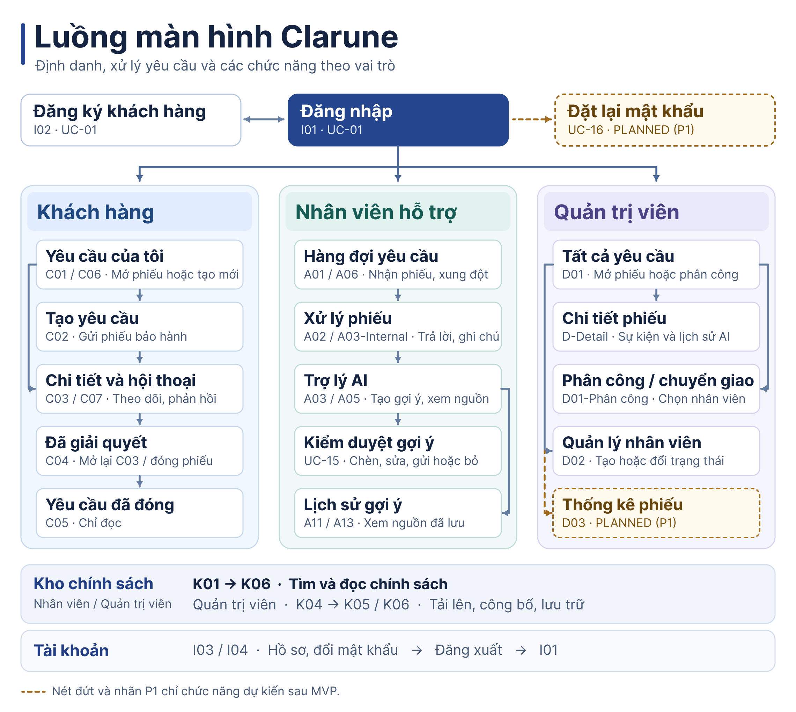
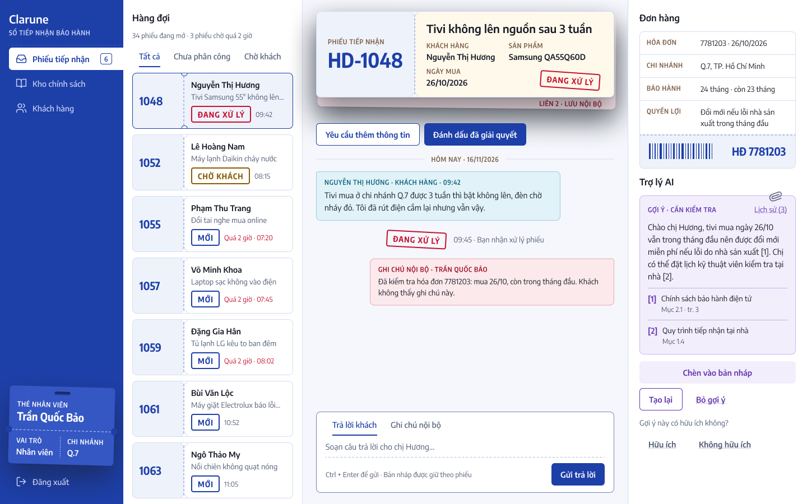
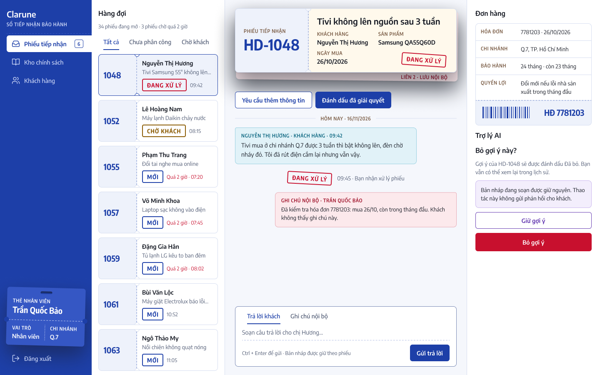
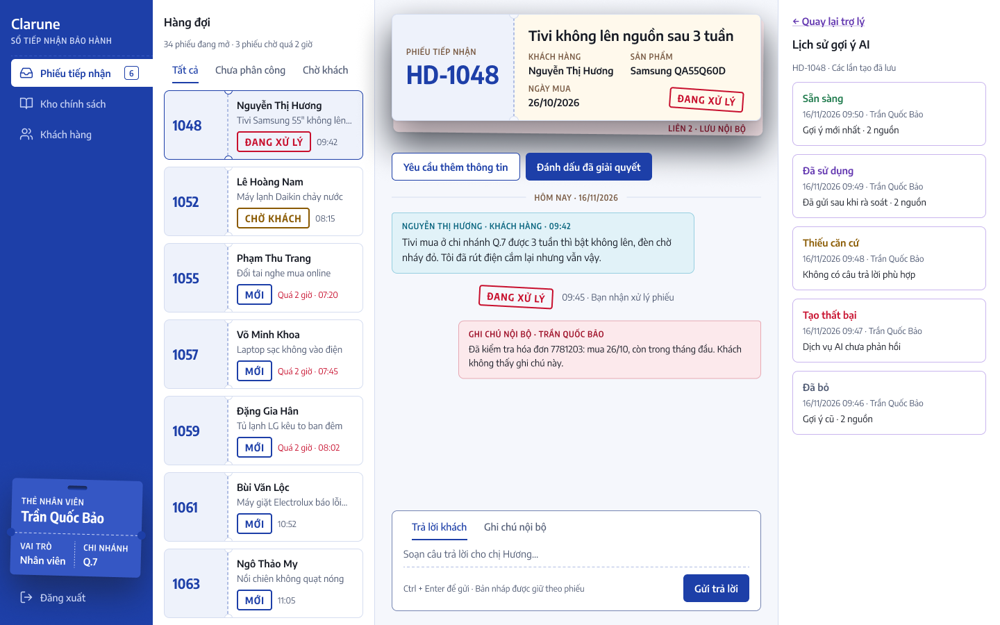
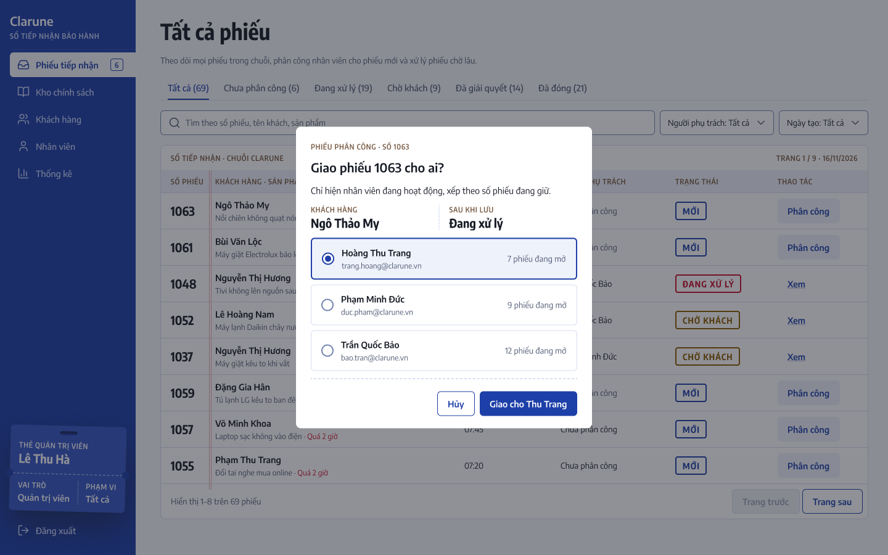
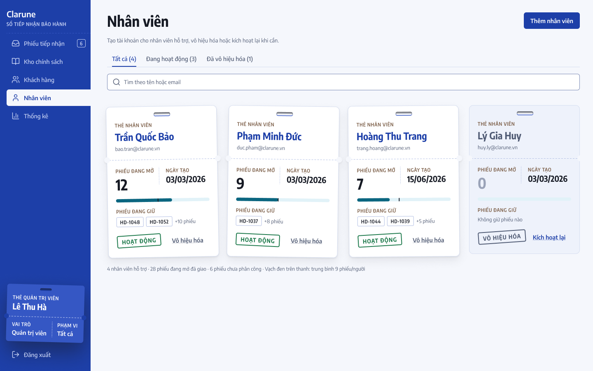
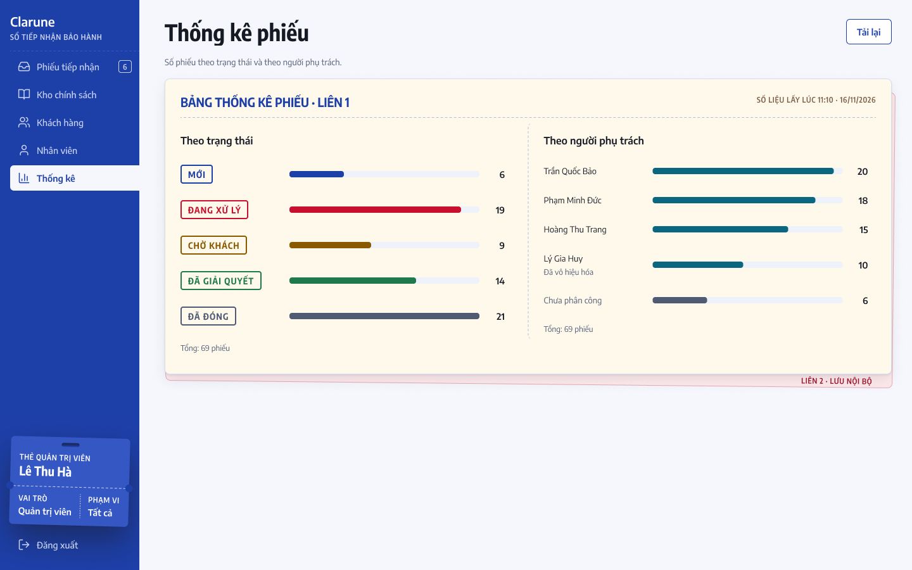

# 5. Thiết kế giao diện Clarune

## 5.1 Sơ đồ màn hình

### 5.1.1 Luồng chuyển màn hình theo vai trò

**Hình 5.1. Luồng màn hình Clarune theo vai trò.** Đăng nhập thành công đưa Khách hàng đến Yêu cầu của tôi, Nhân viên đến hàng đợi và Quản trị viên đến Tất cả yêu cầu. Chức năng P1 có nhãn **PLANNED (P1)**. Khung Figma `1:2`. [Bản SVG xuất từ Figma](diagrams/screen-flow-figma.svg) · [Bản bố cục trước trong draw.io](diagrams/screen-flow.drawio)

- **Khách hàng:** Từ C01/C06, mở phiếu đã có hoặc tạo phiếu C02. Gửi phiếu mới thành công mở C03. Khi phiếu đã giải quyết, C04 cho phép mở lại hoặc xác nhận đóng. C05 chỉ đọc.
- **Nhân viên:** Từ hàng đợi, nhận phiếu A01 để mở A02. Nếu người khác đã nhận, A06 thông báo xung đột và tải lại danh sách. Từ nơi xử lý phiếu, mở Copilot, xem nguồn, kiểm duyệt bản nháp hoặc mở lịch sử gợi ý. Vào K01 từ menu Kho chính sách.
- **Quản trị viên:** D01 dẫn đến chi tiết D-Detail hoặc hộp thoại D01-Phân công. Từ chi tiết mở D-AIHistory. Menu quản trị dẫn đến D02 (Nhân viên), K04 (Quản lý tài liệu) và D03 (Thống kê, **PLANNED (P1)**). Quản trị viên cũng có quyền tìm tài liệu ở K01.
- **Tài khoản:** I02 quay về I01 sau đăng ký. Sau đăng nhập, menu tài khoản mở I03 cho Khách hàng hoặc I04 cho Nhân viên/Quản trị viên. Đăng xuất quay lại I01. Đặt lại mật khẩu thuộc UC-16, **PLANNED (P1)**.

### 5.1.2 Danh mục màn hình đối chiếu Figma v3

Node ID bên dưới là ID của từng frame. [Figma v3](https://www.figma.com/design/Ofvm9udw9coBOxadTN4PXB/SE?node-id=111-3978) · [Danh mục ảnh xuất theo Node ID](../../../design/man-hinh-v3.md)

| Nhóm | Màn hình và Node ID Figma v3 | Use Case |
| --- | --- | --- |
| Định danh | I01 Đăng nhập `113:4387`, I02 Đăng ký `114:4766`, I03 Hồ sơ Khách hàng `113:3580`, I04 Hồ sơ Nhân viên/Quản trị viên `113:3461` | UC-01, UC-02, UC-03 |
| Định danh P1 | Đặt lại mật khẩu, **PLANNED (P1)**. Chưa xác nhận frame v3 trong bộ ảnh đối soát. | UC-16 |
| Khách hàng | C01 Danh sách `111:2664`, C02 Tạo yêu cầu `132:6237`, C03 Chi tiết `111:2763`, C04 Đã giải quyết `132:6339`, C05 Đã đóng `132:6441`, C06 Danh sách mobile `111:3570`, C07 Chi tiết mobile `111:3571` | UC-05, UC-06, UC-08, UC-09 |
| Nhân viên | A01 Phiếu mới `132:5524`, A06 Xung đột nhận `118:3245`, A02 Phiếu đang xử lý `132:5676`, A03-Internal Ghi chú `115:2017`, A07 Chờ khách `118:3523`, A10 Hội thoại mobile `118:5192` | UC-06 đến UC-10 |
| Copilot | A03 Có gợi ý `111:1700`, A05 Đang tạo `118:2229`, A-AIError Lỗi `118:2508`, A09 Tablet `118:5368`, A12 Mobile `119:16873` | UC-14 |
| Kiểm duyệt gợi ý | A-DiscardConfirm Xác nhận bỏ `118:8823`, A-DiscardError Lỗi bỏ `118:9088`, A-ManualAfterDiscard Soạn thủ công `118:14515`, A-SendError Lỗi gửi `118:2785` | UC-15 |
| Lịch sử AI | A11 Lịch sử desktop `118:6210`, A13 Lịch sử mobile `119:17179`, A-HistorySourceError Lỗi bản chụp `118:14804`, A-HistoryLost Mất quyền `118:15089`, D-AIHistory Lịch sử Admin `118:10738`. Đánh giá hữu ích là **PLANNED (P1)**. | UC-18 (P0), UC-19 (P1) |
| Kho chính sách | K01 Tìm kiếm `111:3691`, K06 Đọc chi tiết `113:819`; cùng frame K06 minh họa màn quản trị chi tiết. | UC-13 |
| Quản lý tài liệu | K04 Danh sách `111:4066`, K05 Tải lên `113:693`, K06 Chi tiết `113:819`, K06-Lưu trữ `113:2323` | UC-11, UC-12 |
| Quản trị yêu cầu | D01 Tất cả yêu cầu `112:1709`, D01-Phân công `133:7972`, D-Detail Chi tiết `118:13090` | UC-06, UC-07, UC-10 |
| Quản trị nhân viên | D02 Nhân viên `112:2142`, D02-Thêm `112:2985`, D02-Vô hiệu hóa `112:2883` | UC-04 |
| Thống kê | D03 Thống kê `112:2268`, **PLANNED (P1)** | UC-17 |

## 5.2 Đặc tả màn hình chi tiết

### 5.2.4 Trợ lý AI Copilot

#### 5.2.4.1 Tạo gợi ý và kiểm tra nguồn

**Tác nhân:** Nhân viên hiện phụ trách phiếu hoặc Quản trị viên. **Use Case:** UC-14 (P0).

**Hình 5.2.4a.** A03, Figma `111:1700`. Phiếu HD-1048 minh họa TV không lên nguồn sau ba tuần sử dụng. Ngăn Copilot nằm bên phải A03, nổi trên tablet A09 và mở dạng bảng trượt ở mobile A12. Lời nhắc kiểm tra gợi ý trước khi gửi luôn đi cùng bản nháp AI. Các chip trích dẫn hiển thị tên tài liệu và số trang khi có. [A02 chưa tạo](ui-ver3/a02-chua-tao-goi-y.png) · [A05 đang tạo](ui-ver3/a05-dang-tao.png) · [Lỗi AI](ui-ver3/a-ai-error.png) · [A12 mobile](ui-ver3/a12-copilot-mobile.png)

| Đối tượng | Sự kiện | Hành vi hệ thống |
| --- | --- | --- |
| Tạo gợi ý trả lời | Bấm ở phiếu được phép xử lý và chưa đóng | Hiển thị A05, khóa nút khi đang chờ. Gọi `POST /api/v1/tickets/{id}/ai-suggestions`. Máy chủ dùng hội thoại công khai, kiểm tra quyền, phiên bản phiếu và nguồn trước khi lưu. |
| Kết quả tạo | Nhận `GENERATED` | Hiện `data.suggestedText` và `data.citations[]`; dùng `sourceId` của đoạn nguồn. Gợi ý được lưu cùng bản chụp căn cứ. |
| Thiếu căn cứ | Nhận `INSUFFICIENT_EVIDENCE` | Báo “Kho chính sách chưa đủ căn cứ để đề xuất câu trả lời”. Dữ liệu trả về có `suggestedText: null`, `citations: []`. Khung soạn thủ công tiếp tục tuân theo trạng thái phiếu. |
| Nguồn trích dẫn | Bấm một nguồn | Mở đoạn trích đã lưu, ánh xạ `documentTitle`, `pageNumber` và `excerpt` từ DTO. Số trang có thể trống. |
| Lỗi hoặc mất quyền | Nhận 409, 429, 502, 504, 401, 403 hoặc 404 | 409 do phiên bản phiếu yêu cầu tải lại rồi tạo lại. Lỗi AI hiển thị A-AIError, giữ khung soạn. Lỗi quyền hoặc phiên hết hạn chặn thao tác và xóa dữ liệu Copilot khỏi màn hình. |

Trạng thái thiếu căn cứ và khung xem đoạn trích là yêu cầu P0 theo SRS. Bộ frame đã đối soát chưa có ảnh riêng xác nhận hai trạng thái này.

#### 5.2.4.2 Kiểm duyệt, chèn, gửi và bỏ gợi ý

**Tác nhân:** Nhân viên hiện phụ trách phiếu hoặc Quản trị viên. **Use Case:** UC-15 (P0).

**Hình 5.2.4b.** Xác nhận bỏ gợi ý, Figma `118:8823`. Sau khi bỏ, [màn soạn thủ công](ui-ver3/a-manual-after-discard.png) minh họa nút xác nhận tiếp tục với nội dung bản nháp đang có.

| Đối tượng | Sự kiện | Hành vi hệ thống |
| --- | --- | --- |
| Chèn vào phản hồi | Bấm với gợi ý `GENERATED` | Yêu cầu chuyển sang tab Trả lời công khai nếu đang ghi chú. Nếu đã có nội dung, hỏi xác nhận thay thế, hủy thì giữ nguyên. Khi chèn, lưu `suggestionId` vào bản nháp cục bộ. |
| Gửi trả lời | Người xử lý xác nhận nội dung đã rà soát | Khóa nút khi đang gửi. Gọi `POST /api/v1/tickets/{id}/messages` với `body`, `visibility: PUBLIC`, `suggestionId`. Máy chủ lưu một tin công khai và đánh dấu `APPLIED` trong cùng giao dịch. |
| Gửi lỗi hoặc mất phản hồi | Nhận lỗi hoặc hết thời gian chờ | Giữ bản nháp. Với 409 hoặc hết thời gian chờ, tải lại phiếu/lịch sử để kiểm tra kết quả trước khi thử lại. Với lỗi quyền, ngừng hiển thị nội dung ngoài quyền hiện tại. |
| Bỏ gợi ý | Mở hộp thoại và xác nhận | Gọi `POST /api/v1/ai-suggestions/{id}/discard`. Chuyển `GENERATED` sang `DISCARDED`; không có tin nhắn gửi cho khách. Lỗi bỏ giữ gợi ý và bản nháp. |
| Tiếp tục soạn thủ công | Bấm sau khi đã bỏ gợi ý được chèn | Gỡ liên kết `suggestionId` khỏi bản nháp, giữ nguyên nội dung. Chỉ gửi khi người xử lý xác nhận phản hồi công khai. |

Các trạng thái xác nhận thay thế bản nháp và gửi thành công thuộc luồng P0. Bộ frame đã đối soát chưa có ảnh riêng xác nhận các trạng thái này.

#### 5.2.4.3 Lịch sử gợi ý, bản chụp nguồn và đánh giá hữu ích

**Tác nhân:** Nhân viên hiện phụ trách phiếu hoặc Quản trị viên. **Use Case:** UC-18 (P0), UC-19 **PLANNED (P1)**.

**Hình 5.2.4c.** A11, Figma `118:6210`. Lịch sử hiển thị các lần tạo gần nhất trước, người yêu cầu, thời điểm và trạng thái `GENERATED`, `APPLIED`, `DISCARDED`, `INSUFFICIENT_EVIDENCE` hoặc `FAILED`. A13 là bản mobile; [D-AIHistory](ui-ver3/d-ai-history.png) là góc nhìn Quản trị viên. Có biến thể đang tải, rỗng, lỗi và mất quyền.

| Đối tượng | Sự kiện | Hành vi hệ thống |
| --- | --- | --- |
| Lịch sử gợi ý | Mở từ Copilot hoặc D-Detail | Gọi `GET /api/v1/tickets/{id}/ai-suggestions`. Hiển thị trạng thái đang tải, rỗng hoặc lỗi tương ứng. Với 403/404 sau chuyển giao, ẩn lịch sử và báo quyền đã thay đổi. |
| Mục lịch sử hoặc nguồn | Chọn gợi ý hay trích dẫn | Hiện kết quả và bản chụp đã lưu nếu còn quyền, kể cả khi tài liệu gốc đã lưu trữ. Lỗi tải bản chụp có thông báo riêng. Việc thấy bản chụp không cấp thêm quyền tải tệp gốc. |
| Tiếp tục kiểm duyệt | Chọn gợi ý còn `GENERATED` | Quay về khung kiểm duyệt theo UC-15; kiểm tra lại quyền và điều kiện gửi. |
| Hữu ích / Không hữu ích | Nhân viên phụ trách đánh giá gợi ý `GENERATED` hoặc `APPLIED` | **PLANNED (P1)**. Chỉ lưu/đổi đánh giá của chính Nhân viên. Hợp đồng phương thức và đường dẫn API P1 thuộc phạm vi triển khai UC-19. |

### 5.2.6 Quản trị hệ thống và thống kê

#### 5.2.6.1 Tất cả yêu cầu, chi tiết và phân công

**Tác nhân:** Quản trị viên. **Use Case:** UC-06, UC-07, UC-10; xem lịch sử AI theo UC-18.

**Hình 5.2.6a.** D01-Phân công, Figma `133:7972`. [D01 danh sách](ui-ver3/d01-tat-ca-yeu-cau.png) · [D-Detail chi tiết](ui-ver3/d-detail-chi-tiet.png)

| Đối tượng | Sự kiện | Hành vi hệ thống |
| --- | --- | --- |
| Danh sách, bộ lọc và phân trang | Mở hoặc đổi bộ lọc | Gọi `GET /api/v1/tickets` với tham số lọc/phân trang theo hợp đồng Ticket và quyền Admin. |
| Dòng phiếu / Lịch sử | Chọn phiếu hoặc mở lịch sử | Đọc `GET /api/v1/tickets/{id}`, `GET /api/v1/tickets/{id}/messages` và `GET /api/v1/tickets/{id}/events` theo dữ liệu màn hình cần. Nút Lịch sử gợi ý mở D-AIHistory. |
| Phân công / Chuyển người phụ trách | Chọn Nhân viên đang hoạt động và xác nhận | Gọi `PATCH /api/v1/tickets/{id}/assignment` với `assignedAgentId`. Phân công phiếu `OPEN` chuyển sang `IN_PROGRESS`. Chuyển giao giữ trạng thái `IN_PROGRESS` hoặc `WAITING_CUSTOMER`; quyền Nhân viên cũ được kiểm tra lại ở request kế tiếp. Khi xung đột thì tải dữ liệu mới. |

#### 5.2.6.2 Quản lý nhân viên hỗ trợ

**Tác nhân:** Quản trị viên. **Use Case:** UC-04 (P0).

**Hình 5.2.6b.** D02, Figma `112:2142`. Màn hình thể hiện thẻ Nhân viên, trạng thái tài khoản và số phiếu đang mở. [D02-Thêm](ui-ver3/d02-them-nhan-vien.png) · [D02-Vô hiệu hóa](ui-ver3/d02-vo-hieu-hoa.png)

| Đối tượng | Sự kiện | Hành vi hệ thống |
| --- | --- | --- |
| Danh sách và bộ lọc | Mở trang hoặc lọc trạng thái | Tải danh sách theo quyền Admin. Phương thức đọc danh sách và tham số lọc cần xác nhận ở SCRUM-42 với Bình và Gia Phúc. |
| Tạo nhân viên | Điền tên, email, mật khẩu và gửi | Gọi `POST /api/v1/admin/agents`. Nếu email trùng, hiển thị biến thể D02-Thêm-Lỗi `112:3117`. |
| Vô hiệu hóa / Kích hoạt lại | Xác nhận thay đổi | Gọi `PATCH /api/v1/admin/agents/{id}/enabled` với `enabled`. Khi vô hiệu hóa, máy chủ thu hồi các phiên của tài khoản và chặn request tiếp theo theo BR-16. |

#### 5.2.6.3 Thống kê phiếu

**Tác nhân:** Quản trị viên. **Use Case:** UC-17, **PLANNED (P1)**.

**Hình 5.2.6c.** D03, Figma `112:2268`. Hiển thị phân bố theo năm trạng thái phiếu và theo người phụ trách, gồm nhóm chưa phân công. Giữ Nhân viên đã vô hiệu hóa trong thống kê nếu vẫn đang gắn phiếu. Phân biệt đang tải, dữ liệu rỗng và lỗi tải.

| Đối tượng | Sự kiện | Hành vi hệ thống dự kiến |
| --- | --- | --- |
| Menu Thống kê / Tải lại | Mở báo cáo hoặc yêu cầu cập nhật | Kiểm tra vai trò Admin trên máy chủ. Khi triển khai UC-17, chốt endpoint P1 trước khi kết nối giao diện. |

[Đặc tả SRS, Mục 7 và 11](../../../../reports/SRS-master.md) · [MVP Contracts](../../../../reports/MVP_CONTRACTS.md)
