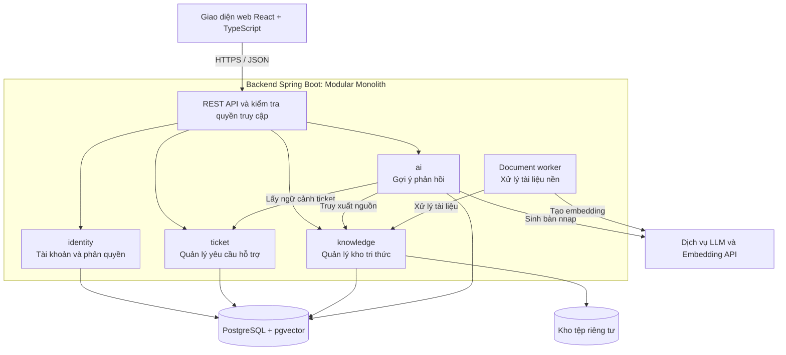

# BÁO CÁO ĐỀ XUẤT ĐỒ ÁN (PROJECT PROPOSAL - TEMPLATE 0)

> **Môn học:** Nhập môn Công nghệ Phần mềm (NMCNPM) - Trường ĐH Khoa học Tự nhiên (HCMUS)  
> **Đề tài:** AI-Powered Helpdesk & Knowledge Base  
> **Mã nhóm:** Group 04  

---

## THÔNG TIN TÀI LIỆU
- **Tiêu đề (Title):** Project Proposal - AI-Powered Helpdesk & Knowledge Base
- **Phiên bản (Version):** 1.0.0
- **Ngày tạo (Date):** 2026-10-19
- **Tác giả & Phân công (Authors + Assignments):**
  - `24120121` - `Lê Quý Phúc`: Trang Bìa, Mục 1 (Bảng đánh giá), Mục 2 (Phát biểu bài toán), Mục 3.2 (Phần cứng)
  - `24120503` - `Phan Gia Phúc`: Mục 3.1.1 (Danh sách chức năng phần mềm)
  - `24120083` - `Nguyễn Đức Lãm`: Mục 3.1.2 (Kiến trúc tổng thể phần mềm) và Mục 4 (Kế hoạch phát triển)
  - `24120269` - `Ngô Viết Thanh Bình` *(Lead)*: Mục 5 (Kế hoạch nhân sự & chi phí: 5.1 & 5.2)

---

## MỤC LỤC
1. [Bảng đánh giá thành viên](#1-bảng-đánh-giá-thành-viên)
2. [Phát biểu bài toán sơ lược](#2-phát-biểu-bài-toán-sơ-lược)  
   2.1. [Bối cảnh và vấn đề đặt ra](#21-bối-cảnh-và-vấn-đề-đặt-ra)  
   2.2. [Ý tưởng giải pháp đề xuất](#22-ý-tưởng-giải-pháp-đề-xuất)  
   2.3. [Môi trường hoạt động dự kiến](#23-môi-trường-hoạt-động-dự-kiến)  
   2.4. [Ràng buộc thiết kế và triển khai](#24-ràng-buộc-thiết-kế-và-triển-khai)  
   2.5. [Mục tiêu và tiêu chí thành công](#25-mục-tiêu-và-tiêu-chí-thành-công)  
   2.6. [Đối tượng sử dụng](#26-đối-tượng-sử-dụng)  
   2.7. [Phạm vi MVP và giá trị sử dụng](#27-phạm-vi-mvp-và-giá-trị-sử-dụng)
3. [Giải pháp đề xuất](#3-giải-pháp-đề-xuất)  
   3.1. [Phần mềm](#31-phần-mềm)  
   &nbsp;&nbsp;&nbsp;&nbsp;3.1.1. [Danh sách các chức năng phần mềm](#311-danh-sách-các-chức-năng-phần-mềm)  
   &nbsp;&nbsp;&nbsp;&nbsp;3.1.2. [Kiến trúc tổng thể phần mềm](#312-kiến-trúc-tổng-thể-phần-mềm)  
   3.2. [Phần cứng](#32-phần-cứng)
4. [Kế hoạch phát triển](#4-kế-hoạch-phát-triển)  
   4.1. [Phân tích yêu cầu](#41-phân-tích-yêu-cầu)  
   4.2. [Thiết kế phần mềm](#42-thiết-kế-phần-mềm)  
   4.3. [Cài đặt (implement) phần mềm](#43-cài-đặt-implement-phần-mềm)  
   4.4. [Kiểm thử phần mềm](#44-kiểm-thử-phần-mềm)  
   4.5. [Triển khai, bảo trì](#45-triển-khai-bảo-trì)
5. [Kế hoạch nhân sự & chi phí](#5-kế-hoạch-nhân-sự--chi-phí)  
   5.1. [Cấu trúc nhân sự](#51-cấu-trúc-nhân-sự)  
   5.2. [Kế hoạch chi phí](#52-kế-hoạch-chi-phí)

---

# 1. Bảng đánh giá thành viên

| MSSV | Họ Tên | % đóng góp (tối đa 100%) | Chữ ký |
| :--- | :--- | :---: | :---: |
| 24120121 | Lê Quý Phúc | 100% | |
| 24120503 | Phan Gia Phúc | 100% | |
| 24120083 | Nguyễn Đức Lãm | 100% | |
| 24120269 | Ngô Viết Thanh Bình | 100% | |

*Tỷ lệ đóng góp và chữ ký được các thành viên và nhóm trưởng đồng thuận xác nhận.*

---

# 2. Phát biểu bài toán sơ lược

### 2.1. Bối cảnh và vấn đề đặt ra
Trong một đơn vị cung cấp sản phẩm, dịch vụ hoặc hỗ trợ học tập, người dùng thường cần hỏi về cách sử dụng hệ thống, báo lỗi hoặc tra cứu những quy định đã được công bố. Nếu yêu cầu được tiếp nhận qua nhiều kênh rời rạc, người dùng khó theo dõi tiến độ; người hỗ trợ khó xác định ai đang phụ trách; lịch sử trao đổi và cách xử lý cũng không được lưu trữ nhất quán. Khi tài liệu hướng dẫn phân tán ở nhiều tệp, nhân viên còn phải tự tìm thông tin và đối chiếu nguồn trước khi phản hồi.

Các mô hình ngôn ngữ lớn (LLM) có thể hỗ trợ diễn đạt câu trả lời, nhưng câu trả lời được sinh trực tiếp từ mô hình có nguy cơ thiếu căn cứ hoặc không phù hợp với quy định riêng của từng đơn vị. Vì vậy, nhóm không đặt mục tiêu xây dựng một chatbot trả lời tự động độc lập, mà kết hợp **quản lý yêu cầu hỗ trợ (ticket)** với **kho tri thức có kiểm duyệt (knowledge base)** để AI chỉ đưa ra *gợi ý* dựa trên tài liệu được phép sử dụng.

### 2.2. Ý tưởng giải pháp đề xuất
**AI-Powered Helpdesk & Knowledge Base** là ứng dụng web cho phép người dùng tạo và theo dõi ticket; nhân viên hỗ trợ tiếp nhận, trao đổi, phân công và xử lý yêu cầu theo một quy trình thống nhất; quản trị viên quản lý tài khoản nhân viên và tài liệu tri thức. Khi cần phản hồi, nhân viên có thể yêu cầu AI đề xuất nội dung dựa trên các đoạn tài liệu liên quan, kèm nguồn trích dẫn để kiểm tra. **Nhân viên luôn là người xem xét, chỉnh sửa và quyết định gửi phản hồi**; AI không tự gửi tin nhắn hoặc thay đổi trạng thái ticket.

Phạm vi sản phẩm bao gồm bốn nhóm chức năng chính: **Identity & Access**, **Ticket Management**, **Knowledge Base** và **AI Assistance**. Các chức năng được tổ chức thành một hệ thống thống nhất; thành phần AI là khả năng hỗ trợ bổ sung, không phải điều kiện để quy trình xử lý ticket hoạt động.

Một tình huống sử dụng điển hình: (1) quản trị viên tải lên tài liệu hướng dẫn và công bố sau khi xử lý; (2) khách hàng gửi ticket; (3) nhân viên nhận ticket từ hàng đợi; (4) nhân viên yêu cầu AI tìm căn cứ trong tài liệu và đề xuất câu trả lời; (5) nhân viên kiểm tra rồi gửi phản hồi; (6) ticket được chuyển sang đã giải quyết và khách hàng xác nhận đóng hoặc yêu cầu mở lại. Hệ thống lưu lịch sử các thay đổi quan trọng để phục vụ tra cứu.

### 2.3. Môi trường hoạt động dự kiến
- **Người dùng:** Truy cập bằng trình duyệt web hiện đại trên máy tính hoặc thiết bị di động (Chrome, Edge, Firefox, Safari); giao diện responsive, không yêu cầu cài ứng dụng riêng.
- **Máy chủ:** Backend Java 21 / Spring Boot cung cấp REST API; frontend React / TypeScript; PostgreSQL lưu dữ liệu nghiệp vụ và hỗ trợ truy xuất vector với pgvector; tài liệu gốc được lưu ở vùng lưu trữ riêng tư.
- **Tích hợp AI:** Dịch vụ tạo embedding và sinh ngôn ngữ qua API; có chế độ mock để kiểm thử hoặc trình diễn khi không có dịch vụ bên ngoài.
- **Triển khai:** Hướng đến môi trường Docker Compose, cấu hình qua biến môi trường và hướng dẫn chạy lại trên máy phát triển mới.

### 2.4. Ràng buộc thiết kế và triển khai
Để bảo đảm tính khả thi trong học kỳ, phiên bản đầu (MVP) chỉ phục vụ **một đơn vị** với ba vai trò **Customer, Agent, Admin**. Hệ thống tiếp nhận tài liệu PDF có văn bản, TXT và Markdown (tối đa 10 MiB/tệp); chưa hỗ trợ OCR cho PDF dạng ảnh. Dự án không phát triển ứng dụng di động native, microservices, tích hợp tổng đài hay AI agent tự xử lý ticket. Việc kiểm tra quyền truy cập được thực hiện tại backend; dữ liệu dùng để trình diễn là dữ liệu giả lập hoặc dữ liệu được phép sử dụng.

### 2.5. Mục tiêu và tiêu chí thành công

| Mã mục tiêu | Nội dung mục tiêu | Tiêu chí đánh giá / đo lường |
| :--- | :--- | :--- |
| **OBJ-01** | Người dùng gửi yêu cầu và theo dõi phản hồi qua giao diện web thống nhất. | Khách hàng tạo được ticket, nhận câu trả lời và xem lịch sử trao đổi. |
| **OBJ-02** | Phân quyền rõ ràng giữa Customer, Agent và Admin. | Kiểm thử phân quyền API: Customer chỉ xem dữ liệu của mình; Agent xử lý ticket được giao; Admin quản trị hệ thống. |
| **OBJ-03** | Quy trình tiếp nhận, phân công và đóng ticket được ghi nhận đầy đủ. | Lịch sử trạng thái ticket thể hiện đúng các mốc: tạo mới, gán nhân viên, phản hồi, giải quyết và đóng. |
| **OBJ-04** | Quản lý kho tài liệu và tìm kiếm đoạn nội dung liên quan theo ngữ nghĩa. | Tài liệu được tải lên, phân đoạn, tạo embedding và truy xuất được đoạn văn bản liên quan. |
| **OBJ-05** | AI đề xuất phản hồi có trích dẫn, đồng thời từ chối khi thiếu bằng chứng. | Kiểm tra nguồn trích dẫn bằng bộ câu hỏi đánh giá; thử các tình huống không có nguồn. |
| **OBJ-06** | Dự án có thể cài đặt lại, kiểm thử và truy vết đóng góp. | Docker Compose, README, kết quả kiểm thử, Git commit/PR và Jira. |

*Các tiêu chí trên là mục tiêu nghiệm thu của dự án, không phải kết quả đã được xác nhận.*

### 2.6. Đối tượng sử dụng

| Đối tượng | Vai trò và nhu cầu chính |
| :--- | :--- |
| **Guest (khách chưa đăng nhập)** | Truy cập chức năng đăng ký tài khoản Customer và đăng nhập. |
| **Customer (người yêu cầu hỗ trợ)** | Tạo ticket, xem ticket của mình, gửi phản hồi và theo dõi trạng thái; không xem ghi chú nội bộ. |
| **Agent (nhân viên hỗ trợ)** | Xem hàng đợi chưa phân công, nhận và xử lý ticket được giao; tra cứu tài liệu đã công bố và sử dụng gợi ý AI. |
| **Admin (quản trị viên)** | Quản lý tài khoản Agent, phân công ticket, quản lý và công bố tài liệu; giám sát hoạt động hỗ trợ theo quyền quản trị. |

Ngoài các vai trò người dùng, hệ thống có tiến trình xử lý tài liệu nền và sử dụng dịch vụ AI bên ngoài. Đây là **thành phần kỹ thuật**, không phải tài khoản người dùng có quyền độc lập trong hệ thống.

### 2.7. Phạm vi MVP và giá trị sử dụng
MVP tập trung vào bốn nhóm chức năng: (1) tài khoản và phân quyền; (2) quy trình ticket có trao đổi hai chiều; (3) quản lý kho tài liệu và tìm kiếm; (4) trợ lý AI gợi ý phản hồi có dẫn nguồn và bước duyệt của nhân viên. Sản phẩm được thiết kế để chứng minh một luồng sử dụng thực tế, tránh mở rộng sang các nghiệp vụ ít liên quan như CRM, thanh toán hoặc quản lý SLA phức tạp.

Giá trị kỳ vọng của hệ thống là **giúp người dùng theo dõi yêu cầu rõ ràng**, **giúp nhân viên tìm căn cứ nhanh hơn** và **giữ được trách nhiệm của con người đối với nội dung gửi đi**. Mức độ cải thiện thời gian xử lý hoặc chất lượng phản hồi chỉ được kết luận sau khi nhóm tiến hành đo đạc, không giả định sẵn.

---

# 3. Giải pháp đề xuất

## 3.1. Phần mềm

### 3.1.1. Danh sách các chức năng phần mềm

## Bảng đầy đủ
| STT | Nhu cầu | Yêu cầu | Tham chiếu | Mức |
|---:|---|---|---|---|
| 1 | Là khách chưa có tài khoản, tôi muốn đăng ký để gửi yêu cầu hỗ trợ. | Đăng ký tài khoản Customer bằng email, tên và mật khẩu; vai trò mặc định là Customer. | FR-ID-01, UC-01, BR-01 | P0 |
| 2 | Là người dùng đã có tài khoản, tôi muốn đăng nhập vào hệ thống. | Đăng nhập bằng email và mật khẩu; cấp access token và refresh token. | FR-ID-02/03, UC-01 | P0 |
| 3 | Là người dùng đã đăng nhập, tôi muốn giữ phiên làm việc và đăng xuất an toàn. | Làm mới token có xoay vòng; đăng xuất thu hồi phiên hiện tại. | FR-ID-04/05, UC-02 | P0 |
| 4 | Là người dùng đã đăng nhập, tôi muốn xem và cập nhật thông tin cá nhân. | Xem/sửa hồ sơ của chính mình; đổi mật khẩu có kiểm tra mật khẩu cũ. | FR-ID-06, UC-03 | P0 |
| 5 | Là quản trị viên, tôi muốn quản lý tài khoản nhân viên hỗ trợ. | Tạo Agent; vô hiệu hóa hoặc kích hoạt lại; tài khoản bị vô hiệu không đăng nhập mới được. | FR-ID-08, UC-04, BR-02/16 | P0 |
| 6 | Là quản trị viên, tôi muốn mỗi vai trò chỉ truy cập đúng dữ liệu được phép. | Phân quyền theo vai trò và theo quyền sở hữu, kiểm tra ở backend. | FR-ID-07, BR-03/04/14 | P0 |
| 7 | Là khách hàng, tôi muốn tạo yêu cầu hỗ trợ để được giúp đỡ. | Tạo ticket gồm tiêu đề và mô tả; hệ thống tạo mã ticket và tin nhắn công khai đầu tiên. | FR-TK-01, UC-05 | P0 |
| 8 | Là khách hàng, tôi muốn xem danh sách và tiến độ các ticket của mình. | Xem danh sách, chi tiết, trạng thái và các tin nhắn công khai; không thấy ghi chú nội bộ. | FR-TK-02/03, UC-06, BR-08 | P0 |
| 9 | Là khách hàng, tôi muốn bổ sung thông tin hoặc trả lời nhân viên trong ticket. | Gửi tin nhắn công khai; khi ticket đang chờ khách phản hồi thì trả lời sẽ chuyển ticket về đang xử lý. | FR-TK-06/08, UC-08/09, BR-07 | P0 |
| 10 | Là khách hàng, tôi muốn xác nhận đóng hoặc yêu cầu mở lại ticket đã giải quyết. | Đóng hoặc mở lại ticket từ trạng thái đã giải quyết. | FR-TK-08, BR-09, UC-09 | P0 |
| 11 | Là nhân viên hỗ trợ, tôi muốn xem hàng đợi và nhận ticket chưa phân công. | Xem ticket OPEN; nhận ticket nguyên tử, chỉ một người nhận được khi nhiều người nhận đồng thời. | FR-TK-04, BR-05/06, UC-07 | P0 |
| 12 | Là quản trị viên, tôi muốn phân công hoặc chuyển ticket cho nhân viên phù hợp. | Gán/chuyển Agent đang hoạt động; ghi lại người cũ và người mới. | FR-TK-05, UC-07, BR-15 | P0 |
| 13 | Là nhân viên được giao ticket, tôi muốn trao đổi công khai với khách hàng. | Gửi phản hồi công khai trên ticket được giao. | FR-TK-06, UC-08, BR-04/07 | P0 |
| 14 | Là nhân viên được giao ticket, tôi muốn ghi chú nội bộ. | Ghi chú nội bộ chỉ Agent được giao và Admin thấy. | FR-TK-07, BR-08, UC-08 | P0 |
| 15 | Là nhân viên được giao ticket, tôi muốn cập nhật trạng thái và mức ưu tiên. | Yêu cầu thêm thông tin, đánh dấu đã giải quyết; đặt ưu tiên LOW/NORMAL/HIGH; chuyển trạng thái theo quy trình, từ chối chuyển không hợp lệ. | FR-TK-08, UC-09; Gợi ý bổ sung FR về việc đặt ưu tiên cụ thể hơn là chỉ nêu ra trong Field MVP | P0 |
| 16 | Là nhân viên nhận ticket hoặc quản trị viên, tôi muốn xem lịch xử lý ticket. | Xem sự kiện nhận, phân công, đổi trạng thái (ai, lúc nào, làm gì). | FR-TK-09, BR-15, UC-10 | P0 |
| 17 | Là người dùng, tôi muốn tìm và lọc ticket nhanh. | Lọc theo trạng thái, người phụ trách, ngày tạo; phân trang và sắp xếp. | FR-TK-10, UC-06 | P0 |
| 18 | Là quản trị viên, tôi muốn đưa tài liệu chính sách vào kho tri thức. | Tải lên PDF văn bản, TXT, MD (≤ 10 MiB); hệ thống kiểm tra file và tạo tác vụ xử lý nền. | FR-KB-01/02, UC-11 | P0 |
| 19 | Là quản trị viên, tôi muốn biết tài liệu đã xử lý xong hay lỗi. | Theo dõi trạng thái UPLOADED/PROCESSING/READY/FAILED; thử lại có giới hạn khi lỗi. | FR-KB-03/04/05/09, UC-11 | P0 |
| 20 | Là quản trị viên, tôi muốn kiểm duyệt tài liệu trước khi AI được dùng. | Công bố tài liệu READY; lưu trữ (archive) tài liệu để AI không dùng nữa. | FR-KB-06/08, BR-11, UC-12 | P0 |
| 21 | Là nhân viên hoặc quản trị viên, tôi muốn tra cứu tài liệu đã công bố. | Tìm kiếm trong tài liệu đã công bố, hiển thị đoạn liên quan. | FR-KB-07, UC-13 | P0 |
| 22 | Là nhân viên nhận ticket, tôi muốn AI gợi ý câu trả lời có dẫn nguồn. | Truy xuất đoạn tài liệu liên quan, sinh bản nháp kèm trích dẫn đã được kiểm chứng. | FR-AI-01..05, BR-11/12, UC-14 | P0 |
| 23 | Là nhân viên, tôi muốn AI cho biết khi không đủ căn cứ. | Trả về "không đủ bằng chứng" thay vì tự bịa chính sách. | FR-AI-06, BR-13, UC-14 | P0 |
| 24 | Là nhân viên, tôi muốn giữ quyền kiểm soát nội dung gửi cho khách. | Xem, chỉnh sửa bản nháp rồi mới gửi thủ công; AI không tự gửi. | FR-AI-07, BR-10, UC-15 | P0 |
| 25 | Là nhân viên hoặc quản trị viên, tôi muốn xem lại các gợi ý AI đã tạo. | Lưu lịch sử gợi ý kèm ảnh chụp nguồn trích dẫn tại thời điểm tạo. | FR-AI-08, BR-12; Gợi ý bổ sung FR/UC về logging/interface cho các gợi ý của AI | P0 |
| 26 | Là nhân viên, tôi muốn hệ thống vẫn dùng được khi AI gặp sự cố. | AI lỗi/quá tải trả thông báo rõ; ticket vẫn tạo, xử lý, trả lời bình thường; giới hạn số lần gọi AI. | FR-AI-09, NFR-REL-01 | P0 |
| 27 | Là người dùng quên mật khẩu, tôi muốn đặt lại mật khẩu. | Đặt lại mật khẩu qua token dùng một lần có thời hạn. | FR-ID-09, UC-16 | P1 |
| 28 | Là quản trị viên, tôi muốn xem thống kê tổng quan. | Dashboard số ticket theo trạng thái và theo nhân viên. | FR-TK-12, UC-17 | P1 |
| 29 | Là khách hàng, tôi muốn đính kèm tệp vào ticket. | Tải tệp đính kèm có giới hạn và kiểm tra quyền tải xuống. | FR-TK-11; Gợi ý bổ sung UC về attactchment lúc Customer tạo/phản hồi ticket  | P1 |
| 30 | Là nhân viên, tôi muốn đánh giá chất lượng gợi ý của AI. | Đánh giá hữu ích/không hữu ích và thống kê chất lượng. | FR-AI-10; Gợi ý bổ sung UC về feedback/evaluation câu trả lời của AI từ Agent | P1 |

---
### Bảng thu gọn
| STT | Nhu cầu | Yêu cầu |
| --- | --- | --- |
| 1 | Là khách chưa có tài khoản, tôi muốn đăng ký để gửi yêu cầu hỗ trợ. | Đăng ký tài khoản Customer bằng email, tên và mật khẩu; vai trò mặc định là Customer. |
| 2 | Là người dùng đã có tài khoản, tôi muốn đăng nhập vào hệ thống. | Đăng nhập bằng email và mật khẩu; cấp access token và refresh token. |
| 3 | Là người dùng đã đăng nhập, tôi muốn giữ phiên làm việc và đăng xuất an toàn. | Làm mới token có xoay vòng; đăng xuất thu hồi phiên hiện tại. |
| 4 | Là người dùng đã đăng nhập, tôi muốn xem và cập nhật thông tin cá nhân. | Xem/sửa hồ sơ của chính mình; đổi mật khẩu có kiểm tra mật khẩu cũ. |
| 5 | Là quản trị viên, tôi muốn quản lý tài khoản nhân viên hỗ trợ. | Tạo Agent; vô hiệu hóa hoặc kích hoạt lại; tài khoản bị vô hiệu không đăng nhập mới được. |
| 6 | Là quản trị viên, tôi muốn mỗi vai trò chỉ truy cập đúng dữ liệu được phép. | Phân quyền theo vai trò và theo quyền sở hữu, kiểm tra ở backend. |
| 7 | Là khách hàng, tôi muốn tạo yêu cầu hỗ trợ để được giúp đỡ. | Tạo ticket gồm tiêu đề và mô tả; hệ thống tạo mã ticket và tin nhắn công khai đầu tiên. |
| 8 | Là khách hàng, tôi muốn xem danh sách và tiến độ các ticket của mình. | Xem danh sách, chi tiết, trạng thái và các tin nhắn công khai; không thấy ghi chú nội bộ. |
| 9 | Là khách hàng, tôi muốn bổ sung thông tin hoặc trả lời nhân viên trong ticket. | Gửi tin nhắn công khai; khi ticket đang chờ khách phản hồi thì trả lời sẽ chuyển ticket về đang xử lý. |
| 10 | Là khách hàng, tôi muốn xác nhận đóng hoặc yêu cầu mở lại ticket đã giải quyết. | Đóng hoặc mở lại ticket từ trạng thái đã giải quyết. |
| 11 | Là nhân viên hỗ trợ, tôi muốn xem hàng đợi và nhận ticket chưa phân công. | Xem ticket OPEN; nhận ticket nguyên tử, chỉ một người nhận được khi nhiều người nhận đồng thời. |
| 12 | Là quản trị viên, tôi muốn phân công hoặc chuyển ticket cho nhân viên phù hợp. | Gán/chuyển Agent đang hoạt động; ghi lại người cũ và người mới. |
| 13 | Là nhân viên được giao ticket, tôi muốn trao đổi công khai với khách hàng. | Gửi phản hồi công khai trên ticket được giao. |
| 14 | Là nhân viên được giao ticket, tôi muốn ghi chú nội bộ. | Ghi chú nội bộ chỉ Agent được giao và Admin thấy. |
| 15 | Là nhân viên được giao ticket, tôi muốn cập nhật trạng thái và mức ưu tiên. | Yêu cầu thêm thông tin, đánh dấu đã giải quyết; đặt ưu tiên LOW/NORMAL/HIGH; chuyển trạng thái theo quy trình, từ chối chuyển không hợp lệ. |
| 16 | Là nhân viên nhận ticket hoặc quản trị viên, tôi muốn xem lịch xử lý ticket. | Xem sự kiện nhận, phân công, đổi trạng thái (ai, lúc nào, làm gì). |
| 17 | Là người dùng, tôi muốn tìm và lọc ticket nhanh. | Lọc theo trạng thái, người phụ trách, ngày tạo; phân trang và sắp xếp. |
| 18 | Là quản trị viên, tôi muốn đưa tài liệu chính sách vào kho tri thức. | Tải lên PDF văn bản, TXT, MD (≤ 10 MiB); hệ thống kiểm tra file và tạo tác vụ xử lý nền. |
| 19 | Là quản trị viên, tôi muốn biết tài liệu đã xử lý xong hay lỗi. | Theo dõi trạng thái UPLOADED/PROCESSING/READY/FAILED; thử lại có giới hạn khi lỗi. |
| 20 | Là quản trị viên, tôi muốn kiểm duyệt tài liệu trước khi AI được dùng. | Công bố tài liệu READY; lưu trữ (archive) tài liệu để AI không dùng nữa. |
| 21 | Là nhân viên hoặc quản trị viên, tôi muốn tra cứu tài liệu đã công bố. | Tìm kiếm trong tài liệu đã công bố, hiển thị đoạn liên quan. |
| 22 | Là nhân viên nhận ticket, tôi muốn AI gợi ý câu trả lời có dẫn nguồn. | Truy xuất đoạn tài liệu liên quan, sinh bản nháp kèm trích dẫn đã được kiểm chứng. |
| 23 | Là nhân viên, tôi muốn AI cho biết khi không đủ căn cứ. | Trả về "không đủ bằng chứng" thay vì tự bịa chính sách. |
| 24 | Là nhân viên, tôi muốn giữ quyền kiểm soát nội dung gửi cho khách. | Xem, chỉnh sửa bản nháp rồi mới gửi thủ công; AI không tự gửi. |
| 25 | Là nhân viên hoặc quản trị viên, tôi muốn xem lại các gợi ý AI đã tạo. | Lưu lịch sử gợi ý kèm ảnh chụp nguồn trích dẫn tại thời điểm tạo. |
| 26 | Là nhân viên, tôi muốn hệ thống vẫn dùng được khi AI gặp sự cố. | AI lỗi/quá tải trả thông báo rõ; ticket vẫn tạo, xử lý, trả lời bình thường; giới hạn số lần gọi AI. |
| 27 | Là người dùng quên mật khẩu, tôi muốn đặt lại mật khẩu. | Đặt lại mật khẩu qua token dùng một lần có thời hạn. |
| 28 | Là quản trị viên, tôi muốn xem thống kê tổng quan. | Dashboard số ticket theo trạng thái và theo nhân viên. |
| 29 | Là khách hàng, tôi muốn đính kèm tệp vào ticket. | Tải tệp đính kèm có giới hạn và kiểm tra quyền tải xuống. |
| 30 | Là nhân viên, tôi muốn đánh giá chất lượng gợi ý của AI. | Đánh giá hữu ích/không hữu ích và thống kê chất lượng. |

### 3.1.2. Kiến trúc tổng thể phần mềm

Hệ thống được thiết kế theo kiến trúc Modular Monolith, với backend là một ứng dụng Spring Boot gồm bốn module nghiệp vụ: `identity`, `ticket`, `knowledge` và `ai`. Các module tương ứng với bốn nhóm chức năng của phần mềm và có ranh giới trách nhiệm riêng. Cách tổ chức này phù hợp với phạm vi MVP phục vụ một đơn vị và quy mô nhóm bốn người, giúp nhóm phát triển, kiểm thử và triển khai trên cùng một ứng dụng.

#### a. Sơ đồ kiến trúc tổng thể

  <em>Kiến trúc tổng thể hệ thống</em>

#### b. Các thành phần và trách nhiệm

| Thành phần | Trách nhiệm |
|---|---|
| Giao diện web | Sử dụng React và TypeScript, cung cấp các màn hình theo vai trò Customer, Agent và Admin. Frontend tổ chức theo tính năng `auth`, `tickets`, `knowledge`, `ai`; gửi yêu cầu REST/JSON qua HTTPS và đính kèm access token với các thao tác cần xác thực. |
| Module `identity` | Xử lý đăng ký, đăng nhập, làm mới token, đăng xuất, quản lý hồ sơ và tài khoản Agent. Backend kiểm tra vai trò và quyền sở hữu dữ liệu trước khi thực hiện nghiệp vụ. |
| Module `ticket` | Quản lý ticket, phân công nhân viên, tin nhắn công khai, ghi chú nội bộ, mức ưu tiên và lịch sử xử lý. Module kiểm soát việc nhận ticket đồng thời và các bước chuyển trạng thái. |
| Module `knowledge` | Quản lý tải lên, xử lý, công bố và lưu trữ tài liệu; cung cấp chức năng tìm kiếm các đoạn nội dung liên quan. |
| Module `ai` | Lấy ngữ cảnh ticket, truy xuất tài liệu, dựng yêu cầu gửi mô hình, kiểm tra nguồn trích dẫn và lưu lịch sử gợi ý. |
| Document worker | Chạy trong cùng ứng dụng backend, nhận công việc từ bảng tác vụ trong cơ sở dữ liệu để trích xuất văn bản, chia đoạn và tạo vector biểu diễn nội dung. |
| PostgreSQL và kho tệp | PostgreSQL lưu dữ liệu nghiệp vụ, tác vụ xử lý và các gợi ý AI; phần mở rộng pgvector lưu vector phục vụ tìm kiếm theo ngữ nghĩa. Tài liệu gốc được lưu trong kho riêng tư trên Docker volume, không công khai qua URL. |
| Dịch vụ AI bên ngoài | Cung cấp mô hình tạo embedding và mô hình sinh ngôn ngữ qua API. Hệ thống có chế độ giả lập (mock) để phục vụ kiểm thử và trình diễn. |

Bên trong mỗi module, mã nguồn được chia thành các phần `api`, `application`, `domain` và `infrastructure`, lần lượt phụ trách giao tiếp HTTP, điều phối ca sử dụng, quy tắc nghiệp vụ và tích hợp hạ tầng.

Các module trao đổi qua application service hoặc interface có kiểm soát. Cụ thể, `ai` lấy ngữ cảnh ticket qua `TicketContextProvider` và truy xuất tri thức qua `KnowledgeRetriever`. Dữ liệu ticket do module `ticket` quản lý; dữ liệu tài liệu và quá trình tìm kiếm thuộc trách nhiệm của `knowledge`.

#### c. Luồng vận hành

##### Xử lý ticket

Customer tạo ticket hoặc gửi phản hồi trên giao diện web. Backend tiếp nhận yêu cầu, xác thực tài khoản, kiểm tra quyền truy cập và các quy tắc nghiệp vụ trước khi ghi dữ liệu. Thay đổi quan trọng và sự kiện lịch sử được lưu trong cùng một giao dịch cơ sở dữ liệu.

Ticket mới xuất hiện trong hàng đợi để Agent tiếp nhận hoặc Admin phân công. Khi nhiều Agent cùng nhận một ticket, hệ thống chỉ cho phép một người nhận thành công. Trong quá trình xử lý, Agent có thể trao đổi công khai với Customer, thêm ghi chú nội bộ và cập nhật trạng thái theo quyền được cấp. Customer chỉ xem được ticket của mình và các tin nhắn công khai.

##### Xử lý và công bố tài liệu

Admin tải tài liệu lên hệ thống. Backend kiểm tra tệp, lưu vào kho riêng tư và tạo tác vụ xử lý nền rồi trả kết quả tiếp nhận, không chờ hoàn tất việc tạo embedding.

Worker nhận tác vụ, trích xuất văn bản, chia thành các đoạn có thông tin nguồn, gọi dịch vụ embedding và lưu kết quả vào PostgreSQL với pgvector. Tài liệu xử lý thành công chuyển sang trạng thái `READY` nhưng chưa được sử dụng làm nguồn cho AI. Admin xem lại và công bố tài liệu; tài liệu đã lưu trữ (archive) được loại khỏi phạm vi truy xuất.

##### Sinh và sử dụng gợi ý AI

Khi Agent được giao ticket yêu cầu gợi ý phản hồi, backend kiểm tra quyền và lấy ngữ cảnh từ nội dung trao đổi công khai. Ghi chú nội bộ không được đưa vào ngữ cảnh gửi mô hình. Module `ai` truy xuất những đoạn liên quan trong các tài liệu đã xử lý xong, đã công bố và chưa lưu trữ. Nếu không có đủ căn cứ, hệ thống lưu trạng thái `INSUFFICIENT_EVIDENCE` và thông báo cho Agent.

Khi có nguồn phù hợp, hệ thống gửi ngữ cảnh cùng các đoạn tài liệu cho mô hình để tạo bản nháp. Backend kiểm tra các mã nguồn trích dẫn có thuộc tập đoạn đã truy xuất hay không, sau đó lưu gợi ý và bản chụp nội dung nguồn tại thời điểm tạo. Việc kiểm tra mã nguồn giúp xác nhận nguồn trích dẫn hợp lệ; Agent vẫn cần đối chiếu nội dung trước khi sử dụng.

Agent xem, chỉnh sửa và chủ động gửi bản nháp. Thao tác gửi đi qua application service của module `ticket` để tạo tin nhắn công khai; gợi ý chỉ được đánh dấu đã sử dụng khi giao dịch chung thành công. AI không có quyền tự gửi tin nhắn, phân công hay thay đổi trạng thái ticket.

Các lời gọi dịch vụ AI được thực hiện ngoài giao dịch xử lý ticket. Khi dịch vụ AI gặp lỗi hoặc quá tải, hệ thống thông báo cho Agent và vẫn cho phép tạo ticket, trao đổi và xử lý yêu cầu theo quy trình thông thường.

## 3.2. Phần cứng

### 3.2.1. Yêu cầu phần cứng và môi trường vận hành (Hardware Requirements)

| Môi trường | Cấu hình/điều kiện dự kiến |
| :--- | :--- |
| **Thiết bị người dùng** | Máy tính, máy tính bảng hoặc điện thoại chạy Chrome/Edge/Firefox/Safari tương đối mới; RAM tối thiểu khoảng 4 GB; Internet ổn định; UI hỗ trợ màn hình điện thoại từ khoảng 360 px. |
| **Máy chủ demo — CPU/RAM** | Tối thiểu 2 vCPU, 4 GB RAM; khuyến nghị 4 vCPU, 8 GB RAM khi chạy backend, PostgreSQL và frontend cùng máy. |
| **Máy chủ demo — lưu trữ/hệ điều hành** | Khoảng 50 GB SSD; Linux hoặc hệ điều hành hỗ trợ Docker Engine và Docker Compose; dữ liệu tài liệu được lưu riêng tư. |
| **Kết nối dịch vụ AI** | Máy chủ có khả năng gọi API nhà cung cấp LLM/embedding qua mạng; nếu offline hoặc không có API key, sử dụng chế độ mock phù hợp demo. |
| **GPU** | Không yêu cầu GPU riêng nếu sử dụng mô hình AI qua API bên ngoài. |
| **Máy phát triển** | Windows/Linux/macOS; tối thiểu 8 GB RAM, khuyến nghị 16 GB; khoảng 40 GB dung lượng trống; JDK 21, Node.js LTS, Git, Docker và IDE. |

### 3.2.2. Các yêu cầu chất lượng và tiêu chí kiểm chứng (Bổ trợ NFR)

| Mã tham chiếu | Nhóm yêu cầu | Mục tiêu dự kiến / phương pháp xác minh |
| :--- | :--- | :--- |
| NFR-SEC-01, 02 | Bảo mật, phân quyền | Mật khẩu và refresh token không lưu ở dạng gốc; bí mật cấu hình ngoài mã nguồn; các API bảo vệ có kiểm thử vai trò/quyền sở hữu; Customer không xem được ghi chú `INTERNAL`. |
| NFR-SEC-03, 04 | An toàn dữ liệu đầu vào | Giới hạn tài liệu tải lên 10 MiB, kiểm tra định dạng và nội dung; truy vấn DB được tham số hóa; nội dung được truy xuất cho RAG được xem là dữ liệu không tin cậy. |
| NFR-PRIV-01 | Quyền riêng tư | Dùng dữ liệu demo giả lập; hạn chế thông tin cá nhân không cần thiết gửi đến dịch vụ LLM; không ghi log password, token hoặc API key. |
| NFR-REL-01 | Độ tin cậy | Khi nhà cung cấp AI lỗi hoặc hết thời gian phản hồi, chức năng tạo, xem và xử lý ticket vẫn hoạt động; kiểm thử bằng cách giả lập lỗi dịch vụ AI. |
| NFR-CONS-01, 02 | Tính nhất quán | Thử 20 lần tình huống hai Agent cùng nhận một ticket: mỗi lần chỉ một yêu cầu thành công; cập nhật trạng thái và bản ghi lịch sử cùng một transaction. |
| NFR-PERF-01 | Hiệu năng REST | Mục tiêu p95 dưới 800 ms cho API CRUD thông thường với 20 người dùng ảo, trên môi trường và dữ liệu kiểm thử được công bố. |
| NFR-PERF-02 | Thời gian sinh gợi ý | Mục tiêu p95 dưới 12 giây khi nhà cung cấp AI ổn định; có timeout và trạng thái lỗi rõ ràng. |
| NFR-PERF-03 | Xử lý tài liệu | Mục tiêu xử lý PDF văn bản khoảng 1 MiB trong 60 giây trên môi trường kiểm thử chuẩn; đo thực tế để xác định giới hạn. |
| NFR-AI-01, 02 | Chất lượng câu trả lời AI | Đánh giá ít nhất 30 câu hỏi; mục tiêu citation accuracy từ 90% trên tập có bằng chứng và tỷ lệ từ chối phù hợp từ 80% trên tập thiếu bằng chứng. |
| NFR-AI-03 | An toàn khi sử dụng AI | Dữ liệu nguồn không được điều khiển API nghiệp vụ; kiểm thử tình huống prompt injection từ nội dung tài liệu; AI không có quyền gửi phản hồi hay cập nhật ticket. |
| NFR-OBS-01 | Khả năng theo dõi | Ghi log có request ID, trạng thái xử lý tài liệu và độ trễ AI; thông tin nhạy cảm không được ghi log. |
| NFR-MAIN-01, NFR-TEST-01 | Bảo trì và kiểm thử | Phân chia module rõ; quản lý database migration; kiểm thử tự động cho phân quyền, workflow, concurrency, bộ lọc truy xuất; CI chạy trước khi merge. |
| NFR-DEPLOY-01 | Khả năng triển khai lại | Docker Compose, `.env.example`, dữ liệu demo và README đủ để một máy mới chạy hệ thống theo hướng dẫn. |
| NFR-UX-01 | Khả dụng giao diện | Giao diện responsive; các trạng thái đang tải, rỗng và lỗi có thông báo rõ ràng; các thao tác chính thực hiện trên trình duyệt hiện đại. |

---

# 4. Kế hoạch phát triển

Dự án bắt đầu vào Thứ Hai, ngày 12/10/2026, khi các template được mở, và kết thúc vào Chủ Nhật, ngày 13/12/2026, theo hạn nộp Template 3 và lịch trình bày sản phẩm. Tổng thời gian thực hiện là 9 tuần, gồm 8 tuần triển khai các giai đoạn phát triển chính và một tuần dự phòng để diễn tập, hoàn thiện và đóng gói sản phẩm.

### Tổng quan theo tuần

| Tuần | Thời gian (năm 2026) | Công việc trọng tâm | Mốc nộp liên quan |
|---|---|---|---|
| W1 | 12/10 đến 18/10 | Hoàn thiện và thống nhất yêu cầu phần mềm | |
| W2 | 19/10 đến 25/10 | Hoàn thiện thiết kế hệ thống | |
| W3 | 26/10 đến 01/11 | Xây dựng nền tảng: Flyway, khung xác thực và CI | Template 0: hạn nội bộ 31/10 |
| W4 | 02/11 đến 08/11 | Hoàn thiện các chức năng Ticket MVP | |
| W5 | 09/11 đến 15/11 | Hoàn thiện các chức năng Knowledge Base MVP | Template 1: hạn nội bộ 14/11 |
| W6 | 16/11 đến 22/11 | Hoàn thiện các chức năng AI MVP | |
| W7 | 23/11 đến 29/11 | Kiểm thử, sửa lỗi và củng cố hệ thống | Template 2: hạn nội bộ 28/11 |
| W8 | 30/11 đến 06/12 | Triển khai, hoàn thiện tài liệu và báo cáo | |
| W9 | 07/12 đến 13/12 | Dự phòng, diễn tập demo và đóng gói sản phẩm | Template 3 và App Demo: hạn nội bộ 12/12; trình bày ngày 13/12 |

### 4.1. Phân tích yêu cầu

Cả bốn thành viên cùng thực hiện giai đoạn này từ ngày 12/10/2026 đến ngày 18/10/2026, trong một tuần.

| STT | Công việc | Bắt đầu | Kết thúc |
|---:|---|---|---|
| 1 | Xác định các bên liên quan, vai trò người dùng và phạm vi của bốn nhóm chức năng | 12/10/2026 | 13/10/2026 |
| 2 | Làm rõ yêu cầu chức năng, phi chức năng và các quy tắc nghiệp vụ | 13/10/2026 | 16/10/2026 |
| 3 | Xây dựng danh mục use case, ma trận phân quyền và máy trạng thái ticket | 15/10/2026 | 17/10/2026 |
| 4 | Viết user story, lập backlog trên Jira và tổ chức rà soát đặc tả yêu cầu với cả nhóm | 17/10/2026 | 18/10/2026 |

Thành phẩm dự kiến gồm tài liệu đặc tả yêu cầu, thiết kế kỹ thuật ở mức tổng thể, danh mục use case, user story và backlog đã được cả nhóm rà soát.

### 4.2. Thiết kế phần mềm

Giai đoạn thiết kế diễn ra từ ngày 19/10/2026 đến ngày 25/10/2026, trong một tuần, với sự tham gia của cả bốn thành viên.

| STT | Công việc | Bắt đầu | Kết thúc |
|---:|---|---|---|
| 1 | Thiết kế sơ đồ ERD và lập kế hoạch migration cơ sở dữ liệu | 19/10/2026 | 21/10/2026 |
| 2 | Xây dựng API contract, quy định mã lỗi và bản nháp OpenAPI | 20/10/2026 | 22/10/2026 |
| 3 | Vẽ sơ đồ kiến trúc tổng thể và sequence diagram cho luồng nhận ticket, sinh gợi ý bằng RAG | 21/10/2026 | 23/10/2026 |
| 4 | Thiết kế wireframe cho các màn hình chính của hệ thống | 22/10/2026 | 24/10/2026 |
| 5 | Thử nghiệm công cụ trích xuất văn bản PDF, mô hình và số chiều embedding; xây dựng khung kho mã nguồn | 19/10/2026 | 24/10/2026 |
| 6 | Rà soát thiết kế và chốt contract của các endpoint cốt lõi | 25/10/2026 | 25/10/2026 |

Kết thúc giai đoạn, nhóm cần có tài liệu thiết kế gồm kiến trúc hệ thống, ERD, đặc tả API và wireframe, cùng kết quả thử nghiệm kỹ thuật và các quyết định lựa chọn công nghệ.

### 4.3. Cài đặt phần mềm

Giai đoạn cài đặt kéo dài bốn tuần, từ ngày 26/10/2026 đến ngày 22/11/2026. Công việc được phân chia theo bốn phân hệ nghiệp vụ chính; cả bốn thành viên đều trực tiếp viết mã nguồn.

| STT | Công việc | Bắt đầu | Kết thúc |
|---:|---|---|---|
| 1 | Xây dựng khung Spring Boot, PostgreSQL, Flyway và React; thiết lập CI; cài đặt đăng ký, đăng nhập, quản lý token và phân quyền theo vai trò | 26/10/2026 | 01/11/2026 |
| 2 | Cài đặt tạo, xem, lọc ticket; nhận ticket nguyên tử; quản lý tin nhắn, chuyển trạng thái và lịch sử xử lý; xây dựng giao diện Customer/Agent | 02/11/2026 | 08/11/2026 |
| 3 | Cài đặt tải tài liệu, worker trích xuất văn bản, chia đoạn và tạo embedding; công bố, lưu trữ và tìm kiếm tài liệu; xây dựng giao diện Admin | 09/11/2026 | 15/11/2026 |
| 4 | Cài đặt RAG, kiểm tra trích dẫn, từ chối khi thiếu căn cứ và dịch vụ AI giả lập; xây dựng chức năng xem, sửa, gửi gợi ý cùng khung giao diện AI | 16/11/2026 | 22/11/2026 |

Thành phẩm là mã nguồn hoàn chỉnh cho các chức năng P0, chạy thông suốt kịch bản demo hoàn chỉnh của hệ thống. Kiểm thử đơn vị và kiểm thử tích hợp được viết song song với quá trình xây dựng từng module.

### 4.4. Kiểm thử phần mềm

Cả bốn thành viên tham gia đợt kiểm thử tập trung từ ngày 23/11/2026 đến ngày 29/11/2026, trong một tuần. Các bộ kiểm thử của từng module được xây dựng từ giai đoạn cài đặt.

| STT | Công việc | Bắt đầu | Kết thúc |
|---:|---|---|---|
| 1 | Hoàn thiện kế hoạch kiểm thử và các ca kiểm thử theo ma trận chức năng | 23/11/2026 | 24/11/2026 |
| 2 | Kiểm tra phân quyền theo vai trò, quyền sở hữu dữ liệu và việc bảo vệ ghi chú nội bộ | 23/11/2026 | 24/11/2026 |
| 3 | Kiểm thử nhận ticket đồng thời và các quy tắc chuyển trạng thái | 24/11/2026 | 25/11/2026 |
| 4 | Kiểm thử quá trình nạp tài liệu và truy xuất nội dung | 25/11/2026 | 26/11/2026 |
| 5 | Đánh giá AI bằng bộ tối thiểu 30 câu hỏi chuẩn hóa; kiểm tra các tình huống lỗi và hết thời gian chờ | 25/11/2026 | 28/11/2026 |
| 6 | Kiểm thử hiệu năng cơ bản theo nhóm yêu cầu NFR-PERF | 27/11/2026 | 28/11/2026 |
| 7 | Ghi nhận, theo dõi và sửa lỗi phát hiện trong quá trình kiểm thử | 23/11/2026 | 29/11/2026 |

Kết quả cần đạt là báo cáo kiểm thử có minh chứng và các lỗi P0 đã được sửa. Số liệu đo phải ghi rõ điều kiện môi trường thực hiện.

### 4.5. Triển khai, bảo trì và hoàn thiện tài liệu

Giai đoạn cuối diễn ra trong hai tuần, từ ngày 30/11/2026 đến ngày 13/12/2026, với sự tham gia của cả bốn thành viên.

| STT | Công việc | Bắt đầu | Kết thúc |
|---:|---|---|---|
| 1 | Chuẩn bị Docker Compose, `.env.example` và dữ liệu mẫu; triển khai bản demo lên máy chủ hoặc nền tảng đám mây | 30/11/2026 | 02/12/2026 |
| 2 | Chạy kiểm tra nhanh (smoke test) trên môi trường triển khai | 03/12/2026 | 03/12/2026 |
| 3 | Hoàn thiện README, báo cáo sử dụng AI và lịch sử commit Git; xuất tài liệu sang PDF/HTML | 03/12/2026 | 08/12/2026 |
| 4 | Chuẩn bị kịch bản và diễn tập demo | 08/12/2026 | 11/12/2026 |
| 5 | Đóng gói `GroupID.zip`, kiểm tra giới hạn 20 tệp/20 MB | 12/12/2026 | 12/12/2026 |
| 6 | Trình bày và demo sản phẩm trong Presentation Day | 13/12/2026 | 13/12/2026 |
---

# 5. Kế hoạch nhân sự & chi phí

### 5.1. Cấu trúc nhân sự

Dự án áp dụng mô hình tổ chức đa năng (cross-functional), trong đó toàn bộ nhân sự kỹ thuật đều tham gia đầy đủ 5 công đoạn phát triển phần mềm (SDLC): Phân tích yêu cầu, Thiết kế, Cài đặt, Kiểm thử và Viết tài liệu kỹ thuật. Mỗi thành viên đóng vai trò hạt nhân phụ trách một nghiệp vụ chính, đồng thời đảm nhận vai trò quản trị hoặc điều phối kỹ thuật liên quan:

| STT | Thành viên | Vai trò chính trong dự án | Phân hệ phụ trách chính | Mô tả công việc chi tiết (Xuyên suốt vòng đời dự án SDLC) |
| :---: | :--- | :--- | :--- | :--- |
| 1 | **Ngô Viết Thanh Bình** | Project Manager & DevOps Lead | **Xác thực & Phân quyền (Identity & Access)** | - **Quản trị & DevOps:** Thiết lập hạ tầng repository, chuẩn hóa luồng Git (Branching Strategy, Commit Hooks), xây dựng CI/CD pipeline tự động hóa kiểm thử mã nguồn, cấu hình Docker Compose môi trường Staging/Production và điều phối tiến độ Sprint trên Jira. - **Phân tích & Thiết kế:** Khảo sát yêu cầu bảo mật, thiết kế mô hình phân quyền đa tầng (RBAC/ABAC), thiết kế luồng xác thực JWT/OAuth2, sơ đồ CSDL quan hệ cho bảng người dùng/phiên/quyền và kiến trúc Audit Logging ghi vết truy cập hệ thống. - **Cài đặt:** Hiện thực hóa các API đăng ký, đăng nhập, thu hồi/làm mới Token, phân quyền Middleware trên Backend; phát triển giao diện quản lý tài khoản, phân quyền và lịch sử hoạt động trên Frontend. - **Kiểm thử & Tài liệu:** Viết kịch bản kiểm thử bảo mật (Security/Auth Testing), kiểm thử phân quyền các vai trò; soạn thảo tài liệu đặc tả kiến trúc bảo mật và hướng dẫn triển khai/vận hành hệ thống. |
| 2 | **Nguyễn Đức Lãm** | Backend Engineer & Quality Control | **Quản lý Tri thức (Knowledge Base)** | - **Phân tích & Thiết kế:** Thu thập yêu cầu nghiệp vụ quản trị kho bài viết hỗ trợ, thiết kế cấu trúc dữ liệu chuyên mục/cây thư mục bài viết, mô hình quan hệ bài viết - thẻ nhãn - tác giả, quy trình kiểm soát phiên bản (Article Versioning) và luồng phê duyệt xuất bản bài viết. - **Cài đặt:** Xây dựng hệ thống RESTful API cho các tác vụ CRUD bài viết, danh mục tri thức, quản lý tệp đính kèm và tìm kiếm phân loại; tích hợp trình biên soạn nội dung Markdown/WYSIWYG ở trang quản trị và giao diện hiển thị bài viết thân thiện với người dùng. - **Kiểm định chất lượng (QC):** Chuẩn hóa bộ quy tắc mã nguồn (Code Style/Linting), rà soát chất lượng code backend, viết Unit Test cho tầng nghiệp vụ và tối ưu hóa hiệu năng truy vấn CSDL bài viết. - **Kiểm thử & Tài liệu:** Xây dựng kịch bản kiểm thử API/chức năng phân hệ Knowledge Base, kiểm thử luồng duyệt/xuất bản và soạn thảo tài liệu hướng dẫn kỹ thuật API (OpenAPI/Swagger). |
| 3 | **Phan Gia Phúc** | Full-stack Engineer & Testing Lead | **Quản lý Phiếu hỗ trợ (Ticket Management)** | - **Phân tích & Thiết kế:** Khảo sát luồng nghiệp vụ tiếp nhận, phân loại mức độ ưu tiên và định tuyến phiếu hỗ trợ; thiết kế sơ đồ máy trạng thái vòng đời Ticket (State Machine), quy định cam kết thời hạn phản hồi/xử lý SLA và cấu trúc CSDL lưu trữ lịch sử trao đổi, bình luận. - **Cài đặt:** Phát triển API xử lý vòng đời phiếu hỗ trợ, tính toán hạn xử lý theo SLA, bộ lọc tìm kiếm đa tiêu chí; xây dựng giao diện tương tác động cho nhân viên kỹ thuật (Agent Workspace) và cổng gửi yêu cầu thuận tiện cho khách hàng. - **Quản lý kiểm thử (Testing Lead):** Thiết lập ma trận kiểm thử (Test Matrix), xây dựng kịch bản kiểm thử tự động E2E (End-to-End) luồng xử lý ticket, kiểm tra tính toán vi phạm SLA và xử lý xung đột dữ liệu đồng thời. - **Kiểm thử & Tài liệu:** Thực hiện kiểm thử tích hợp (Integration Testing) phân hệ Ticket, xây dựng tài liệu hướng dẫn sử dụng cho người dùng (User Guide) và báo cáo đánh giá độ bao phủ kiểm thử. |
| 4 | **Lê Quý Phúc** | AI Integration & Frontend Specialist | **Trợ lý Trí tuệ nhân tạo (AI Assistance)** | - **Phân tích & Thiết kế:** Khảo sát bài toán tích hợp mô hình ngôn ngữ lớn (LLM), thiết kế đường ống xử lý dữ liệu (Data Ingestion Pipeline) từ Knowledge Base sang Vector Database, thiết kế luồng tìm kiếm ngữ nghĩa tăng cường (RAG) và kỹ thuật thiết kế câu lệnh gợi ý (Prompt Engineering). - **Cài đặt:** Xây dựng dịch vụ trích xuất vector embedding, tìm kiếm tương đồng (Similarity Search); phát triển giao diện Chatbot thông minh hỗ trợ khách hàng theo thời gian thực (Streaming Response) và widget AI gợi ý câu trả lời nhanh cho nhân viên xử lý ticket. - **Kiểm thử chuyên sâu:** Đánh giá độ chính xác, tính nhất quán ngữ cảnh và tốc độ phản hồi của AI (Hallucination & Latency Benchmarks); kiểm thử tích hợp API AI với phân hệ Knowledge Base và Ticket. - **Kiểm thử & Tài liệu:** Viết test case kiểm thử giao diện tương tác AI, soạn thảo tài liệu kiến trúc kỹ thuật RAG, ghi nhật ký minh bạch sử dụng AI và hướng dẫn tối ưu hạn mức token. |

---

### 5.2. Kế hoạch chi phí

#### 5.2.1. Cơ sở lập dự toán
Dựa trên kiến trúc hệ thống **AI-Powered Helpdesk & Knowledge Base** sử dụng React + TypeScript, Spring Boot, PostgreSQL tích hợp pgvector và OpenAI API, nhóm lựa chọn triển khai theo mô hình **Modular Monolith**, đóng gói bằng Docker Compose trên một máy chủ ảo (Cloud VPS). Phương án này phù hợp với quy mô MVP, giúp hạn chế chi phí thuê các dịch vụ hạ tầng riêng biệt.

Dự án dự kiến thực hiện trong 9 tuần, từ ngày 12/10/2026 đến 13/12/2026. Chi phí nhân lực được quy đổi theo 4 thành viên, mỗi người 80 giờ/tháng, với đơn giá giả định 60.000 VNĐ/giờ. Tỷ giá quy đổi được ước tính ở mức **~25.500 VNĐ/USD** để phục vụ lập dự toán. Các mức giá dịch vụ quốc tế được tham khảo tại thời điểm lập dự toán tháng 10/2026 và có thể thay đổi khi triển khai thực tế. Các khoản chi phí có số lẻ được làm tròn lên mức thuận tiện cho công tác dự toán ngân sách.

---

#### 5.2.2. Bảng dự toán ngân sách

| STT | Hạng mục | Định mức | Thành tiền (VNĐ) | Ghi chú / Nguồn tham chiếu |
| :---: | :--- | :--- | :---: | :--- |
| **1** | **Nhân lực kỹ thuật** | 4 người × 80 giờ/tháng × 2,1 tháng × 60.000 VNĐ/giờ | **40.320.000** | Tham khảo chi phí trung bình từ các website. |
| **2** | **Cloud VPS** | 48 USD/tháng × 3 tháng | **~3.672.000** | DigitalOcean, gói Basic 4 vCPU, 8 GiB RAM, 160 GiB SSD; giá tham khảo tại thời điểm lập dự toán (quy đổi theo tỷ giá ~25.500 VNĐ/USD). |
| **3** | **Tên miền .com** | 11,48 USD/năm | **~300.000** | Giá tham khảo từ Namecheap (~292.740 VNĐ, làm tròn lên ~300.000 VNĐ gồm phí đăng ký và ICANN); giá thực tế tùy thời điểm và nhà cung cấp. |
| **4** | **API mô hình ngôn ngữ (LLM)** | Kịch bản 3.000 lượt gọi; 12 triệu token đầu vào và 1,5 triệu token đầu ra | **~60.000** | Ước tính theo model tham khảo chi phí thấp trên bảng giá OpenAI (ví dụ GPT-6 Luna: 0,10 USD/1M token input, 0,50 USD/1M token output $\to$ 1,95 USD ~ 49.725 VNĐ, làm tròn lên ~60.000 VNĐ để dự phòng). Chi phí thực tế phụ thuộc model được lựa chọn khi triển khai. |
| **5** | **API Embedding** | 15 triệu token × 0,02 USD/triệu token | **~10.000** | Tham khảo model text-embedding-3-small của OpenAI (0,30 USD ~ 7.650 VNĐ, làm tròn lên ~10.000 VNĐ). |
| **6** | **PostgreSQL + pgvector** | Chạy trên VPS | **0** | Không thuê dịch vụ cơ sở dữ liệu riêng. |
| **7** | **Lưu trữ tệp tin** | Docker Volume trên VPS | **0** | Sử dụng dung lượng ổ đĩa của VPS, không thuê dịch vụ lưu trữ ngoài. |
| **8** | **SSL/TLS** | Cloudflare Universal SSL, gói miễn phí | **0** | Không tính phí chứng chỉ theo phương án sử dụng gói miễn phí; cần cấu hình tên miền phù hợp. |
| — | **Tổng chi phí** | — | **~44.362.000** | Bao gồm giá trị nhân lực quy đổi và chi phí hạ tầng (đã làm tròn các hạng mục lẻ). |
| **9** | **Dự phòng rủi ro (10%)** | 10% tổng chi phí trực tiếp | **~4.438.000** | Dự phòng biến động giá, tỷ giá và mức sử dụng API (làm tròn lên). |
| **TỔNG** | **TỔNG NGÂN SÁCH DỰ TOÁN** | — | **~48.800.000** | *(Bằng chữ: Khoảng bốn mươi tám triệu tám trăm nghìn đồng)* |

> **Ghi chú:**
> • Các chi phí được tính toán dựa trên quy mô nhóm nhỏ (4 thành viên) và mô hình triển khai thử nghiệm (prototype / MVP).
> • Chi phí thực tế có thể thay đổi tùy theo quy mô hệ thống, số lượng người dùng, và gói dịch vụ hạ tầng được chọn khi triển khai chính thức.

---

## TÀI LIỆU THAM KHẢO (REFERENCES)
1. DigitalOcean. Droplet Pricing. https://www.digitalocean.com/pricing/droplets
2. Namecheap. .COM Domain Registration Pricing. https://www.namecheap.com/domains/registration/gtld/com/
3. OpenAI. API Pricing. https://developers.openai.com/api/docs/pricing
4. OpenAI. text-embedding-3-small. https://developers.openai.com/api/docs/models/text-embedding-3-small
5. Cloudflare. Universal SSL/TLS Certificates. https://developers.cloudflare.com/ssl/edge-certificates/universal-ssl/

---

## NHẬT KÝ THAY ĐỔI (CHANGE LOG)
| Phiên bản | Ngày | Người sửa | Nội dung thay đổi | Mã Task Jira |
| :--- | :--- | :--- | :--- | :--- |
| `0.1.0` | 2026-10-19 | DevOps Engineer | Khởi tạo cấu trúc khung Template 0 | SCRUM-6 |
| `1.0.0-draft` | 2026-10-19 | Lê Quý Phúc | Hoàn thiện bìa, Mục 1, Mục 2, Mục 3.2 theo phân công | SCRUM-8 |
| `1.0.1` | 2026-10-22 | Ngô Viết Thanh Bình | Chuẩn hóa mục lục khớp 100% template Word của Thầy và tích hợp đầy đủ nội dung SCRUM-8 | SCRUM-11 |
| `1.0.2` | 2026-10-22 | Phan Gia Phúc | Hoàn thiện Mục 3.1.1 Danh sách chức năng (30 User Stories truy vết) | SCRUM-9 |
| `1.0.3` | 2026-10-22 | Nguyễn Đức Lãm | Hoàn thiện Mục 3.1.2 Kiến trúc tổng thể và Mục 4 Kế hoạch phát triển 5 giai đoạn | SCRUM-10 |
| `1.0.4` | 2026-10-22 | Ngô Viết Thanh Bình | Hoàn thiện Mục 5 Kế hoạch nhân sự & chi phí chuyên nghiệp, chuẩn hóa kiểm chứng nguồn thực tế | SCRUM-11 |
| `1.0.5` | 2026-10-22 | Ngô Viết Thanh Bình | Rà soát và loại bỏ các dòng ghi chú nội bộ, placeholder bản nháp; hoàn thiện bản đề xuất chính thức | SCRUM-11 |
