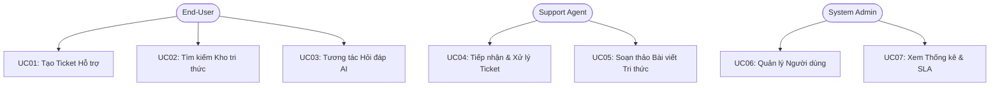

# BÁO CÁO ĐẶC TẢ CA SỬ DỤNG (USE CASE SPECIFICATION)

> **Dự án:** AI-Powered Helpdesk & Knowledge Base  
> **Mã nhóm:** Group 04  
> **Môn học:** Nhập môn Công nghệ Phần mềm - HCMUS

---

## THÔNG TIN TÀI LIỆU
- **Tiêu đề (Title):** Use Case Specification - AI-Powered Helpdesk & Knowledge Base
- **Phiên bản (Version):** 1.0.0-draft
- **Ngày tạo (Date):** 2026-10-19
- **Tác giả & Đóng góp (Authors + Contributions):**
  - `<mssv_A>` - `<name_A>`: Use Cases quản trị tài khoản, phân quyền và xác thực
  - `<mssv_B>` - `<name_B>`: Use Cases tạo, cập nhật, trao đổi và đóng ticket
  - `<mssv_C>` - `<name_C>`: Use Cases tạo bài viết tri thức, duyệt bài và tra cứu
  - `<mssv_D>` - `<name_D>`: Use Cases hỏi đáp với trợ lý AI và xem báo cáo SLA
- **Phạm vi (Scope):** Mô tả chi tiết danh sách tác nhân (Actors), sơ đồ Use Case tổng thể và kịch bản tương tác chính/phụ (Main/Alternative Flows).

---

## 1. DANH SÁCH TÁC NHÂN (ACTORS)
- **End-User (Người dùng cuối):** Người gửi yêu cầu hỗ trợ, tìm kiếm bài viết và tương tác với AI Bot.
- **Support Agent (Nhân viên hỗ trợ):** Người tiếp nhận xử lý ticket, phản hồi khách hàng và biên soạn bài viết.
- **Admin (Quản trị viên):** Quản lý người dùng, cấu hình tham số hệ thống và xem báo cáo SLA.
- **AI System (Hệ thống AI nền tảng):** Tác nhân phụ tự động phân loại, đề xuất bài viết và sinh câu trả lời mẫu.

---

## 2. SƠ ĐỒ USE CASE TỔNG THỂ (USE CASE DIAGRAM)

---

## 3. ĐẶC TẢ CHI TIẾT CÁC CA SỬ DỤNG CHÍNH
### 3.1. UC01: Tạo Ticket Hỗ Trợ
- **Tác nhân chính:** End-User
- **Tiền điều kiện:** Người dùng đã đăng nhập hệ thống.
- **Luồng sự kiện chính (Main Flow):**
  1. Người dùng chọn chức năng "Tạo Ticket mới".
  2. Hệ thống hiển thị form nhập: Tiêu đề, danh mục, nội dung chi tiết và tệp đính kèm.
  3. Khi người dùng nhập tiêu đề, hệ thống AI tự động gợi ý 3 bài viết Knowledge Base liên quan nhất.
  4. Nếu bài viết giải quyết được vấn đề, người dùng nhấn "Đã giải quyết" và kết thúc luồng.
  5. Nếu không, người dùng bấm "Gửi yêu cầu".
  6. Hệ thống lưu ticket, AI gán độ ưu tiên dự kiến và thông báo thành công cho người dùng.

---

## TÀI LIỆU THAM KHẢO (REFERENCES)
1. Alistair Cockburn, "Writing Effective Use Cases", Addison-Wesley.
2. Tài liệu đặc tả tổng thể: `reports/SRS-master.md`.

---

## NHẬT KÝ THAY ĐỔI (CHANGE LOG)
| Phiên bản | Ngày | Người sửa | Nội dung thay đổi | Mã Task Jira |
| :--- | :--- | :--- | :--- | :--- |
| `0.1.0` | 2026-10-19 | DevOps Engineer | Khởi tạo khung tài liệu ca sử dụng | SCRUM-6 |
