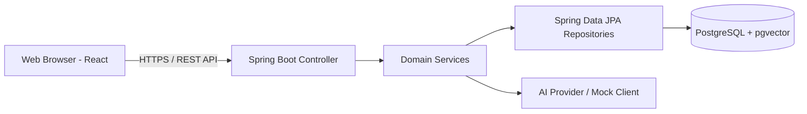

# BÁO CÁO THIẾT KẾ HỆ THỐNG (SYSTEM ARCHITECTURE & DESIGN)

> **Dự án:** AI-Powered Helpdesk & Knowledge Base  
> **Mã nhóm:** Group 04  
> **Môn học:** Nhập môn Công nghệ Phần mềm - HCMUS

---

## THÔNG TIN TÀI LIỆU
- **Tiêu đề (Title):** System Architecture & Database Design
- **Phiên bản (Version):** 1.0.0-draft
- **Ngày tạo (Date):** 2026-10-19
- **Tác giả & Đóng góp (Authors + Contributions):**
  - `<mssv_A>` - `<name_A>`: Thiết kế mô hình bảo mật, phân quyền RBAC và bảng CSDL User/Role
  - `<mssv_B>` - `<name_B>`: Thiết kế CSDL Ticket, Ticket Comments và quy trình State Machine
  - `<mssv_C>` - `<name_C>`: Thiết kế CSDL Knowledge Base và lưu trữ Vector Embedding (pgvector)
  - `<mssv_D>` - `<name_D>`: Thiết kế tích hợp AI Service (LLM / RAG Pipeline) và báo cáo SLA
- **Phạm vi (Scope):** Kiến trúc phân tầng (Tiered Architecture), mô hình dữ liệu quan hệ (ERD), thiết kế lớp (Class Diagram) và tích hợp các module.

---

## 1. KIẾN TRÚC TỔNG THỂ (LOGICAL ARCHITECTURE)
Hệ thống được thiết kế theo mô hình Clean Architecture / Modular Monolith, chia làm 3 tầng chính:
- **Presentation Tier:** Frontend Single Page Application xây dựng bằng React + Vite + TypeScript.
- **Application & Domain Tier:** Backend RESTful Web Service xây dựng bằng Spring Boot 3 (Java 21).
- **Data & Intelligence Tier:** PostgreSQL Database với extension `pgvector` phục vụ tìm kiếm tương đồng và AI Integration Service (OpenAI / Local LLM / Mock Mode).

---

## 2. THIẾT KẾ CƠ SỞ DỮ LIỆU (DATABASE SCHEMA)
- **Bảng `users` & `roles`:** Lưu trữ danh tính, email, mật khẩu mã hoá BCrypt và vai trò.
- **Bảng `tickets` & `ticket_comments`:** Lưu thông tin sự cố, mức độ ưu tiên, trạng thái và phản hồi.
- **Bảng `articles` & `article_embeddings`:** Lưu bài viết tri thức và vector 1536 chiều phục vụ RAG.
- **Bảng `audit_logs`:** Ghi vết các hành động quan trọng trong hệ thống.

---

## TÀI LIỆU THAM KHẢO (REFERENCES)
1. Robert C. Martin, "Clean Architecture: A Craftsman's Guide to Software Structure and Design".
2. Spring Boot Reference Documentation (v3.x).
3. Tài liệu đặc tả tổng thể: `reports/SRS-master.md`.

---

## NHẬT KÝ THAY ĐỔI (CHANGE LOG)
| Phiên bản | Ngày | Người sửa | Nội dung thay đổi | Mã Task Jira |
| :--- | :--- | :--- | :--- | :--- |
| `0.1.0` | 2026-10-19 | DevOps Engineer | Khởi tạo khung tài liệu thiết kế hệ thống | SCRUM-6 |
