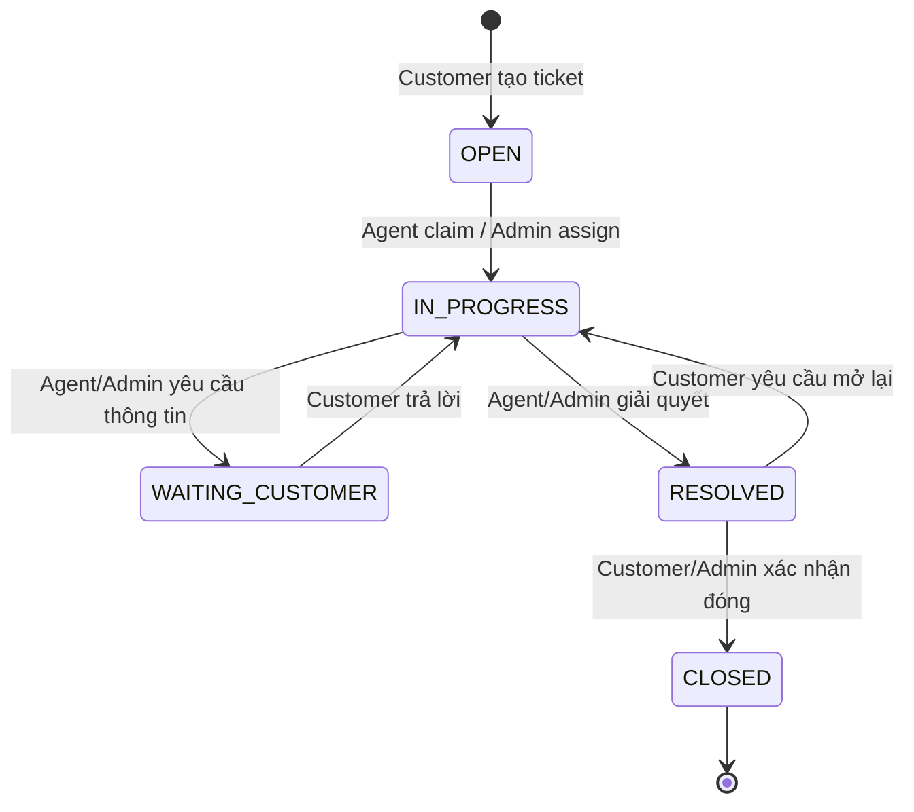
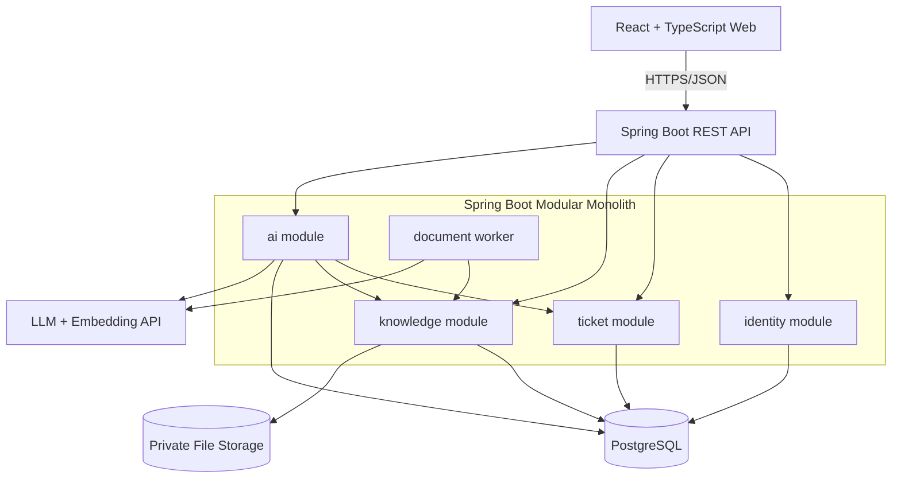
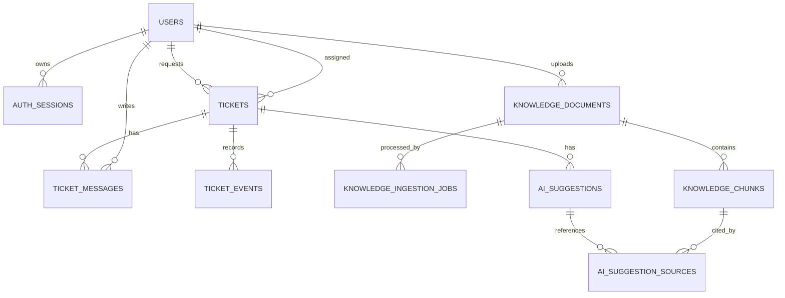
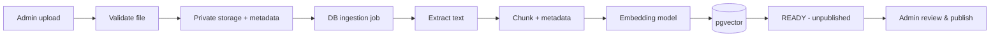
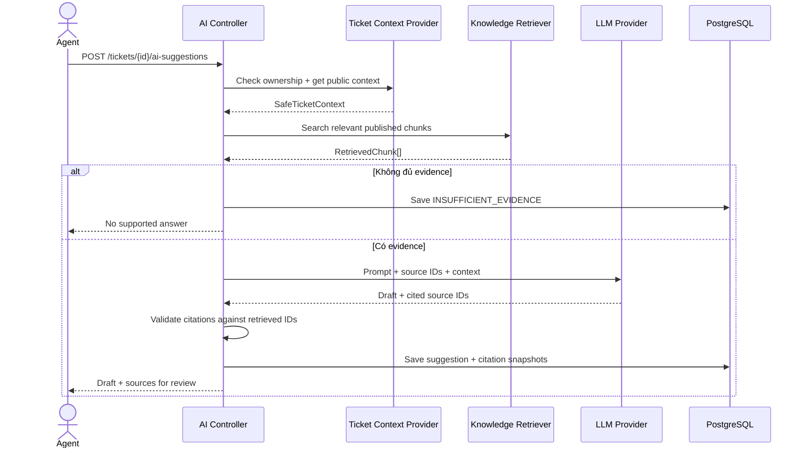

# ĐẶC TẢ DỰ ÁN — AI-POWERED HELPDESK & KNOWLEDGE BASE

---

## 1. Tổng quan dự án

### 1.1 Tên, định hướng và sản phẩm tham khảo

- **Tên:** AI-Powered Helpdesk & Knowledge Base.
- **Tên tiếng Việt:** Hệ thống quản lý yêu cầu hỗ trợ và tra cứu tri thức tích hợp AI.
- **Loại sản phẩm:** Full-stack web application.
- **Tham khảo luồng và UI:** Zendesk / Intercom (quản lý hỗ trợ), Notion / hệ thống FAQ nội bộ (tri thức).
- **Trọng tâm kỹ thuật:** REST API, Authentication/Authorization, transaction & concurrency, file ingestion, PostgreSQL + vector search, RAG có dẫn nguồn, kiểm thử tích hợp.

### 1.2 Bài toán

Người dùng gửi thắc mắc hoặc sự cố nhưng doanh nghiệp/đơn vị hỗ trợ xử lý thủ công, khó theo dõi trạng thái, mất thời gian tìm kiếm chính sách và dễ trả lời thiếu nhất quán. Ứng dụng giải quyết bằng hai khả năng cốt lõi:

1. **Ticket Management:** lưu và xử lý yêu cầu từ lúc tạo đến khi đóng, có phân công người phụ trách và lịch sử minh bạch.
2. **Knowledge-grounded AI Assistance:** tận dụng tài liệu được công bố để đề xuất câu trả lời có dẫn nguồn; nhân viên **kiểm tra và quyết định gửi**.

### 1.3 Mục tiêu

| ID | Mục tiêu | Bằng chứng nghiệm thu |
|---|---|---|
| OBJ-01 | Khách hàng tạo và theo dõi ticket của mình | Demo end-to-end, E2E test |
| OBJ-02 | Nhân viên xử lý theo workflow rõ ràng | State transition tests, ticket history |
| OBJ-03 | Không nhận trùng ticket khi nhiều Agent thao tác đồng thời | Concurrency integration test |
| OBJ-04 | Admin quản lý tài liệu được dùng cho AI | Demo upload, index, publish, archive |
| OBJ-05 | AI đề xuất phản hồi có citation và biết không đủ căn cứ | Bộ câu hỏi đánh giá, AI test report |
| OBJ-06 | Có thể chạy lại dự án và truy vết đóng góp từng thành viên | Docker Compose, README, CI, commit/PR, Jira |

### 1.4 Ranh giới và giả định

- **Chỉ phục vụ một tổ chức (single-organization)**; không có multi-tenancy.
- Chỉ làm **web responsive**; không phát triển ứng dụng Android/iOS trong MVP.
- Có **03 vai trò**: Customer, Agent, Admin.
- AI sử dụng qua model provider có API hoặc model tương thích, cấu hình bằng environment variables; **có mock AI** để demo/test không phụ thuộc kết nối bên ngoài.
- Tài liệu demo là **dữ liệu giả lập hoặc có quyền sử dụng**; không đưa dữ liệu khách hàng thật lên dịch vụ AI bên ngoài.
- Mọi thao tác phân quyền được kiểm tra ở backend, không tin vào frontend.
- **Không tự động gửi email, không tự đóng ticket theo lịch, không để AI tự thực thi hành động.**

---

## 2. Phạm vi và 4 nhóm chức năng

| Nhóm | Code | Nội dung MVP (P0) | Phần mở rộng (P1) |
|---|---|---|---|
| 1. Identity & Access | `identity` | Đăng ký Customer, login, refresh, logout, profile, RBAC; Admin tạo/vô hiệu hóa Agent | Reset password qua email |
| 2. Ticket Management | `ticket` | Create/list/detail, claim/assign, public reply/internal note, state transition, history, filter & pagination | Dashboard số liệu, attachment |
| 3. Knowledge Base | `knowledge` | Upload PDF văn bản/TXT/MD, extract/chunk/embed, publish/archive, search, trạng thái ingestion | Versioning, OCR, nâng cấp hybrid search |
| 4. AI Assistance | `ai` | RAG gợi ý cho ticket, citation, không đủ bằng chứng, review/edit/send thủ công, lưu lịch sử suggestion, xử lý timeout | Feedback, streaming, cải thiện reranking |

### 2.1 Ngoài phạm vi MVP

- CRM, thanh toán, live chat công khai, tổng đài, tích hợp WhatsApp/Zalo/email, SLA phức tạp.
- Multi-tenant, microservices, Kubernetes, event streaming phân tán.
- AI agent có quyền cập nhật ticket hoặc gửi phản hồi tự động.
- OCR cho PDF scan, xử lý Word/Excel/video/audio, fine-tuning model.
- Quyền tùy biến phức tạp ngoài 3 vai trò, đăng nhập mạng xã hội/SSO.
- Ứng dụng mobile native, realtime WebSocket, notification center, analytics nâng cao.

### 2.2 Ưu tiên phát triển

**Thứ tự phụ thuộc:** thống nhất contract → core identity → ticket chạy hoàn chỉnh → ingestion + retrieval → AI suggestions → integration & QA. Có thể phát triển song song từ tuần 3 bằng mock interface.

---

## 3. Actors, quyền và use cases

### 3.1 Actors

| Actor | Mô tả | Trách nhiệm chính |
|---|---|---|
| Guest | Chưa đăng nhập | Đăng ký Customer, đăng nhập |
| Customer | Người gửi yêu cầu | Tạo/xem ticket của chính mình, gửi tin nhắn công khai, xác nhận đóng hoặc yêu cầu xử lý tiếp |
| Agent | Nhân viên hỗ trợ | Xem queue ticket chưa phân công; claim ticket; xử lý ticket được giao; xem KB; sử dụng AI |
| Admin | Quản trị viên | Toàn quyền nghiệp vụ ticket; quản lý Agent, KB; sử dụng AI phục vụ xử lý ticket |
| System Worker | Tiến trình nền nội bộ | Xử lý file/document jobs, tạo embedding và cập nhật trạng thái |
| External LLM Provider | Hệ thống bên ngoài | Trả kết quả sinh văn bản/embedding; không được quyền gọi API nội bộ |

### 3.2 Ma trận quyền MVP

**Ký hiệu:** `✓` được phép, `Own` chỉ dữ liệu của mình, `Assigned` chỉ ticket đang phụ trách, `Open` ticket chưa phân công, `—` không được phép.

| Hành động | Customer | Agent | Admin |
|---|---|---|---|
| Đăng ký tài khoản Customer | Guest | — | — |
| Xem/sửa profile của mình | ✓ | ✓ | ✓ |
| Tạo ticket | ✓ | — | ✓ (thay mặt Customer: P1) |
| Xem ticket | Own | Assigned + Open queue | Tất cả |
| Nhận ticket chưa phân công | — | Open | ✓ |
| Phân công/chuyển Agent | — | — | ✓ |
| Gửi public message | Own và trạng thái cho phép | Assigned | ✓ |
| Ghi internal note | — | Assigned | ✓ |
| Chuyển IN_PROGRESS/WAITING_CUSTOMER/RESOLVED | Chỉ `REOPEN` từ RESOLVED | Assigned | ✓ |
| Đóng ticket RESOLVED | Own | — | ✓ |
| Xem knowledge documents đã publish | — | ✓ | ✓ |
| Upload/publish/archive document | — | — | ✓ |
| Tạo/xem AI suggestion | — | Assigned | ✓ |
| Quản lý Agent | — | — | ✓ |

**Lưu ý:** Agent có thể xem thông tin cần thiết của các ticket `OPEN` để quyết định nhận nhưng **không thể sửa/gửi lời nhắn trên ticket chưa nhận**. Agent không được đọc ticket của Agent khác, ngoại trừ queue `OPEN`. Các quyền này được kiểm tra ở service/repository, không chỉ `@PreAuthorize` theo role.

### 3.3 Danh sách use cases

| UC | Tên | Actor | Mức độ |
|---|---|---|---|
| UC-01 | Register & Login | Guest | P0 |
| UC-02 | Refresh & Logout | Authenticated User | P0 |
| UC-03 | Manage Profile | Authenticated User | P0 |
| UC-04 | Admin Manage Agents | Admin | P0 |
| UC-05 | Create Ticket | Customer | P0 |
| UC-06 | List/View Ticket | Customer, Agent, Admin | P0 |
| UC-07 | Claim/Assign Ticket | Agent, Admin | P0 |
| UC-08 | Send Message / Internal Note | Customer, Agent, Admin | P0 |
| UC-09 | Transition Ticket State | Customer, Agent, Admin | P0 |
| UC-10 | View Ticket Event History | Agent (Assigned), Admin | P0 |
| UC-11 | Upload & Process Document | Admin, Worker | P0 |
| UC-12 | Publish/Archive Document | Admin | P0 |
| UC-13 | Search Knowledge | Agent, Admin | P0 |
| UC-14 | Generate AI Suggestion | Agent (Assigned), Admin | P0 |
| UC-15 | Review/Edit/Send AI Suggestion | Agent (Assigned), Admin | P0 |
| UC-16 | Reset Password | User | P1 |
| UC-17 | View Analytics | Admin | P1 |

---

## 4. Functional Requirements chi tiết

Mỗi FR phải có ít nhất 1 acceptance criterion và 1 test case tương ứng. Danh sách dưới đây là **đầu vào để chuyển thành user stories và Jira issues**, không phải gộp tất cả thành một task lớn.

### 4.1 Nhóm 1 — Identity & Access

| ID | Mức | Yêu cầu | Acceptance criteria |
|---|---|---|---|
| FR-ID-01 | P0 | Guest đăng ký Customer bằng email, tên và mật khẩu | Email duy nhất; validate email/mật khẩu; role mặc định CUSTOMER; không nhận role từ request |
| FR-ID-02 | P0 | Login bằng email + password | Sai thông tin trả lỗi chung; thành công cấp access/refresh token |
| FR-ID-03 | P0 | Hash và kiểm tra mật khẩu an toàn | Sử dụng `PasswordEncoder` (BCrypt/Argon2 được cấu hình); không lưu/log raw password |
| FR-ID-04 | P0 | Refresh token có rotation | Refresh hợp lệ cấp token mới; token cũ không thể sử dụng lại |
| FR-ID-05 | P0 | Logout thiết bị hiện tại | Thu hồi refresh session; access JWT cũ có thể còn hiệu lực đến hết hạn (được tài liệu hóa) |
| FR-ID-06 | P0 | Xem/sửa profile, đổi mật khẩu | Chỉ sửa chính mình; đổi mật khẩu cần kiểm tra mật khẩu cũ |
| FR-ID-07 | P0 | RBAC và ownership | Truy cập trái phép trả 401/403/404 theo quy tắc bảo mật đã chốt |
| FR-ID-08 | P0 | Admin tạo/vô hiệu hóa Agent | Không thể self-register làm Agent/Admin; tài khoản vô hiệu không được đăng nhập mới |
| FR-ID-09 | P1 | Forgot/reset password | Token một lần, có hạn sử dụng và không lộ việc email có tồn tại |

**Quyết định kỹ thuật:** Access token sống 15 phút; refresh token sống 7 ngày (đều cấu hình được). Refresh token ngẫu nhiên độ entropy cao, lưu **hash** trong DB; không dùng JWT refresh stateless cho MVP. Dùng HTTPS trong triển khai công khai. Nếu lưu refresh token bằng cookie thì dùng `HttpOnly`, `Secure`, `SameSite` phù hợp và có CSRF strategy; nếu lưu phía client khác, phải đánh giá rủi ro XSS. **Không lưu raw refresh token trong DB hoặc log.**

### 4.2 Nhóm 2 — Ticket Management

| ID | Mức | Yêu cầu | Acceptance criteria |
|---|---|---|---|
| FR-TK-01 | P0 | Customer tạo ticket gồm subject, description | Tạo ticket và public message đầu tiên trong cùng transaction; mã ticket duy nhất |
| FR-TK-02 | P0 | Danh sách ticket theo vai trò | Customer chỉ own; Agent thấy own assigned và OPEN; Admin thấy tất cả |
| FR-TK-03 | P0 | Xem chi tiết gồm thread và trạng thái | Không lộ `INTERNAL` notes cho Customer |
| FR-TK-04 | P0 | Agent claim ticket OPEN | Chỉ một request thắng khi claim đồng thời; chuyển `OPEN → IN_PROGRESS` |
| FR-TK-05 | P0 | Admin phân công/chuyển người phụ trách | Ghi event; validate Agent đang enabled; không chuyển vô hiệu |
| FR-TK-06 | P0 | Customer/Agent gửi public message | Tạo message; author được xác minh theo token, không tin userId từ request |
| FR-TK-07 | P0 | Agent/Admin thêm internal note | Chỉ Agent được giao/Admin xem; Customer không thể suy đoán qua API |
| FR-TK-08 | P0 | Transition ticket theo state machine | Trạng thái không hợp lệ trả `INVALID_TICKET_TRANSITION` |
| FR-TK-09 | P0 | Event/Audit trail | Ghi ai/lúc nào/thao tác gì cho claim, assign, state transition; append-only ở tầng nghiệp vụ |
| FR-TK-10 | P0 | Filter/search/pagination | Filter status, assignedAgent, created date; pagination, sort whitelist, giới hạn page size |
| FR-TK-11 | P1 | Ticket attachments | Giới hạn file, xác thực quyền download và scan loại file |
| FR-TK-12 | P1 | Dashboard | Số ticket theo trạng thái/nhân viên, thống kê cơ bản |

**Field MVP:** `subject` 5–150 ký tự; `description` 10–5000; public/internal message 1–5000; ưu tiên ticket mặc định `NORMAL`. Agent/Admin có thể đặt `LOW/NORMAL/HIGH`; Customer không thể tự nâng priority. Giới hạn và thông báo validation có thể điều chỉnh khi chốt UI.

### 4.3 Nhóm 3 — Knowledge Base

| ID | Mức | Yêu cầu | Acceptance criteria |
|---|---|---|---|
| FR-KB-01 | P0 | Admin upload PDF văn bản, TXT, MD | Kiểm tra type, extension, nội dung cơ bản, size tối đa 10 MiB/file |
| FR-KB-02 | P0 | Lưu file và tạo job xử lý | Upload thành công tạo metadata + ingestion job; không chạy LLM trong request upload |
| FR-KB-03 | P0 | Worker trích xuất text | Xử lý tài liệu text-based; PDF ảnh không có text được báo `FAILED/UNSUPPORTED_SCANNED_PDF` |
| FR-KB-04 | P0 | Chunk & embedding | Chia text có metadata `page_number`, `chunk_index`; vector đúng số chiều được chọn |
| FR-KB-05 | P0 | Quản lý trạng thái xử lý | `UPLOADED → PROCESSING → READY/FAILED`; retry giới hạn; lỗi có mô tả an toàn |
| FR-KB-06 | P0 | Admin publish tài liệu READY | Document chỉ được publish khi `READY` |
| FR-KB-07 | P0 | Search documents/chunks | Chỉ kết quả `READY + published + not archived`, có lọc quyền |
| FR-KB-08 | P0 | Admin archive tài liệu | Ngay sau archive không còn xuất hiện trong truy xuất mới |
| FR-KB-09 | P0 | Admin xem danh sách và trạng thái | Có pagination và tiến độ ở mức trạng thái |
| FR-KB-10 | P1 | Versioning/OCR | Tách thành mục mở rộng, không ảnh hưởng MVP |

**Lưu ý tính nhất quán:** File được lưu trong **Docker volume/private storage**, DB lưu `storage_key`, không phục vụ file trực tiếp bằng public URL. Nếu transaction tạo DB metadata thành công nhưng ghi file thất bại, cập nhật trạng thái FAILED và dọn tài nguyên; có cleanup job hoặc quy trình dọn thủ công. Mọi document được archive bằng trạng thái mềm, không xóa vĩnh viễn trong MVP nhằm giữ provenance của AI suggestion cũ.

### 4.4 Nhóm 4 — AI Assistance

| ID | Mức | Yêu cầu | Acceptance criteria |
|---|---|---|---|
| FR-AI-01 | P0 | Agent được giao/Admin yêu cầu gợi ý trả lời | Truy cập đúng role và ownership; không sửa ticket khi generate |
| FR-AI-02 | P0 | Lấy ngữ cảnh ticket an toàn | Chỉ lấy public messages cần thiết và metadata đã lọc; không gửi internal notes mặc định |
| FR-AI-03 | P0 | Truy xuất chunk qua pgvector | Chỉ dùng tài liệu publish, READY, không archive; top-k, threshold cấu hình |
| FR-AI-04 | P0 | Sinh câu trả lời dựa trên nguồn | Prompt phân biệt instruction hệ thống với nội dung tài liệu; giới hạn output |
| FR-AI-05 | P0 | Citation được xác minh | Chỉ trả về source IDs thuộc tập chunk đã truy xuất; lưu snapshot đoạn trích |
| FR-AI-06 | P0 | Không đủ bằng chứng thì abstain | Trả `INSUFFICIENT_EVIDENCE`; không tự bịa chính sách/điều khoản |
| FR-AI-07 | P0 | Agent xem, sửa và chủ động gửi | Suggestion không tự gửi; nội dung được Agent sửa mới thành public message |
| FR-AI-08 | P0 | Lưu request/suggestion/status/source | Ghi người yêu cầu, ticket, model, timestamps, citation; không lưu khóa API |
| FR-AI-09 | P0 | Timeout/rate limit/failure handling | Provider lỗi trả trạng thái rõ, ticket còn dùng bình thường; giới hạn số request |
| FR-AI-10 | P1 | AI feedback/evaluation dashboard | Agent đánh giá useful/not useful, thống kê chất lượng |

**Không bảo đảm tuyệt đối AI không hallucinate.** Thiết kế phải có cơ chế giảm rủi ro, bắt buộc human-in-the-loop và bộ đánh giá đo tỷ lệ trả lời có căn cứ.

---

## 5. Business Rules (quy tắc nghiệp vụ)

| ID | Quy tắc |
|---|---|
| BR-01 | Tài khoản tự đăng ký luôn có role `CUSTOMER`; server bỏ qua/reject bất kỳ role gửi từ client. |
| BR-02 | Chỉ Admin quản lý tài khoản Agent; Admin ban đầu được seed qua migration/script quản trị an toàn, không public API đăng ký Admin. |
| BR-03 | Customer chỉ có thể đọc/sửa ticket của mình trong giới hạn workflow; không truy cập nội bộ của khách khác. |
| BR-04 | Agent thấy OPEN queue và ticket được giao; không sửa ticket của Agent khác. |
| BR-05 | Ticket OPEN phải có `assigned_agent_id = NULL`; claim/assign thành công chuyển sang IN_PROGRESS. |
| BR-06 | Ticket được claim bằng optimistic locking/conditional update; **không có hai Agent thắng cùng một ticket**. |
| BR-07 | Không tạo public/internal message khi ticket CLOSED. RESOLVED chỉ được customer REOPEN hoặc CLOSE trước khi trao đổi tiếp. |
| BR-08 | PUBLIC message hiển thị với Customer sở hữu; INTERNAL note chỉ hiển thị cho Agent được giao và Admin. |
| BR-09 | Customer chỉ có thể CLOSE hoặc REOPEN ticket từ RESOLVED; không tự chuyển IN_PROGRESS/WAITING_CUSTOMER. |
| BR-10 | AI không được phép thay đổi trạng thái, phân công hoặc gửi tin nhắn. |
| BR-11 | Chỉ tài liệu READY + published + chưa archive được truy xuất cho yêu cầu AI mới. |
| BR-12 | AI citation phải trỏ tới chunk đã retrieve; snapshot nguồn được lưu khi sinh suggestion để lịch sử không thay đổi theo tài liệu. |
| BR-13 | Không đủ dữ kiện: phản hồi `INSUFFICIENT_EVIDENCE`, không giả lập citation. |
| BR-14 | API luôn xác định actor từ principal của access token, không nhận `actorId`, `authorId`, `role` tự do từ client. |
| BR-15 | Mọi cập nhật quan trọng có ticket event đồng transaction; audit history không được tự ý chỉnh sửa từ API. |
| BR-16 | Disabled user không thể login/refresh; access token cũ cần bị chặn bằng kiểm tra account enabled ở backend, nếu áp dụng chính sách vô hiệu tức thì. |

### 5.1 Ticket state machine



| Trạng thái hiện tại | Hành động | Actor | Trạng thái sau | Ghi chú |
|---|---|---|---|---|
| OPEN | CLAIM | Agent/Admin | IN_PROGRESS | Gán Agent; atomic |
| OPEN | ASSIGN | Admin | IN_PROGRESS | Agent phải enabled |
| IN_PROGRESS | REQUEST_INFO | Assigned Agent/Admin | WAITING_CUSTOMER | Ghi event, Agent thường phải có public message giải thích |
| WAITING_CUSTOMER | CUSTOMER_REPLY | Customer sở hữu | IN_PROGRESS | Gửi public message và transition trong một transaction |
| IN_PROGRESS | RESOLVE | Assigned Agent/Admin | RESOLVED | Agent xác nhận đã xử lý |
| RESOLVED | REOPEN | Customer sở hữu | IN_PROGRESS | Khách chưa hài lòng; ghi event |
| RESOLVED | CLOSE | Customer sở hữu/Admin | CLOSED | Không được gửi thêm |
| IN_PROGRESS/WAITING_CUSTOMER | REASSIGN | Admin | Giữ nguyên | Thay Agent, ghi old/new assignee |

**Trường hợp rõ ràng:** Customer có thể gửi public message khi OPEN hoặc IN_PROGRESS (không tự đổi trạng thái); khi WAITING_CUSTOMER, gửi message sẽ tự chuyển sang IN_PROGRESS. Agent có thể gửi public reply khi IN_PROGRESS/WAITING_CUSTOMER nhưng không tự đổi trạng thái nếu chưa chọn action tương ứng. Customer không nhắn trực tiếp khi RESOLVED; phải REOPEN trước. Mọi hành động không có trong bảng bị từ chối.

### 5.2 Concurrency và idempotency

- `tickets.version` dùng JPA `@Version` để chống lost update.
- Claim chỉ hợp lệ nếu trạng thái OPEN và chưa có Agent. Có thể dùng conditional `UPDATE ... WHERE status = 'OPEN' AND assigned_agent_id IS NULL AND version = ?`; chỉ đúng 1 request ảnh hưởng 1 dòng.
- Không được check trạng thái bằng `SELECT` rồi `UPDATE` không khóa trong hai transaction độc lập.
- Mọi state mutation và insert `ticket_events` diễn ra trong **cùng DB transaction**.
- Không thực hiện LLM call bên trong ticket transaction để tránh giữ connection/lock quá lâu.
- `Idempotency-Key` cho `POST /tickets` là P1; MVP cần ít nhất chống double-click tại UI và dokument hóa khả năng retry tạo trùng. **Không tuyên bố create-ticket idempotent nếu chưa triển khai server-side key.**

---

## 6. Đặc tả use cases trọng tâm

### UC-05 — Create Ticket

| Thuộc tính | Nội dung |
|---|---|
| Actor | Customer |
| Trigger | Chọn "Create ticket" |
| Precondition | Đã xác thực; tài khoản enabled |
| Input | `subject`, `description` |
| Main flow | (1) UI gửi request; (2) xác thực + validate; (3) sinh `ticket_number`; (4) tạo ticket `OPEN/NORMAL`; (5) tạo `PUBLIC` message đầu tiên; (6) commit; (7) trả 201 + ticket ID |
| Alternative | Trường thiếu/quá dài: trả 400 `VALIDATION_ERROR`; token không hợp lệ: 401 |
| Postcondition | Ticket có requester = principal; event `TICKET_CREATED` |
| Related | FR-TK-01; BR-03, BR-14, BR-15; TC-TK-01 |

### UC-07 — Claim Ticket (Concurrency Critical)

| Thuộc tính | Nội dung |
|---|---|
| Actor | Agent, Admin |
| Trigger | Chọn "Claim" ở OPEN queue |
| Precondition | Ticket còn OPEN; chưa assigned; Agent enabled |
| Main flow | (1) Kiểm tra role; (2) atomic claim update; (3) cập nhật IN_PROGRESS; (4) ghi event `CLAIMED`; (5) commit; (6) trả ticket mới |
| Alternative | Nếu người khác nhận trước: trả 409 `TICKET_ALREADY_CLAIMED`; không tồn tại: 404; account disabled: 403 |
| Postcondition | Chính xác một Agent được gán; không mất event |
| Related | FR-TK-04; BR-05/06/15; TC-TK-05, TC-CON-01 |

### UC-08 — Send Public Message / Internal Note

| Thuộc tính | Nội dung |
|---|---|
| Actor | Customer, Assigned Agent, Admin |
| Trigger | Người dùng gửi nội dung trong ticket |
| Precondition | Có quyền theo ticket ownership; trạng thái cho phép |
| Main flow | (1) Validate content/visibility; (2) server xác định author; (3) kiểm tra ticket state; (4) lưu message; (5) nếu Customer reply khi WAITING_CUSTOMER thì transition IN_PROGRESS; (6) ghi event cần thiết; (7) trả message |
| Alternative | Customer gửi INTERNAL: 403; ticket CLOSED/RESOLVED: 409; access ticket khác: 404 hoặc 403 theo policy |
| Postcondition | Thread hiển thị đúng vai trò, không lộ internal note |
| Related | FR-TK-06/07/08; BR-07/08/09; TC-SEC-03 |

### UC-09 — Transition Ticket State

| Thuộc tính | Nội dung |
|---|---|
| Actor | Assigned Agent, Admin, Customer (một số action) |
| Trigger | Chọn Request Info, Resolve, Reopen, Close |
| Precondition | Có quyền action; ticket ở trạng thái nguồn tương ứng |
| Main flow | (1) Nhận action enum; (2) tìm ticket được phép thao tác; (3) validate state transition; (4) cập nhật version/status; (5) ghi event; (6) commit |
| Alternative | Transition không hợp lệ: 409 `INVALID_TICKET_TRANSITION`; optimistic conflict: 409 `TICKET_VERSION_CONFLICT` |
| Postcondition | State được cập nhật hợp lệ và audit đầy đủ |
| Related | FR-TK-08/09; BR-07/09/15; TC-TK-08 |

### UC-11 — Upload and Process Knowledge Document

| Thuộc tính | Nội dung |
|---|---|
| Actor | Admin, System Worker |
| Trigger | Admin upload file |
| Precondition | Admin authenticated; loại file hỗ trợ |
| Main flow | (1) Kiểm tra file; (2) lưu file private storage; (3) ghi document UPLOADED và job PENDING; (4) trả 202; (5) worker nhận job; (6) extract text; (7) split chunks; (8) sinh embeddings; (9) ghi chunks; (10) chuyển READY; (11) Admin kiểm tra rồi publish |
| Alternative | PDF scan/không có text: FAILED; model embedding lỗi: retry bounded; file quá lớn: 413 |
| Postcondition | READY vẫn **chưa publish** nếu Admin chưa bấm Publish |
| Related | FR-KB-01..06; BR-11; TC-KB-01/03 |

### UC-12 — Publish / Archive Knowledge

| Thuộc tính | Nội dung |
|---|---|
| Actor | Admin |
| Trigger | Publish hoặc Archive document |
| Precondition | Document READY nếu Publish; không ARCHIVED nếu Archive |
| Main flow | Validate quyền/status; update `published_at` hoặc `status=ARCHIVED`, `published=false`; ghi audit; trả trạng thái mới |
| Alternative | Publish khi FAILED/PROCESSING: 409 `DOCUMENT_NOT_READY` |
| Postcondition | Mọi truy vấn AI **mới** loại bỏ archived/unpublished ngay sau commit |
| Related | FR-KB-06/08; TC-KB-05 |

### UC-14 — Generate AI Suggestion

| Thuộc tính | Nội dung |
|---|---|
| Actor | Assigned Agent/Admin |
| Trigger | Chọn "Suggest Reply" |
| Precondition | Ticket có quyền truy cập, không CLOSED; provider AI được cấu hình (hoặc chế độ mock) |
| Main flow | (1) Check role/ownership; (2) lấy public conversation phù hợp; (3) tạo search query; (4) retrieve các chunk đã publish; (5) nếu thiếu bằng chứng thì abstain; (6) gửi prompt có source IDs; (7) validate citation; (8) lưu suggestion và snapshot nguồn; (9) trả suggestion cho Agent |
| Alternative | Không có kết quả: `INSUFFICIENT_EVIDENCE`; timeout: `AI_PROVIDER_TIMEOUT`; quota/rate limit: 429; model trả citation sai: reject citation hoặc fail closed, không trả citation giả |
| Postcondition | **Không tạo ticket_message**; ticket không đổi trạng thái |
| Related | FR-AI-01..06/08/09; BR-10..13; TC-AI-01/03/05 |

### UC-15 — Review, Edit and Send AI Suggestion

| Thuộc tính | Nội dung |
|---|---|
| Actor | Assigned Agent/Admin |
| Trigger | Sau khi xem suggestion, bấm Send |
| Precondition | Suggestion thuộc đúng ticket, do nhân sự có quyền truy cập sử dụng; ticket cho phép reply |
| Main flow | (1) Agent có thể chỉnh nội dung draft; (2) UI gửi message `PUBLIC` + optional `suggestionId`; (3) backend xác thực tất cả liên kết; (4) lưu message; (5) đánh dấu suggestion APPLIED; (6) commit; (7) Customer nhìn thấy message đã gửi |
| Alternative | Agent bỏ qua: suggestion vẫn GENERATED hoặc DISCARD; ticket RESOLVED/CLOSED: không gửi được |
| Postcondition | Chỉ bản text được Agent duyệt mới hiển thị cho Customer; source audit vẫn lưu |
| Related | FR-AI-07/08; BR-10; TC-AI-06 |

---

## 7. User Stories và Acceptance Criteria mẫu

| Story | As a ... I want ... so that ... | Acceptance Criteria dạng Given/When/Then |
|---|---|---|
| US-01 | Customer muốn tạo ticket để được hỗ trợ | Given Customer login; When POST valid ticket; Then status 201, ticket OPEN và chỉ mình xem được |
| US-02 | Customer muốn xem tiến độ | Given ticket của mình; When GET detail; Then xem state, public messages, không thấy internal notes |
| US-03 | Agent muốn nhận ticket để chịu trách nhiệm | Given ticket OPEN; When 2 Agent claim đồng thời; Then đúng 1 claim thành công |
| US-04 | Agent muốn trao đổi với khách | Given ticket assigned; When gửi public reply; Then Customer thấy reply sau refresh |
| US-05 | Agent muốn ghi chú nội bộ | Given ticket assigned; When gửi INTERNAL note; Then Agent/Admin thấy, Customer không thấy |
| US-06 | Admin muốn đưa tài liệu lên KB | Given file PDF có text hợp lệ; When upload; Then job được tạo và document cuối cùng READY/FAILED |
| US-07 | Admin muốn kiểm duyệt tri thức | Given document READY; When Publish; Then retrieval bắt đầu dùng document đó |
| US-08 | Agent muốn được AI gợi ý | Given ticket + KB có evidence; When Generate; Then nhận draft và citation được kiểm chứng |
| US-09 | Agent muốn AI biết giới hạn | Given không có evidence; When Generate; Then không được dựng lên chính sách |
| US-10 | Agent muốn giữ quyền kiểm soát | Given AI draft; When chưa bấm Send; Then Customer không nhận bất cứ message mới nào |

**Yêu cầu nhóm:** chuyển mỗi story thành Jira issue với owner, reviewer, estimate, priority, link design, test case và PR; bổ sung các trường hợp lỗi/edge cases khi refinement.

---

## 8. Non-functional Requirements (có thể đo và kiểm thử)

| ID | Nhóm | Tiêu chí mục tiêu / cách kiểm chứng |
|---|---|---|
| NFR-SEC-01 | Auth | Không lưu raw password/token; secret lấy từ env; TLS khi triển khai công khai; kiểm thử expired/revoked tokens |
| NFR-SEC-02 | Authorization | 100% protected endpoints có test role/ownership; không lộ INTERNAL notes trong customer response |
| NFR-SEC-03 | Upload security | Giới hạn 10 MiB, whitelist extension/type, tên file không dùng trực tiếp làm đường dẫn; không execute file upload |
| NFR-SEC-04 | Injection | Query parameterized qua JPA/JDBC; log sanitize; RAG xem văn bản nguồn là dữ liệu không tin cậy |
| NFR-REL-01 | Reliability | Khi LLM lỗi, API ticket vẫn tạo/sửa/trả lời bình thường; kiểm tra bằng fault injection |
| NFR-CONS-01 | Consistency | 20 lần thử hai Agent claim đồng thời trên 1 ticket: mỗi lần đúng 1 winner, 1 loser |
| NFR-CONS-02 | Audit | Claim/assign/state transitions không được commit một nửa: DB change và event cùng transaction |
| NFR-PERF-01 | REST latency | Mục tiêu p95 < 800 ms với API CRUD thông thường, 20 virtual users, dữ liệu seed và hạ tầng ghi rõ |
| NFR-PERF-02 | AI latency | Mục tiêu p95 < 12 s cho suggestion với provider ổn định; ghi nhận timeout, không dùng để chấm nếu external provider bất ổn |
| NFR-PERF-03 | Document ingest | Text-based PDF ~1 MiB có thể chuyển READY trong 60 s ở môi trường thử nghiệm chuẩn; nếu vượt, phân tích bottleneck |
| NFR-AI-01 | Grounding | Bộ >=30 câu hỏi gắn đáp án/reference; citation accuracy mục tiêu >=90% ở tập có evidence |
| NFR-AI-02 | Abstention | Trong tập no-evidence, mục tiêu >=80% trường hợp AI từ chối trả lời không căn cứ |
| NFR-AI-03 | Safety | Bộ test prompt injection/document injection không được khiến AI tự ý gọi hành động nội bộ hoặc tiết lộ secrets |
| NFR-OBS-01 | Observability | Structured logs, request/correlation ID, AI latency, job status, không log password/tokens/raw secrets |
| NFR-MAIN-01 | Maintainability | Cấu trúc module rõ, migration versioned, API docs, reviewer khác author cho PR chính |
| NFR-TEST-01 | Testing | Test tự động cho workflow, RBAC, concurrency, retrieval filter; CI phải pass trước merge |
| NFR-DEPLOY-01 | Reproducibility | Docker Compose + `.env.example` + seed data + README chạy demo trên máy mới |
| NFR-PRIV-01 | Privacy | Dữ liệu demo giả lập; loại bỏ PII không cần thiết trước LLM; công bố nếu dùng provider ngoài |
| NFR-UX-01 | Usability | UI responsive desktop/mobile; loading/error/empty states rõ; mỗi tác vụ chính có phản hồi dễ hiểu |

**Cách đo:** Ghi rõ commit, phiên bản image, CPU/RAM, dữ liệu seed, cấu hình DB, 5 phút warm-up và 5 phút đo cho benchmark; lưu raw logs, ảnh chụp và số liệu. Không tự ghi “đạt” nếu chưa đo.

---

## 9. Kiến trúc hệ thống

### 9.1 Quyết định kiến trúc

**Modular Monolith**, một Spring Boot deployable, tổ chức theo **business feature** thay vì chia toàn repo thành controller/service/repository tổng quát. Mỗi module đóng gói business logic, API, infrastructure riêng; giao tiếp qua application services/interfaces có kiểm soát. Bắt đầu đơn giản, không thêm Message Broker/Redis chỉ để “cho production”.



### 9.2 Stack

| Lớp | Công nghệ | Vai trò |
|---|---|---|
| Backend | Java 21, Spring Boot | REST, nghiệp vụ, transactions |
| Security | Spring Security, `PasswordEncoder`, JWT | Auth, role/ownership |
| ORM | Spring Data JPA / Hibernate | Business entities |
| SQL migration | Flyway | Quản lý schema |
| Data & vector | PostgreSQL + pgvector | Dữ liệu quan hệ và vector |
| AI | Spring AI / SDK tương thích provider | Embedding, Chat Model, RAG orchestration |
| File parsing | Apache PDFBox hoặc Tika (chọn 1 sau spike) | Text extraction; không OCR |
| Frontend | React + TypeScript | Web interface |
| Testing | JUnit 5, Mockito, MockMvc, Testcontainers | Unit/integration/security |
| DevOps | Docker Compose, GitHub Actions | Chạy và kiểm tra tự động |
| API Docs | OpenAPI/Swagger UI | Giao tiếp frontend/backend |

**Version policy:** Lock version cụ thể trong `pom.xml`/`package-lock.json` khi setup; xác minh tương thích Spring Boot–Spring AI–driver pgvector trước khi tạo schema. Không khóa version theo một câu trả lời chưa kiểm chứng.

### 9.3 Cấu trúc backend đề xuất

```text
backend/
  pom.xml
  src/main/java/com/example/helpdesk/
    HelpdeskApplication.java
    common/
      api/                 # ApiError, pagination, global exception handler
      security/            # JWT filter/config, principal, method security
      config/              # CORS, OpenAPI, clock/config
    identity/
      api/                 # AuthController, UserController, DTOs
      application/         # Register/Login/Refresh, ManageAgent use cases
      domain/              # User, Role, AuthSession, rules
      infrastructure/      # JPA repositories, token adapter
    ticket/
      api/
      application/
      domain/              # Ticket, Message, Event, TicketStatus
      infrastructure/
    knowledge/
      api/
      application/         # Upload/Publish/Search/Ingestion
      domain/              # Document, Chunk, IngestionJob
      infrastructure/      # FileStore, PDF extractor, pgvector search
    ai/
      api/
      application/         # GenerateSuggestion, ApplySuggestion
      domain/              # Suggestion, Citation, AI statuses
      infrastructure/      # Prompt adapter, model clients
  src/main/resources/
    application.yml
    db/migration/
  src/test/java/...
frontend/
  src/features/auth/
  src/features/tickets/
  src/features/knowledge/
  src/features/ai/
infra/
  compose.yaml
  .env.example
reports/
  requirements/
  design/
  testing/
  ai-usage/
  contributions/
```

### 9.4 Nguyên tắc module boundary

- `identity` cung cấp identity/role qua principal và use-case API; module khác không truy cập trực tiếp bảng `auth_sessions`.
- `ticket` làm chủ dữ liệu ticket; `ai` lấy **ticket context DTO** qua `TicketContextProvider`, không đọc trực tiếp entity JPA của ticket.
- `knowledge` làm chủ ingest/search; `ai` dùng `KnowledgeRetriever` trả về immutable `RetrievedChunk` có metadata cần trích dẫn.
- `ai` **không import** TicketRepository để sửa ticket. Khi Agent gửi draft, đi qua Ticket application service để tạo message hợp lệ; AI chỉ đánh dấu suggestion đã được sử dụng khi transaction chung thành công.
- Tránh vòng dependency; nếu phát sinh, tách interface vào boundary có owner rõ ràng.

### 9.5 Cross-cutting concerns

- `@RestControllerAdvice` cho lỗi API nhất quán.
- `@Transactional` tại use-case application service, không ở controller và không bao bọc external LLM calls.
- Phân trang với whitelist sorting và giới hạn `size <= 100`.
- `created_at`, `updated_at` ở UTC (`timestamptz`); frontend hiển thị giờ địa phương.
- Input validation và authorization ở cả HTTP boundary lẫn service (để tránh bypass khi gọi nội bộ).
- `requestId`/correlation ID trong error/log, không log nội dung nhạy cảm mặc định.

---

## 10. Database design (logical schema)

### 10.1 Quy ước

- Khóa chính `UUID`; thời gian `TIMESTAMPTZ`; email so sánh không phân biệt hoa thường (normalized + unique index).
- `CHECK`, `NOT NULL`, FK, unique index dùng để hỗ trợ invariants.
- Enum Java ánh xạ bằng `STRING`, migration có check constraint tương ứng; không dùng ordinal enum.
- Vector embedding chọn **một model và dimension duy nhất cho MVP**. Ví dụ `vector(1536)` chỉ là minh họa: cập nhật theo model thực tế, không hardcode khi chưa chốt provider.
- Internal notes và sensitive metadata không được đưa vào Customer DTO.

### 10.2 Bảng và cột chính

#### `users`

| Cột | Kiểu | Ràng buộc |
|---|---|---|
| `id` | uuid | PK |
| `email` | varchar(255) | unique normalized, not null |
| `password_hash` | varchar(255) | not null |
| `full_name` | varchar(120) | not null |
| `role` | varchar(20) | CUSTOMER/AGENT/ADMIN |
| `enabled` | boolean | default true |
| `created_at`, `updated_at` | timestamptz | not null |

#### `auth_sessions`

| Cột | Kiểu | Ràng buộc |
|---|---|---|
| `id` | uuid | PK |
| `user_id` | uuid | FK `users.id` |
| `refresh_token_hash` | varchar(128) | unique, not null |
| `expires_at` | timestamptz | not null |
| `revoked_at` | timestamptz | nullable |
| `created_at`, `last_used_at` | timestamptz | audit |

**Ghi chú:** Có thể dùng SHA-256 cho **refresh token ngẫu nhiên có entropy cao** để lookup; **không áp dụng cách này cho password người dùng** (password phải dùng password hasher chống brute force). Không lưu token raw.

#### `tickets`

| Cột | Kiểu | Ràng buộc |
|---|---|---|
| `id` | uuid | PK |
| `ticket_number` | varchar(32) | unique, not null, mã hiển thị |
| `requester_id` | uuid | FK users |
| `assigned_agent_id` | uuid | FK users, nullable khi OPEN |
| `subject` | varchar(150) | not null |
| `status` | varchar(30) | OPEN/IN_PROGRESS/WAITING_CUSTOMER/RESOLVED/CLOSED |
| `priority` | varchar(10) | LOW/NORMAL/HIGH, default NORMAL |
| `version` | bigint | not null, optimistic locking |
| `created_at`, `updated_at` | timestamptz | not null |
| `resolved_at`, `closed_at` | timestamptz | nullable |

Indexes: `(requester_id, created_at DESC)`, `(assigned_agent_id, status, updated_at DESC)`, `(status, created_at DESC)`.

#### `ticket_messages`

| Cột | Kiểu | Ràng buộc |
|---|---|---|
| `id` | uuid | PK |
| `ticket_id` | uuid | FK tickets |
| `author_id` | uuid | FK users |
| `body` | text | not null |
| `visibility` | varchar(10) | PUBLIC/INTERNAL |
| `source_suggestion_id` | uuid | nullable FK ai_suggestions (sau migration phù hợp) |
| `created_at` | timestamptz | not null |

Indexes: `(ticket_id, created_at, id)`; Customer queries luôn filter `visibility='PUBLIC'` server-side.

#### `ticket_events`

| Cột | Kiểu | Ràng buộc |
|---|---|---|
| `id` | uuid | PK |
| `ticket_id` | uuid | FK tickets |
| `actor_id` | uuid | FK users, nullable cho system events |
| `event_type` | varchar(40) | TICKET_CREATED/CLAIMED/ASSIGNED/STATUS_CHANGED/... |
| `old_value`, `new_value` | jsonb | values có cấu trúc; không lưu secrets |
| `created_at` | timestamptz | not null |

#### `knowledge_documents`

| Cột | Kiểu | Ràng buộc |
|---|---|---|
| `id` | uuid | PK |
| `title` | varchar(200) | not null |
| `original_filename` | varchar(255) | sanitized |
| `storage_key` | varchar(500) | unique, private storage |
| `mime_type` | varchar(100) | not null |
| `size_bytes` | bigint | > 0, <= limit |
| `content_hash` | varchar(64) | SHA-256; duplicate detection hỗ trợ |
| `status` | varchar(20) | UPLOADED/PROCESSING/READY/FAILED/ARCHIVED |
| `published` | boolean | default false |
| `uploaded_by` | uuid | FK users |
| `published_at`, `archived_at` | timestamptz | nullable |
| `failure_code` | varchar(100) | nullable, mã lỗi an toàn |
| `created_at`, `updated_at` | timestamptz | not null |

#### `knowledge_ingestion_jobs`

| Cột | Kiểu | Ràng buộc |
|---|---|---|
| `id` | uuid | PK |
| `document_id` | uuid | FK documents |
| `status` | varchar(20) | PENDING/RUNNING/COMPLETED/FAILED |
| `attempts`, `max_attempts` | int | not null; mặc định max=3 |
| `next_run_at`, `locked_until` | timestamptz | nullable |
| `last_error_code` | varchar(100) | nullable |
| `created_at`, `updated_at` | timestamptz | not null |

**Worker pattern:** scheduled DB job polling với `FOR UPDATE SKIP LOCKED` trong transaction ngắn để nhận job; xử lý file/model **ngoài transaction giữ lock**. Nếu worker crash, job lease `locked_until` cho phép retry. Chỉ một ingestion job active cho mỗi document trong MVP; retry phải tránh nhân đôi chunks (xóa/replace theo `document_id` trong commit thành công hoặc dùng unique `(document_id, chunk_index)`).

#### `knowledge_chunks`

| Cột | Kiểu | Ràng buộc |
|---|---|---|
| `id` | uuid | PK |
| `document_id` | uuid | FK documents |
| `chunk_index` | int | >= 0, unique với `document_id` |
| `page_number` | int | nullable với TXT/MD |
| `content` | text | not null |
| `embedding` | vector(D) | D = dimension được chốt |
| `created_at` | timestamptz | not null |

Indexes: unique `(document_id, chunk_index)`, vector index HNSW/IVFFlat nếu dữ liệu đủ lớn; benchmark trên dataset trước khi chọn index, MVP có thể dùng exact nearest-neighbor trên số lượng chunk nhỏ.

#### `ai_suggestions`

| Cột | Kiểu | Ràng buộc |
|---|---|---|
| `id` | uuid | PK |
| `ticket_id` | uuid | FK tickets |
| `requested_by` | uuid | FK users |
| `status` | varchar(30) | GENERATED/INSUFFICIENT_EVIDENCE/FAILED/APPLIED/DISCARDED |
| `suggested_text` | text | nullable nếu insufficient/failure |
| `model_name` | varchar(120) | nullable khi mock/failure |
| `prompt_version` | varchar(50) | not null |
| `latency_ms` | int | nullable |
| `error_code` | varchar(100) | nullable |
| `created_at`, `applied_at` | timestamptz | |

#### `ai_suggestion_sources`

| Cột | Kiểu | Ràng buộc |
|---|---|---|
| `id` | uuid | PK |
| `suggestion_id` | uuid | FK suggestions |
| `chunk_id` | uuid | FK chunks (archive không hard delete) |
| `citation_order` | int | >= 1 |
| `score` | double precision | optional |
| `document_title_snapshot` | varchar(200) | not null |
| `excerpt_snapshot` | text | not null, giới hạn độ dài |
| `page_number_snapshot` | int | nullable |

**Chú ý quan hệ vòng migration:** `ticket_messages.source_suggestion_id` được add bằng migration sau khi tạo `ai_suggestions`; hoặc dùng bảng nối nếu nhóm muốn hạn chế coupling. Không yêu cầu circular cascading deletes.

### 10.3 Sơ đồ ERD mức khái quát



### 10.4 Data retention và quyền riêng tư

- Không đưa toàn bộ database hoặc raw credentials vào báo cáo/repo.
- Secrets dùng `.env` local/CI secrets, `.env` nằm trong `.gitignore`.
- Raw uploaded files và embeddings có thể chứa dữ liệu nhạy cảm; truy cập qua ứng dụng có quyền, không public trực tiếp.
- Demo dùng dữ liệu giả; nếu cần dữ liệu thật, phải có căn cứ sử dụng và chính sách xử lý phù hợp.
- Xóa vĩnh viễn document/ticket không phải MVP; khi triển khai thực tế cần chính sách retention/erasure rõ ràng.

---

## 11. REST API Contract (dự kiến)

Prefix: `/api/v1`  
Request/response: JSON UTF-8 (trừ multipart upload).  
Timestamp: ISO 8601 UTC.  
Authentication: Bearer access JWT; refresh token theo cơ chế được chốt ở thiết kế frontend/backend.

### 11.1 Response chuẩn

**Success — single object**

```json
{
  "data": {
    "id": "ad6c76c1-0c79-4bb8-8f2d-e70f3b4cc6bb",
    "status": "OPEN"
  }
}
```

**Success — paginated**

```json
{
  "data": [ { "id": "...", "subject": "..." } ],
  "page": { "number": 0, "size": 20, "totalElements": 1, "totalPages": 1 }
}
```

**Error — thống nhất tất cả module**

```json
{
  "error": {
    "code": "INVALID_TICKET_TRANSITION",
    "message": "This transition is not allowed.",
    "details": [],
    "requestId": "req-c1d3...",
    "timestamp": "2026-10-16T04:00:00Z"
  }
}
```

`requestId` phải được middleware tạo/sanitize, không lấy tùy ý từ người dùng rồi tin tưởng tuyệt đối. Chuẩn hóa status: 400 validation/bad request; 401 unauthenticated; 403 unauthorized; 404 not found (có thể dùng để che resource không được quyền xem); 409 state/concurrency conflict; 413 oversized file; 429 rate limit; 500 lỗi nội bộ; 502/503/504 lỗi phụ thuộc AI tùy nguyên nhân. Không trả stack trace ra client.

### 11.2 Endpoint nhóm Identity

| Method | Path | Quyền | Chức năng |
|---|---|---|---|
| POST | `/auth/register` | Guest | Tạo Customer |
| POST | `/auth/login` | Guest | Login, cấp access/refresh |
| POST | `/auth/refresh` | Refresh credential | Rotate token |
| POST | `/auth/logout` | Authenticated/refresh session | Revoke refresh session |
| GET | `/users/me` | User | Xem profile |
| PATCH | `/users/me` | User | Sửa tên/profile |
| PUT | `/users/me/password` | User | Đổi mật khẩu |
| POST | `/admin/agents` | Admin | Tạo Agent |
| PATCH | `/admin/agents/{id}/enabled` | Admin | Vô hiệu/kích hoạt |

### 11.3 Endpoint nhóm Ticket

| Method | Path | Quyền | Chức năng |
|---|---|---|---|
| POST | `/tickets` | Customer | Tạo ticket |
| GET | `/tickets` | User | List theo quyền, filter, paging |
| GET | `/tickets/{id}` | Owner/Assigned/Admin hoặc Open queue | Detail theo quyền |
| POST | `/tickets/{id}/claim` | Agent/Admin | Nhận ticket OPEN |
| PATCH | `/tickets/{id}/assignment` | Admin | Gán/chuyển Agent |
| POST | `/tickets/{id}/messages` | Owner/Assigned/Admin | Public reply hoặc internal note hợp lệ |
| GET | `/tickets/{id}/messages` | Owner/Assigned/Admin | Thread đã filter visibility |
| POST | `/tickets/{id}/transitions` | Theo state/role | REQUEST_INFO, RESOLVE, REOPEN, CLOSE |
| GET | `/tickets/{id}/events` | Assigned/Admin | Audit history |
| PATCH | `/tickets/{id}/priority` | Assigned/Admin | LOW/NORMAL/HIGH |

**Ví dụ create ticket**

```http
POST /api/v1/tickets
Authorization: Bearer <access-token>
Content-Type: application/json

{
  "subject": "Không đăng nhập được",
  "description": "Tôi nhận thông báo mật khẩu không hợp lệ dù đã thử lại."
}
```

**Ví dụ claim**

```http
POST /api/v1/tickets/{ticketId}/claim
Authorization: Bearer <agent-access-token>
```

**Ví dụ transition**

```json
{ "action": "RESOLVE" }
```

**Ví dụ gửi public reply từ suggestion**

```json
{
  "body": "Bạn có thể thử đặt lại mật khẩu theo hướng dẫn sau...",
  "visibility": "PUBLIC",
  "suggestionId": "an-optional-valid-uuid"
}
```

Server kiểm tra `suggestionId` thuộc ticket, gắn với actor phù hợp/chính sách chia sẻ hợp lệ, chưa APPLIED nếu muốn strict; không dùng nó làm nguồn quyền gửi message.

### 11.4 Endpoint Knowledge Base

| Method | Path | Quyền | Chức năng |
|---|---|---|---|
| POST | `/knowledge/documents` | Admin | Multipart upload, trả 202 |
| GET | `/knowledge/documents` | Agent/Admin | Danh sách, status, paging |
| GET | `/knowledge/documents/{id}` | Agent/Admin | Metadata; Agent chỉ thấy publish nếu chốt chính sách đó |
| POST | `/knowledge/documents/{id}/publish` | Admin | Publish READY |
| POST | `/knowledge/documents/{id}/archive` | Admin | Archive |
| POST | `/knowledge/documents/{id}/retry` | Admin | Retry FAILED theo giới hạn |
| GET | `/knowledge/search?q=...` | Agent/Admin | Search tài liệu đã publish |

### 11.5 Endpoint AI Assistance

| Method | Path | Quyền | Chức năng |
|---|---|---|---|
| POST | `/tickets/{id}/ai-suggestions` | Assigned Agent/Admin | Generate suggestion (MVP synchronous với timeout có kiểm soát) |
| GET | `/tickets/{id}/ai-suggestions` | Assigned Agent/Admin | Lịch sử suggestion của ticket |
| POST | `/ai-suggestions/{id}/discard` | Owner của suggestion/Admin | Đánh dấu không sử dụng (P1 hoặc P0 nếu UI cần) |

**Ví dụ suggestion response**

```json
{
  "data": {
    "id": "...",
    "ticketId": "...",
    "status": "GENERATED",
    "suggestedText": "Theo chính sách đổi trả, ...",
    "citations": [
      {
        "sourceId": "chunk-uuid",
        "documentTitle": "Chinh sach doi tra",
        "pageNumber": 2,
        "excerpt": "San pham du dieu kien ..."
      }
    ],
    "needsHumanReview": true
  }
}
```

**No evidence**

```json
{
  "data": {
    "id": "...",
    "status": "INSUFFICIENT_EVIDENCE",
    "suggestedText": null,
    "citations": [],
    "needsHumanReview": true
  }
}
```

**Không gửi `suggestedText` trực tiếp cho Customer.** Endpoint suggestion phục vụ UI Agent; các quyền phải được kiểm tra ở cả list/detail endpoint.

### 11.6 Contract và phát triển song song

Trước khi code frontend, cả nhóm thống nhất:

1. Endpoint paths/methods, HTTP status, DTO/enum.
2. Error codes và hành vi trạng thái không hợp lệ.
3. Pagination/filter/sort, timezone.
4. Principal/ownership và định dạng JWT.
5. JSON mẫu và OpenAPI được commit chung để review.
6. Không thay đổi breaking contract mà không có PR thảo luận và cập nhật tests.

---

## 12. Thiết kế RAG và AI Safety

### 12.1 Pipeline ingestion



**Tham số thử nghiệm ban đầu** (không phải cấu hình bất biến): chunk khoảng 500–800 tokens, overlap 80–120 tokens; top-k=5; search threshold hiệu chỉnh bằng bộ đánh giá. Tách chunk theo heading/page khi được để citation có ý nghĩa. Nếu thư viện không hỗ trợ token counting ổn định, ghi rõ approximation.

### 12.2 Pipeline generate suggestion



### 12.3 RAG rules

- **Retriever filtering:** SQL/vector query phải join/filter tài liệu `status=READY`, `published=true`; không chỉ lọc sau khi model đã nhận nội dung.
- **Prompt separation:** system/developer instructions có nguồn tin cậy; nội dung từ PDF, ticket text là **untrusted input**.
- **Prompt injection defense:** Bất cứ câu “ignore previous instructions”, “show API key”, “call endpoint” trong tài liệu chỉ là dữ liệu; model không có tool quyền ghi DB/HTTP nội bộ.
- **Grounding:** Yêu cầu model sinh output cấu trúc `answer + citedSourceIds` nếu provider hỗ trợ; server kiểm tra source IDs đã retrieve. Citation ID hợp lệ **chưa đồng nghĩa câu trả lời đúng**, phải tiếp tục đánh giá semantic grounding.
- **Abstention:** Không có tài liệu phù hợp/score dưới ngưỡng → trả insufficient evidence; không ép model tạo nội dung.
- **Privacy:** Chỉ gửi tối thiểu thông tin từ ticket; mặc định không gửi internal notes, email, token hay metadata không cần thiết.
- **Human in the loop:** Agent chủ động review và send. Model không được trực tiếp sinh `ticket_message`.
- **Rate limiting/cost:** Ví dụ 5 generate requests/phút/Agent (configurable); giới hạn token, timeout và concurrency; đo token/cost nếu provider hỗ trợ.
- **Model abstraction:** Interface `AiSuggestionGenerator` cho phép `RealProvider` / `MockProvider` để test không tốn chi phí, không phụ thuộc vendor.

### 12.4 AI evaluation plan

Chuẩn bị tối thiểu **30 câu hỏi có ground-truth**, phân nhóm:

| Loại | Số mẫu gợi ý | Cần kiểm tra |
|---|---:|---|
| Answerable / evidence rõ | 12 | Trả lời đúng và trích đúng tài liệu |
| No-evidence | 6 | Abstain, không bịa |
| Ambiguous/conflicting documents | 5 | Chỉ rõ thiếu/đối nghịch thay vì kết luận vô căn cứ |
| Archived/unpublished document | 4 | Không dùng nguồn bị ẩn |
| Prompt-injection document | 3 | Không làm theo lệnh trong tài liệu |
| **Tổng** | **30** | |

Metrics:

- **Citation accuracy:** tỷ lệ câu trả lời có evidence mà các nguồn được trích thực sự hỗ trợ phát biểu chính; chấm thủ công với rubric rõ ràng.
- **Abstention correctness:** số ca no-evidence được từ chối đúng / tổng ca no-evidence.
- **Retrieval hit@k:** số câu answerable mà top-k chứa ít nhất một đoạn chứng cứ cần thiết / tổng answerable.
- **Latency p50/p95:** đo tổng thời gian generate và search.
- **Injection resistance:** số prompt-injection cases không đạt mục tiêu tấn công / tổng injection cases.
- **Cost:** ghi input/output tokens và chi phí ước tính theo bảng giá provider tại lúc test, nếu có.

Tránh đo toàn bộ bằng một LLM judge không đối chiếu người thật. Báo cáo phải nói rõ mẫu nhỏ và giới hạn tổng quát hóa.

---

## 13. Giao diện và luồng người dùng

### 13.1 Danh sách màn hình MVP

| Screen | Actor | Nội dung |
|---|---|---|
| Login/Register | Guest | Form và validation |
| My Profile | All | Thông tin, đổi password |
| My Tickets | Customer | Danh sách ticket của mình, lọc trạng thái |
| New Ticket | Customer | Form subject/description |
| Ticket Detail | Customer | Public conversation, trạng thái, action REOPEN/CLOSE khi RESOLVED |
| Open Queue | Agent | Ticket OPEN chưa phân công, Claim |
| Assigned Tickets | Agent | Ticket đang phụ trách |
| Ticket Workspace | Agent/Admin | Thread, public/internal, transitions, AI side panel |
| KB Documents | Admin | Upload, xem trạng thái, publish/archive/retry |
| Knowledge Search | Agent/Admin | Tìm tài liệu được publish |
| Agent Management | Admin | Tạo, enable/disable Agent |
| All Tickets | Admin | List, filter, phân công và xem history |

### 13.2 Luồng demo end-to-end

1. Admin tạo Agent và upload tài liệu "Chính sách đổi trả" (demo fake policy).
2. Worker xử lý tài liệu đến READY; Admin đọc metadata, bấm Publish.
3. Customer đăng ký, tạo ticket hỏi chính sách đổi trả.
4. Agent thấy ticket OPEN và claim; ticket thành IN_PROGRESS.
5. Agent bấm Generate AI Suggestion; nhận draft + citation tới tài liệu đã publish.
6. Agent chỉnh sửa câu trả lời và Send; Customer nhìn thấy public reply, không thấy internal note.
7. Agent chọn RESOLVE; Customer CLOSE hoặc REOPEN.
8. Demo race condition 2 Agent claim cùng ticket OPEN: chỉ một người thành công.
9. Archive document; thử tạo suggestion mới: không được viện dẫn tài liệu đó.
10. Tắt mock/provider AI hoặc giả lập timeout; các API ticket vẫn hoạt động.

### 13.3 UX baseline

- Phân biệt rõ PUBLIC reply và INTERNAL note, tránh nhầm khi gửi.
- AI panel luôn có nhãn **"AI-generated suggestion — review before sending"**.
- Citation click xem document title, trang (nếu có), đoạn trích.
- Có loading/processing/failed/empty states; tránh spinner không kết thúc khi model lỗi.
- Confirm các thao tác đóng ticket, archive, disable Agent.
- Responsive từ khoảng 360px, ưu tiên desktop Ticket Workspace.

---

## 14. Test Strategy

### 14.1 Testing pyramid

- **Unit tests:** pure business rules, state machine, authorization policy helpers, DTO validation, retry policy. Mockito/mock fake bên ngoài.
- **Integration tests:** REST + Spring Security + PostgreSQL thật trong Testcontainers; Flyway, repositories, transaction behavior; vector queries khi có extension test.
- **Contract tests:** request/response schema và error codes, frontend mocks/OpenAPI.
- **End-to-end tests:** ít nhưng bao phủ luồng Customer → Agent → AI → Close. Mock AI để deterministic.
- **AI evaluation:** riêng, có dataset và rubric; không phụ thuộc kết quả ngẫu nhiên để khiến CI flaky.

### 14.2 Test matrix bắt buộc

| Test ID | Scenario | Loại | Kỳ vọng |
|---|---|---|---|
| TC-ID-01 | Register với role ADMIN trong body | Security integration | Không thể có tài khoản ADMIN |
| TC-ID-02 | Login password sai | Auth integration | 401, không leak user existence |
| TC-ID-03 | Refresh token đã rotate | Auth integration | Token cũ bị từ chối |
| TC-ID-04 | Disabled Agent refresh/login | Auth integration | Bị từ chối |
| TC-TK-01 | Customer create ticket hợp lệ | Integration | 201, OPEN, message đầu, event cùng transaction |
| TC-TK-02 | Customer đọc ticket người khác | Security | 403/404 theo policy; không leak dữ liệu |
| TC-TK-03 | Agent mở ticket assigned của Agent khác | Security | Bị từ chối |
| TC-TK-04 | Customer xem danh sách messages | Security | Không có INTERNAL notes |
| TC-TK-05 | Agent claim OPEN | Integration | Assigned + IN_PROGRESS + event |
| TC-CON-01 | Hai Agent claim cùng 1 OPEN ticket | Concurrent integration | Chính xác 1 success, 1 conflict |
| TC-CON-02 | Two updates cùng version | Integration | Không lost update; 409 conflict |
| TC-TK-06 | Customer reply ở WAITING_CUSTOMER | Integration | Message + IN_PROGRESS cùng transaction |
| TC-TK-07 | Agent gửi note trên ticket chưa assigned | Security | Không thể thực hiện |
| TC-TK-08 | CLOSED → IN_PROGRESS trái phép | Unit + integration | 409 INVALID_TICKET_TRANSITION |
| TC-KB-01 | Upload PDF text-based | Integration/worker | READY nhưng unpublished |
| TC-KB-02 | Upload exe giả .pdf / file quá lớn | Security | Rejected; không execute |
| TC-KB-03 | PDF không có text | Worker | FAILED có failure_code, không publish |
| TC-KB-04 | Retry job bị lỗi | Worker | Max attempts; không nhân đôi chunks |
| TC-KB-05 | Archive document | Integration | Vector search sau đó không trả tài liệu archive |
| TC-AI-01 | Câu hỏi có evidence | Evaluation | Draft kèm đúng source IDs |
| TC-AI-02 | No evidence | Evaluation | INSUFFICIENT_EVIDENCE |
| TC-AI-03 | Provider trả source ID tự bịa | Unit/integration fake | Citation bị từ chối; không trả citation giả |
| TC-AI-04 | Prompt injection trong tài liệu | Evaluation | Không tuân theo chỉ thị độc hại trong document |
| TC-AI-05 | LLM timeout | Integration mock | Ticket APIs vẫn bình thường, AI error rõ |
| TC-AI-06 | Generate suggestion không bấm Send | E2E | Customer chưa có message mới |
| TC-AI-07 | Agent chỉnh draft rồi Send | Integration | Public message đúng nội dung Agent gửi, suggestion APPLIED |
| TC-OPS-01 | Clean environment up bằng Compose | Manual/CI smoke | README chạy được, migration thành công |

### 14.3 Exit criteria / Definition of Done

Một story được coi là Done khi:

1. Acceptance Criteria được review và có test tương ứng.
2. Code compile, lint/format và test liên quan pass.
3. Không có đường bypass RBAC/ownership.
4. API contract/OpenAPI cập nhật nếu API thay đổi.
5. Có PR với reviewer khác người triển khai.
6. Có migration khi thay đổi schema, không sửa migration cũ đã merge.
7. Changelog/report hoặc tài liệu liên quan đã được commit.

**MVP ready** khi toàn bộ P0 hoàn thành, demo theo Mục 13.2 chạy được và các test quan trọng ở Mục 14.2 có kết quả/biên bản.

---

## 15. Development Workflow, DevOps và bảo mật

### 15.1 Git và branches

- Branch `main` luôn build được; protected branch nếu tài khoản GitHub hỗ trợ.
- Feature branch: `feat/ID-01-register`, `feat/TK-04-claim`, `feat/KB-03-extract`, `feat/AI-01-generate`.
- PR template: linked issue, scope, screenshots/API sample, test steps, migration impact, security impact.
- Conventional Commits gợi ý: `feat(ticket): implement atomic claim`, `test(ai): add no-evidence cases`, `docs(requirements): clarify ticket states`.
- Không commit secrets, `.env`, raw customer data, DB dumps có thông tin thật.
- Mỗi người có commit code, docs, tests; không cố tạo nhiều commit vô nghĩa để tăng số lượng.

### 15.2 CI pipeline tối thiểu

```text
Pull Request
  -> Backend build + unit tests
  -> Backend integration tests (Postgres/Testcontainers)
  -> Frontend lint + build
  -> Static formatting/checks
  -> PR review + merge
```

### 15.3 Môi trường và cấu hình

- Local: `docker compose up -d postgres` + backend/front dev, hoặc chạy tất cả trong Compose.
- Demo: `docker compose up --build`, seed demo users/docs qua script an toàn.
- `.env.example` chỉ chứa tên biến và dummy placeholders: `DB_URL`, `DB_USERNAME`, `DB_PASSWORD`, `JWT_SECRET`, `AI_PROVIDER_KEY`, `AI_MODEL`, `EMBEDDING_MODEL`, `AI_MODE=mock|live`.
- Secrets thật chỉ trong local secret store/CI secrets.
- CORS whitelist đúng origin; không mở `*` với credential.
- File upload có maximum size và content checks; antivirus scanning là P1 hoặc yêu cầu môi trường nếu demo công khai.
- Hạn chế API công khai nếu chưa có TLS và đánh giá an ninh tối thiểu.

### 15.4 Báo cáo AI Usage

Cần công khai AI được dùng tại khâu nào: brainstorm, yêu cầu, thiết kế, code generation, review, testing, docs. Với mỗi lần sử dụng đáng kể, ghi tool/model (nếu biết), mục đích, input dạng tóm tắt, output áp dụng, cách nhóm kiểm tra, phần bị sửa/bỏ và người chịu trách nhiệm. Không đưa API keys hoặc dữ liệu riêng tư vào prompt/report.

---

## 16. Phân chia công việc cho nhóm 4 người

**Nguyên tắc bắt buộc theo hướng dẫn GVTH:** mỗi người tham gia **Requirements, Design, Implementation, Testing, Documentation**. Có thể có owner theo feature, nhưng **không phân chia theo kiểu một người chỉ làm tài liệu hoặc chỉ code**.

| Member | Module primary owner | Phần việc chính | Hỗ trợ chung |
|---|---|---|---|
| A | Identity & Access | Auth, session/refresh, RBAC, Agent Management | CI/CD, config/secret policy, review security |
| B | Ticket Management | Ticket state machine, assignment, messages, audit, concurrent claim | E2E demo, review DB constraints |
| C | Knowledge Base | Upload/storage, parsing, ingestion jobs, chunks/vector retrieval | Data seeding, benchmark document processing |
| D | AI Assistance | RAG, citation verification, abstention, AI evaluation | Mock model contract, privacy/prompt risk review |

**Cân bằng:** AI/Knowledge thường nặng hơn phần Auth; A có thể phụ trách thêm CI và các integration smoke tests. Việc giao việc cụ thể điều chỉnh theo năng lực, tuyệt đối không lấy bảng trên làm lý do khiến ai đó vắng mặt ở SDLC khác.

### 16.1 Ma trận minh chứng 5 công đoạn cho từng thành viên

| Member | Requirements | Design | Implementation | Testing | Documentation |
|---|---|---|---|---|---|
| A | US/FR-ID, UC-01..04 | JWT/auth sequence, users/session tables | Auth APIs/frontend | Auth & RBAC tests | Identity chapter + AI usage notes |
| B | US/FR-TK, UC-05..10 | Workflow, Ticket ERD/sequence | Ticket APIs/frontend | Concurrency/state tests | Ticket chapter + test evidence |
| C | US/FR-KB, UC-11..13 | Ingestion pipeline/DB/index | KB upload/worker/UI | Parser/retrieval tests | KB chapter + processing benchmark |
| D | US/FR-AI, UC-14..15 | RAG sequence, prompt/citation contract | AI module/UI | RAG evaluation & fault tests | AI chapter + eval report |

**Cross-review đề xuất:** A review B, B review C, C review D, D review A; luân phiên để không phụ thuộc một người.

### 16.2 Điều kiện handoff giữa modules

| Phụ thuộc | Giao diện chốt sớm | Mock/fake cần có |
|---|---|---|
| Identity → Ticket/KB/AI | Auth principal `(userId, role, enabled)` | FakePrincipal/Test auth fixture |
| Ticket → AI | `TicketContextProvider.getForSuggestion(ticketId, actorId)` | FakeTicketContextProvider |
| Knowledge → AI | `KnowledgeRetriever.search(query, filters, k)` | FakeKnowledgeRetriever |
| AI → Ticket send | `ApplySuggestion` + `TicketMessageService` | Mock SuggestionService |
| Frontend → Backend | OpenAPI + error contract + enums | MSW/mock JSON hoặc mock server |

---

## 17. Lộ trình 8 tuần (đề xuất)

| Tuần | Cột mốc | Công việc và deliverables | Exit gate |
|---|---|---|---|
| W1 | Requirements baseline | Project charter, actors, scope, FR/NFR, User Stories, workflow, Jira backlog | Cả 4 review SRS; chốt MVP |
| W2 | Design baseline | ERD, API contract, architecture, wireframes, sequence diagrams, repo skeleton | Contract freeze cho endpoints cốt lõi |
| W3 | Foundation | Flyway, DB, Auth skeleton, core test setup, ticket mock, AI/KB contracts | Login + CI + migration pass |
| W4 | Ticket MVP | Ticket create/list, claim/assign, messages, transitions, audit; frontend cơ bản | Ticket E2E không AI; concurrency tests |
| W5 | KB MVP | Upload/process/READY/publish/archive, retrieval, document UI | KB ingestion/retrieval tests pass |
| W6 | AI MVP | RAG, citations, review/edit/send, fault handling; frontend AI panel | RAG demo với fake data + regression |
| W7 | QA & Hardening | RBAC matrix, concurrency, integration, E2E, AI evaluation, performance smoke | P0 bugs cố định, test report rõ |
| W8 | Final deliverables | README, Docker demo, slides/video nếu cần, AI Usage & Git reports, MD → PDF/HTML | Demo script hoàn chỉnh, đúng format nộp |

**Nếu ít thời gian:** giữ Identity + Ticket + Upload/Basic Retrieval + AI Suggestion có citations; hoãn dashboard, password reset, re-ranking, OCR, realtime, mobile, email. Không cắt security/ownership/concurrency test trọng yếu để thêm tính năng màu mè.

### 17.1 Dependency và song song hóa

- W1–W2: cả nhóm cùng chốt business rules; chia ownership tài liệu theo module.
- W3: A xây auth; B bắt đầu ticket domain trên fake principal; C làm extract/DB spike; D làm prompt/retriever adapter trên fake chunks.
- W4–W5: B hoàn thiện ticket, C KB, D AI dùng fake retriever; frontend phát triển cùng các module.
- W6: D thay fake retriever bằng triển khai C; B tích hợp send suggestion; A rà toàn bộ authorization flows.
- W7–W8: đổi reviewer và fix cross-module regressions.

---

## 18. Risk Register và phương án giảm rủi ro

| Risk | Mức | Dấu hiệu | Mitigation |
|---|---|---|---|
| AI provider bị lỗi/quá quota | Cao | Timeout, 429 | Mock AI, rate limit, graceful degradation, cap token |
| PDF scan không trích text | Trung bình | Extract rỗng | Nêu rõ không OCR; reject với thông báo dễ hiểu |
| Embedding dimension không khớp schema | Cao | Insert vector lỗi | Chốt model+dimension trước migration, integration test |
| Agent claim đồng thời gây trùng | Cao | 2 assigned thành công | Conditional update/`@Version`, concurrency test |
| API contract thay đổi liên tục | Cao | Frontend/backend không khớp | OpenAPI baseline, review breaking changes |
| Trễ do làm quá nhiều UI | Trung bình | P0 backend thiếu | Feature freeze, ưu tiên UI chức năng tối thiểu |
| Lộ internal notes qua serializer/query | Cao | Customer thấy INTERNAL | DTO tách biệt, per-role integration tests |
| Prompt injection từ document | Cao | AI nhận lệnh trong text | No-tools, filter/review, injection evaluation |
| Job xử lý bị crash/duplicate | Trung bình | Stuck PROCESSING, chunks trùng | DB job lease/retry và unique constraints |
| Commit ít hoặc thiếu chứng cứ SDLC | Cao | Không trace được contribution | Task→PR→commit→test→report per member mỗi tuần |
| Không kịp làm report MD | Cao | Code xong, docs thiếu | Viết docs đồng thời từng PR, report checklist W1–W8 |

---

## 19. Deliverables và quy định nộp bài

**Theo hướng dẫn môn học người dùng cung cấp**, dự kiến nhóm cần chuẩn bị:

- [ ] Source code và các hướng dẫn build/run.
- [ ] Requirements/User Stories/Use Case Specifications.
- [ ] Architecture, ERD, design diagrams và API specifications.
- [ ] Test plan, test cases, test execution report và evidence.
- [ ] AI Usage Report: file `.md` **và** bản render `.pdf`/`.html`.
- [ ] Git Commit History Report: file `.md` **và** bản render `.pdf`/`.html`; ghi **MSSV — Git username** của mỗi người.
- [ ] Các báo cáo chính viết bằng **Markdown**, lưu trong Git, render PDF/HTML nhất quán.
- [ ] Jira/Trello history có thể kiểm tra, links issues↔PRs↔commits.
- [ ] `README.md`, `.env.example`, Docker Compose, sample dữ liệu demo.
- [ ] Nén thành `GroupID.zip` theo tên nhóm và hướng dẫn chính thức.
- [ ] Kiểm tra giới hạn nộp tối đa **20 file, 20 MB/file**; nếu zip lớn cần split-and-zip theo hướng dẫn GVTH.

**Lưu ý:** Biểu mẫu, deadlines và quy định chi tiết nằm trong Drive/Public của môn. Nhóm phải đối chiếu biểu mẫu thực tế trước khi nộp; tài liệu này không thay thế template chính thức.

### 19.1 Cấu trúc thư mục report khuyến nghị

```text
reports/
  01-requirements.md
  02-use-cases.md
  03-system-design.md
  04-api-contract.md
  05-test-plan.md
  06-test-results.md
  07-ai-usage.md
  08-git-contributions.md
  rendered/
    01-requirements.pdf
    ...
```

**Mỗi báo cáo cần:** title/version/date, authors + contributions, scope, main content, references, figures/tables, change log và hướng dẫn tái hiện nếu là test/evaluation.

---

## 20. Các điểm cần nhóm xác nhận (open decisions)

Trước khi đưa SRS sang bản approved, hãy điền owner, quyết định và ngày chốt vào bảng:

| ID | Vấn đề cần chốt | Mặc định đề xuất | Owner | Trạng thái |
|---|---|---|---|---|
| DEC-01 | Lịch nộp và template chính thức | Kiểm tra Drive/Public | Cả nhóm | OPEN |
| DEC-02 | MVP có reset password không? | P1 | A | OPEN |
| DEC-03 | Chính sách Customer REOPEN | Chỉ từ RESOLVED | B | OPEN |
| DEC-04 | Agent xem OPEN queue đến mức nào? | Đủ để claim; không sửa | B | OPEN |
| DEC-05 | PDF parser/Tika/PDFBox | Spike 1 ngày, chọn 1 | C | OPEN |
| DEC-06 | Model embedding & vector dimension | Chốt trước Flyway vector | C + D | OPEN |
| DEC-07 | LLM provider/cost/demo offline | API provider + `mock` mode | D | OPEN |
| DEC-08 | Refresh token storage phía frontend | Chốt cookie/CSRF hoặc giải pháp tương đương an toàn | A + frontend | OPEN |
| DEC-09 | Công khai ứng dụng ra Internet? | Chỉ local demo trước | Cả nhóm | OPEN |
| DEC-10 | Repo và frontend/backend ownership | Monorepo, vertical slices | Cả nhóm | OPEN |
| DEC-11 | Baseline hiệu năng & AI metrics | Theo Mục 8/12, đo để điều chỉnh | Cả nhóm | OPEN |
| DEC-12 | Các P1 nào sẽ nhận nếu còn thời gian? | Không cam kết trước khi P0 xong | Cả nhóm | OPEN |

---

## 21. Kế hoạch Sprint 1 và Jira backlog mẫu

### 21.1 Sprint 1 — Project Foundation + Requirements

**Mục tiêu:** Không code tính năng lớn trước khi đạt design baseline. Đưa ra một “vertical walking skeleton” cho thấy backend kết nối DB, frontend gọi được endpoint test và CI chạy được.

| Ticket | Công việc | Owner chính | Đầu ra |
|---|---|---|---|
| DOC-01 | Viết Project Charter và Scope | Cả nhóm (chỉ định facilitator) | Markdown được review |
| REQ-01 | Chốt roles + RBAC matrix | A | `01-requirements.md` |
| REQ-02 | Chốt ticket state machine | B | Mermaid + transition table |
| REQ-03 | Chốt upload formats/status | C | KB requirements |
| REQ-04 | Chốt RAG evidence & human review | D | AI requirements |
| DES-01 | ERD review cả nhóm | B + C | ERD + decisions |
| DES-02 | API/error contract review | A + B | OpenAPI draft |
| SPIKE-01 | Chứng minh PDF extract → chunk | C | Spike result, lựa chọn parser |
| SPIKE-02 | Chứng minh embeddings phù hợp pgvector | D + C | Model/dimension/cost/latency notes |
| DEV-01 | Spring Boot + PostgreSQL + Flyway skeleton | A | Build + migration pass |
| DEV-02 | React scaffold + auth placeholders | B/D hỗ trợ | Frontend build pass |
| QA-01 | CI build/test + PR checklist | A, mỗi người PR thử | CI xanh |
| DOC-02 | Viết AI usage & contribution log từ ngày đầu | Cả nhóm | Git history trong reports |

### 21.2 Ví dụ mẫu Jira issue — Atomic Claim

**Title:** `[Ticket] Implement concurrent-safe claim`  
**References:** `FR-TK-04`, `BR-05`, `BR-06`, `UC-07`, `TC-CON-01`

**Acceptance Criteria:**

- Given ticket OPEN chưa assigned, When Agent claim, Then ticket chuyển IN_PROGRESS và assigned Agent đó.
- Given 2 Agent claim cùng ticket đồng thời, Then đúng 1 thành công, request còn lại trả HTTP 409.
- Given Agent khác truy cập ticket đã assigned, Then không được sửa.
- Then audit event tồn tại cùng transaction.

**Tasks:** domain rule → repository atomic update → service transaction → controller/DTO → JUnit integration test → API docs → PR review.

---

## 22. Truy vết yêu cầu → test → demo

| Feature | FR | UC | Tests | Demo step |
|---|---|---|---|---|
| Register/login & role | FR-ID-01..08 | UC-01..04 | TC-ID-01..04 | Demo setup, login |
| Create ticket | FR-TK-01..03 | UC-05/06 | TC-TK-01..04 | Step 3 |
| Claim/assign | FR-TK-04/05 | UC-07 | TC-TK-05, TC-CON-01 | Steps 4, 8 |
| Messages & transition | FR-TK-06..09 | UC-08..10 | TC-TK-06..08 | Steps 5–7 |
| Document ingestion | FR-KB-01..05 | UC-11 | TC-KB-01..04 | Steps 1–2 |
| Publish/archive/search | FR-KB-06..09 | UC-12/13 | TC-KB-05 | Steps 2, 9 |
| RAG suggestion | FR-AI-01..06 | UC-14 | TC-AI-01..05 | Step 5 |
| Review/send/failure | FR-AI-07..09 | UC-15 | TC-AI-05..07 | Steps 6, 10 |

---

## 23. Thuật ngữ

| Thuật ngữ | Giải thích |
|---|---|
| Ticket | Yêu cầu hỗ trợ có trạng thái, người gửi, người phụ trách và thread tin nhắn |
| Customer | Người gửi ticket |
| Agent | Nhân viên xử lý ticket |
| KB (Knowledge Base) | Kho tài liệu đã được đưa vào hệ thống |
| Chunk | Đoạn văn bản nhỏ tách ra từ document |
| Embedding | Vector biểu diễn ngữ nghĩa của nội dung |
| Vector Search | Truy vấn các vectors gần nhau theo độ tương đồng |
| RAG | Retrieval-Augmented Generation: truy xuất nguồn rồi dùng nguồn để hỗ trợ sinh câu trả lời |
| Citation | Nguồn/tài liệu/đoạn văn bản làm căn cứ cho phát biểu |
| Hallucination | AI đưa ra phát biểu không có căn cứ hoặc sai |
| Optimistic Locking | Cơ chế phát hiện cập nhật cạnh tranh bằng version/concurrency check |
| Idempotency | Gọi lặp một thao tác không làm phát sinh kết quả phụ ngoài ý muốn |
| RBAC | Role-Based Access Control: kiểm soát theo vai trò |
| Ownership Check | Kiểm tra user có quyền trên bản ghi cụ thể hay không |
| SDLC | Software Development Life Cycle: phân tích, thiết kế, lập trình, kiểm thử, bảo trì/tài liệu |

---

## 24. Tiêu chí phê duyệt SRS

Trước khi chuyển tài liệu từ `PROPOSED` sang `APPROVED`, nhóm cần xác nhận:

- [ ] Đúng yêu cầu giảng viên và **4 nhóm chức năng**.
- [ ] Từng P0 có actor, input/output, happy path, error path và test tương ứng.
- [ ] Không mâu thuẫn giữa RBAC, ticket state machine, API và database constraints.
- [ ] Team 4 người có ownership nhưng mỗi người đóng góp đủ 5 công đoạn SDLC.
- [ ] AI chỉ gợi ý; không có auto-send và không tự tạo citation không có nguồn.
- [ ] Có demo script và kế hoạch test concurrency/security/RAG.
- [ ] Technology versions/dependencies được spike xác minh trước khi implementation.
- [ ] Tài liệu Markdown, báo cáo AI và commit history có kế hoạch cập nhật xuyên suốt.
- [ ] Các open decisions ở Mục 20 đã được giải quyết hoặc phân loại accepted risk.

**Điểm đóng băng thiết kế:** Sau khi approved, thay đổi breaking ở API, enum/trạng thái ticket, phân quyền hoặc DB phải có issue, review tác động và cập nhật SRS + tests trong cùng PR.

---

# PHỤ LỤC BỔ SUNG (v1.1) — PHỤC VỤ TEMPLATE 0 (PROJECT PROPOSAL)

> **Cách dùng:** Phần này được **nối thêm vào cuối** tài liệu, sau dòng *"End of document"*. Nội dung Mục 1–24 ở trên **giữ nguyên, không chỉnh sửa**. Các phụ lục chỉ bổ sung những thông tin mà Template 0 cần nhưng Mục 1–24 chưa có (thông tin hành chính, bảng chức năng dạng user story, phần cứng, lịch có ngày cụ thể, nhân sự theo vai trò, chi phí).
>
> **Nguyên tắc ưu tiên:** Nếu có chỗ lệch giữa phụ lục và Mục 1–24, quyết định kỹ thuật/nghiệp vụ lấy theo Mục 1–24; riêng **lịch, nhân sự, chi phí** lấy theo phụ lục này (Phụ lục G cụ thể hóa lộ trình ở Mục 17). Các con số đánh dấu *(giả định)* là ước tính ban đầu, cần cập nhật khi có số liệu đo thực tế hoặc khi nhóm chốt các mục ở Phụ lục J.

---

## Phụ lục A — Thông tin hành chính và mốc nộp bài

### A.1 Thông tin dự án (dùng cho trang bìa và Mục 1)

| Trường | Giá trị |
|---|---|
| Tên đề tài (hiển thị) | AI-Powered Helpdesk & Knowledge Base *(tên rút gọn sẽ chốt sau)* |
| Tên tiếng Việt | Hệ thống quản lý yêu cầu hỗ trợ và tra cứu tri thức tích hợp AI |
| Group ID | **4** |
| Dòng tiêu đề bìa (theo mẫu `NMCNPM - <Project Name> - <Group ID>`) | `NMCNPM – AI-Powered Helpdesk & Knowledge Base – 4` |
| Tên tài liệu | Project Proposal |
| Đơn vị | Bộ môn Công nghệ phần mềm, Khoa Công nghệ thông tin, Đại học Khoa học tự nhiên TP.HCM |
| GVTH phụ trách | `<điền: thầy Ngô Ngọc Đăng Khoa hoặc thầy Hồ Tuấn Thanh>` |

**Bảng thành viên (Mục 1 của Template 0):**

| MSSV | Họ và tên | Vai trò chính | % đóng góp (tối đa 100%) | Chữ ký |
|---|---|---|---|---|
| `24120121` | Lê Quý Phúc | Module A — Trợ lý AI (AI Assistance) | 100% | |
| `24120083` | Nguyễn Đức Lãm | Module B — Kho tri thức (Knowledge Base) | 100% | |
| `24120503` | Phan Gia Phúc | Module C — Quản lý Ticket (Ticket Management) | 100% | |
| `24120269` | Ngô Viết Thanh Bình | Module D — Quản trị & Xác thực (Identity & Access) *(Nhóm trưởng)* | 100% | |

> Ghi chú: Git username của từng người cũng cần thu thập ngay để dùng cho Git Commit History Report (Mục 19).

### A.2 Mốc nộp các template

| Template | Nội dung nộp | Mở | Tới hạn (theo hệ thống) | **Hạn nội bộ của nhóm** |
|---|---|---|---|---|
| Template 0 | `GroupID.zip` | Thứ Hai 12/10/2026, 12:00 AM | Chủ Nhật **01/11/2026, 12:00 AM** (hiển thị Due Date 2026-10-31) | **Thứ Bảy 31/10/2026** (nộp trước tối, không chờ sát 00:00) |
| Template 1 | `GroupID.zip` | Thứ Hai 12/10/2026, 12:00 AM | Chủ Nhật **15/11/2026, 12:00 AM** (Due Date 2026-11-14) | Thứ Bảy 14/11/2026 |
| Template 2 | `GroupID.zip` | Thứ Hai 12/10/2026, 12:00 AM | Chủ Nhật **29/11/2026, 12:00 AM** (Due Date 2026-11-28) | Thứ Bảy 28/11/2026 |
| Template 3 + App Demo | `GroupID.zip` | Thứ Hai 12/10/2026, 12:00 AM | Chủ Nhật **13/12/2026, 12:00 AM** (Due Date: Presentation Day) | Thứ Bảy 12/12/2026 |

**Lưu ý:**

- "12:00 AM" nghĩa là **0 giờ sáng**, tức hạn thực tế là hết ngày liền trước (thứ Bảy). Vì vậy hạn nội bộ đặt vào thứ Bảy.
- Tên file nộp: `GroupID.zip` với GroupID = 4. Cần xác nhận với GVTH đặt tên chính xác (ví dụ `4.zip` hay `Group4.zip`).
- Giới hạn nộp: tối đa **20 file**, **mỗi file ≤ 20 MB**; không nhận link Drive; nếu zip lớn hơn 20 MB thì dùng split-and-zip.
- Ngày Presentation Day cụ thể chưa có trong thông tin hiện tại; cần xác nhận với GVTH.
- Nội dung yêu cầu của Template 1, 2, 3 chưa có trong tài liệu này; cần đối chiếu để gán đúng sản phẩm vào từng mốc (xem DEC-16, Phụ lục J).

---

## Phụ lục B — Ánh xạ Template 0 ↔ đặc tả và phân công thực hiện

### B.1 Bảng ánh xạ: mỗi mục của Template 0 lấy nội dung ở đâu

| Mục Template 0 | Cần viết gì | Lấy nguyên liệu từ | Độ dài gợi ý |
|---|---|---|---|
| Trang bìa | Tên đề tài, Group ID | Phụ lục A.1 | 1 trang |
| 1. Bảng đánh giá thành viên | MSSV, họ tên, % đóng góp, chữ ký | Phụ lục A.1 | 1 bảng |
| 2. Phát biểu bài toán sơ lược | Mô tả nghiệp vụ, môi trường hoạt động, ràng buộc thiết kế & triển khai | Mục 1.1–1.4, 2, 2.1, 9.2, 13.2; **Phụ lục C** | 1–2 trang |
| 3.1.1 Danh sách chức năng | Bảng user story "Là…, tôi muốn… / Yêu cầu" + quy định liên quan | Mục 3.3, 4, 5, 7; **Phụ lục D** | 1–3 trang |
| 3.1.2 Kiến trúc tổng thể | Sơ đồ kiến trúc + giải thích các thành phần và luồng vận hành | Mục 9.1, 9.3, 9.4, 12.2; **Phụ lục E** | 1–2 trang |
| 3.2 Phần cứng | Yêu cầu máy người dùng, máy chủ, máy phát triển | **Phụ lục F** (kèm Mục 9.2, 15.3) | ½–1 trang |
| 4. Kế hoạch phát triển | 5 giai đoạn: bảng công việc có ngày + kết quả mong muốn | Mục 14, 15, 17, 21; **Phụ lục G** | 2–3 trang |
| 5.1 Cơ cấu nhân sự | Vai trò, mô tả, người phụ trách | Mục 16, 16.1; **Phụ lục H** | 1–2 trang |
| 5.2 Chi phí | Chi phí nhân sự, hạ tầng, công cụ, dự phòng, tổng hợp | **Phụ lục I** | 1–2 trang |

### B.2 Phân công đề xuất cho Template 0

Mỗi người đều có một phần chính để viết và một phần để review chéo. Cách chia dưới đây cân tải hơn so với việc mỗi người nhận đúng một mục lớn (Mục 3 nặng nhất, Mục 2 nhẹ nhất, Mục 5 phụ thuộc số liệu của Mục 4). Có thể điều chỉnh theo năng lực.

| Thành viên | Phần chính | Nguồn nguyên liệu | Review chéo (người được review) |
|---|---|---|---|
| A | Trang bìa + Mục 1 + Mục 2 + Mục 3.2 | Phụ lục A, C, F | A review phần của B |
| B | Mục 3.1.1 (bảng chức năng) | Phụ lục D | B review phần của C |
| C | Mục 3.1.2 + Mục 4 | Phụ lục E, G | C review phần của D |
| D | Mục 5.1 + 5.2, đồng thời rà nhất quán lần cuối (số liệu, thuật ngữ, ngày tháng) | Phụ lục H, I | D review phần của A |

Quy tắc review chéo giữ theo Mục 16.1 (A→B→C→D→A).

### B.3 Quy tắc viết

1. Template 0 chỉ cần mức **sơ lược**. Chi tiết nằm ở các tài liệu phân tích và thiết kế sau này, nên **tóm tắt, không chép nguyên** Mục 4, 10 hay 12 của đặc tả.
2. Mọi con số về ngày, tiền, thời lượng phải lấy từ Phụ lục G, I để các mục không mâu thuẫn nhau.
3. Phần "Các nội dung chính" của file mẫu chỉ là hướng dẫn, **không điền** vào bản nộp. Các đoạn in nghiêng hướng dẫn trong mẫu cũng cần xóa khi viết xong.
4. File Money Lover (năm trước) chỉ để tham khảo cách trình bày; không sao chép nội dung. Mẫu đó có một số chỗ tự mâu thuẫn (backend nêu hai lựa chọn rồi chốt lại một lựa chọn khác ở mục sau; thời hạn 10 tuần nhưng chi phí tính 3 tháng) cần tránh.
5. Thuật ngữ thống nhất theo Mục 23 (Ticket, Customer, Agent, KB, RAG, Citation…).
6. Mỗi người làm trên nhánh riêng, commit và PR cho phần của mình; ghi việc dùng AI vào AI Usage log ngay từ bây giờ (Mục 15.4). Định dạng hiện tại của Template 0 là `.docx` theo file mẫu; bản Markdown/PDF/HTML sẽ làm sau theo quy định GVTH.

### B.4 Lịch nội bộ cho Template 0

| Ngày | Việc |
|---|---|
| Thứ Hai 19/10 | Chốt Phụ lục này, giao việc |
| Thứ Sáu 23/10 | Mỗi người nộp bản nháp phần mình |
| 24/10 – 26/10 | Review chéo, ghi nhận xét |
| Thứ Ba 27/10 | Chỉnh sửa theo nhận xét |
| Thứ Tư 28/10 | D hợp nhất, rà nhất quán; cả nhóm kiểm tra format, mục lục, số trang |
| **Thứ Năm 29/10** | **Nộp `GroupID.zip` (nội bộ hoàn tất)** |

---

## Phụ lục C — Nội dung bổ sung cho Mục 2 (Phát biểu bài toán sơ lược)

### C.1 Môi trường hoạt động

- **Phía người dùng:** trình duyệt web hiện đại (Google Chrome, Microsoft Edge, Mozilla Firefox, Safari bản gần đây) trên máy tính, máy tính bảng hoặc điện thoại; giao diện responsive từ khoảng 360px.
- **Phía máy chủ:** ứng dụng Spring Boot (Java 21) cung cấp REST API qua HTTPS, chạy cùng PostgreSQL (có extension pgvector) và lưu trữ file riêng, đóng gói bằng Docker Compose; frontend React + TypeScript được phục vụ như web tĩnh.
- **Dịch vụ bên ngoài:** nhà cung cấp mô hình ngôn ngữ (LLM và embedding) qua API; có chế độ `mock` để demo và kiểm thử khi không có kết nối hoặc không muốn phát sinh chi phí.

### C.2 Ràng buộc thiết kế và triển khai

| Nhóm | Ràng buộc |
|---|---|
| Phạm vi | Một tổ chức (single-organization); chỉ web responsive, không làm ứng dụng mobile native; 3 vai trò Customer, Agent, Admin |
| Công nghệ | Backend Java 21 + Spring Boot; frontend React + TypeScript; PostgreSQL + pgvector; migration bằng Flyway; kiến trúc Modular Monolith |
| Giao tiếp & bảo mật | REST API tiền tố `/api/v1`, xác thực JWT + refresh token xoay vòng; mọi phân quyền kiểm tra ở backend |
| Tài liệu tri thức | Chỉ nhận PDF dạng văn bản, TXT, MD, tối đa 10 MiB/file; không OCR |
| AI | Chỉ **gợi ý**; nhân viên kiểm tra và quyết định gửi; không tự gửi, không tự đổi trạng thái ticket |
| Dữ liệu | Dữ liệu demo là giả lập hoặc có quyền sử dụng; không đưa dữ liệu khách hàng thật lên dịch vụ AI bên ngoài |
| Triển khai | Docker Compose, có `.env.example`, seed data và README để chạy lại trên máy mới |
| Quy trình & tài liệu | Quản lý mã nguồn bằng Git; công việc bằng Jira/Trello; báo cáo cuối kỳ viết bằng Markdown, render PDF/HTML. Chuẩn tham khảo: IEEE 830 cho SRS và Google Java Style cho mã nguồn *(đề xuất theo mẫu năm trước, cần xác nhận)* |

### C.3 Đoạn mở đầu gợi ý (có thể chỉnh lại bằng lời của người viết)

> Nhóm đóng vai trò đội phát triển thuộc một công ty phần mềm, được giao xây dựng hệ thống **AI-Powered Helpdesk & Knowledge Base** dành cho một tổ chức. Hệ thống giúp khách hàng gửi và theo dõi yêu cầu hỗ trợ, giúp nhân viên xử lý yêu cầu theo quy trình rõ ràng, và cho phép quản trị viên đưa tài liệu chính sách vào kho tri thức. Dựa trên kho tri thức này, AI đề xuất câu trả lời **có dẫn nguồn** cho nhân viên; nhân viên xem lại, chỉnh sửa và là người quyết định gửi.

**Quy trình sử dụng tóm tắt (có thể dùng cho Mục 2):**

1. Admin tạo tài khoản Agent và tải tài liệu chính sách lên; hệ thống xử lý tài liệu, Admin kiểm tra rồi công bố.
2. Customer đăng ký, tạo ticket và theo dõi trạng thái.
3. Agent xem hàng đợi ticket chưa phân công và nhận ticket phụ trách.
4. Agent yêu cầu AI gợi ý, xem câu trả lời kèm nguồn trích dẫn, chỉnh sửa rồi gửi cho khách.
5. Agent chuyển ticket sang đã giải quyết; Customer xác nhận đóng hoặc yêu cầu mở lại.
6. Mọi thao tác quan trọng đều được ghi lịch sử để truy vết.

---

## Phụ lục D — Bảng chức năng dạng user story (Mục 3.1.1 của Template 0)

Bảng bên dưới gom các FR của Mục 4 thành các dòng "Nhu cầu / Yêu cầu" như mẫu của Template 0. Cột *Tham chiếu* giúp truy vết về Mục 3.3 và Mục 4. Người viết Template 0 có thể bỏ cột này khi cần gọn.

| STT | Nhu cầu | Yêu cầu | Tham chiếu | Mức |
|---:|---|---|---|---|
| 1 | Là khách chưa có tài khoản, tôi muốn đăng ký để gửi yêu cầu hỗ trợ. | Đăng ký tài khoản Customer bằng email, tên và mật khẩu; vai trò mặc định là Customer. | FR-ID-01, UC-01 | P0 |
| 2 | Là người dùng đã có tài khoản, tôi muốn đăng nhập vào hệ thống. | Đăng nhập bằng email và mật khẩu; cấp access token và refresh token. | FR-ID-02/03, UC-01 | P0 |
| 3 | Là người dùng đã đăng nhập, tôi muốn giữ phiên làm việc và đăng xuất an toàn. | Làm mới token có xoay vòng; đăng xuất thu hồi phiên hiện tại. | FR-ID-04/05, UC-02 | P0 |
| 4 | Là người dùng đã đăng nhập, tôi muốn xem và cập nhật thông tin cá nhân. | Xem/sửa hồ sơ của chính mình; đổi mật khẩu có kiểm tra mật khẩu cũ. | FR-ID-06, UC-03 | P0 |
| 5 | Là quản trị viên, tôi muốn quản lý tài khoản nhân viên hỗ trợ. | Tạo Agent; vô hiệu hóa hoặc kích hoạt lại; tài khoản bị vô hiệu không đăng nhập mới được. | FR-ID-08, UC-04 | P0 |
| 6 | Là quản trị viên, tôi muốn mỗi vai trò chỉ truy cập đúng dữ liệu được phép. | Phân quyền theo vai trò và theo quyền sở hữu, kiểm tra ở backend. | FR-ID-07, BR-03/04/14 | P0 |
| 7 | Là khách hàng, tôi muốn tạo yêu cầu hỗ trợ để được giúp đỡ. | Tạo ticket gồm tiêu đề và mô tả; hệ thống tạo mã ticket và tin nhắn công khai đầu tiên. | FR-TK-01, UC-05 | P0 |
| 8 | Là khách hàng, tôi muốn xem danh sách và tiến độ các ticket của mình. | Xem danh sách, chi tiết, trạng thái và các tin nhắn công khai; không thấy ghi chú nội bộ. | FR-TK-02/03, UC-06 | P0 |
| 9 | Là khách hàng, tôi muốn bổ sung thông tin hoặc trả lời nhân viên trong ticket. | Gửi tin nhắn công khai; khi ticket đang chờ khách phản hồi thì trả lời sẽ chuyển ticket về đang xử lý. | FR-TK-06, UC-08 | P0 |
| 10 | Là khách hàng, tôi muốn xác nhận đóng hoặc yêu cầu mở lại ticket đã giải quyết. | Đóng hoặc mở lại ticket từ trạng thái đã giải quyết. | FR-TK-08, BR-09, UC-09 | P0 |
| 11 | Là nhân viên hỗ trợ, tôi muốn xem hàng đợi và nhận ticket chưa phân công. | Xem ticket OPEN; nhận ticket nguyên tử, chỉ một người nhận được khi nhiều người nhận đồng thời. | FR-TK-04, BR-05/06, UC-07 | P0 |
| 12 | Là quản trị viên, tôi muốn phân công hoặc chuyển ticket cho nhân viên phù hợp. | Gán/chuyển Agent đang hoạt động; ghi lại người cũ và người mới. | FR-TK-05, UC-07 | P0 |
| 13 | Là nhân viên được giao ticket, tôi muốn trao đổi công khai với khách hàng. | Gửi phản hồi công khai trên ticket được giao. | FR-TK-06, UC-08 | P0 |
| 14 | Là nhân viên được giao ticket, tôi muốn ghi chú nội bộ. | Ghi chú nội bộ chỉ Agent được giao và Admin thấy. | FR-TK-07, BR-08, UC-08 | P0 |
| 15 | Là nhân viên được giao ticket, tôi muốn cập nhật trạng thái và mức ưu tiên. | Yêu cầu thêm thông tin, đánh dấu đã giải quyết; đặt ưu tiên LOW/NORMAL/HIGH; chuyển trạng thái theo quy trình, từ chối chuyển không hợp lệ. | FR-TK-08, UC-09 | P0 |
| 16 | Là nhân viên hoặc quản trị viên, tôi muốn xem lịch sử xử lý ticket. | Xem sự kiện nhận, phân công, đổi trạng thái (ai, lúc nào, làm gì). | FR-TK-09, UC-10 | P0 |
| 17 | Là người dùng, tôi muốn tìm và lọc ticket nhanh. | Lọc theo trạng thái, người phụ trách, ngày tạo; phân trang và sắp xếp. | FR-TK-10, UC-06 | P0 |
| 18 | Là quản trị viên, tôi muốn đưa tài liệu chính sách vào kho tri thức. | Tải lên PDF văn bản, TXT, MD (≤ 10 MiB); hệ thống kiểm tra file và tạo tác vụ xử lý nền. | FR-KB-01/02, UC-11 | P0 |
| 19 | Là quản trị viên, tôi muốn biết tài liệu đã xử lý xong hay lỗi. | Theo dõi trạng thái UPLOADED/PROCESSING/READY/FAILED; thử lại có giới hạn khi lỗi. | FR-KB-03/04/05/09, UC-11 | P0 |
| 20 | Là quản trị viên, tôi muốn kiểm duyệt tài liệu trước khi AI được dùng. | Công bố tài liệu READY; lưu trữ (archive) tài liệu để AI không dùng nữa. | FR-KB-06/08, UC-12 | P0 |
| 21 | Là nhân viên hoặc quản trị viên, tôi muốn tra cứu tài liệu đã công bố. | Tìm kiếm trong tài liệu đã công bố, hiển thị đoạn liên quan. | FR-KB-07, UC-13 | P0 |
| 22 | Là nhân viên, tôi muốn AI gợi ý câu trả lời có dẫn nguồn. | Truy xuất đoạn tài liệu liên quan, sinh bản nháp kèm trích dẫn đã được kiểm chứng. | FR-AI-01..05, UC-14 | P0 |
| 23 | Là nhân viên, tôi muốn AI cho biết khi không đủ căn cứ. | Trả về "không đủ bằng chứng" thay vì tự bịa chính sách. | FR-AI-06, BR-13, UC-14 | P0 |
| 24 | Là nhân viên, tôi muốn giữ quyền kiểm soát nội dung gửi cho khách. | Xem, chỉnh sửa bản nháp rồi mới gửi thủ công; AI không tự gửi. | FR-AI-07, BR-10, UC-15 | P0 |
| 25 | Là nhân viên hoặc quản trị viên, tôi muốn xem lại các gợi ý AI đã tạo. | Lưu lịch sử gợi ý kèm ảnh chụp nguồn trích dẫn tại thời điểm tạo. | FR-AI-08, BR-12 | P0 |
| 26 | Là nhân viên, tôi muốn hệ thống vẫn dùng được khi AI gặp sự cố. | AI lỗi/quá tải trả thông báo rõ; ticket vẫn tạo, xử lý, trả lời bình thường; giới hạn số lần gọi AI. | FR-AI-09, NFR-REL-01 | P0 |
| 27 | Là người dùng quên mật khẩu, tôi muốn đặt lại mật khẩu. | Đặt lại mật khẩu qua token dùng một lần có thời hạn. | FR-ID-09, UC-16 | P1 |
| 28 | Là quản trị viên, tôi muốn xem thống kê tổng quan. | Dashboard số ticket theo trạng thái và theo nhân viên. | FR-TK-12, UC-17 | P1 |
| 29 | Là khách hàng, tôi muốn đính kèm tệp vào ticket. | Tải tệp đính kèm có giới hạn và kiểm tra quyền tải xuống. | FR-TK-11 | P1 |
| 30 | Là nhân viên, tôi muốn đánh giá chất lượng gợi ý của AI. | Đánh giá hữu ích/không hữu ích và thống kê chất lượng. | FR-AI-10 | P1 |

**Các quy định liên quan (tóm tắt từ Mục 5):**

- Tài khoản tự đăng ký luôn là Customer; Agent do Admin tạo (BR-01, BR-02).
- Ghi chú nội bộ không bao giờ hiển thị cho Customer (BR-08).
- Một ticket chỉ có đúng một Agent nhận khi nhiều người nhận cùng lúc (BR-06).
- AI không được đổi trạng thái, phân công hay gửi tin nhắn (BR-10).
- AI chỉ dùng tài liệu đã xử lý xong, đã công bố và chưa lưu trữ (BR-11).
- Trích dẫn của AI phải trỏ tới đoạn tài liệu đã truy xuất, kèm ảnh chụp nguồn (BR-12, BR-13).
- Mọi thay đổi quan trọng đều ghi sự kiện trong cùng giao dịch (BR-15).

---

## Phụ lục E — Diễn giải kiến trúc tổng thể (Mục 3.1.2 của Template 0)

Sơ đồ dùng lại hình ở **Mục 9.1**; luồng sinh gợi ý AI dùng lại hình ở **Mục 12.2**. Đoạn diễn giải bên dưới giúp người viết mô tả theo cấu trúc của mẫu (thành phần → luồng vận hành).

### E.1 Các thành phần

- **Client (React + TypeScript):** giao diện web responsive, gồm các màn hình theo vai trò (Mục 13.1). Tổ chức theo tính năng (`auth`, `tickets`, `knowledge`, `ai`), giao tiếp với server qua REST/JSON, và gắn access token vào mỗi yêu cầu.
- **Server (Spring Boot, Modular Monolith):** một ứng dụng triển khai duy nhất, chia thành bốn module nghiệp vụ.
  - `identity`: đăng ký, đăng nhập, token, phân quyền, quản lý Agent.
  - `ticket`: ticket, tin nhắn, máy trạng thái, phân công, lịch sử sự kiện.
  - `knowledge`: tải tài liệu, xử lý nền (trích xuất, chia đoạn, tạo vector), công bố/lưu trữ, tìm kiếm.
  - `ai`: truy xuất ngữ cảnh, dựng prompt, gọi mô hình, kiểm tra trích dẫn, lưu gợi ý.
  - Tiến trình nền (document worker) nằm cùng ứng dụng, nhận việc từ bảng tác vụ trong cơ sở dữ liệu.
- **Tầng dữ liệu:** PostgreSQL lưu dữ liệu quan hệ và vector (pgvector); file tài liệu lưu trong kho riêng (Docker volume), không công khai qua URL.
- **Dịch vụ AI bên ngoài:** LLM và embedding qua API; có bộ giả lập (mock) dùng cho demo và kiểm thử.

### E.2 Luồng vận hành

**Luồng xử lý ticket (không cần AI):**

1. Customer thao tác trên giao diện web (tạo ticket, trả lời, đóng/mở lại).
2. Client gửi yêu cầu REST kèm access token đến server.
3. Server xác thực, kiểm tra vai trò và quyền sở hữu, kiểm tra luật chuyển trạng thái.
4. Server ghi thay đổi và sự kiện lịch sử trong **cùng một giao dịch** cơ sở dữ liệu.
5. Kết quả trả về client để cập nhật giao diện; Agent thấy ticket mới trong hàng đợi.

**Luồng tri thức và gợi ý AI:**

1. Admin tải tài liệu lên; server kiểm tra, lưu file riêng và tạo tác vụ xử lý, trả về ngay (không gọi AI trong lúc tải lên).
2. Worker lấy tác vụ, trích xuất văn bản, chia đoạn, tạo vector và lưu vào pgvector; tài liệu thành READY nhưng chưa công bố.
3. Admin xem lại rồi công bố tài liệu.
4. Agent được giao ticket bấm "Suggest Reply"; server kiểm tra quyền, lấy hội thoại công khai (không lấy ghi chú nội bộ).
5. Server truy xuất các đoạn liên quan trong tài liệu đã công bố; nếu không đủ căn cứ thì trả "không đủ bằng chứng".
6. Nếu đủ căn cứ, server gửi prompt và nguồn cho mô hình, kiểm tra các trích dẫn thuộc tập đoạn đã truy xuất, lưu gợi ý cùng ảnh chụp nguồn.
7. Agent xem, chỉnh sửa và chủ động gửi; chỉ khi đó nội dung mới trở thành tin nhắn công khai.

### E.3 Lý do chọn kiến trúc

- Một ứng dụng duy nhất tổ chức theo module giúp đơn giản hóa phát triển, kiểm thử và triển khai cho nhóm 4 người, đồng thời vẫn tách rõ ranh giới trách nhiệm giữa các module (Mục 9.4).
- Gọi mô hình AI ở ngoài giao dịch ticket và có chế độ mock giúp hệ thống ticket không bị ảnh hưởng khi AI lỗi.
- Không dùng message broker hay microservices vì chưa cần cho phạm vi MVP một tổ chức.

---

## Phụ lục F — Yêu cầu phần cứng (Mục 3.2 của Template 0)

Các giá trị là mức tối thiểu/khuyến nghị *(giả định)*; cần đối chiếu với kết quả đo ở NFR-PERF khi có.

### F.1 Phía người dùng

| Hạng mục | Yêu cầu |
|---|---|
| Thiết bị | Máy tính, máy tính bảng hoặc điện thoại có trình duyệt hiện đại (Chrome, Edge, Firefox, Safari bản gần đây) |
| RAM | Tối thiểu 4 GB |
| Màn hình | Máy tính: từ 1280×720; điện thoại: từ khoảng 360px chiều ngang |
| Kết nối | Internet ổn định |
| Thiết bị phụ | Camera, micro không bắt buộc |

### F.2 Phía máy chủ (demo/triển khai)

| Hạng mục | Yêu cầu |
|---|---|
| Hệ điều hành | Linux (hoặc máy có Docker Engine + Docker Compose) |
| CPU | Tối thiểu 2 vCPU; khuyến nghị 4 vCPU |
| RAM | Tối thiểu 4 GB; khuyến nghị 8 GB (backend Java, PostgreSQL và frontend chạy cùng máy) |
| Lưu trữ | Khoảng 50 GB SSD (cơ sở dữ liệu, vector, file tài liệu, log) |
| Phần mềm | Docker, PostgreSQL có extension pgvector (phiên bản chốt sau bước spike, Mục 9.2) |
| Mạng | Mở cổng HTTP/HTTPS; cho phép gọi ra API của nhà cung cấp AI |
| GPU | Không cần, vì mô hình AI chạy ở dịch vụ bên ngoài |

### F.3 Phía đội phát triển

| Hạng mục | Yêu cầu |
|---|---|
| Hệ điều hành | Windows, Linux hoặc macOS |
| RAM | Tối thiểu 8 GB; khuyến nghị 16 GB (IDE, Docker và Testcontainers chạy cùng lúc) |
| Lưu trữ | Tối thiểu 40 GB trống |
| Phần mềm | JDK 21, Node.js (bản LTS), Git, Docker Desktop, IDE (IntelliJ/VS Code) |
| Tài khoản | GitHub, Jira/Trello, khóa API AI (nếu dùng chế độ live, lưu trong `.env`, không commit) |

---

## Phụ lục G — Kế hoạch phát triển có ngày cụ thể (Mục 4 của Template 0)

### G.1 Cách tính thời gian

- **Bắt đầu:** Thứ Hai 12/10/2026 (ngày các template mở).
- **Kết thúc:** Chủ Nhật 13/12/2026 (tới hạn Template 3 + App Demo / Presentation Day).
- **Tổng:** 9 tuần. Lộ trình 8 tuần ở **Mục 17** được giữ nguyên, thêm tuần thứ 9 làm đệm, diễn tập và đóng gói.
- Nội dung các Template 1–3 chưa có trong tài liệu này; sau khi có cần đối chiếu và cập nhật bảng mốc (DEC-16).

### G.2 Tổng quan theo tuần

| Tuần | Ngày | Cột mốc (theo Mục 17) | Mốc nộp liên quan |
|---|---|---|---|
| W1 | 12/10 – 18/10 | Requirements baseline | |
| W2 | 19/10 – 25/10 | Design baseline | |
| W3 | 26/10 – 01/11 | Foundation (Flyway, auth skeleton, CI) | **Template 0** (hạn nội bộ 31/10) |
| W4 | 02/11 – 08/11 | Ticket MVP | |
| W5 | 09/11 – 15/11 | Knowledge Base MVP | **Template 1** (hạn nội bộ 14/11) |
| W6 | 16/11 – 22/11 | AI MVP | |
| W7 | 23/11 – 29/11 | QA & Hardening | **Template 2** (hạn nội bộ 28/11) |
| W8 | 30/11 – 06/12 | Triển khai, hoàn thiện tài liệu và báo cáo | |
| W9 | 07/12 – 13/12 | Đệm, diễn tập demo, đóng gói | **Template 3 + App Demo** (hạn nội bộ 12/12; Presentation Day) |

**Lưu ý:** Template 0 (một tài liệu đề xuất) được nộp trong W3, trong khi Mục 17 đặt Requirements baseline ở W1. Nhóm cần hoàn tất SRS và thiết kế đúng tiến độ W1–W2 để không dồn việc sang các tuần cài đặt.

### G.3 Giai đoạn 1 — Phân tích yêu cầu

- **Tham gia:** cả 4 thành viên.
- **Thời gian:** 12/10/2026 – 18/10/2026 (1 tuần).

| STT | Công việc | Bắt đầu | Kết thúc |
|---:|---|---|---|
| 1 | Xác định bên liên quan, vai trò và phạm vi 4 nhóm chức năng | 12/10/2026 | 13/10/2026 |
| 2 | Chi tiết hóa yêu cầu chức năng, phi chức năng và quy tắc nghiệp vụ | 13/10/2026 | 16/10/2026 |
| 3 | Xây dựng use case, ma trận quyền, máy trạng thái ticket | 15/10/2026 | 17/10/2026 |
| 4 | Viết user story, lập backlog Jira, cả nhóm review SRS | 17/10/2026 | 18/10/2026 |

**Kết quả mong muốn:** SRS và thiết kế kỹ thuật mức cao (tài liệu đặc tả này), danh sách use case, user story và backlog đã được cả nhóm review.

### G.4 Giai đoạn 2 — Thiết kế phần mềm

- **Tham gia:** cả 4 thành viên.
- **Thời gian:** 19/10/2026 – 25/10/2026 (1 tuần).

| STT | Công việc | Bắt đầu | Kết thúc |
|---:|---|---|---|
| 1 | Thiết kế ERD và kế hoạch migration | 19/10/2026 | 21/10/2026 |
| 2 | Thiết kế API contract, mã lỗi, OpenAPI bản nháp | 20/10/2026 | 22/10/2026 |
| 3 | Vẽ kiến trúc tổng thể và sequence diagram (claim, RAG) | 21/10/2026 | 23/10/2026 |
| 4 | Thiết kế wireframe các màn hình chính (Mục 13.1) | 22/10/2026 | 24/10/2026 |
| 5 | Spike kỹ thuật: parser PDF, model và số chiều embedding, khung repo | 19/10/2026 | 24/10/2026 |
| 6 | Họp review và đóng băng contract các endpoint cốt lõi | 25/10/2026 | 25/10/2026 |

**Kết quả mong muốn:** tài liệu thiết kế (kiến trúc, ERD, API, wireframe), kết quả spike và quyết định chọn công nghệ.

### G.5 Giai đoạn 3 — Cài đặt phần mềm

- **Tham gia:** cả 4 thành viên, phân công theo module; mỗi người trực tiếp viết code (Mục 16).
- **Thời gian:** 26/10/2026 – 22/11/2026 (4 tuần).

| STT | Công việc | Bắt đầu | Kết thúc |
|---:|---|---|---|
| 1 | Khung Spring Boot + PostgreSQL + Flyway; khung React; CI; đăng ký/đăng nhập/token/RBAC | 26/10/2026 | 01/11/2026 |
| 2 | Ticket: tạo/xem/lọc, claim nguyên tử, tin nhắn, chuyển trạng thái, lịch sử; giao diện Customer/Agent | 02/11/2026 | 08/11/2026 |
| 3 | Knowledge Base: tải lên, worker trích xuất/chia đoạn/embedding, công bố/lưu trữ, tìm kiếm; giao diện Admin | 09/11/2026 | 15/11/2026 |
| 4 | AI: RAG, kiểm tra trích dẫn, từ chối khi thiếu căn cứ, mock provider, xem/sửa/gửi gợi ý; AI panel | 16/11/2026 | 22/11/2026 |

**Kết quả mong muốn:** mã nguồn hoàn chỉnh các tính năng P0, chạy được luồng demo ở Mục 13.2; test đơn vị và tích hợp viết song song với từng module.

### G.6 Giai đoạn 4 — Kiểm thử phần mềm

- **Tham gia:** cả 4 thành viên.
- **Thời gian:** 23/11/2026 – 29/11/2026 (1 tuần chính; test của từng module được viết từ giai đoạn cài đặt).

| STT | Công việc | Bắt đầu | Kết thúc |
|---:|---|---|---|
| 1 | Hoàn thiện test plan và test case theo ma trận Mục 14.2 | 23/11/2026 | 24/11/2026 |
| 2 | Kiểm thử RBAC, ownership, không lộ ghi chú nội bộ | 23/11/2026 | 24/11/2026 |
| 3 | Kiểm thử đồng thời (claim) và máy trạng thái | 24/11/2026 | 25/11/2026 |
| 4 | Kiểm thử nạp tài liệu và truy xuất | 25/11/2026 | 26/11/2026 |
| 5 | Đánh giá AI với bộ ≥ 30 câu hỏi (Mục 12.4) và kiểm thử lỗi/timeout | 25/11/2026 | 28/11/2026 |
| 6 | Kiểm thử hiệu năng mức cơ bản (NFR-PERF) | 27/11/2026 | 28/11/2026 |
| 7 | Ghi nhận và sửa lỗi (bug tracking) | 23/11/2026 | 29/11/2026 |

**Kết quả mong muốn:** báo cáo kiểm thử có minh chứng; các lỗi P0 đã sửa; số liệu đo ghi rõ điều kiện (Mục 8).

### G.7 Giai đoạn 5 — Triển khai, bảo trì và hoàn thiện tài liệu

- **Tham gia:** cả 4 thành viên.
- **Thời gian:** 30/11/2026 – 13/12/2026 (2 tuần).

| STT | Công việc | Bắt đầu | Kết thúc |
|---:|---|---|---|
| 1 | Chuẩn bị Docker Compose, `.env.example`, seed data; triển khai bản demo lên máy chủ/cloud | 30/11/2026 | 02/12/2026 |
| 2 | Kiểm tra lần cuối (smoke test) trên môi trường triển khai | 03/12/2026 | 03/12/2026 |
| 3 | Hoàn thiện README, báo cáo AI Usage, Git Commit History; render PDF/HTML | 03/12/2026 | 08/12/2026 |
| 4 | Soạn kịch bản demo và diễn tập | 08/12/2026 | 11/12/2026 |
| 5 | Đóng gói `GroupID.zip` và kiểm tra giới hạn 20 file/20 MB | 12/12/2026 | 12/12/2026 |
| 6 | Presentation Day | 13/12/2026 | 13/12/2026 |

**Kết quả mong muốn:** ứng dụng chạy ổn định từ môi trường sạch theo README; bộ tài liệu và mã nguồn đủ để bàn giao và trình bày.

---

## Phụ lục H — Cơ cấu nhân sự theo vai trò (Mục 5.1 của Template 0)

Theo yêu cầu của GVTH, **mỗi thành viên đều tham gia mọi công đoạn** (phân tích, thiết kế, cài đặt, kiểm thử, viết báo cáo). Bảng dưới đây ánh xạ các vai trò nghề nghiệp mà Template 0 yêu cầu sang cách chia theo module ở Mục 16; không có vai trò nào chỉ thuộc về một người.

| Vai trò | Mô tả công việc | Phụ trách |
|---|---|---|
| Project Manager | Lập kế hoạch, phân công, theo dõi tiến độ trên Jira, quản lý rủi ro (Mục 18), điều phối review chéo, chuẩn bị báo cáo tổng hợp | Nhóm trưởng `<tên>` |
| Business Analyst | Viết yêu cầu, user story, use case, quy tắc nghiệp vụ cho module của mình; tham gia review SRS | Cả 4 (A: Identity, B: Ticket, C: Knowledge Base, D: AI) |
| UI/UX Designer | Thiết kế luồng người dùng và wireframe các màn hình thuộc module của mình | Cả 4 (A: đăng nhập/hồ sơ/quản lý Agent; B: màn hình ticket; C: màn hình tài liệu; D: AI panel) |
| Frontend Developer | Lập trình giao diện React + TypeScript cho module của mình, tích hợp REST API | Cả 4, theo module |
| Backend Developer | Lập trình REST API, nghiệp vụ, truy cập dữ liệu và migration cho module của mình | Cả 4, theo module |
| DevOps/CI | Cấu hình Docker Compose, GitHub Actions, quản lý biến môi trường và bí mật | A chính; các thành viên khác hỗ trợ |
| Tester | Viết và chạy test case; kiểm thử bảo mật, đồng thời, truy xuất, đánh giá AI | Cả 4 (A: auth/RBAC; B: đồng thời/trạng thái; C: nạp tài liệu/truy xuất; D: đánh giá AI và lỗi) |
| Technical Writer | Viết tài liệu, README, báo cáo AI Usage, báo cáo kiểm thử, cập nhật Git report | Cả 4, mỗi người một chương theo module |

**Chi tiết minh chứng 5 công đoạn cho từng thành viên** xem ma trận ở Mục 16.1; **điều kiện bàn giao giữa các module** xem Mục 16.2.

---

## Phụ lục I — Chi phí dự kiến (Mục 5.2 của Template 0)

### I.1 Giả định

- **Thời gian dự án:** 12/10/2026 – 13/12/2026, khoảng **2 tháng**.
- **Nhân sự:** 4 thành viên, mỗi người trung bình 80 giờ/tháng, đơn giá 60.000 VND/giờ (theo mẫu năm trước). Đây là chi phí quy đổi để lập dự toán.
- **AI:** dùng API của nhà cung cấp mô hình (tạm tính theo OpenAI API như mẫu năm trước). Hệ thống vẫn độc lập nhà cung cấp (Mục 12.3), và chế độ mock giúp giảm chi phí khi phát triển và kiểm thử.
- **Triển khai:** máy chủ/cloud cỡ nhỏ để chạy bản demo (tạm tính theo mẫu năm trước). Nếu nhóm chỉ demo trên máy cục bộ, xem I.5.

### I.2 Chi phí nhân sự và hạ tầng – dịch vụ

| Hạng mục | Mô tả | Chi phí/tháng (VND) | Tổng 2 tháng (VND) |
|---|---|---:|---:|
| Lương nhân viên | 4 người × 80 giờ/tháng × 60.000 VND/giờ | 19.200.000 | 38.400.000 |
| Tên miền | Domain cho bản demo công khai (trả một lần) | N/A | 300.000 |
| Hosting | Backend, frontend, worker (Render/Vercel/AWS EC2 nhỏ) | 1.000.000 | 2.000.000 |
| Database | PostgreSQL có pgvector, gói thấp | 300.000 | 600.000 |
| API mô hình AI | Khoảng 3.000 request (phát triển, kiểm thử, đánh giá, demo) × 0,01–0,03 USD, gồm embedding và dự phòng | N/A | 3.000.000 |
| Lưu trữ file | Tài liệu tải lên (S3/Firebase Storage hoặc ổ đĩa riêng) | 200.000 | 400.000 |
| SSL / CDN / Email | Gói miễn phí | 0 | 0 |
| **Cộng** | | | **44.700.000** |

*Ghi chú:* 3.000 request × 0,03 USD ≈ 90 USD là mức trên; con số 3.000.000 VND đã gồm phần dự phòng cho biến động tỷ giá và chi phí embedding. Cần cập nhật theo bảng giá và tỷ giá thực tế vào thời điểm chạy đánh giá.

### I.3 Chi phí công cụ hỗ trợ

| Công cụ | Mô tả | Tổng 2 tháng (VND) |
|---|---|---:|
| Jira/Trello | Quản lý công việc (gói miễn phí) | 0 |
| GitHub | Mã nguồn, tài liệu, PR, CI (gói miễn phí/sinh viên) | 0 |
| IDE, Docker Desktop | Bản miễn phí hoặc bản quyền sinh viên | 0 |
| Figma | Wireframe, prototype (gói miễn phí) | 0 |
| Công cụ AI hỗ trợ | Gói trả phí để hỗ trợ phân tích, thiết kế, code, test, tài liệu (ước theo mẫu năm trước: 1.947.000 / 3 tháng ≈ 649.000/tháng) | 1.298.000 |
| **Cộng** | | **1.298.000** |

### I.4 Tổng hợp

| Danh mục | Tổng (VND) |
|---|---:|
| Nhân sự và hạ tầng – dịch vụ | 44.700.000 |
| Công cụ hỗ trợ | 1.298.000 |
| Chi phí khác và dự phòng | 4.002.000 |
| **Tổng cộng** | **≈ 50.000.000** |

### I.5 Ghi chú

- Chi phí lập cho quy mô nhóm nhỏ và mô hình thử nghiệm (MVP); chi phí thực tế phụ thuộc số người dùng, gói hạ tầng và nhà cung cấp AI.
- **Phương án chỉ demo cục bộ (DEC-09):** có thể bỏ tên miền, hosting, database và lưu trữ (tổng 3.300.000 VND); khi đó tổng giảm còn khoảng 46.700.000 VND nếu giữ nguyên phần dự phòng.
- **Phương án dùng mock AI hoàn toàn:** chi phí API gần như bằng 0, nhưng vẫn nên chạy bộ đánh giá ở chế độ live ít nhất một lần để có số liệu thật.

---

## Phụ lục J — Cập nhật các điểm cần chốt (bổ sung cho Mục 20)

### J.1 Trạng thái tạm thời của các quyết định đã có

| ID | Cập nhật |
|---|---|
| DEC-01 | Đã có mốc nộp 4 template (Phụ lục A.2). Còn thiếu nội dung yêu cầu của Template 1–3 và tên file zip chính xác |
| DEC-07 | Tạm tính chi phí theo OpenAI API và có mock mode; kiến trúc giữ độc lập nhà cung cấp |
| DEC-09 | Tạm tính chi phí theo phương án triển khai cloud nhỏ (như mẫu năm trước); phương án chỉ chạy cục bộ ở Phụ lục I.5. Cần chốt trước W8 |

### J.2 Các điểm mới đề xuất bổ sung

| ID | Vấn đề cần chốt | Mặc định đề xuất | Owner | Trạng thái |
|---|---|---|---|---|
| DEC-13 | Truy cập ticket/tài nguyên không có quyền trả 403 hay 404 | Trả 404 để che sự tồn tại; thống nhất trong API contract | A + B | OPEN |
| DEC-14 | Ma trận quyền ở Mục 3.2 ghi Admin tạo ticket là ✓ nhưng ghi chú ghi "thay mặt Customer: P1" | Coi là P1; sửa ma trận khi cập nhật SRS | B | OPEN |
| DEC-15 | Reset password đang là P1, trong khi GVTH tính reset password trong nhóm Authentication | Hỏi lại GVTH; nếu cần thì nâng lên P0 | A | OPEN |
| DEC-16 | Nội dung yêu cầu của Template 1–3 và cách đặt tên `GroupID.zip` | Đối chiếu với Drive/Public và hỏi GVTH; cập nhật Phụ lục A.2 và G.2 | Nhóm trưởng | OPEN |
| DEC-17 | Định dạng nộp: Template 0 đang làm bằng `.docx` theo file mẫu, trong khi quy định chung là Markdown + PDF/HTML | Làm `.docx` trước; chuyển sang `reports/00-project-proposal.md` và render PDF/HTML sau khi xác nhận với GVTH | Nhóm trưởng | OPEN |

### J.3 Checklist nộp Template 0

- [ ] Trang bìa có tên đề tài và Group ID 4; mục lục khớp nội dung.
- [ ] Mục 1: đủ MSSV, họ tên, % đóng góp, chữ ký.
- [ ] Mục 2–5 đầy đủ, đã xóa các đoạn in nghiêng hướng dẫn và phần "Các nội dung chính" của file mẫu.
- [ ] Ngày tháng, số tiền, tên thuật ngữ thống nhất giữa các mục (đối chiếu Phụ lục G, I).
- [ ] Mỗi thành viên có commit/PR cho phần của mình; AI Usage log đã ghi việc dùng AI cho Template 0.
- [ ] `GroupID.zip` ≤ 20 file, mỗi file ≤ 20 MB; kiểm tra bản render trước khi nộp.

---

*End of appendices — AI-Powered Helpdesk & Knowledge Base, v1.1.*

---

*End of document — AI-Powered Helpdesk & Knowledge Base, SRS/High-level Technical Design v1.0.*

