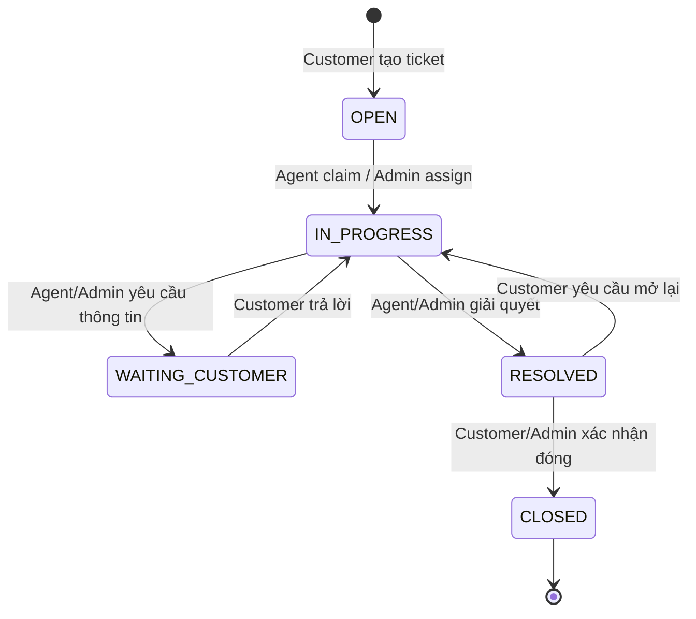
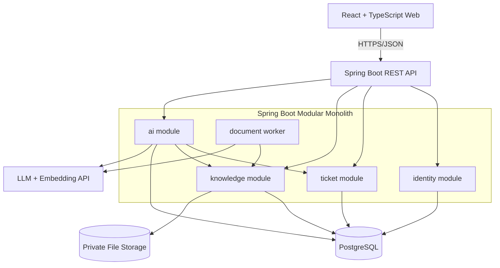
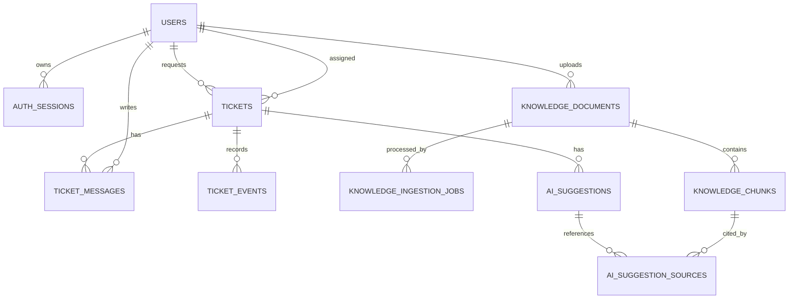
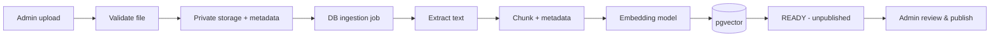
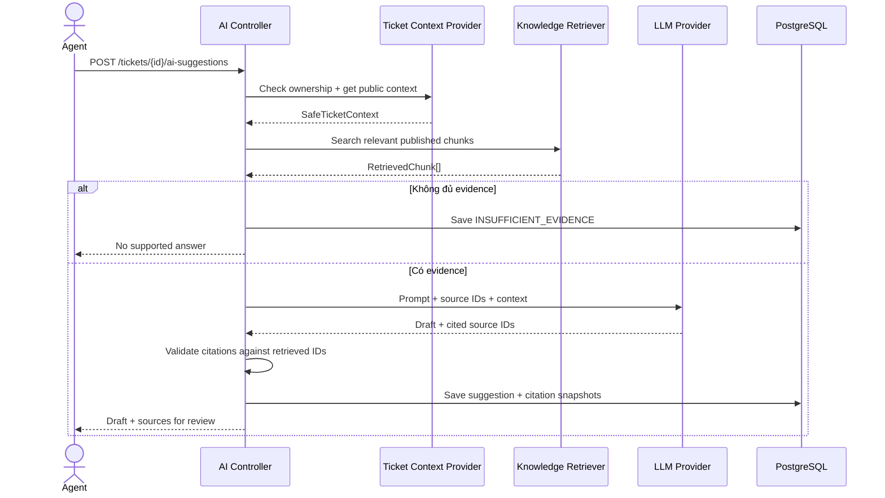

# ĐẶC TẢ DỰ ÁN — AI-POWERED HELPDESK & KNOWLEDGE BASE

> Baseline yêu cầu ngày 12/11/2026: [Report.pdf](template1/report/Report.pdf) và [bản Markdown đối chiếu](template1/report/report.md). Các phần yêu cầu và use case dưới đây đã đồng bộ theo bản final; thiết kế kỹ thuật là tài liệu triển khai, không phải bằng chứng tính năng đã chạy.

---

## 1. Tổng quan dự án

### 1.1 Tên, định hướng và sản phẩm tham khảo

- **Tên:** AI-Powered Helpdesk & Knowledge Base.
- **Tên tiếng Việt:** Hệ thống quản lý yêu cầu hỗ trợ và tra cứu tri thức tích hợp AI.
- **Loại sản phẩm:** Full-stack web application.
- **Tham khảo luồng và UI:** Zendesk / Intercom (quản lý hỗ trợ), Notion / hệ thống FAQ nội bộ (tri thức).
- **Trọng tâm kỹ thuật:** REST API, Authentication/Authorization, transaction & concurrency, file ingestion, PostgreSQL + vector search, RAG có dẫn nguồn, kiểm thử tích hợp.

### 1.2 Bài toán

Người dùng gửi thắc mắc hoặc sự cố nhưng doanh nghiệp/đơn vị hỗ trợ xử lý thủ công, khó theo dõi trạng thái, mất thời gian tìm kiếm chính sách và dễ trả lời thiếu nhất quán. Ứng dụng giải quyết bằng hai khả năng cốt lõi:

1. **Ticket Management:** lưu và xử lý yêu cầu từ lúc tạo đến khi đóng, có phân công người phụ trách và lịch sử minh bạch.
2. **Knowledge-grounded AI Assistance:** tận dụng tài liệu được công bố để đề xuất câu trả lời có dẫn nguồn; nhân viên **kiểm tra và quyết định gửi**.

### 1.3 Mục tiêu

| ID | Mục tiêu | Bằng chứng nghiệm thu |
|---|---|---|
| OBJ-01 | Khách hàng tạo và theo dõi ticket của mình | Demo end-to-end, E2E test |
| OBJ-02 | Nhân viên xử lý theo workflow rõ ràng | State transition tests, ticket history |
| OBJ-03 | Không nhận trùng ticket khi nhiều Agent thao tác đồng thời | Concurrency integration test |
| OBJ-04 | Admin quản lý tài liệu được dùng cho AI | Demo upload, index, publish, archive |
| OBJ-05 | AI đề xuất phản hồi có citation và biết không đủ căn cứ | Bộ câu hỏi đánh giá, AI test report |
| OBJ-06 | Có thể chạy lại dự án và truy vết đóng góp từng thành viên | Docker Compose, README, CI, commit/PR, Jira |

### 1.4 Ranh giới và giả định

- **Chỉ phục vụ một tổ chức (single-organization)**; không có multi-tenancy.
- Chỉ làm **web responsive**; không phát triển ứng dụng Android/iOS trong MVP.
- Có **03 vai trò**: Customer, Agent, Admin.
- AI sử dụng qua model provider có API hoặc model tương thích, cấu hình bằng environment variables; **có mock AI** để demo/test không phụ thuộc kết nối bên ngoài.
- Tài liệu demo là **dữ liệu giả lập hoặc có quyền sử dụng**; không đưa dữ liệu khách hàng thật lên dịch vụ AI bên ngoài.
- Mọi thao tác phân quyền được kiểm tra ở backend, không tin vào frontend.
- **Không tích hợp email hỗ trợ trong P0; email đặt lại mật khẩu thuộc P1. Không tự đóng ticket theo lịch hoặc để AI tự thực thi hành động.**

---

## 2. Phạm vi và 4 nhóm chức năng

| Nhóm | Code | Nội dung MVP (P0) | Phần mở rộng (P1) |
|---|---|---|---|
| 1. Identity & Access | `identity` | Đăng ký Customer, login, refresh, logout, profile, RBAC; Admin tạo/vô hiệu hóa Agent | Reset password qua email |
| 2. Ticket Management | `ticket` | Create/list/detail, claim/assign, public reply/internal note, state transition, history, filter & pagination | Dashboard số liệu, attachment |
| 3. Knowledge Base | `knowledge` | Upload PDF văn bản/TXT/MD, extract/chunk/embed, publish/archive, search, trạng thái ingestion | Versioning, OCR, nâng cấp hybrid search |
| 4. AI Assistance | `ai` | RAG gợi ý cho ticket, citation, không đủ bằng chứng, review/edit/send thủ công, lưu lịch sử suggestion, xử lý timeout | Feedback, streaming, cải thiện reranking |

### 2.1 Ngoài phạm vi MVP

- CRM, thanh toán, live chat công khai, tổng đài, tích hợp WhatsApp/Zalo/email, SLA phức tạp.
- Multi-tenant, microservices, Kubernetes, event streaming phân tán.
- AI agent có quyền cập nhật ticket hoặc gửi phản hồi tự động.
- OCR cho PDF scan, xử lý Word/Excel/video/audio, fine-tuning model.
- Quyền tùy biến phức tạp ngoài 3 vai trò, đăng nhập mạng xã hội/SSO.
- Ứng dụng mobile native, realtime WebSocket, notification center, analytics nâng cao.

### 2.2 Ưu tiên phát triển

**Thứ tự phụ thuộc:** thống nhất contract → core identity → ticket chạy hoàn chỉnh → ingestion + retrieval → AI suggestions → integration & QA. Có thể phát triển song song từ tuần 3 bằng mock interface.

---

## 3. Actors, quyền và use cases

### 3.1 Actors

| Actor | Mô tả | Trách nhiệm chính |
|---|---|---|
| Guest | Chưa đăng nhập | Đăng ký Customer, đăng nhập, đặt lại mật khẩu P1 |
| Customer | Người gửi yêu cầu | Tạo/xem ticket của chính mình, gửi tin nhắn công khai, xác nhận đóng hoặc yêu cầu xử lý tiếp |
| Agent | Nhân viên hỗ trợ | Xem queue ticket chưa phân công; claim ticket; xử lý ticket được giao; xem KB; sử dụng AI |
| Admin | Quản trị viên | Quản lý Agent, KB; phân công, xử lý ticket và dùng AI theo đúng trạng thái; không đánh giá gợi ý thay Agent |
| External Mail Service (P1) | Dịch vụ ngoài ranh giới hệ thống | Gửi liên kết đặt lại mật khẩu qua UC-16 |
| External Embedding/LLM Provider | Dịch vụ ngoài ranh giới hệ thống | Trả embedding/văn bản, không có quyền thực thi hành động nội bộ |


**System Worker là thành phần nội bộ, không phải actor bên ngoài của toàn hệ thống.** Khi mô hình một subsystem khác phải ghi rõ subject trước khi xác định actor. Context Diagram chỉ thể hiện P0, không trình bày DB/storage/worker; dịch vụ Email P1 được mô tả ở UC-16 và sơ đồ Định danh và phân quyền.

### 3.2 Ma trận quyền MVP

**Ký hiệu:** `✓` được phép, `Own` chỉ dữ liệu của mình, `Assigned` chỉ ticket đang phụ trách, `Open` ticket chưa phân công, `—` không được phép.

| Hành động | Customer | Agent | Admin |
|---|---|---|---|
| Đăng ký tài khoản Customer | Guest | — | — |
| Xem/sửa profile của mình | ✓ | ✓ | ✓ |
| Tạo ticket | ✓ | — | — (tạo thay Customer là P1) |
| Xem ticket | Own | Assigned + Open queue | Tất cả |
| Nhận ticket chưa phân công | — | Open | Phân công cho Agent qua ASSIGN |
| Phân công/chuyển Agent | — | — | ✓ |
| Gửi public message | Own và trạng thái cho phép | Assigned | ✓ |
| Ghi internal note | — | Assigned | ✓ |
| Chuyển IN_PROGRESS/WAITING_CUSTOMER/RESOLVED | Chỉ `REOPEN` từ RESOLVED | Assigned | ✓ |
| Đóng ticket RESOLVED | Own | — | ✓ |
| Xem knowledge documents đã publish | — | ✓ | ✓ |
| Upload/publish/archive document | — | — | ✓ |
| Tạo/xem AI suggestion | — | Assigned | ✓ |
| Quản lý Agent | — | — | ✓ |

**Lưu ý:** Agent có thể xem thông tin cần thiết của các ticket `OPEN` để quyết định nhận nhưng **không thể sửa/gửi lời nhắn trên ticket chưa nhận**. Agent không được đọc ticket của Agent khác, ngoại trừ queue `OPEN`. Các quyền này được kiểm tra ở service/repository, không chỉ `@PreAuthorize` theo role.

### 3.3 Danh sách use cases

| UC | Tên | Actor | Mức độ |
|---|---|---|---|
| UC-01 | Đăng ký và đăng nhập hệ thống | Guest / người dùng chưa xác thực | P0 |
| UC-02 | Làm mới phiên và đăng xuất | Customer, Agent, Admin | P0 |
| UC-03 | Xem và cập nhật hồ sơ cá nhân | Customer, Agent, Admin | P0 |
| UC-04 | Quản lý tài khoản Agent | Admin | P0 |
| UC-05 | Tạo yêu cầu hỗ trợ | Customer | P0 |
| UC-06 | Xem danh sách và chi tiết ticket | Customer, Agent, Admin | P0 |
| UC-07 | Tiếp nhận và phân công ticket | Agent, Admin | P0 |
| UC-08 | Gửi tin nhắn công khai và ghi chú nội bộ | Customer, Agent, Admin | P0 |
| UC-09 | Chuyển trạng thái ticket | Customer, Agent, Admin | P0 |
| UC-10 | Xem lịch sử sự kiện ticket | Agent được giao, Admin | P0 |
| UC-11 | Tải lên và xử lý tài liệu tri thức | Admin; Embedding Provider | P0 |
| UC-12 | Công bố và lưu trữ tài liệu tri thức | Admin | P0 |
| UC-13 | Tìm kiếm tri thức | Agent, Admin; Embedding Provider | P0 |
| UC-14 | Tạo gợi ý câu trả lời bằng AI | Agent được giao, Admin; AI Provider | P0 |
| UC-15 | Kiểm duyệt, chỉnh sửa và gửi phản hồi từ gợi ý AI | Agent được giao, Admin | P0 |
| UC-16 | Đặt lại mật khẩu (P1) | Người dùng chưa đăng nhập; Mail Service P1 | P1 |
| UC-17 | Xem thống kê ticket (P1) | Admin | P1 |
| UC-18 | Xem lịch sử gợi ý AI | Agent được giao, Admin | P0 |
| UC-19 | Đánh giá gợi ý AI hữu ích hoặc không hữu ích | Agent được giao | P1 |

---

## 4. Functional Requirements chi tiết

Mỗi FR phải có ít nhất 1 acceptance criterion và 1 test case tương ứng. Danh sách dưới đây là **đầu vào để chuyển thành user stories và Jira issues**, không phải gộp tất cả thành một task lớn.

### 4.1 Nhóm 1 — Identity & Access

| ID | Mức | Yêu cầu | Acceptance criteria |
|---|---|---|---|
| FR-ID-01 | P0 | Đăng ký tài khoản | \- Người dùng mới đăng ký tài khoản khách hàng bằng họ tên, email và mật khẩu. \- Hệ thống kiểm tra định dạng email, yêu cầu mật khẩu và bảo đảm email chưa được sử dụng. Tài khoản tự đăng ký luôn có vai trò khách hàng; người đăng ký không được tự chọn quyền nhân viên hoặc quản trị viên. |
| FR-ID-02 | P0 | Đăng nhập và bảo vệ mật khẩu | \- Người dùng đăng nhập bằng email và mật khẩu. Nếu thông tin không đúng, hệ thống thông báo lỗi chung, không tiết lộ email có tồn tại hay không. \- Khi đăng nhập thành công, hệ thống cấp mã xác thực để truy cập và mã gia hạn để duy trì phiên đăng nhập. |
| FR-ID-03 | P0 | Đăng nhập và bảo vệ mật khẩu | \- Mật khẩu được kiểm tra và lưu dưới dạng băm một chiều bằng thuật toán chuyên dụng, không lưu hoặc ghi nhật ký mật khẩu nguyên bản. |
| FR-ID-04 | P0 | Duy trì phiên và đăng xuất | \- Khi phiên truy cập cần được gia hạn, hệ thống kiểm tra mã gia hạn còn hợp lệ và cấp bộ mã xác thực mới; mã gia hạn cũ không được sử dụng lại. |
| FR-ID-05 | P0 | Duy trì phiên và đăng xuất | \- Người dùng có thể đăng xuất khỏi thiết bị hiện tại. Hệ thống thu hồi khả năng gia hạn của phiên đó. \- Mã xác thực truy cập đã cấp trước khi đăng xuất có thể còn hiệu lực đến khi hết hạn; giới hạn này phải được nêu rõ trong tài liệu. |
| FR-ID-06 | P0 | Quản lý hồ sơ cá nhân | \- Người dùng xem, cập nhật thông tin cá nhân và thay đổi mật khẩu của chính mình. \- Khi đổi mật khẩu, hệ thống phải kiểm tra mật khẩu hiện tại trước khi lưu mật khẩu mới. |
| FR-ID-07 | P0 | Phân quyền truy cập | \- Hệ thống kiểm tra quyền theo vai trò người dùng và quyền sở hữu hoặc phạm vi phụ trách đối với từng dữ liệu. \- Nếu chưa đăng nhập hoặc phiên xác thực không hợp lệ, hệ thống yêu cầu đăng nhập lại. Nếu không có quyền sử dụng chức năng, hệ thống từ chối thao tác. \- Với dữ liệu người dùng không được phép truy cập, hệ thống thông báo như trường hợp không tìm thấy dữ liệu, tránh tiết lộ dữ liệu có tồn tại hay không. |
| FR-ID-08 | P0 | Quản lý tài khoản nhân viên | \- Chỉ quản trị viên được tạo hoặc vô hiệu hóa tài khoản nhân viên hỗ trợ. Người dùng không được tự đăng ký thành nhân viên hoặc quản trị viên. \- Tài khoản đã bị vô hiệu hóa không thể đăng nhập, gia hạn phiên hoặc tiếp tục sử dụng chức năng cần đăng nhập, kể cả khi mã xác thực cũ chưa hết hạn. |
| FR-ID-09 | P1 | Đặt lại mật khẩu (mở rộng) | \- Người dùng quên mật khẩu có thể yêu cầu đặt lại mật khẩu trong giai đoạn mở rộng. \- Mã đặt lại mật khẩu chỉ được dùng một lần và có thời hạn. Thông báo xử lý không được tiết lộ email có tồn tại trong hệ thống hay không. |

**Quyết định kỹ thuật:** Access token sống 15 phút; refresh token sống 7 ngày (đều cấu hình được). Refresh token ngẫu nhiên độ entropy cao, lưu **hash** trong DB; không dùng JWT refresh stateless cho MVP. Dùng HTTPS trong triển khai công khai. Access Token chỉ lưu trong bộ nhớ ứng dụng; Refresh Token bắt buộc dùng cookie `HttpOnly`, `Secure` khi HTTPS, `SameSite` phù hợp và bảo vệ CSRF cho refresh/logout. **Không lưu raw refresh token trong DB hoặc log.**

### 4.2 Nhóm 2 — Ticket Management

| ID | Mức | Yêu cầu | Acceptance criteria |
|---|---|---|---|
| FR-TK-01 | P0 | Tạo yêu cầu hỗ trợ | \- Khách hàng tạo yêu cầu hỗ trợ bằng cách nhập tiêu đề và nội dung mô tả. \- Hệ thống cấp mã yêu cầu duy nhất, đồng thời lưu yêu cầu và tin nhắn công khai đầu tiên từ nội dung mô tả; không lưu thành công một phần nếu có lỗi. |
| FR-TK-02 | P0 | Xem, tìm kiếm và lọc yêu cầu | \- Khách hàng chỉ xem yêu cầu của mình; nhân viên xem yêu cầu được giao và các yêu cầu mới chưa phân công; quản trị viên xem toàn bộ yêu cầu. |
| FR-TK-03 | P0 | Xem, tìm kiếm và lọc yêu cầu | \- Trang chi tiết hiển thị cuộc trao đổi và trạng thái xử lý. Nội dung trả về cho khách hàng không bao gồm ghi chú nội bộ. \- Người dùng tìm theo từ khóa, lọc theo trạng thái, người phụ trách và ngày tạo. Kết quả được phân trang, giới hạn số mục mỗi trang và chỉ sắp xếp theo các tiêu chí hệ thống hỗ trợ. |
| FR-TK-04 | P0 | Tiếp nhận và phân công | \- Nhân viên nhận xử lý yêu cầu mới chưa có người phụ trách. Nếu nhiều người cùng nhận, chỉ một người thành công; yêu cầu chuyển từ “Mới tạo” sang “Đang xử lý”. |
| FR-TK-05 | P0 | Tiếp nhận và phân công | \- Quản trị viên có thể phân công hoặc chuyển yêu cầu cho nhân viên khác đang hoạt động; hệ thống từ chối phân công cho tài khoản đã bị vô hiệu hóa. \- Mọi lần nhận hoặc phân công đều được ghi vào lịch sử xử lý cùng với thay đổi người phụ trách. |
| FR-TK-06 | P0 | Trao đổi với khách hàng | \- Khách hàng, nhân viên phụ trách và quản trị viên gửi tin nhắn công khai trên yêu cầu hỗ trợ trong phạm vi quyền và trạng thái cho phép. \- Hệ thống xác định người gửi từ tài khoản đã đăng nhập, không dựa vào thông tin người gửi tự khai trong nội dung gửi lên. |
| FR-TK-07 | P0 | Ghi chú nội bộ | \- Nhân viên được phân công và quản trị viên thêm ghi chú nội bộ để phục vụ xử lý yêu cầu. \- Chỉ nhân viên phụ trách và quản trị viên được xem ghi chú; dữ liệu trả về cho khách hàng không được làm lộ nội dung hoặc sự tồn tại của ghi chú nội bộ. |
| FR-TK-08 | P0 | Cập nhật trạng thái | \- Người dùng thực hiện các thao tác yêu cầu thêm thông tin, đánh dấu đã giải quyết, mở lại hoặc xác nhận đóng theo đúng vai trò và trạng thái hiện tại của yêu cầu. |
| FR-TK-09 | P0 | Cập nhật trạng thái | \- Hệ thống chỉ cho phép chuyển trạng thái theo quy trình xử lý đã quy định; nếu thao tác không hợp lệ, hệ thống thông báo lý do và giữ nguyên trạng thái. |
| FR-TK-10 | P0 | Xem lịch sử xử lý | \- Nhân viên được phân công và quản trị viên xem lịch sử tiếp nhận, phân công và chuyển trạng thái của yêu cầu. \- Mỗi sự kiện ghi rõ người thực hiện, thời điểm và nội dung thay đổi. Lịch sử chỉ được ghi bổ sung, không được tự ý sửa hoặc xóa các sự kiện đã lưu qua chức năng nghiệp vụ. |
| FR-TK-11 | P1 | Tệp đính kèm (mở rộng) | \- Hỗ trợ đính kèm tệp vào yêu cầu trong giai đoạn mở rộng. \- Hệ thống kiểm tra loại và dung lượng tệp; chỉ cho phép người có quyền truy cập yêu cầu tải tệp xuống. |
| FR-TK-12 | P1 | Thống kê tổng quan (mở rộng) | \- Quản trị viên xem bảng tổng quan và các thống kê cơ bản trong giai đoạn mở rộng. \- Thống kê gồm số lượng yêu cầu theo trạng thái và theo nhân viên phụ trách. |

**Field MVP:** `subject` 5–150 ký tự; `description` 10–5000; public/internal message 1–5000; ưu tiên ticket mặc định `NORMAL`. Bản final chỉ chốt mức ưu tiên mặc định `NORMAL`; thao tác thay đổi priority chưa được đặc tả trong Report.pdf, không coi là chức năng P0 đã chốt.

### 4.3 Nhóm 3 — Knowledge Base

| ID | Mức | Yêu cầu | Acceptance criteria |
|---|---|---|---|
| FR-KB-01 | P0 | Tải lên và lưu tài liệu | \- Quản trị viên tải lên tài liệu PDF có lớp văn bản, tệp văn bản thuần hoặc tệp Markdown. |
| FR-KB-02 | P0 | Tải lên và lưu tài liệu | \- Hệ thống kiểm tra định dạng, phần mở rộng, nội dung cơ bản và dung lượng tối đa 10 MiB cho mỗi tệp. \- Khi tải lên thành công, hệ thống lưu tệp, thông tin mô tả và tạo công việc xử lý nền. Việc xử lý tài liệu được thực hiện sau đó, không gọi mô hình AI trong lúc tiếp nhận tệp. |
| FR-KB-03 | P0 | Trích xuất và lập chỉ mục | \- Hệ thống trích xuất văn bản từ các tài liệu được hỗ trợ. Nếu PDF chỉ chứa ảnh quét và không có lớp văn bản, hệ thống thông báo xử lý thất bại do chưa hỗ trợ loại tài liệu này. |
| FR-KB-04 | P0 | Trích xuất và lập chỉ mục | \- Văn bản được chia thành các đoạn nhỏ, kèm thông tin số trang khi có và thứ tự đoạn để xác định vị trí nguồn. \- Mỗi đoạn được chuyển thành một dãy số biểu diễn ý nghĩa, theo số chiều đã cấu hình, phục vụ tìm kiếm nội dung liên quan. |
| FR-KB-05 | P0 | Theo dõi và xử lý lỗi | \- Quản trị viên theo dõi tiến trình xử lý của từng tài liệu qua các trạng thái “Đã tải lên”, “Đang xử lý”, “Sẵn sàng” hoặc “Thất bại”. \- Khi gặp lỗi tạm thời, hệ thống tự thử lại với tổng số lần xử lý không quá 3, kể cả lần đầu. Nếu vẫn thất bại, hệ thống hiển thị lý do phù hợp, không tiết lộ thông tin kỹ thuật nhạy cảm. |
| FR-KB-06 | P0 | Công bố tài liệu | \- Quản trị viên công bố tài liệu để đưa vào sử dụng. \- Chỉ được công bố khi tài liệu đã xử lý thành công và ở trạng thái “Sẵn sàng”; tải lên thành công không đồng nghĩa với đã công bố. |
| FR-KB-07 | P0 | Tìm kiếm tri thức | \- Nhân viên và quản trị viên tìm kiếm tài liệu hoặc các đoạn nội dung liên quan trong kho tri thức. \- Chỉ hiển thị kết quả thuộc phạm vi được phép truy cập, đã xử lý thành công, đã công bố và chưa được đưa vào lưu trữ. |
| FR-KB-08 | P0 | Lưu trữ tài liệu | \- Quản trị viên đưa tài liệu không còn sử dụng vào trạng thái lưu trữ. \- Ngay sau khi thao tác được lưu thành công, tài liệu không còn được dùng cho các lần tìm kiếm hoặc tạo gợi ý AI mới. |
| FR-KB-09 | P0 | Xem danh mục tài liệu | Quản trị viên xem danh sách tài liệu có phân trang và mở chi tiết từng tài liệu. Danh sách hiển thị tên tài liệu, thời điểm tải lên, trạng thái xử lý và tình trạng công bố/lưu trữ. |
| FR-KB-10 | P1 | Phiên bản và OCR (mở rộng) | \- Quản lý các phiên bản tài liệu và nhận dạng chữ trong tài liệu ảnh quét thuộc giai đoạn mở rộng. \- Các chức năng này không thuộc phạm vi triển khai ban đầu. |

**Lưu ý tính nhất quán:** File được lưu trong **Docker volume/private storage**, DB lưu `storage_key`, không phục vụ file trực tiếp bằng public URL. Nếu transaction tạo DB metadata thành công nhưng ghi file thất bại, cập nhật trạng thái FAILED và dọn tài nguyên; có cleanup job hoặc quy trình dọn thủ công. Mọi document được archive bằng trạng thái mềm, không xóa vĩnh viễn trong MVP nhằm giữ provenance của AI suggestion cũ.

### 4.4 Nhóm 4 — AI Assistance

| ID | Mức | Yêu cầu | Acceptance criteria |
|---|---|---|---|
| FR-AI-01 | P0 | Yêu cầu gợi ý và lấy ngữ cảnh | \- Nhân viên được phân công hoặc quản trị viên yêu cầu AI gợi ý câu trả lời cho yêu cầu hỗ trợ mà mình có quyền truy cập. Việc tạo gợi ý không tự thay đổi yêu cầu hỗ trợ. |
| FR-AI-02 | P0 | Yêu cầu gợi ý và lấy ngữ cảnh | \- Hệ thống chỉ lấy các tin nhắn công khai cần thiết và thông tin liên quan đã được lọc để gửi cho AI; mặc định không gửi ghi chú nội bộ. |
| FR-AI-03 | P0 | Truy xuất tri thức | \- Hệ thống tìm các đoạn tri thức có ý nghĩa phù hợp với nội dung cần trả lời, dựa trên dữ liệu tìm kiếm đã lập chỉ mục. \- Chỉ sử dụng tài liệu đã xử lý thành công, đã công bố và chưa được lưu trữ. Số đoạn được chọn và mức độ liên quan tối thiểu có thể cấu hình. |
| FR-AI-04 | P0 | Sinh câu trả lời và dẫn nguồn | \- AI tạo bản nháp câu trả lời dựa trên các đoạn tri thức đã tìm được; hệ thống giới hạn độ dài nội dung tạo ra. |
| FR-AI-05 | P0 | Sinh câu trả lời và dẫn nguồn | \- Hướng dẫn gửi cho AI phải phân biệt rõ yêu cầu của hệ thống với nội dung tài liệu tham khảo, tránh coi câu lệnh trong tài liệu là chỉ dẫn cần thực hiện. \- Hệ thống kiểm tra để mỗi dẫn nguồn trỏ đúng một đoạn đã được truy xuất và lưu bản chụp đoạn trích tại thời điểm tạo gợi ý để có thể đối chiếu về sau. |
| FR-AI-06 | P0 | Xử lý khi thiếu căn cứ | \- Nếu không có đủ thông tin đáng tin cậy trong tài liệu, hệ thống thông báo chưa đủ căn cứ để tạo câu trả lời. \- AI không được tự đặt ra chính sách, điều khoản hoặc dẫn nguồn không có thật để hoàn thiện câu trả lời. |
| FR-AI-07 | P0 | Kiểm duyệt và gửi phản hồi | \- Nhân viên phụ trách hoặc quản trị viên đọc bản nháp, đối chiếu nguồn và chỉnh sửa khi cần trước khi chủ động gửi. \- Gợi ý AI không tự gửi cho khách hàng. Chỉ nội dung đã được người có quyền duyệt và chọn gửi mới trở thành tin nhắn công khai. |
| FR-AI-08 | P0 | Lưu lịch sử gợi ý | \- Hệ thống lưu người yêu cầu, yêu cầu hỗ trợ liên quan, mô hình AI sử dụng, thời điểm tạo, nội dung gợi ý, trạng thái xử lý và các nguồn trích dẫn. \- Lịch sử cho phép đối chiếu yêu cầu tạo gợi ý với kết quả và nguồn đã sử dụng; không lưu khóa truy cập dịch vụ AI. |
| FR-AI-09 | P0 | Giới hạn và xử lý sự cố | \- Hệ thống giới hạn số lần yêu cầu tạo gợi ý và thời gian chờ dịch vụ AI. \- Khi dịch vụ AI gặp lỗi, hết hạn mức hoặc phản hồi quá chậm, hệ thống thông báo rõ tình trạng. Các chức năng tạo, xử lý và trả lời yêu cầu hỗ trợ vẫn hoạt động bình thường. |
| FR-AI-10 | P1 | Đánh giá gợi ý (mở rộng) | \- Nhân viên đang được phân công ticket đánh giá gợi ý AI là Hữu ích hoặc Không hữu ích trong giai đoạn mở rộng (P1). Chỉ cho phép đánh giá gợi ý ở trạng thái GENERATED hoặc APPLIED. Mỗi cặp nhân viên-gợi ý chỉ có một đánh giá hiện hành; nhân viên có thể thay đổi lựa chọn của chính mình. Việc đánh giá không gửi phản hồi, thay đổi ticket hoặc trạng thái gợi ý. |

**Không bảo đảm tuyệt đối AI không hallucinate.** Thiết kế phải có cơ chế giảm rủi ro, bắt buộc human-in-the-loop và bộ đánh giá đo tỷ lệ trả lời có căn cứ.

---

## 5. Business Rules (quy tắc nghiệp vụ)

| ID | Quy tắc |
|---|---|
| BR-01 | Tài khoản tự đăng ký luôn có role `CUSTOMER`; server bỏ qua/reject bất kỳ role gửi từ client. |
| BR-02 | Chỉ Admin quản lý tài khoản Agent; Admin ban đầu được seed qua migration/script quản trị an toàn, không public API đăng ký Admin. |
| BR-03 | Customer chỉ có thể đọc/sửa ticket của mình trong giới hạn workflow; không truy cập nội bộ của khách khác. |
| BR-04 | Agent thấy OPEN queue và ticket được giao; không sửa ticket của Agent khác. |
| BR-05 | Ticket OPEN phải có `assigned_agent_id = NULL`; claim/assign thành công chuyển sang IN_PROGRESS. |
| BR-06 | Ticket được claim bằng optimistic locking/conditional update; **không có hai Agent thắng cùng một ticket**. |
| BR-07 | Không tạo public/internal message khi ticket CLOSED. RESOLVED chỉ được customer REOPEN hoặc CLOSE trước khi trao đổi tiếp. |
| BR-08 | PUBLIC message hiển thị với Customer sở hữu; INTERNAL note chỉ hiển thị cho Agent được giao và Admin. |
| BR-09 | Customer chỉ có thể CLOSE hoặc REOPEN ticket từ RESOLVED; không tự chuyển IN_PROGRESS/WAITING_CUSTOMER. |
| BR-10 | AI không được phép thay đổi trạng thái, phân công hoặc gửi tin nhắn. |
| BR-11 | Chỉ tài liệu READY + published + chưa archive được truy xuất cho yêu cầu AI mới. |
| BR-12 | AI citation phải trỏ tới chunk đã retrieve; snapshot nguồn được lưu khi sinh suggestion để lịch sử không thay đổi theo tài liệu. |
| BR-13 | Không đủ dữ kiện: phản hồi `INSUFFICIENT_EVIDENCE`, không giả lập citation. |
| BR-14 | API luôn xác định actor từ principal của access token, không nhận `actorId`, `authorId`, `role` tự do từ client. |
| BR-15 | Mọi cập nhật quan trọng có ticket event đồng transaction; audit history không được tự ý chỉnh sửa từ API. |
| BR-16 | Disabled user không thể login/refresh; request authenticated tiếp theo bằng access token cũ cũng bị chặn nhờ kiểm tra enabled server-side. Logout session riêng giữ chính sách FR-ID-05. |

### 5.1 Ticket state machine



| Trạng thái hiện tại | Hành động | Actor | Trạng thái sau | Ghi chú |
|---|---|---|---|---|
| OPEN | CLAIM | Agent | IN_PROGRESS | Gán Agent; atomic |
| OPEN | ASSIGN | Admin | IN_PROGRESS | Agent phải enabled |
| IN_PROGRESS | REQUEST_INFO | Assigned Agent/Admin | WAITING_CUSTOMER | Ghi event, Agent thường phải có public message giải thích |
| WAITING_CUSTOMER | CUSTOMER_REPLY | Customer sở hữu | IN_PROGRESS | Gửi public message và transition trong một transaction |
| IN_PROGRESS | RESOLVE | Assigned Agent/Admin | RESOLVED | Agent xác nhận đã xử lý |
| RESOLVED | REOPEN | Customer sở hữu | IN_PROGRESS | Khách chưa hài lòng; ghi event |
| RESOLVED | CLOSE | Customer sở hữu/Admin | CLOSED | Không được gửi thêm |
| IN_PROGRESS/WAITING_CUSTOMER | REASSIGN | Admin | Giữ nguyên | Thay Agent, ghi old/new assignee |

**Trường hợp rõ ràng:** Customer có thể gửi public message khi OPEN hoặc IN_PROGRESS (không tự đổi trạng thái); khi WAITING_CUSTOMER, gửi message sẽ tự chuyển sang IN_PROGRESS. Agent có thể gửi public reply khi IN_PROGRESS/WAITING_CUSTOMER nhưng không tự đổi trạng thái nếu chưa chọn action tương ứng. Customer không nhắn trực tiếp khi RESOLVED; phải REOPEN trước. Mọi hành động không có trong bảng bị từ chối.

### 5.2 Concurrency và idempotency

- `tickets.version` dùng JPA `@Version` để chống lost update.
- Claim chỉ hợp lệ nếu OPEN và chưa có Agent. Conditional UPDATE phải tăng `version=version+1`, kiểm tra điều kiện OPEN/unassigned và expected version khi contract yêu cầu; chỉ đúng 1 request ảnh hưởng 1 dòng. Bulk UPDATE không tự tuân theo `@Version`: phải xử lý persistence context stale, event và conflict như [MVP_CONTRACTS Mục 4](MVP_CONTRACTS.md).
- Không được check trạng thái bằng `SELECT` rồi `UPDATE` không khóa trong hai transaction độc lập.
- Mọi state mutation và insert `ticket_events` diễn ra trong **cùng DB transaction**.
- Không thực hiện LLM call bên trong ticket transaction để tránh giữ connection/lock quá lâu.
- `Idempotency-Key` cho `POST /tickets` là P1; MVP cần ít nhất chống double-click tại UI và dokument hóa khả năng retry tạo trùng. **Không tuyên bố create-ticket idempotent nếu chưa triển khai server-side key.**

---

## 6. Đặc tả use cases trọng tâm

Toàn bộ 19 Use Case, mỗi bảng gồm 9 trường, đồng bộ theo Report.pdf.

### UC-01 — Đăng ký và đăng nhập hệ thống

| Use case ID | UC-01 |
| :---- | :---- |
| **Tên Use Case** | Đăng ký và đăng nhập hệ thống |
| **Tóm tắt** | \- Khách đăng ký tài khoản Customer. \- Người dùng xác thực bằng email và mật khẩu để bắt đầu phiên làm việc. |
| **Tác nhân** | \- Khách chưa có tài khoản khi đăng ký (Guest / Unauthenticated User). \- Customer, Support Agent, System Administrator ở trạng thái chưa xác thực phiên khi đăng nhập. |
| **Điều kiện tiên quyết** | \- Người dùng truy cập được ứng dụng. Đăng ký áp dụng cho người chưa có tài khoản. \- Đăng nhập áp dụng cho người đã có tài khoản. |
| **Kết quả** | \- Đăng ký thành công tạo tài khoản CUSTOMER.  \- Đăng nhập thành công cấp Access Token và Refresh Token, chuyển đến giao diện theo vai trò.  \- Nhánh lỗi không cấp phiên đăng nhập. |
| **Kịch bản chính** | Luồng A \- Đăng ký \- A.1. Khách chọn Đăng ký; hệ thống hiển thị biểu mẫu họ tên, email, mật khẩu và xác nhận mật khẩu. \- A.2. Khách nhập dữ liệu và gửi biểu mẫu. \- A.3. Hệ thống kiểm tra dữ liệu, xác nhận mật khẩu và tính duy nhất của email. \- A.4. Hệ thống băm mật khẩu bằng PasswordEncoder đã cấu hình, gán CUSTOMER ở phía máy chủ; không chấp nhận vai trò do khách tự gửi. \- A.5. Hệ thống lưu tài khoản, báo thành công và chuyển về Đăng nhập; luồng A kết thúc. Luồng B \- Đăng nhập \- B.1. Người dùng nhập email, mật khẩu và chọn Đăng nhập. \- B.2. Hệ thống kiểm tra thông tin xác thực và trạng thái enabled của tài khoản. \- B.3. Hệ thống cấp Access Token 15 phút và Refresh Token 7 ngày theo cấu hình; chỉ lưu bản băm Refresh Token. \- B.4. Hệ thống trả phiên an toàn và mở trang phù hợp với vai trò; luồng B kết thúc. |
| **Kịch bản phụ** | \- A.3a. Thông tin đăng ký không hợp lệ → Hệ thống hiển thị lỗi và yêu cầu nhập lại. \- A.3b. Email đã tồn tại → Hệ thống thông báo email đã được sử dụng, không tạo tài khoản mới. \- B.2a. Email hoặc mật khẩu không chính xác → Hệ thống thông báo lỗi chung và yêu cầu đăng nhập lại. \- B.2b. Tài khoản bị vô hiệu hóa → Hệ thống từ chối đăng nhập và thông báo lỗi. |
| **Ràng buộc phi chức năng** | \- Mật khẩu và Refresh Token phải được lưu dưới dạng mã băm an toàn, không lưu giá trị nguyên bản trên máy chủ. \- Không tiết lộ thông tin tài khoản khi đăng nhập thất bại. \- Các chức năng yêu cầu đăng nhập phải được kiểm tra phân quyền và bảo vệ thông tin xác thực. |

### UC-02 — Làm mới phiên và đăng xuất

| Use case ID | UC-02 |
| :---- | :---- |
| **Tên Use Case** | Làm mới phiên và đăng xuất |
| **Tóm tắt** | \- Tự động làm mới phiên làm việc bằng Refresh Token có xoay vòng. \- Đăng xuất thu hồi phiên trên thiết bị hiện tại. |
| **Tác nhân** | Người dùng đã đăng nhập (Customer, Support Agent, System Administrator). |
| **Điều kiện tiên quyết** | \- Luồng A: Client có phiên hợp lệ với Refresh Token còn hiệu lực. \- Luồng B: Người dùng chọn kết thúc phiên làm việc hiện tại. |
| **Kết quả** | \- Làm mới thành công: cấp Access Token mới và xoay vòng Refresh Token mới; token cũ bị vô hiệu hóa. \- Đăng xuất: thu hồi phiên trên máy chủ, xóa token trong bộ nhớ ứng dụng và xóa cookie phiên trên trình duyệt. \- Access Token cũ có thể còn hiệu lực ngắn cho đến khi tự hết hạn theo quy định an toàn. |
| **Kịch bản chính** | Luồng A \- Làm mới phiên: \- A.1. Ứng dụng phát hiện Access Token hết hạn, gửi yêu cầu làm mới. Refresh Token được trình duyệt tự động gửi kèm qua cookie an toàn (HttpOnly) cùng mã chống giả mạo (CSRF). \- A.2. Hệ thống kiểm tra mã CSRF, tính hợp lệ của Refresh Token, thời hạn phiên và trạng thái tài khoản đang hoạt động. \- A.3. Hệ thống thực hiện vô hiệu hóa Refresh Token cũ và cấp cặp token mới trong cùng một xử lý nguyên tử (cùng thành công hoặc cùng hủy). \- A.4. Hệ thống cập nhật cookie an toàn mới cho trình duyệt, trả Access Token mới cho ứng dụng tiếp tục thao tác; Luồng A kết thúc. Luồng B \- Đăng xuất: \- B.1. Người dùng chọn Đăng xuất; ứng dụng gửi yêu cầu kết thúc phiên kèm mã CSRF và cookie phiên. \- B.2. Hệ thống thu hồi phiên làm việc trên máy chủ và gửi yêu cầu xóa cookie an toàn trên trình duyệt. \- B.3. Ứng dụng xóa Access Token khỏi bộ nhớ tạm và chuyển người dùng về màn hình Đăng nhập; Luồng B kết thúc. |
| **Kịch bản phụ** | \- A.2a. Token không hợp lệ, hết hạn, bị thu hồi hoặc sai mã CSRF: Hệ thống từ chối làm mới phiên, xóa cookie phiên và yêu cầu người dùng đăng nhập lại. \- A.2b. Xử lý nhiều yêu cầu làm mới đồng thời:   \+ Phía ứng dụng (Client): Dùng một yêu cầu làm mới chung cho các tác vụ đồng thời bị hết hạn, chỉ thử lại tác vụ ban đầu một lần và không tạo vòng lặp làm mới.   \+ Phía hệ thống (Server): Với hai yêu cầu gửi cùng một Refresh Token cũ, hệ thống chỉ chấp nhận xoay vòng cho yêu cầu đầu tiên; yêu cầu còn lại bị từ chối và không sinh thêm phiên hợp lệ. \- A.2c. Tài khoản bị vô hiệu hóa trong khi phiên còn hạn: Hệ thống từ chối làm mới phiên, hủy các phiên đang hoạt động của người dùng và chuyển về màn hình đăng nhập. \- B.2a. Mất kết nối khi đăng xuất:   \+ Ứng dụng xóa ngay Access Token trong bộ nhớ tạm trên thiết bị và chuyển về màn hình Đăng nhập.   \+ Do mất mạng, cookie an toàn (HttpOnly) trên trình duyệt và phiên trên máy chủ chưa được hủy tức thì, nhưng sẽ tự động hết hiệu lực theo thời gian hoặc khi có kết nối trở lại. |
| **Ràng buộc phi chức năng** | \- Bảo mật: Không lưu hoặc hiển thị Refresh Token dưới dạng văn bản gốc trong nhật ký hệ thống. Access Token chỉ lưu trong bộ nhớ tạm (memory) của ứng dụng; Refresh Token bắt buộc bảo vệ bằng cookie HttpOnly và kiểm tra mã CSRF. \- Toàn vẹn phiên: Quá trình xoay vòng token phải đảm bảo tính nguyên tử để ngăn chặn việc tái sử dụng token cũ hoặc mất phiên bất thường. |

### UC-03 — Xem và cập nhật hồ sơ cá nhân

| Use case ID | UC-03 |
| :---- | :---- |
| **Tên Use Case** | Xem và cập nhật hồ sơ cá nhân |
| **Tóm tắt** | Người dùng xem, cập nhật hồ sơ của chính mình hoặc đổi mật khẩu sau khi xác minh mật khẩu hiện tại. |
| **Tác nhân** | Mọi người dùng đã xác thực (Customer, Support Agent, Administrator). |
| **Điều kiện tiên quyết** | Người dùng đã xác thực, tài khoản enabled. |
| **Kết quả** | Hồ sơ hoặc mật khẩu được cập nhật khi hợp lệ. Nhánh lỗi giữ nguyên dữ liệu đã lưu. |
| **Kịch bản chính** | Luồng A \- Hồ sơ cá nhân \- A.1. Người dùng mở trang Hồ sơ cá nhân. \- A.2. Hệ thống hiển thị thông tin hồ sơ; email và vai trò không được chỉnh sửa. \- A.3. Người dùng thay đổi thông tin được phép và chọn Lưu. \- A.4. Hệ thống kiểm tra, cập nhật thông tin và thông báo thành công; luồng A kết thúc. Luồng B \- Đổi mật khẩu \- B.1. Từ hồ sơ, người dùng chọn Đổi mật khẩu, nhập mật khẩu hiện tại, mật khẩu mới và xác nhận. \- B.2. Hệ thống đối chiếu mật khẩu hiện tại, kiểm tra mật khẩu mới và phần xác nhận theo chính sách cấu hình. \- B.3. Hệ thống lưu mật khẩu mới dưới dạng mã băm và thông báo thành công; luồng B kết thúc. |
| **Kịch bản phụ** | \- A.4a. Thông tin cập nhật không hợp lệ → Hệ thống hiển thị lỗi, không lưu thay đổi và yêu cầu nhập lại. \- B.2a. Mật khẩu hiện tại không chính xác → Hệ thống thông báo lỗi và yêu cầu nhập lại. \- B.2b. Mật khẩu mới không hợp lệ hoặc xác nhận không khớp → Hệ thống thông báo lỗi và yêu cầu nhập lại. |
| **Ràng buộc phi chức năng** | \- Bảo mật thông tin cá nhân và mật khẩu của người dùng. \- Không lưu hoặc ghi nhật ký mật khẩu nguyên bản. \- Ngăn chặn truy cập trái phép vào hồ sơ của người dùng khác. |

### UC-04 — Quản lý tài khoản Agent

| Use case ID | UC-04 |
| :---- | :---- |
| **Tên Use Case** | Quản lý tài khoản Agent |
| **Tóm tắt** | Admin tạo tài khoản Agent, vô hiệu hóa hoặc kích hoạt lại Agent. |
| **Tác nhân** | Quản trị viên hệ thống (System Administrator). |
| **Điều kiện tiên quyết** | Admin đã xác thực, tài khoản enabled và có quyền quản lý Agent. |
| **Kết quả** | Tài khoản Agent được tạo hoặc cập nhật enabled. Agent bị vô hiệu hóa không thể đăng nhập, làm mới phiên hoặc thực hiện các yêu cầu có xác thực tiếp theo, kể cả khi Access Token cũ chưa hết hạn. |
| **Kịch bản chính** | Luồng A \- Tạo Agent \- A.1. Admin mở Quản trị người dùng; hệ thống hiển thị danh sách Agent và trạng thái. \- A.2. Admin chọn Thêm nhân viên, nhập họ tên, email và mật khẩu khởi tạo. \- A.3. Hệ thống kiểm tra thông tin, tạo tài khoản với vai trò Agent. \- A.4. Hệ thống lưu tài khoản, cập nhật danh sách; kết thúc luồng A. Luồng B \- Vô hiệu hóa \- B.1. Admin chọn một Agent đang hoạt động và yêu cầu vô hiệu hóa. \- B.2. Admin xác nhận yêu cầu. \- B.3. Hệ thống vô hiệu hóa tài khoản, chặn đăng nhập và các truy cập tiếp theo. \- B.4. Hệ thống cập nhật trạng thái tài khoản; kết thúc luồng B. Luồng C \- Kích hoạt lại \- C.1. Admin chọn Agent đã bị vô hiệu hóa. \- C.2. Admin yêu cầu kích hoạt lại tài khoản. \- C.3. Hệ thống lưu trạng thái kích hoạt lại tài khoản và thông báo thành công; kết thúc luồng C. |
| **Kịch bản phụ** | \- A.1a. Người dùng không có quyền quản trị hoặc phiên làm việc hết hạn: Hệ thống từ chối truy cập, không hiển thị danh sách người dùng và chuyển về trang thông báo lỗi phân quyền. \- A.3a. Email đã tồn tại hoặc thông tin không hợp lệ: Hệ thống hiển thị thông báo lỗi, không tạo tài khoản và yêu cầu nhập lại thông tin. \- A.4a, B.3a hoặc C.3a. Không lưu được thay đổi: Hệ thống hủy các thay đổi của thao tác và thông báo thất bại, cho phép thử lại. Nếu tạo mới thất bại, không tạo tài khoản Agent. Nếu vô hiệu hóa hoặc kích hoạt lại thất bại, giữ nguyên trạng thái tài khoản trước thao tác. \- B.2a. Admin hủy yêu cầu vô hiệu hóa: Hệ thống đóng hộp thoại xác nhận và giữ nguyên trạng thái tài khoản. |
| **Ràng buộc phi chức năng** | \- Bảo đảm chỉ Admin được truy cập chức năng quản lý Agent. \- Không lưu hoặc ghi nhật ký mật khẩu khởi tạo dưới dạng nguyên bản. \- Các chức năng quản trị phải được kiểm thử phân quyền và truy cập trái phép. |

### UC-16 — Đặt lại mật khẩu (P1)

| Use case ID | UC-16 |
| :---- | :---- |
| **Tên Use Case** | Đặt lại mật khẩu (P1) |
| **Tóm tắt** | Người dùng yêu cầu liên kết đặt lại mật khẩu bằng token một lần có thời hạn. Đây là chức năng P1. |
| **Tác nhân** | Người dùng chưa đăng nhập (Unauthenticated User). |
| **Điều kiện tiên quyết** | Người dùng truy cập được biểu mẫu Quên mật khẩu. Không cần phiên đăng nhập. |
| **Kết quả** | Khi token và mật khẩu mới hợp lệ, mật khẩu được thay đổi và token bị đánh dấu đã dùng. Phản hồi yêu cầu ban đầu không tiết lộ email có tồn tại. |
| **Kịch bản chính** | 1\. Người dùng chọn Quên mật khẩu tại trang Đăng nhập. 2\. Hệ thống hiển thị biểu mẫu yêu cầu nhập email. 3\. Người dùng nhập email và gửi yêu cầu. 4\. Hệ thống kiểm tra thông tin và gửi liên kết đặt lại mật khẩu nếu tài khoản tồn tại. 5\. Người dùng mở liên kết, nhập mật khẩu mới và xác nhận. 6\. Hệ thống kiểm tra liên kết và mật khẩu mới. 7\. Hệ thống cập nhật mật khẩu, vô hiệu hóa liên kết đã sử dụng và thông báo thành công; Use Case kết thúc. |
| **Kịch bản phụ** | \- 3a. Email không hợp lệ → Hệ thống hiển thị lỗi và yêu cầu nhập lại. \- 4a. Email không tồn tại → Hệ thống vẫn hiển thị thông báo chung, không tiết lộ thông tin tài khoản. \- 6a. Liên kết không hợp lệ, hết hạn hoặc đã sử dụng → Hệ thống từ chối đặt lại mật khẩu và yêu cầu thực hiện lại. \- 6b. Mật khẩu mới không hợp lệ hoặc xác nhận không khớp → Hệ thống thông báo lỗi và yêu cầu nhập lại. |
| **Ràng buộc phi chức năng** | \- Không tiết lộ email có tồn tại trong hệ thống hay không. \- Bảo mật token đặt lại mật khẩu và không lưu token nguyên bản. \- Không lưu hoặc ghi nhật ký mật khẩu mới dưới dạng nguyên bản. |

### UC-05 — Tạo yêu cầu hỗ trợ

| Use case ID | UC-05 |
| :---- | :---- |
| **Tên Use Case** | Tạo yêu cầu hỗ trợ |
| **Tóm tắt** | Khách hàng tạo yêu cầu hỗ trợ bằng cách nhập tiêu đề và nội dung mô tả. Chức năng đính kèm tệp thuộc giai đoạn mở rộng. |
| **Tác nhân** | Khách hàng đã đăng nhập. |
| **Điều kiện tiên quyết** | Khách hàng đã đăng nhập và tài khoản đang hoạt động. |
| **Kết quả** | Yêu cầu hỗ trợ được tạo ở trạng thái “Mới tạo”, có mức ưu tiên “Bình thường” và chưa có nhân viên phụ trách. Nội dung mô tả được lưu thành tin nhắn công khai đầu tiên; lịch sử đồng thời ghi nhận việc tạo yêu cầu. |
| **Kịch bản chính** | 1\. Khách hàng chọn “Tạo yêu cầu mới”; hệ thống hiển thị biểu mẫu gồm tiêu đề và nội dung mô tả. 2\. Khách hàng nhập tiêu đề từ 5 đến 150 ký tự, mô tả từ 10 đến 5000 ký tự và chọn “Gửi yêu cầu”. 3\. Hệ thống xác định người tạo từ tài khoản đã đăng nhập, kiểm tra quyền tạo yêu cầu và tính hợp lệ của nội dung. 4\. Hệ thống cấp mã yêu cầu duy nhất, gắn yêu cầu với khách hàng đang đăng nhập, đặt trạng thái “Mới tạo”, mức ưu tiên “Bình thường” và chưa phân công nhân viên. Yêu cầu, tin nhắn công khai đầu tiên và sự kiện tạo yêu cầu được lưu cùng nhau. 5\. Hệ thống thông báo tạo yêu cầu thành công và mở trang chi tiết; Use Case kết thúc. |
| **Kịch bản phụ** | \- 2a. Đính kèm tệp trong giai đoạn mở rộng: Khách hàng chọn tệp; hệ thống kiểm tra loại tệp, dung lượng và quyền tải xuống. Nếu hợp lệ, tiếp tục bước 3; nếu không, thông báo lý do và quay lại bước 2\. \- 3a. Tiêu đề hoặc mô tả không hợp lệ: Hệ thống chỉ rõ nội dung cần sửa, không tạo yêu cầu và quay lại bước 2\. \- 4a. Không lưu được dữ liệu: Hệ thống hủy toàn bộ dữ liệu vừa tạo, gồm yêu cầu, tin nhắn đầu tiên và sự kiện liên quan; thông báo tạo yêu cầu thất bại; nhánh kết thúc. |
| **Ràng buộc phi chức năng** | \- Bảo mật: Kiểm tra quyền tạo yêu cầu trên máy chủ. Nếu có tệp đính kèm, chỉ chấp nhận loại tệp được cho phép, dung lượng tối đa 10 MiB; tên tệp phải được xử lý an toàn và tệp tải lên không được thực thi. \- Tính toàn vẹn: Yêu cầu hỗ trợ, tin nhắn đầu tiên và sự kiện tạo yêu cầu phải được lưu đồng thời; nếu có lỗi, toàn bộ thay đổi phải được hủy. \- Độ tin cậy: Khách hàng vẫn tạo được yêu cầu hỗ trợ khi dịch vụ AI gặp sự cố. \- Hiệu năng: Mục tiêu xử lý dưới 800 mili giây cho ít nhất 95% yêu cầu tạo ticket khi kiểm thử với 20 người dùng giả lập đồng thời; hạ tầng và dữ liệu mẫu phải được ghi rõ. \- Trải nghiệm người dùng: Biểu mẫu dễ sử dụng trên máy tính và điện thoại; hiển thị rõ trạng thái đang gửi, kết quả thành công và lỗi cần sửa. |

### UC-06 — Xem danh sách và chi tiết ticket

| Use case ID | UC-06 |
| :---- | :---- |
| **Tên Use Case** | Xem danh sách và chi tiết ticket |
| **Tóm tắt** | Người dùng tìm kiếm, lọc và xem chi tiết các yêu cầu hỗ trợ trong phạm vi được phép truy cập. |
| **Tác nhân** | Khách hàng, nhân viên hỗ trợ và quản trị viên. |
| **Điều kiện tiên quyết** | Người dùng đã đăng nhập và tài khoản đang hoạt động. |
| **Kết quả** | Người dùng xem được danh sách hoặc chi tiết yêu cầu hỗ trợ trong phạm vi quyền của mình. Nội dung trả về cho khách hàng không bao gồm ghi chú nội bộ. |
| **Kịch bản chính** | 1\. Người dùng mở danh sách yêu cầu hỗ trợ. 2\. Hệ thống xác định tài khoản đang đăng nhập và giới hạn dữ liệu được xem: khách hàng chỉ thấy yêu cầu của mình; nhân viên thấy yêu cầu mới chưa có người phụ trách và các yêu cầu được giao cho mình; quản trị viên thấy toàn bộ yêu cầu. 3\. Hệ thống hiển thị danh sách có phân trang và cho phép sắp xếp theo các tiêu chí được hỗ trợ. 4\. Người dùng tìm theo từ khóa hoặc lọc theo trạng thái, người phụ trách và ngày tạo. Hệ thống hiển thị kết quả phù hợp trong phạm vi được phép xem. 5\. Người dùng chọn một yêu cầu để mở trang chi tiết. 6\. Hệ thống kiểm tra lại quyền truy cập tại thời điểm mở yêu cầu. Khách hàng chỉ xem được các tin nhắn công khai; nhân viên phụ trách và quản trị viên được xem nội dung theo quyền. Nhân viên xem yêu cầu chưa phân công phải nhận xử lý trước khi có thể gửi tin nhắn. 7\. Hệ thống hiển thị chi tiết yêu cầu; Use Case kết thúc. |
| **Kịch bản phụ** | \- 3a hoặc 4a. Không có kết quả: Hệ thống hiển thị “Không có yêu cầu phù hợp”; người dùng có thể thay đổi bộ lọc ở bước 4\. \- 6a. Yêu cầu không tồn tại hoặc người dùng không có quyền xem: Hệ thống đều thông báo “Không tìm thấy yêu cầu”, không trả nội dung và không tiết lộ yêu cầu có tồn tại hay không; nhánh kết thúc. \- 6b. Yêu cầu vừa được nhân viên khác nhận: Hệ thống kiểm tra lại quyền truy cập theo thông tin mới nhất; nếu người dùng không còn quyền xem, xử lý như trường hợp 6a. |
| **Ràng buộc phi chức năng** | \- Bảo mật: Kiểm tra quyền truy cập trên máy chủ khi xem danh sách và chi tiết ticket. Khách hàng chỉ được xem ticket của mình và không được nhận ghi chú nội bộ trong dữ liệu trả về. \- An toàn dữ liệu: Từ khóa tìm kiếm và bộ lọc phải được xử lý bằng truy vấn có tham số, tránh để dữ liệu nhập vào làm thay đổi câu lệnh truy vấn. \- Hiệu năng: Mục tiêu xử lý dưới 800 mili giây cho ít nhất 95% yêu cầu xem, tìm kiếm và lọc ticket khi kiểm thử với 20 người dùng giả lập đồng thời; hạ tầng và dữ liệu mẫu phải được ghi rõ. \- Trải nghiệm người dùng: Danh sách và chi tiết ticket dễ đọc trên máy tính và điện thoại; hiển thị rõ khi đang tải, không có kết quả hoặc xảy ra lỗi. |

### UC-07 — Tiếp nhận và phân công ticket

| Use case ID | UC-07 |
| :---- | :---- |
| **Tên Use Case** | Tiếp nhận và phân công ticket |
| **Tóm tắt** | Nhân viên tiếp nhận yêu cầu hỗ trợ mới chưa có người phụ trách. Quản trị viên có thể phân công ban đầu hoặc chuyển yêu cầu cho một nhân viên khác đang hoạt động. |
| **Tác nhân** | Nhân viên hỗ trợ thực hiện việc nhận xử lý; quản trị viên thực hiện việc phân công hoặc chuyển người phụ trách. |
| **Điều kiện tiên quyết** | Người thực hiện đã đăng nhập và tài khoản đang hoạt động. Khi nhận xử lý, yêu cầu phải ở trạng thái “Mới tạo” và chưa có người phụ trách. Khi phân công hoặc chuyển người phụ trách, người thực hiện phải là quản trị viên và trạng thái yêu cầu phải cho phép thao tác đó. |
| **Kết quả** | Khi nhận xử lý hoặc phân công lần đầu thành công, yêu cầu được gán cho một nhân viên và chuyển từ “Mới tạo” sang “Đang xử lý”. Khi chuyển người phụ trách, yêu cầu giữ nguyên trạng thái “Đang xử lý” hoặc “Chờ khách hàng phản hồi”. Hệ thống ghi nhận phiên bản dữ liệu mới và sự kiện tương ứng cùng với thay đổi. |
| **Kịch bản chính** | Luồng A \- Nhân viên nhận xử lý \- A.1. Nhân viên chọn “Nhận xử lý” trên một yêu cầu mới chưa có người phụ trách. \- A.2. Hệ thống xác định nhân viên đang đăng nhập và kiểm tra quyền nhận yêu cầu. \- A.3. Hệ thống kiểm tra yêu cầu vẫn ở trạng thái “Mới”, chưa có người phụ trách và chưa bị thay đổi kể từ lúc nhân viên xem. Nếu hợp lệ, hệ thống gán yêu cầu cho nhân viên, chuyển sang “Đang xử lý” và ghi nhận phiên bản dữ liệu mới. Việc kiểm tra và cập nhật phải bảo đảm chỉ một người nhận thành công. \- A.4. Hệ thống lưu thông tin tiếp nhận và sự kiện tương ứng cùng nhau. \- A.5. Hệ thống đưa yêu cầu vào danh sách do nhân viên phụ trách và thông báo nhận xử lý thành công; kết thúc luồng A. Luồng B \- Quản trị viên phân công hoặc chuyển người phụ trách \- B.1. Quản trị viên mở yêu cầu, chọn “Phân công” và chọn một nhân viên đang hoạt động. \- B.2. Hệ thống kiểm tra quyền quản trị viên, tình trạng tài khoản nhân viên được chọn và thông tin mới nhất của yêu cầu. Chỉ phân công lần đầu khi yêu cầu ở trạng thái “Mới”; chỉ chuyển người phụ trách khi yêu cầu ở trạng thái “Đang xử lý” hoặc “Chờ khách hàng phản hồi”. \- B.3. Hệ thống gán nhân viên được chọn làm người phụ trách. Nếu phân công lần đầu, yêu cầu chuyển sang “Đang xử lý”; nếu chuyển người phụ trách, trạng thái được giữ nguyên. Hệ thống ghi nhận phiên bản dữ liệu mới, người phụ trách cũ, người phụ trách mới và người thực hiện trong cùng lần lưu. B.4. Hệ thống lưu thành công và hiển thị kết quả; kết thúc luồng B. |
| **Kịch bản phụ** | \- A.3a. Yêu cầu đã được người khác nhận: Hệ thống không thay đổi người phụ trách, thông báo yêu cầu đã có người nhận và tải lại danh sách; kết thúc luồng A. \- A.3b hoặc B.2a. Yêu cầu đã được cập nhật sau khi người dùng mở xem: Hệ thống không ghi đè dữ liệu mới, thông báo có thay đổi và yêu cầu tải lại trước khi thao tác; nhánh kết thúc. \- B.2b. Tài khoản nhân viên được chọn đã bị vô hiệu hóa: Hệ thống từ chối phân công và yêu cầu chọn nhân viên khác ở bước B.1. \- B.2c. Trạng thái yêu cầu không cho phép phân công hoặc chuyển người phụ trách: Hệ thống thông báo lý do và không lưu thay đổi; nhánh kết thúc. \- A.4a hoặc B.3a. Không ghi được sự kiện: Hệ thống hủy toàn bộ thay đổi liên quan, giữ nguyên người phụ trách và trạng thái trước thao tác, đồng thời thông báo thất bại; nhánh kết thúc. |
| **Ràng buộc phi chức năng** | \- Bảo mật: Quyền nhận và phân công ticket phải được kiểm tra trên máy chủ, theo vai trò và phạm vi phụ trách của người thực hiện. \- Tính nhất quán: Khi hai nhân viên cùng nhận một ticket, chỉ một người được nhận thành công; người còn lại phải được thông báo ticket đã có người nhận. Kết quả này phải được bảo đảm trong cả 20 lần kiểm thử đồng thời. \- Tính toàn vẹn: Thông tin người phụ trách, trạng thái ticket và sự kiện liên quan phải được lưu trong cùng một giao dịch; nếu có lỗi, toàn bộ thay đổi phải được hủy. \- Hiệu năng: Mục tiêu xử lý dưới 800 mili giây cho ít nhất 95% yêu cầu nhận hoặc phân công ticket khi kiểm thử với 20 người dùng giả lập đồng thời; hạ tầng và dữ liệu mẫu phải được ghi rõ. \- Trải nghiệm người dùng: Thao tác nhận và phân công dễ sử dụng trên máy tính và điện thoại; thông báo rõ kết quả, lỗi hoặc việc ticket đã được người khác nhận. |

### UC-08 — Gửi tin nhắn công khai và ghi chú nội bộ

| Use case ID | UC-08 |
| :---- | :---- |
| **Tên Use Case** | Gửi tin nhắn công khai và ghi chú nội bộ |
| **Tóm tắt** | Khách hàng và nhân viên trao đổi qua tin nhắn công khai trong yêu cầu hỗ trợ. Nhân viên được phân công và quản trị viên có thể lưu ghi chú nội bộ để phục vụ xử lý. |
| **Tác nhân** | Khách hàng sở hữu yêu cầu hỗ trợ, nhân viên được phân công phụ trách và quản trị viên. |
| **Điều kiện tiên quyết** | Người gửi đã đăng nhập và có quyền truy cập yêu cầu. Trạng thái hiện tại phải cho phép gửi tin nhắn hoặc lưu ghi chú; không được thêm nội dung khi yêu cầu đã ở trạng thái “Đã giải quyết” hoặc “Đã đóng”. |
| **Kết quả** | Nội dung được lưu đúng người gửi và phạm vi hiển thị. Khi khách hàng trả lời một yêu cầu đang “Chờ khách hàng phản hồi”, hệ thống đồng thời chuyển yêu cầu sang “Đang xử lý” và ghi nhận sự kiện thay đổi. Các trường hợp gửi nội dung khác không tự làm thay đổi trạng thái. |
| **Kịch bản chính** | Luồng A \- Gửi tin nhắn công khai \- A.1. Người dùng nhập nội dung từ 1 đến 5000 ký tự và chọn “Gửi phản hồi”. \- A.2. Hệ thống xác định người gửi từ tài khoản đã đăng nhập, kiểm tra nội dung, quyền truy cập và trạng thái yêu cầu. Khách hàng được gửi tin nhắn trên yêu cầu của mình khi yêu cầu đang “Mới tạo”, “Đang xử lý” hoặc “Chờ khách hàng phản hồi”. Nhân viên phụ trách và quản trị viên được gửi khi yêu cầu đang “Đang xử lý” hoặc “Chờ khách hàng phản hồi”. \- A.3. Hệ thống lưu tin nhắn công khai. Nếu khách hàng trả lời khi yêu cầu đang “Chờ khách hàng phản hồi”, hệ thống đồng thời chuyển sang “Đang xử lý” và ghi nhận sự kiện chuyển trạng thái. \- A.4. Hệ thống lưu thành công và hiển thị tin nhắn trong cuộc trao đổi; kết thúc luồng A. Luồng B \- Lưu ghi chú nội bộ \- B.1. Nhân viên phụ trách hoặc quản trị viên chọn “Ghi chú nội bộ”, nhập nội dung và chọn “Lưu”. \- B.2. Hệ thống xác định người ghi chú từ tài khoản đã đăng nhập, kiểm tra nội dung từ 1 đến 5000 ký tự, quyền phụ trách hoặc quyền quản trị và trạng thái yêu cầu cho phép. \- B.3. Hệ thống lưu ghi chú với phạm vi nội bộ; chỉ nhân viên được phân công và quản trị viên được đọc; kết thúc luồng B. |
| **Kịch bản phụ** | \- A.2a hoặc B.2a. Nội dung không hợp lệ: Hệ thống chỉ rõ lỗi, không lưu nội dung và yêu cầu nhập lại ở bước A.1 hoặc B.1. \- A.2b hoặc B.2b. Yêu cầu đã được giải quyết hoặc đã đóng: Hệ thống thông báo không thể thêm nội dung và không lưu thay đổi. Với yêu cầu đã giải quyết, khách hàng phải chọn “Mở lại yêu cầu” trước khi tiếp tục trao đổi; yêu cầu đã đóng không được trao đổi tiếp; nhánh kết thúc. \- B.2c. Khách hàng cố tạo ghi chú nội bộ: Hệ thống thông báo không có quyền thực hiện và không tạo ghi chú; nhánh kết thúc. \- A.2c hoặc B.2d. Người gửi không có quyền truy cập yêu cầu: Hệ thống thông báo “Không tìm thấy yêu cầu” như trường hợp yêu cầu không tồn tại, không tiết lộ nội dung; nhánh kết thúc. \- A.3a hoặc B.3a. Không lưu được dữ liệu: Hệ thống hủy tin nhắn hoặc ghi chú vừa tạo cùng mọi thay đổi liên quan, đồng thời thông báo thất bại; nhánh kết thúc. \- A.2d hoặc B.2e. Phiên đăng nhập hết hạn: hệ thống yêu cầu đăng nhập lại và không lưu nội dung. Nếu tài khoản bị ngừng hoạt động, hệ thống từ chối thao tác và thông báo phù hợp; nhánh kết thúc. |
| **Ràng buộc phi chức năng** | \- Bảo mật: Kiểm tra quyền đọc và gửi nội dung trên máy chủ. Ghi chú nội bộ chỉ dành cho nhân viên được phân công và quản trị viên, không xuất hiện trong dữ liệu trả về cho khách hàng. \- Tính toàn vẹn: Tin nhắn, thay đổi trạng thái và sự kiện phát sinh phải được lưu đồng thời; nếu có lỗi, toàn bộ thay đổi liên quan phải được hủy. \- Độ tin cậy: Người dùng vẫn gửi được tin nhắn công khai và lưu ghi chú nội bộ khi dịch vụ AI gặp sự cố. \- Hiệu năng: Mục tiêu xử lý dưới 800 mili giây cho ít nhất 95% yêu cầu gửi tin nhắn hoặc lưu ghi chú khi kiểm thử với 20 người dùng giả lập đồng thời; hạ tầng và dữ liệu mẫu phải được ghi rõ. \- Trải nghiệm người dùng: Phân biệt rõ tin nhắn công khai và ghi chú nội bộ trên máy tính và điện thoại; hiển thị trạng thái đang gửi, gửi thành công hoặc lỗi. |

### UC-09 — Chuyển trạng thái ticket

| Use case ID | UC-09 |
| :---- | :---- |
| **Tên Use Case** | Chuyển trạng thái ticket |
| **Tóm tắt** | Người dùng cập nhật trạng thái yêu cầu hỗ trợ theo quy trình xử lý. Thao tác được phép phụ thuộc vào vai trò, quyền truy cập và trạng thái hiện tại của yêu cầu. |
| **Tác nhân** | Nhân viên hỗ trợ được phân công, quản trị viên và khách hàng sở hữu yêu cầu. Khách hàng chỉ được mở lại hoặc xác nhận đóng yêu cầu đã giải quyết. |
| **Điều kiện tiên quyết** | Người dùng đã đăng nhập, có quyền truy cập yêu cầu và được phép thực hiện thao tác đã chọn ở trạng thái hiện tại. |
| **Kết quả** | Trạng thái mới, phiên bản dữ liệu mới và sự kiện thay đổi được lưu cùng nhau. Nếu thao tác thất bại, trạng thái cũ được giữ nguyên và không ghi nhận sự kiện thành công. |
| **Kịch bản chính** | 1\. Người dùng chọn thao tác: nhân viên phụ trách hoặc quản trị viên chọn “Yêu cầu thêm thông tin” hoặc “Đánh dấu đã giải quyết”; khách hàng sở hữu yêu cầu chọn “Mở lại yêu cầu” hoặc “Xác nhận đóng”. Quản trị viên cũng được xác nhận đóng yêu cầu đã giải quyết. 2\. Hệ thống xác định người thực hiện từ tài khoản đã đăng nhập, tìm yêu cầu trong phạm vi được phép truy cập và kiểm tra quyền thực hiện thao tác. 3\. Hệ thống kiểm tra trạng thái hiện tại và thao tác đã chọn. Yêu cầu “Đang xử lý” được chuyển sang “Chờ khách hàng phản hồi” khi nhân viên phụ trách hoặc quản trị viên yêu cầu thêm thông tin, hoặc sang “Đã giải quyết” khi họ xác nhận xử lý xong. Yêu cầu “Đã giải quyết” được chuyển về “Đang xử lý” khi khách hàng mở lại, hoặc sang “Đã đóng” khi khách hàng hay quản trị viên xác nhận đóng. 4\. Hệ thống kiểm tra yêu cầu chưa bị cập nhật kể từ khi người dùng mở xem, sau đó lưu trạng thái mới và ghi nhận phiên bản dữ liệu mới. Người thực hiện, trạng thái trước và sau thay đổi được lưu vào lịch sử cùng với lần cập nhật này. 5\. Hệ thống thông báo thành công và hiển thị trạng thái mới; Use Case kết thúc. Lưu ý: Yêu cầu tự chuyển từ “Mới tạo” sang “Đang xử lý” khi nhân viên nhận hoặc được phân công; yêu cầu chuyển từ “Chờ khách hàng phản hồi” về “Đang xử lý” khi khách hàng gửi phản hồi. Hai trường hợp này được thực hiện trong chức năng tương ứng, không phải thao tác đổi trạng thái tùy ý. |
| **Kịch bản phụ** | \- 2a. Người dùng không có quyền thực hiện thao tác: Hệ thống thông báo không được phép và không cập nhật. Nếu người dùng không có quyền truy cập yêu cầu hoặc yêu cầu không tồn tại, hệ thống đều thông báo “Không tìm thấy yêu cầu”; nhánh kết thúc. \- 3a. Thao tác không phù hợp với trạng thái hiện tại: Hệ thống thông báo không thể chuyển trạng thái, hiển thị trạng thái hiện tại và không lưu thay đổi; nhánh kết thúc. \- 4a. Yêu cầu đã được cập nhật bởi thao tác khác: Hệ thống không ghi đè thay đổi mới, thông báo có xung đột và yêu cầu tải lại trước khi thực hiện thao tác khác; nhánh kết thúc. \- 4b. Không lưu được trạng thái hoặc sự kiện thay đổi: Hệ thống hủy toàn bộ thay đổi của thao tác và thông báo thất bại; nhánh kết thúc. |
| **Ràng buộc phi chức năng** | \- Bảo mật: Quyền chuyển trạng thái phải được kiểm tra trên máy chủ, theo vai trò và quyền truy cập ticket của người thực hiện. \- Tính toàn vẹn: Trạng thái mới và sự kiện ghi nhận thay đổi phải được lưu trong cùng một giao dịch; nếu có lỗi, giữ nguyên dữ liệu trước thao tác. Khi nhiều người cùng cập nhật, hệ thống phải phát hiện xung đột để tránh ghi đè thay đổi của nhau. \- Khả năng theo dõi: Nhật ký xử lý phải có mã theo dõi yêu cầu để hỗ trợ tra cứu lỗi, không ghi mật khẩu, token hoặc thông tin bí mật. \- Hiệu năng: Mục tiêu xử lý dưới 800 mili giây cho ít nhất 95% yêu cầu chuyển trạng thái khi kiểm thử với 20 người dùng giả lập đồng thời; hạ tầng và dữ liệu mẫu phải được ghi rõ. \- Trải nghiệm người dùng: Hiển thị rõ trạng thái sau thao tác trên máy tính và điện thoại; thông báo dễ hiểu khi thao tác thất bại hoặc cần tải lại do xung đột cập nhật. |

### UC-10 — Xem lịch sử sự kiện ticket

| Use case ID | UC-10 |
| :---- | :---- |
| **Tên Use Case** | Xem lịch sử sự kiện ticket |
| **Tóm tắt** | Nhân viên được phân công và quản trị viên xem lại các sự kiện xử lý yêu cầu hỗ trợ theo thứ tự thời gian. |
| **Tác nhân** | Nhân viên hỗ trợ được phân công và quản trị viên hệ thống. |
| **Điều kiện tiên quyết** | Nhân viên được phân công hoặc quản trị viên đã đăng nhập và tài khoản đang hoạt động. |
| **Kết quả** | Hệ thống chỉ hiển thị lịch sử trong phạm vi người dùng được phép xem. Việc xem lịch sử không làm thay đổi yêu cầu hỗ trợ hoặc các sự kiện đã ghi nhận. |
| **Kịch bản chính** | 1\. Nhân viên được phân công hoặc quản trị viên mở yêu cầu và chọn “Lịch sử sự kiện”. 2\. Hệ thống xác định tài khoản đang đăng nhập, kiểm tra quyền xem yêu cầu và lịch sử nội bộ. 3\. Hệ thống lấy các sự kiện đã ghi nhận theo thứ tự thời gian, gồm người thực hiện, thời điểm, thao tác và nội dung thay đổi được phép hiển thị. 4\. Hệ thống hiển thị lịch sử dưới dạng dòng thời gian, gồm các lần tạo yêu cầu, nhận xử lý, phân công, chuyển người phụ trách và chuyển trạng thái. 5\. Người dùng xem lịch sử xử lý; Use Case kết thúc. |
| **Kịch bản phụ** | \- 2a. Khách hàng truy cập chức năng chỉ dành cho nhân viên và quản trị viên: Hệ thống thông báo không có quyền thực hiện, không trả lịch sử nội bộ; nhánh kết thúc. \- 2b. Nhân viên không được phân công yêu cầu hoặc yêu cầu không tồn tại: Hệ thống đều thông báo “Không tìm thấy yêu cầu”, không tiết lộ lịch sử; nhánh kết thúc. \- 3a. Chưa có sự kiện phù hợp: Hệ thống hiển thị thông báo “Chưa có sự kiện”; Use Case kết thúc. |
| **Ràng buộc phi chức năng** | \- Bảo mật: Quyền xem lịch sử phải được kiểm tra trên máy chủ. Chỉ nhân viên được phân công và quản trị viên được xem lịch sử nội bộ của ticket; không trả dữ liệu này cho khách hàng hoặc người không có quyền. \- Tính nhất quán: Lịch sử phải phản ánh đúng những thay đổi đã được lưu thành công; không hiển thị sự kiện thành công của một thao tác đã bị hủy do lỗi. \- Khả năng theo dõi: Nhật ký xử lý yêu cầu xem lịch sử phải có mã theo dõi để hỗ trợ tra cứu lỗi, không ghi mật khẩu, token hoặc thông tin bí mật. \- Hiệu năng: Mục tiêu xử lý dưới 800 mili giây cho ít nhất 95% yêu cầu xem lịch sử khi kiểm thử với 20 người dùng giả lập đồng thời; hạ tầng và dữ liệu mẫu phải được ghi rõ. \- Trải nghiệm người dùng: Dòng thời gian dễ đọc trên máy tính và điện thoại, thể hiện rõ người thực hiện, thời điểm và thay đổi; có thông báo khi đang tải, chưa có sự kiện hoặc xảy ra lỗi. |

### UC-11 — Tải lên và xử lý tài liệu tri thức

| Use case ID | UC-11 |
| :---- | :---- |
| **Tên Use Case** | Tải lên và xử lý tài liệu tri thức |
| **Tóm tắt** | Quản trị viên tải tài liệu PDF dạng văn bản, TXT hoặc MD lên hệ thống. Hệ thống tự động xử lý nội dung để phục vụ tra cứu sau khi được công bố, đồng thời cho phép quản trị viên theo dõi kết quả xử lý. |
| **Tác nhân** | \- Quản trị viên hệ thống (System Administrator). \- Tác nhân hỗ trợ: Dịch vụ Embedding Provider. |
| **Điều kiện tiên quyết** | Quản trị viên đã đăng nhập, tài khoản đang hoạt động và có quyền tải tài liệu lên hệ thống. |
| **Kết quả** | \- Tài liệu hợp lệ được tiếp nhận và xử lý. Nếu xử lý thành công, tài liệu sẵn sàng để quản trị viên kiểm duyệt nhưng chưa được công bố. \- Nếu tải lên hoặc xử lý thất bại, hệ thống thông báo lý do phù hợp để quản trị viên biết và khắc phục. |
| **Kịch bản chính** | 1\. Quản trị viên mở Quản lý tri thức, chọn Tải tài liệu và chọn tệp cần tải lên. 2\. Hệ thống kiểm tra quyền tải tài liệu, định dạng, nội dung cơ bản và dung lượng tối đa 10 MiB. 3\. Hệ thống tiếp nhận và lưu tài liệu an toàn. Chỉ người có quyền mới được truy cập tài liệu. 4\. Hệ thống thông báo đã tiếp nhận tài liệu và cho phép quản trị viên theo dõi tình trạng xử lý. 5\. Hệ thống bắt đầu xử lý tài liệu. Trong thời gian chờ, quản trị viên có thể tiếp tục sử dụng các chức năng khác. 6\. Hệ thống đọc nội dung tài liệu, trích xuất văn bản, chia đoạn(chunk) kèm số trang/thứ tự đoạn và sinh vector embedding, chuẩn bị cho việc tra cứu sau khi được công bố. 7\. Khi xử lý hoàn tất, hệ thống cập nhật tình trạng tài liệu để quản trị viên biết tài liệu đã được xử lý xong. Tài liệu chưa được tự động công bố. 8\. Quản trị viên xem kết quả xử lý trong danh sách hoặc trang chi tiết tài liệu. Việc công bố được thực hiện riêng qua UC-12; Use Case kết thúc. |
| **Kịch bản phụ** | \- 2a. Tệp vượt quá dung lượng 10 MiB: hệ thống từ chối tiếp nhận và thông báo giới hạn dung lượng; quản trị viên quay lại bước 1 để chọn tệp khác. \- 2b. Tệp không thuộc định dạng được hỗ trợ hoặc nội dung không hợp lệ: hệ thống từ chối tiếp nhận và thông báo lý do; quản trị viên quay lại bước 1\. \- 3a. Không thể lưu tài liệu: hệ thống thông báo tải lên thất bại và không ghi nhận việc tải lên thành công. Quản trị viên có thể thử lại sau; nhánh kết thúc. \- 6a. Tài liệu PDF không có văn bản đọc được, chẳng hạn chỉ chứa ảnh quét: hệ thống thông báo hiện chưa hỗ trợ đọc chữ từ loại tài liệu này và đề nghị tải lên PDF dạng văn bản. Tài liệu không được công bố; nhánh kết thúc. \- 6b. Quá trình xử lý gặp lỗi tạm thời: hệ thống chờ một khoảng thời gian phù hợp rồi thử lại, với tổng số lần xử lý không quá 3 lần, kể cả lần đầu. Trong thời gian này, tài liệu vẫn được hiển thị là đang xử lý. Nếu thành công, tiếp tục bước 7; nếu hết số lần cho phép, hệ thống thông báo xử lý thất bại kèm lý do phù hợp. Việc thử lại không được ghi nhận trùng kết quả của cùng một lần tải lên. \- 5a hoặc 7a. Quá trình xử lý bị gián đoạn: hệ thống tự khôi phục và thử xử lý lại trong giới hạn cho phép. Chỉ kết quả hợp lệ được ghi nhận, tránh trùng lặp hoặc ghi đè kết quả mới. Nếu không thể hoàn tất, hệ thống thông báo xử lý thất bại để quản trị viên biết. |
| **Ràng buộc phi chức năng** | \- Bảo mật: Chỉ tiếp nhận PDF dạng văn bản, TXT hoặc MD, dung lượng tối đa 10 MiB. Hệ thống kiểm tra loại và nội dung cơ bản của tệp, không thực thi tệp tải lên. Tài liệu được lưu an toàn và chỉ người có quyền mới được truy cập. \- Hiệu năng: Mục tiêu xử lý xong tài liệu PDF dạng văn bản khoảng 1 MiB trong 60 giây ở môi trường thử nghiệm chuẩn. Mức đáp ứng được xác nhận bằng kết quả kiểm thử thực tế. \- Quy tắc nghiệp vụ: Tài liệu xử lý xong vẫn chưa được công bố. Chỉ tài liệu đã xử lý thành công, đã công bố và chưa lưu trữ mới được sử dụng cho tra cứu và hỗ trợ AI. Việc công bố được thực hiện riêng qua UC-12. |

### UC-12 — Công bố và lưu trữ tài liệu tri thức

| Use case ID | UC-12 |
| :---- | :---- |
| **Tên Use Case** | Công bố và lưu trữ tài liệu tri thức |
| **Tóm tắt** | Quản trị viên công bố tài liệu đã được xử lý thành công để phục vụ tra cứu và hỗ trợ AI. Khi tài liệu không còn phù hợp, quản trị viên lưu trữ tài liệu để ngừng sử dụng cho các tìm kiếm và yêu cầu AI mới. |
| **Tác nhân** | Quản trị viên hệ thống (System Administrator). |
| **Điều kiện tiên quyết** | \- Quản trị viên đã đăng nhập, tài khoản đang hoạt động và có quyền quản lý tài liệu. \- Tài liệu cần thao tác tồn tại trong hệ thống. Để công bố, tài liệu phải được xử lý thành công và chưa lưu trữ. Để lưu trữ, tài liệu phải chưa được lưu trữ trước đó. \- Hệ thống kiểm tra lại quyền và tình trạng tài liệu khi thực hiện thao tác. |
| **Kết quả** | \- Công bố: Tài liệu được phép sử dụng cho tra cứu và hỗ trợ AI trong phạm vi quyền truy cập cho phép. \- Lưu trữ: Tài liệu ngừng xuất hiện trong các tìm kiếm và không được sử dụng cho các yêu cầu AI mới. Dữ liệu tài liệu và nội dung trích dẫn đã lưu trong lịch sử AI vẫn được giữ lại. |
| **Kịch bản chính** | Luồng A — Công bố tài liệu \- A.1. Quản trị viên mở chi tiết tài liệu đã xử lý thành công để kiểm duyệt nội dung. \- A.2. Quản trị viên chọn Công bố tài liệu. \- A.3. Hệ thống kiểm tra quyền của quản trị viên và xác nhận tài liệu đã được xử lý thành công, chưa lưu trữ. \- A.4. Hệ thống ghi nhận việc công bố tài liệu, thời điểm công bố và người thực hiện. \- A.5. Hệ thống thông báo công bố thành công. Tài liệu bắt đầu được sử dụng cho tra cứu và hỗ trợ AI theo quyền truy cập cho phép; kết thúc luồng A. Luồng B — Lưu trữ tài liệu \- B.1. Quản trị viên chọn Lưu trữ đối với tài liệu cần ngừng sử dụng. \- B.2. Hệ thống hiển thị yêu cầu xác nhận; quản trị viên đồng ý lưu trữ. \- B.3. Hệ thống kiểm tra quyền của quản trị viên và xác nhận tài liệu chưa được lưu trữ. \- B.4. Hệ thống ghi nhận việc lưu trữ tài liệu, thời điểm lưu trữ và người thực hiện. Tài liệu ngừng được sử dụng cho các tìm kiếm và yêu cầu AI mới. \- B.5. Hệ thống thông báo lưu trữ thành công. Nội dung trích dẫn đã lưu trong lịch sử AI được giữ nguyên; kết thúc luồng B. |
| **Kịch bản phụ** | \- A.3a. Tài liệu chưa được xử lý thành công hoặc đã được lưu trữ: hệ thống từ chối công bố và thông báo lý do; không thay đổi tài liệu; nhánh kết thúc. \- B.3a. Tài liệu đã được lưu trữ trước đó: hệ thống thông báo tình trạng hiện tại và không thực hiện lưu trữ lại; nhánh kết thúc. \- B.2a. Quản trị viên hủy xác nhận: hệ thống không thay đổi tài liệu; kết thúc luồng B. \- A.3b hoặc B.3b. Tài liệu không tồn tại hoặc không được phép truy cập: hệ thống thông báo không thể truy cập tài liệu; không thực hiện thao tác; nhánh kết thúc. \- A.3c hoặc B.3c. Người dùng chưa đăng nhập hoặc phiên làm việc đã hết hạn: hệ thống yêu cầu đăng nhập lại. Nếu tài khoản bị ngừng hoạt động hoặc không đủ quyền, hệ thống từ chối thao tác và thông báo phù hợp; nhánh kết thúc. \- A.4a hoặc B.4a. Có lỗi khi lưu thay đổi hoặc ghi nhật ký thao tác: hệ thống giữ nguyên tài liệu như trước khi thực hiện, không thông báo thành công và đề nghị quản trị viên thử lại sau; nhánh kết thúc. |
| **Ràng buộc phi chức năng** | \- Phân quyền: Chỉ quản trị viên có tài khoản đang hoạt động được công bố hoặc lưu trữ tài liệu. Quyền được kiểm tra mỗi lần thực hiện thao tác. \- Nhật ký: Ghi nhận người thực hiện, thời điểm và thao tác công bố hoặc lưu trữ. Không ghi mật khẩu hoặc thông tin bí mật vào nhật ký. \- Quy tắc nghiệp vụ:   \+ Chỉ tài liệu đã xử lý thành công, đã công bố và chưa lưu trữ mới được sử dụng cho tra cứu và các yêu cầu AI mới.   \+ Giữ nguyên nội dung nguồn đã lưu kèm các gợi ý AI trước đó. Việc lưu trữ tài liệu không làm thay đổi lịch sử trích dẫn. \- Sau khi lưu trữ, tài liệu không còn xuất hiện trong các kết quả tìm kiếm mới. |

### UC-13 — Tìm kiếm tri thức

| Use case ID | UC-13 |
| :---- | :---- |
| **Tên Use Case** | Tìm kiếm tri thức |
| **Tóm tắt** | Nhân viên hỗ trợ hoặc quản trị viên tìm kiếm tài liệu và các đoạn nội dung liên quan để tham khảo khi hỗ trợ khách hàng. Chỉ những tài liệu đã được công bố và được phép truy cập mới xuất hiện trong kết quả. |
| **Tác nhân** | \- Nhân viên hỗ trợ (Support Agent), Quản trị viên (Admin). \- Tác nhân hỗ trợ: Dịch vụ Embedding Provider. |
| **Điều kiện tiên quyết** | Người dùng đã đăng nhập, tài khoản đang hoạt động và có vai trò nhân viên hỗ trợ hoặc quản trị viên. |
| **Kết quả** | \- Hệ thống hiển thị các tài liệu và đoạn nội dung phù hợp với yêu cầu tìm kiếm. Kết quả chỉ gồm tài liệu đã xử lý thành công, đã công bố, chưa lưu trữ và nằm trong phạm vi quyền truy cập. \- Nếu không có kết quả phù hợp, hệ thống thông báo để người dùng điều chỉnh nội dung tìm kiếm. \- Việc tìm kiếm và đọc không làm thay đổi nội dung tài liệu. |
| **Kịch bản chính** | 1\. Nhân viên hỗ trợ hoặc quản trị viên mở chức năng Tìm kiếm tri thức. 2\. Người dùng nhập câu hỏi hoặc từ khóa và chọn Tìm kiếm. 3\. Hệ thống kiểm tra quyền truy cập, tình trạng tài khoản và nội dung tìm kiếm. 4\. Hệ thống xác định nội dung người dùng cần tìm từ câu hỏi hoặc từ khóa đã nhập. 5\. Hệ thống tìm trong các tài liệu đã xử lý thành công, đã công bố, chưa lưu trữ và được phép truy cập. Các kết quả phù hợp được sắp xếp theo mức độ liên quan. 6\. Hệ thống hiển thị danh sách kết quả gồm tên tài liệu, đoạn nội dung liên quan, nguồn tài liệu và số trang nếu có. 7\. Người dùng chọn một kết quả. Hệ thống kiểm tra lại quyền truy cập và tình trạng tài liệu trước khi hiển thị nội dung chi tiết. 8\. Người dùng đọc tài liệu; Use Case kết thúc. |
| **Kịch bản phụ** | \- 3a. Người dùng chưa nhập nội dung hoặc nội dung tìm kiếm không hợp lệ: hệ thống thông báo và yêu cầu điều chỉnh; chưa thực hiện tìm kiếm; quay lại bước 2\. \- 3b. Người dùng chưa đăng nhập hoặc phiên làm việc đã hết hạn: hệ thống yêu cầu đăng nhập lại; nhánh kết thúc. \- 3c. Tài khoản bị ngừng hoạt động hoặc người dùng không có quyền sử dụng chức năng: hệ thống từ chối tìm kiếm và thông báo phù hợp; nhánh kết thúc. \- 4a. Chức năng tìm kiếm tạm thời bị gián đoạn hoặc không thể hoàn tất: hệ thống thông báo và đề nghị người dùng thử lại sau; không tạo kết quả giả để thay thế; nhánh kết thúc. \- 6a. Không tìm thấy nội dung phù hợp: hệ thống hiển thị “Không tìm thấy tài liệu phù hợp”. Người dùng có thể thay đổi câu hỏi hoặc từ khóa và quay lại bước 2\. \- 7a. Tài liệu đã được lưu trữ, ngừng công bố hoặc không còn đáp ứng điều kiện sử dụng sau khi kết quả tìm kiếm được hiển thị: hệ thống không hiển thị nội dung chi tiết, thông báo tài liệu không còn khả dụng và đề nghị tìm kiếm lại từ bước 2\. \- 7b. Tài liệu không còn tồn tại hoặc người dùng không còn quyền truy cập: hệ thống thông báo không thể truy cập tài liệu và không hiển thị nội dung; nhánh kết thúc. |
| **Ràng buộc phi chức năng** | \- Phân quyền: Chỉ nhân viên hỗ trợ hoặc quản trị viên có tài khoản đang hoạt động được sử dụng chức năng. Quyền truy cập được kiểm tra khi tìm kiếm và khi mở tài liệu. \- Bảo vệ dữ liệu: Kiểm tra nội dung người dùng nhập để ngăn việc lợi dụng chức năng tìm kiếm nhằm truy cập hoặc thay đổi dữ liệu trái phép. \- Giao diện: Thể hiện rõ khi hệ thống đang tìm kiếm, không tìm thấy kết quả hoặc gặp lỗi. Thông báo dễ hiểu để người dùng điều chỉnh nội dung tìm kiếm hoặc thử lại. \- Quy tắc nghiệp vụ: Chỉ tài liệu đã xử lý thành công, đã công bố và chưa lưu trữ mới được đưa vào kết quả tìm kiếm. Hệ thống kiểm tra lại các điều kiện này trước khi hiển thị nội dung tài liệu được chọn. \- Tài liệu đã lưu trữ không xuất hiện trong các kết quả tìm kiếm mới. |

### UC-14 — Tạo gợi ý câu trả lời bằng AI

| Use case ID | UC-14 |
| :---- | :---- |
| **Tên Use Case** | Tạo gợi ý câu trả lời bằng AI |
| **Tóm tắt** | Nhân viên được giao ticket hoặc Admin yêu cầu AI tạo gợi ý trả lời dựa trên hội thoại và kho tri thức. Gợi ý có nguồn để nhân viên kiểm tra trước khi sử dụng. |
| **Tác nhân** | \- Tác nhân chính: Agent hiện được giao ticket, Admin. \- Tác nhân hỗ trợ: dịch vụ cung cấp mô hình AI bên ngoài khi sử dụng dịch vụ thật. |
| **Điều kiện tiên quyết** | \- Người dùng đã đăng nhập, tài khoản đang hoạt động và có quyền xử lý yêu cầu hỗ trợ tương ứng. \- Yêu cầu hỗ trợ chưa được đóng. \- Dịch vụ AI đã được cấu hình và sẵn sàng sử dụng. \- Kho tri thức không bắt buộc phải có tài liệu phù hợp; nếu không tìm thấy thông tin đủ căn cứ, hệ thống sẽ xử lý theo kịch bản phụ. |
| **Kết quả** | \- Thành công: Hệ thống lưu gợi ý đã tạo, bao gồm nội dung phản hồi, người yêu cầu, thời điểm tạo và bản lưu các đoạn tài liệu được sử dụng làm nguồn trích dẫn. \- Thiếu căn cứ: Hệ thống ghi nhận việc không đủ thông tin để đưa ra gợi ý, không tạo câu trả lời hoặc trích dẫn thiếu căn cứ. \- Xử lý thất bại: Nếu xảy ra sự cố sau khi yêu cầu đã được ghi nhận, hệ thống lưu trạng thái xử lý thất bại tương ứng. \- Ràng buộc: Việc tạo gợi ý không tự động gửi tin nhắn đến khách hàng, không thay đổi trạng thái hoặc người phụ trách yêu cầu hỗ trợ. |
| **Kịch bản chính** | Luồng A \- Tạo gợi ý câu trả lời AI \- A.1. Người dùng mở ticket và chọn tạo gợi ý trả lời. \- A.2. Hệ thống kiểm tra quyền hiện tại, trạng thái ticket và lấy thông tin hội thoại cần thiết. Ghi chú nội bộ và dữ liệu nhạy cảm không cần thiết được loại khỏi ngữ cảnh gửi cho AI. \- A.3. Hệ thống tìm các đoạn tri thức phù hợp trong tài liệu đã xử lý xong, đã công bố và chưa lưu trữ. \- A.4. Khi có đủ căn cứ, hệ thống yêu cầu AI tạo câu trả lời dựa trên các đoạn đã tìm được. \- A.5. Hệ thống kiểm tra kết quả và bảo đảm các mã nguồn trích dẫn thuộc các đoạn đã cung cấp cho AI. \- A.6. Trước khi lưu và trả kết quả, hệ thống kiểm tra lại quyền, ngữ cảnh ticket và tính hợp lệ của các nguồn. \- A.7. Hệ thống lưu gợi ý cùng bản chụp nguồn, rồi hiển thị nội dung và các liên kết xem nguồn. Người dùng có thể chuyển sang UC-15 để kiểm duyệt hoặc UC-18 để xem lịch sử. |
| **Kịch bản phụ** | \- A.2a. Người dùng chưa đăng nhập, tài khoản bị vô hiệu hóa hoặc không có quyền truy cập → Hệ thống từ chối yêu cầu và không cung cấp dữ liệu AI liên quan đến ticket. \- A.2b. Ticket đã được đóng → Hệ thống thông báo không thể tạo gợi ý mới; người dùng vẫn có thể xem lịch sử gợi ý đã lưu nếu có quyền truy cập. \- A.3a. Không tìm thấy tài liệu phù hợp hoặc không đủ căn cứ → Hệ thống thông báo không đủ thông tin để đưa ra gợi ý và không yêu cầu AI tạo câu trả lời thiếu căn cứ. \- A.4a. Dịch vụ AI phản hồi quá thời gian cho phép, vượt giới hạn sử dụng hoặc gặp sự cố → Hệ thống hiển thị thông báo phù hợp; nhân viên vẫn có thể soạn và gửi phản hồi thủ công. \- A.5a. Kết quả AI không đúng định dạng hoặc chứa thông tin trích dẫn không hợp lệ → Hệ thống không chấp nhận và không hiển thị kết quả đó như một gợi ý hợp lệ. \- A.6a. Ticket được chuyển cho nhân viên khác hoặc tài khoản người dùng bị vô hiệu hóa trong quá trình xử lý → Hệ thống kiểm tra lại quyền truy cập và từ chối yêu cầu nếu người dùng không còn đủ quyền. \- A.6b. Nội dung hội thoại hoặc thông tin ticket thay đổi trong quá trình tạo gợi ý → Hệ thống thông báo ngữ cảnh đã thay đổi và yêu cầu nhân viên tạo lại gợi ý dựa trên thông tin mới nhất. \- A.6c. Tài liệu nguồn bị lưu trữ hoặc không còn đủ điều kiện sử dụng trong quá trình xử lý → Hệ thống không chấp nhận kết quả làm gợi ý hợp lệ và thông báo nhân viên thử lại. \- A.7a. Hệ thống không thể lưu kết quả gợi ý → Hiển thị thông báo lỗi và không ghi nhận quá trình tạo gợi ý là thành công. |
| **Ràng buộc phi chức năng** | \- Phải kiểm tra quyền truy cập hiện tại trước khi tạo, lưu và trả gợi ý; không để người không có quyền đọc dữ liệu của ticket. \- Dữ liệu cá nhân không cần thiết và thông tin bí mật phải được loại khỏi ngữ cảnh gửi cho dịch vụ AI; không gửi ghi chú nội bộ không cần thiết. \- Nội dung tài liệu nguồn phải được xử lý như dữ liệu tham khảo; các chỉ dẫn trong tài liệu không được khiến AI tự thực hiện hành động nội bộ hoặc tiết lộ thông tin bí mật. \- Khi dịch vụ AI lỗi hoặc quá thời gian chờ, các chức năng tạo, xử lý và trả lời ticket vẫn phải hoạt động bình thường; lỗi AI phải được thông báo rõ ràng. \- Khi dịch vụ AI ổn định, mục tiêu thời gian phản hồi ở phân vị 95 phải dưới 12 giây. \- Trên bộ đánh giá có ít nhất 30 câu hỏi kèm đáp án hoặc tài liệu tham chiếu, mục tiêu độ chính xác trích dẫn đạt ít nhất 90% ở nhóm có căn cứ và tỷ lệ từ chối trả lời thiếu căn cứ đạt ít nhất 80% ở nhóm không có căn cứ. |

### UC-15 — Kiểm duyệt, chỉnh sửa và gửi phản hồi từ gợi ý AI

| Use case ID | UC-15 |
| :---- | :---- |
| **Tên Use Case** | Kiểm duyệt, chỉnh sửa và gửi phản hồi từ gợi ý AI |
| **Tóm tắt** | \- Nhân viên được giao ticket hoặc Admin đọc gợi ý và nguồn, có thể chỉnh sửa nội dung, rồi chủ động gửi phản hồi công khai cho Customer. \- Chức năng cũng cho phép bỏ một gợi ý chưa sử dụng. |
| **Tác nhân** | Agent hiện được giao ticket, Admin. |
| **Điều kiện tiên quyết** | \- Người dùng đã đăng nhập, tài khoản đang hoạt động và có quyền xử lý yêu cầu hỗ trợ tương ứng. \- Gợi ý thuộc đúng yêu cầu hỗ trợ và đã được tạo thành công, chưa bị loại bỏ hoặc gửi đi. \- Khi gửi phản hồi, yêu cầu hỗ trợ phải ở trạng thái cho phép trao đổi công khai. Hệ thống kiểm tra lại các điều kiện này tại thời điểm gửi. |
| **Kết quả** | \- Gửi thành công: Hệ thống tạo một tin nhắn công khai duy nhất với nội dung đã được nhân viên kiểm tra, chỉnh sửa và xác nhận gửi. Đồng thời, gợi ý được ghi nhận là đã sử dụng. \- Bỏ gợi ý: Hệ thống ghi nhận gợi ý đã bị loại bỏ và không gửi bất kỳ tin nhắn nào đến khách hàng. \- Chỉ xem, chèn gợi ý vào bản nháp hoặc đóng ngăn AI: Hệ thống chưa ghi nhận gợi ý là đã sử dụng và giữ nguyên trạng thái đã tạo, chưa gửi. Việc đánh giá mức độ hữu ích của gợi ý được thực hiện độc lập trong UC-19. |
| **Kịch bản chính** | Luồng A \- Kiểm duyệt và gửi phản hồi \- A.1. Người dùng mở gợi ý và xem các nguồn trích dẫn để kiểm tra tính chính xác của nội dung. \- A.2. Người dùng chọn chèn gợi ý vào ô soạn phản hồi công khai. Nếu ô soạn đã có nội dung, hệ thống yêu cầu xác nhận trước khi thay thế. \- A.3. Người dùng giữ nguyên hoặc chỉnh sửa nội dung bản nháp, sau đó chủ động chọn Gửi trả lời. \- A.4. Hệ thống kiểm tra lại quyền truy cập của người gửi, trạng thái hiện tại của ticket, tính hợp lệ của nội dung và tình trạng sử dụng của gợi ý. \- A.5. Hệ thống lưu một tin nhắn công khai với nội dung đã được nhân viên xác nhận và đồng thời ghi nhận gợi ý đã được sử dụng. Hai thao tác phải hoàn thành cùng nhau trước khi hệ thống hiển thị phản hồi đã gửi. Luồng B \- Bỏ gợi ý \- B.1. Người dùng chọn Bỏ gợi ý đối với gợi ý chưa được sử dụng. Hệ thống yêu cầu xác nhận, đồng thời thông báo rằng nội dung bản nháp sẽ được giữ nguyên và không có phản hồi nào được gửi. \- B.2. Người dùng xác nhận. Hệ thống kiểm tra lại quyền truy cập và tình trạng gợi ý, sau đó ghi nhận gợi ý đã bị loại bỏ và thông báo kết quả. Gợi ý vẫn được lưu trong lịch sử. \- B.3. Nếu gợi ý đã được chèn vào bản nháp, hệ thống giữ nguyên nội dung nhưng không cho phép tiếp tục gửi dưới hình thức sử dụng gợi ý đã loại bỏ. Người dùng phải chọn Tiếp tục soạn thủ công để kiểm tra và gửi nội dung như một phản hồi thông thường. Gợi ý vẫn được ghi nhận là đã bị loại bỏ. |
| **Kịch bản phụ** | \- A.2a. Người dùng hủy xác nhận thay thế bản nháp → Hệ thống giữ nguyên nội dung đang soạn. \- A.2b. Người dùng đang soạn ghi chú nội bộ → Hệ thống yêu cầu chuyển sang ô soạn phản hồi công khai trước khi chèn gợi ý, không tự động đưa gợi ý vào ghi chú nội bộ. \- A.3a. Nội dung phản hồi rỗng hoặc không hợp lệ → Hệ thống hiển thị thông báo lỗi và giữ nguyên bản nháp để người dùng chỉnh sửa. \- A.4a hoặc B.2a. Người dùng không còn quyền xử lý ticket hoặc tài khoản đã bị vô hiệu hóa → Hệ thống từ chối thao tác và không cung cấp thông tin vượt quá quyền truy cập của người dùng. \- A.4b. Ticket đã được giải quyết → Hệ thống yêu cầu khách hàng mở lại ticket trước khi tiếp tục trao đổi. Nếu ticket đã đóng, hệ thống không cho phép gửi thêm phản hồi. \- A.4c. Thông tin ticket hoặc nội dung hội thoại thay đổi trong quá trình kiểm duyệt → Hệ thống yêu cầu tải lại thông tin và kiểm tra bản nháp trước khi gửi. \- A.4d hoặc B.2b. Gợi ý thuộc ticket khác, đã được sử dụng hoặc đã bị loại bỏ → Hệ thống từ chối thao tác và không cho phép gửi phản hồi dưới hình thức sử dụng gợi ý không còn hợp lệ. \- A.5a. Có nhiều yêu cầu gửi phản hồi hoặc thao tác gửi và bỏ gợi ý diễn ra đồng thời → Hệ thống chỉ chấp nhận một thao tác hợp lệ, bảo đảm không tạo tin nhắn trùng lặp. \- A.5b. Quá trình lưu phản hồi gặp sự cố → Hệ thống bảo đảm việc lưu tin nhắn và ghi nhận gợi ý đã được sử dụng phải cùng thành công hoặc cùng không được áp dụng. Bản nháp được giữ nguyên và người dùng nhận được thông báo lỗi. \- A.5c. Người dùng không nhận được xác nhận sau khi gửi → Hệ thống kiểm tra lại kết quả xử lý trước khi cho phép thử lại nhằm tránh gửi trùng phản hồi. \- B.1a. Người dùng hủy xác nhận bỏ gợi ý → Hệ thống giữ nguyên gợi ý và nội dung bản nháp, cho phép người dùng tiếp tục kiểm duyệt. \- B.2c. Hệ thống không thể lưu thao tác bỏ gợi ý → Trạng thái gợi ý được giữ nguyên như trước khi thực hiện và hệ thống hiển thị thông báo lỗi. |
| **Ràng buộc phi chức năng** | \- Phải kiểm tra lại quyền xử lý ticket tại thời điểm gửi phản hồi hoặc bỏ gợi ý; người không còn quyền phải bị từ chối thao tác. \- Tin nhắn công khai và trạng thái đã sử dụng của gợi ý phải được lưu đầy đủ cùng nhau; thao tác lặp hoặc đồng thời không được tạo tin nhắn trùng. \- Khi lưu thất bại, hệ thống phải giữ bản nháp, thông báo lỗi rõ ràng và không hiển thị kết quả thành công khi dữ liệu chưa được lưu. \- Với thao tác ghi thông thường, mục tiêu thời gian phản hồi ở phân vị 95 phải dưới 800 mili giây khi có 20 người dùng đồng thời. |

### UC-17 — Xem thống kê ticket (P1)

| Use case ID | UC-17 |
| :---- | :---- |
| **Tên Use Case** | Xem thống kê ticket (P1) |
| **Tóm tắt** | Admin xem tổng số ticket theo trạng thái và người phụ trách để nắm tình hình xử lý yêu cầu. |
| **Tác nhân** | Admin. |
| **Điều kiện tiên quyết** | \- Admin đã đăng nhập và tài khoản đang hoạt động. \- Chức năng thống kê được cung cấp. \- Hệ thống có thể chưa có ticket. |
| **Kết quả** | Hiển thị số lượng ticket theo trạng thái và người phụ trách, kèm thời điểm lấy dữ liệu; hoặc hiển thị trạng thái rỗng/lỗi. Việc xem thống kê không làm thay đổi ticket. |
| **Kịch bản chính** | Luồng A \- Xem thống kê ticket \- A.1. Quản trị viên mở chức năng Thống kê ticket. \- A.2. Hệ thống kiểm tra quyền truy cập của quản trị viên và truy xuất dữ liệu ticket phục vụ thống kê. \- A.3. Hệ thống thống kê số lượng ticket theo từng trạng thái: chưa tiếp nhận, đang xử lý, đang chờ khách hàng phản hồi, đã giải quyết và đã đóng. \- A.4. Hệ thống thống kê số lượng ticket theo nhân viên phụ trách hiện tại. Các ticket chưa được phân công được tính vào một nhóm riêng. Ticket vẫn được thống kê ngay cả khi tài khoản của nhân viên phụ trách đã bị vô hiệu hóa. \- A.5. Hệ thống hiển thị kết quả dưới dạng bảng hoặc biểu đồ, kèm theo thời điểm lấy dữ liệu để quản trị viên theo dõi. |
| **Kịch bản phụ** | \- A.2a. Chưa đăng nhập, tài khoản bị vô hiệu hóa hoặc không có quyền Admin → từ chối truy cập, không trả số liệu. \- A.3a. Chưa có ticket → hiển thị số 0 và thông báo chưa có dữ liệu. \- A.3b. Không lấy được số liệu → thông báo lỗi và cho phép tải lại; không dùng số 0 thay cho dữ liệu lỗi. |
| **Ràng buộc phi chức năng** | \- Chỉ quản trị viên có quyền mới được truy cập số liệu thống kê; phải kiểm tra quyền trước khi trả dữ liệu. \- Số liệu phải nhất quán trên cùng phạm vi dữ liệu; tổng các nhóm trong mỗi bảng phải bằng tổng số ticket được thống kê. \- Nhãn thống kê và thời điểm lấy dữ liệu phải được hiển thị rõ ràng; giao diện phải phân biệt trạng thái đang tải, không có dữ liệu và lỗi lấy dữ liệu. |

### UC-18 — Xem lịch sử gợi ý AI

| Use case ID | UC-18 |
| :---- | :---- |
| **Tên Use Case** | Xem lịch sử gợi ý AI |
| **Tóm tắt** | Nhân viên được giao ticket hoặc Admin xem lại các lần tạo gợi ý, nội dung đã lưu và bản chụp nguồn trích dẫn. |
| **Tác nhân** | Agent hiện được giao ticket, Admin. |
| **Điều kiện tiên quyết** | \- Người dùng đã đăng nhập, tài khoản đang hoạt động và hiện có quyền xem dữ liệu AI của ticket. \- Quyền được xác định theo người phụ trách hiện tại, không theo người từng tạo gợi ý. \- Có thể xem lịch sử trên ticket đã đóng nếu vẫn có quyền; ticket cũng có thể chưa có gợi ý nào. |
| **Kết quả** | Hiển thị danh sách và chi tiết các lần tạo gợi ý được phép truy cập, kể cả kết quả thiếu căn cứ hoặc thất bại. Việc xem không tạo gợi ý mới, gửi tin nhắn hay thay đổi ticket và trạng thái gợi ý. |
| **Kịch bản chính** | Luồng A \- Xem lịch sử gợi ý AI \- A.1. Người dùng mở ticket và chọn chức năng Lịch sử gợi ý AI. \- A.2. Hệ thống kiểm tra quyền truy cập hiện tại của người dùng trước khi truy xuất và hiển thị dữ liệu. \- A.3. Hệ thống hiển thị danh sách các lần tạo gợi ý theo thứ tự thời gian, bao gồm tình trạng xử lý, người yêu cầu và thời điểm tạo. \- A.4. Người dùng chọn một lần tạo gợi ý để xem nội dung hoặc kết quả đã lưu. Hệ thống chỉ hiển thị thông tin có sẵn, không tạo lại câu trả lời khi xem lịch sử. \- A.5. Nếu gợi ý có nguồn trích dẫn, người dùng có thể xem lại bản lưu các đoạn tài liệu được sử dụng tại thời điểm tạo. Hệ thống kiểm tra quyền truy cập trước khi hiển thị nội dung. \- A.6. Người dùng quay lại danh sách hoặc kết thúc thao tác. Những gợi ý đã tạo thành công và chưa được sử dụng hoặc loại bỏ có thể tiếp tục được kiểm duyệt theo UC-15. Khi chức năng đánh giá được triển khai, nhân viên có thể đánh giá các gợi ý đủ điều kiện theo UC-19. |
| **Kịch bản phụ** | \- A.2a. Chưa đăng nhập, tài khoản bị vô hiệu hóa hoặc không còn được giao ticket → từ chối truy cập và không hiển thị dữ liệu ngoài quyền. \- A.3a. Chưa có lần tạo nào → hiển thị lịch sử trống. \- A.3b. Tải danh sách thất bại → thông báo lỗi và cho phép thử lại; không tạo lại gợi ý để thay thế lịch sử. \- A.4a. Lần tạo đã thất bại hoặc thiếu căn cứ → hiển thị kết quả tương ứng, không trình bày như một câu trả lời có thể gửi. \- A.4b. Không tìm thấy gợi ý hoặc gợi ý không thuộc ticket đang xem → thông báo không thể truy cập; không mở dữ liệu của ticket khác. \- A.5a. Tài liệu nguồn đã bị lưu trữ → vẫn cho xem bản chụp đã lưu theo quyền ticket; không tự cấp quyền tải tài liệu gốc. \- A.5b. Không tải được bản chụp → thông báo lỗi và cho phép thử lại; không thay thế bằng nội dung tài liệu mới. \- A.4c hoặc A.5c. Quyền thay đổi trong khi đang xem → dừng trả thêm dữ liệu, ẩn nội dung không còn được phép và thông báo cho người dùng. |
| **Ràng buộc phi chức năng** | \- Phải kiểm tra quyền truy cập ticket hiện tại trước khi trả danh sách, chi tiết gợi ý hoặc bản chụp nguồn; việc từng tạo gợi ý không tự cấp quyền xem lịch sử. \- Nội dung gợi ý và bản chụp nguồn phải được giữ nguyên theo dữ liệu đã lưu, không tự thay bằng nội dung tài liệu mới khi xem lại. \- Nhật ký hệ thống phải hỗ trợ truy vết yêu cầu nhưng không được ghi mật khẩu, thông tin xác thực hoặc dữ liệu bí mật. \- Giao diện phải thể hiện rõ các trạng thái đang tải, lịch sử trống, lỗi và mất quyền truy cập; không tiếp tục hiển thị dữ liệu ngoài quyền. \- Với thao tác đọc thông thường, mục tiêu thời gian phản hồi ở phân vị 95 phải dưới 800 mili giây khi có 20 người dùng đồng thời. |

### UC-19 — Đánh giá gợi ý AI hữu ích hoặc không hữu ích

| Use case ID | UC-19 |
| :---- | :---- |
| **Tên Use Case** | Đánh giá gợi ý AI hữu ích hoặc không hữu ích |
| **Tóm tắt** | \- Agent đánh giá mức hữu ích của một gợi ý đã đọc bằng một trong hai lựa chọn Hữu ích hoặc Không hữu ích. \- Thao tác này độc lập với việc gửi phản hồi cho Customer. |
| **Tác nhân** | Agent hiện được giao ticket. |
| **Điều kiện tiên quyết** | \- Nhân viên hỗ trợ đã đăng nhập, tài khoản đang hoạt động và có quyền truy cập yêu cầu hỗ trợ tương ứng. \- Chức năng đánh giá mức độ hữu ích của gợi ý AI đã được triển khai và sẵn sàng sử dụng. \- Gợi ý thuộc đúng yêu cầu hỗ trợ, có nội dung phản hồi và đã được tạo thành công hoặc đã được sử dụng để gửi phản hồi. |
| **Kết quả** | Lưu lựa chọn hiện hành của Agent đối với gợi ý. Mỗi cặp nhân viên–gợi ý có một đánh giá hiện hành; nhân viên được đổi lựa chọn của chính mình. Đánh giá không sửa nội dung hoặc nguồn, không đổi trạng thái gợi ý, gửi tin nhắn hay thay đổi ticket. |
| **Kịch bản chính** | Luồng A \- Đánh giá gợi ý AI \- A.1. Agent mở gợi ý hiện tại hoặc chọn một gợi ý từ lịch sử. \- A.2. Agent đọc nội dung, kiểm tra nguồn nếu cần và chọn Hữu ích hoặc Không hữu ích. \- A.3. Hệ thống kiểm tra danh tính, quyền hiện tại, liên kết gợi ý với ticket và điều kiện được đánh giá. \- A.4. Hệ thống lưu mới hoặc cập nhật lựa chọn hiện hành của chính Agent đối với gợi ý đó. \- A.5. Khi lưu thành công, giao diện hiển thị lựa chọn đã lưu. Agent có thể chọn mức còn lại để thay đổi đánh giá. |
| **Kịch bản phụ** | \- A.3a. Chưa đăng nhập, tài khoản bị vô hiệu hóa hoặc không còn được giao ticket → từ chối thao tác, không lưu đánh giá. \- A.3b. Customer hoặc Admin yêu cầu đánh giá → từ chối vì thao tác này dành cho Agent. \- A.3c. Gợi ý không tồn tại hoặc không thuộc ticket → từ chối, không gắn đánh giá sang ticket khác. \- A.3d. Gợi ý thất bại, không có đủ bằng chứng hoặc bị loại bỏ → không cung cấp thao tác đánh giá cho lần tạo này. \- A.3e. Lựa chọn không thuộc Hữu ích/Không hữu ích → báo dữ liệu không hợp lệ và không lưu. \- A.4a. Agent chọn lại cùng một mức hoặc gửi trùng yêu cầu → giữ một đánh giá hiện hành, không tăng số phiếu. \- A.4b. Agent đổi mức đánh giá → cập nhật lựa chọn của chính người đó; không sửa đánh giá của người khác. \- A.4c. Lưu thất bại → hiển thị lỗi và cho phép thử lại; không báo đã lưu, không làm mất đánh giá đã lưu trước đó. |
| **Ràng buộc phi chức năng** | \- Phải kiểm tra quyền của nhân viên đang được giao ticket tại thời điểm lưu đánh giá; người không còn quyền phải bị từ chối thao tác. \- Mỗi cặp nhân viên và gợi ý chỉ có một đánh giá hiện hành; yêu cầu lặp không được làm tăng số phiếu và việc đổi lựa chọn không được sửa đánh giá của người khác. \- Giao diện phải phân biệt rõ trạng thái chưa đánh giá, đang lưu, đã lưu và lỗi; khi lưu thất bại phải giữ lựa chọn đã lưu trước đó và không báo thành công. \- Với thao tác ghi thông thường, mục tiêu thời gian phản hồi ở phân vị 95 phải dưới 800 mili giây khi có 20 người dùng đồng thời. |

---

## 7. User Stories và Acceptance Criteria mẫu

**ID chuẩn US-01..US-30 được định nghĩa duy nhất tại Phụ lục D.** Bảng sau là ví dụ acceptance criteria cho một số story trong danh mục đó, không phải bộ ID khác.

| Story | As a ... I want ... so that ... | Acceptance Criteria dạng Given/When/Then |
|---|---|---|
| US-07 | Customer muốn tạo ticket để được hỗ trợ | Given Customer login; When POST valid ticket; Then status 201, ticket OPEN và chỉ mình xem được |
| US-08 | Customer muốn xem tiến độ | Given ticket của mình; When GET detail; Then xem state, public messages, không thấy internal notes |
| US-11 | Agent muốn nhận ticket để chịu trách nhiệm | Given ticket OPEN; When 2 Agent claim đồng thời; Then đúng 1 claim thành công |
| US-13 | Agent muốn trao đổi với khách | Given ticket assigned; When gửi public reply; Then Customer thấy reply sau refresh |
| US-14 | Agent muốn ghi chú nội bộ | Given ticket assigned; When gửi INTERNAL note; Then Agent/Admin thấy, Customer không thấy |
| US-18 | Admin muốn đưa tài liệu lên KB | Given file PDF có text hợp lệ; When upload; Then job được tạo và document cuối cùng READY/FAILED |
| US-20 | Admin muốn kiểm duyệt tri thức | Given document READY; When Publish; Then retrieval bắt đầu dùng document đó |
| US-22 | Agent muốn được AI gợi ý | Given ticket + KB có evidence; When Generate; Then nhận draft và citation được kiểm chứng |
| US-23 | Agent muốn AI biết giới hạn | Given không có evidence; When Generate; Then không được dựng lên chính sách |
| US-24 | Agent muốn giữ quyền kiểm soát | Given AI draft; When chưa bấm Send; Then Customer không nhận bất cứ message mới nào |

**Yêu cầu nhóm:** chuyển mỗi story thành Jira issue với owner, reviewer, priority, link design, test case và PR; bổ sung các trường hợp lỗi/edge cases khi refinement.

---

## 8. Non-functional Requirements (có thể đo và kiểm thử)

| ID | Nhóm | Tiêu chí mục tiêu / cách kiểm chứng |
|---|---|---|
| NFR-SEC-01 | Auth | Không lưu raw password/token; secret lấy từ env; TLS khi triển khai công khai; kiểm thử expired/revoked tokens |
| NFR-SEC-02 | Authorization | 100% protected endpoints có test role/ownership; không lộ INTERNAL notes trong customer response |
| NFR-SEC-03 | Upload security | Giới hạn 10 MiB, whitelist extension/type, tên file không dùng trực tiếp làm đường dẫn; không execute file upload |
| NFR-SEC-04 | Injection | Query parameterized qua JPA/JDBC; log sanitize; RAG xem văn bản nguồn là dữ liệu không tin cậy |
| NFR-REL-01 | Reliability | Khi LLM lỗi, API ticket vẫn tạo/sửa/trả lời bình thường; kiểm tra bằng fault injection |
| NFR-CONS-01 | Consistency | 20 lần thử hai Agent claim đồng thời trên 1 ticket: mỗi lần đúng 1 winner, 1 loser |
| NFR-CONS-02 | Audit | Claim/assign/state transitions không được commit một nửa: DB change và event cùng transaction |
| NFR-PERF-01 | REST latency | Mục tiêu p95 < 800 ms với API CRUD thông thường, 20 virtual users, dữ liệu seed và hạ tầng ghi rõ |
| NFR-PERF-02 | AI latency | Mục tiêu p95 < 12 s cho suggestion với provider ổn định; ghi nhận timeout, không dùng để chấm nếu external provider bất ổn |
| NFR-PERF-03 | Document ingest | Text-based PDF ~1 MiB có thể chuyển READY trong 60 s ở môi trường thử nghiệm chuẩn; nếu vượt, phân tích bottleneck |
| NFR-AI-01 | Grounding | Bộ >=30 câu hỏi gắn đáp án/reference; citation accuracy mục tiêu >=90% ở tập có evidence |
| NFR-AI-02 | Abstention | Trong tập no-evidence, mục tiêu >=80% trường hợp AI từ chối trả lời không căn cứ |
| NFR-AI-03 | Safety | Bộ test prompt injection/document injection không được khiến AI tự ý gọi hành động nội bộ hoặc tiết lộ secrets |
| NFR-OBS-01 | Observability | Structured logs, request/correlation ID, AI latency, job status, không log password/tokens/raw secrets |
| NFR-MAIN-01 | Maintainability | Cấu trúc module rõ, migration versioned, API docs, reviewer khác author cho PR chính |
| NFR-TEST-01 | Testing | Test tự động cho workflow, RBAC, concurrency, retrieval filter; CI phải pass trước merge |
| NFR-DEPLOY-01 | Reproducibility | Docker Compose + `.env.example` + seed data + README chạy demo trên máy mới |
| NFR-PRIV-01 | Privacy | Dữ liệu demo giả lập; loại bỏ PII không cần thiết, ghi chú nội bộ và bí mật hệ thống trước LLM; công bố nếu dùng provider ngoài |
| NFR-UX-01 | Usability | UI responsive desktop/mobile; loading/error/empty states rõ; mỗi tác vụ chính có phản hồi dễ hiểu |

**Cách đo:** Ghi rõ commit, phiên bản image, CPU/RAM, dữ liệu seed, cấu hình DB, 5 phút warm-up và 5 phút đo cho benchmark; lưu raw logs, ảnh chụp và số liệu. Không tự ghi “đạt” nếu chưa đo.

---

## 9. Kiến trúc hệ thống

### 9.1 Quyết định kiến trúc

**Modular Monolith**, một Spring Boot deployable, tổ chức theo **business feature** thay vì chia toàn repo thành controller/service/repository tổng quát. Mỗi module đóng gói business logic, API, infrastructure riêng; giao tiếp qua application services/interfaces có kiểm soát. Bắt đầu đơn giản, không thêm Message Broker/Redis chỉ để “cho production”.



### 9.2 Stack

| Lớp | Công nghệ | Vai trò |
|---|---|---|
| Backend | Java 21, Spring Boot | REST, nghiệp vụ, transactions |
| Security | Spring Security, `PasswordEncoder`, JWT | Auth, role/ownership |
| ORM | Spring Data JPA / Hibernate | Business entities |
| SQL migration | Flyway | Quản lý schema |
| Data & vector | PostgreSQL + pgvector | Dữ liệu quan hệ và vector |
| AI | Spring AI / SDK tương thích provider | Embedding, Chat Model, RAG orchestration |
| File parsing | Apache PDFBox (baseline); parser TXT/MD riêng | Text extraction; không OCR |
| Frontend | React + TypeScript | Web interface |
| Testing | JUnit 5, Mockito, MockMvc, Testcontainers | Unit/integration/security |
| DevOps | Docker Compose, GitHub Actions | Chạy và kiểm tra tự động |
| API Docs | OpenAPI/Swagger UI | Giao tiếp frontend/backend |

**Version policy:** Lock version cụ thể trong `pom.xml`/`package-lock.json` khi setup; xác minh tương thích Spring Boot–Spring AI–driver pgvector trước khi tạo schema. Không khóa version theo một câu trả lời chưa kiểm chứng.

### 9.3 Cấu trúc backend đề xuất

```text
backend/
  pom.xml
  src/main/java/vn/edu/hcmus/helpdesk/
    HelpdeskApplication.java
    common/
      api/                 # ApiError, pagination, global exception handler
      security/            # JWT filter/config, principal, method security
      config/              # CORS, OpenAPI, clock/config
    identity/
      api/                 # AuthController, UserController, DTOs
      application/         # Register/Login/Refresh, ManageAgent use cases
      domain/              # User, Role, AuthSession, rules
      infrastructure/      # JPA repositories, token adapter
    ticket/
      api/
      application/
      domain/              # Ticket, Message, Event, TicketStatus
      infrastructure/
    knowledge/
      api/
      application/         # Upload/Publish/Search/Ingestion
      domain/              # Document, Chunk, IngestionJob
      infrastructure/      # FileStore, PDF extractor, pgvector search
    ai/
      api/
      application/         # GenerateSuggestion, suggestion lifecycle/ports
      domain/              # Suggestion, Citation, AI statuses
      infrastructure/      # Prompt adapter, model clients
    workflow/              # Apply/Discard orchestration qua public ports, transaction cùng DB
  src/main/resources/
    application.yml
    db/migration/
  src/test/java/...
frontend/
  src/features/auth/
  src/features/ticket/
  src/features/knowledge/
  src/features/ticket/components/  # AI panel/citation trong prototype hiện có
infra/
  compose.yaml
  .env.example
reports/
  requirements/
  design/
  testing/
  ai-usage/
  contributions/
```

### 9.4 Nguyên tắc module boundary

- `identity` cung cấp identity/role qua principal và use-case API; module khác không truy cập trực tiếp bảng `auth_sessions`.
- `ticket` làm chủ dữ liệu ticket; `ai` lấy **ticket context DTO** qua `TicketContextProvider`, không đọc trực tiếp entity JPA của ticket.
- `knowledge` làm chủ ingest/search; `ai` dùng `KnowledgeRetriever` trả về immutable `RetrievedChunk` có metadata cần trích dẫn.
- `workflow` application service điều phối send/discard qua public ports của Ticket và AI trong một transaction cùng DB; lock ticket rồi suggestion, không gọi provider. Không import repository/entity module khác, không REQUIRES_NEW và không tạo vòng dependency Ticket ↔ AI. Quyền và suggestion state được kiểm tra lại khi gửi.
- Tránh vòng dependency; nếu phát sinh, tách interface vào boundary có owner rõ ràng.

### 9.5 Cross-cutting concerns

- `@RestControllerAdvice` cho lỗi API nhất quán.
- `@Transactional` tại use-case application service, không ở controller và không bao bọc external LLM calls.
- Phân trang với whitelist sorting và giới hạn `size <= 100`.
- `created_at`, `updated_at` ở UTC (`timestamptz`); frontend hiển thị giờ địa phương.
- Input validation và authorization ở cả HTTP boundary lẫn service (để tránh bypass khi gọi nội bộ).
- `requestId`/correlation ID trong error/log, không log nội dung nhạy cảm mặc định.
- Hợp đồng triển khai, schema naming, quyền, ingestion và send suggestion: [MVP_CONTRACTS.md](MVP_CONTRACTS.md). Thay đổi baseline phải đồng bộ tài liệu này và SRS, ghi reviewer và kết quả test.

---

## 10. Database design (logical schema)

### 10.1 Quy ước

- Khóa chính `UUID`; thời gian `TIMESTAMPTZ`; email so sánh không phân biệt hoa thường (normalized + unique index).
- `CHECK`, `NOT NULL`, FK, unique index dùng để hỗ trợ invariants.
- Enum Java ánh xạ bằng `STRING`, migration có check constraint tương ứng; không dùng ordinal enum.
- Vector embedding chọn **một model và dimension duy nhất cho MVP**. Ví dụ `vector(1536)` chỉ là minh họa: cập nhật theo model thực tế, không hardcode khi chưa chốt provider.
- Internal notes và sensitive metadata không được đưa vào Customer DTO.

### 10.2 Bảng và cột chính

#### `users`

| Cột | Kiểu | Ràng buộc |
|---|---|---|
| `id` | uuid | PK |
| `email` | varchar(255) | unique normalized, not null |
| `password_hash` | varchar(255) | not null |
| `full_name` | varchar(120) | not null |
| `role` | varchar(20) | CUSTOMER/AGENT/ADMIN |
| `enabled` | boolean | default true |
| `created_at`, `updated_at` | timestamptz | not null |

#### `auth_sessions`

| Cột | Kiểu | Ràng buộc |
|---|---|---|
| `id` | uuid | PK |
| `user_id` | uuid | FK `users.id` |
| `refresh_token_hash` | varchar(128) | unique, not null |
| `expires_at` | timestamptz | not null |
| `revoked_at` | timestamptz | nullable |
| `created_at`, `last_used_at` | timestamptz | audit |

**Ghi chú:** Có thể dùng SHA-256 cho **refresh token ngẫu nhiên có entropy cao** để lookup; **không áp dụng cách này cho password người dùng** (password phải dùng password hasher chống brute force). Không lưu token raw.

#### `tickets`

| Cột | Kiểu | Ràng buộc |
|---|---|---|
| `id` | uuid | PK |
| `ticket_number` | varchar(32) | unique, not null, mã hiển thị |
| `requester_id` | uuid | FK users |
| `assigned_agent_id` | uuid | FK users, nullable khi OPEN |
| `subject` | varchar(150) | not null; description ban đầu lưu ở public message đầu tiên |
| `status` | varchar(30) | OPEN/IN_PROGRESS/WAITING_CUSTOMER/RESOLVED/CLOSED |
| `priority` | varchar(10) | LOW/NORMAL/HIGH, default NORMAL |
| `version` | bigint | not null, optimistic locking |
| `created_at`, `updated_at` | timestamptz | not null |
| `resolved_at`, `closed_at` | timestamptz | nullable |

Indexes: `(requester_id, created_at DESC)`, `(assigned_agent_id, status, updated_at DESC)`, `(status, created_at DESC)`.

#### `ticket_messages`

| Cột | Kiểu | Ràng buộc |
|---|---|---|
| `id` | uuid | PK |
| `ticket_id` | uuid | FK tickets |
| `author_id` | uuid | FK users |
| `body` | text | not null |
| `visibility` | varchar(10) | PUBLIC/INTERNAL |
| `source_suggestion_id` | uuid | nullable FK ai_suggestions (sau migration phù hợp) |
| `created_at` | timestamptz | not null |

Indexes: `(ticket_id, created_at, id)`; unique partial `(source_suggestion_id) WHERE source_suggestion_id IS NOT NULL` chống apply hai lần. Customer queries luôn filter `visibility='PUBLIC'` server-side.

#### `ticket_events`

| Cột | Kiểu | Ràng buộc |
|---|---|---|
| `id` | uuid | PK |
| `ticket_id` | uuid | FK tickets |
| `actor_id` | uuid | FK users, nullable cho system events |
| `event_type` | varchar(40) | TICKET_CREATED/CLAIMED/ASSIGNED/STATUS_CHANGED/... |
| `old_value`, `new_value` | jsonb | values có cấu trúc; không lưu secrets |
| `created_at` | timestamptz | not null |

#### `knowledge_documents`

| Cột | Kiểu | Ràng buộc |
|---|---|---|
| `id` | uuid | PK |
| `title` | varchar(200) | not null |
| `original_filename` | varchar(255) | sanitized |
| `storage_key` | varchar(500) | unique, private storage |
| `mime_type` | varchar(100) | not null |
| `size_bytes` | bigint | > 0, <= limit |
| `content_hash` | varchar(64) | SHA-256; duplicate detection hỗ trợ |
| `status` | varchar(20) | UPLOADED/PROCESSING/READY/FAILED/ARCHIVED |
| `published` | boolean | default false |
| `uploaded_by` | uuid | FK users |
| `published_at`, `archived_at` | timestamptz | nullable |
| `failure_code` | varchar(100) | nullable, mã lỗi an toàn |
| `created_at`, `updated_at` | timestamptz | not null |

#### `knowledge_ingestion_jobs`

| Cột | Kiểu | Ràng buộc |
|---|---|---|
| `id` | uuid | PK |
| `document_id` | uuid | FK documents |
| `status` | varchar(20) | PENDING/RUNNING/COMPLETED/FAILED |
| `attempts`, `max_attempts` | int | not null; mặc định max=3 |
| `next_run_at`, `locked_until` | timestamptz | next_run_at xác định lịch retry; locked_until xác định lease |
| `lease_token` | uuid | nullable; mỗi lần nhận job sinh token mới để chặn worker cũ |
| `last_error_code` | varchar(100) | nullable |
| `created_at`, `updated_at` | timestamptz | not null |

**Worker pattern:** một worker tuần tự trong monolith; nhận job bằng transaction ngắn với `FOR UPDATE SKIP LOCKED`, tăng attempts ngay lúc nhận (tổng tối đa 3 lần), cấp lease_token/locked_until và commit. Parse/embedding ngoài transaction. Poll phục hồi RUNNING hết lease; kết quả chỉ được commit khi token và lease còn hợp lệ. Lỗi còn lượt → PENDING với next_run_at/backoff; hết lượt/lỗi vĩnh viễn → FAILED. Khi chờ retry tự động document vẫn PROCESSING. Manual retry không reset attempts vô hạn. Một job active/document; unique `(document_id, chunk_index)` và commit chunks/READY/COMPLETED nguyên tử. Không re-ingest READY hoặc xóa chunk đã được citation tham chiếu; upload document mới khi thay nội dung. Chi tiết và nghiệm thu ở [MVP_CONTRACTS Mục 5](MVP_CONTRACTS.md).

#### `knowledge_chunks`

| Cột | Kiểu | Ràng buộc |
|---|---|---|
| `id` | uuid | PK |
| `document_id` | uuid | FK documents |
| `chunk_index` | int | >= 0, unique với `document_id` |
| `page_number` | int | nullable với TXT/MD |
| `content` | text | not null |
| `embedding` | vector(D) | D = dimension được chốt |
| `created_at` | timestamptz | not null |

Indexes: unique `(document_id, chunk_index)`, vector index HNSW/IVFFlat nếu dữ liệu đủ lớn; benchmark trên dataset trước khi chọn index, MVP có thể dùng exact nearest-neighbor trên số lượng chunk nhỏ.

#### `ai_suggestions`

| Cột | Kiểu | Ràng buộc |
|---|---|---|
| `id` | uuid | PK |
| `ticket_id` | uuid | FK tickets |
| `requested_by` | uuid | FK users |
| `status` | varchar(30) | GENERATED/INSUFFICIENT_EVIDENCE/FAILED/APPLIED/DISCARDED |
| `suggested_text` | text | nullable nếu insufficient/failure |
| `model_name` | varchar(120) | nullable khi mock/failure |
| `prompt_version` | varchar(50) | not null |
| `latency_ms` | int | nullable |
| `error_code` | varchar(100) | nullable |
| `created_at`, `applied_at` | timestamptz | |

#### `ai_suggestion_sources`

| Cột | Kiểu | Ràng buộc |
|---|---|---|
| `id` | uuid | PK |
| `suggestion_id` | uuid | FK suggestions |
| `chunk_id` | uuid | FK chunks (archive không hard delete) |
| `citation_order` | int | >= 1 |
| `score` | double precision | optional |
| `document_title_snapshot` | varchar(200) | not null |
| `excerpt_snapshot` | text | not null, giới hạn độ dài |
| `page_number_snapshot` | int | nullable |

**Chú ý quan hệ vòng migration:** Cột nullable `ticket_messages.source_suggestion_id` được tạo ở V2, FK tới `ai_suggestions` được thêm ở V5 sau V4; không tạo FK tới bảng chưa có. Không yêu cầu circular cascading deletes.

### 10.3 Sơ đồ ERD mức khái quát



### 10.4 Data retention và quyền riêng tư

- Không đưa toàn bộ database hoặc raw credentials vào báo cáo/repo.
- Secrets dùng `.env` local/CI secrets, `.env` nằm trong `.gitignore`.
- Raw uploaded files và embeddings có thể chứa dữ liệu nhạy cảm; truy cập qua ứng dụng có quyền, không public trực tiếp.
- Demo dùng dữ liệu giả; nếu cần dữ liệu thật, phải có căn cứ sử dụng và chính sách xử lý phù hợp.
- Xóa vĩnh viễn document/ticket không phải MVP; khi triển khai thực tế cần chính sách retention/erasure rõ ràng.

---

## 11. REST API Contract (dự kiến)

Prefix: `/api/v1`  
Request/response: JSON UTF-8 (trừ multipart upload).  
Timestamp: ISO 8601 UTC.  
Authentication: Bearer access JWT; refresh cookie HttpOnly và CSRF theo baseline [MVP_CONTRACTS Mục 2](MVP_CONTRACTS.md), kiểm chứng cấu hình local/HTTPS trước DEV-0.

### 11.1 Response chuẩn

**Success — single object**

```json
{
  "data": {
    "id": "ad6c76c1-0c79-4bb8-8f2d-e70f3b4cc6bb",
    "status": "OPEN"
  }
}
```

**Success — paginated**

```json
{
  "data": [ { "id": "...", "subject": "..." } ],
  "page": { "number": 0, "size": 20, "totalElements": 1, "totalPages": 1 }
}
```

**Error — thống nhất tất cả module**

```json
{
  "error": {
    "code": "INVALID_TICKET_TRANSITION",
    "message": "This transition is not allowed.",
    "details": [],
    "requestId": "req-c1d3...",
    "timestamp": "2026-10-16T04:00:00Z"
  }
}
```

`requestId` phải được middleware tạo/sanitize, không lấy tùy ý từ người dùng rồi tin tưởng tuyệt đối. Chuẩn hóa status: 400 validation/bad request; 401 unauthenticated; 403 unauthorized; 404 not found (có thể dùng để che resource không được quyền xem); 409 state/concurrency conflict; 413 oversized file; 429 rate limit; 500 lỗi nội bộ; 502/503/504 lỗi phụ thuộc AI tùy nguyên nhân. Không trả stack trace ra client.

### 11.2 Endpoint nhóm Identity

| Method | Path | Quyền | Chức năng |
|---|---|---|---|
| POST | `/auth/register` | Guest | Tạo Customer |
| POST | `/auth/login` | Guest | Login, cấp access/refresh |
| POST | `/auth/refresh` | Refresh credential | Rotate token |
| POST | `/auth/logout` | Authenticated/refresh session | Revoke refresh session |
| GET | `/users/me` | User | Xem profile |
| PATCH | `/users/me` | User | Sửa tên/profile |
| PUT | `/users/me/password` | User | Đổi mật khẩu |
| POST | `/admin/agents` | Admin | Tạo Agent |
| PATCH | `/admin/agents/{id}/enabled` | Admin | Vô hiệu/kích hoạt |

### 11.3 Endpoint nhóm Ticket

| Method | Path | Quyền | Chức năng |
|---|---|---|---|
| POST | `/tickets` | Customer | Tạo ticket |
| GET | `/tickets` | User | List theo quyền, filter, paging |
| GET | `/tickets/{id}` | Owner/Assigned/Admin hoặc Open queue | Detail theo quyền |
| POST | `/tickets/{id}/claim` | Agent/Admin | Nhận ticket OPEN |
| PATCH | `/tickets/{id}/assignment` | Admin | Gán/chuyển Agent |
| POST | `/tickets/{id}/messages` | Owner/Assigned/Admin | Public reply hoặc internal note hợp lệ |
| GET | `/tickets/{id}/messages` | Owner/Assigned/Admin | Thread đã filter visibility |
| POST | `/tickets/{id}/transitions` | Theo state/role | REQUEST_INFO, RESOLVE, REOPEN, CLOSE |
| GET | `/tickets/{id}/events` | Assigned/Admin | Audit history |
| PATCH | `/tickets/{id}/priority` | Assigned/Admin | LOW/NORMAL/HIGH |

**Ví dụ create ticket**

```http
POST /api/v1/tickets
Authorization: Bearer <access-token>
Content-Type: application/json

{
  "subject": "Không đăng nhập được",
  "description": "Tôi nhận thông báo mật khẩu không hợp lệ dù đã thử lại."
}
```

**Ví dụ claim**

```http
POST /api/v1/tickets/{ticketId}/claim
Authorization: Bearer <agent-access-token>
```

**Ví dụ transition**

```json
{ "action": "RESOLVE" }
```

**Ví dụ gửi public reply từ suggestion**

```json
{
  "body": "Bạn có thể thử đặt lại mật khẩu theo hướng dẫn sau...",
  "visibility": "PUBLIC",
  "suggestionId": "an-optional-valid-uuid"
}
```

Server kiểm tra quyền ticket hiện tại, suggestion cùng ticket, trạng thái GENERATED và visibility PUBLIC; body là nội dung Agent đã duyệt. Message và APPLIED cùng transaction, lock ticket rồi suggestion; repeated send/send-discard race chỉ một winner. Suggestion không hợp lệ trả 404/409 theo [MVP_CONTRACTS Mục 7](MVP_CONTRACTS.md). Không dùng suggestionId làm nguồn quyền gửi message.

### 11.4 Endpoint Knowledge Base

| Method | Path | Quyền | Chức năng |
|---|---|---|---|
| POST | `/knowledge/documents` | Admin | Multipart upload, trả 202 |
| GET | `/knowledge/documents` | Agent/Admin | Admin quản trị; Agent chỉ READY + published + chưa archive |
| GET | `/knowledge/documents/{id}` | Agent/Admin | Metadata; Agent chỉ thấy READY + published + chưa archive |
| POST | `/knowledge/documents/{id}/publish` | Admin | Publish READY |
| POST | `/knowledge/documents/{id}/archive` | Admin | Archive |
| POST | `/knowledge/documents/{id}/retry` | Admin | Retry FAILED theo giới hạn |
| GET | `/knowledge/search?q=...` | Agent/Admin | Search tài liệu đã publish |

### 11.5 Endpoint AI Assistance

| Method | Path | Quyền | Chức năng |
|---|---|---|---|
| POST | `/tickets/{id}/ai-suggestions` | Assigned Agent/Admin | Generate suggestion (MVP synchronous với timeout có kiểm soát) |
| GET | `/tickets/{id}/ai-suggestions` | Assigned Agent/Admin | Lịch sử suggestion của ticket |
| POST | `/ai-suggestions/{id}/discard` | Assigned Agent/Admin của ticket hiện tại | GENERATED → DISCARDED; P0 |

**Ví dụ suggestion response**

```json
{
  "data": {
    "id": "...",
    "ticketId": "...",
    "status": "GENERATED",
    "suggestedText": "Theo chính sách đổi trả, ...",
    "citations": [
      {
        "sourceId": "chunk-uuid",
        "documentId": "document-uuid",
        "documentTitle": "Chinh sach doi tra",
        "pageNumber": 2,
        "excerpt": "San pham du dieu kien ..."
      }
    ],
    "needsHumanReview": true
  }
}
```

**No evidence**

```json
{
  "data": {
    "id": "...",
    "status": "INSUFFICIENT_EVIDENCE",
    "suggestedText": null,
    "citations": [],
    "needsHumanReview": true
  }
}
```

**Không gửi `suggestedText` trực tiếp cho Customer.** Endpoint suggestion phục vụ UI Agent; kiểm tra quyền ticket hiện tại ở list/detail/discard/apply/snapshot, kể cả sau reassign. Raw file gốc chỉ tải qua endpoint có quyền, Agent không được download document archived; snapshot lịch sử theo quyền ticket không tự cấp quyền tải file. [MVP_CONTRACTS Mục 2 và 8](MVP_CONTRACTS.md).

### 11.6 Contract và phát triển song song

Trước khi code frontend, cả nhóm thống nhất:

1. Endpoint paths/methods, HTTP status, DTO/enum.
2. Error codes và hành vi trạng thái không hợp lệ.
3. Pagination/filter/sort, timezone.
4. Principal/ownership và định dạng JWT.
5. JSON mẫu và OpenAPI được commit chung để review.
6. Không thay đổi breaking contract mà không có PR thảo luận và cập nhật tests.
7. Contract chi tiết ở [MVP_CONTRACTS.md](MVP_CONTRACTS.md): Actor, DTO, cosine score, job lease, apply transaction và adapter frontend. Fake và triển khai thật phải thỏa cùng contract; không coi kiểu TypeScript prototype là API chuẩn.

---

## 12. Thiết kế RAG và AI Safety

### 12.1 Pipeline ingestion



**Tham số thử nghiệm ban đầu** (không phải cấu hình bất biến): chunk khoảng 500–800 tokens, overlap 80–120 tokens; top-k=5; search threshold hiệu chỉnh bằng bộ đánh giá. Tách chunk theo heading/page khi được để citation có ý nghĩa. Nếu thư viện không hỗ trợ token counting ổn định, ghi rõ approximation.

### 12.2 Pipeline generate suggestion



### 12.3 RAG rules

- **Retriever filtering:** SQL/vector query phải join/filter tài liệu `status=READY`, `published=true`; không chỉ lọc sau khi model đã nhận nội dung.
- **Prompt separation:** system/developer instructions có nguồn tin cậy; nội dung từ PDF, ticket text là **untrusted input**.
- **Prompt injection defense:** Bất cứ câu “ignore previous instructions”, “show API key”, “call endpoint” trong tài liệu chỉ là dữ liệu; model không có tool quyền ghi DB/HTTP nội bộ.
- **Grounding:** Yêu cầu model sinh output cấu trúc `answer + citedSourceIds` nếu provider hỗ trợ; server kiểm tra source IDs đã retrieve. Citation ID hợp lệ **chưa đồng nghĩa câu trả lời đúng**, phải tiếp tục đánh giá semantic grounding.
- **Abstention:** Không có tài liệu phù hợp/score dưới ngưỡng → trả insufficient evidence; không ép model tạo nội dung.
- **Privacy:** Chỉ gửi tối thiểu thông tin từ ticket; mặc định không gửi internal notes, email, token hay metadata không cần thiết.
- **Human in the loop:** Agent chủ động review và send. Model không được trực tiếp sinh `ticket_message`.
- **Rate limiting/cost:** Ví dụ 5 generate requests/phút/Agent (configurable); giới hạn token, timeout và concurrency; đo token/cost nếu provider hỗ trợ.
- **Model abstraction:** Interface `AiSuggestionGenerator` cho phép `RealProvider` / `MockProvider` để test không tốn chi phí, không phụ thuộc vendor.

### 12.4 AI evaluation plan

Chuẩn bị tối thiểu **30 câu hỏi có ground-truth**, phân nhóm:

| Loại | Số mẫu gợi ý | Cần kiểm tra |
|---|---:|---|
| Answerable / evidence rõ | 12 | Trả lời đúng và trích đúng tài liệu |
| No-evidence | 6 | Abstain, không bịa |
| Ambiguous/conflicting documents | 5 | Chỉ rõ thiếu/đối nghịch thay vì kết luận vô căn cứ |
| Archived/unpublished document | 4 | Không dùng nguồn bị ẩn |
| Prompt-injection document | 3 | Không làm theo lệnh trong tài liệu |
| **Tổng** | **30** | |

Metrics:

- **Citation accuracy:** tỷ lệ câu trả lời có evidence mà các nguồn được trích thực sự hỗ trợ phát biểu chính; chấm thủ công với rubric rõ ràng.
- **Abstention correctness:** số ca no-evidence được từ chối đúng / tổng ca no-evidence.
- **Retrieval hit@k:** số câu answerable mà top-k chứa ít nhất một đoạn chứng cứ cần thiết / tổng answerable.
- **Latency p50/p95:** đo tổng thời gian generate và search.
- **Injection resistance:** số prompt-injection cases không đạt mục tiêu tấn công / tổng injection cases.
- **Cost:** ghi input/output tokens và chi phí ước tính theo bảng giá provider tại lúc test, nếu có.

Tránh đo toàn bộ bằng một LLM judge không đối chiếu người thật. Báo cáo phải nói rõ mẫu nhỏ và giới hạn tổng quát hóa.

---

## 13. Giao diện và luồng người dùng

### 13.1 Danh sách màn hình MVP

| Screen | Actor | Nội dung |
|---|---|---|
| Login/Register | Guest | Form và validation |
| My Profile | All | Thông tin, đổi password |
| My Tickets | Customer | Danh sách ticket của mình, lọc trạng thái |
| New Ticket | Customer | Form subject/description |
| Ticket Detail | Customer | Public conversation, trạng thái, action REOPEN/CLOSE khi RESOLVED |
| Open Queue | Agent | Ticket OPEN chưa phân công, Claim |
| Assigned Tickets | Agent | Ticket đang phụ trách |
| Ticket Workspace | Agent/Admin | Thread, public/internal, transitions, AI side panel |
| KB Documents | Admin | Upload, xem trạng thái, publish/archive/retry |
| Knowledge Search | Agent/Admin | Tìm tài liệu được publish |
| Agent Management | Admin | Tạo, enable/disable Agent |
| All Tickets | Admin | List, filter, phân công và xem history |

### 13.2 Luồng demo end-to-end

1. Admin tạo Agent và upload tài liệu "Chính sách đổi trả" (demo fake policy).
2. Worker xử lý tài liệu đến READY; Admin đọc metadata, bấm Publish.
3. Customer đăng ký, tạo ticket hỏi chính sách đổi trả.
4. Agent thấy ticket OPEN và claim; ticket thành IN_PROGRESS.
5. Agent bấm Generate AI Suggestion; nhận draft + citation tới tài liệu đã publish.
6. Agent chỉnh sửa câu trả lời và Send; Customer nhìn thấy public reply, không thấy internal note.
7. Agent chọn RESOLVE; Customer CLOSE hoặc REOPEN.
8. Demo race condition 2 Agent claim cùng ticket OPEN: chỉ một người thành công.
9. Archive document; thử tạo suggestion mới: không được viện dẫn tài liệu đó.
10. Tắt mock/provider AI hoặc giả lập timeout; các API ticket vẫn hoạt động.

### 13.3 UX baseline

- Phân biệt rõ PUBLIC reply và INTERNAL note, tránh nhầm khi gửi.
- AI panel luôn có nhãn **"AI-generated suggestion — review before sending"**.
- Citation click xem document title, trang (nếu có), đoạn trích.
- Có loading/processing/failed/empty states; tránh spinner không kết thúc khi model lỗi.
- Confirm các thao tác đóng ticket, archive, disable Agent.
- Responsive từ khoảng 360px, ưu tiên desktop Ticket Workspace.

---

## 14. Test Strategy

### 14.1 Testing pyramid

- **Unit tests:** pure business rules, state machine, authorization policy helpers, DTO validation, retry policy. Mockito/mock fake bên ngoài.
- **Integration tests:** REST + Spring Security + PostgreSQL thật trong Testcontainers; Flyway, repositories, transaction behavior; vector queries khi có extension test.
- **Contract tests:** request/response schema và error codes, frontend mocks/OpenAPI.
- **End-to-end tests:** ít nhưng bao phủ luồng Customer → Agent → AI → Close. Mock AI để deterministic.
- **AI evaluation:** riêng, có dataset và rubric; không phụ thuộc kết quả ngẫu nhiên để khiến CI flaky.

### 14.2 Test matrix bắt buộc

| Test ID | Scenario | Loại | Kỳ vọng |
|---|---|---|---|
| TC-ID-01 | Register với role ADMIN trong body | Security integration | Không thể có tài khoản ADMIN |
| TC-ID-02 | Login password sai | Auth integration | 401, không leak user existence |
| TC-ID-03 | Refresh token đã rotate | Auth integration | Token cũ bị từ chối |
| TC-ID-04 | Disabled Agent refresh/login | Auth integration | Bị từ chối; mở rộng kiểm tra request access JWT còn hạn |
| TC-TK-01 | Customer create ticket hợp lệ | Integration | 201, OPEN, message đầu, event cùng transaction |
| TC-TK-02 | Customer đọc ticket người khác | Security | 404 thống nhất với không tồn tại; không leak dữ liệu |
| TC-TK-03 | Agent mở ticket assigned của Agent khác | Security | Bị từ chối |
| TC-TK-04 | Customer xem danh sách messages | Security | Không có INTERNAL notes |
| TC-TK-05 | Agent claim OPEN | Integration | Assigned + IN_PROGRESS + event |
| TC-CON-01 | Hai Agent claim cùng 1 OPEN ticket | Concurrent integration | Chính xác 1 success, 1 conflict |
| TC-CON-02 | Two updates cùng version | Integration | Không lost update; 409 conflict |
| TC-TK-06 | Customer reply ở WAITING_CUSTOMER | Integration | Message + IN_PROGRESS cùng transaction |
| TC-TK-07 | Agent gửi note trên ticket chưa assigned | Security | Không thể thực hiện |
| TC-TK-08 | CLOSED → IN_PROGRESS trái phép | Unit + integration | 409 INVALID_TICKET_TRANSITION |
| TC-KB-01 | Upload PDF text-based | Integration/worker | READY nhưng unpublished |
| TC-KB-02 | Upload exe giả .pdf / file quá lớn | Security | Rejected; không execute |
| TC-KB-03 | PDF không có text | Worker | FAILED có failure_code, không publish |
| TC-KB-04 | Retry job bị lỗi | Worker | Max attempts; không nhân đôi chunks |
| TC-KB-05 | Archive document | Integration | Vector search sau đó không trả tài liệu archive |
| TC-AI-01 | Câu hỏi có evidence | Evaluation | Draft kèm đúng source IDs |
| TC-AI-02 | No evidence | Evaluation | INSUFFICIENT_EVIDENCE |
| TC-AI-03 | Provider trả source ID tự bịa | Unit/integration fake | Citation bị từ chối; không trả citation giả |
| TC-AI-04 | Prompt injection trong tài liệu | Evaluation | Không tuân theo chỉ thị độc hại trong document |
| TC-AI-05 | LLM timeout | Integration mock | Ticket APIs vẫn bình thường, AI error rõ |
| TC-AI-06 | Generate suggestion không bấm Send | E2E | Customer chưa có message mới |
| TC-AI-07 | Agent chỉnh draft rồi Send | Integration | Public message đúng nội dung Agent gửi, suggestion APPLIED |
| TC-ID-05 | Register/login hợp lệ | Auth integration | Customer được tạo; cấp phiên đúng role, không dùng lại mã test security |
| TC-ID-06 | Refresh đồng thời, cookie/CSRF và Axios single-flight | Integration/browser | Token cũ không tái dùng; CSRF sai bị từ chối; không refresh loop |
| TC-KB-06 | Crash và completion bằng lease cũ | PostgreSQL worker | Phục hồi job hết lease, từ chối stale worker, không kẹt khi hết attempts |
| TC-KB-07 | TXT/MD, file private và retry trùng | Integration/worker | Đúng parser, page null, kiểm tra download, không nhân đôi chunks/jobs |
| TC-WF-01 | Apply suggestion khác ticket/state sai | Security integration | Không gửi; 404/409 đúng policy |
| TC-WF-02 | Double-send và send/discard đồng thời | Concurrent PostgreSQL | Một winner, tối đa một message; loser 409 |
| TC-WF-03 | Lỗi giữa ghi message và APPLIED | Integration rollback | Cả hai cùng rollback; không commit một nửa |
| TC-WF-04 | Reassign/disable, stale ticket và archive trong lúc generate | Security/concurrency | Recheck quyền ở history/snapshot/apply; context/nguồn cũ bị từ chối theo contract |
| TC-OPS-01 | Clean environment up bằng Compose | Manual/CI smoke | README chạy được, migration thành công |

**Yêu cầu báo cáoTemplate 3 từ mẫu được cung cấp03/11:** testplan, listcase và ít nhất5 chức năng×5ca được đặc tả Context/Input/Expected/Steps; actual/result lấy khi chạy thật. [Catalog25ca](testing/TEST_CASE_CATALOG.md) dùng ReportID RPT-* liên kết TC-* ởbảng trên, không đổi nghĩa mãsuite. Dataset≥30 câuAI là yêu cầuđánhgiá khác. TaskT3-CASE-01 đặc tả09–14/11, execution theo feature gates/QA, T3-RELEASE-01 gói cuối.

### 14.3 Exit criteria / Definition of Done

Một story được coi là Done khi:

1. Acceptance Criteria được review và có test tương ứng.
2. Code compile, lint/format và test liên quan pass.
3. Không có đường bypass RBAC/ownership.
4. API contract/OpenAPI cập nhật nếu API thay đổi.
5. Có PR với reviewer khác người triển khai.
6. Có migration khi thay đổi schema, không sửa migration cũ đã merge.
7. Changelog/report hoặc tài liệu liên quan đã được commit.

**MVP ready** khi toàn bộ P0 hoàn thành, demo theo Mục 13.2 chạy được và test quan trọng ở Mục 14.2 có kết quả. Ngày 22/11 là cột mốc nghiệm thu chức năng; chỉ công bố đạt NFR chất lượng AI/hiệu năng sau khi đo trong QA 23–29/11, không suy ra từ mock hoặc smoke live.

---

## 15. Development Workflow, DevOps và bảo mật

### 15.1 Git và branches

- Branch `main` luôn build được; protected branch nếu tài khoản GitHub hỗ trợ.
- Feature branch: `feat/ID-01-register`, `feat/TK-04-claim`, `feat/KB-03-extract`, `feat/AI-01-generate`.
- PR template: linked issue, scope, screenshots/API sample, test steps, migration impact, security impact.
- Conventional Commits gợi ý: `feat(ticket): implement atomic claim`, `test(ai): add no-evidence cases`, `docs(requirements): clarify ticket states`.
- Không commit secrets, `.env`, raw customer data, DB dumps có thông tin thật.
- Mỗi người có commit code, docs, tests; không cố tạo nhiều commit vô nghĩa để tăng số lượng.

### 15.2 CI pipeline tối thiểu

```text
Pull Request
  -> Backend build + unit tests
  -> Backend integration tests (Postgres/Testcontainers)
  -> Frontend lint + build
  -> Static formatting/checks
  -> PR review + merge
```

### 15.3 Môi trường và cấu hình

- Local: `docker compose up -d postgres` + backend/front dev, hoặc chạy tất cả trong Compose.
- Demo: `docker compose up --build`, seed demo users/docs qua script an toàn.
- `.env.example` chỉ chứa tên biến và dummy placeholders: `DB_URL`, `DB_USERNAME`, `DB_PASSWORD`, `JWT_SECRET`, `AI_PROVIDER_KEY`, `AI_MODEL`, `EMBEDDING_MODEL`, `AI_MODE=mock|live`.
- Secrets thật chỉ trong local secret store/CI secrets.
- CORS whitelist đúng origin; không mở `*` với credential.
- File upload có maximum size và content checks; antivirus scanning là P1 hoặc yêu cầu môi trường nếu demo công khai.
- Hạn chế API công khai nếu chưa có TLS và đánh giá an ninh tối thiểu.

### 15.4 Báo cáo AI Usage

Nguồn bổ sung theo người tại [ai-usage/README.md](ai-usage/README.md); Lãm tổng hợp vào báo cáo chung, không xóa lịch sử. Cần công khai AI được dùng tại khâu nào: brainstorm, yêu cầu, thiết kế, code generation, review, testing, docs. Với mỗi lần sử dụng đáng kể, ghi tool/model (nếu biết), mục đích, input dạng tóm tắt, output áp dụng, cách nhóm kiểm tra, phần bị sửa/bỏ và người chịu trách nhiệm. Không đưa API keys hoặc dữ liệu riêng tư vào prompt/report.

---

## 16. Phân chia công việc cho nhóm 4 người

**Cách nhận việc:** [TASK_PLAYBOOK_TEMPLATE1.md](../TASK_PLAYBOOK_TEMPLATE1.md) có card theo người/ref, nguồn, từng bước, output và gate bắt đầu/chốt; [TEAM_READINESS](planning/TEAM_READINESS.md) giữ input chưa xác minh. Workflow T1-WF-01 chốt19/11 tách Ticket core15/11. QA23–29/11 có Epic QA1 riêng cho bằngchứngTemplate 3, không kéo feature code quá22/11. Thiết kếTemplate 2 có Epic T2 song song09–22/11; T3-CASE-01 chuẩn bị≥5 chức năng×5ca từ 09–14/11 theo mẫu vừa cung cấp.

**Nguyên tắc nhóm:** mỗi người tham gia Requirements, Design, Implementation, Testing, Documentation theo module của mình. Đối chiếu yêu cầu chính thức của môn học trước chốt Template 1; không dùng bảng phân công thay cho bằng chứng đã hoàn thành. Baseline ngày 03/11 ở kế hoạch và CSV.

| Owner | Module chính | Hỗ trợ chung / dự phòng |
|---|---|---|
| Bình | identity | Khung Spring Boot/Docker/principal, security review; không duyệt lại mọi PR |
| Gia Phúc | ticket + workflow | Contract/OpenAPI điều phối, E2E/test coordination; dự phòng đóng gói |
| Lãm | knowledge | Schema V1–V5 phối hợp, EmbeddingProvider/fake, release tài liệu và clean-environment smoke |
| Quý Phúc | ai | Adapter embedding live dùng chung, CI, tổng hợp mockup từng người; UC-17 P1 chỉ đặc tả |

Theo dõi tiến độ theo owner, deadline, đầu ra và blocker; không yêu cầu khai báo thời lượng làm việc. Tách test mỗi module và task chung có owner rõ; không gom mọi việc vào Bình.

### 16.1 Ma trận minh chứng năm công đoạn

| Owner | Requirements | Design | Implementation | Testing | Documentation |
|---|---|---|---|---|---|
| Bình | FR-ID, US-01..06, UC-01..04/16 | Auth/session và mockup Identity | Auth APIs/UI và principal | TC-ID-01..06 | Identity và AI log cá nhân |
| Gia Phúc | FR-TK, US-07..17/29, UC-05..10; review UC-17/US-28 | Ticket/workflow, mockup Ticket | Ticket APIs/UI, apply orchestration | TC-TK, TC-CON, phối hợp TC-WF | Ticket, FR/story tổng hợp, E2E report |
| Lãm | FR-KB, US-18..21, UC-11..13, stakeholders/NFR | Ingestion/schema, mockup KB | Upload/worker/retrieval/UI | TC-KB-01..07 và TC-OPS-01 | Knowledge, release, tổng hợp AI log |
| Quý Phúc | FR-AI, US-22..26/30, UC-14/15; đặc tả UC-17/US-28 P1 | RAG/citation, mockup AI | AI APIs/UI, live adapter, CI | TC-AI-01..07, TC-WF-01..04 với Gia Phúc | AI, mô tả/bìa, mockup tổng hợp |

**Cross-review:** Bình → Lãm → Gia Phúc → Quý Phúc → Bình (người trước review người sau). Release Lãm do Gia Phúc kiểm tra độc lập. Thay contract/schema cần owner phía nhận tham gia. Quyền merge/branch protection thực tế chưa xác minh; không mặc định mọi PR phải chờ Bình duyệt lại.

### 16.2 Điều kiện handoff giữa modules

| Phụ thuộc | Giao diện chốt sớm | Mock/fake cần có |
|---|---|---|
| Identity → Ticket/KB/AI | Actor `(userId, role)` đã xác thực; enabled kiểm tra server-side | FakePrincipal/Test auth fixture |
| Ticket → AI | `TicketContextProvider.getForSuggestion(ticketId, actor)` | FakeTicketContextProvider |
| Knowledge → AI | `KnowledgeRetriever.search(queryText, actor, limit, minSimilarity)` | FakeKnowledgeRetriever |
| Workflow → Ticket + AI send/discard | ApplySuggestion với Actor, ticketId, suggestionId, body; một transaction | Fake ports giữ đúng quyền/state và lỗi |
| Frontend → Backend | OpenAPI + error contract + enums | MSW/mock JSON hoặc mock server |

---

## 17. Lộ trình triển khai (điều chỉnh ngày 05/11/2026)

**Baseline điều hành hiện hành:** hoàn tất và nộp bài Template 1 từ 03–12/11 (Draft Freeze 23:59 07/11, Review chéo 23:59 08/11, nộp Markdown Task T1-DOC-MD 23:59 10/11, nộp bài trước 23:59 ngày 12/11/2026); toàn bộ cài đặt và kiểm thử MVP P0 từ 11–24/11/2026 (Code Freeze 23:59 24/11). Template 2 (Thiết kế phần mềm) làm song song từ 11–28/11 (nộp 28/11). Template 3 (Kiểm thử phần mềm) diễn ra SAU MVP từ 25/11–12/12/2026. Chi tiết ngày ở Phụ lục G.5 và `PLAN_TEMPLATE1_AND_DEVELOPMENT.md` Mục 2.

| Thời gian | Cột mốc | Công việc và deliverables | Exit gate |
|---|---|---|---|
| 03–12/11 | Template 1 | 19 UC (16 P0, 3 P1), 41 FR/30 story, 19 NFR, 6 sơ đồ, mockup Figma 229 frames, review chéo, render và gói nộp | Draft Freeze 23:59 07/11; review chéo 23:59 08/11; nộp Markdown T1-DOC-MD 23:59 10/11; nộp bài 23:59 12/11 |
| 11–12/11 | Foundation & Technical Baseline | Spring Boot 3, Docker pgvector, CI, schema V1–V5, OpenAPI contract DTOs, Embedding decision | Khung chạy, schema V1-V5 chốt 12/11, contract dùng chung |
| 12–15/11 | Identity P0 | Auth JWT, token, RBAC, profile, Agent management và UI | Test Identity; principal thật cho lát cắt Ticket 15/11 |
| 13–17/11 | Ticket P0 | Create/list, claim concurrency 409, messages, transitions, audit và UI | Ticket E2E thật; ownership/concurrency/version tests |
| 14–19/11 | Knowledge P0 | Upload/process/publish/archive/retrieval và UI | Ingestion/retrieval tests; retriever thật nối AI 19/11 |
| 15–21/11 | AI P0 & Workflow | RAG, citations, abstention, review/edit/send, apply workflow nguyên tử và UI | Ticket/KB thật, workflow pass races/rollback 21/11 |
| 21–23/11 | Kiểm thử 4 Module | Bộ test Unit & Integration cho cả 4 module | 100% test suites pass trước 23/11 |
| 22–24/11 | Chốt MVP P0 tích hợp | Clean-environment smoke test, E2E tăng dần và nghiệm thu MVP P0 | Code Freeze MVP P0 chốt 23:59 24/11 |
| 11–28/11 (song song code) | Thiết kế Template 2 | Conceptual Model (14/11), Cây phân rã Kiến trúc (14/11), ERD/Dictionary (20/11), UI specs (22/11), Review (23-27/11) | Đóng gói và nộp bài trước hạn trường 29/11 (hạn nội bộ 23:59 28/11) |
| 25/11–12/12 (SAU MVP) | Kiểm thử Template 3 & QA | Lập Test Plan và catalog $\ge 25$ ca (25–28/11); Regression bảo mật/concurrency & AI evaluation $\ge 30$ câu (26/11–02/12); Báo cáo test cuối kỳ và nộp bài (12/12) | Báo cáo kiểm thử hoàn chỉnh có số liệu chạy thật |
| 30/11–13/12 | Triển khai và demo | README, Docker demo, AI Usage/Git reports, diễn tập và đóng gói | Theo Phụ lục G.7 |

**Nếu ít thời gian:** giữ Identity + Ticket + Upload/Basic Retrieval + AI Suggestion có citations; hoãn dashboard, password reset, re-ranking, OCR, realtime, mobile, email. Không cắt security/ownership/concurrency test trọng yếu để thêm tính năng màu mè.

### 17.1 Dependency và song song hóa

- 03–12/11: cả nhóm hoàn tất tài liệu Template 1 và nộp bài ngày 12/11; P1 vẫn được đặc tả nhưng hoãn cài đặt sau 24/11, khi P0 ổn định.
- Từ 11/11: Bắt đầu code MVP P0 và soạn thiết kế Template 2; Foundation và Schema V1-V5 chốt ngày 12/11.
- 15/11: xong Identity; 17/11: xong Ticket; 19/11: xong Knowledge; 21/11: xong AI Assistance và Workflow.
- 21–23/11: test và review chéo mã nguồn; 24/11: Code Freeze MVP P0, clean environment và nghiệm thu E2E.
- 25/11–12/12: Kiểm thử Template 3 diễn ra SAU MVP; 28/11: hoàn tất và nộp bài Template 2 (Thiết kế phần mềm).

---

## 18. Risk Register và phương án giảm rủi ro

| Risk | Mức | Dấu hiệu | Mitigation |
|---|---|---|---|
| AI provider bị lỗi/quá quota | Cao | Timeout, 429 | Mock AI, rate limit, graceful degradation, cap token |
| PDF scan không trích text | Trung bình | Extract rỗng | Nêu rõ không OCR; reject với thông báo dễ hiểu |
| Embedding dimension không khớp schema | Cao | Insert vector lỗi | Chốt model+dimension trước migration, integration test |
| Agent claim đồng thời gây trùng | Cao | 2 assigned thành công | Conditional update/`@Version`, concurrency test |
| API contract thay đổi liên tục | Cao | Frontend/backend không khớp | OpenAPI baseline, review breaking changes |
| Trễ do làm quá nhiều UI | Trung bình | P0 backend thiếu | Feature freeze, ưu tiên UI chức năng tối thiểu |
| Lộ internal notes qua serializer/query | Cao | Customer thấy INTERNAL | DTO tách biệt, per-role integration tests |
| Prompt injection từ document | Cao | AI nhận lệnh trong text | No-tools, filter/review, injection evaluation |
| Job xử lý bị crash/duplicate | Trung bình | Stuck PROCESSING, chunks trùng | DB job lease/retry và unique constraints |
| Commit ít hoặc thiếu chứng cứ SDLC | Cao | Không trace được contribution | Task→PR→commit→test→report per member mỗi tuần |
| Không kịp làm report MD | Cao | Code xong, docs thiếu | Viết docs đồng thời từng PR, report checklist W1–W8 |

---

## 19. Deliverables và quy định nộp bài

**Theo hướng dẫn môn học người dùng cung cấp**, dự kiến nhóm cần chuẩn bị:

- [ ] Source code và các hướng dẫn build/run.
- [ ] Requirements/User Stories/Use Case Specifications.
- [ ] Architecture, ERD, design diagrams và API specifications.
- [ ] Test plan, test cases, test execution report và evidence.
- [ ] AI Usage Report: file `.md` **và** bản render `.pdf`/`.html`.
- [ ] Git Commit History Report: file `.md` **và** bản render `.pdf`/`.html`; ghi **MSSV — Git username** của mỗi người.
- [ ] Các báo cáo chính viết bằng **Markdown**, lưu trong Git, render PDF/HTML nhất quán.
- [ ] Jira/Trello history có thể kiểm tra, links issues↔PRs↔commits.
- [ ] `README.md`, `.env.example`, Docker Compose, sample dữ liệu demo.
- [ ] Nén thành `GroupID.zip` theo tên nhóm và hướng dẫn chính thức.
- [ ] Kiểm tra giới hạn nộp tối đa **20 file, 20 MB/file**; nếu zip lớn cần split-and-zip theo hướng dẫn GVTH.

**Lưu ý:** Biểu mẫu, deadlines và quy định chi tiết nằm trong Drive/Public của môn. Nhóm phải đối chiếu biểu mẫu thực tế trước khi nộp; tài liệu này không thay thế template chính thức.

### 19.1 Cấu trúc thư mục report khuyến nghị

```text
reports/
  01-requirements.md
  02-use-cases.md
  03-system-design.md
  04-api-contract.md
  05-test-plan.md
  06-test-results.md
  07-ai-usage.md
  08-git-contributions.md
  rendered/
    01-requirements.pdf
    ...
```

**Mỗi báo cáo cần:** title/version/date, authors + contributions, scope, main content, references, figures/tables, change log và hướng dẫn tái hiện nếu là test/evaluation.

---

## 20. Các điểm cần nhóm xác nhận (open decisions)

Trước khi đưa SRS sang bản approved, hãy điền owner, quyết định và ngày chốt vào bảng:

| ID | Vấn đề cần chốt | Mặc định đề xuất | Owner | Trạng thái |
|---|---|---|---|---|
| DEC-01 | Lịch nộp và template chính thức | Kiểm tra Drive/Public | Cả nhóm | OPEN |
| DEC-02 | MVP có reset password không? | P1 | Bình | OPEN |
| DEC-03 | Chính sách Customer REOPEN | Chỉ từ RESOLVED | Gia Phúc | OPEN |
| DEC-04 | Agent xem OPEN queue đến mức nào? | Đủ để claim; không sửa | Gia Phúc | OPEN |
| DEC-05 | PDF parser | Baseline: PDFBox cho PDF text; parser TXT/MD riêng, scan PDF fail rõ; smoke 09–10/11 | Lãm | BASELINE 03/11; CHƯA KIỂM THỬ |
| DEC-06 | Model embedding & vector dimension | Lãm + Quý Phúc đo/chốt model, dimension, corpus mode trước V3 ngày 10/11; chưa có kết quả thì BLOCKED | knowledge + ai | OPEN |
| DEC-07 | LLM provider/cost/demo offline | API provider + `mock` mode | Quý Phúc | OPEN |
| DEC-08 | Refresh token storage phía frontend | Baseline kỹ thuật: HttpOnly cookie + CSRF, access trong memory; kiểm chứng origin/local/HTTPS trước 10/11 theo MVP_CONTRACTS | Bình + Quý Phúc review | BASELINE 03/11; CHƯA KIỂM THỬ |
| DEC-09 | Công khai ứng dụng ra Internet? | Chỉ local demo trước | Cả nhóm | OPEN |
| DEC-10 | Repo và frontend/backend ownership | Monorepo, vertical slices | Cả nhóm | OPEN |
| DEC-11 | Baseline hiệu năng & AI metrics | Theo Mục 8/12, đo để điều chỉnh | Cả nhóm | OPEN |
| DEC-12 | Các P1 nào sẽ nhận nếu còn thời gian? | Không cam kết trước khi P0 xong | Cả nhóm | OPEN |

---

## 21. Kế hoạch Sprint 1 và Jira backlog mẫu (tham khảo lịch sử)

Các bảng Sprint 1 bên dưới là mẫu ban đầu, **không phải phân công hiện hành**. Owner/ngày/dependency hiện hành ở `scripts/jira/tasks_template1.csv`; lịch 03–12/11 tài liệu, 11–24/11 code MVP P0 và 11–28/11 thiết kế Template 2 tại Mục 17. Chữ A–D trong ví dụ lịch sử không dùng để giao task mới.

### 21.1 Sprint 1 — Project Foundation + Requirements

**Mục tiêu:** Không code tính năng lớn trước khi đạt design baseline. Đưa ra một “vertical walking skeleton” cho thấy backend kết nối DB, frontend gọi được endpoint test và CI chạy được.

| Ticket | Công việc | Owner chính | Đầu ra |
|---|---|---|---|
| DOC-01 | Viết Project Charter và Scope | Cả nhóm (chỉ định facilitator) | Markdown được review |
| REQ-01 | Chốt roles + RBAC matrix | A | `01-requirements.md` |
| REQ-02 | Chốt ticket state machine | B | Mermaid + transition table |
| REQ-03 | Chốt upload formats/status | C | KB requirements |
| REQ-04 | Chốt RAG evidence & human review | D | AI requirements |
| DES-01 | ERD review cả nhóm | B + C | ERD + decisions |
| DES-02 | API/error contract review | A + B | OpenAPI draft |
| SPIKE-01 | Chứng minh PDF extract → chunk | C | Spike result, lựa chọn parser |
| SPIKE-02 | Chứng minh embeddings phù hợp pgvector | D + C | Model/dimension/cost/latency notes |
| DEV-01 | Spring Boot + PostgreSQL + Flyway skeleton | A | Build + migration pass |
| DEV-02 | React scaffold + auth placeholders | B/D hỗ trợ | Frontend build pass |
| QA-01 | CI build/test + PR checklist | A, mỗi người PR thử | CI xanh |
| DOC-02 | Viết AI usage & contribution log từ ngày đầu | Cả nhóm | Git history trong reports |

### 21.2 Ví dụ mẫu Jira issue — Atomic Claim

**Title:** `[Ticket] Implement concurrent-safe claim`  
**References:** `FR-TK-04`, `BR-05`, `BR-06`, `UC-07`, `TC-CON-01`

**Acceptance Criteria:**

- Given ticket OPEN chưa assigned, When Agent claim, Then ticket chuyển IN_PROGRESS và assigned Agent đó.
- Given 2 Agent claim cùng ticket đồng thời, Then đúng 1 thành công, request còn lại trả HTTP 409.
- Given Agent khác truy cập ticket đã assigned, Then không được sửa.
- Then audit event tồn tại cùng transaction.

**Tasks:** domain rule → repository atomic update → service transaction → controller/DTO → JUnit integration test → API docs → PR review.

---

## 22. Truy vết yêu cầu → test → demo

| Feature | FR | UC | Tests | Demo step |
|---|---|---|---|---|
| Register/login & role | FR-ID-01..08 | UC-01..04 | TC-ID-01..04 | Demo setup, login |
| Create ticket | FR-TK-01..03 | UC-05/06 | TC-TK-01..04 | Step 3 |
| Claim/assign | FR-TK-04/05 | UC-07 | TC-TK-05, TC-CON-01 | Steps 4, 8 |
| Messages & transition | FR-TK-06..09 | UC-08..10 | TC-TK-06..08 | Steps 5–7 |
| Document ingestion | FR-KB-01..05 | UC-11 | TC-KB-01..04 | Steps 1–2 |
| Publish/archive/search | FR-KB-06..09 | UC-12/13 | TC-KB-05 | Steps 2, 9 |
| RAG suggestion | FR-AI-01..06 | UC-14 | TC-AI-01..05 | Step 5 |
| Review/send/failure | FR-AI-07..09 | UC-15 | TC-AI-05..07 | Steps 6, 10 |

---

## 23. Thuật ngữ

| Thuật ngữ | Giải thích |
|---|---|
| Ticket | Yêu cầu hỗ trợ có trạng thái, người gửi, người phụ trách và thread tin nhắn |
| Customer | Người gửi ticket |
| Agent | Nhân viên xử lý ticket |
| KB (Knowledge Base) | Kho tài liệu đã được đưa vào hệ thống |
| Chunk | Đoạn văn bản nhỏ tách ra từ document |
| Embedding | Vector biểu diễn ngữ nghĩa của nội dung |
| Vector Search | Truy vấn các vectors gần nhau theo độ tương đồng |
| RAG | Retrieval-Augmented Generation: truy xuất nguồn rồi dùng nguồn để hỗ trợ sinh câu trả lời |
| Citation | Nguồn/tài liệu/đoạn văn bản làm căn cứ cho phát biểu |
| Hallucination | AI đưa ra phát biểu không có căn cứ hoặc sai |
| Optimistic Locking | Cơ chế phát hiện cập nhật cạnh tranh bằng version/concurrency check |
| Idempotency | Gọi lặp một thao tác không làm phát sinh kết quả phụ ngoài ý muốn |
| RBAC | Role-Based Access Control: kiểm soát theo vai trò |
| Ownership Check | Kiểm tra user có quyền trên bản ghi cụ thể hay không |
| SDLC | Software Development Life Cycle: phân tích, thiết kế, lập trình, kiểm thử, bảo trì/tài liệu |

---

## 24. Tiêu chí phê duyệt SRS

Trước khi chuyển tài liệu từ `PROPOSED` sang `APPROVED`, nhóm cần xác nhận:

- [ ] Đúng yêu cầu giảng viên và **4 nhóm chức năng**.
- [ ] Từng P0 có actor, input/output, happy path, error path và test tương ứng.
- [ ] Không mâu thuẫn giữa RBAC, ticket state machine, API và database constraints.
- [ ] Team 4 người có ownership nhưng mỗi người đóng góp đủ 5 công đoạn SDLC.
- [ ] AI chỉ gợi ý; không có auto-send và không tự tạo citation không có nguồn.
- [ ] Có demo script và kế hoạch test concurrency/security/RAG.
- [ ] Technology versions/dependencies được spike xác minh trước khi implementation.
- [ ] Tài liệu Markdown, báo cáo AI và commit history có kế hoạch cập nhật xuyên suốt.
- [ ] Các open decisions ở Mục 20 đã được giải quyết hoặc phân loại accepted risk.

**Điểm đóng băng thiết kế:** Sau khi approved, thay đổi breaking ở API, enum/trạng thái ticket, phân quyền hoặc DB phải có issue, review tác động và cập nhật SRS + tests trong cùng PR.

---

# PHỤ LỤC BỔ SUNG (v1.1) — PHỤC VỤ TEMPLATE 0 (PROJECT PROPOSAL)

> **Cách dùng:** Phần này được **nối thêm vào cuối** tài liệu, sau dòng *"End of document"*. Nội dung Mục 1–24 ở trên **giữ nguyên, không chỉnh sửa**. Các phụ lục chỉ bổ sung những thông tin mà Template 0 cần nhưng Mục 1–24 chưa có (thông tin hành chính, bảng chức năng dạng user story, phần cứng, lịch có ngày cụ thể, nhân sự theo vai trò, chi phí).
>
> **Nguyên tắc ưu tiên:** Nếu có chỗ lệch giữa phụ lục và Mục 1–24, quyết định kỹ thuật/nghiệp vụ lấy theo Mục 1–24; riêng **lịch, nhân sự, chi phí** lấy theo phụ lục này (Phụ lục G cụ thể hóa lộ trình ở Mục 17). Các con số đánh dấu *(giả định)* là ước tính ban đầu, cần cập nhật khi có số liệu đo thực tế hoặc khi nhóm chốt các mục ở Phụ lục J.

---

## Phụ lục A — Thông tin hành chính và mốc nộp bài

### A.1 Thông tin dự án (dùng cho trang bìa và Mục 1)

| Trường | Giá trị |
|---|---|
| Tên đề tài (hiển thị) | AI-Powered Helpdesk & Knowledge Base *(tên rút gọn sẽ chốt sau)* |
| Tên tiếng Việt | Hệ thống quản lý yêu cầu hỗ trợ và tra cứu tri thức tích hợp AI |
| Group ID | **4** |
| Dòng tiêu đề bìa (theo mẫu `NMCNPM - <Project Name> - <Group ID>`) | `NMCNPM – AI-Powered Helpdesk & Knowledge Base – 4` |
| Tên tài liệu | Project Proposal |
| Đơn vị | Bộ môn Công nghệ phần mềm, Khoa Công nghệ thông tin, Đại học Khoa học tự nhiên TP.HCM |
| GVTH phụ trách | `<điền: thầy Ngô Ngọc Đăng Khoa hoặc thầy Hồ Tuấn Thanh>` |

**Bảng thành viên (Mục 1 của Template 0):**

| MSSV | Họ và tên | Vai trò chính | % đóng góp (tối đa 100%) | Chữ ký |
|---|---|---|---|---|
| `24120121` | Lê Quý Phúc | Module A — Trợ lý AI (AI Assistance) | Chờ xác nhận | |
| `24120083` | Nguyễn Đức Lãm | Module B — Kho tri thức (Knowledge Base) | Chờ xác nhận | |
| `24120503` | Phan Gia Phúc | Module C — Quản lý Ticket (Ticket Management) | Chờ xác nhận | |
| `24120269` | Ngô Viết Thanh Bình | Module D — Quản trị & Xác thực (Identity & Access) *(Nhóm trưởng)* | Chờ xác nhận | |

> Ghi chú: Git username của từng người cũng cần thu thập ngay để dùng cho Git Commit History Report (Mục 19).

### A.2 Mốc nộp các template

| Template | Nội dung nộp | Mở | Tới hạn (theo hệ thống) | **Hạn nội bộ của nhóm** |
|---|---|---|---|---|
| Template 0 | `GroupID.zip` | Thứ Hai 12/10/2026, 12:00 AM | Chủ Nhật **01/11/2026, 12:00 AM** (hiển thị Due Date 2026-10-31) | **Thứ Bảy 31/10/2026** (nộp trước tối, không chờ sát 00:00) |
| Template 1 | `GroupID.zip` | Thứ Hai 12/10/2026, 12:00 AM | Chủ Nhật **15/11/2026, 12:00 AM** (Due Date 2026-11-14) | **Thứ Năm 12/11/2026, 23:59** (nộp bài chính thức) |
| Template 2 — Thiết kế | `GroupID.zip` | Thứ Hai 12/10/2026, 12:00 AM | Chủ Nhật **29/11/2026, 12:00 AM** (Due Date 2026-11-28) | Thứ Bảy 28/11/2026 |
| Template 3 — Kiểm thử + App Demo | `GroupID.zip` | Thứ Hai 12/10/2026, 12:00 AM | Chủ Nhật **13/12/2026, 12:00 AM** (Due Date: Presentation Day) | Thứ Bảy 12/12/2026 |

**Lưu ý:**

- "12:00 AM" nghĩa là **0 giờ sáng**, tức hạn thực tế là hết ngày liền trước (thứ Bảy). Hạn nội bộ Template 1 được chốt và nộp trước 23:59 ngày 12/11/2026; các template khác giữ mốc nội bộ 23:59 trong bảng.
- Tên file nộp: `GroupID.zip` với GroupID = 4. Cần xác nhận với GVTH đặt tên chính xác (ví dụ `4.zip` hay `Group4.zip`).
- Giới hạn nộp: tối đa **20 file**, **mỗi file ≤ 20 MB**; không nhận link Drive; nếu zip lớn hơn 20 MB thì dùng split-and-zip.
- Ngày Presentation Day cụ thể chưa có trong thông tin hiện tại; cần xác nhận với GVTH.
- Nội dungTemplate 2/3 đã có snapshot mẫu người dùng cung cấp; Template 2=Thiết kế, Template 3=Kiểm thử. Ngày/giờcổng không nằm trong các mẫu này; phải kiểm tra riêng. Template 1 mới có bài năm trước tham khảo, không tự coi làrubric hiện hành.

---

## Phụ lục B — Ánh xạ Template 0 ↔ đặc tả và phân công thực hiện

### B.1 Bảng ánh xạ: mỗi mục của Template 0 lấy nội dung ở đâu

| Mục Template 0 | Cần viết gì | Lấy nguyên liệu từ | Độ dài gợi ý |
|---|---|---|---|
| Trang bìa | Tên đề tài, Group ID | Phụ lục A.1 | 1 trang |
| 1. Bảng đánh giá thành viên | MSSV, họ tên, % đóng góp, chữ ký | Phụ lục A.1 | 1 bảng |
| 2. Phát biểu bài toán sơ lược | Mô tả nghiệp vụ, môi trường hoạt động, ràng buộc thiết kế & triển khai | Mục 1.1–1.4, 2, 2.1, 9.2, 13.2; **Phụ lục C** | 1–2 trang |
| 3.1.1 Danh sách chức năng | Bảng user story "Là…, tôi muốn… / Yêu cầu" + quy định liên quan | Mục 3.3, 4, 5, 7; **Phụ lục D** | 1–3 trang |
| 3.1.2 Kiến trúc tổng thể | Sơ đồ kiến trúc + giải thích các thành phần và luồng vận hành | Mục 9.1, 9.3, 9.4, 12.2; **Phụ lục E** | 1–2 trang |
| 3.2 Phần cứng | Yêu cầu máy người dùng, máy chủ, máy phát triển | **Phụ lục F** (kèm Mục 9.2, 15.3) | ½–1 trang |
| 4. Kế hoạch phát triển | 5 giai đoạn: bảng công việc có ngày + kết quả mong muốn | Mục 14, 15, 17, 21; **Phụ lục G** | 2–3 trang |
| 5.1 Cơ cấu nhân sự | Vai trò, mô tả, người phụ trách | Mục 16, 16.1; **Phụ lục H** | 1–2 trang |
| 5.2 Chi phí | Chi phí nhân sự, hạ tầng, công cụ, dự phòng, tổng hợp | **Phụ lục I** | 1–2 trang |

### B.2 Phân công đề xuất cho Template 0

Mỗi người đều có một phần chính để viết và một phần để review chéo. Cách chia dưới đây cân tải hơn so với việc mỗi người nhận đúng một mục lớn (Mục 3 nặng nhất, Mục 2 nhẹ nhất, Mục 5 phụ thuộc số liệu của Mục 4). Có thể điều chỉnh theo năng lực.

| Thành viên | Phần chính | Nguồn nguyên liệu | Review chéo (người được review) |
|---|---|---|---|
| A | Trang bìa + Mục 1 + Mục 2 + Mục 3.2 | Phụ lục A, C, F | A review phần của B |
| B | Mục 3.1.1 (bảng chức năng) | Phụ lục D | B review phần của C |
| C | Mục 3.1.2 + Mục 4 | Phụ lục E, G | C review phần của D |
| D | Mục 5.1 + 5.2, đồng thời rà nhất quán lần cuối (số liệu, thuật ngữ, ngày tháng) | Phụ lục H, I | D review phần của A |

Quy tắc review chéo giữ theo Mục 16.1 (A→B→C→D→A).

### B.3 Quy tắc viết

1. Template 0 chỉ cần mức **sơ lược**. Chi tiết nằm ở các tài liệu phân tích và thiết kế sau này, nên **tóm tắt, không chép nguyên** Mục 4, 10 hay 12 của đặc tả.
2. Mọi con số về ngày, tiền, thời lượng phải lấy từ Phụ lục G, I để các mục không mâu thuẫn nhau.
3. Phần "Các nội dung chính" của file mẫu chỉ là hướng dẫn, **không điền** vào bản nộp. Các đoạn in nghiêng hướng dẫn trong mẫu cũng cần xóa khi viết xong.
4. File Money Lover (năm trước) chỉ để tham khảo cách trình bày; không sao chép nội dung. Mẫu đó có một số chỗ tự mâu thuẫn (backend nêu hai lựa chọn rồi chốt lại một lựa chọn khác ở mục sau; thời hạn 10 tuần nhưng chi phí tính 3 tháng) cần tránh.
5. Thuật ngữ thống nhất theo Mục 23 (Ticket, Customer, Agent, KB, RAG, Citation…).
6. Mỗi người làm trên nhánh riêng, commit và PR cho phần của mình; ghi việc dùng AI vào AI Usage log ngay từ bây giờ (Mục 15.4). Định dạng hiện tại của Template 0 là `.docx` theo file mẫu; bản Markdown/PDF/HTML sẽ làm sau theo quy định GVTH.

### B.4 Lịch nội bộ cho Template 0

| Ngày | Việc |
|---|---|
| Thứ Hai 19/10 | Chốt Phụ lục này, giao việc |
| Thứ Sáu 23/10 | Mỗi người nộp bản nháp phần mình |
| 24/10 – 26/10 | Review chéo, ghi nhận xét |
| Thứ Ba 27/10 | Chỉnh sửa theo nhận xét |
| Thứ Tư 28/10 | D hợp nhất, rà nhất quán; cả nhóm kiểm tra format, mục lục, số trang |
| **Thứ Năm 29/10** | **Nộp `GroupID.zip` (nội bộ hoàn tất)** |

---

## Phụ lục C — Nội dung bổ sung cho Mục 2 (Phát biểu bài toán sơ lược)

### C.1 Môi trường hoạt động

- **Phía người dùng:** trình duyệt web hiện đại (Google Chrome, Microsoft Edge, Mozilla Firefox, Safari bản gần đây) trên máy tính, máy tính bảng hoặc điện thoại; giao diện responsive từ khoảng 360px.
- **Phía máy chủ:** ứng dụng Spring Boot (Java 21) cung cấp REST API qua HTTPS, chạy cùng PostgreSQL (có extension pgvector) và lưu trữ file riêng, đóng gói bằng Docker Compose; frontend React + TypeScript được phục vụ như web tĩnh.
- **Dịch vụ bên ngoài:** nhà cung cấp mô hình ngôn ngữ (LLM và embedding) qua API; có chế độ `mock` để demo và kiểm thử khi không có kết nối hoặc không muốn phát sinh chi phí.

### C.2 Ràng buộc thiết kế và triển khai

| Nhóm | Ràng buộc |
|---|---|
| Phạm vi | Một tổ chức (single-organization); chỉ web responsive, không làm ứng dụng mobile native; 3 vai trò Customer, Agent, Admin |
| Công nghệ | Backend Java 21 + Spring Boot; frontend React + TypeScript; PostgreSQL + pgvector; migration bằng Flyway; kiến trúc Modular Monolith |
| Giao tiếp & bảo mật | REST API tiền tố `/api/v1`, xác thực JWT + refresh token xoay vòng; mọi phân quyền kiểm tra ở backend |
| Tài liệu tri thức | Chỉ nhận PDF dạng văn bản, TXT, MD, tối đa 10 MiB/file; không OCR |
| AI | Chỉ **gợi ý**; nhân viên kiểm tra và quyết định gửi; không tự gửi, không tự đổi trạng thái ticket |
| Dữ liệu | Dữ liệu demo là giả lập hoặc có quyền sử dụng; không đưa dữ liệu khách hàng thật lên dịch vụ AI bên ngoài |
| Triển khai | Docker Compose, có `.env.example`, seed data và README để chạy lại trên máy mới |
| Quy trình & tài liệu | Quản lý mã nguồn bằng Git; công việc bằng Jira/Trello; báo cáo cuối kỳ viết bằng Markdown, render PDF/HTML. Chuẩn tham khảo: IEEE 830 cho SRS và Google Java Style cho mã nguồn *(đề xuất theo mẫu năm trước, cần xác nhận)* |

### C.3 Đoạn mở đầu gợi ý (có thể chỉnh lại bằng lời của người viết)

> Nhóm đóng vai trò đội phát triển thuộc một công ty phần mềm, được giao xây dựng hệ thống **AI-Powered Helpdesk & Knowledge Base** dành cho một tổ chức. Hệ thống giúp khách hàng gửi và theo dõi yêu cầu hỗ trợ, giúp nhân viên xử lý yêu cầu theo quy trình rõ ràng, và cho phép quản trị viên đưa tài liệu chính sách vào kho tri thức. Dựa trên kho tri thức này, AI đề xuất câu trả lời **có dẫn nguồn** cho nhân viên; nhân viên xem lại, chỉnh sửa và là người quyết định gửi.

**Quy trình sử dụng tóm tắt (có thể dùng cho Mục 2):**

1. Admin tạo tài khoản Agent và tải tài liệu chính sách lên; hệ thống xử lý tài liệu, Admin kiểm tra rồi công bố.
2. Customer đăng ký, tạo ticket và theo dõi trạng thái.
3. Agent xem hàng đợi ticket chưa phân công và nhận ticket phụ trách.
4. Agent yêu cầu AI gợi ý, xem câu trả lời kèm nguồn trích dẫn, chỉnh sửa rồi gửi cho khách.
5. Agent chuyển ticket sang đã giải quyết; Customer xác nhận đóng hoặc yêu cầu mở lại.
6. Mọi thao tác quan trọng đều được ghi lịch sử để truy vết.

---

## Phụ lục D — Bảng chức năng dạng user story (Mục 3.1.1 của Template 0)

Bảng bên dưới gom các FR của Mục 4 thành các dòng "Nhu cầu / Yêu cầu" như mẫu của Template 0. Cột Story ID là danh mục chuẩn US-01..US-30; không đổi nghĩa hoặc tái dùng mã. Cột *Tham chiếu* giúp truy vết về Mục 3.3 và Mục 4. Người viết Template 0 có thể bỏ cột này khi cần gọn.

| Story ID | Nhu cầu | Yêu cầu | Tham chiếu | Mức |
|---|---|---|---|---|
| US-01 | Là khách chưa có tài khoản, tôi muốn đăng ký để gửi yêu cầu hỗ trợ. | Đăng ký tài khoản Customer bằng email, tên và mật khẩu; vai trò mặc định là Customer. | FR-ID-01, UC-01 | P0 |
| US-02 | Là người dùng đã có tài khoản, tôi muốn đăng nhập vào hệ thống. | Đăng nhập bằng email và mật khẩu; cấp access token và refresh token. | FR-ID-02/03, UC-01 | P0 |
| US-03 | Là người dùng đã đăng nhập, tôi muốn giữ phiên làm việc và đăng xuất an toàn. | Làm mới token có xoay vòng; đăng xuất thu hồi phiên hiện tại. | FR-ID-04/05, UC-02 | P0 |
| US-04 | Là người dùng đã đăng nhập, tôi muốn xem và cập nhật thông tin cá nhân. | Xem/sửa hồ sơ của chính mình; đổi mật khẩu có kiểm tra mật khẩu cũ. | FR-ID-06, UC-03 | P0 |
| US-05 | Là quản trị viên, tôi muốn quản lý tài khoản nhân viên hỗ trợ. | Tạo Agent; vô hiệu hóa hoặc kích hoạt lại; tài khoản bị vô hiệu không đăng nhập mới được. | FR-ID-08, UC-04 | P0 |
| US-06 | Là quản trị viên, tôi muốn mỗi vai trò chỉ truy cập đúng dữ liệu được phép. | Phân quyền theo vai trò và theo quyền sở hữu, kiểm tra ở backend. | FR-ID-07, BR-03/04/14 | P0 |
| US-07 | Là khách hàng, tôi muốn tạo yêu cầu hỗ trợ để được giúp đỡ. | Tạo ticket gồm tiêu đề và mô tả; hệ thống tạo mã ticket và tin nhắn công khai đầu tiên. | FR-TK-01, UC-05 | P0 |
| US-08 | Là khách hàng, tôi muốn xem danh sách và tiến độ các ticket của mình. | Xem danh sách, chi tiết, trạng thái và các tin nhắn công khai; không thấy ghi chú nội bộ. | FR-TK-02/03, UC-06 | P0 |
| US-09 | Là khách hàng, tôi muốn bổ sung thông tin hoặc trả lời nhân viên trong ticket. | Gửi tin nhắn công khai; khi ticket đang chờ khách phản hồi thì trả lời sẽ chuyển ticket về đang xử lý. | FR-TK-06, UC-08 | P0 |
| US-10 | Là khách hàng, tôi muốn xác nhận đóng hoặc yêu cầu mở lại ticket đã giải quyết. | Đóng hoặc mở lại ticket từ trạng thái đã giải quyết. | FR-TK-08, BR-09, UC-09 | P0 |
| US-11 | Là nhân viên hỗ trợ, tôi muốn xem hàng đợi và nhận ticket chưa phân công. | Xem ticket OPEN; nhận ticket nguyên tử, chỉ một người nhận được khi nhiều người nhận đồng thời. | FR-TK-04, BR-05/06, UC-07 | P0 |
| US-12 | Là quản trị viên, tôi muốn phân công hoặc chuyển ticket cho nhân viên phù hợp. | Gán/chuyển Agent đang hoạt động; ghi lại người cũ và người mới. | FR-TK-05, UC-07 | P0 |
| US-13 | Là nhân viên được giao ticket, tôi muốn trao đổi công khai với khách hàng. | Gửi phản hồi công khai trên ticket được giao. | FR-TK-06, UC-08 | P0 |
| US-14 | Là nhân viên được giao ticket, tôi muốn ghi chú nội bộ. | Ghi chú nội bộ chỉ Agent được giao và Admin thấy. | FR-TK-07, BR-08, UC-08 | P0 |
| US-15 | Là nhân viên được giao ticket, tôi muốn cập nhật trạng thái và mức ưu tiên. | Yêu cầu thêm thông tin, đánh dấu đã giải quyết; đặt ưu tiên LOW/NORMAL/HIGH; chuyển trạng thái theo quy trình, từ chối chuyển không hợp lệ. | FR-TK-08, UC-09 | P0 |
| US-16 | Là nhân viên hoặc quản trị viên, tôi muốn xem lịch sử xử lý ticket. | Xem sự kiện nhận, phân công, đổi trạng thái (ai, lúc nào, làm gì). | FR-TK-10, UC-10 | P0 |
| US-17 | Là người dùng, tôi muốn tìm và lọc ticket nhanh. | Lọc theo trạng thái, người phụ trách, ngày tạo; phân trang và sắp xếp. | FR-TK-03, UC-06 | P0 |
| US-18 | Là quản trị viên, tôi muốn đưa tài liệu chính sách vào kho tri thức. | Tải lên PDF văn bản, TXT, MD (≤ 10 MiB); hệ thống kiểm tra file và tạo tác vụ xử lý nền. | FR-KB-01/02, UC-11 | P0 |
| US-19 | Là quản trị viên, tôi muốn biết tài liệu đã xử lý xong hay lỗi. | Theo dõi trạng thái UPLOADED/PROCESSING/READY/FAILED; thử lại có giới hạn khi lỗi. | FR-KB-03/04/05/09, UC-11 | P0 |
| US-20 | Là quản trị viên, tôi muốn kiểm duyệt tài liệu trước khi AI được dùng. | Công bố tài liệu READY; lưu trữ (archive) tài liệu để AI không dùng nữa. | FR-KB-06/08, UC-12 | P0 |
| US-21 | Là nhân viên hoặc quản trị viên, tôi muốn tra cứu tài liệu đã công bố. | Tìm kiếm trong tài liệu đã công bố, hiển thị đoạn liên quan. | FR-KB-07, UC-13 | P0 |
| US-22 | Là nhân viên, tôi muốn AI gợi ý câu trả lời có dẫn nguồn. | Truy xuất đoạn tài liệu liên quan, sinh bản nháp kèm trích dẫn đã được kiểm chứng. | FR-AI-01..05, UC-14 | P0 |
| US-23 | Là nhân viên, tôi muốn AI cho biết khi không đủ căn cứ. | Trả về "không đủ bằng chứng" thay vì tự bịa chính sách. | FR-AI-06, BR-13, UC-14 | P0 |
| US-24 | Là nhân viên, tôi muốn giữ quyền kiểm soát nội dung gửi cho khách. | Xem, chỉnh sửa bản nháp rồi mới gửi thủ công; AI không tự gửi. | FR-AI-07, BR-10, UC-15 | P0 |
| US-25 | Là nhân viên hoặc quản trị viên, tôi muốn xem lại các gợi ý AI đã tạo. | Lưu lịch sử gợi ý kèm ảnh chụp nguồn trích dẫn tại thời điểm tạo. | FR-AI-08, BR-12 | P0 |
| US-26 | Là nhân viên, tôi muốn hệ thống vẫn dùng được khi AI gặp sự cố. | AI lỗi/quá tải trả thông báo rõ; ticket vẫn tạo, xử lý, trả lời bình thường; giới hạn số lần gọi AI. | FR-AI-09, NFR-REL-01 | P0 |
| US-27 | Là người dùng quên mật khẩu, tôi muốn đặt lại mật khẩu. | Đặt lại mật khẩu qua token dùng một lần có thời hạn. | FR-ID-09, UC-16 | P1 |
| US-28 | Là quản trị viên, tôi muốn xem thống kê tổng quan. | Dashboard số ticket theo trạng thái và theo nhân viên. | FR-TK-12, UC-17 | P1 |
| US-29 | Là khách hàng, tôi muốn đính kèm tệp vào ticket. | Tải tệp đính kèm có giới hạn và kiểm tra quyền tải xuống. | FR-TK-11 | P1 |
| US-30 | Là nhân viên, tôi muốn đánh giá chất lượng gợi ý của AI. | Agent được giao đánh giá GENERATED/APPLIED là Hữu ích/Không hữu ích; một đánh giá hiện hành cho mỗi cặp Agent–gợi ý, được đổi lựa chọn; không có dashboard chất lượng AI. | FR-AI-10 | P1 |

**Các quy định liên quan (tóm tắt từ Mục 5):**

- Tài khoản tự đăng ký luôn là Customer; Agent do Admin tạo (BR-01, BR-02).
- Ghi chú nội bộ không bao giờ hiển thị cho Customer (BR-08).
- Một ticket chỉ có đúng một Agent nhận khi nhiều người nhận cùng lúc (BR-06).
- AI không được đổi trạng thái, phân công hay gửi tin nhắn (BR-10).
- AI chỉ dùng tài liệu đã xử lý xong, đã công bố và chưa lưu trữ (BR-11).
- Trích dẫn của AI phải trỏ tới đoạn tài liệu đã truy xuất, kèm ảnh chụp nguồn (BR-12, BR-13).
- Mọi thay đổi quan trọng đều ghi sự kiện trong cùng giao dịch (BR-15).

---

## Phụ lục E — Diễn giải kiến trúc tổng thể (Mục 3.1.2 của Template 0)

Sơ đồ dùng lại hình ở **Mục 9.1**; luồng sinh gợi ý AI dùng lại hình ở **Mục 12.2**. Đoạn diễn giải bên dưới giúp người viết mô tả theo cấu trúc của mẫu (thành phần → luồng vận hành).

### E.1 Các thành phần

- **Client (React + TypeScript):** giao diện web responsive, gồm các màn hình theo vai trò (Mục 13.1). Tổ chức theo tính năng (`auth`, `tickets`, `knowledge`, `ai`), giao tiếp với server qua REST/JSON, và gắn access token vào mỗi yêu cầu.
- **Server (Spring Boot, Modular Monolith):** một ứng dụng triển khai duy nhất, chia thành bốn module nghiệp vụ.
  - `identity`: đăng ký, đăng nhập, token, phân quyền, quản lý Agent.
  - `ticket`: ticket, tin nhắn, máy trạng thái, phân công, lịch sử sự kiện.
  - `knowledge`: tải tài liệu, xử lý nền (trích xuất, chia đoạn, tạo vector), công bố/lưu trữ, tìm kiếm.
  - `ai`: truy xuất ngữ cảnh, dựng prompt, gọi mô hình, kiểm tra trích dẫn, lưu gợi ý.
  - Tiến trình nền (document worker) nằm cùng ứng dụng, nhận việc từ bảng tác vụ trong cơ sở dữ liệu.
- **Tầng dữ liệu:** PostgreSQL lưu dữ liệu quan hệ và vector (pgvector); file tài liệu lưu trong kho riêng (Docker volume), không công khai qua URL.
- **Dịch vụ AI bên ngoài:** LLM và embedding qua API; có bộ giả lập (mock) dùng cho demo và kiểm thử.

### E.2 Luồng vận hành

**Luồng xử lý ticket (không cần AI):**

1. Customer thao tác trên giao diện web (tạo ticket, trả lời, đóng/mở lại).
2. Client gửi yêu cầu REST kèm access token đến server.
3. Server xác thực, kiểm tra vai trò và quyền sở hữu, kiểm tra luật chuyển trạng thái.
4. Server ghi thay đổi và sự kiện lịch sử trong **cùng một giao dịch** cơ sở dữ liệu.
5. Kết quả trả về client để cập nhật giao diện; Agent thấy ticket mới trong hàng đợi.

**Luồng tri thức và gợi ý AI:**

1. Admin tải tài liệu lên; server kiểm tra, lưu file riêng và tạo tác vụ xử lý, trả về ngay (không gọi AI trong lúc tải lên).
2. Worker lấy tác vụ, trích xuất văn bản, chia đoạn, tạo vector và lưu vào pgvector; tài liệu thành READY nhưng chưa công bố.
3. Admin xem lại rồi công bố tài liệu.
4. Agent được giao ticket bấm "Suggest Reply"; server kiểm tra quyền, lấy hội thoại công khai (không lấy ghi chú nội bộ).
5. Server truy xuất các đoạn liên quan trong tài liệu đã công bố; nếu không đủ căn cứ thì trả "không đủ bằng chứng".
6. Nếu đủ căn cứ, server gửi prompt và nguồn cho mô hình, kiểm tra các trích dẫn thuộc tập đoạn đã truy xuất, lưu gợi ý cùng ảnh chụp nguồn.
7. Agent xem, chỉnh sửa và chủ động gửi; chỉ khi đó nội dung mới trở thành tin nhắn công khai.

### E.3 Lý do chọn kiến trúc

- Một ứng dụng duy nhất tổ chức theo module giúp đơn giản hóa phát triển, kiểm thử và triển khai cho nhóm 4 người, đồng thời vẫn tách rõ ranh giới trách nhiệm giữa các module (Mục 9.4).
- Gọi mô hình AI ở ngoài giao dịch ticket và có chế độ mock giúp hệ thống ticket không bị ảnh hưởng khi AI lỗi.
- Không dùng message broker hay microservices vì chưa cần cho phạm vi MVP một tổ chức.

---

## Phụ lục F — Yêu cầu phần cứng (Mục 3.2 của Template 0)

Các giá trị là mức tối thiểu/khuyến nghị *(giả định)*; cần đối chiếu với kết quả đo ở NFR-PERF khi có.

### F.1 Phía người dùng

| Hạng mục | Yêu cầu |
|---|---|
| Thiết bị | Máy tính, máy tính bảng hoặc điện thoại có trình duyệt hiện đại (Chrome, Edge, Firefox, Safari bản gần đây) |
| RAM | Tối thiểu 4 GB |
| Màn hình | Máy tính: từ 1280×720; điện thoại: từ khoảng 360px chiều ngang |
| Kết nối | Internet ổn định |
| Thiết bị phụ | Camera, micro không bắt buộc |

### F.2 Phía máy chủ (demo/triển khai)

| Hạng mục | Yêu cầu |
|---|---|
| Hệ điều hành | Linux (hoặc máy có Docker Engine + Docker Compose) |
| CPU | Tối thiểu 2 vCPU; khuyến nghị 4 vCPU |
| RAM | Tối thiểu 4 GB; khuyến nghị 8 GB (backend Java, PostgreSQL và frontend chạy cùng máy) |
| Lưu trữ | Khoảng 50 GB SSD (cơ sở dữ liệu, vector, file tài liệu, log) |
| Phần mềm | Docker, PostgreSQL có extension pgvector (phiên bản chốt sau bước spike, Mục 9.2) |
| Mạng | Mở cổng HTTP/HTTPS; cho phép gọi ra API của nhà cung cấp AI |
| GPU | Không cần, vì mô hình AI chạy ở dịch vụ bên ngoài |

### F.3 Phía đội phát triển

| Hạng mục | Yêu cầu |
|---|---|
| Hệ điều hành | Windows, Linux hoặc macOS |
| RAM | Tối thiểu 8 GB; khuyến nghị 16 GB (IDE, Docker và Testcontainers chạy cùng lúc) |
| Lưu trữ | Tối thiểu 40 GB trống |
| Phần mềm | JDK 21, Node.js (bản LTS), Git, Docker Desktop, IDE (IntelliJ/VS Code) |
| Tài khoản | GitHub, Jira/Trello, khóa API AI (nếu dùng chế độ live, lưu trong `.env`, không commit) |

---

## Phụ lục G — Kế hoạch phát triển có ngày cụ thể (Mục 4 của Template 0)

### G.1 Cách tính thời gian

- **Bắt đầu:** Thứ Hai 12/10/2026 (ngày các template mở).
- **Kết thúc:** Chủ Nhật 13/12/2026 (tới hạn Template 3 + App Demo / Presentation Day).
- **Tổng:** 9 tuần. Lịch điều hành ở **Mục 17** và G.2/G.5 được điều chỉnh ngày 03/11/2026: Template 1 nộp 12/11; code 11–24/11; Template 2 11–28/11; Template 3 sau MVP 25/11 – 12/12. G.3/G.4 là lịch dự kiến ban đầu, không phải xác nhận đã hoàn thành.
- Đã nhận mẫu Template 2 thiết kế/Template 3 kiểm thử ngày03/11; snapshot và đối chiếu ở reports/references và planning/TEMPLATE2_3_ALIGNMENT.md. Rubric chi tiết/mẫu chính thứcTemplate 1 và giờcổng vẫn cần xác minh (DEC-16).

### G.2 Tổng quan theo tuần

| Tuần | Ngày | Cột mốc (theo Mục 17) | Mốc nộp liên quan |
|---|---|---|---|
| W1 | 12/10 – 18/10 | Requirements baseline | |
| W2 | 19/10 – 25/10 | Design baseline | |
| W3 | 26/10 – 01/11 | Template 0; Foundation dự kiến cũ chuyển sang 09–10/11 | **Template 0** (hạn nội bộ 31/10) |
| W4 | 02/11 – 08/11 | Soạn thảo tập trung Google Docs, Draft Freeze 23:59 07/11, Review chéo 23:59 08/11 | Bản nháp hoàn thiện trên Docs |
| W5 | 09/11 – 15/11 | Chuyển Markdown 10/11, nộp bài Template 1 12/11; Code MVP bắt đầu 11/11, Foundation 12/11, Identity 15/11 | **Template 1 nộp 12/11** |
| W6 | 16/11 – 22/11 | Ticket 17/11; Knowledge 19/11; AI & Workflow 21/11; tests 23/11; Code Freeze MVP 24/11 | MVP P0 nghiệm thu 24/11 |
| W7 | 23/11 – 29/11 | QA & Hardening | **Template 2 — Thiết kế**, nộp nội bộ28/11; QA là đầu vàoTemplate 3 |
| W8 | 30/11 – 06/12 | Triển khai, hoàn thiện tài liệu và báo cáo | |
| W9 | 07/12 – 13/12 | Đệm, diễn tập demo, đóng gói | **Template 3 — Kiểm thử + App Demo** (hạn nội bộ 12/12; Presentation Day) |

**Lưu ý:** Lịch phân tích/thiết kế W1–W2 ở G.3/G.4 là dự kiến ban đầu. Từ 03–12/11 phải hoàn thiện, review và nộp baseline Template 1; không coi các mốc lịch sử là việc đã xong. Gói nộp không phụ thuộc hoàn thành code.

### G.3 Giai đoạn 1 — Phân tích yêu cầu

- **Tham gia:** cả 4 thành viên.
- **Thời gian:** 12/10/2026 – 18/10/2026 (1 tuần).

| STT | Công việc | Bắt đầu | Kết thúc |
|---:|---|---|---|
| 1 | Xác định bên liên quan, vai trò và phạm vi 4 nhóm chức năng | 12/10/2026 | 13/10/2026 |
| 2 | Chi tiết hóa yêu cầu chức năng, phi chức năng và quy tắc nghiệp vụ | 13/10/2026 | 16/10/2026 |
| 3 | Xây dựng use case, ma trận quyền, máy trạng thái ticket | 15/10/2026 | 17/10/2026 |
| 4 | Viết user story, lập backlog Jira, cả nhóm review SRS | 17/10/2026 | 18/10/2026 |

**Kết quả mong muốn:** SRS và thiết kế kỹ thuật mức cao (tài liệu đặc tả này), danh sách use case, user story và backlog đã được cả nhóm review.

### G.4 Giai đoạn 2 — Thiết kế phần mềm

- **Tham gia:** cả 4 thành viên.
- **Thời gian:** 19/10/2026 – 25/10/2026 (1 tuần).

| STT | Công việc | Bắt đầu | Kết thúc |
|---:|---|---|---|
| 1 | Thiết kế ERD và kế hoạch migration | 19/10/2026 | 21/10/2026 |
| 2 | Thiết kế API contract, mã lỗi, OpenAPI bản nháp | 20/10/2026 | 22/10/2026 |
| 3 | Vẽ kiến trúc tổng thể và sequence diagram (claim, RAG) | 21/10/2026 | 23/10/2026 |
| 4 | Thiết kế wireframe các màn hình chính (Mục 13.1) | 22/10/2026 | 24/10/2026 |
| 5 | Spike kỹ thuật: parser PDF, model và số chiều embedding, khung repo | 19/10/2026 | 24/10/2026 |
| 6 | Họp review và đóng băng contract các endpoint cốt lõi | 25/10/2026 | 25/10/2026 |

**Kết quả mong muốn:** tài liệu thiết kế (kiến trúc, ERD, API, wireframe), kết quả spike và quyết định chọn công nghệ.

### G.5 Giai đoạn 3 — Cài đặt phần mềm

- **Tham gia:** cả 4 thành viên, phân công theo module; mỗi người trực tiếp viết code (Mục 16).
- **Thời gian cập nhật:** **11/11/2026 – 24/11/2026 (2 tuần)**, sau khi khởi động code từ 11/11 và nộp bài Template 1 trước 23:59 ngày 12/11/2026. Thay thế lịch cài đặt 26/10–22/11 ban đầu; giữ lại sản phẩm có sẵn nhưng không mặc định Foundation đã hoàn thành.

| STT | Công việc | Bắt đầu | Hạn chót |
|---:|---|---|---|
| 1 | Foundation: Spring Boot + PostgreSQL/pgvector + Docker + CI; phối hợp schema V1–V5, principal, DTO, API/error contract và fake | 09/11/2026 | 10/11/2026 |
| 2 | Identity P0: register/login, refresh/logout, profile, quản lý Agent, RBAC và UI; test cùng code | 09/11/2026 | 13/11/2026 |
| 3 | Ticket P0: tạo/xem/lọc, claim/version, messages/internal note, state machine, audit và UI | 09/11/2026 | 15/11/2026 |
| 4 | Knowledge P0: upload, worker extract/chunk/embed với lease/retry, publish/archive/search và UI | 09/11/2026 | 17/11/2026 |
| 5 | AI P0: mock/live provider, RAG, citation, abstention, review/edit/send/discard và AI panel | 09/11/2026 | 19/11/2026 |
| 6 | Test đơn vị/tích hợp và review PR của từng owner, hoàn tất regression trọng yếu | 09/11/2026 | 21/11/2026, 23:59 |
| 7 | Tích hợp tăng dần, E2E, lỗi provider, sửa lỗi và chạy từ môi trường sạch | 12/11/2026 | **24/11/2026, 23:59** |

**Handoff:** ngày 12/11 principal thật + ticket tối thiểu; 15/11 Ticket E2E; 18/11 Knowledge thật nối AI. Các module phát triển song song bằng fake từ 09/11, không đợi module trước xong mới bắt đầu. 20–22/11 không mở tính năng mới.

**Kết quả mong muốn:** MVP P0 tích hợp chạy luồng SRS 13.2; test quyền, state, concurrency, worker/retrieval, citation và lỗi provider pass. UC-16/UC-17 và P1 khác được đặc tả trong Template 1 nhưng hoãn cài đặt sau 22/11 khi P0 ổn định, không ảnh hưởng QA. Nếu mốc 22/11 chưa đạt, ghi rõ P0 còn thiếu và ưu tiên sửa trong tuần QA.

### G.6 Giai đoạn 4 — Kiểm thử phần mềm

- **Tham gia:** cả 4 thành viên.
- **Thời gian:** 23/11/2026 – 29/11/2026 (1 tuần chính; test từng feature đã phải pass tại gate module). TaskQA1-REG-01 Gia Phúc; QA1-EVAL-01 Quý Phúc/Lãm nhãn: kết quả dành Template 3 kiểm thử. **Template 2 là thiết kế**, có luồng09–22/11 và review 23–25/freeze 26/gói 27/nộp 28 trước hạn 29; QA1-T2-01 giữ ref nhưng chuyển parent T2/nội dung release thiết kế, không chờ regression/evaluation. Xem [đối chiếu mẫu](planning/TEMPLATE2_3_ALIGNMENT.md).

| STT | Công việc | Bắt đầu | Kết thúc |
|---:|---|---|---|
| 1 | Hoàn thiện test plan và test case theo ma trận Mục 14.2 | 23/11/2026 | 24/11/2026 |
| 2 | Kiểm thử RBAC, ownership, không lộ ghi chú nội bộ | 23/11/2026 | 24/11/2026 |
| 3 | Kiểm thử đồng thời (claim) và máy trạng thái | 24/11/2026 | 25/11/2026 |
| 4 | Kiểm thử nạp tài liệu và truy xuất | 25/11/2026 | 26/11/2026 |
| 5 | Đánh giá AI với bộ ≥ 30 câu hỏi (Mục 12.4) và kiểm thử lỗi/timeout | 25/11/2026 | 28/11/2026 |
| 6 | Kiểm thử hiệu năng mức cơ bản (NFR-PERF) | 27/11/2026 | 28/11/2026 |
| 7 | Ghi nhận và sửa lỗi (bug tracking) | 23/11/2026 | 29/11/2026 |

**Kết quả mong muốn:** báo cáo kiểm thử có minh chứng; các lỗi P0 đã sửa; số liệu đo ghi rõ điều kiện (Mục 8).

### G.7 Giai đoạn 5 — Triển khai, bảo trì và hoàn thiện tài liệu

- **Tham gia:** cả 4 thành viên.
- **Thời gian:** 30/11/2026 – 13/12/2026 (2 tuần).

| STT | Công việc | Bắt đầu | Kết thúc |
|---:|---|---|---|
| 1 | Chuẩn bị Docker Compose, `.env.example`, seed data; triển khai bản demo lên máy chủ/cloud | 30/11/2026 | 02/12/2026 |
| 2 | Kiểm tra lần cuối (smoke test) trên môi trường triển khai | 03/12/2026 | 03/12/2026 |
| 3 | Hoàn thiện README, báo cáo AI Usage, Git Commit History; render PDF/HTML | 03/12/2026 | 08/12/2026 |
| 4 | Soạn kịch bản demo và diễn tập | 08/12/2026 | 11/12/2026 |
| 5 | Đóng gói `GroupID.zip` và kiểm tra giới hạn 20 file/20 MB | 12/12/2026 | 12/12/2026 |
| 6 | Presentation Day | 13/12/2026 | 13/12/2026 |

**Kết quả mong muốn:** ứng dụng chạy ổn định từ môi trường sạch theo README; bộ tài liệu và mã nguồn đủ để bàn giao và trình bày.

---

## Phụ lục H — Cơ cấu nhân sự theo vai trò (Mục 5.1 của Template 0)

Theo yêu cầu của GVTH, **mỗi thành viên đều tham gia mọi công đoạn** (phân tích, thiết kế, cài đặt, kiểm thử, viết báo cáo). Bảng dưới đây ánh xạ các vai trò nghề nghiệp mà Template 0 yêu cầu sang cách chia theo module ở Mục 16; không có vai trò nào chỉ thuộc về một người.

| Vai trò | Mô tả công việc | Phụ trách |
|---|---|---|
| Project Manager | Lập kế hoạch, phân công, theo dõi tiến độ trên Jira, quản lý rủi ro (Mục 18), điều phối review chéo, chuẩn bị báo cáo tổng hợp | Ngô Viết Thanh Bình |
| Business Analyst | Viết yêu cầu, user story, use case, quy tắc nghiệp vụ cho module của mình; tham gia review SRS | Cả 4 theo Mục 16: Bình/identity, Gia Phúc/ticket, Lãm/knowledge, Quý Phúc/ai |
| UI/UX Designer | Thiết kế luồng người dùng và wireframe các màn hình thuộc module của mình | Cả 4 tự làm mockup module mình; Quý Phúc tổng hợp |
| Frontend Developer | Lập trình giao diện React + TypeScript cho module của mình, tích hợp REST API | Cả 4, theo module |
| Backend Developer | Lập trình REST API, nghiệp vụ, truy cập dữ liệu và migration cho module của mình | Cả 4, theo module |
| DevOps/CI | Cấu hình Docker Compose, GitHub Actions, quản lý biến môi trường và bí mật | Bình phụ trách Docker/security; Quý Phúc CI; Lãm schema/clean environment; Gia Phúc test/E2E |
| Tester | Viết và chạy test case; kiểm thử bảo mật, đồng thời, truy xuất, đánh giá AI | Cả 4 theo task test riêng; Gia Phúc điều phối kết quả, không viết thay |
| Technical Writer | Viết tài liệu, README, báo cáo AI Usage, báo cáo kiểm thử, cập nhật Git report | Cả 4, mỗi người một chương theo module; Lãm release/tổng hợp, Gia Phúc dự phòng |

**Chi tiết minh chứng 5 công đoạn cho từng thành viên** xem ma trận ở Mục 16.1; **điều kiện bàn giao giữa các module** xem Mục 16.2.

---

## Phụ lục I — Chi phí dự kiến (Mục 5.2 của Template 0)

### I.1 Giả định

- **Thời gian dự án:** 12/10/2026 – 13/12/2026, khoảng **2 tháng**.
- **Nhân sự:** 4 thành viên, mỗi người trung bình 80 giờ/tháng, đơn giá 60.000 VND/giờ (theo mẫu năm trước). Đây là chi phí quy đổi để lập dự toán.
- **AI:** dùng API của nhà cung cấp mô hình (tạm tính theo OpenAI API như mẫu năm trước). Hệ thống vẫn độc lập nhà cung cấp (Mục 12.3), và chế độ mock giúp giảm chi phí khi phát triển và kiểm thử.
- **Triển khai:** máy chủ/cloud cỡ nhỏ để chạy bản demo (tạm tính theo mẫu năm trước). Nếu nhóm chỉ demo trên máy cục bộ, xem I.5.

### I.2 Chi phí nhân sự và hạ tầng – dịch vụ

| Hạng mục | Mô tả | Chi phí/tháng (VND) | Tổng 2 tháng (VND) |
|---|---|---:|---:|
| Lương nhân viên | 4 người × 80 giờ/tháng × 60.000 VND/giờ | 19.200.000 | 38.400.000 |
| Tên miền | Domain cho bản demo công khai (trả một lần) | N/A | 300.000 |
| Hosting | Backend, frontend, worker (Render/Vercel/AWS EC2 nhỏ) | 1.000.000 | 2.000.000 |
| Database | PostgreSQL có pgvector, gói thấp | 300.000 | 600.000 |
| API mô hình AI | Khoảng 3.000 request (phát triển, kiểm thử, đánh giá, demo) × 0,01–0,03 USD, gồm embedding và dự phòng | N/A | 3.000.000 |
| Lưu trữ file | Tài liệu tải lên (S3/Firebase Storage hoặc ổ đĩa riêng) | 200.000 | 400.000 |
| SSL / CDN / Email | Gói miễn phí | 0 | 0 |
| **Cộng** | | | **44.700.000** |

*Ghi chú:* 3.000 request × 0,03 USD ≈ 90 USD là mức trên; con số 3.000.000 VND đã gồm phần dự phòng cho biến động tỷ giá và chi phí embedding. Cần cập nhật theo bảng giá và tỷ giá thực tế vào thời điểm chạy đánh giá.

### I.3 Chi phí công cụ hỗ trợ

| Công cụ | Mô tả | Tổng 2 tháng (VND) |
|---|---|---:|
| Jira/Trello | Quản lý công việc (gói miễn phí) | 0 |
| GitHub | Mã nguồn, tài liệu, PR, CI (gói miễn phí/sinh viên) | 0 |
| IDE, Docker Desktop | Bản miễn phí hoặc bản quyền sinh viên | 0 |
| Figma | Wireframe, prototype (gói miễn phí) | 0 |
| Công cụ AI hỗ trợ | Gói trả phí để hỗ trợ phân tích, thiết kế, code, test, tài liệu (ước theo mẫu năm trước: 1.947.000 / 3 tháng ≈ 649.000/tháng) | 1.298.000 |
| **Cộng** | | **1.298.000** |

### I.4 Tổng hợp

| Danh mục | Tổng (VND) |
|---|---:|
| Nhân sự và hạ tầng – dịch vụ | 44.700.000 |
| Công cụ hỗ trợ | 1.298.000 |
| Chi phí khác và dự phòng | 4.002.000 |
| **Tổng cộng** | **≈ 50.000.000** |

### I.5 Ghi chú

- Chi phí lập cho quy mô nhóm nhỏ và mô hình thử nghiệm (MVP); chi phí thực tế phụ thuộc số người dùng, gói hạ tầng và nhà cung cấp AI.
- **Phương án chỉ demo cục bộ (DEC-09):** có thể bỏ tên miền, hosting, database và lưu trữ (tổng 3.300.000 VND); khi đó tổng giảm còn khoảng 46.700.000 VND nếu giữ nguyên phần dự phòng.
- **Phương án dùng mock AI hoàn toàn:** chi phí API gần như bằng 0, nhưng vẫn nên chạy bộ đánh giá ở chế độ live ít nhất một lần để có số liệu thật.

---

## Phụ lục J — Cập nhật các điểm cần chốt (bổ sung cho Mục 20)

### J.1 Trạng thái tạm thời của các quyết định đã có

| ID | Cập nhật |
|---|---|
| DEC-01 | Đã có mốc nộp 4 template (Phụ lục A.2). Còn thiếu nội dung yêu cầu của Template 1–3 và tên file zip chính xác |
| DEC-07 | Tạm tính chi phí theo OpenAI API và có mock mode; kiến trúc giữ độc lập nhà cung cấp |
| DEC-09 | Tạm tính chi phí theo phương án triển khai cloud nhỏ (như mẫu năm trước); phương án chỉ chạy cục bộ ở Phụ lục I.5. Cần chốt trước W8 |

### J.2 Các điểm mới đề xuất bổ sung

| ID | Vấn đề cần chốt | Mặc định đề xuất | Owner | Trạng thái |
|---|---|---|---|---|
| DEC-13 | Truy cập tài nguyên không có quyền | Baseline: 404 cho ownership/not-found, 403 cho sai role endpoint, 401 cho thiếu/sai token; MVP_CONTRACTS Mục 2 | Bình + Gia Phúc | BASELINE 03/11; CHƯA KIỂM THỬ |
| DEC-14 | Admin tạo ticket thay Customer | Đã đồng bộ ma trận: ngoài P0, P1 chưa triển khai | Gia Phúc | BASELINE 03/11 |
| DEC-15 | Reset password P1 có bắt buộc theo rubric không? | Giữ P1 theo SRS; Bình đối chiếu yêu cầu chính thức trước chốt 10/11. Chưa có căn cứ coi đây là yêu cầu P0 của GVTH | Bình | OPEN |
| DEC-16 | Nội dungmẫu/giờnộp/tênfile | Đã nhận mẫuT2=Thiết kế/T3=Kiểm thử; xem planning/TEMPLATE2_3_ALIGNMENT.md. Cần xác minh mụcUI/T2, rubricchi tiết, Template 1 hiện hành và giờcổng/tênzip | Bình | PARTIAL — mẫu2/3 đã có; lịch/quy cách còn OPEN |
| DEC-17 | Định dạng nộp: Template 0 đang làm bằng `.docx` theo file mẫu, trong khi quy định chung là Markdown + PDF/HTML | Làm `.docx` trước; chuyển sang `reports/00-project-proposal.md` và render PDF/HTML sau khi xác nhận với GVTH | Nhóm trưởng | OPEN |

### J.3 Checklist nộp Template 0

- [ ] Trang bìa có tên đề tài và Group ID 4; mục lục khớp nội dung.
- [ ] Mục 1: đủ MSSV, họ tên, % đóng góp, chữ ký.
- [ ] Mục 2–5 đầy đủ, đã xóa các đoạn in nghiêng hướng dẫn và phần "Các nội dung chính" của file mẫu.
- [ ] Ngày tháng, số tiền, tên thuật ngữ thống nhất giữa các mục (đối chiếu Phụ lục G, I).
- [ ] Mỗi thành viên có commit/PR cho phần của mình; AI Usage log đã ghi việc dùng AI cho Template 0.
- [ ] `GroupID.zip` ≤ 20 file, mỗi file ≤ 20 MB; kiểm tra bản render trước khi nộp.

---

*End of appendices — AI-Powered Helpdesk & Knowledge Base, v1.1.*

---

*End of document — AI-Powered Helpdesk & Knowledge Base, SRS/High-level Technical Design v1.0.*


## Baseline bổ sung03/11 — áp dụng mẫu Template 2–3

[Mẫu thiết kế](references/template2-design-requirements.md) và[mẫu kiểm thử](references/template3-testing-requirements.md) được người dùng cung cấp, đối chiếu chi tiết tại[planning/TEMPLATE2_3_ALIGNMENT.md](planning/TEMPLATE2_3_ALIGNMENT.md). Thiết kếT2 được soạn song song code09–22, review 23–25/freeze 26/gói 27/nộp 28 trước mốc29 theo giờcổng. Mẫu nhắcUI ởmục tiêu nhưng thiếu đềmục riêng: bao phủ bằng mục5UI vàBình xácminh cách trìnhbày. Không tự bắt mọi mứcC4/đặc tảmọilớp theo bài mẫu. Template 3 là báo cáo kiểm thử, chuẩn bịcases từ 09/11, không bắt đầu toàn bộ vào tháng12.
