# 🎨 BẢN TRÌNH CHIẾU GIAO DIỆN HỆ THỐNG (UI SHOWCASE & SPECIFICATION)

> **Dự án:** AI-Powered Helpdesk & Knowledge Base  
> **Nhóm thực hiện:** Group 04 — Môn Nhập môn Công nghệ Phần mềm (HCMUS)  
> **Thành viên:** Ngô Viết Thanh Bình (Lead), Nguyễn Đức Lãm, Phan Gia Phúc, Lê Quý Phúc  
> **Phiên bản giao diện:** `v1.0.0-prototype` (React 18 + TypeScript + Tailwind CSS)

---

## 📌 HƯỚNG DẪN XEM VÀ CHIA SẺ CHO NHÓM

Nhóm có 3 cách cực kỳ tiện lợi để xem và chỉnh sửa bộ giao diện này:

1. **Cách 1 (Nhanh & Đẹp nhất — Khuyên dùng):**  
   Mở file [`reports/UI_SHOWCASE.html`](file:///Users/ngovietthanhbinh/Project/AI-Powered-Helpdesk-Knowledge-Base/reports/UI_SHOWCASE.html) bằng bất kỳ trình duyệt nào (Chrome, Safari, Edge). File này đã được thiết kế thành một **Thư viện Showcase tương tác**, có phân mục theo từng phân hệ và cho phép click vào bất kỳ ảnh nào để phóng to xem chi tiết.
2. **Cách 2 (Chạy trực tiếp ứng dụng tương tác):**  
   Mở terminal tại máy cá nhân và chạy:
   ```bash
   cd frontend
   npm run dev
   ```
   Truy cập: `http://localhost:5173/` để tự tay bấm chuyển role, thu gọn sidebar, mở AI Copilot, test gửi tin nhắn.
3. **Cách 3 (Chuyển 100% sang Figma bằng 1 click):**  
   - Bật web local `http://localhost:5173/`.
   - Mở Figma $\rightarrow$ Vào mục Plugins $\rightarrow$ Tìm và chạy plugin **`html.to.design`**.
   - Dán URL `http://localhost:5173/` $\rightarrow$ Plugin sẽ tự động bóc tách toàn bộ trang web thành các Frame, Layer Vector, Text và Icon chuẩn trong Figma để nhóm tha hồ đổi logo và phối màu thương hiệu!

---

## 🖼️ TỔNG HỢP 11 MÀN HÌNH THEO 4 PHÂN HỆ

### PHÂN HỆ 1: NHÂN VIÊN HỖ TRỢ (SUPPORT AGENT WORKSPACE)
*Phụ trách chính: Phan Gia Phúc (Module C) & Lê Quý Phúc (Module A)*

#### 1. Màn hình làm việc chính (3 Cột)
*Mô tả: Hàng đợi OPEN bên trái, Khung chat rộng rãi ở giữa với Header chia tầng thông minh (Mã ticket, Tag trạng thái, Nút Claim/Resolve, Dải thông tin khách hàng và hạn SLA đếm ngược).*

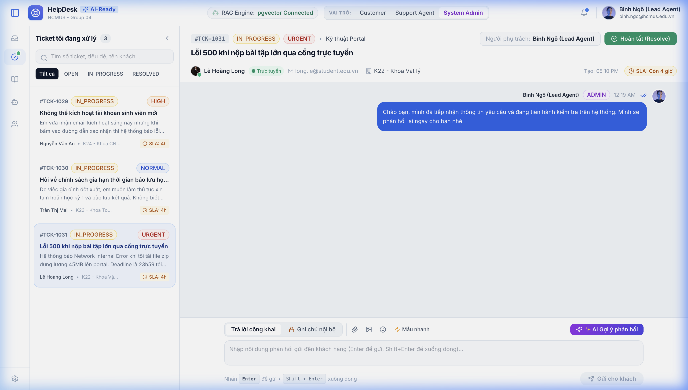

---

#### 2. Trợ lý AI Copilot nổi ở góc dưới bên phải (Floating Dock)
*Mô tả: Nút "AI Copilot" nổi ở góc dưới. Khi bấm vào, cửa sổ trợ lý hiện câu trả lời gợi ý từ RAG, độ tin cậy (95%), trích dẫn nguồn (Citations) và nút "Áp dụng vào khung trả lời" chèn thẳng text vào ô chat.*

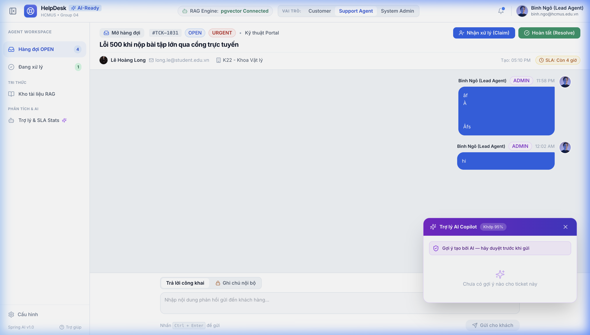

---

#### 3. Chế độ Ghi chú nội bộ màu vàng (Internal Note)
*Mô tả: Khi chuyển sang tab "Ghi chú nội bộ", ô soạn thảo và bong bóng tin nhắn chuyển sang màu vàng amber đặc trưng có biểu tượng ổ khóa, chỉ dành riêng cho Agent & Admin trao đổi kỹ thuật.*

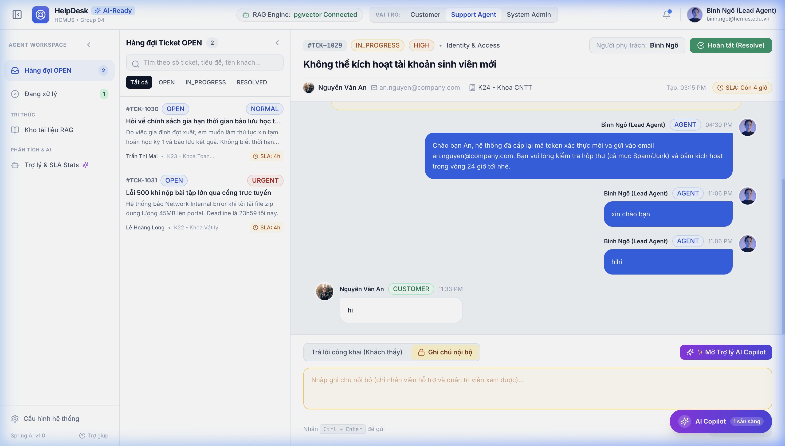

---

#### 4. Chế độ tập trung (Focus Mode — Thu gọn Sidebar & Hàng đợi)
*Mô tả: Bấm nút thu gọn trên Sidebar (về dạng mini icon) và Hàng đợi (về dải ruy-băng dọc), giải phóng 100% diện tích màn hình để Agent tập trung xử lý sự cố.*

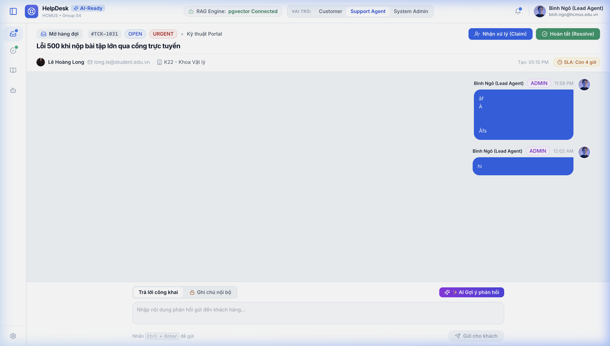

---

### PHÂN HỆ 2: CỔNG KHÁCH HÀNG (CUSTOMER PORTAL)
*Phụ trách chính: Phan Gia Phúc (Module C)*

#### 5. Danh sách ticket của tôi & Trao đổi công khai
*Mô tả: Khách hàng chỉ xem được danh sách ticket của chính mình và chuỗi trao đổi công khai (hoàn toàn không thấy ghi chú nội bộ của Agent và không thấy menu quản trị).*

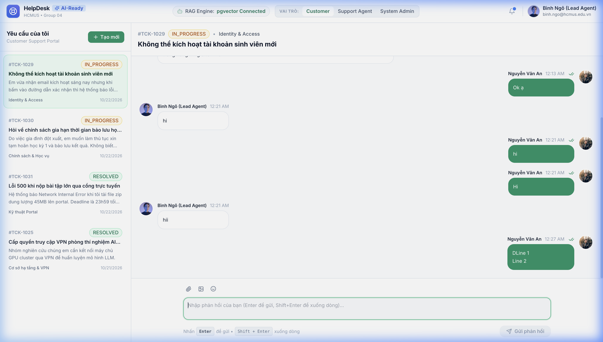

---

#### 6. Form gửi yêu cầu mới & AI gợi ý giải pháp tức thì
*Mô tả: Khi khách hàng nhập tiêu đề ticket, hệ thống tự động tìm kiếm trong Kho tri thức và hiển thị ngay bài viết giải đáp liên quan giúp giải quyết vấn đề trước khi gửi ticket (FR-AI-01).*

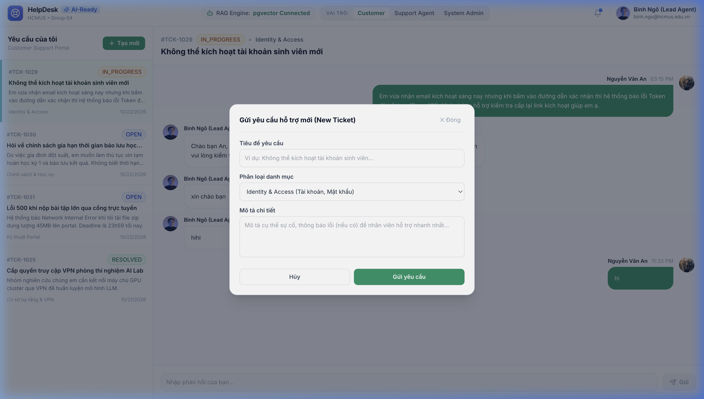

---

### PHÂN HỆ 3: KHO TRI THỨC & VECTOR SEARCH (MODULE B)
*Phụ trách chính: Nguyễn Đức Lãm (Module B)*

#### 7. Quản lý tài liệu & Thống kê pgvector Chunks
*Mô tả: Bảng danh sách tài liệu tri thức, theo dõi trạng thái chunking (READY, PROCESSING, FAILED), số lượng vector embeddings đã nạp vào pgvector, nút Publish/Archive.*

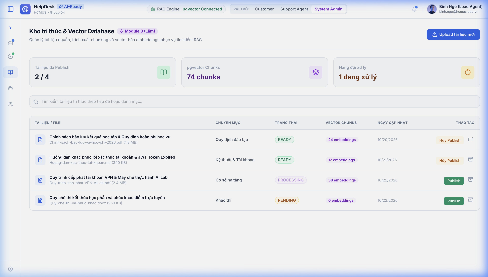

---

#### 8. Modal Upload tài liệu tri thức mới
*Mô tả: Hỗ trợ tải lên file PDF, TXT, Markdown với phân loại chuyên mục và vùng kéo thả hiện đại.*

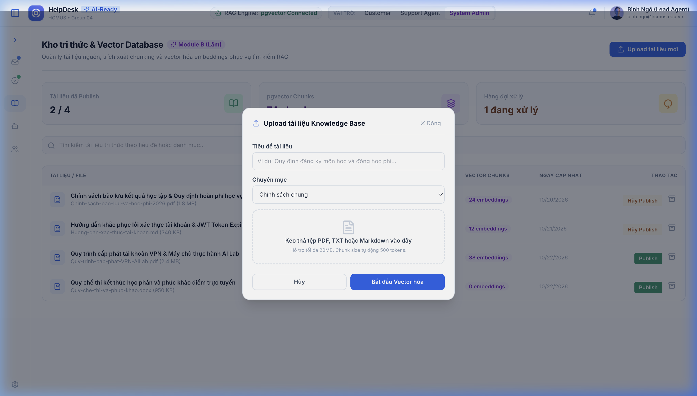

---

### PHÂN HỆ 4: QUẢN TRỊ VIÊN & THỐNG KÊ SLA (MODULE D & A)
*Phụ trách chính: Ngô Viết Thanh Bình (Module D) & Lê Quý Phúc (Module A)*

#### 9. Quản trị nhân sự Agent & Phân quyền RBAC
*Mô tả: Danh sách tài khoản Support Agent, kiểm soát trạng thái hoạt động và các nút Kích hoạt / Vô hiệu hóa (Enable/Disable) tài khoản theo tiêu chuẩn bảo mật NFR-SEC.*

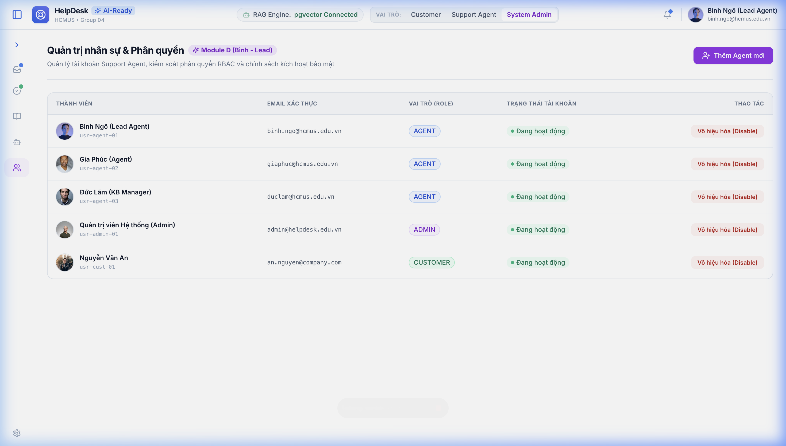

---

#### 10. Modal tạo tài khoản Agent mới
*Mô tả: Biểu mẫu cấp phát tài khoản nhân sự mới.*

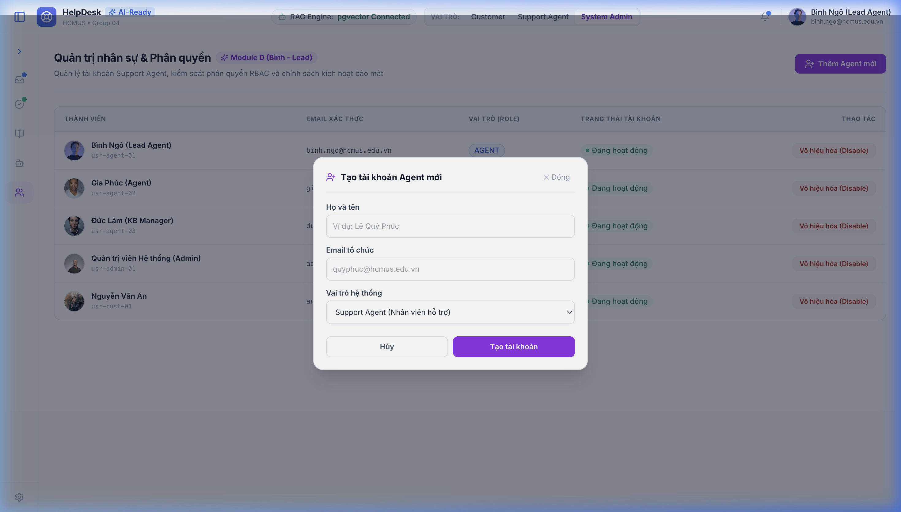

---

#### 11. Báo cáo phân tích AI & Chỉ số SLA
*Mô tả: Thống kê SLA, thời gian phản hồi trung bình, độ trễ pgvector (42ms), Bảng xếp hạng tài liệu được AI trích dẫn nhiều nhất và công tắc bật/tắt chế độ Mock AI Offline (NFR-AVAIL-01).*

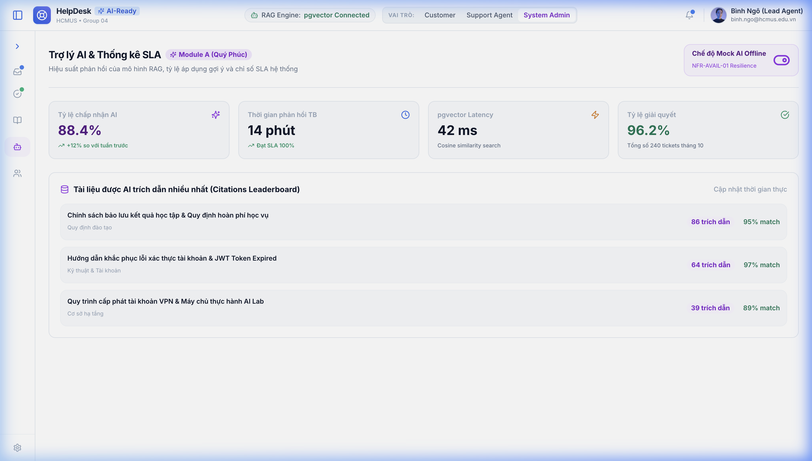
