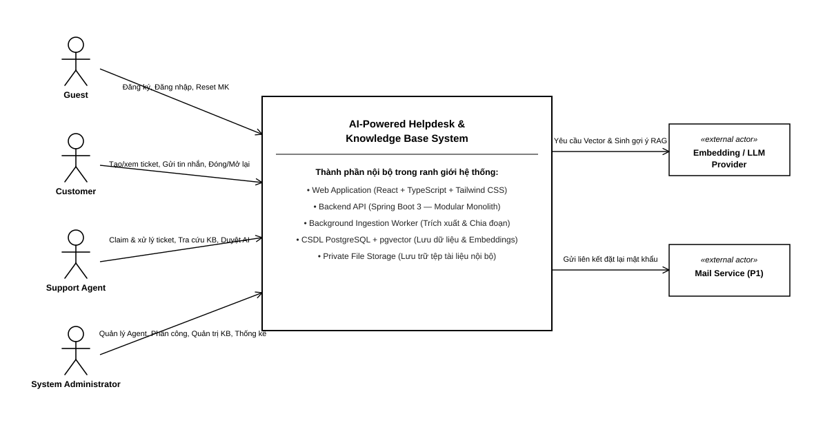

# 3.1 DANH SÁCH CÁC STAKEHOLDER & SƠ ĐỒ BỐI CẢNH

> **Hướng dẫn nhận việc:** [T1-DOC-02 — nguồn đọc, từng bước, đầu ra và bàn giao](../../../TASK_PLAYBOOK_TEMPLATE1.md#t1-doc-02). File khung chưa phải bằng chứng task đã hoàn thành.

> **Người phụ trách:** Nguyễn Đức Lãm (MSSV: 24120083) | **Task ref:** `T1-DOC-02` (Jira key cần đối chiếu)  
> **Nguồn tham chiếu:** [reports/SRS-master.md](../../SRS-master.md) (Mục 3.1)

## 3.1.1 Bảng danh sách các bên liên quan (Stakeholders)

| STT | Stakeholder | Vai trò & Trách nhiệm trong hệ thống |
| :---: | :--- | :--- |
| 1 | **Khách vãng lai (Guest)** | Người dùng chưa đăng nhập, đăng ký tài khoản Customer hoặc đăng nhập; trang chủ không được coi là yêu cầu riêng khi chưa có FR. |
| 2 | **Khách hàng (Customer)** | Người gửi yêu cầu hỗ trợ, theo dõi tiến độ, trao đổi công khai và xác nhận đóng ticket. |
| 3 | **Nhân viên hỗ trợ (Support Agent)** | Người trực tiếp tiếp nhận (claim) ticket, trao đổi với khách, dùng AI gợi ý và tra cứu tri thức. |
| 4 | **Quản trị viên (System Admin)** | Quản lý toàn diện hệ thống: tài khoản Agent, kho tài liệu chính sách, phân công ticket và xem báo cáo. |
| 5 | **Dịch vụ AI bên ngoài** | Hệ thống ngoài cung cấp embedding/sinh văn bản; không được thực thi hành động nội bộ. |

System Worker là thành phần nội bộ, không phải stakeholder hay actor bên ngoài toàn hệ thống. Bảng này cần bổ sung bên liên quan nghiệp vụ theo kết quả phân tích của owner; không coi danh sách actor là toàn bộ stakeholders.

## 3.1.2 Sơ đồ bối cảnh hệ thống (Context Diagram)

