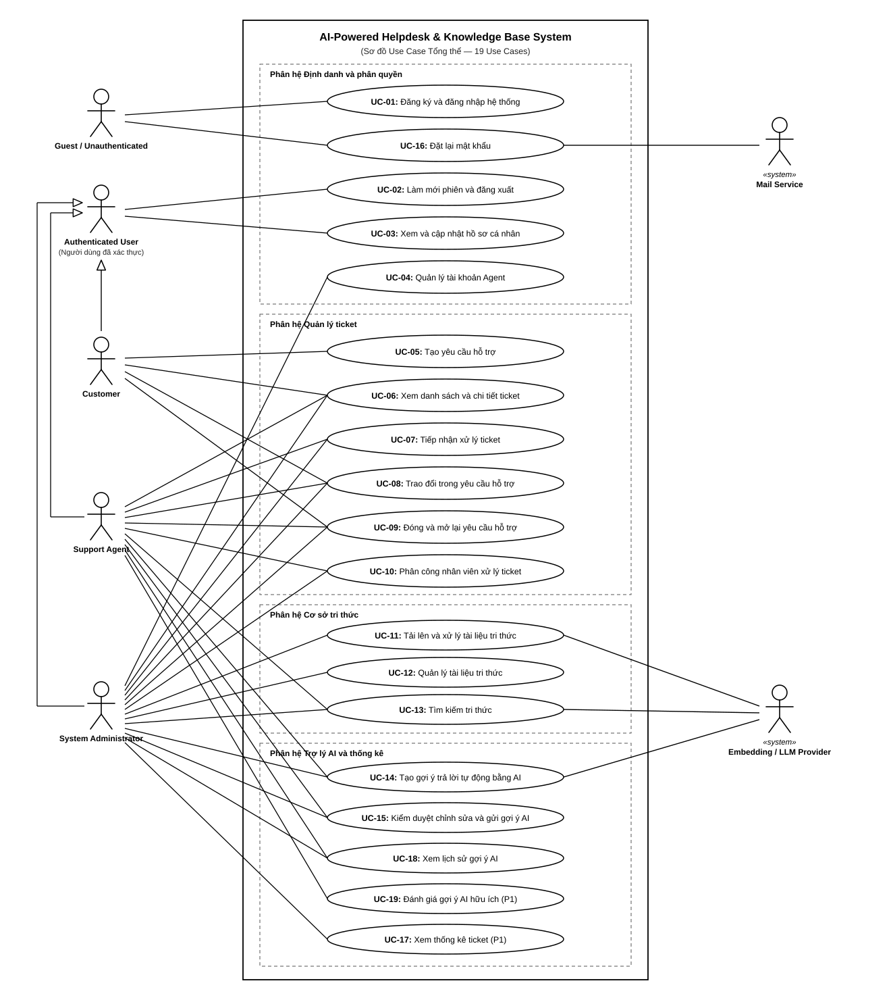

# 4.1 SƠ ĐỒ USE CASE TỔNG QUAN HỆ THỐNG

> **Hướng dẫn nhận việc:** [T1-DOC-04 — nguồn đọc, từng bước, đầu ra và bàn giao](../../../TASK_PLAYBOOK_TEMPLATE1.md#t1-doc-04). File khung chưa phải bằng chứng task đã hoàn thành.

> **Người phụ trách:** Ngô Viết Thanh Bình (MSSV: 24120269) | **Task ref:** `T1-DOC-04` (Jira key cần đối chiếu)

