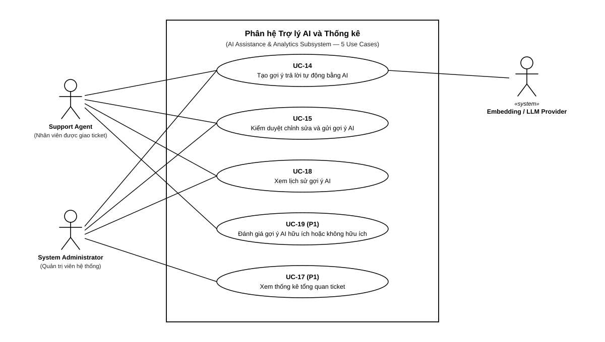

# 4.2 ĐẶC TẢ USE CASE — MODULE A: AI ASSISTANCE

> **Hướng dẫn nhận việc:** [T1-DOC-07 — nguồn đọc, từng bước, đầu ra và bàn giao](../../../TASK_PLAYBOOK_TEMPLATE1.md#t1-doc-07). File khung chưa phải bằng chứng task đã hoàn thành.

> **Người phụ trách:** Lê Quý Phúc (MSSV: 24120121) | **Task ref:** `T1-DOC-07` (Jira key cần đối chiếu)  
> **Phạm vi:** 2 Use Cases chuẩn (`UC-14`, `UC-15`); UC-17 thuộc nghiệp vụ Ticket, xem file đặc tả Analytics riêng

## Sơ đồ Use Case Module A

## Danh sách bảng đặc tả Use Case chi tiết
<!-- Soạn 2 bảng đặc tả chi tiết theo chuẩn 9 trường thông tin -->
