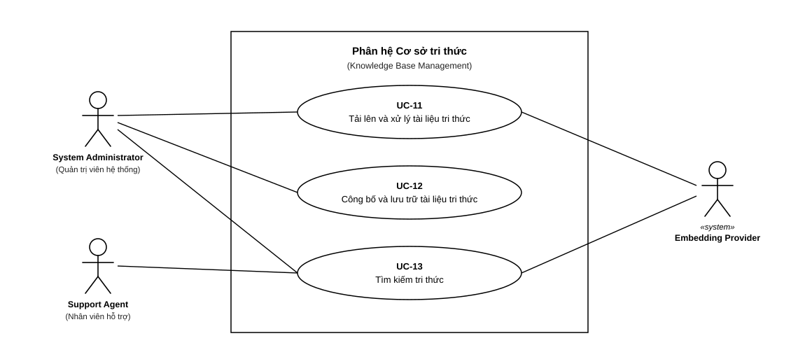

# 4.2 ĐẶC TẢ USE CASE — MODULE B: KNOWLEDGE BASE

> **Hướng dẫn nhận việc:** [T1-DOC-06 — nguồn đọc, từng bước, đầu ra và bàn giao](../../../TASK_PLAYBOOK_TEMPLATE1.md#t1-doc-06). File khung chưa phải bằng chứng task đã hoàn thành.

> **Người phụ trách:** Nguyễn Đức Lãm (MSSV: 24120083) | **Task ref:** `T1-DOC-06` (Jira key cần đối chiếu)  
> **Phạm vi:** 3 Use Cases chuẩn (`UC-11`, `UC-12`, `UC-13`)

## Sơ đồ Use Case Module B

## Danh sách bảng đặc tả Use Case chi tiết
<!-- Soạn 3 bảng đặc tả chi tiết theo chuẩn 9 trường thông tin -->
