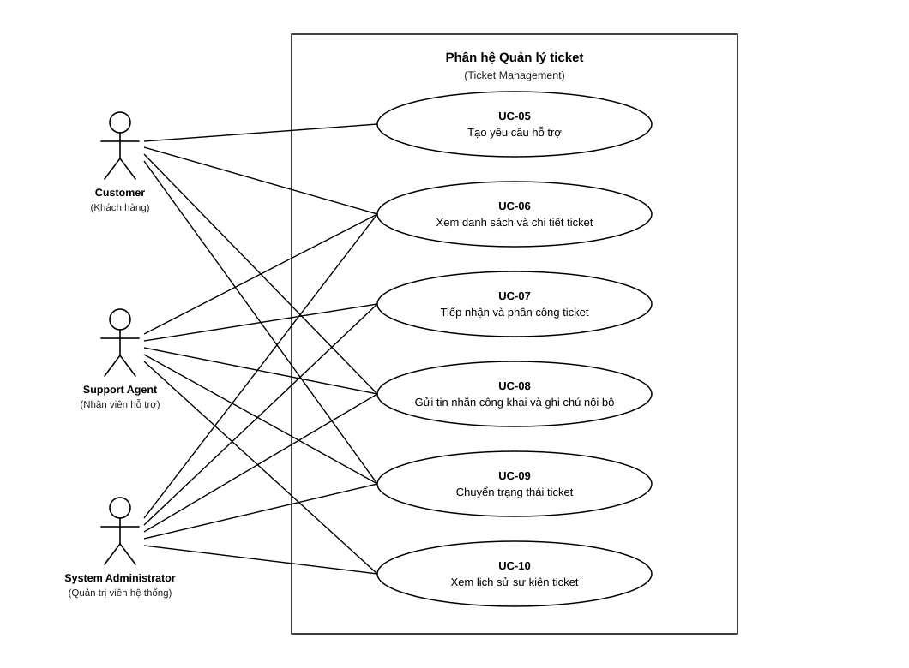

# 4.2 ĐẶC TẢ USE CASE — MODULE C: TICKET MANAGEMENT

> **Hướng dẫn nhận việc:** [T1-DOC-05 — nguồn đọc, từng bước, đầu ra và bàn giao](../../../TASK_PLAYBOOK_TEMPLATE1.md#t1-doc-05). File khung chưa phải bằng chứng task đã hoàn thành.

> **Người phụ trách:** Phan Gia Phúc (MSSV: 24120503) | **Task ref:** `T1-DOC-05` (Jira key cần đối chiếu)  
> **Phạm vi:** 6 Use Cases chuẩn (`UC-05`, `UC-06`, `UC-07`, `UC-08`, `UC-09`, `UC-10`)

## Sơ đồ Use Case Module C

## Danh sách bảng đặc tả Use Case chi tiết
<!-- Soạn 6 bảng đặc tả chi tiết theo chuẩn 9 trường thông tin -->
