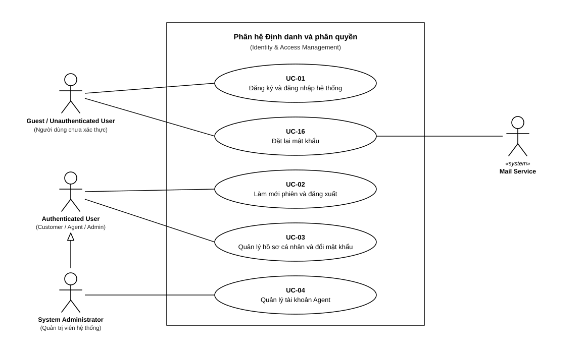

# 4.2 ĐẶC TẢ USE CASE — MODULE D: IDENTITY & ACCESS

> **Hướng dẫn nhận việc:** [T1-DOC-04 — nguồn đọc, từng bước, đầu ra và bàn giao](../../../TASK_PLAYBOOK_TEMPLATE1.md#t1-doc-04). File khung chưa phải bằng chứng task đã hoàn thành.

> **Người phụ trách:** Ngô Viết Thanh Bình (MSSV: 24120269) | **Task ref:** `T1-DOC-04` (Jira key cần đối chiếu)  
> **Phạm vi:** 5 Use Cases chuẩn (`UC-01`, `UC-02`, `UC-03`, `UC-04`, `UC-16`)

## Sơ đồ Use Case Module D

## Danh sách bảng đặc tả Use Case chi tiết
<!-- Soạn 5 bảng đặc tả chi tiết theo chuẩn 9 trường thông tin -->
