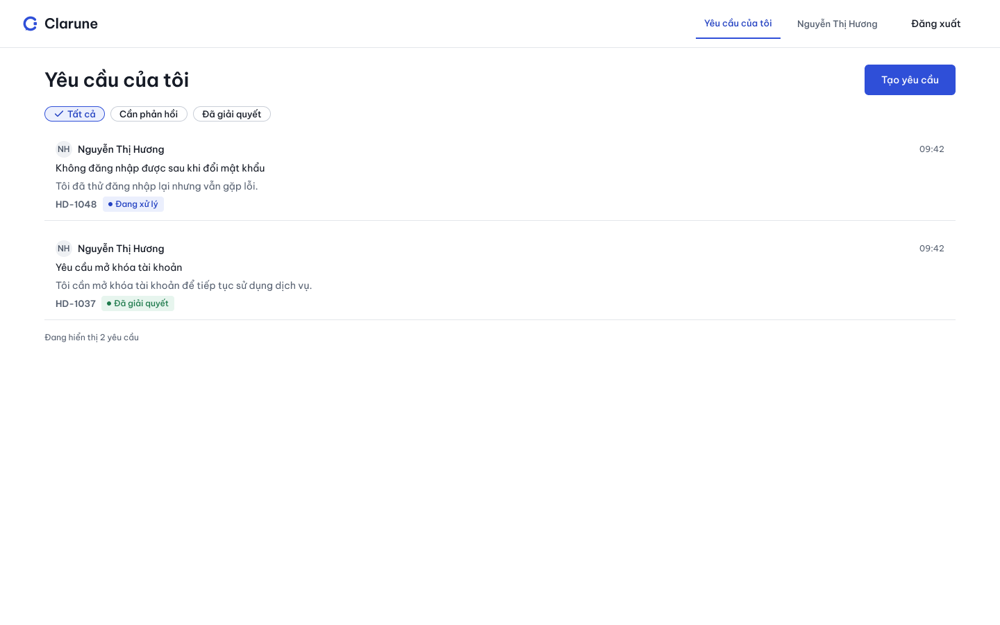
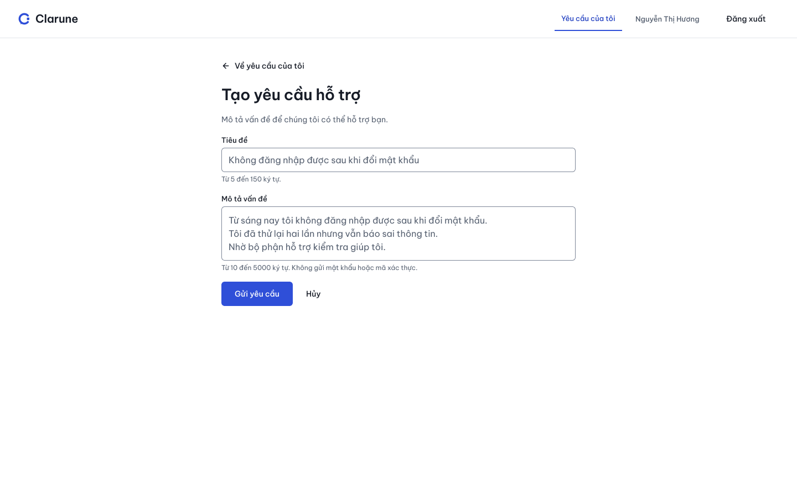
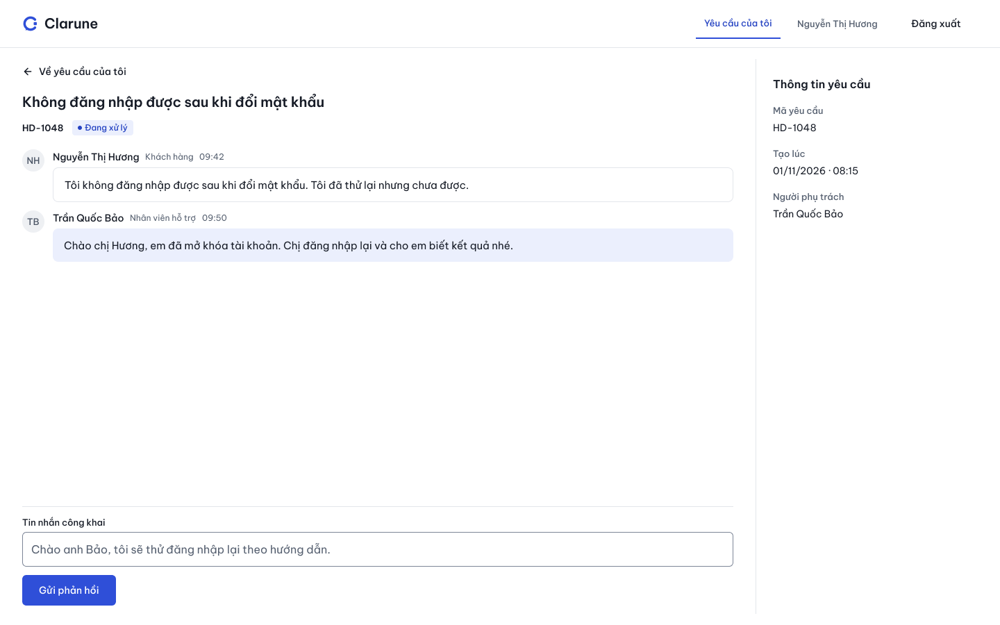
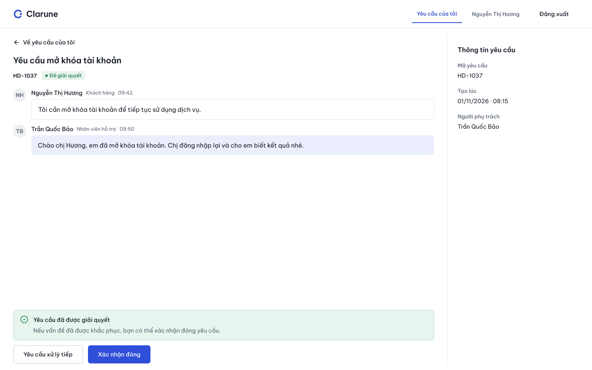
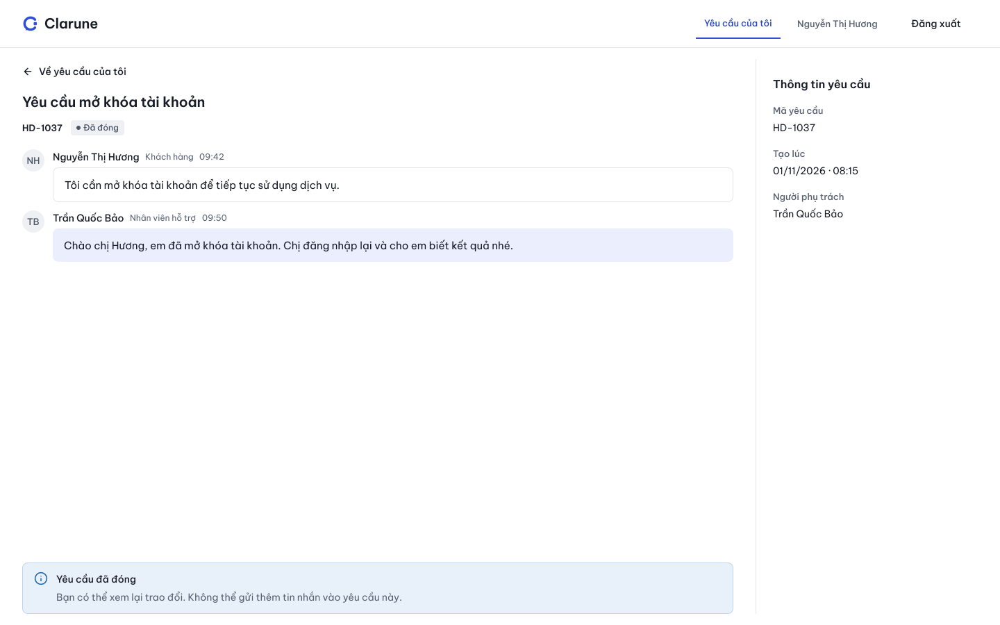
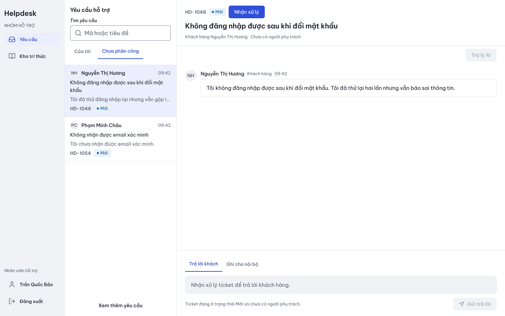
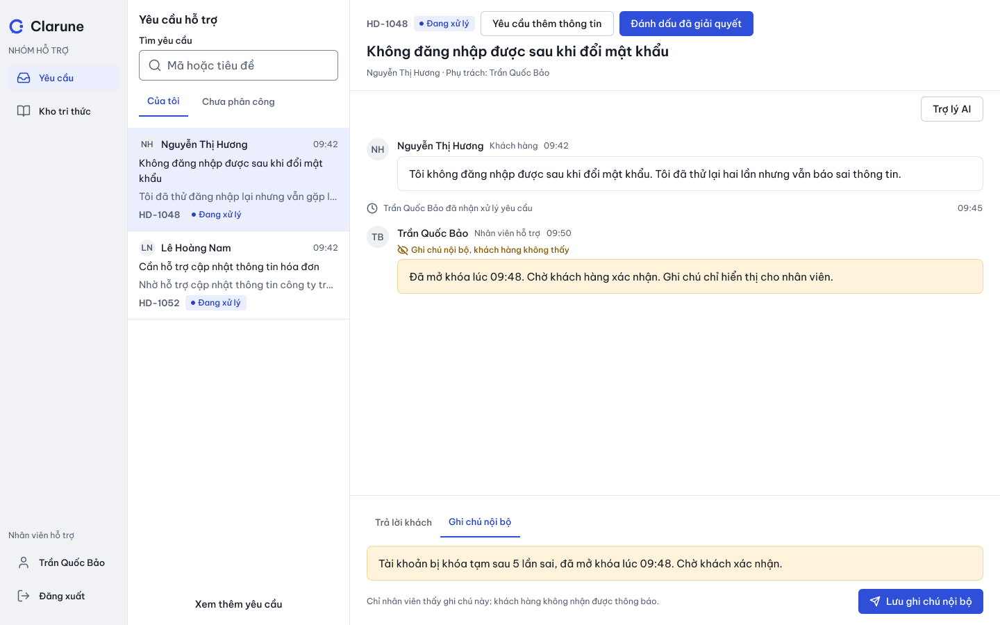
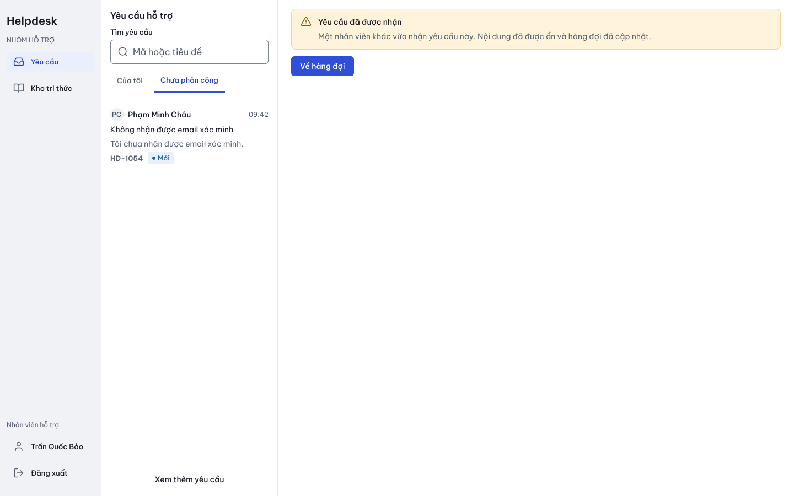

# 5. BẢN MẪU GIAO DIỆN (UI PROTOTYPE & DESIGN SYSTEM)

> **Thông tin điều phối:**
> - **Người phụ trách tổng hợp UI:** Lê Quý Phúc (Module A - AI Assistance & Frontend UI Lead).
> - **Tài liệu làm việc nhóm (Google Docs):** [[SE - Nhóm 4] template1 - Google Tài liệu](https://docs.google.com/document/d/1vSMrk5GCPtOlhbWMRMqZvDq8575tSIz2IXgcp-K0WAg/edit?tab=t.0)
> - **File thiết kế chính thức (Figma SE):** [SE – Figma (Node 49:58 - Redesign v2)](https://www.figma.com/design/Ofvm9udw9coBOxadTN4PXB/SE?node-id=49-58&p=f&m=dev)
> - **Tài liệu đặc tả liên quan:** [DESIGN.md](../../DESIGN.md) · [Đặc tả Inbox Workspace](../../docs/design/dac-ta-inbox.md) · [Design System MASTER v2](../../design-system/helpdesk-workspace/MASTER.md) · [Danh mục màn hình chi tiết](../../docs/design/man-hinh.md).

---

## 5.1 TỔNG QUAN PHƯƠNG ÁN THIẾT KẾ (REDESIGN V2)

Giao diện hệ thống Helpdesk được thiết kế theo **Phương án A: "Bàn làm việc yên tĩnh" (Quiet Workspace)**, tối ưu hóa cho nhân viên hỗ trợ (Agent) và quản trị viên (Admin) xử lý liên tục nhiều yêu cầu mà không bị mỏi mắt hay phân tâm. Hệ thống hỗ trợ hoàn chỉnh cả **Light Mode** và **Dark Mode**, tuân thủ nghiêm ngặt chuẩn tiếp cận người dùng **WCAG 2.1 AA** (độ tương phản chữ tối thiểu 4.5:1, viền điều khiển $\ge 3:1$).

* **Quy mô thiết kế:** Gồm **33 nhóm màn hình chính** với **151 frames**, 56 luồng tương tác (prototype flows) và 709 reactions được thiết lập trên Figma.
* **Toàn bộ ảnh chụp màn hình (PNG):** Được lưu trữ trực tiếp trong kho mã nguồn tại thư mục [`docs/design/anh/`](../../docs/design/anh/) và [`docs/design/anh/thanh-phan/`](../../docs/design/anh/thanh-phan/).
* **Thích ứng màn hình (Responsive Breakpoints):**
  - **Desktop (1440 × 900 px):** Bố cục 3 cột liền mạch: Điều hướng (184px) + Danh sách ticket (320px) + Vùng hội thoại (936px). Ngăn Trợ lý AI / Ngữ cảnh rộng 320px mở theo yêu cầu.
  - **Tablet (1024 × 768 px):** Thanh ray thu gọn (72px) + Danh sách (280px) + Hội thoại; Ngăn AI hiển thị dạng Overlay (tối đa 360px).
  - **Mobile (390 × 844 px):** Tách thành các màn hình độc lập (Danh sách, Chi tiết hội thoại, Trợ lý AI, Đọc nguồn) với nút điều hướng quay lại rõ ràng.

> **Nguyên tắc kế thừa và tinh chỉnh:** Bộ thiết kế Redesign v2 do Lê Quý Phúc khởi tạo đóng vai trò là **Bộ khung nền tảng (Baseline)** đảm bảo tính nhất quán về Design Tokens, Typography và Layout cho toàn hệ thống. Từng thành viên phụ trách phân hệ (Module Owner) có toàn quyền chủ động rà soát, tinh chỉnh hoặc vẽ bổ sung các màn hình, luồng tương tác và trạng thái biên trên Figma để đáp ứng chính xác nhất kịch bản nghiệp vụ của Use Case mình phụ trách.

---

## 5.2 BẢNG MA TRẬN 33 NHÓM MÀN HÌNH CHÍNH & ÁNH XẠ USE CASE

| STT | Phân hệ | Nhóm màn hình chính | Node ID (Figma) | Chế độ | Use Case ánh xạ | Ảnh minh họa (PNG) |
|:---:|:---|:---|:---:|:---:|:---|:---:|
| **01** | **Agent** | A01 · Hàng đợi · Nhận xử lý | `55:1992` | Light | UC-07, UC-08 | [`55-1992.png`](../../docs/design/anh/55-1992.png) |
| **02** | Agent | A02 · Xử lý ticket · AI đóng | `55:1993` | Light | UC-07, UC-10 | [`55-1993.png`](../../docs/design/anh/55-1993.png) |
| **03** | Agent | A03 · Gợi ý AI có trích dẫn nguồn | `55:1994` | Light | UC-14, UC-15 | [`55-1994.png`](../../docs/design/anh/55-1994.png) |
| **04** | Agent | A04 · Ghi chú nội bộ (Internal Note) | `55:2537` | Light | UC-10 | [`55-2537.png`](../../docs/design/anh/55-2537.png) |
| **05** | Agent | A05 · AI đang tạo gợi ý | `55:2538` | Light | UC-14 | [`55-2538.png`](../../docs/design/anh/55-2538.png) |
| **06** | Agent | A06 · Xung đột nhận xử lý (Claim Conflict) | `56:3104` | Light | UC-08 | [`56-3104.png`](../../docs/design/anh/56-3104.png) |
| **07** | Agent | A07 · Yêu cầu thêm thông tin (Chờ khách) | `56:3576` | Light | UC-07 | [`56-3576.png`](../../docs/design/anh/56-3576.png) |
| **08** | Agent | A08 · Đọc chi tiết nguồn của gợi ý | `56:3578` | Light | UC-14 | [`56-3578.png`](../../docs/design/anh/56-3578.png) |
| **09** | Agent | A09 · Tablet · AI Drawer Overlay | `56:4106` | Light | UC-07, UC-14 | [`56-4106.png`](../../docs/design/anh/56-4106.png) |
| **10** | Agent | A10 · Mobile · Hội thoại xử lý ticket | `56:4107` | Light | UC-07, UC-10 | [`56-4107.png`](../../docs/design/anh/56-4107.png) |
| **11** | **Customer** | C01 · Danh sách yêu cầu của tôi | `58:6763` | Light | UC-06 | [`58-6763.png`](../../docs/design/anh/58-6763.png) |
| **12** | Customer | C02 · Tạo yêu cầu hỗ trợ mới | `58:6764` | Light | UC-05 | [`58-6764.png`](../../docs/design/anh/58-6764.png) |
| **13** | Customer | C03 · Chi tiết yêu cầu · Đang xử lý | `58:6765` | Light | UC-06, UC-09 | [`58-6765.png`](../../docs/design/anh/58-6765.png) |
| **14** | Customer | C04 · Yêu cầu đã giải quyết (Chờ xác nhận) | `62:6953` | Light | UC-06, UC-09 | [`62-6953.png`](../../docs/design/anh/62-6953.png) |
| **15** | Customer | C05 · Yêu cầu đã đóng (Closed - Readonly) | `62:6954` | Light | UC-06 | [`62-6954.png`](../../docs/design/anh/62-6954.png) |
| **16** | Customer | C06 · Mobile · Danh sách yêu cầu | `62:6955` | Light | UC-06 | [`62-6955.png`](../../docs/design/anh/62-6955.png) |
| **17** | Customer | C07 · Mobile · Chi tiết yêu cầu | `62:7174` | Light | UC-06, UC-09 | [`62-7174.png`](../../docs/design/anh/62-7174.png) |
| **18** | **Identity** | I01 · Đăng nhập hệ thống (Login) | `62:8214` | Light | UC-02 | [`62-8214.png`](../../docs/design/anh/62-8214.png) |
| **19** | Identity | I02 · Đăng ký tài khoản khách hàng | `62:8215` | Light | UC-01 | [`62-8215.png`](../../docs/design/anh/62-8215.png) |
| **20** | Identity | I03 · Hồ sơ cá nhân khách hàng | `62:8216` | Light | UC-03 | [`62-8216.png`](../../docs/design/anh/62-8216.png) |
| **21** | Identity | I04 · Hồ sơ nhân viên / Quản trị viên | `62:8328` | Light | UC-03 | [`62-8328.png`](../../docs/design/anh/62-8328.png) |
| **22** | Identity | I05 · Mobile · Đăng nhập | `62:8329` | Light | UC-02 | [`62-8329.png`](../../docs/design/anh/62-8329.png) |
| **23** | **Knowledge** | K01 · Tìm kiếm tri thức (Search KB) | `62:9092` | Light | UC-13 | [`62-9092.png`](../../docs/design/anh/62-9092.png) |
| **24** | Knowledge | K02 · Không có kết quả tìm kiếm | `62:9093` | Light | UC-13 | [`62-9093.png`](../../docs/design/anh/62-9093.png) |
| **25** | Knowledge | K03 · Đọc tài liệu tri thức đã công bố | `62:9094` | Light | UC-13 | [`62-9094.png`](../../docs/design/anh/62-9094.png) |
| **26** | Knowledge | K04 · Bảng quản trị tài liệu tri thức | `62:9240` | Light | UC-11, UC-12 | [`62-9240.png`](../../docs/design/anh/62-9240.png) |
| **27** | Knowledge | K05 · Tải lên tài liệu mới (UploadZone) | `62:9241` | Light | UC-11 | [`62-9241.png`](../../docs/design/anh/62-9241.png) |
| **28** | Knowledge | K06 · Chi tiết tài liệu · Thao tác Công bố | `62:9242` | Light | UC-12 | [`62-9242.png`](../../docs/design/anh/62-9242.png) |
| **29** | **Admin** | D01 · Danh sách tất cả yêu cầu (Filter) | `62:9943` | Light | UC-07, UC-10 | [`62-9943.png`](../../docs/design/anh/62-9943.png) |
| **30** | Admin | D02 · Chi tiết yêu cầu và lịch sử thay đổi | `62:9944` | Light | UC-07, UC-10 | [`62-9944.png`](../../docs/design/anh/62-9944.png) |
| **31** | Admin | D03 · Phân công nhân viên phụ trách | `62:9945` | Light | UC-08 | [`62-9945.png`](../../docs/design/anh/62-9945.png) |
| **32** | Admin | D04 · Quản lý danh sách nhân viên | `62:10225` | Light | UC-04 | [`62-10225.png`](../../docs/design/anh/62-10225.png) |
| **33** | Admin | D05 · Tạo tài khoản nhân viên mới | `62:10226` | Light | UC-04 | [`62-10226.png`](../../docs/design/anh/62-10226.png) |

---

## 5.3 CÁC MÀN HÌNH ĐẶC THÙ: TRẠNG THÁI BIÊN, NGOẠI LỆ & DARK MODE

Bên cạnh 33 màn hình chính, hệ thống đã thiết kế chi tiết các màn hình xử lý trạng thái biên, thông báo lỗi và chế độ nền tối (Dark Mode):

1. **Nhánh ngoại lệ AI & Trợ lý ảo (FR-AI-01..10):**
   - `A-AIError` (`55:2539`): Thông báo AI tạm thời không phản hồi / timeout, nhân viên vẫn soạn tin nhắn thủ công bình thường.
   - `A-AIInsufficient` (`56:3103`): AI phát hiện thiếu căn cứ (độ tương đồng vector dưới ngưỡng hoặc tài liệu không đủ dữ kiện - tuân thủ BR-03).
   - `A-Replace` (`56:6373`): Hộp thoại xác nhận ghi đè khi nhân viên bấm chèn gợi ý AI vào ô soạn thảo đã có sẵn nội dung.
2. **Nhánh quản trị tài liệu & Ingestion Worker (FR-KB-01..10):**
   - `K-TooLarge` (`62:9621`): Cảnh báo tệp vượt quá dung lượng tối đa cho phép (10 MiB).
   - `K-ScanFailed` (`62:9622`): Từ chối tệp PDF dạng ảnh quét không có text layer (tuân thủ BR-06).
   - `K-ReadyDetail` (`62:9783`): Tài liệu đã ingestion thành công (`READY`), chờ Admin duyệt bấm nút "Công bố" (Published).
   - `K-Archive` (`62:11218`): Xác nhận lưu trữ (Archive) tài liệu đã công bố để loại trừ khỏi tìm kiếm và RAG.
3. **Chế độ nền tối (Dark Mode):**
   - `A-Dark` (`56:6374`): Giao diện xử lý ticket và gợi ý AI chế độ Dark.
   - `C-Dark` (`62:8115`): Giao diện chi tiết yêu cầu khách hàng chế độ Dark.
   - `I-Dark` (`62:8879`): Giao diện đăng nhập chế độ Dark.
   - `K-Dark` (`62:11220`): Kho tri thức chế độ Dark.
   - `D-Dark` (`62:13392`): Danh sách yêu cầu quản trị chế độ Dark.

---

## 5.4 KẾT QUẢ KIỂM ĐỊNH TỰ ĐỘNG (AUDIT & SEMANTIC CHECKS)

Toàn bộ 151 frames và bộ Design System đã được kiểm định tự động thông qua các công cụ phân tích tĩnh:
* **Kiểm tra độ tương phản màu (WCAG 2.1 AA):** 100% các cặp màu chữ chính (`text/primary`), chữ phụ (`text/secondary`) và nhãn nút trên nền surface/subtle đạt tỉ lệ tương phản $\ge 4.74:1$ (vượt ngưỡng yêu cầu $4.5:1$). Viền ô nhập liệu (`border/control`) đạt $\ge 3.27:1$ (vượt ngưỡng $3:1$).
* **Kiểm tra logic nghiệp vụ (`redesign-v2-semantic-checks.json`):**
  - Khóa ô soạn thảo khi chưa Claim: `openComposerLocked = true`.
  - Chèn gợi ý AI không tự động gửi: `aiInsertAndSendExact = true`.
  - Khách hàng không thấy ghi chú nội bộ hoặc AI: `noCustomerInternalOrAI = true`.
  - Tách bạch trạng thái kỹ thuật `READY` và kinh doanh `Đã công bố`: `publicationSeparate = true`.
  - Mật khẩu đã đổi tự động xóa khỏi form: `passwordClearedAndDisabled = true`.

---

> **Ghi chú: Phần Phan Gia Phúc phụ trách.**

## **5.2 Giao diện Customer Portal**

### **5.2.1 Danh sách yêu cầu của tôi**

Màn hình hiển thị các yêu cầu hỗ trợ do Customer hiện tại tạo, kèm trạng thái xử lý để khách hàng theo dõi tiến độ. Người dùng có thể tìm kiếm, lọc, chuyển trang và chọn một yêu cầu để xem chi tiết.

Giao diện phân biệt các trạng thái đang tải, chưa có yêu cầu, không có kết quả phù hợp và lỗi tải dữ liệu.

**Hình 5.6  Danh sách yêu cầu của tôi**

### **5.2.2 Tạo yêu cầu hỗ trợ**

Customer nhập tiêu đề và nội dung mô tả, sau đó chọn Gửi yêu cầu. Hệ thống kiểm tra dữ liệu và hiển thị lỗi tại nội dung cần điều chỉnh nếu thông tin không hợp lệ.

Khi tạo thành công, yêu cầu có trạng thái Mới tạo (OPEN), chưa có nhân viên phụ trách và được mở ở trang chi tiết. Nội dung mô tả xuất hiện trong hội thoại công khai đầu tiên.

**Hình 5.7  Tạo yêu cầu hỗ trợ**

### **5.2.3 Chi tiết và hội thoại công khai**

Customer xem thông tin, trạng thái xử lý và các tin nhắn công khai của yêu cầu thuộc sở hữu của mình. Giao diện không hiển thị ghi chú INTERNAL hoặc lịch sử sự kiện nội bộ.

Khách hàng gửi phản hồi khi trạng thái yêu cầu cho phép. Nếu yêu cầu đang Chờ khách hàng phản hồi (WAITING\_CUSTOMER), việc gửi phản hồi thành công đưa yêu cầu về Đang xử lý (IN\_PROGRESS).

Khi yêu cầu chuyển sang Đã giải quyết (RESOLVED), giao diện cung cấp lựa chọn xác nhận đóng hoặc yêu cầu xử lý tiếp theo Mục 5.2.4.

**Hình 5.8 Chi tiết và hội thoại công khai khi yêu cầu đang được xử lý**

#### **5.2.4 Xác nhận đóng hoặc mở lại yêu cầu**

Khi yêu cầu ở trạng thái Đã giải quyết (RESOLVED), Customer xem lại nội dung xử lý và lựa chọn:

\- Đóng yêu cầu (CLOSE): Xác nhận vấn đề đã được giải quyết, chuyển yêu cầu sang CLOSED.

\- Yêu cầu xử lý tiếp (REOPEN): Thông báo vấn đề chưa được giải quyết, chuyển yêu cầu về IN\_PROGRESS.

Hệ thống kiểm tra quyền sở hữu và trạng thái hiện tại trước khi thực hiện. Nếu thao tác thất bại hoặc trạng thái đã thay đổi, giao diện thông báo phù hợp và không hiển thị kết quả thành công.

******

**Hình 5.9 Yêu cầu đã giải quyết, chờ Customer xác nhận đóng hoặc mở lại**

#### **5.2.5 Chi tiết yêu cầu đã đóng**

Khi yêu cầu ở trạng thái Đã đóng (CLOSED), Customer vẫn được xem thông tin và hội thoại công khai của yêu cầu thuộc sở hữu của mình.

Giao diện chuyển sang chế độ chỉ đọc, khóa ô soạn phản hồi và không cho phép gửi thêm tin nhắn hoặc mở lại yêu cầu đã đóng. Trạng thái CLOSED được hiển thị rõ để khách hàng phân biệt với yêu cầu đang chờ xác nhận giải quyết.

******

**Hình 5.10 Chi tiết yêu cầu đã đóng ở chế độ chỉ đọc**

## **5.3 Giao diện Agent Workspace**

### **5.3.1 Hàng đợi và nhận xử lý**

Hiển thị hàng đợi các ticket đang mở (OPEN), có thể chọn xem nội dung chi tiết từng ticket, có thể tìm kiếm ticket thông qua ô tìm yêu cầu; Mã ticket và trạng thái “Mới” được hiển thị rõ; Thao tác với nút “Nhận xử lý” để nhận ticket; Ticket chưa được Agent đang đăng nhập nhận thì Agent này không được soạn phản hồi → các tính năng liên quan đến xử lý ticket bị khóa (giao diện soạn phản hồi, sử dụng Trợ lý AI, xem/soạn ghi chú nội bộ).

**Hình 5.11  Hàng đợi và nhận xử lý**

### **5.3.2 Xử lý ticket và ghi chú nội bộ**

Ticket đang được xử lý có thể được đánh dấu đã giải quyết hoặc yêu cầu thêm thông tin từ Customer, Agent có thể dùng tính năng Trợ lý AI để hỗ trợ xử lý ticket. Trạng thái của ticket khi này được hiển thị rõ “Đang xử lý”.

Chỉ Agent được giao ticket/Admin được tạo và xem ghi chú nội bộ. Vùng soạn ghi chú/ghi chú đã thêm được hiển thị nổi bật trên giao diện.

**Hình 5.12  Xử lý ticket và ghi chú nội bộ**

### **5.3.3 Xung đột nhận ticket**

Thông báo ticket đã có Agent khác nhận xử lý, thao tác với nút “Về hàng đợi” để tải lại hàng đợi ticket → Agent thua claim không được tiếp tục xử lý ticket ngoài quyền.

**Hình 5.13  Xung đột nhận ticket**
