> Bản master đồng bộ theo [Report.pdf](report/Report.pdf) ngày 13/11/2026. Tên tệp được giữ để các liên kết hiện có tiếp tục hoạt động. Bản nháp trước khi chốt được lưu tại [sources/history/template1-master-before-final-pdf.md](sources/history/template1-master-before-final-pdf.md).

**NMCNPM \- Clarune \- 04**

# **MỤC LỤC**

[**1 Bảng đánh giá thành viên**](#1-bảng-đánh-giá-thành-viên)

[1.1 Phân công theo module](#1.1-phân-công-theo-module)

[**2 Mô tả bài toán**](#2-mô-tả-bài-toán)

[2.1 Bối cảnh và vấn đề](#2.1-bối-cảnh-và-vấn-đề)

[2.2 Mục tiêu, phạm vi và đối tượng sử dụng](#2.2-mục-tiêu,-phạm-vi-và-đối-tượng-sử-dụng)

[2.3 Môi trường vận hành và ràng buộc](#2.3-môi-trường-vận-hành-và-ràng-buộc)

[**3 Tổng quan yêu cầu**](#3-tổng-quan-yêu-cầu)

[3.1 Danh sách các stakeholder](#3.1-danh-sách-các-stakeholder)

[3.1.1 Sơ đồ bối cảnh](#3.1.1-sơ-đồ-bối-cảnh)

[3.2 Danh sách yêu cầu](#3.2-danh-sách-yêu-cầu)

[3.2.1 Đặc tả yêu cầu chức năng](#3.2.1-đặc-tả-yêu-cầu-chức-năng)

[3.2.2 Đặc tả yêu cầu phi chức năng](#3.2.2-đặc-tả-yêu-cầu-phi-chức-năng)

[**4 Phân tích yêu cầu**](#4-phân-tích-yêu-cầu)

[4.1 Sơ đồ Use Case](#4.1-sơ-đồ-use-case)

[4.1.1 Sơ đồ Use Case tổng thể](#4.1.1-sơ-đồ-use-case-tổng-thể)

[4.1.2 Sơ đồ Use Case Module Định danh và phân quyền](#4.1.2-sơ-đồ-use-case-module-định-danh-và-phân-quyền)

[4.1.3 Sơ đồ Use Case Module Quản lý ticket](#4.1.3-sơ-đồ-use-case-module-quản-lý-ticket)

[4.1.4 Sơ đồ Use Case Module Cơ sở tri thức](#4.1.4-sơ-đồ-use-case-module-cơ-sở-tri-thức)

[4.1.5 Sơ đồ Use Case Module Trợ lý AI](#4.1.5-sơ-đồ-use-case-module-trợ-lý-ai)

[4.2 Đặc tả Use Case](#4.2-đặc-tả-use-case)

[4.2.1 Đăng ký và đăng nhập hệ thống \[UC-01\]](#4.2.1-đăng-ký-và-đăng-nhập-hệ-thống-[uc-01])

[4.2.2 Làm mới phiên và đăng xuất \[UC-02\]](#4.2.2-làm-mới-phiên-và-đăng-xuất-[uc-02])

[4.2.3 Xem và cập nhật hồ sơ cá nhân \[UC-03\]](#4.2.3-xem-và-cập-nhật-hồ-sơ-cá-nhân-[uc-03])

[4.2.4 Quản lý tài khoản Agent \[UC-04\]](#4.2.4-quản-lý-tài-khoản-agent-[uc-04])

[4.2.5 Đặt lại mật khẩu \[UC-16\]](#4.2.5-đặt-lại-mật-khẩu-[uc-16])

[4.2.6 Tạo yêu cầu hỗ trợ \[UC-05\]](#4.2.6-tạo-yêu-cầu-hỗ-trợ-[uc-05])

[4.2.7 Xem danh sách và chi tiết ticket \[UC-06\]](#4.2.7-xem-danh-sách-và-chi-tiết-ticket-[uc-06])

[4.2.8 Tiếp nhận và phân công ticket \[UC-07\]](#4.2.8-tiếp-nhận-và-phân-công-ticket-[uc-07])

[4.2.9 Gửi tin nhắn công khai và ghi chú nội bộ \[UC-08\]](#4.2.9-gửi-tin-nhắn-công-khai-và-ghi-chú-nội-bộ-[uc-08])

[4.2.10 Chuyển trạng thái ticket \[UC-09\]](#4.2.10-chuyển-trạng-thái-ticket-[uc-09])

[4.2.11 Xem lịch sử sự kiện ticket \[UC-10\]](#4.2.11-xem-lịch-sử-sự-kiện-ticket-[uc-10])

[4.2.12 Tải lên và xử lý tài liệu tri thức \[UC-11\]](#4.2.12-tải-lên-và-xử-lý-tài-liệu-tri-thức-[uc-11])

[4.2.13 Công bố và lưu trữ tài liệu tri thức \[UC-12\]](#4.2.13-công-bố-và-lưu-trữ-tài-liệu-tri-thức-[uc-12])

[4.2.14 Tìm kiếm tri thức \[UC-13\]](#4.2.14-tìm-kiếm-tri-thức-[uc-13])

[4.2.15 Tạo gợi ý câu trả lời bằng AI \[UC-14\]](#4.2.15-tạo-gợi-ý-câu-trả-lời-bằng-ai-[uc-14])

[4.2.16 Kiểm duyệt, chỉnh sửa và gửi phản hồi từ gợi ý AI \[UC-15\]](#4.2.16-kiểm-duyệt,-chỉnh-sửa-và-gửi-phản-hồi-từ-gợi-ý-ai-[uc-15])

[4.2.17 Xem thống kê ticket \[UC-17\]](#4.2.17-xem-thống-kê-ticket-[uc-17])

[4.2.18 Xem lịch sử gợi ý AI \[UC-18\]](#4.2.18-xem-lịch-sử-gợi-ý-ai-[uc-18])

[4.2.19 Đánh giá gợi ý AI hữu ích hoặc không hữu ích \[UC-19\]](#4.2.19-đánh-giá-gợi-ý-ai-hữu-ích-hoặc-không-hữu-ích-[uc-19])

[**5 Bản mẫu (Prototype)**](#5-bản-mẫu-\(prototype\))

[5.1 Giao diện định danh và tài khoản](#5.1-giao-diện-định-danh-và-tài-khoản)

[5.1.1 Đăng nhập hệ thống](#5.1.1-đăng-nhập-hệ-thống)

[5.1.2 Đăng ký Customer](#5.1.2-đăng-ký-customer)

[5.1.3 Hồ sơ cá nhân](#5.1.3-hồ-sơ-cá-nhân)

[5.1.4 Quản lý danh sách tài khoản Agent (Admin)](#5.1.4-quản-lý-danh-sách-tài-khoản-agent-\(admin\))

[5.1.5 Tạo tài khoản Agent mới và Vô hiệu hóa tài khoản (Admin)](#5.1.5-tạo-tài-khoản-agent-mới-và-vô-hiệu-hóa-tài-khoản-\(admin\))

[5.2 Giao diện Customer Portal](#5.2-giao-diện-customer-portal)

[5.2.1 Danh sách yêu cầu của tôi](#5.2.1-danh-sách-yêu-cầu-của-tôi)

[5.2.2 Tạo yêu cầu hỗ trợ](#5.2.2-tạo-yêu-cầu-hỗ-trợ)

[5.2.3 Chi tiết và hội thoại công khai](#5.2.3-chi-tiết-và-hội-thoại-công-khai)

[5.2.4 Xác nhận đóng hoặc mở lại yêu cầu](#5.2.4-xác-nhận-đóng-hoặc-mở-lại-yêu-cầu)

[5.2.5 Chi tiết yêu cầu đã đóng](#5.2.5-chi-tiết-yêu-cầu-đã-đóng)

[5.3 Giao diện Agent Workspace](#5.3-giao-diện-agent-workspace)

[5.3.1 Hàng đợi và nhận xử lý](#5.3.1-hàng-đợi-và-nhận-xử-lý)

[5.3.2 Xử lý ticket và ghi chú nội bộ](#5.3.2-xử-lý-ticket-và-ghi-chú-nội-bộ)

[5.3.3 Xung đột nhận ticket](#5.3.3-xung-đột-nhận-ticket)

[5.4 Giao diện Knowledge Base](#5.4-giao-diện-knowledge-base)

[5.4.1 Tìm kiếm tri thức](#5.4.1-tìm-kiếm-tri-thức)

[5.4.2 Đọc tài liệu tri thức](#5.4.2-đọc-tài-liệu-tri-thức)

[5.4.3 Quản trị và công bố tài liệu](#5.4.3-quản-trị-và-công-bố-tài-liệu)

[5.4.4 Tải tài liệu mới lên Knowledge Base (Upload)](#5.4.4-tải-tài-liệu-mới-lên-knowledge-base-\(upload\))

[5.4.5 Chi tiết tài liệu đã xử lý xong nhưng chưa công bố (READY — Unpublished)](#5.4.5-chi-tiết-tài-liệu-đã-xử-lý-xong-nhưng-chưa-công-bố-\(ready-—-unpublished\))

[5.5 Giao diện AI và tham chiếu quản trị](#5.5-giao-diện-ai-và-tham-chiếu-quản-trị)

[5.5.1 Gợi ý AI và trích dẫn](#5.5.1-gợi-ý-ai-và-trích-dẫn)

[5.5.2 Xem nguồn trích dẫn](#5.5.2-xem-nguồn-trích-dẫn)

[5.5.3 Danh sách yêu cầu quản trị](#5.5.3-danh-sách-yêu-cầu-quản-trị)

[5.5.4 Xử lý, lịch sử yêu cầu và phân công nhân viên](#5.5.4-xử-lý,-lịch-sử-yêu-cầu-và-phân-công-nhân-viên)

[5.5.5 Lịch sử gợi ý AI](#5.5.5-lịch-sử-gợi-ý-ai)

[5.5.6 Đánh giá gợi ý AI (P1)](#5.5.6-đánh-giá-gợi-ý-ai-\(p1\))

[5.5.7 Bỏ gợi ý và tiếp tục soạn thủ công](#5.5.7-bỏ-gợi-ý-và-tiếp-tục-soạn-thủ-công)

[5.5.8 Thống kê ticket (P1)](#5.5.8-thống-kê-ticket-\(p1\))

# **1 Bảng đánh giá thành viên**

| STT | MSSV | Họ và tên | Đóng góp | Chữ ký |
| :---- | :---- | :---- | :---- | :---- |
| 1 | 24120269 | Ngô Viết Thanh Bình | 100% |  |
| 2 | 24120503 | Phan Gia Phúc | 100% |  |
| 3 | 24120083 | Nguyễn Đức Lãm | 100% |  |
| 4 | 24120121 | Lê Quý Phúc | 100% |  |

## **1.1 Phân công theo module**

| Thành viên | Phạm vi phụ trách |
| :---- | :---- |
| Ngô Viết Thanh Bình | Trưởng nhóm; Module Identity, Access Management và nền tảng hệ thống. UC-01, UC-02, UC-03, UC-04, UC-16. |
| Phan Gia Phúc | Module Ticket Management, state machine và concurrency claim. UC-05, UC-06, UC-07, UC-08, UC-09, UC-10; phối hợp review thống kê ticket. |
| Nguyễn Đức Lãm | Module Knowledge Base, ingestion, embeddings và tìm kiếm. UC-11, UC-12, UC-13. |
| Lê Quý Phúc | Module AI Assistance, RAG và human-in-the-loop; UC-14, UC-15, UC-17, UC-18, UC-19 và tổng hợp UI . Soạn đặc tả Analytics P1. |

# **2 Mô tả bài toán**

## **2.1 Bối cảnh và vấn đề**

Trong một đơn vị hỗ trợ, khách hàng gửi các câu hỏi, yêu cầu hoặc sự cố cần được tiếp nhận và xử lý có người phụ trách. Nếu trao đổi phân tán qua nhiều nơi, khách hàng khó theo dõi tiến độ; nhân viên dễ nhận trùng yêu cầu, bỏ sót thông tin hoặc mất dấu lịch sử xử lý. Tài liệu chính sách và hướng dẫn phân tán cũng khiến nhân viên mất thời gian tìm căn cứ và có thể trả lời không nhất quán.

Mô hình ngôn ngữ có thể hỗ trợ soạn nội dung nhưng có nguy cơ tạo thông tin thiếu căn cứ. Vì vậy, hệ thống Clarune (AI-Powered Helpdesk & Knowledge Base System) kết hợp quản lý ticket với kho tri thức được kiểm duyệt để tạo gợi ý có nguồn, đồng thời giữ quyền quyết định gửi phản hồi ở nhân viên. Việc xác minh mã nguồn trích dẫn giúp kiểm tra nguồn gốc; nhân viên vẫn cần đối chiếu nội dung vì mã trích dẫn đúng chưa chứng minh toàn bộ câu trả lời đúng.

## **2.2 Mục tiêu, phạm vi và đối tượng sử dụng**

Customer tạo và theo dõi ticket của mình, trao đổi công khai với bộ phận hỗ trợ. Agent xem hàng đợi để nhận việc và xử lý ticket được giao. Admin quản lý Agent, phân công ticket và công bố hoặc lưu trữ tài liệu tri thức. Guest là tác nhân trước xác thực, không phải vai trò tài khoản thứ tư.

Kho tri thức tiếp nhận PDF có lớp văn bản, TXT và Markdown. Worker xử lý nền để trích xuất, chia đoạn và tạo embedding. Tài liệu chỉ được dùng cho truy xuất mới khi READY, đã published và chưa archived. Khi có yêu cầu, trợ lý AI sử dụng ngữ cảnh công khai cần thiết và các đoạn nguồn hợp lệ để tạo nháp hoặc trả INSUFFICIENT\_EVIDENCE nếu thiếu căn cứ. Nhân viên đọc nguồn, chỉnh sửa và chủ động gửi; AI không tự tạo message, đổi trạng thái hoặc phân công ticket. Khi AI gặp sự cố, các nghiệp vụ ticket vẫn hoạt động.

| Mã | Mục tiêu | Bằng chứng dự kiến |
| :---- | :---- | :---- |
| OBJ-01 | Customer tạo và theo dõi ticket của mình | Demo đầu cuối; kiểm tra dữ liệu hiển thị đúng người sở hữu |
| OBJ-02 | Nhân viên xử lý theo workflow rõ ràng | Kiểm tra chuyển trạng thái và lịch sử ticket |
| OBJ-03 | Không nhận trùng ticket khi nhiều Agent thao tác | Kiểm thử nhận việc đồng thời; chỉ một người thắng |
| OBJ-04 | Admin quản lý tài liệu được dùng cho AI | Demo tải lên, xử lý, công bố, lưu trữ và loại nguồn không hợp lệ |
| OBJ-05 | AI gợi ý có citation và biết thiếu căn cứ | Bộ câu hỏi đánh giá, kiểm nguồn và nhánh abstention |
| OBJ-06 | Có thể chạy lại dự án và truy vết đóng góp | Docker Compose, README, CI và bằng chứng task/PR thực tế |

P0 gồm xác thực và phân quyền, quản lý ticket, kho tri thức và trợ lý AI có người duyệt, bao gồm xem lịch sử gợi ý. P1 gồm các mở rộng như đặt lại mật khẩu, tệp đính kèm, thống kê ticket, OCR/quản lý phiên bản tài liệu và đánh giá gợi ý AI.

## **2.3 Môi trường vận hành và ràng buộc**

Hệ thống là ứng dụng web responsive phục vụ một đơn vị, truy cập bằng trình duyệt. Frontend React/TypeScript giao tiếp REST với backend Spring Boot 3 trên Java 21; backend tổ chức theo Modular Monolith. PostgreSQL và pgvector lưu dữ liệu và vector phục vụ truy xuất; tài liệu gốc nằm trong private storage. Docker Compose và hướng dẫn cấu hình phục vụ tái lập môi trường. Dịch vụ AI có chế độ mock để kiểm thử và trình diễn không phụ thuộc provider bên ngoài.

MVP giới hạn ba vai trò Customer, Agent, Admin; kiểm tra quyền ở backend. File tri thức tối đa 10 MiB; chưa xử lý OCR cho PDF scan trong P0. Dữ liệu demo là dữ liệu giả lập hoặc được phép sử dụng; chỉ gửi dữ liệu cần thiết cho model, không gửi INTERNAL notes mặc định hoặc secrets. Không mở rộng sang CRM, thanh toán, tổng đài, SLA phức tạp, multi-tenancy, mobile native hoặc AI tự xử lý ticket.

Các chỉ tiêu hiệu năng và chất lượng cần được đánh giá bằng kiểm thử có ghi nhận điều kiện đo; ảnh giao diện chỉ minh họa thiết kế.

# **3 Tổng quan yêu cầu**

## **3.1 Danh sách các stakeholder**

| STT | Bên liên quan | Vai trò |
| :---- | :---- | :---- |
| 1 | Giảng viên Hướng dẫn & Bộ môn CNPM (Project Sponsor / Academic Evaluator) | Giao đề tài, cung cấp các yêu cầu và ràng buộc ban đầu; giám sát các mốc tiến độ (Milestones); tư vấn chuyên môn, phê duyệt và nghiệm thu, đánh giá chấm điểm toàn bộ đồ án. |
| 2 | Nhóm phát triển phần mềm (Development Team – Nhóm 4\) | Trực tiếp khảo sát, phân tích yêu cầu, thiết kế kiến trúc Modular Monolith (Spring Boot 3 \+ React), lập trình, kiểm thử tự động, đóng gói Docker và bàn giao sản phẩm đúng tiến độ cam kết. |
| 3 | Đơn vị vận hành / Ban quản lý hỗ trợ (Business Sponsor / Helpdesk Manager) | Chủ quản quy trình nghiệp vụ; thiết lập chính sách xử lý sự cố, tiêu chuẩn chất lượng dịch vụ (SLA); quản lý chi phí API và đánh giá hiệu quả ứng dụng trong việc tối ưu hóa năng suất hỗ trợ. |
| 4 | Khách vãng lai (Guest / Unauthenticated User) | Người dùng chưa đăng nhập, truy cập hệ thống công khai để đăng ký tài khoản khách hàng mới, thực hiện đăng nhập hoặc gửi yêu cầu khôi phục mật khẩu (P1). |
| 5 | Khách hàng (Customer / Authenticated End-User) | Người trực tiếp sử dụng cổng thông tin hỗ trợ để tạo ticket, tra cứu tiến độ xử lý, trao đổi công khai với nhân viên và thực hiện xác nhận đóng hoặc mở lại ticket. |
| 6 | Nhân viên hỗ trợ (Support Agent) | Người trực tiếp tiếp nhận (claim) và xử lý ticket trong hàng đợi, tra cứu tài liệu tri thức, kiểm duyệt/chỉnh sửa bản nháp gợi ý từ AI và gửi phản hồi cho khách hàng. |
| 7 | Quản trị viên hệ thống (System Administrator) | Người dùng có đặc quyền cao nhất: quản lý tài khoản Agent, kiểm duyệt và công bố/lưu trữ tài liệu tri thức, phân công ticket và theo dõi báo cáo thống kê vận hành. |
| 8 | Nhà cung cấp Dịch vụ AI ngoài (Embedding & LLM Provider — Gemini/OpenAI) | Dịch vụ đám mây bên thứ ba cung cấp API trích xuất vector embedding và mô hình ngôn ngữ lớn (LLM) để sinh câu trả lời RAG; không có quyền truy cập trực tiếp vào cơ sở dữ liệu hệ thống. |
| 9 | Dịch vụ gửi Email bên thứ ba (External Mail Service Provider — SMTP/SendGrid) | Dịch vụ bên ngoài hỗ trợ gửi mã xác thực hoặc liên kết đặt lại mật khẩu một lần (P1) an toàn vào hòm thư cá nhân của người dùng. |

Bảng trên liệt kê các bên liên quan, bao gồm các tác nhân trực tiếp tương tác với hệ thống và các bên liên quan về quản trị, học thuật.

### **3.1.1 Sơ đồ bối cảnh**

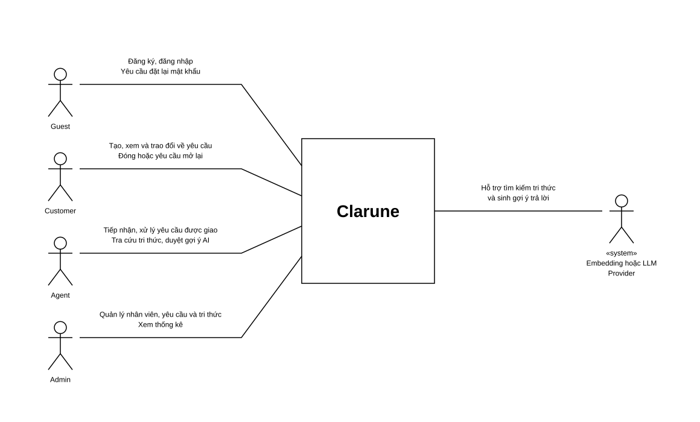

**Hình 3.1  Ranh giới hệ thống và các tác nhân bên ngoài**

Sơ đồ thể hiện các tác nhân tương tác với Clarune trong phạm vi P0. Dịch vụ Email phục vụ đặt lại mật khẩu thuộc P1 nên không xuất hiện; tương tác này được mô tả tại UC-16 và sơ đồ module Định danh và phân quyền. Worker, PostgreSQL/pgvector và private storage là các thành phần nội bộ, không được biểu diễn thành tác nhân bên ngoài.

## **3.2 Danh sách yêu cầu**

### **3.2.1 Đặc tả yêu cầu chức năng**

Các chức năng được nhóm theo nghiệp vụ. Những chức năng ghi “mở rộng” nằm ngoài phạm vi triển khai ban đầu.

| Nhóm chức năng | Chức năng | Mã chức năng | Chi tiết |
| ----- | ----- | ----- | ----- |
| **1\. Định danh và phân quyền** | Đăng ký tài khoản | FR–ID–01 | \- Người dùng mới đăng ký tài khoản khách hàng bằng họ tên, email và mật khẩu. \- Hệ thống kiểm tra định dạng email, yêu cầu mật khẩu và bảo đảm email chưa được sử dụng. Tài khoản tự đăng ký luôn có vai trò khách hàng; người đăng ký không được tự chọn quyền nhân viên hoặc quản trị viên. |
|  | Đăng nhập và bảo vệ mật khẩu | FR–ID–02 | \- Người dùng đăng nhập bằng email và mật khẩu. Nếu thông tin không đúng, hệ thống thông báo lỗi chung, không tiết lộ email có tồn tại hay không. \- Khi đăng nhập thành công, hệ thống cấp mã xác thực để truy cập và mã gia hạn để duy trì phiên đăng nhập. |
|  |  | FR–ID–03 | \- Mật khẩu được kiểm tra và lưu dưới dạng băm một chiều bằng thuật toán chuyên dụng, không lưu hoặc ghi nhật ký mật khẩu nguyên bản. |
|  | Duy trì phiên và đăng xuất | FR–ID–04 | \- Khi phiên truy cập cần được gia hạn, hệ thống kiểm tra mã gia hạn còn hợp lệ và cấp bộ mã xác thực mới; mã gia hạn cũ không được sử dụng lại. |
|  |  | FR–ID–05 | \- Người dùng có thể đăng xuất khỏi thiết bị hiện tại. Hệ thống thu hồi khả năng gia hạn của phiên đó. \- Mã xác thực truy cập đã cấp trước khi đăng xuất có thể còn hiệu lực đến khi hết hạn; giới hạn này phải được nêu rõ trong tài liệu. |
|  | Quản lý hồ sơ cá nhân | FR–ID–06 | \- Người dùng xem, cập nhật thông tin cá nhân và thay đổi mật khẩu của chính mình. \- Khi đổi mật khẩu, hệ thống phải kiểm tra mật khẩu hiện tại trước khi lưu mật khẩu mới. |
|  | Phân quyền truy cập | FR–ID–07 | \- Hệ thống kiểm tra quyền theo vai trò người dùng và quyền sở hữu hoặc phạm vi phụ trách đối với từng dữ liệu. \- Nếu chưa đăng nhập hoặc phiên xác thực không hợp lệ, hệ thống yêu cầu đăng nhập lại. Nếu không có quyền sử dụng chức năng, hệ thống từ chối thao tác. \- Với dữ liệu người dùng không được phép truy cập, hệ thống thông báo như trường hợp không tìm thấy dữ liệu, tránh tiết lộ dữ liệu có tồn tại hay không. |
|  | Quản lý tài khoản nhân viên | FR–ID–08 | \- Chỉ quản trị viên được tạo hoặc vô hiệu hóa tài khoản nhân viên hỗ trợ. Người dùng không được tự đăng ký thành nhân viên hoặc quản trị viên. \- Tài khoản đã bị vô hiệu hóa không thể đăng nhập, gia hạn phiên hoặc tiếp tục sử dụng chức năng cần đăng nhập, kể cả khi mã xác thực cũ chưa hết hạn. |
|  | Đặt lại mật khẩu (mở rộng) | FR–ID–09 | \- Người dùng quên mật khẩu có thể yêu cầu đặt lại mật khẩu trong giai đoạn mở rộng. \- Mã đặt lại mật khẩu chỉ được dùng một lần và có thời hạn. Thông báo xử lý không được tiết lộ email có tồn tại trong hệ thống hay không. |
|   | Tạo yêu cầu hỗ trợ | FR–TK–01 | \- Khách hàng tạo yêu cầu hỗ trợ bằng cách nhập tiêu đề và nội dung mô tả. \- Hệ thống cấp mã yêu cầu duy nhất, đồng thời lưu yêu cầu và tin nhắn công khai đầu tiên từ nội dung mô tả; không lưu thành công một phần nếu có lỗi. |
| **2\. Quản lý yêu cầu hỗ trợ** |  Xem, tìm kiếm và lọc yêu cầu | FR–TK–02 | \- Khách hàng chỉ xem yêu cầu của mình; nhân viên xem yêu cầu được giao và các yêu cầu mới chưa phân công; quản trị viên xem toàn bộ yêu cầu. |
|  |  | FR–TK–03 | \- Trang chi tiết hiển thị cuộc trao đổi và trạng thái xử lý. Nội dung trả về cho khách hàng không bao gồm ghi chú nội bộ. \- Người dùng tìm theo từ khóa, lọc theo trạng thái, người phụ trách và ngày tạo. Kết quả được phân trang, giới hạn số mục mỗi trang và chỉ sắp xếp theo các tiêu chí hệ thống hỗ trợ. |
|  | Tiếp nhận và phân công | FR–TK–04 | \- Nhân viên nhận xử lý yêu cầu mới chưa có người phụ trách. Nếu nhiều người cùng nhận, chỉ một người thành công; yêu cầu chuyển từ “Mới tạo” sang “Đang xử lý”. |
|  |  | FR–TK–05 |  \- Quản trị viên có thể phân công hoặc chuyển yêu cầu cho nhân viên khác đang hoạt động; hệ thống từ chối phân công cho tài khoản đã bị vô hiệu hóa. \- Mọi lần nhận hoặc phân công đều được ghi vào lịch sử xử lý cùng với thay đổi người phụ trách.  |
|  | Trao đổi với khách hàng | FR–TK–06 | \- Khách hàng, nhân viên phụ trách và quản trị viên gửi tin nhắn công khai trên yêu cầu hỗ trợ trong phạm vi quyền và trạng thái cho phép. \- Hệ thống xác định người gửi từ tài khoản đã đăng nhập, không dựa vào thông tin người gửi tự khai trong nội dung gửi lên. |
|  |  |  |  |
|  | Ghi chú nội bộ | FR–TK–07 | \- Nhân viên được phân công và quản trị viên thêm ghi chú nội bộ để phục vụ xử lý yêu cầu. \- Chỉ nhân viên phụ trách và quản trị viên được xem ghi chú; dữ liệu trả về cho khách hàng không được làm lộ nội dung hoặc sự tồn tại của ghi chú nội bộ. |
|  | Cập nhật trạng thái | FR–TK–08 | \- Người dùng thực hiện các thao tác yêu cầu thêm thông tin, đánh dấu đã giải quyết, mở lại hoặc xác nhận đóng theo đúng vai trò và trạng thái hiện tại của yêu cầu. |
|  |  | FR–TK–09 | \- Hệ thống chỉ cho phép chuyển trạng thái theo quy trình xử lý đã quy định; nếu thao tác không hợp lệ, hệ thống thông báo lý do và giữ nguyên trạng thái. |
|  | Xem lịch sử xử lý | FR–TK–10 | \- Nhân viên được phân công và quản trị viên xem lịch sử tiếp nhận, phân công và chuyển trạng thái của yêu cầu. \- Mỗi sự kiện ghi rõ người thực hiện, thời điểm và nội dung thay đổi. Lịch sử chỉ được ghi bổ sung, không được tự ý sửa hoặc xóa các sự kiện đã lưu qua chức năng nghiệp vụ. |
|  | Tệp đính kèm (mở rộng) | FR–TK–11 | \- Hỗ trợ đính kèm tệp vào yêu cầu trong giai đoạn mở rộng. \- Hệ thống kiểm tra loại và dung lượng tệp; chỉ cho phép người có quyền truy cập yêu cầu tải tệp xuống. |
|  | Thống kê tổng quan (mở rộng) | FR–TK–12 | \- Quản trị viên xem bảng tổng quan và các thống kê cơ bản trong giai đoạn mở rộng. \- Thống kê gồm số lượng yêu cầu theo trạng thái và theo nhân viên phụ trách. |
|  |  Tải lên và lưu tài liệu | FR–KB–01 | \- Quản trị viên tải lên tài liệu PDF có lớp văn bản, tệp văn bản thuần hoặc tệp Markdown. |
|  |  | FR–KB–02 | \- Hệ thống kiểm tra định dạng, phần mở rộng, nội dung cơ bản và dung lượng tối đa 10 MiB cho mỗi tệp. \- Khi tải lên thành công, hệ thống lưu tệp, thông tin mô tả và tạo công việc xử lý nền. Việc xử lý tài liệu được thực hiện sau đó, không gọi mô hình AI trong lúc tiếp nhận tệp. |
|  |  Trích xuất và lập chỉ mục | FR–KB–03 | \- Hệ thống trích xuất văn bản từ các tài liệu được hỗ trợ. Nếu PDF chỉ chứa ảnh quét và không có lớp văn bản, hệ thống thông báo xử lý thất bại do chưa hỗ trợ loại tài liệu này. |
|  |  | FR–KB–04 | \- Văn bản được chia thành các đoạn nhỏ, kèm thông tin số trang khi có và thứ tự đoạn để xác định vị trí nguồn. \- Mỗi đoạn được chuyển thành một dãy số biểu diễn ý nghĩa, theo số chiều đã cấu hình, phục vụ tìm kiếm nội dung liên quan. |
|  | Theo dõi và xử lý lỗi | FR–KB–05 | \- Quản trị viên theo dõi tiến trình xử lý của từng tài liệu qua các trạng thái “Đã tải lên”, “Đang xử lý”, “Sẵn sàng” hoặc “Thất bại”. \- Khi gặp lỗi tạm thời, hệ thống tự thử lại với tổng số lần xử lý không quá 3, kể cả lần đầu. Nếu vẫn thất bại, hệ thống hiển thị lý do phù hợp, không tiết lộ thông tin kỹ thuật nhạy cảm. |
|  | Xem danh mục tài liệu | FR–KB–09 | Quản trị viên xem danh sách tài liệu có phân trang và mở chi tiết từng tài liệu. Danh sách hiển thị tên tài liệu, thời điểm tải lên, trạng thái xử lý và tình trạng công bố/lưu trữ. |
| **3\. Cơ sở tri thức** |  Công bố tài liệu | FR–KB–06 | \- Quản trị viên công bố tài liệu để đưa vào sử dụng. |
|  |  |  | \- Chỉ được công bố khi tài liệu đã xử lý thành công và ở trạng thái “Sẵn sàng”; tải lên thành công không đồng nghĩa với đã công bố. |
|  | Tìm kiếm tri thức | FR–KB–07 | \- Nhân viên và quản trị viên tìm kiếm tài liệu hoặc các đoạn nội dung liên quan trong kho tri thức. \- Chỉ hiển thị kết quả thuộc phạm vi được phép truy cập, đã xử lý thành công, đã công bố và chưa được đưa vào lưu trữ. |
|  | Lưu trữ tài liệu | FR–KB–08 | \- Quản trị viên đưa tài liệu không còn sử dụng vào trạng thái lưu trữ. |
|  |  |  | \- Ngay sau khi thao tác được lưu thành công, tài liệu không còn được dùng cho các lần tìm kiếm hoặc tạo gợi ý AI mới. |
|  | Phiên bản và OCR (mở rộng) | FR–KB–10 | \- Quản lý các phiên bản tài liệu và nhận dạng chữ trong tài liệu ảnh quét thuộc giai đoạn mở rộng. \- Các chức năng này không thuộc phạm vi triển khai ban đầu. |
|   | Yêu cầu gợi ý và lấy ngữ cảnh | FR–AI–01 | \- Nhân viên được phân công hoặc quản trị viên yêu cầu AI gợi ý câu trả lời cho yêu cầu hỗ trợ mà mình có quyền truy cập. Việc tạo gợi ý không tự thay đổi yêu cầu hỗ trợ. |
|  |  | FR–AI–02 | \- Hệ thống chỉ lấy các tin nhắn công khai cần thiết và thông tin liên quan đã được lọc để gửi cho AI; mặc định không gửi ghi chú nội bộ. |
|  **4\. Trợ lý AI** | Truy xuất tri thức | FR–AI–03 | \- Hệ thống tìm các đoạn tri thức có ý nghĩa phù hợp với nội dung cần trả lời, dựa trên dữ liệu tìm kiếm đã lập chỉ mục. \- Chỉ sử dụng tài liệu đã xử lý thành công, đã công bố và chưa được lưu trữ. Số đoạn được chọn và mức độ liên quan tối thiểu có thể cấu hình. |
|  | Sinh câu trả lời và dẫn nguồn | FR–AI–04 | \- AI tạo bản nháp câu trả lời dựa trên các đoạn tri thức đã tìm được; hệ thống giới hạn độ dài nội dung tạo ra. |
|  |  | FR–AI–05 | \- Hướng dẫn gửi cho AI phải phân biệt rõ yêu cầu của hệ thống với nội dung tài liệu tham khảo, tránh coi câu lệnh trong tài liệu là chỉ dẫn cần thực hiện. \- Hệ thống kiểm tra để mỗi dẫn nguồn trỏ đúng một đoạn đã được truy xuất và lưu bản chụp đoạn trích tại thời điểm tạo gợi ý để có thể đối chiếu về sau. |
|  | Xử lý khi thiếu căn cứ | FR–AI–06 | \- Nếu không có đủ thông tin đáng tin cậy trong tài liệu, hệ thống thông báo chưa đủ căn cứ để tạo câu trả lời. \- AI không được tự đặt ra chính sách, điều khoản hoặc dẫn nguồn không có thật để hoàn thiện câu trả lời. |
|  | Kiểm duyệt và gửi phản hồi | FR–AI–07 | \- Nhân viên phụ trách hoặc quản trị viên đọc bản nháp, đối chiếu nguồn và chỉnh sửa khi cần trước khi chủ động gửi. \- Gợi ý AI không tự gửi cho khách hàng. Chỉ nội dung đã được người có quyền duyệt và chọn gửi mới trở thành tin nhắn công khai. |
|  | Lưu lịch sử gợi ý | FR–AI–08 | \- Hệ thống lưu người yêu cầu, yêu cầu hỗ trợ liên quan, mô hình AI sử dụng, thời điểm tạo, nội dung gợi ý, trạng thái xử lý và các nguồn trích dẫn. \- Lịch sử cho phép đối chiếu yêu cầu tạo gợi ý với kết quả và nguồn đã sử dụng; không lưu khóa truy cập dịch vụ AI. |
|  | Giới hạn và xử lý sự cố | FR–AI–09 | \- Hệ thống giới hạn số lần yêu cầu tạo gợi ý và thời gian chờ dịch vụ AI. \- Khi dịch vụ AI gặp lỗi, hết hạn mức hoặc phản hồi quá chậm, hệ thống thông báo rõ tình trạng. Các chức năng tạo, xử lý và trả lời yêu cầu hỗ trợ vẫn hoạt động bình thường. |
|  | Đánh giá gợi ý (mở rộng) | FR–AI–10 | \- Nhân viên đang được phân công ticket đánh giá gợi ý AI là Hữu ích hoặc Không hữu ích trong giai đoạn mở rộng (P1). Chỉ cho phép đánh giá gợi ý ở trạng thái GENERATED hoặc APPLIED. \- Mỗi cặp nhân viên-gợi ý chỉ có một đánh giá hiện hành; nhân viên có thể thay đổi lựa chọn của chính mình. Việc đánh giá không gửi phản hồi, thay đổi ticket hoặc trạng thái gợi ý. |

### **3.2.2 Đặc tả yêu cầu phi chức năng**

Các yêu cầu sau mô tả chất lượng, hiệu năng và ràng buộc kỹ thuật của hệ thống. Các chỉ số là mục tiêu cần đo trong điều kiện kiểm thử được ghi nhận.

| Tiền tố mã | Nhóm chức năng | Chi tiết |
| :---- | :---- | :---- |
| **NFR – SEC** | **Bảo mật, phân quyền** | NFR–SEC–01: Không lưu trữ mật khẩu hoặc token dạng thô; mọi thông tin nhạy cảm phải lấy từ biến môi trường. Bắt buộc dùng giao thức bảo mật (TLS) khi triển khai công khai và có kịch bản kiểm thử các trường hợp token hết hạn hoặc bị thu hồi. |
|  |  | NFR–SEC–02: 100% các endpoint được bảo vệ phải có bài kiểm tra về phân quyền và quyền sở hữu. Tuyệt đối không để lộ các ghi chú nội bộ trong phản hồi gửi cho khách hàng. |
|  | **An toàn dữ liệu đầu vào** | NFR–SEC–03: Giới hạn dung lượng tối đa 10 MiB, chỉ chấp nhận các định dạng/phần mở rộng được cho phép. Tên file không được dùng trực tiếp làm đường dẫn để tránh lỗ hổng bảo mật, và hệ thống tuyệt đối không thực thi các file được tải lên. |
|  |  | NFR–SEC–04: Mọi truy vấn database phải sử dụng parameterized query qua JPA/JDBC. Log hệ thống phải được làm sạch dữ liệu nhạy cảm. Riêng với mô hình RAG, các văn bản nguồn phải luôn được đối xử như dữ liệu không đáng tin cậy. |
| **NFR – PRIV** | **Quyền riêng tư** | NFR–PRIV–01: Dữ liệu dùng để demo phải là dữ liệu giả lập; loại bỏ thông tin nhận dạng cá nhân (PII) không cần thiết, không gửi ghi chú nội bộ và bí mật hệ thống trước khi gửi dữ liệu cho LLM; đồng thời phải công bố rõ ràng nếu sử dụng dịch vụ AI từ bên thứ ba. |
| **NFR – REL** | **Độ tin cậy** | NFR–REL–01: Ngay cả khi dịch vụ LLM gặp sự cố, API xử lý ticket vẫn phải hoạt động bình thường (cho phép tạo, sửa, trả lời). Điều này được kiểm chứng bằng phương pháp bơm lỗi giả lập (fault injection). |
| **NFR – CONS** | **Tính nhất quán** | NFR–CONS–01: Khi có hai Agent cùng lúc cố gắng nhận (claim) một ticket, hệ thống phải đảm bảo xử lý đồng thời sao cho chỉ có đúng 1 người thành công và 1 người thất bại qua tối thiểu 20 lần kiểm thử đồng thời liên tiếp. |
|  |  | NFR–CONS–02: Các thao tác chuyển trạng thái, phân công hoặc nhận ticket không được phép commit một nửa; mọi thay đổi ở cơ sở dữ liệu và sự kiện (event) phải nằm chung trong một transaction. |
| **NFR – PERF** | **Hiệu năng REST** | NFR–PERF–01: Mục tiêu đạt p95 dưới 800 ms cho các API CRUD thông thường với giả định 20 người dùng ảo, chạy trên hạ tầng và dữ liệu mẫu đã được định nghĩa cụ thể. |
|  | **Thời gian sinh gợi ý** | NFR–PERF–02: Mục tiêu đạt p95 dưới 12 giây cho các gợi ý từ AI khi nhà cung cấp (provider) hoạt động ổn định. Trường hợp nhà cung cấp ngoài không ổn định sẽ được ghi nhận là timeout và không dùng để chấm điểm chuẩn. |
|  | **Xử lý tài liệu** | NFR–PERF–03: Một file PDF dựa trên văn bản dung lượng khoảng 1 MiB phải được xử lý sang trạng thái sẵn sàng (READY) trong vòng 60 giây ở môi trường thử nghiệm tiêu chuẩn; nếu vượt quá thời gian này, cần tiến hành phân tích điểm nghẽn (bottleneck). |
| **NFR – AI** | **Chất lượng câu trả lời AI** | NFR–AI–01: Dựa trên bộ 30 câu hỏi chuẩn trở lên có kèm đáp án và tài liệu tham khảo, độ chính xác của trích dẫn (citation accuracy) phải đạt từ 90% trở lên ở các tập dữ liệu có đủ bằng chứng. |
|  |  | NFR–AI–02: Ở các trường hợp không có bằng chứng (no-evidence), AI phải từ chối trả lời không căn cứ ít nhất 80% số lần. |
|  | **An toàn khi sử dụng AI** | NFR–AI–03: Bộ kiểm thử các câu lệnh độc hại (prompt injection/document injection) không được phép làm cho AI tự ý thực hiện các hành động nội bộ hoặc làm lộ thông tin bí mật. |
| **NFR – OBS** | **Khả năng theo dõi** | NFR–OBS–01: Hệ thống phải có log cấu trúc kèm theo ID theo dõi, ghi nhận đầy đủ độ trễ AI và trạng thái công việc, tuyệt đối không log mật khẩu, token hay dữ liệu nhạy cảm dạng thô. |
| **NFR – MAIN** | **Bảo trì** | NFR–MAIN–01: Cấu trúc mã nguồn chia module rõ ràng, các bản cập nhật database (migration) được quản lý theo phiên bản, có tài liệu API đầy đủ và quy định bắt buộc phải có đồng nghiệp review PR đối với các thay đổi quan trọng. |
| **NFR – TEST** | **Kiểm thử** | NFR–TEST–01: Có hệ thống test tự động cho toàn bộ luồng nghiệp vụ, phân quyền (RBAC), xử lý đồng thời và bộ lọc tìm kiếm; CI bắt buộc phải chạy pass trước khi tiến hành merge code. |
| **NFR – DEPLOY** | **Khả năng triển khai lại** | NFR–DEPLOY–01: Cung cấp đầy đủ Docker Compose, file .env.example, dữ liệu mẫu (seed data) và file README để có thể dựng và chạy demo ngay trên một máy tính hoàn toàn mới. |
| **NFR – UX** | **Khả dụng giao diện** | NFR–UX–01: Giao diện hoạt động tốt trên cả máy tính và thiết bị di động (responsive); các trạng thái đang tải, lỗi hay dữ liệu trống đều phải hiển thị trực quan, dễ hiểu cho người dùng. |

# **4 Phân tích yêu cầu**

## **4.1 Sơ đồ Use Case**

### **4.1.1 Sơ đồ Use Case tổng thể**

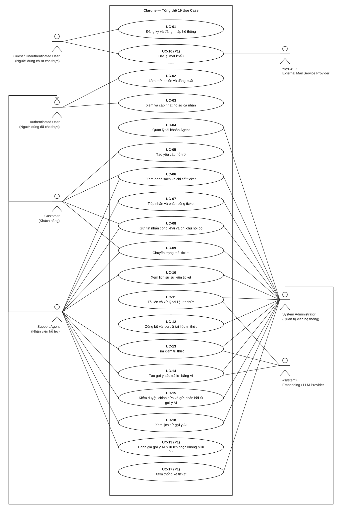

**Hình 4.1  Tổng thể 19 Use Case trong ranh giới hệ thống**

### **4.1.2 Sơ đồ Use Case Module Định danh và phân quyền**

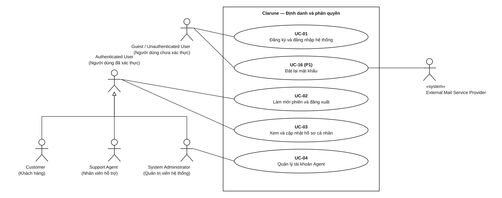

**Hình 4.2  Use Case Module Định danh và phân quyền**

### **4.1.3 Sơ đồ Use Case Module Quản lý ticket**

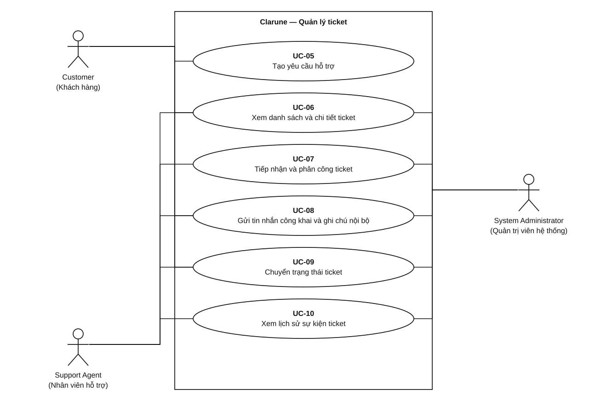

**Hình 4.3  Use Case Module Quản lý ticket**

### **4.1.4 Sơ đồ Use Case Module Cơ sở tri thức**

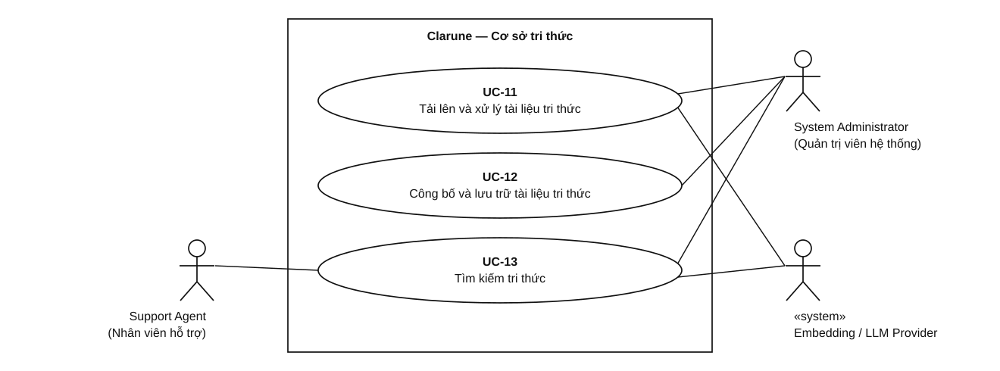

**Hình 4.4  Use Case Module Cơ sở tri thức**

### **4.1.5 Sơ đồ Use Case Module Trợ lý AI**

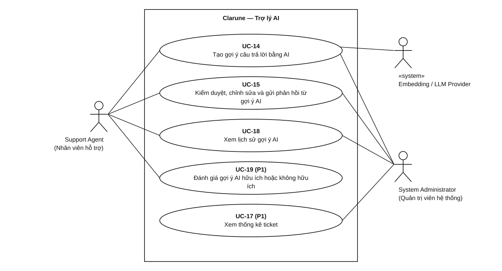

**Hình 4.5  Use Case Module Trợ lý AI**

## **4.2 Đặc tả Use Case**

Mỗi bảng gồm 9 trường. Luồng A/B/C là các luồng độc lập; nhánh như A.3a phát sinh tại A.3. Thứ tự trình bày theo module không thay đổi mã Use Case.

### **4.2.1 Đăng ký và đăng nhập hệ thống \[UC-01\]**

| Use case ID | UC-01 |
| :---- | :---- |
| **Tên Use Case** | Đăng ký và đăng nhập hệ thống |
| **Tóm tắt** | \- Khách đăng ký tài khoản Customer. \- Người dùng xác thực bằng email và mật khẩu để bắt đầu phiên làm việc. |
| **Tác nhân** | \- Khách chưa có tài khoản khi đăng ký (Guest / Unauthenticated User). \- Customer, Support Agent, System Administrator ở trạng thái chưa xác thực phiên khi đăng nhập. |
| **Điều kiện tiên quyết** | \- Người dùng truy cập được ứng dụng. Đăng ký áp dụng cho người chưa có tài khoản. \- Đăng nhập áp dụng cho người đã có tài khoản. |
| **Kết quả** | \- Đăng ký thành công tạo tài khoản CUSTOMER.  \- Đăng nhập thành công cấp Access Token và Refresh Token, chuyển đến giao diện theo vai trò.  \- Nhánh lỗi không cấp phiên đăng nhập. |
| **Kịch bản chính** | Luồng A \- Đăng ký \- A.1. Khách chọn Đăng ký; hệ thống hiển thị biểu mẫu họ tên, email, mật khẩu và xác nhận mật khẩu. \- A.2. Khách nhập dữ liệu và gửi biểu mẫu. \- A.3. Hệ thống kiểm tra dữ liệu, xác nhận mật khẩu và tính duy nhất của email. \- A.4. Hệ thống băm mật khẩu bằng PasswordEncoder đã cấu hình, gán CUSTOMER ở phía máy chủ; không chấp nhận vai trò do khách tự gửi. \- A.5. Hệ thống lưu tài khoản, báo thành công và chuyển về Đăng nhập; luồng A kết thúc. Luồng B \- Đăng nhập \- B.1. Người dùng nhập email, mật khẩu và chọn Đăng nhập. \- B.2. Hệ thống kiểm tra thông tin xác thực và trạng thái enabled của tài khoản. \- B.3. Hệ thống cấp Access Token 15 phút và Refresh Token 7 ngày theo cấu hình; chỉ lưu bản băm Refresh Token. \- B.4. Hệ thống trả phiên an toàn và mở trang phù hợp với vai trò; luồng B kết thúc. |
| **Kịch bản phụ** | \- A.3a. Thông tin đăng ký không hợp lệ → Hệ thống hiển thị lỗi và yêu cầu nhập lại. \- A.3b. Email đã tồn tại → Hệ thống thông báo email đã được sử dụng, không tạo tài khoản mới. \- B.2a. Email hoặc mật khẩu không chính xác → Hệ thống thông báo lỗi chung và yêu cầu đăng nhập lại. \- B.2b. Tài khoản bị vô hiệu hóa → Hệ thống từ chối đăng nhập và thông báo lỗi. |
| **Ràng buộc phi chức năng** | \- Mật khẩu và Refresh Token phải được lưu dưới dạng mã băm an toàn, không lưu giá trị nguyên bản trên máy chủ. \- Không tiết lộ thông tin tài khoản khi đăng nhập thất bại. \- Các chức năng yêu cầu đăng nhập phải được kiểm tra phân quyền và bảo vệ thông tin xác thực. |

### **4.2.2 Làm mới phiên và đăng xuất \[UC-02\]**

| Use case ID | UC-02 |
| :---- | :---- |
| **Tên Use Case** | Làm mới phiên và đăng xuất |
| **Tóm tắt** | \- Tự động làm mới phiên làm việc bằng Refresh Token có xoay vòng. \- Đăng xuất thu hồi phiên trên thiết bị hiện tại. |
| **Tác nhân** | Người dùng đã đăng nhập (Customer, Support Agent, System Administrator). |
| **Điều kiện tiên quyết** | \- Luồng A: Client có phiên hợp lệ với Refresh Token còn hiệu lực. \- Luồng B: Người dùng chọn kết thúc phiên làm việc hiện tại. |
| **Kết quả** | \- Làm mới thành công: cấp Access Token mới và xoay vòng Refresh Token mới; token cũ bị vô hiệu hóa. \- Đăng xuất: thu hồi phiên trên máy chủ, xóa token trong bộ nhớ ứng dụng và xóa cookie phiên trên trình duyệt. \- Access Token cũ có thể còn hiệu lực ngắn cho đến khi tự hết hạn theo quy định an toàn. |
| **Kịch bản chính** | Luồng A \- Làm mới phiên: \- A.1. Ứng dụng phát hiện Access Token hết hạn, gửi yêu cầu làm mới. Refresh Token được trình duyệt tự động gửi kèm qua cookie an toàn (HttpOnly) cùng mã chống giả mạo (CSRF). \- A.2. Hệ thống kiểm tra mã CSRF, tính hợp lệ của Refresh Token, thời hạn phiên và trạng thái tài khoản đang hoạt động. \- A.3. Hệ thống thực hiện vô hiệu hóa Refresh Token cũ và cấp cặp token mới trong cùng một xử lý nguyên tử (cùng thành công hoặc cùng hủy). \- A.4. Hệ thống cập nhật cookie an toàn mới cho trình duyệt, trả Access Token mới cho ứng dụng tiếp tục thao tác; Luồng A kết thúc. Luồng B \- Đăng xuất: \- B.1. Người dùng chọn Đăng xuất; ứng dụng gửi yêu cầu kết thúc phiên kèm mã CSRF và cookie phiên. \- B.2. Hệ thống thu hồi phiên làm việc trên máy chủ và gửi yêu cầu xóa cookie an toàn trên trình duyệt. \- B.3. Ứng dụng xóa Access Token khỏi bộ nhớ tạm và chuyển người dùng về màn hình Đăng nhập; Luồng B kết thúc. |
| **Kịch bản phụ** | \- A.2a. Token không hợp lệ, hết hạn, bị thu hồi hoặc sai mã CSRF: Hệ thống từ chối làm mới phiên, xóa cookie phiên và yêu cầu người dùng đăng nhập lại. \- A.2b. Xử lý nhiều yêu cầu làm mới đồng thời:   \+ Phía ứng dụng (Client): Dùng một yêu cầu làm mới chung cho các tác vụ đồng thời bị hết hạn, chỉ thử lại tác vụ ban đầu một lần và không tạo vòng lặp làm mới.   \+ Phía hệ thống (Server): Với hai yêu cầu gửi cùng một Refresh Token cũ, hệ thống chỉ chấp nhận xoay vòng cho yêu cầu đầu tiên; yêu cầu còn lại bị từ chối và không sinh thêm phiên hợp lệ. \- A.2c. Tài khoản bị vô hiệu hóa trong khi phiên còn hạn: Hệ thống từ chối làm mới phiên, hủy các phiên đang hoạt động của người dùng và chuyển về màn hình đăng nhập. \- B.2a. Mất kết nối khi đăng xuất:   \+ Ứng dụng xóa ngay Access Token trong bộ nhớ tạm trên thiết bị và chuyển về màn hình Đăng nhập.   \+ Do mất mạng, cookie an toàn (HttpOnly) trên trình duyệt và phiên trên máy chủ chưa được hủy tức thì, nhưng sẽ tự động hết hiệu lực theo thời gian hoặc khi có kết nối trở lại. |
| **Ràng buộc phi chức năng** | \- Bảo mật: Không lưu hoặc hiển thị Refresh Token dưới dạng văn bản gốc trong nhật ký hệ thống. Access Token chỉ lưu trong bộ nhớ tạm (memory) của ứng dụng; Refresh Token bắt buộc bảo vệ bằng cookie HttpOnly và kiểm tra mã CSRF. \- Toàn vẹn phiên: Quá trình xoay vòng token phải đảm bảo tính nguyên tử để ngăn chặn việc tái sử dụng token cũ hoặc mất phiên bất thường. |

### **4.2.3 Xem và cập nhật hồ sơ cá nhân \[UC-03\]**

| Use case ID | UC-03 |
| :---- | :---- |
| **Tên Use Case** | Xem và cập nhật hồ sơ cá nhân |
| **Tóm tắt** | Người dùng xem, cập nhật hồ sơ của chính mình hoặc đổi mật khẩu sau khi xác minh mật khẩu hiện tại. |
| **Tác nhân** | Mọi người dùng đã xác thực (Customer, Support Agent, Administrator). |
| **Điều kiện tiên quyết** | Người dùng đã xác thực, tài khoản enabled. |
| **Kết quả** | Hồ sơ hoặc mật khẩu được cập nhật khi hợp lệ. Nhánh lỗi giữ nguyên dữ liệu đã lưu. |
| **Kịch bản chính** | Luồng A \- Hồ sơ cá nhân \- A.1. Người dùng mở trang Hồ sơ cá nhân. \- A.2. Hệ thống hiển thị thông tin hồ sơ; email và vai trò không được chỉnh sửa. \- A.3. Người dùng thay đổi thông tin được phép và chọn Lưu. \- A.4. Hệ thống kiểm tra, cập nhật thông tin và thông báo thành công; luồng A kết thúc. Luồng B \- Đổi mật khẩu \- B.1. Từ hồ sơ, người dùng chọn Đổi mật khẩu, nhập mật khẩu hiện tại, mật khẩu mới và xác nhận. \- B.2. Hệ thống đối chiếu mật khẩu hiện tại, kiểm tra mật khẩu mới và phần xác nhận theo chính sách cấu hình. \- B.3. Hệ thống lưu mật khẩu mới dưới dạng mã băm và thông báo thành công; luồng B kết thúc. |
| **Kịch bản phụ** | \- A.4a. Thông tin cập nhật không hợp lệ → Hệ thống hiển thị lỗi, không lưu thay đổi và yêu cầu nhập lại. \- B.2a. Mật khẩu hiện tại không chính xác → Hệ thống thông báo lỗi và yêu cầu nhập lại. \- B.2b. Mật khẩu mới không hợp lệ hoặc xác nhận không khớp → Hệ thống thông báo lỗi và yêu cầu nhập lại. |
| **Ràng buộc phi chức năng** | \- Bảo mật thông tin cá nhân và mật khẩu của người dùng. \- Không lưu hoặc ghi nhật ký mật khẩu nguyên bản. \- Ngăn chặn truy cập trái phép vào hồ sơ của người dùng khác. |

### **4.2.4 Quản lý tài khoản Agent \[UC-04\]**

| Use case ID | UC-04 |
| :---- | :---- |
| **Tên Use Case** | Quản lý tài khoản Agent |
| **Tóm tắt** | Admin tạo tài khoản Agent, vô hiệu hóa hoặc kích hoạt lại Agent. |
| **Tác nhân** | Quản trị viên hệ thống (System Administrator). |
| **Điều kiện tiên quyết** | Admin đã xác thực, tài khoản enabled và có quyền quản lý Agent. |
| **Kết quả** | Tài khoản Agent được tạo hoặc cập nhật enabled. Agent bị vô hiệu hóa không thể đăng nhập, làm mới phiên hoặc thực hiện các yêu cầu có xác thực tiếp theo, kể cả khi Access Token cũ chưa hết hạn. |
| **Kịch bản chính** | Luồng A \- Tạo Agent \- A.1. Admin mở Quản trị người dùng; hệ thống hiển thị danh sách Agent và trạng thái. \- A.2. Admin chọn Thêm nhân viên, nhập họ tên, email và mật khẩu khởi tạo. \- A.3. Hệ thống kiểm tra thông tin, tạo tài khoản với vai trò Agent. \- A.4. Hệ thống lưu tài khoản, cập nhật danh sách; kết thúc luồng A. Luồng B \- Vô hiệu hóa \- B.1. Admin chọn một Agent đang hoạt động và yêu cầu vô hiệu hóa. \- B.2. Admin xác nhận yêu cầu. \- B.3. Hệ thống vô hiệu hóa tài khoản, chặn đăng nhập và các truy cập tiếp theo. \- B.4. Hệ thống cập nhật trạng thái tài khoản; kết thúc luồng B. Luồng C \- Kích hoạt lại \- C.1. Admin chọn Agent đã bị vô hiệu hóa. \- C.2. Admin yêu cầu kích hoạt lại tài khoản. \- C.3. Hệ thống lưu trạng thái kích hoạt lại tài khoản và thông báo thành công; kết thúc luồng C. |
| **Kịch bản phụ** | \- A.1a. Người dùng không có quyền quản trị hoặc phiên làm việc hết hạn: Hệ thống từ chối truy cập, không hiển thị danh sách người dùng và chuyển về trang thông báo lỗi phân quyền. \- A.3a. Email đã tồn tại hoặc thông tin không hợp lệ: Hệ thống hiển thị thông báo lỗi, không tạo tài khoản và yêu cầu nhập lại thông tin. \- A.4a, B.3a hoặc C.3a. Không lưu được thay đổi: Hệ thống hủy các thay đổi của thao tác và thông báo thất bại, cho phép thử lại. Nếu tạo mới thất bại, không tạo tài khoản Agent. Nếu vô hiệu hóa hoặc kích hoạt lại thất bại, giữ nguyên trạng thái tài khoản trước thao tác. \- B.2a. Admin hủy yêu cầu vô hiệu hóa: Hệ thống đóng hộp thoại xác nhận và giữ nguyên trạng thái tài khoản. |
| **Ràng buộc phi chức năng** | \- Bảo đảm chỉ Admin được truy cập chức năng quản lý Agent. \- Không lưu hoặc ghi nhật ký mật khẩu khởi tạo dưới dạng nguyên bản. \- Các chức năng quản trị phải được kiểm thử phân quyền và truy cập trái phép. |

### **4.2.5 Đặt lại mật khẩu \[UC-16\]**

| Use case ID | UC-16 |
| :---- | :---- |
| **Tên Use Case** | Đặt lại mật khẩu (P1) |
| **Tóm tắt** | Người dùng yêu cầu liên kết đặt lại mật khẩu bằng token một lần có thời hạn. Đây là chức năng P1. |
| **Tác nhân** | Người dùng chưa đăng nhập (Unauthenticated User). |
| **Điều kiện tiên quyết** | Người dùng truy cập được biểu mẫu Quên mật khẩu. Không cần phiên đăng nhập. |
| **Kết quả** | Khi token và mật khẩu mới hợp lệ, mật khẩu được thay đổi và token bị đánh dấu đã dùng. Phản hồi yêu cầu ban đầu không tiết lộ email có tồn tại. |
| **Kịch bản chính** | 1\. Người dùng chọn Quên mật khẩu tại trang Đăng nhập. 2\. Hệ thống hiển thị biểu mẫu yêu cầu nhập email. 3\. Người dùng nhập email và gửi yêu cầu. 4\. Hệ thống kiểm tra thông tin và gửi liên kết đặt lại mật khẩu nếu tài khoản tồn tại. 5\. Người dùng mở liên kết, nhập mật khẩu mới và xác nhận. 6\. Hệ thống kiểm tra liên kết và mật khẩu mới. 7\. Hệ thống cập nhật mật khẩu, vô hiệu hóa liên kết đã sử dụng và thông báo thành công; Use Case kết thúc. |
| **Kịch bản phụ** | \- 3a. Email không hợp lệ → Hệ thống hiển thị lỗi và yêu cầu nhập lại. \- 4a. Email không tồn tại → Hệ thống vẫn hiển thị thông báo chung, không tiết lộ thông tin tài khoản. \- 6a. Liên kết không hợp lệ, hết hạn hoặc đã sử dụng → Hệ thống từ chối đặt lại mật khẩu và yêu cầu thực hiện lại. \- 6b. Mật khẩu mới không hợp lệ hoặc xác nhận không khớp → Hệ thống thông báo lỗi và yêu cầu nhập lại. |
| **Ràng buộc phi chức năng** | \- Không tiết lộ email có tồn tại trong hệ thống hay không. \- Bảo mật token đặt lại mật khẩu và không lưu token nguyên bản. \- Không lưu hoặc ghi nhật ký mật khẩu mới dưới dạng nguyên bản. |

### **4.2.6 Tạo yêu cầu hỗ trợ \[UC-05\]**

| Use case ID | UC-05 |
| :---- | :---- |
| **Tên Use Case** | Tạo yêu cầu hỗ trợ |
| **Tóm tắt** | Khách hàng tạo yêu cầu hỗ trợ bằng cách nhập tiêu đề và nội dung mô tả. Chức năng đính kèm tệp thuộc giai đoạn mở rộng. |
| **Tác nhân** | Khách hàng đã đăng nhập. |
| **Điều kiện tiên quyết** | Khách hàng đã đăng nhập và tài khoản đang hoạt động. |
| **Kết quả** | Yêu cầu hỗ trợ được tạo ở trạng thái “Mới tạo”, có mức ưu tiên “Bình thường” và chưa có nhân viên phụ trách. Nội dung mô tả được lưu thành tin nhắn công khai đầu tiên; lịch sử đồng thời ghi nhận việc tạo yêu cầu. |
| **Kịch bản chính** | 1\. Khách hàng chọn “Tạo yêu cầu mới”; hệ thống hiển thị biểu mẫu gồm tiêu đề và nội dung mô tả. 2\. Khách hàng nhập tiêu đề từ 5 đến 150 ký tự, mô tả từ 10 đến 5000 ký tự và chọn “Gửi yêu cầu”. 3\. Hệ thống xác định người tạo từ tài khoản đã đăng nhập, kiểm tra quyền tạo yêu cầu và tính hợp lệ của nội dung. 4\. Hệ thống cấp mã yêu cầu duy nhất, gắn yêu cầu với khách hàng đang đăng nhập, đặt trạng thái “Mới tạo”, mức ưu tiên “Bình thường” và chưa phân công nhân viên. Yêu cầu, tin nhắn công khai đầu tiên và sự kiện tạo yêu cầu được lưu cùng nhau. 5\. Hệ thống thông báo tạo yêu cầu thành công và mở trang chi tiết; Use Case kết thúc. |
| **Kịch bản phụ** | \- 2a. Đính kèm tệp trong giai đoạn mở rộng: Khách hàng chọn tệp; hệ thống kiểm tra loại tệp, dung lượng và quyền tải xuống. Nếu hợp lệ, tiếp tục bước 3; nếu không, thông báo lý do và quay lại bước 2\. \- 3a. Tiêu đề hoặc mô tả không hợp lệ: Hệ thống chỉ rõ nội dung cần sửa, không tạo yêu cầu và quay lại bước 2\. \- 4a. Không lưu được dữ liệu: Hệ thống hủy toàn bộ dữ liệu vừa tạo, gồm yêu cầu, tin nhắn đầu tiên và sự kiện liên quan; thông báo tạo yêu cầu thất bại; nhánh kết thúc. |
| **Ràng buộc phi chức năng** | \- Bảo mật: Kiểm tra quyền tạo yêu cầu trên máy chủ. Nếu có tệp đính kèm, chỉ chấp nhận loại tệp được cho phép, dung lượng tối đa 10 MiB; tên tệp phải được xử lý an toàn và tệp tải lên không được thực thi. \- Tính toàn vẹn: Yêu cầu hỗ trợ, tin nhắn đầu tiên và sự kiện tạo yêu cầu phải được lưu đồng thời; nếu có lỗi, toàn bộ thay đổi phải được hủy. \- Độ tin cậy: Khách hàng vẫn tạo được yêu cầu hỗ trợ khi dịch vụ AI gặp sự cố. \- Hiệu năng: Mục tiêu xử lý dưới 800 mili giây cho ít nhất 95% yêu cầu tạo ticket khi kiểm thử với 20 người dùng giả lập đồng thời; hạ tầng và dữ liệu mẫu phải được ghi rõ. \- Trải nghiệm người dùng: Biểu mẫu dễ sử dụng trên máy tính và điện thoại; hiển thị rõ trạng thái đang gửi, kết quả thành công và lỗi cần sửa. |

### **4.2.7 Xem danh sách và chi tiết ticket \[UC-06\]**

| Use case ID | UC-06 |
| :---- | :---- |
| **Tên Use Case** | Xem danh sách và chi tiết ticket |
| **Tóm tắt** | Người dùng tìm kiếm, lọc và xem chi tiết các yêu cầu hỗ trợ trong phạm vi được phép truy cập. |
| **Tác nhân** | Khách hàng, nhân viên hỗ trợ và quản trị viên. |
| **Điều kiện tiên quyết** | Người dùng đã đăng nhập và tài khoản đang hoạt động. |
| **Kết quả** | Người dùng xem được danh sách hoặc chi tiết yêu cầu hỗ trợ trong phạm vi quyền của mình. Nội dung trả về cho khách hàng không bao gồm ghi chú nội bộ. |
| **Kịch bản chính** | 1\. Người dùng mở danh sách yêu cầu hỗ trợ. 2\. Hệ thống xác định tài khoản đang đăng nhập và giới hạn dữ liệu được xem: khách hàng chỉ thấy yêu cầu của mình; nhân viên thấy yêu cầu mới chưa có người phụ trách và các yêu cầu được giao cho mình; quản trị viên thấy toàn bộ yêu cầu. 3\. Hệ thống hiển thị danh sách có phân trang và cho phép sắp xếp theo các tiêu chí được hỗ trợ. 4\. Người dùng tìm theo từ khóa hoặc lọc theo trạng thái, người phụ trách và ngày tạo. Hệ thống hiển thị kết quả phù hợp trong phạm vi được phép xem. 5\. Người dùng chọn một yêu cầu để mở trang chi tiết. 6\. Hệ thống kiểm tra lại quyền truy cập tại thời điểm mở yêu cầu. Khách hàng chỉ xem được các tin nhắn công khai; nhân viên phụ trách và quản trị viên được xem nội dung theo quyền. Nhân viên xem yêu cầu chưa phân công phải nhận xử lý trước khi có thể gửi tin nhắn. 7\. Hệ thống hiển thị chi tiết yêu cầu; Use Case kết thúc. |
| **Kịch bản phụ** | \- 3a hoặc 4a. Không có kết quả: Hệ thống hiển thị “Không có yêu cầu phù hợp”; người dùng có thể thay đổi bộ lọc ở bước 4\. \- 6a. Yêu cầu không tồn tại hoặc người dùng không có quyền xem: Hệ thống đều thông báo “Không tìm thấy yêu cầu”, không trả nội dung và không tiết lộ yêu cầu có tồn tại hay không; nhánh kết thúc. \- 6b. Yêu cầu vừa được nhân viên khác nhận: Hệ thống kiểm tra lại quyền truy cập theo thông tin mới nhất; nếu người dùng không còn quyền xem, xử lý như trường hợp 6a. |
| **Ràng buộc phi chức năng** | \- Bảo mật: Kiểm tra quyền truy cập trên máy chủ khi xem danh sách và chi tiết ticket. Khách hàng chỉ được xem ticket của mình và không được nhận ghi chú nội bộ trong dữ liệu trả về. \- An toàn dữ liệu: Từ khóa tìm kiếm và bộ lọc phải được xử lý bằng truy vấn có tham số, tránh để dữ liệu nhập vào làm thay đổi câu lệnh truy vấn. \- Hiệu năng: Mục tiêu xử lý dưới 800 mili giây cho ít nhất 95% yêu cầu xem, tìm kiếm và lọc ticket khi kiểm thử với 20 người dùng giả lập đồng thời; hạ tầng và dữ liệu mẫu phải được ghi rõ. \- Trải nghiệm người dùng: Danh sách và chi tiết ticket dễ đọc trên máy tính và điện thoại; hiển thị rõ khi đang tải, không có kết quả hoặc xảy ra lỗi. |

### **4.2.8 Tiếp nhận và phân công ticket \[UC-07\]**

| Use case ID | UC-07 |
| :---- | :---- |
| **Tên Use Case** | Tiếp nhận và phân công ticket |
| **Tóm tắt** | Nhân viên tiếp nhận yêu cầu hỗ trợ mới chưa có người phụ trách. Quản trị viên có thể phân công ban đầu hoặc chuyển yêu cầu cho một nhân viên khác đang hoạt động. |
| **Tác nhân** | Nhân viên hỗ trợ thực hiện việc nhận xử lý; quản trị viên thực hiện việc phân công hoặc chuyển người phụ trách. |
| **Điều kiện tiên quyết** | Người thực hiện đã đăng nhập và tài khoản đang hoạt động. Khi nhận xử lý, yêu cầu phải ở trạng thái “Mới tạo” và chưa có người phụ trách. Khi phân công hoặc chuyển người phụ trách, người thực hiện phải là quản trị viên và trạng thái yêu cầu phải cho phép thao tác đó. |
| **Kết quả** | Khi nhận xử lý hoặc phân công lần đầu thành công, yêu cầu được gán cho một nhân viên và chuyển từ “Mới tạo” sang “Đang xử lý”. Khi chuyển người phụ trách, yêu cầu giữ nguyên trạng thái “Đang xử lý” hoặc “Chờ khách hàng phản hồi”. Hệ thống ghi nhận phiên bản dữ liệu mới và sự kiện tương ứng cùng với thay đổi. |
| **Kịch bản chính** | Luồng A \- Nhân viên nhận xử lý \- A.1. Nhân viên chọn “Nhận xử lý” trên một yêu cầu mới chưa có người phụ trách. \- A.2. Hệ thống xác định nhân viên đang đăng nhập và kiểm tra quyền nhận yêu cầu. \- A.3. Hệ thống kiểm tra yêu cầu vẫn ở trạng thái “Mới”, chưa có người phụ trách và chưa bị thay đổi kể từ lúc nhân viên xem. Nếu hợp lệ, hệ thống gán yêu cầu cho nhân viên, chuyển sang “Đang xử lý” và ghi nhận phiên bản dữ liệu mới. Việc kiểm tra và cập nhật phải bảo đảm chỉ một người nhận thành công. \- A.4. Hệ thống lưu thông tin tiếp nhận và sự kiện tương ứng cùng nhau. \- A.5. Hệ thống đưa yêu cầu vào danh sách do nhân viên phụ trách và thông báo nhận xử lý thành công; kết thúc luồng A. Luồng B \- Quản trị viên phân công hoặc chuyển người phụ trách \- B.1. Quản trị viên mở yêu cầu, chọn “Phân công” và chọn một nhân viên đang hoạt động. \- B.2. Hệ thống kiểm tra quyền quản trị viên, tình trạng tài khoản nhân viên được chọn và thông tin mới nhất của yêu cầu. Chỉ phân công lần đầu khi yêu cầu ở trạng thái “Mới”; chỉ chuyển người phụ trách khi yêu cầu ở trạng thái “Đang xử lý” hoặc “Chờ khách hàng phản hồi”. \- B.3. Hệ thống gán nhân viên được chọn làm người phụ trách. Nếu phân công lần đầu, yêu cầu chuyển sang “Đang xử lý”; nếu chuyển người phụ trách, trạng thái được giữ nguyên. Hệ thống ghi nhận phiên bản dữ liệu mới, người phụ trách cũ, người phụ trách mới và người thực hiện trong cùng lần lưu. B.4. Hệ thống lưu thành công và hiển thị kết quả; kết thúc luồng B. |
| **Kịch bản phụ** | \- A.3a. Yêu cầu đã được người khác nhận: Hệ thống không thay đổi người phụ trách, thông báo yêu cầu đã có người nhận và tải lại danh sách; kết thúc luồng A. \- A.3b hoặc B.2a. Yêu cầu đã được cập nhật sau khi người dùng mở xem: Hệ thống không ghi đè dữ liệu mới, thông báo có thay đổi và yêu cầu tải lại trước khi thao tác; nhánh kết thúc. \- B.2b. Tài khoản nhân viên được chọn đã bị vô hiệu hóa: Hệ thống từ chối phân công và yêu cầu chọn nhân viên khác ở bước B.1. \- B.2c. Trạng thái yêu cầu không cho phép phân công hoặc chuyển người phụ trách: Hệ thống thông báo lý do và không lưu thay đổi; nhánh kết thúc. \- A.4a hoặc B.3a. Không ghi được sự kiện: Hệ thống hủy toàn bộ thay đổi liên quan, giữ nguyên người phụ trách và trạng thái trước thao tác, đồng thời thông báo thất bại; nhánh kết thúc. |
| **Ràng buộc phi chức năng** | \- Bảo mật: Quyền nhận và phân công ticket phải được kiểm tra trên máy chủ, theo vai trò và phạm vi phụ trách của người thực hiện. \- Tính nhất quán: Khi hai nhân viên cùng nhận một ticket, chỉ một người được nhận thành công; người còn lại phải được thông báo ticket đã có người nhận. Kết quả này phải được bảo đảm trong cả 20 lần kiểm thử đồng thời. \- Tính toàn vẹn: Thông tin người phụ trách, trạng thái ticket và sự kiện liên quan phải được lưu trong cùng một giao dịch; nếu có lỗi, toàn bộ thay đổi phải được hủy. \- Hiệu năng: Mục tiêu xử lý dưới 800 mili giây cho ít nhất 95% yêu cầu nhận hoặc phân công ticket khi kiểm thử với 20 người dùng giả lập đồng thời; hạ tầng và dữ liệu mẫu phải được ghi rõ. \- Trải nghiệm người dùng: Thao tác nhận và phân công dễ sử dụng trên máy tính và điện thoại; thông báo rõ kết quả, lỗi hoặc việc ticket đã được người khác nhận. |

### **4.2.9 Gửi tin nhắn công khai và ghi chú nội bộ \[UC-08\]**

| Use case ID | UC-08 |
| :---- | :---- |
| **Tên Use Case** | Gửi tin nhắn công khai và ghi chú nội bộ |
| **Tóm tắt** | Khách hàng và nhân viên trao đổi qua tin nhắn công khai trong yêu cầu hỗ trợ. Nhân viên được phân công và quản trị viên có thể lưu ghi chú nội bộ để phục vụ xử lý. |
| **Tác nhân** | Khách hàng sở hữu yêu cầu hỗ trợ, nhân viên được phân công phụ trách và quản trị viên. |
| **Điều kiện tiên quyết** | Người gửi đã đăng nhập và có quyền truy cập yêu cầu. Trạng thái hiện tại phải cho phép gửi tin nhắn hoặc lưu ghi chú; không được thêm nội dung khi yêu cầu đã ở trạng thái “Đã giải quyết” hoặc “Đã đóng”. |
| **Kết quả** | Nội dung được lưu đúng người gửi và phạm vi hiển thị. Khi khách hàng trả lời một yêu cầu đang “Chờ khách hàng phản hồi”, hệ thống đồng thời chuyển yêu cầu sang “Đang xử lý” và ghi nhận sự kiện thay đổi. Các trường hợp gửi nội dung khác không tự làm thay đổi trạng thái. |
| **Kịch bản chính** | Luồng A \- Gửi tin nhắn công khai \- A.1. Người dùng nhập nội dung từ 1 đến 5000 ký tự và chọn “Gửi phản hồi”. \- A.2. Hệ thống xác định người gửi từ tài khoản đã đăng nhập, kiểm tra nội dung, quyền truy cập và trạng thái yêu cầu. Khách hàng được gửi tin nhắn trên yêu cầu của mình khi yêu cầu đang “Mới tạo”, “Đang xử lý” hoặc “Chờ khách hàng phản hồi”. Nhân viên phụ trách và quản trị viên được gửi khi yêu cầu đang “Đang xử lý” hoặc “Chờ khách hàng phản hồi”. \- A.3. Hệ thống lưu tin nhắn công khai. Nếu khách hàng trả lời khi yêu cầu đang “Chờ khách hàng phản hồi”, hệ thống đồng thời chuyển sang “Đang xử lý” và ghi nhận sự kiện chuyển trạng thái. \- A.4. Hệ thống lưu thành công và hiển thị tin nhắn trong cuộc trao đổi; kết thúc luồng A. Luồng B \- Lưu ghi chú nội bộ \- B.1. Nhân viên phụ trách hoặc quản trị viên chọn “Ghi chú nội bộ”, nhập nội dung và chọn “Lưu”. \- B.2. Hệ thống xác định người ghi chú từ tài khoản đã đăng nhập, kiểm tra nội dung từ 1 đến 5000 ký tự, quyền phụ trách hoặc quyền quản trị và trạng thái yêu cầu cho phép. \- B.3. Hệ thống lưu ghi chú với phạm vi nội bộ; chỉ nhân viên được phân công và quản trị viên được đọc; kết thúc luồng B. |
| **Kịch bản phụ** | \- A.2a hoặc B.2a. Nội dung không hợp lệ: Hệ thống chỉ rõ lỗi, không lưu nội dung và yêu cầu nhập lại ở bước A.1 hoặc B.1. \- A.2b hoặc B.2b. Yêu cầu đã được giải quyết hoặc đã đóng: Hệ thống thông báo không thể thêm nội dung và không lưu thay đổi. Với yêu cầu đã giải quyết, khách hàng phải chọn “Mở lại yêu cầu” trước khi tiếp tục trao đổi; yêu cầu đã đóng không được trao đổi tiếp; nhánh kết thúc. \- B.2c. Khách hàng cố tạo ghi chú nội bộ: Hệ thống thông báo không có quyền thực hiện và không tạo ghi chú; nhánh kết thúc. \- A.2c hoặc B.2d. Người gửi không có quyền truy cập yêu cầu: Hệ thống thông báo “Không tìm thấy yêu cầu” như trường hợp yêu cầu không tồn tại, không tiết lộ nội dung; nhánh kết thúc. \- A.3a hoặc B.3a. Không lưu được dữ liệu: Hệ thống hủy tin nhắn hoặc ghi chú vừa tạo cùng mọi thay đổi liên quan, đồng thời thông báo thất bại; nhánh kết thúc. \- A.2d hoặc B.2e. Phiên đăng nhập hết hạn: hệ thống yêu cầu đăng nhập lại và không lưu nội dung. Nếu tài khoản bị ngừng hoạt động, hệ thống từ chối thao tác và thông báo phù hợp; nhánh kết thúc. |
| **Ràng buộc phi chức năng** | \- Bảo mật: Kiểm tra quyền đọc và gửi nội dung trên máy chủ. Ghi chú nội bộ chỉ dành cho nhân viên được phân công và quản trị viên, không xuất hiện trong dữ liệu trả về cho khách hàng. \- Tính toàn vẹn: Tin nhắn, thay đổi trạng thái và sự kiện phát sinh phải được lưu đồng thời; nếu có lỗi, toàn bộ thay đổi liên quan phải được hủy. \- Độ tin cậy: Người dùng vẫn gửi được tin nhắn công khai và lưu ghi chú nội bộ khi dịch vụ AI gặp sự cố. \- Hiệu năng: Mục tiêu xử lý dưới 800 mili giây cho ít nhất 95% yêu cầu gửi tin nhắn hoặc lưu ghi chú khi kiểm thử với 20 người dùng giả lập đồng thời; hạ tầng và dữ liệu mẫu phải được ghi rõ. \- Trải nghiệm người dùng: Phân biệt rõ tin nhắn công khai và ghi chú nội bộ trên máy tính và điện thoại; hiển thị trạng thái đang gửi, gửi thành công hoặc lỗi. |

### **4.2.10 Chuyển trạng thái ticket \[UC-09\]**

| Use case ID | UC-09 |
| :---- | :---- |
| **Tên Use Case** | Chuyển trạng thái ticket |
| **Tóm tắt** | Người dùng cập nhật trạng thái yêu cầu hỗ trợ theo quy trình xử lý. Thao tác được phép phụ thuộc vào vai trò, quyền truy cập và trạng thái hiện tại của yêu cầu. |
| **Tác nhân** | Nhân viên hỗ trợ được phân công, quản trị viên và khách hàng sở hữu yêu cầu. Khách hàng chỉ được mở lại hoặc xác nhận đóng yêu cầu đã giải quyết. |
| **Điều kiện tiên quyết** | Người dùng đã đăng nhập, có quyền truy cập yêu cầu và được phép thực hiện thao tác đã chọn ở trạng thái hiện tại. |
| **Kết quả** | Trạng thái mới, phiên bản dữ liệu mới và sự kiện thay đổi được lưu cùng nhau. Nếu thao tác thất bại, trạng thái cũ được giữ nguyên và không ghi nhận sự kiện thành công. |
| **Kịch bản chính** | 1\. Người dùng chọn thao tác: nhân viên phụ trách hoặc quản trị viên chọn “Yêu cầu thêm thông tin” hoặc “Đánh dấu đã giải quyết”; khách hàng sở hữu yêu cầu chọn “Mở lại yêu cầu” hoặc “Xác nhận đóng”. Quản trị viên cũng được xác nhận đóng yêu cầu đã giải quyết. 2\. Hệ thống xác định người thực hiện từ tài khoản đã đăng nhập, tìm yêu cầu trong phạm vi được phép truy cập và kiểm tra quyền thực hiện thao tác. 3\. Hệ thống kiểm tra trạng thái hiện tại và thao tác đã chọn. Yêu cầu “Đang xử lý” được chuyển sang “Chờ khách hàng phản hồi” khi nhân viên phụ trách hoặc quản trị viên yêu cầu thêm thông tin, hoặc sang “Đã giải quyết” khi họ xác nhận xử lý xong. Yêu cầu “Đã giải quyết” được chuyển về “Đang xử lý” khi khách hàng mở lại, hoặc sang “Đã đóng” khi khách hàng hay quản trị viên xác nhận đóng. 4\. Hệ thống kiểm tra yêu cầu chưa bị cập nhật kể từ khi người dùng mở xem, sau đó lưu trạng thái mới và ghi nhận phiên bản dữ liệu mới. Người thực hiện, trạng thái trước và sau thay đổi được lưu vào lịch sử cùng với lần cập nhật này. 5\. Hệ thống thông báo thành công và hiển thị trạng thái mới; Use Case kết thúc. Lưu ý: Yêu cầu tự chuyển từ “Mới tạo” sang “Đang xử lý” khi nhân viên nhận hoặc được phân công; yêu cầu chuyển từ “Chờ khách hàng phản hồi” về “Đang xử lý” khi khách hàng gửi phản hồi. Hai trường hợp này được thực hiện trong chức năng tương ứng, không phải thao tác đổi trạng thái tùy ý. |
| **Kịch bản phụ** | \- 2a. Người dùng không có quyền thực hiện thao tác: Hệ thống thông báo không được phép và không cập nhật. Nếu người dùng không có quyền truy cập yêu cầu hoặc yêu cầu không tồn tại, hệ thống đều thông báo “Không tìm thấy yêu cầu”; nhánh kết thúc. \- 3a. Thao tác không phù hợp với trạng thái hiện tại: Hệ thống thông báo không thể chuyển trạng thái, hiển thị trạng thái hiện tại và không lưu thay đổi; nhánh kết thúc. \- 4a. Yêu cầu đã được cập nhật bởi thao tác khác: Hệ thống không ghi đè thay đổi mới, thông báo có xung đột và yêu cầu tải lại trước khi thực hiện thao tác khác; nhánh kết thúc. \- 4b. Không lưu được trạng thái hoặc sự kiện thay đổi: Hệ thống hủy toàn bộ thay đổi của thao tác và thông báo thất bại; nhánh kết thúc. |
| **Ràng buộc phi chức năng** | \- Bảo mật: Quyền chuyển trạng thái phải được kiểm tra trên máy chủ, theo vai trò và quyền truy cập ticket của người thực hiện. \- Tính toàn vẹn: Trạng thái mới và sự kiện ghi nhận thay đổi phải được lưu trong cùng một giao dịch; nếu có lỗi, giữ nguyên dữ liệu trước thao tác. Khi nhiều người cùng cập nhật, hệ thống phải phát hiện xung đột để tránh ghi đè thay đổi của nhau. \- Khả năng theo dõi: Nhật ký xử lý phải có mã theo dõi yêu cầu để hỗ trợ tra cứu lỗi, không ghi mật khẩu, token hoặc thông tin bí mật. \- Hiệu năng: Mục tiêu xử lý dưới 800 mili giây cho ít nhất 95% yêu cầu chuyển trạng thái khi kiểm thử với 20 người dùng giả lập đồng thời; hạ tầng và dữ liệu mẫu phải được ghi rõ. \- Trải nghiệm người dùng: Hiển thị rõ trạng thái sau thao tác trên máy tính và điện thoại; thông báo dễ hiểu khi thao tác thất bại hoặc cần tải lại do xung đột cập nhật. |

### **4.2.11 Xem lịch sử sự kiện ticket \[UC-10\]**

| Use case ID | UC-10 |
| :---- | :---- |
| **Tên Use Case** | Xem lịch sử sự kiện ticket |
| **Tóm tắt** | Nhân viên được phân công và quản trị viên xem lại các sự kiện xử lý yêu cầu hỗ trợ theo thứ tự thời gian. |
| **Tác nhân** | Nhân viên hỗ trợ được phân công và quản trị viên hệ thống. |
| **Điều kiện tiên quyết** | Nhân viên được phân công hoặc quản trị viên đã đăng nhập và tài khoản đang hoạt động. |
| **Kết quả** | Hệ thống chỉ hiển thị lịch sử trong phạm vi người dùng được phép xem. Việc xem lịch sử không làm thay đổi yêu cầu hỗ trợ hoặc các sự kiện đã ghi nhận. |
| **Kịch bản chính** | 1\. Nhân viên được phân công hoặc quản trị viên mở yêu cầu và chọn “Lịch sử sự kiện”. 2\. Hệ thống xác định tài khoản đang đăng nhập, kiểm tra quyền xem yêu cầu và lịch sử nội bộ. 3\. Hệ thống lấy các sự kiện đã ghi nhận theo thứ tự thời gian, gồm người thực hiện, thời điểm, thao tác và nội dung thay đổi được phép hiển thị. 4\. Hệ thống hiển thị lịch sử dưới dạng dòng thời gian, gồm các lần tạo yêu cầu, nhận xử lý, phân công, chuyển người phụ trách và chuyển trạng thái. 5\. Người dùng xem lịch sử xử lý; Use Case kết thúc. |
| **Kịch bản phụ** | \- 2a. Khách hàng truy cập chức năng chỉ dành cho nhân viên và quản trị viên: Hệ thống thông báo không có quyền thực hiện, không trả lịch sử nội bộ; nhánh kết thúc. \- 2b. Nhân viên không được phân công yêu cầu hoặc yêu cầu không tồn tại: Hệ thống đều thông báo “Không tìm thấy yêu cầu”, không tiết lộ lịch sử; nhánh kết thúc. \- 3a. Chưa có sự kiện phù hợp: Hệ thống hiển thị thông báo “Chưa có sự kiện”; Use Case kết thúc. |
| **Ràng buộc phi chức năng** | \- Bảo mật: Quyền xem lịch sử phải được kiểm tra trên máy chủ. Chỉ nhân viên được phân công và quản trị viên được xem lịch sử nội bộ của ticket; không trả dữ liệu này cho khách hàng hoặc người không có quyền. \- Tính nhất quán: Lịch sử phải phản ánh đúng những thay đổi đã được lưu thành công; không hiển thị sự kiện thành công của một thao tác đã bị hủy do lỗi. \- Khả năng theo dõi: Nhật ký xử lý yêu cầu xem lịch sử phải có mã theo dõi để hỗ trợ tra cứu lỗi, không ghi mật khẩu, token hoặc thông tin bí mật. \- Hiệu năng: Mục tiêu xử lý dưới 800 mili giây cho ít nhất 95% yêu cầu xem lịch sử khi kiểm thử với 20 người dùng giả lập đồng thời; hạ tầng và dữ liệu mẫu phải được ghi rõ. \- Trải nghiệm người dùng: Dòng thời gian dễ đọc trên máy tính và điện thoại, thể hiện rõ người thực hiện, thời điểm và thay đổi; có thông báo khi đang tải, chưa có sự kiện hoặc xảy ra lỗi. |

### **4.2.12 Tải lên và xử lý tài liệu tri thức \[UC-11\]**

| Use case ID | UC-11 |
| :---- | :---- |
| **Tên Use Case** | Tải lên và xử lý tài liệu tri thức |
| **Tóm tắt** | Quản trị viên tải tài liệu PDF dạng văn bản, TXT hoặc MD lên hệ thống. Hệ thống tự động xử lý nội dung để phục vụ tra cứu sau khi được công bố, đồng thời cho phép quản trị viên theo dõi kết quả xử lý. |
| **Tác nhân** | \- Quản trị viên hệ thống (System Administrator). \- Tác nhân hỗ trợ: Dịch vụ Embedding Provider. |
| **Điều kiện tiên quyết** | Quản trị viên đã đăng nhập, tài khoản đang hoạt động và có quyền tải tài liệu lên hệ thống. |
| **Kết quả** | \- Tài liệu hợp lệ được tiếp nhận và xử lý. Nếu xử lý thành công, tài liệu sẵn sàng để quản trị viên kiểm duyệt nhưng chưa được công bố. \- Nếu tải lên hoặc xử lý thất bại, hệ thống thông báo lý do phù hợp để quản trị viên biết và khắc phục. |
| **Kịch bản chính** | 1\. Quản trị viên mở Quản lý tri thức, chọn Tải tài liệu và chọn tệp cần tải lên. 2\. Hệ thống kiểm tra quyền tải tài liệu, định dạng, nội dung cơ bản và dung lượng tối đa 10 MiB. 3\. Hệ thống tiếp nhận và lưu tài liệu an toàn. Chỉ người có quyền mới được truy cập tài liệu. 4\. Hệ thống thông báo đã tiếp nhận tài liệu và cho phép quản trị viên theo dõi tình trạng xử lý. 5\. Hệ thống bắt đầu xử lý tài liệu. Trong thời gian chờ, quản trị viên có thể tiếp tục sử dụng các chức năng khác. 6\. Hệ thống đọc nội dung tài liệu, trích xuất văn bản, chia đoạn(chunk) kèm số trang/thứ tự đoạn và sinh vector embedding, chuẩn bị cho việc tra cứu sau khi được công bố. 7\. Khi xử lý hoàn tất, hệ thống cập nhật tình trạng tài liệu để quản trị viên biết tài liệu đã được xử lý xong. Tài liệu chưa được tự động công bố. 8\. Quản trị viên xem kết quả xử lý trong danh sách hoặc trang chi tiết tài liệu. Việc công bố được thực hiện riêng qua UC-12; Use Case kết thúc. |
| **Kịch bản phụ** | \- 2a. Tệp vượt quá dung lượng 10 MiB: hệ thống từ chối tiếp nhận và thông báo giới hạn dung lượng; quản trị viên quay lại bước 1 để chọn tệp khác. \- 2b. Tệp không thuộc định dạng được hỗ trợ hoặc nội dung không hợp lệ: hệ thống từ chối tiếp nhận và thông báo lý do; quản trị viên quay lại bước 1\. \- 3a. Không thể lưu tài liệu: hệ thống thông báo tải lên thất bại và không ghi nhận việc tải lên thành công. Quản trị viên có thể thử lại sau; nhánh kết thúc. \- 6a. Tài liệu PDF không có văn bản đọc được, chẳng hạn chỉ chứa ảnh quét: hệ thống thông báo hiện chưa hỗ trợ đọc chữ từ loại tài liệu này và đề nghị tải lên PDF dạng văn bản. Tài liệu không được công bố; nhánh kết thúc. \- 6b. Quá trình xử lý gặp lỗi tạm thời: hệ thống chờ một khoảng thời gian phù hợp rồi thử lại, với tổng số lần xử lý không quá 3 lần, kể cả lần đầu. Trong thời gian này, tài liệu vẫn được hiển thị là đang xử lý. Nếu thành công, tiếp tục bước 7; nếu hết số lần cho phép, hệ thống thông báo xử lý thất bại kèm lý do phù hợp. Việc thử lại không được ghi nhận trùng kết quả của cùng một lần tải lên. \- 5a hoặc 7a. Quá trình xử lý bị gián đoạn: hệ thống tự khôi phục và thử xử lý lại trong giới hạn cho phép. Chỉ kết quả hợp lệ được ghi nhận, tránh trùng lặp hoặc ghi đè kết quả mới. Nếu không thể hoàn tất, hệ thống thông báo xử lý thất bại để quản trị viên biết. |
| **Ràng buộc phi chức năng** | \- Bảo mật: Chỉ tiếp nhận PDF dạng văn bản, TXT hoặc MD, dung lượng tối đa 10 MiB. Hệ thống kiểm tra loại và nội dung cơ bản của tệp, không thực thi tệp tải lên. Tài liệu được lưu an toàn và chỉ người có quyền mới được truy cập. \- Hiệu năng: Mục tiêu xử lý xong tài liệu PDF dạng văn bản khoảng 1 MiB trong 60 giây ở môi trường thử nghiệm chuẩn. Mức đáp ứng được xác nhận bằng kết quả kiểm thử thực tế. \- Quy tắc nghiệp vụ: Tài liệu xử lý xong vẫn chưa được công bố. Chỉ tài liệu đã xử lý thành công, đã công bố và chưa lưu trữ mới được sử dụng cho tra cứu và hỗ trợ AI. Việc công bố được thực hiện riêng qua UC-12. |

### **4.2.13 Công bố và lưu trữ tài liệu tri thức \[UC-12\]**

| Use case ID | UC-12 |
| :---- | :---- |
| **Tên Use Case** | Công bố và lưu trữ tài liệu tri thức |
| **Tóm tắt** | Quản trị viên công bố tài liệu đã được xử lý thành công để phục vụ tra cứu và hỗ trợ AI. Khi tài liệu không còn phù hợp, quản trị viên lưu trữ tài liệu để ngừng sử dụng cho các tìm kiếm và yêu cầu AI mới. |
| **Tác nhân** | Quản trị viên hệ thống (System Administrator). |
| **Điều kiện tiên quyết** | \- Quản trị viên đã đăng nhập, tài khoản đang hoạt động và có quyền quản lý tài liệu. \- Tài liệu cần thao tác tồn tại trong hệ thống. Để công bố, tài liệu phải được xử lý thành công và chưa lưu trữ. Để lưu trữ, tài liệu phải chưa được lưu trữ trước đó. \- Hệ thống kiểm tra lại quyền và tình trạng tài liệu khi thực hiện thao tác. |
| **Kết quả** | \- Công bố: Tài liệu được phép sử dụng cho tra cứu và hỗ trợ AI trong phạm vi quyền truy cập cho phép. \- Lưu trữ: Tài liệu ngừng xuất hiện trong các tìm kiếm và không được sử dụng cho các yêu cầu AI mới. Dữ liệu tài liệu và nội dung trích dẫn đã lưu trong lịch sử AI vẫn được giữ lại. |
| **Kịch bản chính** | Luồng A — Công bố tài liệu \- A.1. Quản trị viên mở chi tiết tài liệu đã xử lý thành công để kiểm duyệt nội dung. \- A.2. Quản trị viên chọn Công bố tài liệu. \- A.3. Hệ thống kiểm tra quyền của quản trị viên và xác nhận tài liệu đã được xử lý thành công, chưa lưu trữ. \- A.4. Hệ thống ghi nhận việc công bố tài liệu, thời điểm công bố và người thực hiện. \- A.5. Hệ thống thông báo công bố thành công. Tài liệu bắt đầu được sử dụng cho tra cứu và hỗ trợ AI theo quyền truy cập cho phép; kết thúc luồng A. Luồng B — Lưu trữ tài liệu \- B.1. Quản trị viên chọn Lưu trữ đối với tài liệu cần ngừng sử dụng. \- B.2. Hệ thống hiển thị yêu cầu xác nhận; quản trị viên đồng ý lưu trữ. \- B.3. Hệ thống kiểm tra quyền của quản trị viên và xác nhận tài liệu chưa được lưu trữ. \- B.4. Hệ thống ghi nhận việc lưu trữ tài liệu, thời điểm lưu trữ và người thực hiện. Tài liệu ngừng được sử dụng cho các tìm kiếm và yêu cầu AI mới. \- B.5. Hệ thống thông báo lưu trữ thành công. Nội dung trích dẫn đã lưu trong lịch sử AI được giữ nguyên; kết thúc luồng B. |
| **Kịch bản phụ** | \- A.3a. Tài liệu chưa được xử lý thành công hoặc đã được lưu trữ: hệ thống từ chối công bố và thông báo lý do; không thay đổi tài liệu; nhánh kết thúc. \- B.3a. Tài liệu đã được lưu trữ trước đó: hệ thống thông báo tình trạng hiện tại và không thực hiện lưu trữ lại; nhánh kết thúc. \- B.2a. Quản trị viên hủy xác nhận: hệ thống không thay đổi tài liệu; kết thúc luồng B. \- A.3b hoặc B.3b. Tài liệu không tồn tại hoặc không được phép truy cập: hệ thống thông báo không thể truy cập tài liệu; không thực hiện thao tác; nhánh kết thúc. \- A.3c hoặc B.3c. Người dùng chưa đăng nhập hoặc phiên làm việc đã hết hạn: hệ thống yêu cầu đăng nhập lại. Nếu tài khoản bị ngừng hoạt động hoặc không đủ quyền, hệ thống từ chối thao tác và thông báo phù hợp; nhánh kết thúc. \- A.4a hoặc B.4a. Có lỗi khi lưu thay đổi hoặc ghi nhật ký thao tác: hệ thống giữ nguyên tài liệu như trước khi thực hiện, không thông báo thành công và đề nghị quản trị viên thử lại sau; nhánh kết thúc. |
| **Ràng buộc phi chức năng** | \- Phân quyền: Chỉ quản trị viên có tài khoản đang hoạt động được công bố hoặc lưu trữ tài liệu. Quyền được kiểm tra mỗi lần thực hiện thao tác. \- Nhật ký: Ghi nhận người thực hiện, thời điểm và thao tác công bố hoặc lưu trữ. Không ghi mật khẩu hoặc thông tin bí mật vào nhật ký. \- Quy tắc nghiệp vụ:   \+ Chỉ tài liệu đã xử lý thành công, đã công bố và chưa lưu trữ mới được sử dụng cho tra cứu và các yêu cầu AI mới.   \+ Giữ nguyên nội dung nguồn đã lưu kèm các gợi ý AI trước đó. Việc lưu trữ tài liệu không làm thay đổi lịch sử trích dẫn. \- Sau khi lưu trữ, tài liệu không còn xuất hiện trong các kết quả tìm kiếm mới. |

### **4.2.14 Tìm kiếm tri thức \[UC-13\]**

| Use case ID | UC-13 |
| :---- | :---- |
| **Tên Use Case** | Tìm kiếm tri thức |
| **Tóm tắt** | Nhân viên hỗ trợ hoặc quản trị viên tìm kiếm tài liệu và các đoạn nội dung liên quan để tham khảo khi hỗ trợ khách hàng. Chỉ những tài liệu đã được công bố và được phép truy cập mới xuất hiện trong kết quả. |
| **Tác nhân** | \- Nhân viên hỗ trợ (Support Agent), Quản trị viên (Admin). \- Tác nhân hỗ trợ: Dịch vụ Embedding Provider. |
| **Điều kiện tiên quyết** | Người dùng đã đăng nhập, tài khoản đang hoạt động và có vai trò nhân viên hỗ trợ hoặc quản trị viên. |
| **Kết quả** | \- Hệ thống hiển thị các tài liệu và đoạn nội dung phù hợp với yêu cầu tìm kiếm. Kết quả chỉ gồm tài liệu đã xử lý thành công, đã công bố, chưa lưu trữ và nằm trong phạm vi quyền truy cập. \- Nếu không có kết quả phù hợp, hệ thống thông báo để người dùng điều chỉnh nội dung tìm kiếm. \- Việc tìm kiếm và đọc không làm thay đổi nội dung tài liệu. |
| **Kịch bản chính** | 1\. Nhân viên hỗ trợ hoặc quản trị viên mở chức năng Tìm kiếm tri thức. 2\. Người dùng nhập câu hỏi hoặc từ khóa và chọn Tìm kiếm. 3\. Hệ thống kiểm tra quyền truy cập, tình trạng tài khoản và nội dung tìm kiếm. 4\. Hệ thống xác định nội dung người dùng cần tìm từ câu hỏi hoặc từ khóa đã nhập. 5\. Hệ thống tìm trong các tài liệu đã xử lý thành công, đã công bố, chưa lưu trữ và được phép truy cập. Các kết quả phù hợp được sắp xếp theo mức độ liên quan. 6\. Hệ thống hiển thị danh sách kết quả gồm tên tài liệu, đoạn nội dung liên quan, nguồn tài liệu và số trang nếu có. 7\. Người dùng chọn một kết quả. Hệ thống kiểm tra lại quyền truy cập và tình trạng tài liệu trước khi hiển thị nội dung chi tiết. 8\. Người dùng đọc tài liệu; Use Case kết thúc. |
| **Kịch bản phụ** | \- 3a. Người dùng chưa nhập nội dung hoặc nội dung tìm kiếm không hợp lệ: hệ thống thông báo và yêu cầu điều chỉnh; chưa thực hiện tìm kiếm; quay lại bước 2\. \- 3b. Người dùng chưa đăng nhập hoặc phiên làm việc đã hết hạn: hệ thống yêu cầu đăng nhập lại; nhánh kết thúc. \- 3c. Tài khoản bị ngừng hoạt động hoặc người dùng không có quyền sử dụng chức năng: hệ thống từ chối tìm kiếm và thông báo phù hợp; nhánh kết thúc. \- 4a. Chức năng tìm kiếm tạm thời bị gián đoạn hoặc không thể hoàn tất: hệ thống thông báo và đề nghị người dùng thử lại sau; không tạo kết quả giả để thay thế; nhánh kết thúc. \- 6a. Không tìm thấy nội dung phù hợp: hệ thống hiển thị “Không tìm thấy tài liệu phù hợp”. Người dùng có thể thay đổi câu hỏi hoặc từ khóa và quay lại bước 2\. \- 7a. Tài liệu đã được lưu trữ, ngừng công bố hoặc không còn đáp ứng điều kiện sử dụng sau khi kết quả tìm kiếm được hiển thị: hệ thống không hiển thị nội dung chi tiết, thông báo tài liệu không còn khả dụng và đề nghị tìm kiếm lại từ bước 2\. \- 7b. Tài liệu không còn tồn tại hoặc người dùng không còn quyền truy cập: hệ thống thông báo không thể truy cập tài liệu và không hiển thị nội dung; nhánh kết thúc. |
| **Ràng buộc phi chức năng** | \- Phân quyền: Chỉ nhân viên hỗ trợ hoặc quản trị viên có tài khoản đang hoạt động được sử dụng chức năng. Quyền truy cập được kiểm tra khi tìm kiếm và khi mở tài liệu. \- Bảo vệ dữ liệu: Kiểm tra nội dung người dùng nhập để ngăn việc lợi dụng chức năng tìm kiếm nhằm truy cập hoặc thay đổi dữ liệu trái phép. \- Giao diện: Thể hiện rõ khi hệ thống đang tìm kiếm, không tìm thấy kết quả hoặc gặp lỗi. Thông báo dễ hiểu để người dùng điều chỉnh nội dung tìm kiếm hoặc thử lại. \- Quy tắc nghiệp vụ: Chỉ tài liệu đã xử lý thành công, đã công bố và chưa lưu trữ mới được đưa vào kết quả tìm kiếm. Hệ thống kiểm tra lại các điều kiện này trước khi hiển thị nội dung tài liệu được chọn. \- Tài liệu đã lưu trữ không xuất hiện trong các kết quả tìm kiếm mới. |

### **4.2.15 Tạo gợi ý câu trả lời bằng AI \[UC-14\]**

| Use case ID | UC-14 |
| :---- | :---- |
| **Tên Use Case** | Tạo gợi ý câu trả lời bằng AI |
| **Tóm tắt** | Nhân viên được giao ticket hoặc Admin yêu cầu AI tạo gợi ý trả lời dựa trên hội thoại và kho tri thức. Gợi ý có nguồn để nhân viên kiểm tra trước khi sử dụng. |
| **Tác nhân** | \- Tác nhân chính: Agent hiện được giao ticket, Admin. \- Tác nhân hỗ trợ: dịch vụ cung cấp mô hình AI bên ngoài khi sử dụng dịch vụ thật. |
| **Điều kiện tiên quyết** | \- Người dùng đã đăng nhập, tài khoản đang hoạt động và có quyền xử lý yêu cầu hỗ trợ tương ứng. \- Yêu cầu hỗ trợ chưa được đóng. \- Dịch vụ AI đã được cấu hình và sẵn sàng sử dụng. \- Kho tri thức không bắt buộc phải có tài liệu phù hợp; nếu không tìm thấy thông tin đủ căn cứ, hệ thống sẽ xử lý theo kịch bản phụ. |
| **Kết quả** | \- Thành công: Hệ thống lưu gợi ý đã tạo, bao gồm nội dung phản hồi, người yêu cầu, thời điểm tạo và bản lưu các đoạn tài liệu được sử dụng làm nguồn trích dẫn. \- Thiếu căn cứ: Hệ thống ghi nhận việc không đủ thông tin để đưa ra gợi ý, không tạo câu trả lời hoặc trích dẫn thiếu căn cứ. \- Xử lý thất bại: Nếu xảy ra sự cố sau khi yêu cầu đã được ghi nhận, hệ thống lưu trạng thái xử lý thất bại tương ứng. \- Ràng buộc: Việc tạo gợi ý không tự động gửi tin nhắn đến khách hàng, không thay đổi trạng thái hoặc người phụ trách yêu cầu hỗ trợ. |
| **Kịch bản chính** | Luồng A \- Tạo gợi ý câu trả lời AI \- A.1. Người dùng mở ticket và chọn tạo gợi ý trả lời. \- A.2. Hệ thống kiểm tra quyền hiện tại, trạng thái ticket và lấy thông tin hội thoại cần thiết. Ghi chú nội bộ và dữ liệu nhạy cảm không cần thiết được loại khỏi ngữ cảnh gửi cho AI. \- A.3. Hệ thống tìm các đoạn tri thức phù hợp trong tài liệu đã xử lý xong, đã công bố và chưa lưu trữ. \- A.4. Khi có đủ căn cứ, hệ thống yêu cầu AI tạo câu trả lời dựa trên các đoạn đã tìm được. \- A.5. Hệ thống kiểm tra kết quả và bảo đảm các mã nguồn trích dẫn thuộc các đoạn đã cung cấp cho AI. \- A.6. Trước khi lưu và trả kết quả, hệ thống kiểm tra lại quyền, ngữ cảnh ticket và tính hợp lệ của các nguồn. \- A.7. Hệ thống lưu gợi ý cùng bản chụp nguồn, rồi hiển thị nội dung và các liên kết xem nguồn. Người dùng có thể chuyển sang UC-15 để kiểm duyệt hoặc UC-18 để xem lịch sử. |
| **Kịch bản phụ** | \- A.2a. Người dùng chưa đăng nhập, tài khoản bị vô hiệu hóa hoặc không có quyền truy cập → Hệ thống từ chối yêu cầu và không cung cấp dữ liệu AI liên quan đến ticket. \- A.2b. Ticket đã được đóng → Hệ thống thông báo không thể tạo gợi ý mới; người dùng vẫn có thể xem lịch sử gợi ý đã lưu nếu có quyền truy cập. \- A.3a. Không tìm thấy tài liệu phù hợp hoặc không đủ căn cứ → Hệ thống thông báo không đủ thông tin để đưa ra gợi ý và không yêu cầu AI tạo câu trả lời thiếu căn cứ. \- A.4a. Dịch vụ AI phản hồi quá thời gian cho phép, vượt giới hạn sử dụng hoặc gặp sự cố → Hệ thống hiển thị thông báo phù hợp; nhân viên vẫn có thể soạn và gửi phản hồi thủ công. \- A.5a. Kết quả AI không đúng định dạng hoặc chứa thông tin trích dẫn không hợp lệ → Hệ thống không chấp nhận và không hiển thị kết quả đó như một gợi ý hợp lệ. \- A.6a. Ticket được chuyển cho nhân viên khác hoặc tài khoản người dùng bị vô hiệu hóa trong quá trình xử lý → Hệ thống kiểm tra lại quyền truy cập và từ chối yêu cầu nếu người dùng không còn đủ quyền. \- A.6b. Nội dung hội thoại hoặc thông tin ticket thay đổi trong quá trình tạo gợi ý → Hệ thống thông báo ngữ cảnh đã thay đổi và yêu cầu nhân viên tạo lại gợi ý dựa trên thông tin mới nhất. \- A.6c. Tài liệu nguồn bị lưu trữ hoặc không còn đủ điều kiện sử dụng trong quá trình xử lý → Hệ thống không chấp nhận kết quả làm gợi ý hợp lệ và thông báo nhân viên thử lại. \- A.7a. Hệ thống không thể lưu kết quả gợi ý → Hiển thị thông báo lỗi và không ghi nhận quá trình tạo gợi ý là thành công. |
| **Ràng buộc phi chức năng** | \- Phải kiểm tra quyền truy cập hiện tại trước khi tạo, lưu và trả gợi ý; không để người không có quyền đọc dữ liệu của ticket. \- Dữ liệu cá nhân không cần thiết và thông tin bí mật phải được loại khỏi ngữ cảnh gửi cho dịch vụ AI; không gửi ghi chú nội bộ không cần thiết. \- Nội dung tài liệu nguồn phải được xử lý như dữ liệu tham khảo; các chỉ dẫn trong tài liệu không được khiến AI tự thực hiện hành động nội bộ hoặc tiết lộ thông tin bí mật. \- Khi dịch vụ AI lỗi hoặc quá thời gian chờ, các chức năng tạo, xử lý và trả lời ticket vẫn phải hoạt động bình thường; lỗi AI phải được thông báo rõ ràng. \- Khi dịch vụ AI ổn định, mục tiêu thời gian phản hồi ở phân vị 95 phải dưới 12 giây. \- Trên bộ đánh giá có ít nhất 30 câu hỏi kèm đáp án hoặc tài liệu tham chiếu, mục tiêu độ chính xác trích dẫn đạt ít nhất 90% ở nhóm có căn cứ và tỷ lệ từ chối trả lời thiếu căn cứ đạt ít nhất 80% ở nhóm không có căn cứ. |

### **4.2.16 Kiểm duyệt, chỉnh sửa và gửi phản hồi từ gợi ý AI \[UC-15\]**

| Use case ID | UC-15 |
| :---- | :---- |
| **Tên Use Case** | Kiểm duyệt, chỉnh sửa và gửi phản hồi từ gợi ý AI |
| **Tóm tắt** | \- Nhân viên được giao ticket hoặc Admin đọc gợi ý và nguồn, có thể chỉnh sửa nội dung, rồi chủ động gửi phản hồi công khai cho Customer. \- Chức năng cũng cho phép bỏ một gợi ý chưa sử dụng. |
| **Tác nhân** | Agent hiện được giao ticket, Admin. |
| **Điều kiện tiên quyết** | \- Người dùng đã đăng nhập, tài khoản đang hoạt động và có quyền xử lý yêu cầu hỗ trợ tương ứng. \- Gợi ý thuộc đúng yêu cầu hỗ trợ và đã được tạo thành công, chưa bị loại bỏ hoặc gửi đi. \- Khi gửi phản hồi, yêu cầu hỗ trợ phải ở trạng thái cho phép trao đổi công khai. Hệ thống kiểm tra lại các điều kiện này tại thời điểm gửi. |
| **Kết quả** | \- Gửi thành công: Hệ thống tạo một tin nhắn công khai duy nhất với nội dung đã được nhân viên kiểm tra, chỉnh sửa và xác nhận gửi. Đồng thời, gợi ý được ghi nhận là đã sử dụng. \- Bỏ gợi ý: Hệ thống ghi nhận gợi ý đã bị loại bỏ và không gửi bất kỳ tin nhắn nào đến khách hàng. \- Chỉ xem, chèn gợi ý vào bản nháp hoặc đóng ngăn AI: Hệ thống chưa ghi nhận gợi ý là đã sử dụng và giữ nguyên trạng thái đã tạo, chưa gửi. Việc đánh giá mức độ hữu ích của gợi ý được thực hiện độc lập trong UC-19. |
| **Kịch bản chính** | Luồng A \- Kiểm duyệt và gửi phản hồi \- A.1. Người dùng mở gợi ý và xem các nguồn trích dẫn để kiểm tra tính chính xác của nội dung. \- A.2. Người dùng chọn chèn gợi ý vào ô soạn phản hồi công khai. Nếu ô soạn đã có nội dung, hệ thống yêu cầu xác nhận trước khi thay thế. \- A.3. Người dùng giữ nguyên hoặc chỉnh sửa nội dung bản nháp, sau đó chủ động chọn Gửi trả lời. \- A.4. Hệ thống kiểm tra lại quyền truy cập của người gửi, trạng thái hiện tại của ticket, tính hợp lệ của nội dung và tình trạng sử dụng của gợi ý. \- A.5. Hệ thống lưu một tin nhắn công khai với nội dung đã được nhân viên xác nhận và đồng thời ghi nhận gợi ý đã được sử dụng. Hai thao tác phải hoàn thành cùng nhau trước khi hệ thống hiển thị phản hồi đã gửi. Luồng B \- Bỏ gợi ý \- B.1. Người dùng chọn Bỏ gợi ý đối với gợi ý chưa được sử dụng. Hệ thống yêu cầu xác nhận, đồng thời thông báo rằng nội dung bản nháp sẽ được giữ nguyên và không có phản hồi nào được gửi. \- B.2. Người dùng xác nhận. Hệ thống kiểm tra lại quyền truy cập và tình trạng gợi ý, sau đó ghi nhận gợi ý đã bị loại bỏ và thông báo kết quả. Gợi ý vẫn được lưu trong lịch sử. \- B.3. Nếu gợi ý đã được chèn vào bản nháp, hệ thống giữ nguyên nội dung nhưng không cho phép tiếp tục gửi dưới hình thức sử dụng gợi ý đã loại bỏ. Người dùng phải chọn Tiếp tục soạn thủ công để kiểm tra và gửi nội dung như một phản hồi thông thường. Gợi ý vẫn được ghi nhận là đã bị loại bỏ. |
| **Kịch bản phụ** | \- A.2a. Người dùng hủy xác nhận thay thế bản nháp → Hệ thống giữ nguyên nội dung đang soạn. \- A.2b. Người dùng đang soạn ghi chú nội bộ → Hệ thống yêu cầu chuyển sang ô soạn phản hồi công khai trước khi chèn gợi ý, không tự động đưa gợi ý vào ghi chú nội bộ. \- A.3a. Nội dung phản hồi rỗng hoặc không hợp lệ → Hệ thống hiển thị thông báo lỗi và giữ nguyên bản nháp để người dùng chỉnh sửa. \- A.4a hoặc B.2a. Người dùng không còn quyền xử lý ticket hoặc tài khoản đã bị vô hiệu hóa → Hệ thống từ chối thao tác và không cung cấp thông tin vượt quá quyền truy cập của người dùng. \- A.4b. Ticket đã được giải quyết → Hệ thống yêu cầu khách hàng mở lại ticket trước khi tiếp tục trao đổi. Nếu ticket đã đóng, hệ thống không cho phép gửi thêm phản hồi. \- A.4c. Thông tin ticket hoặc nội dung hội thoại thay đổi trong quá trình kiểm duyệt → Hệ thống yêu cầu tải lại thông tin và kiểm tra bản nháp trước khi gửi. \- A.4d hoặc B.2b. Gợi ý thuộc ticket khác, đã được sử dụng hoặc đã bị loại bỏ → Hệ thống từ chối thao tác và không cho phép gửi phản hồi dưới hình thức sử dụng gợi ý không còn hợp lệ. \- A.5a. Có nhiều yêu cầu gửi phản hồi hoặc thao tác gửi và bỏ gợi ý diễn ra đồng thời → Hệ thống chỉ chấp nhận một thao tác hợp lệ, bảo đảm không tạo tin nhắn trùng lặp. \- A.5b. Quá trình lưu phản hồi gặp sự cố → Hệ thống bảo đảm việc lưu tin nhắn và ghi nhận gợi ý đã được sử dụng phải cùng thành công hoặc cùng không được áp dụng. Bản nháp được giữ nguyên và người dùng nhận được thông báo lỗi. \- A.5c. Người dùng không nhận được xác nhận sau khi gửi → Hệ thống kiểm tra lại kết quả xử lý trước khi cho phép thử lại nhằm tránh gửi trùng phản hồi. \- B.1a. Người dùng hủy xác nhận bỏ gợi ý → Hệ thống giữ nguyên gợi ý và nội dung bản nháp, cho phép người dùng tiếp tục kiểm duyệt. \- B.2c. Hệ thống không thể lưu thao tác bỏ gợi ý → Trạng thái gợi ý được giữ nguyên như trước khi thực hiện và hệ thống hiển thị thông báo lỗi. |
| **Ràng buộc phi chức năng** | \- Phải kiểm tra lại quyền xử lý ticket tại thời điểm gửi phản hồi hoặc bỏ gợi ý; người không còn quyền phải bị từ chối thao tác. \- Tin nhắn công khai và trạng thái đã sử dụng của gợi ý phải được lưu đầy đủ cùng nhau; thao tác lặp hoặc đồng thời không được tạo tin nhắn trùng. \- Khi lưu thất bại, hệ thống phải giữ bản nháp, thông báo lỗi rõ ràng và không hiển thị kết quả thành công khi dữ liệu chưa được lưu. \- Với thao tác ghi thông thường, mục tiêu thời gian phản hồi ở phân vị 95 phải dưới 800 mili giây khi có 20 người dùng đồng thời. |

### **4.2.17 Xem thống kê ticket \[UC-17\]**

| Use case ID | UC-17 |
| :---- | :---- |
| **Tên Use Case** | Xem thống kê ticket (P1) |
| **Tóm tắt** | Admin xem tổng số ticket theo trạng thái và người phụ trách để nắm tình hình xử lý yêu cầu. |
| **Tác nhân** | Admin. |
| **Điều kiện tiên quyết** | \- Admin đã đăng nhập và tài khoản đang hoạt động. \- Chức năng thống kê được cung cấp. \- Hệ thống có thể chưa có ticket. |
| **Kết quả** | Hiển thị số lượng ticket theo trạng thái và người phụ trách, kèm thời điểm lấy dữ liệu; hoặc hiển thị trạng thái rỗng/lỗi. Việc xem thống kê không làm thay đổi ticket. |
| **Kịch bản chính** | Luồng A \- Xem thống kê ticket \- A.1. Quản trị viên mở chức năng Thống kê ticket. \- A.2. Hệ thống kiểm tra quyền truy cập của quản trị viên và truy xuất dữ liệu ticket phục vụ thống kê. \- A.3. Hệ thống thống kê số lượng ticket theo từng trạng thái: chưa tiếp nhận, đang xử lý, đang chờ khách hàng phản hồi, đã giải quyết và đã đóng. \- A.4. Hệ thống thống kê số lượng ticket theo nhân viên phụ trách hiện tại. Các ticket chưa được phân công được tính vào một nhóm riêng. Ticket vẫn được thống kê ngay cả khi tài khoản của nhân viên phụ trách đã bị vô hiệu hóa. \- A.5. Hệ thống hiển thị kết quả dưới dạng bảng hoặc biểu đồ, kèm theo thời điểm lấy dữ liệu để quản trị viên theo dõi. |
| **Kịch bản phụ** | \- A.2a. Chưa đăng nhập, tài khoản bị vô hiệu hóa hoặc không có quyền Admin → từ chối truy cập, không trả số liệu. \- A.3a. Chưa có ticket → hiển thị số 0 và thông báo chưa có dữ liệu. \- A.3b. Không lấy được số liệu → thông báo lỗi và cho phép tải lại; không dùng số 0 thay cho dữ liệu lỗi. |
| **Ràng buộc phi chức năng** | \- Chỉ quản trị viên có quyền mới được truy cập số liệu thống kê; phải kiểm tra quyền trước khi trả dữ liệu. \- Số liệu phải nhất quán trên cùng phạm vi dữ liệu; tổng các nhóm trong mỗi bảng phải bằng tổng số ticket được thống kê. \- Nhãn thống kê và thời điểm lấy dữ liệu phải được hiển thị rõ ràng; giao diện phải phân biệt trạng thái đang tải, không có dữ liệu và lỗi lấy dữ liệu. |

### **4.2.18 Xem lịch sử gợi ý AI \[UC-18\]**

| Use case ID | UC-18 |
| :---- | :---- |
| **Tên Use Case** | Xem lịch sử gợi ý AI |
| **Tóm tắt** | Nhân viên được giao ticket hoặc Admin xem lại các lần tạo gợi ý, nội dung đã lưu và bản chụp nguồn trích dẫn. |
| **Tác nhân** | Agent hiện được giao ticket, Admin. |
| **Điều kiện tiên quyết** | \- Người dùng đã đăng nhập, tài khoản đang hoạt động và hiện có quyền xem dữ liệu AI của ticket. \- Quyền được xác định theo người phụ trách hiện tại, không theo người từng tạo gợi ý. \- Có thể xem lịch sử trên ticket đã đóng nếu vẫn có quyền; ticket cũng có thể chưa có gợi ý nào. |
| **Kết quả** | Hiển thị danh sách và chi tiết các lần tạo gợi ý được phép truy cập, kể cả kết quả thiếu căn cứ hoặc thất bại. Việc xem không tạo gợi ý mới, gửi tin nhắn hay thay đổi ticket và trạng thái gợi ý. |
| **Kịch bản chính** | Luồng A \- Xem lịch sử gợi ý AI \- A.1. Người dùng mở ticket và chọn chức năng Lịch sử gợi ý AI. \- A.2. Hệ thống kiểm tra quyền truy cập hiện tại của người dùng trước khi truy xuất và hiển thị dữ liệu. \- A.3. Hệ thống hiển thị danh sách các lần tạo gợi ý theo thứ tự thời gian, bao gồm tình trạng xử lý, người yêu cầu và thời điểm tạo. \- A.4. Người dùng chọn một lần tạo gợi ý để xem nội dung hoặc kết quả đã lưu. Hệ thống chỉ hiển thị thông tin có sẵn, không tạo lại câu trả lời khi xem lịch sử. \- A.5. Nếu gợi ý có nguồn trích dẫn, người dùng có thể xem lại bản lưu các đoạn tài liệu được sử dụng tại thời điểm tạo. Hệ thống kiểm tra quyền truy cập trước khi hiển thị nội dung. \- A.6. Người dùng quay lại danh sách hoặc kết thúc thao tác. Những gợi ý đã tạo thành công và chưa được sử dụng hoặc loại bỏ có thể tiếp tục được kiểm duyệt theo UC-15. Khi chức năng đánh giá được triển khai, nhân viên có thể đánh giá các gợi ý đủ điều kiện theo UC-19. |
| **Kịch bản phụ** | \- A.2a. Chưa đăng nhập, tài khoản bị vô hiệu hóa hoặc không còn được giao ticket → từ chối truy cập và không hiển thị dữ liệu ngoài quyền. \- A.3a. Chưa có lần tạo nào → hiển thị lịch sử trống. \- A.3b. Tải danh sách thất bại → thông báo lỗi và cho phép thử lại; không tạo lại gợi ý để thay thế lịch sử. \- A.4a. Lần tạo đã thất bại hoặc thiếu căn cứ → hiển thị kết quả tương ứng, không trình bày như một câu trả lời có thể gửi. \- A.4b. Không tìm thấy gợi ý hoặc gợi ý không thuộc ticket đang xem → thông báo không thể truy cập; không mở dữ liệu của ticket khác. \- A.5a. Tài liệu nguồn đã bị lưu trữ → vẫn cho xem bản chụp đã lưu theo quyền ticket; không tự cấp quyền tải tài liệu gốc. \- A.5b. Không tải được bản chụp → thông báo lỗi và cho phép thử lại; không thay thế bằng nội dung tài liệu mới. \- A.4c hoặc A.5c. Quyền thay đổi trong khi đang xem → dừng trả thêm dữ liệu, ẩn nội dung không còn được phép và thông báo cho người dùng. |
| **Ràng buộc phi chức năng** | \- Phải kiểm tra quyền truy cập ticket hiện tại trước khi trả danh sách, chi tiết gợi ý hoặc bản chụp nguồn; việc từng tạo gợi ý không tự cấp quyền xem lịch sử. \- Nội dung gợi ý và bản chụp nguồn phải được giữ nguyên theo dữ liệu đã lưu, không tự thay bằng nội dung tài liệu mới khi xem lại. \- Nhật ký hệ thống phải hỗ trợ truy vết yêu cầu nhưng không được ghi mật khẩu, thông tin xác thực hoặc dữ liệu bí mật. \- Giao diện phải thể hiện rõ các trạng thái đang tải, lịch sử trống, lỗi và mất quyền truy cập; không tiếp tục hiển thị dữ liệu ngoài quyền. \- Với thao tác đọc thông thường, mục tiêu thời gian phản hồi ở phân vị 95 phải dưới 800 mili giây khi có 20 người dùng đồng thời. |

### **4.2.19 Đánh giá gợi ý AI hữu ích hoặc không hữu ích \[UC-19\]**

| Use case ID | UC-19 |
| :---- | :---- |
| **Tên Use Case** | Đánh giá gợi ý AI hữu ích hoặc không hữu ích |
| **Tóm tắt** | \- Agent đánh giá mức hữu ích của một gợi ý đã đọc bằng một trong hai lựa chọn Hữu ích hoặc Không hữu ích. \- Thao tác này độc lập với việc gửi phản hồi cho Customer. |
| **Tác nhân** | Agent hiện được giao ticket. |
| **Điều kiện tiên quyết** | \- Nhân viên hỗ trợ đã đăng nhập, tài khoản đang hoạt động và có quyền truy cập yêu cầu hỗ trợ tương ứng. \- Chức năng đánh giá mức độ hữu ích của gợi ý AI đã được triển khai và sẵn sàng sử dụng. \- Gợi ý thuộc đúng yêu cầu hỗ trợ, có nội dung phản hồi và đã được tạo thành công hoặc đã được sử dụng để gửi phản hồi. |
| **Kết quả** | Lưu lựa chọn hiện hành của Agent đối với gợi ý. Mỗi cặp nhân viên–gợi ý có một đánh giá hiện hành; nhân viên được đổi lựa chọn của chính mình. Đánh giá không sửa nội dung hoặc nguồn, không đổi trạng thái gợi ý, gửi tin nhắn hay thay đổi ticket. |
| **Kịch bản chính** | Luồng A \- Đánh giá gợi ý AI \- A.1. Agent mở gợi ý hiện tại hoặc chọn một gợi ý từ lịch sử. \- A.2. Agent đọc nội dung, kiểm tra nguồn nếu cần và chọn Hữu ích hoặc Không hữu ích. \- A.3. Hệ thống kiểm tra danh tính, quyền hiện tại, liên kết gợi ý với ticket và điều kiện được đánh giá. \- A.4. Hệ thống lưu mới hoặc cập nhật lựa chọn hiện hành của chính Agent đối với gợi ý đó. \- A.5. Khi lưu thành công, giao diện hiển thị lựa chọn đã lưu. Agent có thể chọn mức còn lại để thay đổi đánh giá. |
| **Kịch bản phụ** | \- A.3a. Chưa đăng nhập, tài khoản bị vô hiệu hóa hoặc không còn được giao ticket → từ chối thao tác, không lưu đánh giá. \- A.3b. Customer hoặc Admin yêu cầu đánh giá → từ chối vì thao tác này dành cho Agent. \- A.3c. Gợi ý không tồn tại hoặc không thuộc ticket → từ chối, không gắn đánh giá sang ticket khác. \- A.3d. Gợi ý thất bại, không có đủ bằng chứng hoặc bị loại bỏ → không cung cấp thao tác đánh giá cho lần tạo này. \- A.3e. Lựa chọn không thuộc Hữu ích/Không hữu ích → báo dữ liệu không hợp lệ và không lưu. \- A.4a. Agent chọn lại cùng một mức hoặc gửi trùng yêu cầu → giữ một đánh giá hiện hành, không tăng số phiếu. \- A.4b. Agent đổi mức đánh giá → cập nhật lựa chọn của chính người đó; không sửa đánh giá của người khác. \- A.4c. Lưu thất bại → hiển thị lỗi và cho phép thử lại; không báo đã lưu, không làm mất đánh giá đã lưu trước đó. |
| **Ràng buộc phi chức năng** | \- Phải kiểm tra quyền của nhân viên đang được giao ticket tại thời điểm lưu đánh giá; người không còn quyền phải bị từ chối thao tác. \- Mỗi cặp nhân viên và gợi ý chỉ có một đánh giá hiện hành; yêu cầu lặp không được làm tăng số phiếu và việc đổi lựa chọn không được sửa đánh giá của người khác. \- Giao diện phải phân biệt rõ trạng thái chưa đánh giá, đang lưu, đã lưu và lỗi; khi lưu thất bại phải giữ lựa chọn đã lưu trước đó và không báo thành công. \- Với thao tác ghi thông thường, mục tiêu thời gian phản hồi ở phân vị 95 phải dưới 800 mili giây khi có 20 người dùng đồng thời. |

# **5 Bản mẫu (Prototype)**

Bộ giao diện tham chiếu: Redesign v2; 34 nhóm màn hình chính, 229 frames và 82 flow points theo danh mục thiết kế. Light/Dark Mode và responsive là định hướng thiết kế; các hành vi tương tác phải tuân thủ quyền và workflow ở Mục 4\.

[Mở thiết kế Figma chính thức \- Node 49:58](https://www.figma.com/design/Ofvm9udw9coBOxadTN4PXB/SE?node-id=49-58&p=f&m=dev)

## **5.1 Giao diện định danh và tài khoản**

### **5.1.1 Đăng nhập hệ thống**

Biểu mẫu email và mật khẩu, thông báo lỗi chung, chuyển hướng theo vai trò. Không đưa Google OAuth vào phạm vi đăng nhập MVP.

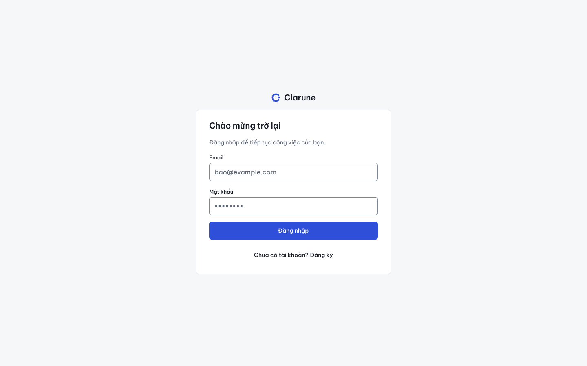

**Hình 5.1  Đăng nhập hệ thống**

### **5.1.2 Đăng ký Customer**

Nhập họ tên, email, mật khẩu và xác nhận; tài khoản tự đăng ký luôn mang vai trò CUSTOMER.

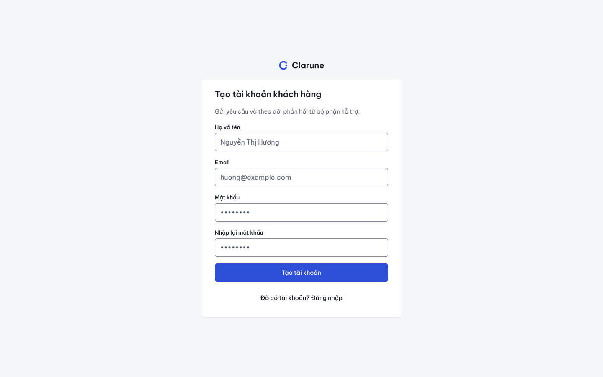

**Hình 5.2  Đăng ký Customer**

### **5.1.3 Hồ sơ cá nhân**

Xem và cập nhật thông tin được phép của chính mình; đổi mật khẩu có kiểm tra mật khẩu hiện tại.

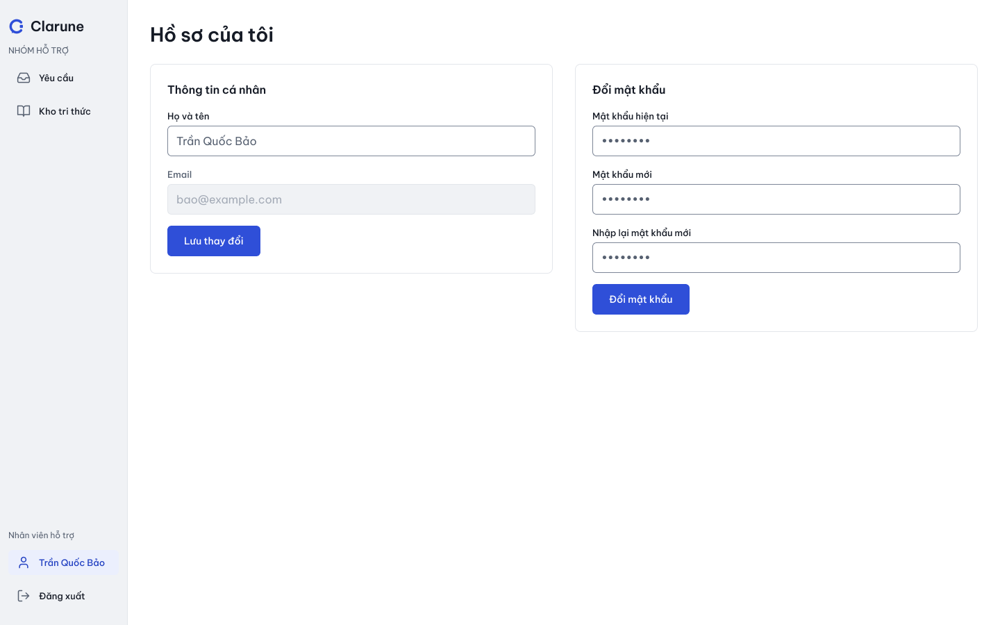

**Hình 5.3  Hồ sơ cá nhân**

### **5.1.4 Quản lý danh sách tài khoản Agent (Admin)**

Quản trị viên xem danh sách nhân viên hỗ trợ, lọc theo trạng thái hoạt động và kích hoạt/vô hiệu hóa tài khoản Agent.

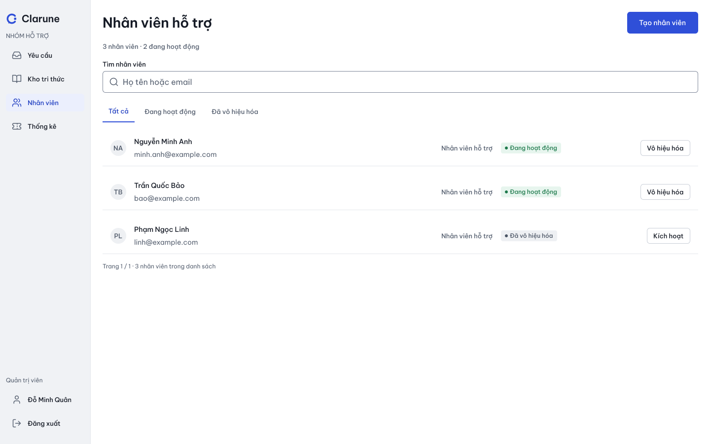

**Hình 5.4 Quản lý danh sách nhân viên (Admin)**

### **5.1.5 Tạo tài khoản Agent mới và Vô hiệu hóa tài khoản (Admin)**

Quản trị viên tạo mới tài khoản Support Agent hoặc xác nhận vô hiệu hóa tài khoản Agent (thu hồi phiên đăng nhập hiện hành).

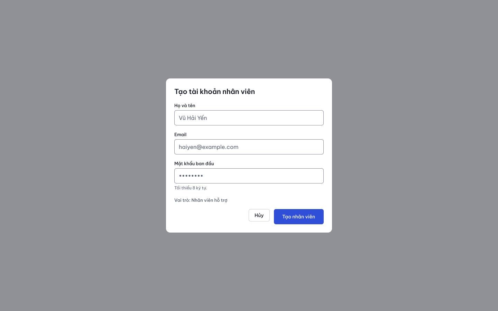

**Hình 5.5a Biểu mẫu tạo tài khoản nhân viên mới**

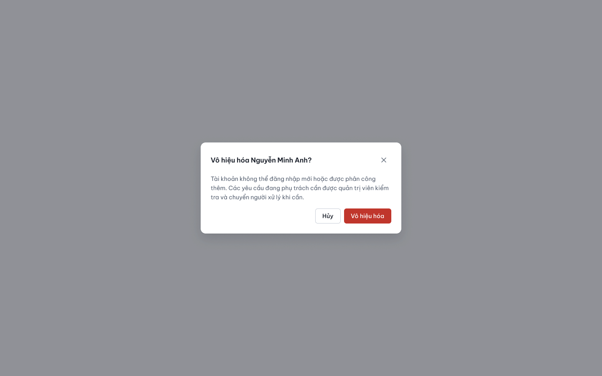

**Hình 5.5b Xác nhận vô hiệu hóa tài khoản nhân viên**

## **5.2 Giao diện Customer Portal**

### **5.2.1 Danh sách yêu cầu của tôi**

Màn hình hiển thị các yêu cầu hỗ trợ do Customer hiện tại tạo, kèm trạng thái xử lý để khách hàng theo dõi tiến độ. Người dùng có thể tìm kiếm, lọc, chuyển trang và chọn một yêu cầu để xem chi tiết.

Giao diện phân biệt các trạng thái đang tải, chưa có yêu cầu, không có kết quả phù hợp và lỗi tải dữ liệu.

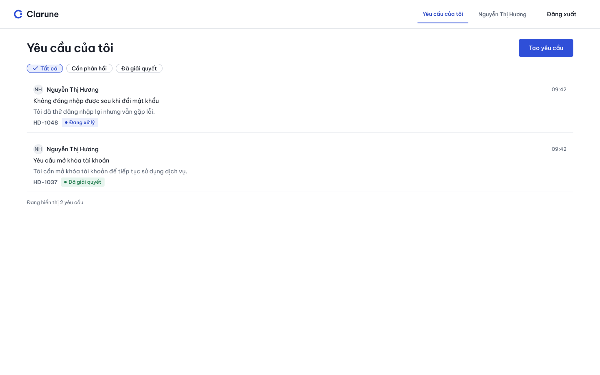

**Hình 5.6  Danh sách yêu cầu của tôi**

### **5.2.2 Tạo yêu cầu hỗ trợ**

Customer nhập tiêu đề và nội dung mô tả, sau đó chọn Gửi yêu cầu. Hệ thống kiểm tra dữ liệu và hiển thị lỗi tại nội dung cần điều chỉnh nếu thông tin không hợp lệ.

Khi tạo thành công, yêu cầu có trạng thái Mới tạo (OPEN), chưa có nhân viên phụ trách và được mở ở trang chi tiết. Nội dung mô tả xuất hiện trong hội thoại công khai đầu tiên.

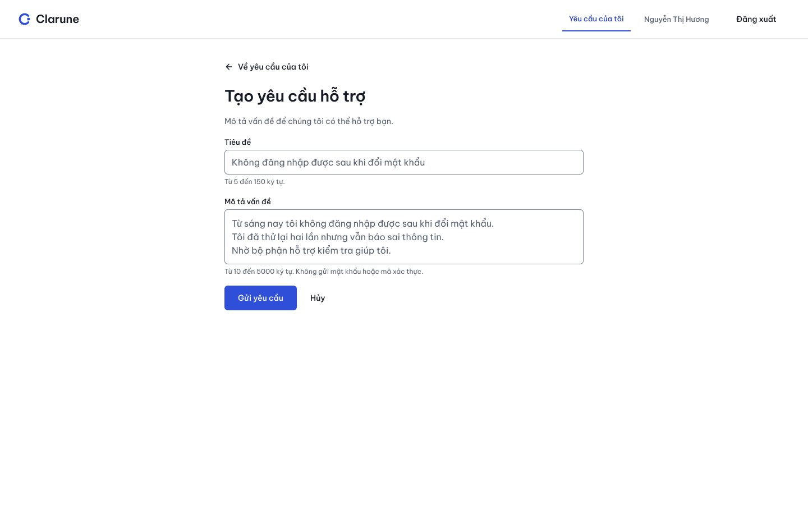

**Hình 5.7  Tạo yêu cầu hỗ trợ**

### **5.2.3 Chi tiết và hội thoại công khai**

Customer xem thông tin, trạng thái xử lý và các tin nhắn công khai của yêu cầu thuộc sở hữu của mình. Giao diện không hiển thị ghi chú INTERNAL hoặc lịch sử sự kiện nội bộ.

Khách hàng gửi phản hồi khi trạng thái yêu cầu cho phép. Nếu yêu cầu đang Chờ khách hàng phản hồi (WAITING\_CUSTOMER), việc gửi phản hồi thành công đưa yêu cầu về Đang xử lý (IN\_PROGRESS).

Khi yêu cầu chuyển sang Đã giải quyết (RESOLVED), giao diện cung cấp lựa chọn xác nhận đóng hoặc yêu cầu xử lý tiếp theo Mục 5.2.4.

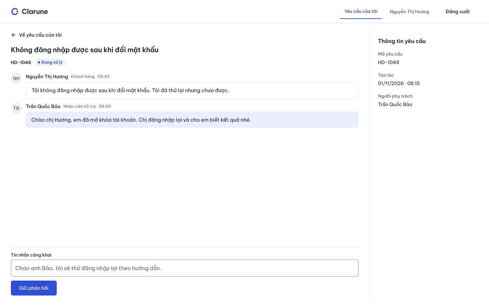

**Hình 5.8 Chi tiết và hội thoại công khai khi yêu cầu đang được xử lý**

#### **5.2.4 Xác nhận đóng hoặc mở lại yêu cầu**

Khi yêu cầu ở trạng thái Đã giải quyết (RESOLVED), Customer xem lại nội dung xử lý và lựa chọn:

\- Đóng yêu cầu (CLOSE): Xác nhận vấn đề đã được giải quyết, chuyển yêu cầu sang CLOSED.

\- Yêu cầu xử lý tiếp (REOPEN): Thông báo vấn đề chưa được giải quyết, chuyển yêu cầu về IN\_PROGRESS.

Hệ thống kiểm tra quyền sở hữu và trạng thái hiện tại trước khi thực hiện. Nếu thao tác thất bại hoặc trạng thái đã thay đổi, giao diện thông báo phù hợp và không hiển thị kết quả thành công.

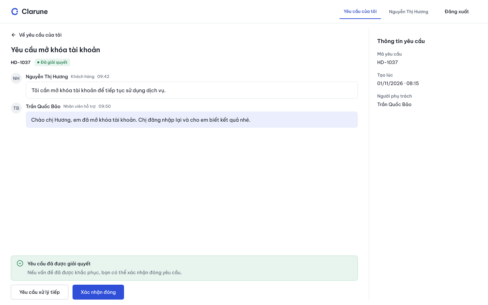

**Hình 5.9 Yêu cầu đã giải quyết, chờ Customer xác nhận đóng hoặc mở lại**

#### **5.2.5 Chi tiết yêu cầu đã đóng**

Khi yêu cầu ở trạng thái Đã đóng (CLOSED), Customer vẫn được xem thông tin và hội thoại công khai của yêu cầu thuộc sở hữu của mình.

Giao diện chuyển sang chế độ chỉ đọc, khóa ô soạn phản hồi và không cho phép gửi thêm tin nhắn hoặc mở lại yêu cầu đã đóng. Trạng thái CLOSED được hiển thị rõ để khách hàng phân biệt với yêu cầu đang chờ xác nhận giải quyết.

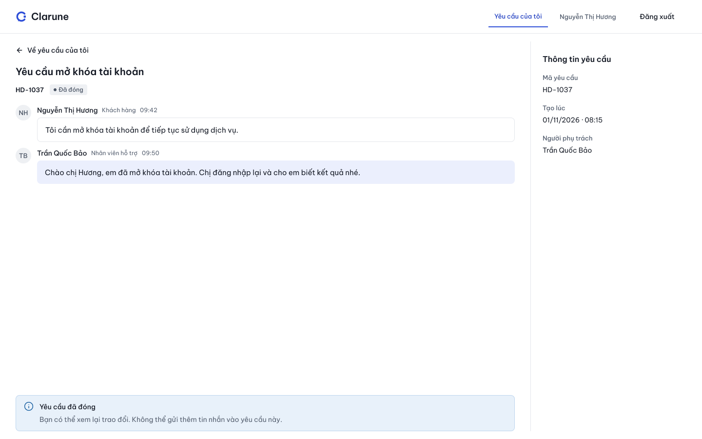

**Hình 5.10 Chi tiết yêu cầu đã đóng ở chế độ chỉ đọc**

## **5.3 Giao diện Agent Workspace**

### **5.3.1 Hàng đợi và nhận xử lý**

Hiển thị hàng đợi các ticket đang mở (OPEN), có thể chọn xem nội dung chi tiết từng ticket, có thể tìm kiếm ticket thông qua ô tìm yêu cầu; Mã ticket và trạng thái “Mới” được hiển thị rõ; Thao tác với nút “Nhận xử lý” để nhận ticket; Ticket chưa được Agent đang đăng nhập nhận thì Agent này không được soạn phản hồi → các tính năng liên quan đến xử lý ticket bị khóa (giao diện soạn phản hồi, sử dụng Trợ lý AI, xem/soạn ghi chú nội bộ).

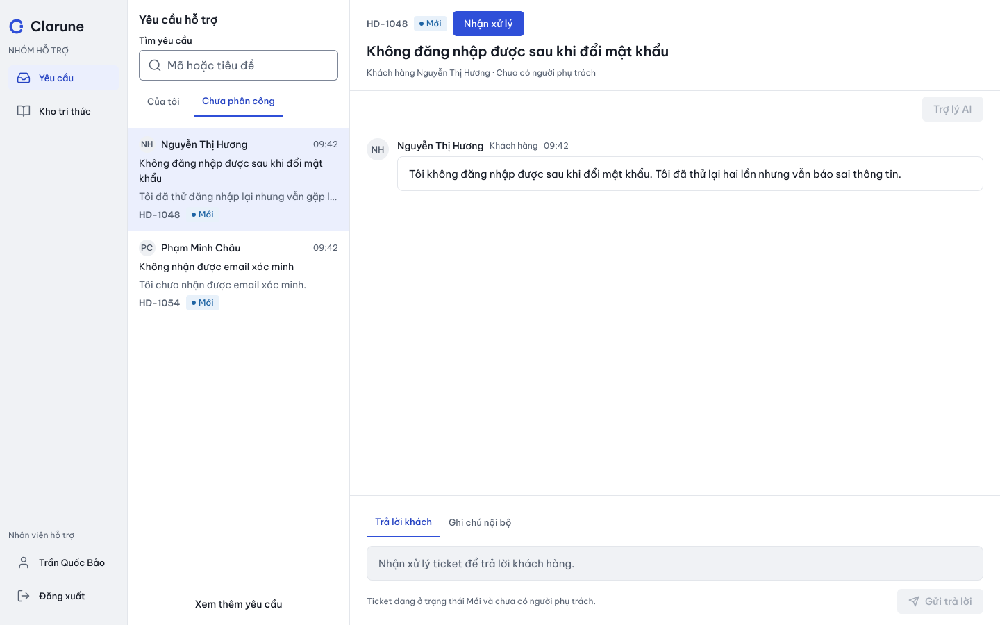

**Hình 5.11  Hàng đợi và nhận xử lý**

### **5.3.2 Xử lý ticket và ghi chú nội bộ**

Ticket đang được xử lý có thể được đánh dấu đã giải quyết hoặc yêu cầu thêm thông tin từ Customer, Agent có thể dùng tính năng Trợ lý AI để hỗ trợ xử lý ticket. Trạng thái của ticket khi này được hiển thị rõ “Đang xử lý”.

Chỉ Agent được giao ticket/Admin được tạo và xem ghi chú nội bộ. Vùng soạn ghi chú/ghi chú đã thêm được hiển thị nổi bật trên giao diện.

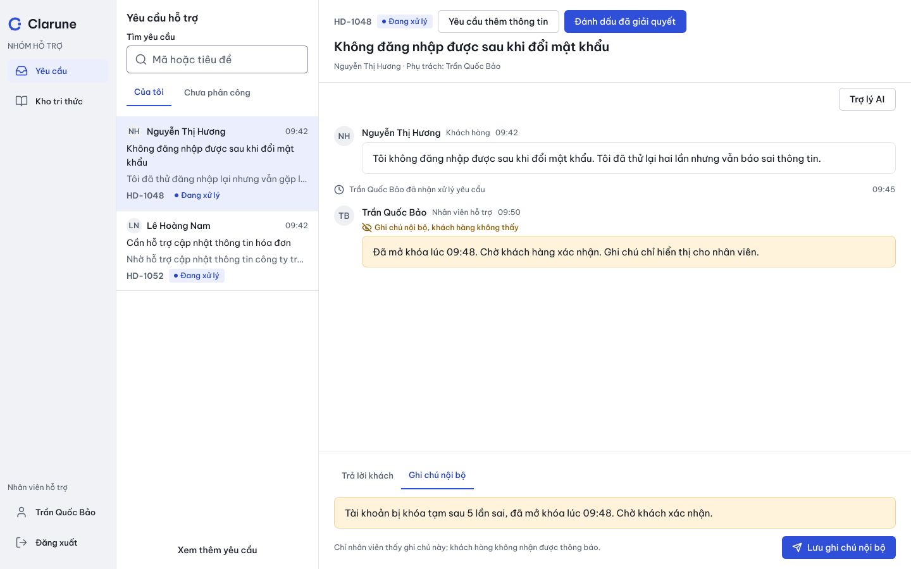

**Hình 5.12  Xử lý ticket và ghi chú nội bộ**

### **5.3.3 Xung đột nhận ticket**

Thông báo ticket đã có Agent khác nhận xử lý, thao tác với nút “Về hàng đợi” để tải lại hàng đợi ticket → Agent thua claim không được tiếp tục xử lý ticket ngoài quyền.

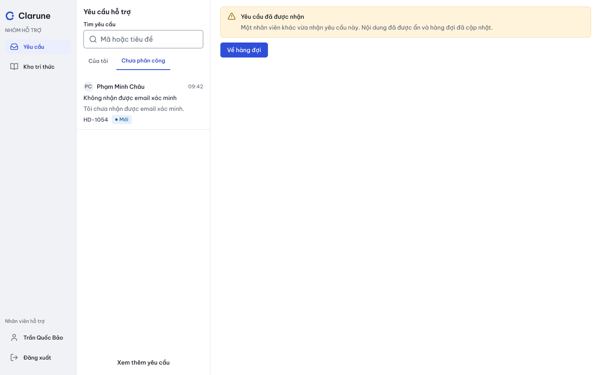

**Hình 5.13  Xung đột nhận ticket**

## **5.4 Giao diện Knowledge Base**

### **5.4.1 Tìm kiếm tri thức**

Agent/Admin tìm kiếm tài liệu

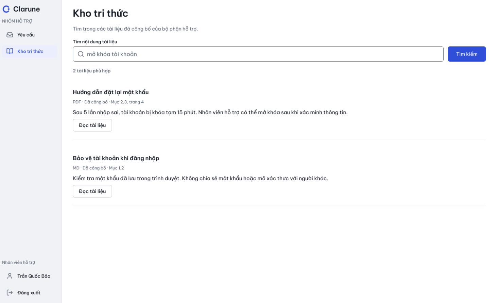

**Hình 5.14  Tìm kiếm tri thức**

### **5.4.2 Đọc tài liệu tri thức**

Hiển thị nội dung tài liệu được phép.

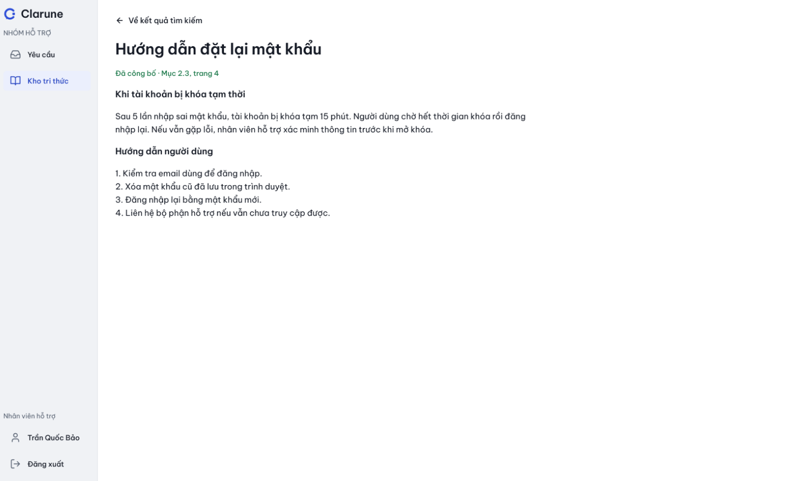

**Hình 5.15  Đọc tài liệu tri thức**

### **5.4.3 Quản trị và công bố tài liệu**

Admin xem danh mục và trạng thái; READY không đồng nghĩa đã published. Upload, publish và archive theo quyền Admin.

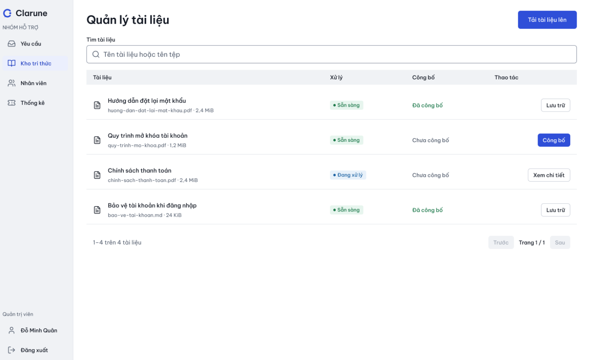

**Hình 5.16  Quản trị và công bố tài liệu**

#### **5.4.4 Tải tài liệu mới lên Knowledge Base (Upload)**

Biểu mẫu chọn tệp tài liệu (PDF/TXT/MD, giới hạn kích thước \<= 10 MiB) để đưa vào hàng đợi bóc tách và lập chỉ mục Vector bất đồng bộ.

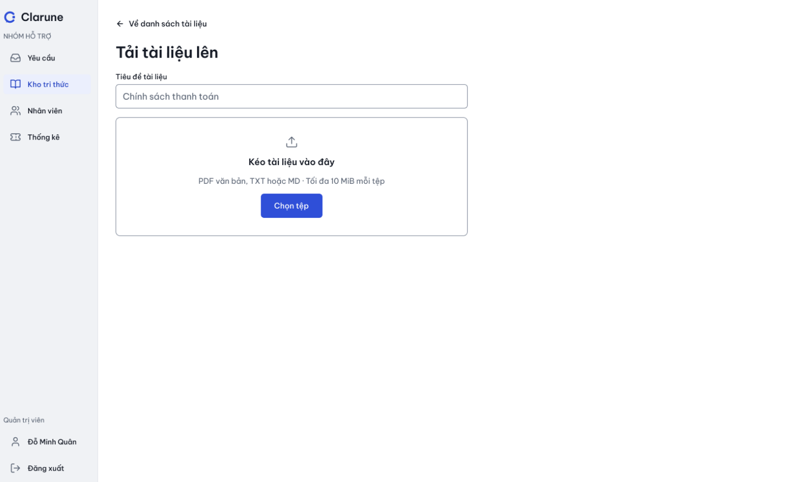

***Hình 5.17 Tải tài liệu mới lên Knowledge Base***

#### **5.4.5 Chi tiết tài liệu đã xử lý xong nhưng chưa công bố (READY — Unpublished)**

Minh họa trạng thái tài liệu đã hoàn tất bóc tách và nhúng vector nhưng đang chờ kiểm duyệt, chưa được công bố cho tìm kiếm hoặc RAG.

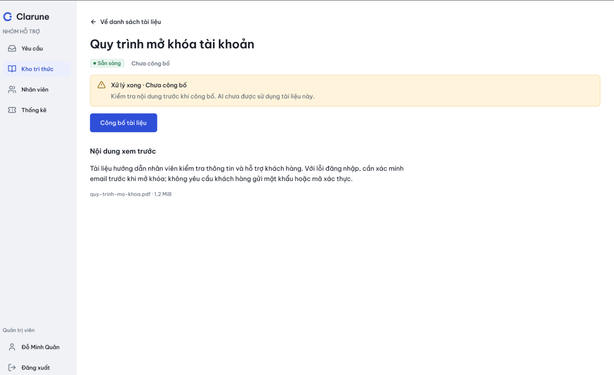

***Hình 5.18 Chi tiết tài liệu ở trạng thái sẵn sàng nhưng chưa công bố***

## **5.5 Giao diện AI và tham chiếu quản trị**

### **5.5.1 Gợi ý AI và trích dẫn**

Agent tạo gợi ý, đọc nguồn và chủ động chèn vào bản nháp để kiểm duyệt trước khi gửi. Ngăn AI có lối mở lịch sử và thao tác đánh giá gợi ý; thao tác chèn hoặc đánh giá không tự gửi phản hồi.

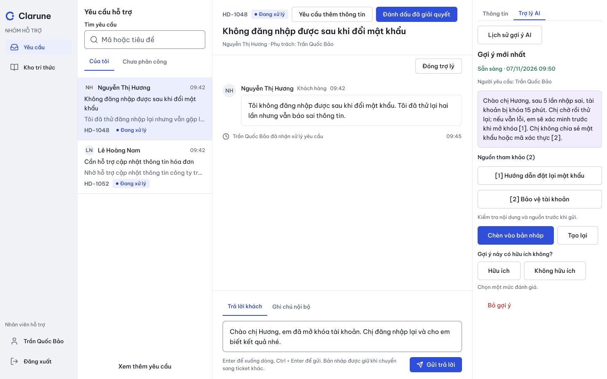

**Hình 5.19 Gợi ý AI, nguồn trích dẫn và thao tác hỗ trợ nhân viên**

### **5.5.2 Xem nguồn trích dẫn**

Người dùng mở đoạn nguồn để kiểm tra nội dung gợi ý. Bản chụp đã lưu tại thời điểm tạo được giữ nguyên, kể cả khi tài liệu nguồn hiện đã lưu trữ; quyền tải tài liệu gốc được kiểm tra riêng.

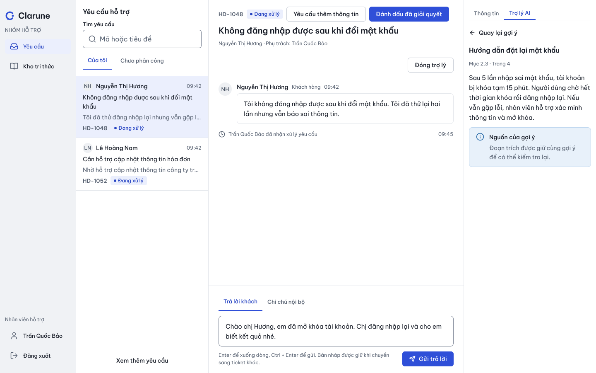

**Hình 5.20 Xem đoạn nguồn trích dẫn của gợi ý**

### **5.5.3 Danh sách yêu cầu quản trị**

Admin xem danh sách toàn bộ ticket và sử dụng bộ lọc để tìm yêu cầu cần theo dõi hoặc xử lý.

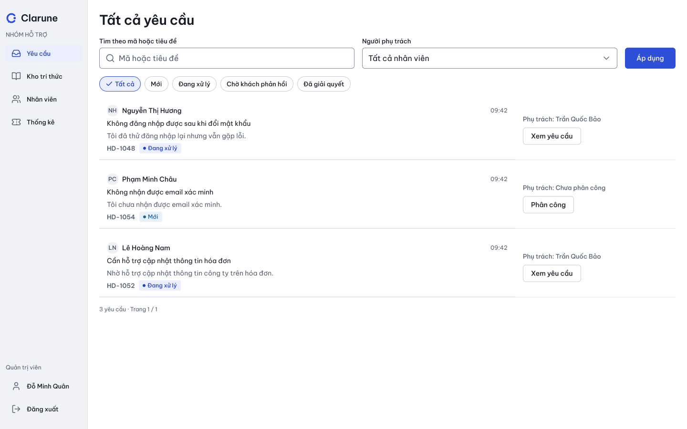

**Hình 5.21 Danh sách yêu cầu quản trị**

### **5.5.4 Xử lý, lịch sử yêu cầu và phân công nhân viên**

Quản trị viên xem toàn bộ lịch sử xử lý, bao gồm ghi chú nội bộ (INTERNAL), và thực hiện gán hoặc chuyển người phụ trách ticket.

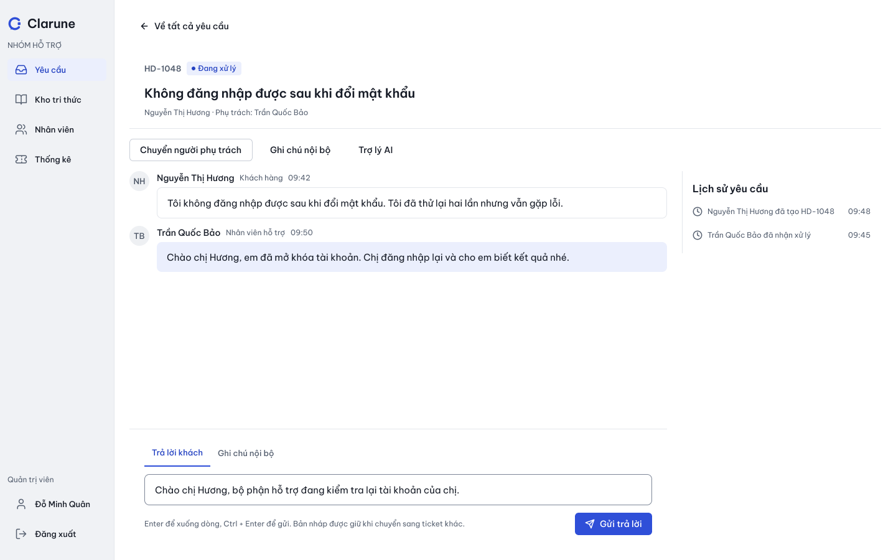

**Hình 5.22a Chi tiết xử lý và lịch sử yêu cầu (Admin — D02)**

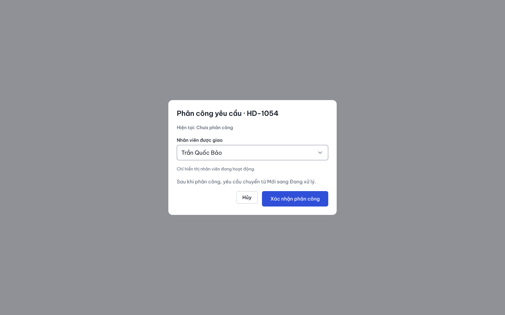

**Hình 5.22b Biểu mẫu phân công nhân viên phụ trách (Admin — D03)**

### **5.5.5 Lịch sử gợi ý AI**

Agent được giao ticket và Admin xem các lần tạo gợi ý, người yêu cầu, thời điểm và kết quả đã lưu. Người dùng chọn một lần tạo để đọc lại nội dung và bản chụp nguồn. Giao diện có các trạng thái đang tải, trống, lỗi và mất quyền.

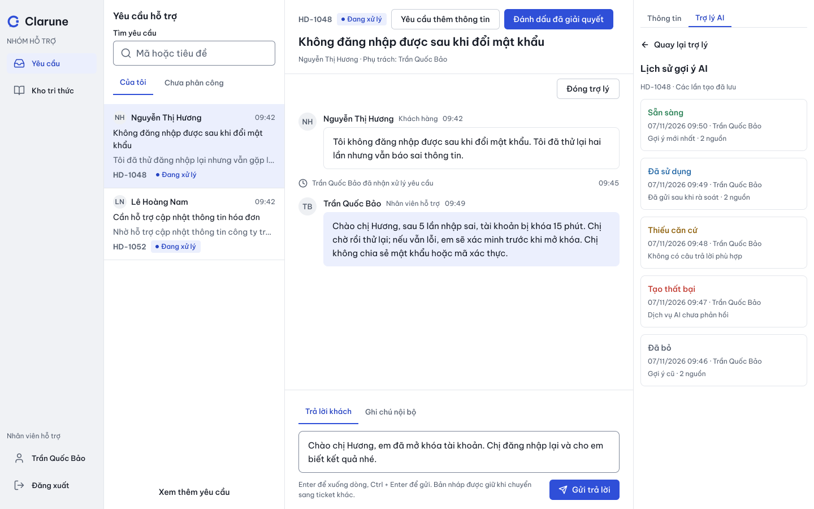

**Hình 5.23a Danh sách các lần tạo gợi ý AI**

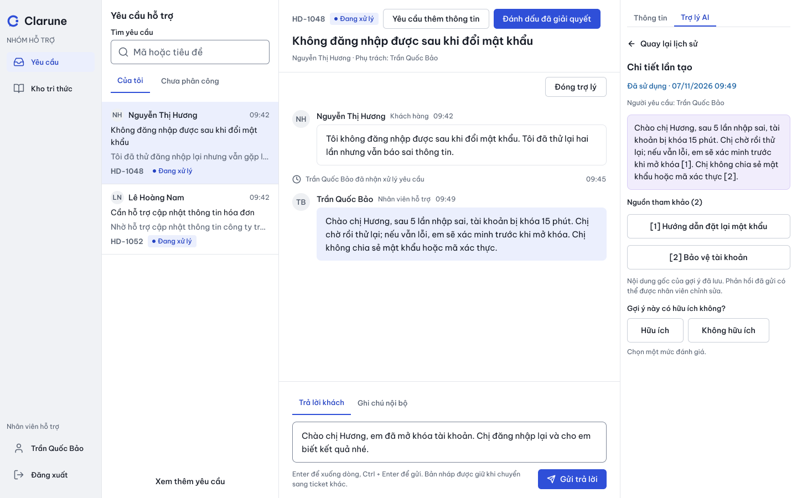

**Hình 5.23b Chi tiết gợi ý AI đã lưu**

### **5.5.6 Đánh giá gợi ý AI (P1)**

Agent được giao ticket chọn Hữu ích hoặc Không hữu ích trên gợi ý ở trạng thái GENERATED hoặc APPLIED. Giao diện hiển thị lựa chọn đã lưu, cho phép đổi lựa chọn và thử lại khi lưu lỗi. Đánh giá không tự gửi phản hồi hoặc thay đổi trạng thái gợi ý. Admin không có thao tác đánh giá.

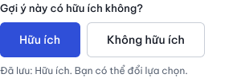

**Hình 5.24a Trạng thái đã lưu đánh giá hữu ích**

**Hình 5.24b Thông báo lỗi lưu đánh giá và thao tác thử lại**

### **5.5.7 Bỏ gợi ý và tiếp tục soạn thủ công**

Người dùng xác nhận trước khi bỏ gợi ý ở trạng thái GENERATED. Sau khi bỏ, gợi ý chuyển sang DISCARDED và vẫn được lưu trong lịch sử; bản nháp được giữ nguyên, không có phản hồi nào được gửi. Nếu bản nháp đã được chèn từ gợi ý, người dùng phải chọn Tiếp tục soạn thủ công trước khi kiểm duyệt và gửi. Việc gửi thủ công không chuyển gợi ý đã bỏ thành APPLIED.

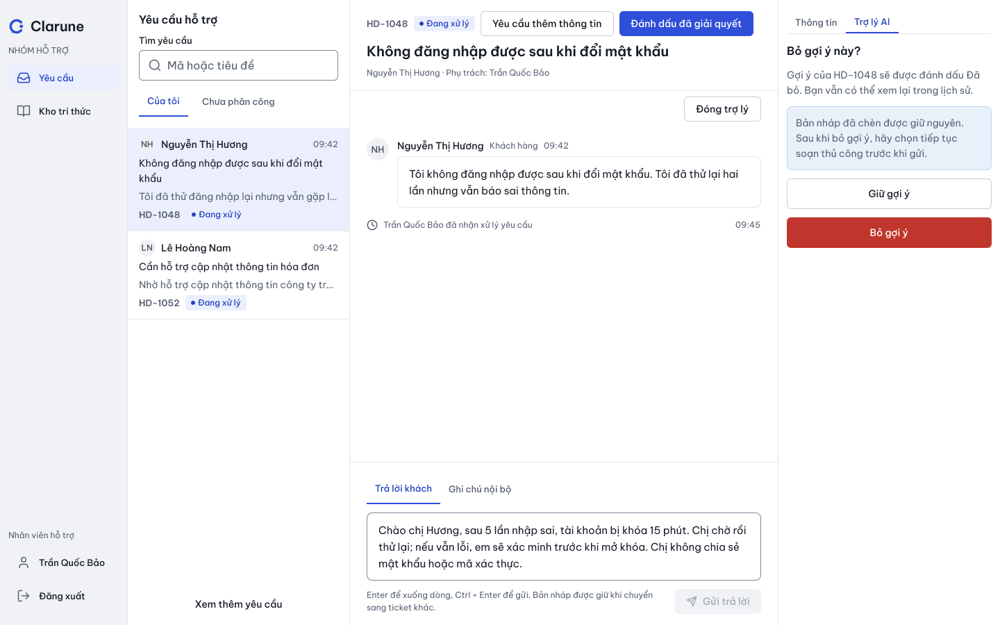

**Hình 5.25 Xác nhận bỏ gợi ý AI**

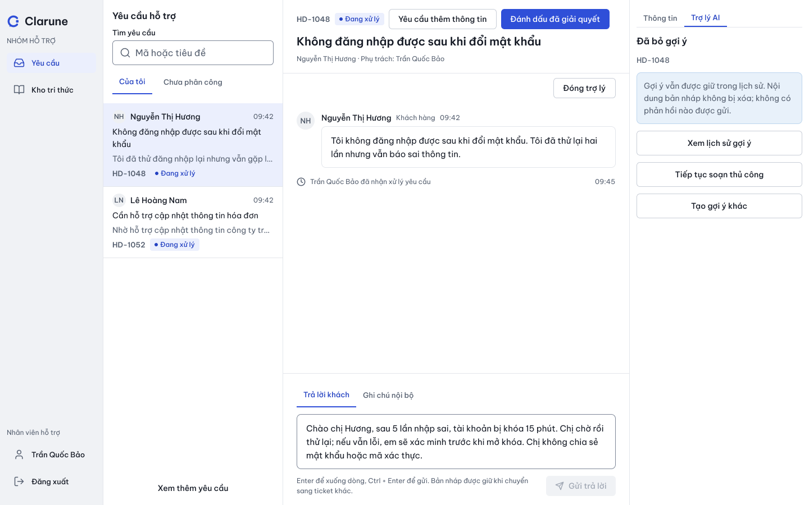

**Hình 5.26 Đã bỏ gợi ý AI và lựa chọn tiếp tục soạn thủ công**

### **5.5.8 Thống kê ticket (P1)**

Admin xem tổng số ticket, phân bố theo trạng thái và người phụ trách hiện tại, cùng thời điểm lấy dữ liệu. Ticket chưa được giao hiển thị thành nhóm riêng; nhân viên đã vô hiệu hóa vẫn được giữ trong thống kê nếu còn ticket. Tổng các nhóm trong mỗi bảng bằng tổng số ticket. Giao diện hỗ trợ tải lại dữ liệu và có các trạng thái đang tải, không có dữ liệu, lỗi và không đủ quyền.

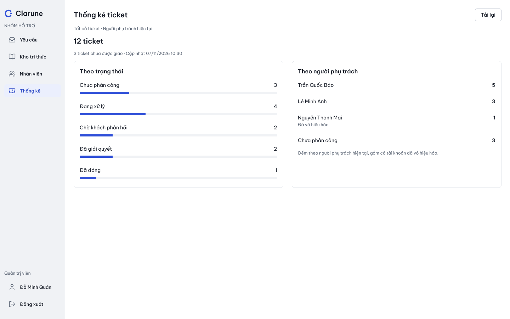

**Hình 5.27 Thống kê ticket theo trạng thái và người phụ trách**
