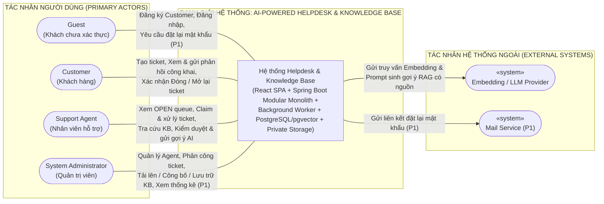
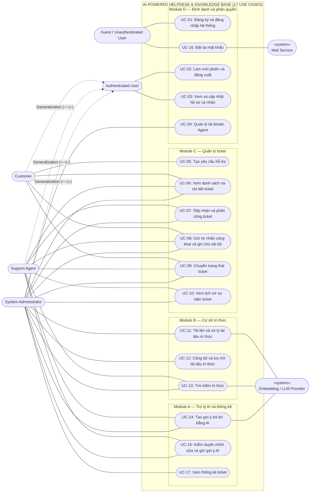
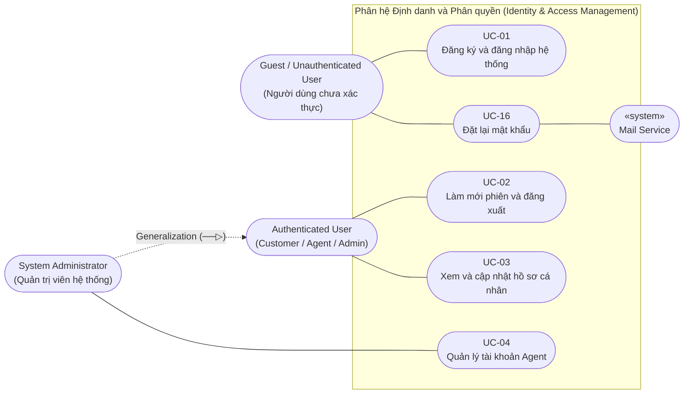
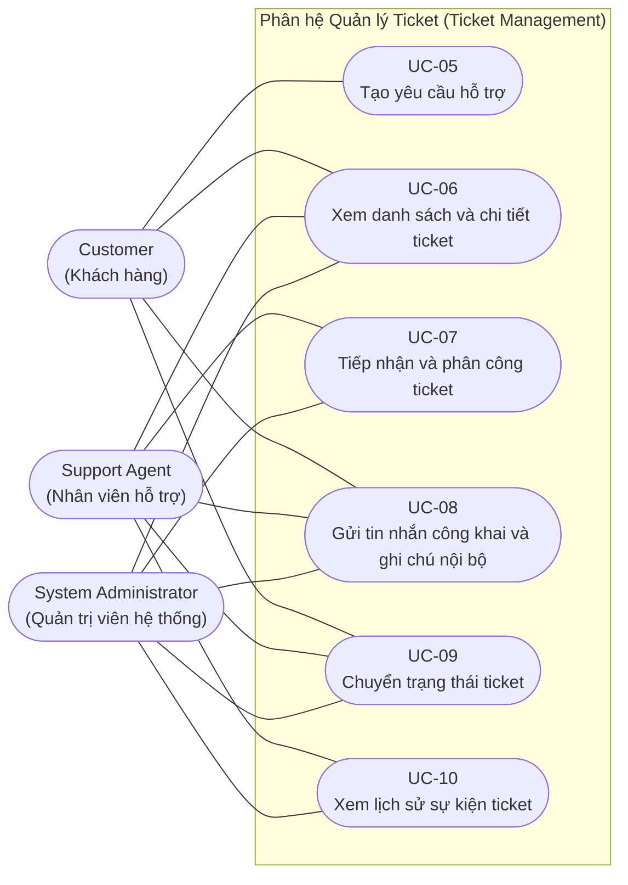
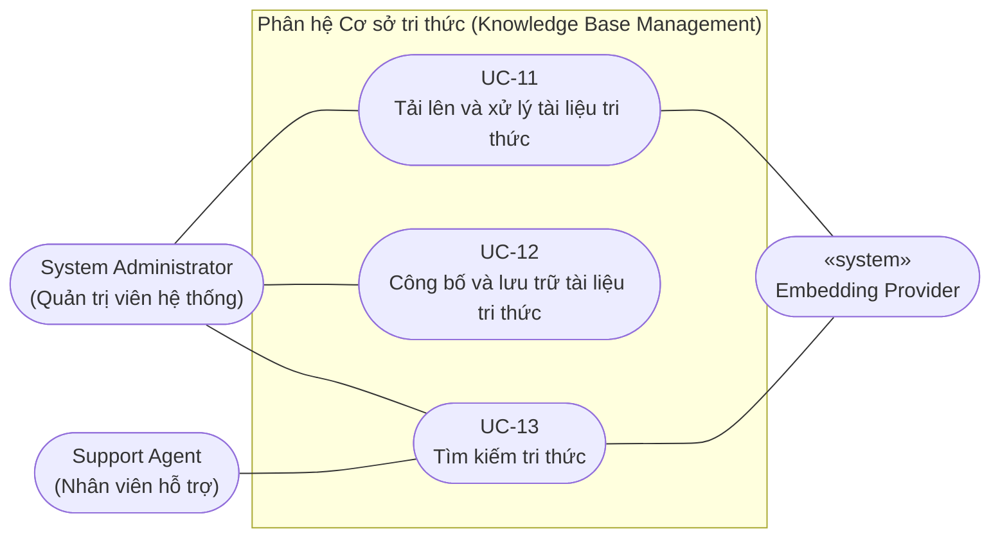
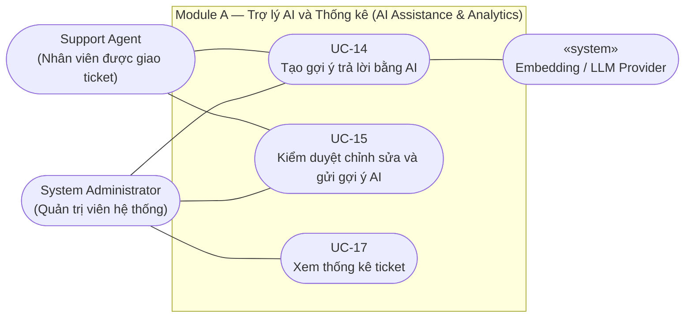

## 5. KẾ HOẠCH CHI TIẾT LUỒNG 1: BIÊN SOẠN TÀI LIỆU TEMPLATE 1 & TƯ LIỆU MẪU

Tài liệu được thiết kế theo đúng quy chuẩn mẫu giáo trình môn học HCMUS (Khoa CNTT - ĐHQG-HCM) và cấu trúc chuẩn của hai bài mẫu đạt điểm xuất sắc `Group03 (Katling)` và `Group06 (Planora)`.

### 5.1. Danh mục 19 Use Cases chuẩn hóa theo SRS-master & Clarune Docs
Thay vì tự ý chia nhỏ vụn vặt làm mất tính nguyên tử của Use Case hoặc tự vẽ thêm module không có thực, toàn bộ hệ thống bám sát **chính xác 17 Use Cases** được định nghĩa chính thức tại **Mục 3.3 của [reports/SRS-master.md](reports/SRS-master.md)** (gồm 15 Use Cases cốt lõi P0 và 2 Use Cases mở rộng P1), tương ứng trực tiếp với 30 User Stories trong Phụ lục D và 30 Functional Requirements trong Mục 4:

| Module | Mã Use Case | Tên Use Case | Tác nhân chính (Actors) | Mức độ | Người phụ trách | Dẫn chiếu SRS |
| :---: | :---: | :--- | :--- | :---: | :---: | :---: |
| **Phân hệ Định danh & Phân quyền** | **UC-01** | Đăng ký & Đăng nhập | Guest, User | P0 | Ngô Viết Thanh Bình | FR-ID-01..03, US-01..02 |
| | **UC-02** | Làm mới phiên & Đăng xuất | Authenticated User | P0 | Ngô Viết Thanh Bình | FR-ID-04..05, US-03 |
| | **UC-03** | Quản lý hồ sơ cá nhân & Đổi mật khẩu | Authenticated User | P0 | Ngô Viết Thanh Bình | FR-ID-06, US-04 |
| | **UC-04** | Quản lý nhân viên hỗ trợ | Admin | P0 | Ngô Viết Thanh Bình | FR-ID-08, US-05 |
| | **UC-16** | Đặt lại mật khẩu qua email | Guest, User | P1 | Ngô Viết Thanh Bình | FR-ID-09, US-27 |
| **Phân hệ Quản lý ticket** | **UC-05** | Tạo ticket mới | Customer | P0 | Phan Gia Phúc | FR-TK-01, US-07 |
| | **UC-06** | Xem danh sách & Chi tiết ticket | Customer, Agent, Admin | P0 | Phan Gia Phúc | FR-TK-02..03, 10; US-08, 17 |
| | **UC-07** | Nhận & Phân công ticket | Agent, Admin | P0 | Phan Gia Phúc | FR-TK-04..05, US-11..12 |
| | **UC-08** | Gửi trao đổi công khai & Ghi chú nội bộ | Customer, Agent, Admin | P0 | Phan Gia Phúc | FR-TK-06..07; US-09, 13..14 |
| | **UC-09** | Chuyển trạng thái ticket | Customer, Agent, Admin | P0 | Phan Gia Phúc | FR-TK-08, US-10, 15 |
| | **UC-10** | Xem lịch sử sự kiện ticket | Agent, Admin | P0 | Phan Gia Phúc | FR-TK-09, US-16 |
| | **UC-18** | Xem lịch sử gợi ý AI | Agent, Admin | P0 | Lê Quý Phúc | FR-AI-08, US-23 |
| | **UC-19** | Đánh giá gợi ý AI hữu ích (P1) | Agent | P1 | Lê Quý Phúc | FR-AI-07, US-30 |
| | **UC-17** | Xem thống kê ticket | Admin | P1 | Phan Gia Phúc | FR-TK-12, US-28 |
| **Phân hệ Cơ sở tri thức** | **UC-11** | Tải lên & Xử lý tài liệu | Admin, System Worker | P0 | Nguyễn Đức Lãm | FR-KB-01..05, 09; US-18..19 |
| | **UC-12** | Công bố & Lưu trữ tài liệu | Admin | P0 | Nguyễn Đức Lãm | FR-KB-06, 08; US-20 |
| | **UC-13** | Tìm kiếm tri thức theo ngữ nghĩa | Agent, Admin | P0 | Nguyễn Đức Lãm | FR-KB-07, US-21 |
| **Phân hệ Trợ lý AI & Thống kê** | **UC-14** | Tạo gợi ý câu trả lời AI | Agent, Admin | P0 | Lê Quý Phúc | FR-AI-01..06, 09; US-22..23, 26 |
| | **UC-15** | Rà soát, chỉnh sửa & Gửi phản hồi AI | Agent, Admin | P0 | Lê Quý Phúc | FR-AI-07..08, US-24..25 |

> **Phân định phạm vi rõ ràng giữa Mục 3.2.1 và Mục 4.2 của Template 1:**
> - **Mục 3.2.1 (Đặc tả yêu cầu chức năng):** Phan Gia Phúc phụ trách tổng hợp bảng **30 User Stories (`US-01` đến `US-30`)** từ Phụ lục D trong `SRS-master.md`.
> - **Mục 4.2 (Đặc tả Use Case):** Cả 4 thành viên soạn thảo chi tiết **17 bảng đặc tả Use Case chuẩn** theo mẫu 8 trường thông tin bên dưới, phân công đúng theo module phụ trách.

### 5.2. Cấu trúc chuẩn của từng bảng Đặc tả Use Case (Bắt buộc dùng form này)
Tất cả 17 Use Case trên phải được viết dưới dạng bảng Markdown chuẩn 8 trường thông tin (đồng bộ hoàn toàn với cấu trúc đặc tả tại Mục 6 của `SRS-master.md`):

| Thuộc tính | Nội dung chi tiết |
| :--- | :--- |
| **Mã Use Case** | `UC-XX` (Từ `UC-01` đến `UC-17`) |
| **Tên Use Case** | Tên hành động tiếng Việt ngắn gọn, rõ ràng (Ví dụ: *Nhận và phân công ticket*) |
| **Tóm tắt** | Mô tả tóm lược 2-3 câu về mục tiêu của ca sử dụng |
| **Tác nhân** | Tác nhân chính thực hiện (Ví dụ: *Nhân viên hỗ trợ, Quản trị viên*) |
| **Điều kiện tiên quyết** | Các điều kiện bắt buộc trước khi kích hoạt (Ví dụ: *Nhân viên đã đăng nhập, ticket đang ở trạng thái OPEN*) |
| **Kết quả** | Trạng thái hệ thống và dữ liệu sau khi thực hiện thành công |
| **Kịch bản chính** | Các bước tuần tự đánh số: 1, 2, 3, 4, 5... từ khi tác nhân tương tác đến khi nhận phản hồi |
| **Kịch bản phụ** | Các trường hợp lỗi hoặc luồng rẽ nhánh: 2.1, 3.1, 4.1... (Ví dụ: *4.1 Ticket đã bị nhân viên khác nhận trước -> trả về lỗi 409 Conflict*) |
| **Ràng buộc & Quy tắc nghiệp vụ** | Quy tắc nghiệp vụ liên quan (`BR-xx`), yêu cầu hiệu năng, tính nguyên tử transaction, bảo mật... |

---

---

## 6. BỘ SƠ ĐỒ UML TOÀN DIỆN & QUY CHUẨN ĐỒNG NHẤT TOÀN NHÓM (6 SƠ ĐỒ CHUẨN SRS & GOOGLE DOCS)

Cấu trúc chuẩn của hệ thống gồm **đúng 4 module chức năng (17 Use Cases từ `UC-01` đến `UC-17`)** bám sát 100% `SRS-master.md` và tài liệu làm việc chung Google Docs (`NMCNPM - Clarune - 04`). Hệ thống gồm **6 sơ đồ chuẩn**:

```
[BỘ 6 SƠ ĐỒ ĐẶC TẢ YÊU CẦU MÔN NMCNPM — NHÓM 04]
├── Sơ đồ 0: Sơ đồ bối cảnh hệ thống (Hình 3.1 - Mục 3.1.1 — Phụ trách: Nguyễn Đức Lãm)
├── Sơ đồ 1: Sơ đồ Use Case tổng thể 17 Use Cases (Hình 4.1 - Mục 4.1.1 — Phụ trách: Ngô Viết Thanh Bình)
├── Sơ đồ 2: Sơ đồ Use Case Module D - Định danh và phân quyền (Hình 4.2 - Mục 4.1.2 — Phụ trách: Ngô Viết Thanh Bình)
├── Sơ đồ 3: Sơ đồ Use Case Module C - Quản lý ticket (Hình 4.3 - Mục 4.1.3 — Phụ trách: Phan Gia Phúc)
├── Sơ đồ 4: Sơ đồ Use Case Module B - Cơ sở tri thức (Hình 4.4 - Mục 4.1.4 — Phụ trách: Nguyễn Đức Lãm)
└── Sơ đồ 5: Sơ đồ Use Case Module A - Trợ lý AI và thống kê (Hình 4.5 - Mục 4.1.5 — Phụ trách: Lê Quý Phúc)
```

> [!IMPORTANT]
> **QUY CHUẨN BẮT BUỘC KHI VẼ SƠ ĐỒ USE CASE (UML 2.5 — TÔNG TRẮNG ĐEN HỌC THUẬT):**
> Để 5 sơ đồ Use Case khi ghép vào Google Docs và Markdown đồng nhất tuyệt đối như do một người vẽ, toàn bộ thành viên tuân thủ **4 quy tắc bất di bất dịch** sau:
>
> 1. **Quy tắc 1 — Ánh xạ 1:1 với 17 mã Use Case (`UC-01` đến `UC-17`) trong Mục 4.2:**
>    - Mỗi hình Elip trên sơ đồ **BẮT BUỘC** tương ứng 1:1 với 1 bảng đặc tả trong Mục 4.2.
>    - Nhãn trong mỗi hình Elip gồm 2 dòng: Dòng 1 in đậm mã **`UC-xx`**, dòng 2 ghi đúng **Tên Use Case** trong Mục 4.2.
>    - **TUYỆT ĐỐI KHÔNG** vẽ các bước kiểm tra kỹ thuật nội bộ (như *"Kiểm tra chính sách mật khẩu"*, *"Ghi nhận sự kiện tự động"*, *"Kiểm tra khóa tránh nhận trùng"*, *"Trích xuất văn bản"*, *"Chia nhỏ đoạn văn bản"*, *"Kiểm chứng trích dẫn"*) thành hình Elip rời rồi nối `«include»` / `«extend»`. Đó là lỗi phân rã chức năng (*Functional Decomposition*) và làm lệch số lượng Use Case so với SRS.
>    - **Không dùng viền nét đứt cho hình Elip** (kể cả các chức năng P1 như `UC-16`, `UC-17`). Mọi Use Case chuẩn UML đều vẽ bằng **Elip viền nét liền**.
>
> 2. **Quy tắc 2 — Tông màu Trắng - Đen (Monochrome UML) dễ quan sát, chuẩn báo cáo học thuật:**
>    - Nền tất cả các hình (System Boundary, Elip Use Case, Actor): **Trắng (`#FFFFFF`)**.
>    - Đường viền và dây nối: **Đen (`#000000`)**, độ dày nét `1.5 pt`, không đổ bóng (No Shadow), không tô màu sặc sỡ.
>    - Font chữ: `Arial` hoặc `Segoe UI`, cỡ chữ `12–13 pt`, màu đen.
>
> 3. **Quy tắc 3 — Vị trí Tác nhân (Actor) và Ranh giới hệ thống (System Boundary):**
>    - **System Boundary:** Khung chữ nhật đứng bao quanh các hình Elip của phân hệ, tiêu đề đặt ở chính giữa phía trên bên trong khung.
>    - **Tác nhân chính (Primary Actors):** Vẽ bằng ký hiệu **Stickman (Hình người que)** đặt ở **bên trái** ngoài khung hệ thống.
>    - **Tác nhân phụ / Hệ thống ngoài (Secondary Actors):** Đặt ở **bên phải** ngoài khung hệ thống, có stereotype `«system»` (VD: `«system» Mail Service`, `«system» Embedding / LLM Provider`).
>    - **Lưu ý quan trọng theo Mục 3.1.1:** `System Worker`, `Database (PostgreSQL + pgvector)` và `Private Storage` là **thành phần nội bộ của hệ thống**, **TUYỆT ĐỐI KHÔNG** vẽ thành Actor bên ngoài ranh giới hệ thống!
>
> 4. **Quy tắc 4 — Chuẩn ký hiệu Đường nối UML 2.5 trên Draw.io:**
>    - **Association (Actor ─── Use Case):** Đường thẳng **nét liền, KHÔNG có đầu mũi tên**.
>    - **Generalization / Kế thừa (Actor con ──▷ Actor cha):** Đường thẳng **nét liền, đầu mũi tên tam giác rỗng** trỏ về Actor cha (KHÔNG dùng nét đứt và KHÔNG ghi chữ *"Kế thừa"* đè lên dây).
>    - **Chỉ dùng `«include»` / `«extend»` khi cả 2 đầu mũi tên đều là các Use Case có mã `UC-xx` thật trong SRS** (ví dụ ở Module A: `UC-15` có thể độc lập hoặc nối với `UC-14`; ở Module D, C, B các Use Case đều là các mục tiêu độc lập nên nối trực tiếp với Actor, không ép buộc dùng `«include»` giả tạo).
>
> 📁 **TÀI LIỆU & BỘ FILE MẪU THAM KHẢO BẮT BUỘC CHO CÁC THÀNH VIÊN:**
> 1. **Kho bài mẫu xuất sắc khóa K23 (Google Drive):** [Mở thư mục Template tham khảo K23](https://drive.google.com/drive/folders/1Vk7wPTVLxhoxhTLnqAhIQlQxfslToMGU?usp=sharing) *(Dùng để tham khảo bố cục trình bày báo cáo, cách đặt tên hình và phong cách sơ đồ trắng-đen học thuật; lưu ý không lặp lại lỗi lạm dụng `«include»` cho các bước nhập liệu nhỏ).*
> 2. **Bộ 6 Sơ đồ chuẩn (`.drawio`, `.svg`, `.png`) đã được Trưởng nhóm dựng sẵn tại:** [`reports/template1/assets/diagrams/`](reports/template1/assets/diagrams/)
>    - **Cách sử dụng cho các thành viên (Phan Gia Phúc, Nguyễn Đức Lãm, Lê Quý Phúc):**
>      * Có thể dùng ngay các file `.png` / `.svg` tương ứng trong `reports/template1/assets/diagrams/` để chèn vào Google Docs ([NMCNPM - Clarune - 04](https://docs.google.com/document/d/1vSMrk5GCPtOlhbWMRMqZvDq8575tSIz2IXgcp-K0WAg/edit?tab=t.p8jvgjthj2me)) và file Markdown.
>      * Nếu cần tinh chỉnh thêm chi tiết, mở trực tiếp file `.drawio` của phân hệ mình trên **app.diagrams.net (Draw.io)** để sửa trên đúng khung chuẩn, giữ nguyên tông Trắng - Đen (`#FFFFFF` / `#000000`), font chữ và kích thước hình Elip để cả 6 sơ đồ trong báo cáo đồng nhất 100%.

---

### SƠ ĐỒ 0: Sơ đồ bối cảnh hệ thống (Context Diagram — Hình 3.1, Mục 3.1.1)
- **Phụ trách:** Nguyễn Đức Lãm
- **File chuẩn:** `reports/template1/assets/diagrams/context_diagram_system.drawio` | `.svg` | `.png`
- **Nguyên tắc theo Mục 3.1.1:** `Worker`, `PostgreSQL + pgvector` và `Private Storage` nằm **bên trong** ranh giới hệ thống, không phải Actor ngoài.



---

### SƠ ĐỒ 1: Sơ đồ Use Case tổng thể 19 Use Cases (Hình 4.1, Mục 4.1.1)
- **Phụ trách:** Ngô Viết Thanh Bình
- **File chuẩn:** `reports/template1/assets/diagrams/uc_overall_17_usecases.drawio` | `.svg` | `.png`
- **Nguyên tắc theo Mục 4.1.1:** Hiển thị đầy đủ **19 Use Cases (`UC-01` đến `UC-19`)** chia theo 4 phân hệ bên trong ranh giới hệ thống. `Customer`, `Support Agent`, `System Administrator` kế thừa khả năng thao tác phiên (`UC-02`) và hồ sơ (`UC-03`) của `Authenticated User`.



---

### SƠ ĐỒ 2: Phân hệ Định danh và phân quyền (Hình 4.2, Mục 4.1.2)
- **Phụ trách:** Ngô Viết Thanh Bình
- **File chuẩn:** `reports/template1/assets/diagrams/uc_module_d_identity.drawio` | `.svg` | `.png`
- **Ánh xạ 1:1 với Mục 4.2.1 – 4.2.5:** Gồm đúng 5 Use Cases (`UC-01`, `UC-16`, `UC-02`, `UC-03`, `UC-04`). Không vẽ các bước kiểm tra mật khẩu hay thu hồi phiên thành Use Case phụ.



---

### SƠ ĐỒ 3: Phân hệ Quản lý ticket (Hình 4.3, Mục 4.1.3)
- **Phụ trách:** Phan Gia Phúc
- **File chuẩn tham khảo:** `reports/template1/assets/diagrams/uc_module_c_ticketing.drawio` | `.svg` | `.png`
- **Ánh xạ 1:1 với Mục 4.2.6 – 4.2.11:** Gồm đúng **6 Use Cases (`UC-05`, `UC-06`, `UC-07`, `UC-08`, `UC-09`, `UC-10`)**.
  - Lưu ý: `UC-07` đã gộp cả Luồng A (Agent Claim) và Luồng B (Admin Assign/Reassign); `UC-08` đã gộp cả Luồng A (Public Message) và Luồng B (Internal Note); `UC-17 (Xem thống kê ticket)` thuộc Module A (Mục 4.1.5), không vẽ lặp ở Module C.
  - Không vẽ các bước kỹ thuật nội bộ (`RecordEvent`, `ConcurrencyCheck`) thành hình Elip rời.



---

### SƠ ĐỒ 4: Phân hệ Cơ sở tri thức (Hình 4.4, Mục 4.1.4)
- **Phụ trách:** Nguyễn Đức Lãm
- **File chuẩn tham khảo:** `reports/template1/assets/diagrams/uc_module_b_kb.drawio` | `.svg` | `.png`
- **Ánh xạ 1:1 với Mục 4.2.12 – 4.2.14:** Gồm đúng **3 Use Cases (`UC-11`, `UC-12`, `UC-13`)**.
  - Lưu ý quan trọng: Theo Mục 2.3 và 3.1.1, chỉ **Admin** có quyền Upload (`UC-11`) và Publish/Archive (`UC-12`); cả **Support Agent** và **Admin** đều có quyền Tìm kiếm tri thức (`UC-13`).
  - `Worker` là thành phần nội bộ thực thi bên trong `UC-11`, **không vẽ `System Worker` làm Actor ngoài** và không tách các bước `Extract`, `Chunk`, `Embed` thành Use Case rời. Tác nhân phụ bên phải là `«system» Embedding Provider`.



---

### SƠ ĐỒ 5: Phân hệ Trợ lý AI và thống kê (Hình 4.5, Mục 4.1.5)
- **Phụ trách:** Lê Quý Phúc
- **File chuẩn tham khảo:** `reports/template1/assets/diagrams/uc_module_a_ai_analytics.drawio` | `.svg` | `.png`
- **Ánh xạ 1:1 với Mục 4.2.15 – 4.2.17:** Gồm đúng **3 Use Cases (`UC-14`, `UC-15`, `UC-17`)**.
  - Lưu ý: Không vẽ các bước xử lý nội bộ của pipeline RAG (`RetrieveContext`, `VerifyCitation`, `Abstain`) thành các hình Elip rời. Tác nhân phụ bên phải là `«system» Embedding / LLM Provider` kết nối với `UC-14`.



---

---

